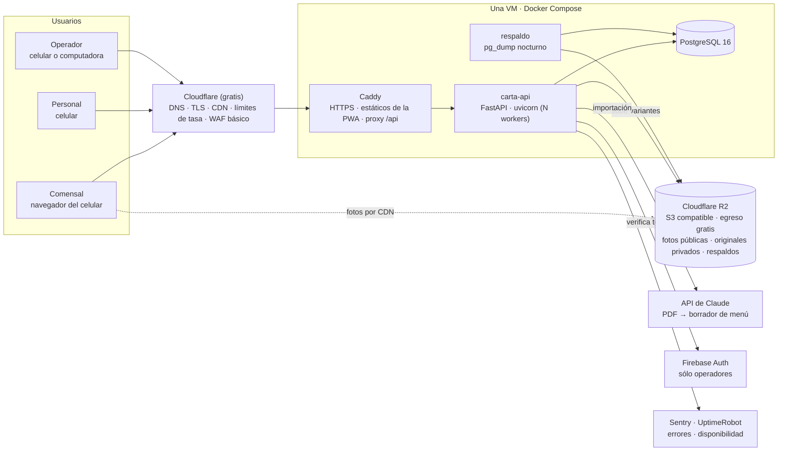
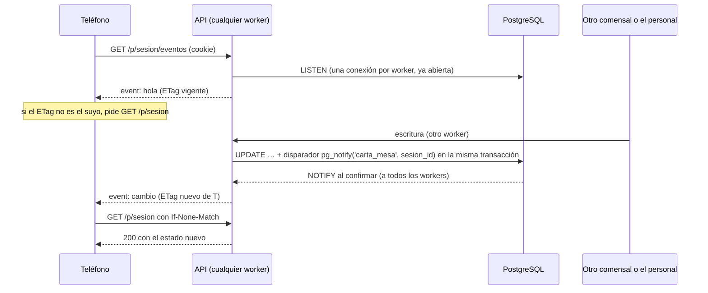
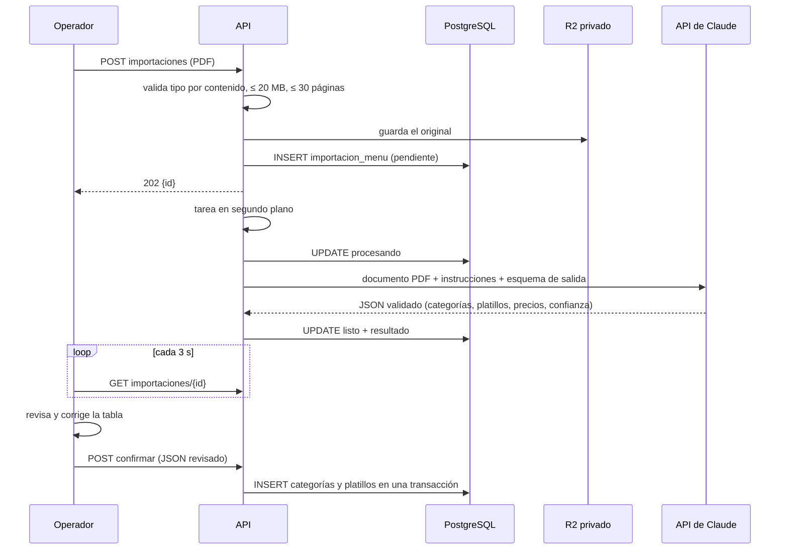

# Carta v1 — Arquitectura

**Versión:** 1.0 · **Fecha:** 2 de noviembre de 2026 · **ADRs:** [012](../mvp/adr/ADR-012-un-servidor-portable.md), [013](../mvp/adr/ADR-013-personal-con-pin.md), [014](../mvp/adr/ADR-014-importacion-menu-con-llm.md); [017](../mvp/adr/ADR-017-el-personal-lleva-el-ciclo.md) (ciclo de la mesa) y [018](../mvp/adr/ADR-018-entrega-por-eventos.md) (entrega por eventos; sustituye a [004](../mvp/adr/ADR-004-sondeo-vs-websockets.md) desde el 13 de noviembre de 2026); siguen vigentes [001](../mvp/adr/ADR-001-monolito.md), [002](../mvp/adr/ADR-002-pwa-vs-nativa.md), [003](../mvp/adr/ADR-003-identidad-invitado.md) (enmendada por 017), [008](../mvp/adr/ADR-008-esquema-espanol.md), [009](../mvp/adr/ADR-009-driver-async.md), [010](../mvp/adr/ADR-010-hosting-frontend.md).

---

## 1. Principios

1. **Un servidor, una imagen, una base.** Todo corre en una máquina virtual con Docker Compose. Lo que se agrega después se agrega porque un número lo pidió (§11).
2. **Portable.** La aplicación no usa ningún SDK propietario de nube: PostgreSQL, almacenamiento compatible con S3 y variables de entorno. La misma imagen corre en la VM, en Cloud Run o en ECS.
3. **Las lecturas no tocan el servidor.** El menú es público y cacheable en el borde (Cloudflare); el estado de la mesa llega por aviso (ADR-018) y el teléfono sólo lo pide cuando cambió; esa lectura responde `304` sin ir a la base si ya está al día. Una ola de tráfico (el video viral de Alerta Roja MX) la absorbe el borde; las escrituras están acotadas por las mesas físicas.
4. **Costo determinista.** Una VM cuesta lo mismo con 10 que con 10,000 visitas. Nada de facturas sorpresa en una fase donde no hay ingresos.
5. **Operable por una persona desde el teléfono.** Panel de administración, monitoreo y despliegue accesibles sin computadora.
6. **Confianza desde el primer día.** Dominio propio con HTTPS, página de quién está detrás, aviso de privacidad.

---

## 2. Diagrama

**Dos entornos en una VM:** `staging` y `prod` como dos stacks de Compose (puertos distintos, bases distintas en la misma instancia de PostgreSQL, subdominios distintos). Cada push a `master` despliega staging; cada etiqueta `v*` promueve la misma imagen a prod.

---

## 3. Stack

| Capa | Elección | Por qué |
|---|---|---|
| Lenguaje y API | Python 3.12 · FastAPI · SQLAlchemy 2 async · asyncpg · Alembic · Pydantic v2 · `uv` | Ya decidido en el paquete MVP; `uv` sustituye a pip/venv por velocidad y bloqueo de versiones |
| Calidad | `ruff` (lint **y** formato) · `mypy` · `pytest` | Un solo formateador; `black` se retira |
| Base de datos | PostgreSQL 16 en la misma VM (contenedor con volumen) | Transacciones ACID entre sesión, orden y comanda; cero costo adicional |
| Archivos | Cloudflare R2 (API S3) · en desarrollo, carpeta local o MinIO | 10 GB gratis y **egreso gratis**: las fotos son lo que más tráfico genera |
| Frontend | Vite · React 18 · TypeScript · una SPA con tres áreas (`/m`, `/staff`, `/admin`) con *code splitting* · PWA | El prototipo ya está en React; tres áreas en un build evitan tres pipelines |
| Servidor web | Caddy 2 | HTTPS automático, sirve los estáticos, proxy a la API, cabeceras de seguridad en 10 líneas |
| Borde | Cloudflare plan gratuito (proxy naranja) | DNS, TLS, caché del menú y estáticos, límites de tasa, protección DDoS |
| Autenticación | Comensal: JWT de invitado en cookie (ADR-003) · Personal: PIN → cookie de 12 h (ADR-013) · Operador: Firebase Auth (Google y enlace por correo) | Tres audiencias, tres mecanismos, ninguno comparte credenciales |
| IA | API de Claude: `claude-opus-5-5` con documento PDF y salida estructurada | Ver §7 |
| Correo | Resend (3,000 correos/mes gratis) | Enlaces de acceso del operador y avisos |
| Monitoreo | Sentry (gratis) · UptimeRobot (gratis) · logs JSON con `request_id` | Ver 05 |
| CI/CD | GitHub Actions → imagen en GHCR → `ssh` a la VM → `docker compose pull && up` | Sin agentes ni runners propios |
| Infraestructura como código | `deploy/` con `docker-compose.prod.yml`, `Caddyfile`, `cloud-init.yml` para crear la VM | Terraform de GCP se archiva en `deploy/etapa2-gcp/` para la Etapa 2 |

**Qué se retira del TDD de agosto:** Redis/Memorystore (caché e idempotencia van en proceso y en PostgreSQL), Cloud Run y Cloud SQL (Etapa 2), VPC y conector, worker 3D y cola, conversión USDZ, `black`.

---

## 4. Cómo se sirve cada cosa

| Petición | Ruta | Quién responde | Caché |
|---|---|---|---|
| PWA y estáticos | `/`, `/m/*`, `/staff/*`, `/admin/*`, `/assets/*` | Caddy desde `frontend/dist` | Cloudflare 1 año (nombres con hash); `index.html` sin caché |
| Menú público | `GET /api/v1/p/menu/{slug}` | API, **sin cookie**, `Cache-Control: public, max-age=30, s-maxage=30` + `ETag` | Cloudflare 30 s (AC-04.4: ninguna copia anterior a un cambio vive más de 30 s, y el comensal vuelve a pedir el menú cada 25 s); purga por API al editar el menú (en segundo plano, agrupada; T-1.3). El `ETag` lleva la versión del contenido y la ruta no rellena el borde con caché local de otra generación |
| Fotos de platillos | `https://img.<dominio>/...` | R2 detrás de Cloudflare | 1 año, nombres inmutables por hash |
| Línea de avisos del comensal | `GET /api/v1/p/sesion/eventos` (`text/event-stream`, abierta mientras se ve la página) | API; `hola` con la versión, `cambio` por cada aviso de `LISTEN/NOTIFY`, latido tras 25 s de silencio, cierre a los 10 min ± 20 % (§6) | Nunca en el borde (`no-store, no-transform`); regla de Cloudflare sin búfer si hace falta (ADR-018) |
| Línea de avisos del personal | `GET /api/v1/op/eventos` | API; igual, por restaurante | Igual |
| Línea de avisos del panel del dueño | `GET /api/v1/admin/eventos`, con el pase de línea (`POST /admin/restaurantes/{rid}/linea`, cookie `HttpOnly; Secure; SameSite=Strict`, vida corta; F3-2, ADR-018 §9) | API; igual, por restaurante; el pase sólo abre esta ruta | Igual |
| Estado del comensal | `GET /api/v1/p/sesion` con `If-None-Match`, **al recibir un aviso**, al reconectar, al volver a primer plano y como respaldo (§6) | API; `304` si el ETag coincide (ETag en memoria 60 s, invalidado por `NOTIFY` en todos los workers) | Nunca en el borde (`Cache-Control: private, no-store`) |
| Estado del personal | `GET /api/v1/op/mesas` con `If-None-Match`, igual | API; igual | Igual |
| Escrituras | `POST/PATCH/DELETE` | API → PostgreSQL | — |
| Importación de PDF | `POST /api/v1/admin/.../importaciones` | API encola en `importacion_menu`; un *task* en proceso llama a la API de Claude | — |

El menú se sirve **por `slug` del restaurante y sin depender de la cookie** justamente para que el borde pueda cachearlo. La sesión del comensal sólo necesita el menú para precios al agregar, y esos se leen siempre de la base (regla dura 4).

---

## 5. API v1

Convenciones (prefijos, envoltura de error, idempotencia, versionado) como en [`04_API_Spec.md` §1](../mvp/04_API_Spec.md), con dos cambios: la idempotencia se guarda en la tabla `clave_idempotencia` en lugar de Redis, y el prefijo `/op` lo usa el personal con cookie `carta_personal`.

### 5.1 Comensal `/api/v1/p` (cookie `carta_invitado`)

| Método y ruta | Qué hace | Historia |
|---|---|---|
| `POST /sesion/entrar` `{codigo_mesa}` | Crea o reanuda sesión y miembro; emite cookie | US-01, US-02 |
| `GET /sesion` | Estado de la mesa: miembros, estados, mi orden, comandas y su estado. ETag | US-02, US-11, US-12 |
| `GET /sesion/eventos` | Línea de avisos de la mesa (`text/event-stream`, §6) | US-40 |
| `GET /solicitud` | Estado de mi solicitud de entrada, con la cookie `carta_solicitud` (10 min); al aprobarse emite la cookie de invitado. ETag; la pantalla de espera pregunta cada 5 s (excepción del ADR-018) | US-33 |
| `PATCH /miembro` `{alias}` | Cambiar alias | US-03 |
| `GET /menu/{slug}` | Menú activo por categorías. Público, cacheable | US-04 |
| `GET /platillos/{id}` | Detalle | US-04 |
| `POST /orden/items` · `PATCH /orden/items/{id}` · `DELETE /orden/items/{id}` | Mi orden | US-10 |
| `POST /orden/confirmar` · `POST /orden/deshacer` | `Idempotency-Key` | US-11, US-12 |
| `POST /llamar-mesero` | 1 por minuto por sesión | US-12 |
| `POST /eventos` | Lotes de hasta 50 eventos **de analítica** (no confundir con la línea de avisos) | US-24 |

Las rutas del ciclo de la mesa de la Spec 001 (cerrar mi cuenta, propina declarada, «ya pagué», salir de la mesa, solicitud de entrada) las fija el contrato de T-3.0.

### 5.2 Personal `/api/v1/op` (cookie `carta_personal`)

| Método y ruta | Qué hace | Historia |
|---|---|---|
| `GET /personal/{slug}` | Lista de nombres activos para la pantalla de entrada (sin PIN) | US-26 |
| `POST /entrar` `{slug, personal_id, pin}` | Cookie de 12 h. Límite 5/min | US-26 |
| `POST /salir` | Cierra sesión | US-26 |
| `GET /mesas` | Mesas con estado y tiempos (y la hora de la última acción, para los relojes del teléfono). ETag | US-28, US-30 |
| `GET /eventos` | Línea de avisos del restaurante (`text/event-stream`, §6; T-3.4) | US-40 |
| `GET /mesas/{id}` | Comanda(s) de la mesa por comensal, llamadas | US-13 |
| `GET /comandas?estado=abierta` | Comandas y llamadas pendientes. ETag | US-13, US-14 |
| `POST /comandas/{id}/atender` · `POST /comandas/{id}/servir` | Transiciones | US-13 |
| `POST /llamadas/{id}/atender` | | US-14 |
| `POST /mesas/{id}/liberar` | Cierra la sesión de la mesa; desde la Spec 001, «mesa limpia» sobre una mesa pagada y la liberación con cargos sólo con permiso. Las rutas del ciclo, la entrada y las correcciones las fija el contrato de T-3.0 | US-28, US-29, US-31, US-33 |
| `GET /platillos?q=` · `POST /platillos/{id}/disponible` `{disponible}` | Agotado / de vuelta | US-27 |
| `GET /resumen` | Sólo capitán: métricas del turno | US-26 |

### 5.3 Operador `/api/v1/admin` (`Authorization: Bearer <Firebase ID token>`)

| Método y ruta | Qué hace | Historia |
|---|---|---|
| `POST /restaurantes` | Alta: crea restaurante y al operador como propietario | US-15 |
| `GET /restaurantes` · `GET /restaurantes/{rid}` · `PATCH /restaurantes/{rid}` | Mis restaurantes; nombre, logo, slug | US-15 |
| `POST /restaurantes/{rid}/importaciones` (multipart) · `GET .../importaciones/{id}` · `POST .../importaciones/{id}/confirmar` · `POST .../importaciones/{id}/reintentar` | Importar menú desde PDF | US-25 |
| `GET/POST /restaurantes/{rid}/categorias` · `PATCH/DELETE /categorias/{id}` · `POST .../categorias/reordenar` | Categorías | US-16 |
| `GET/POST /restaurantes/{rid}/platillos` · `PATCH/DELETE /platillos/{id}` · `POST .../platillos/reordenar` | Platillos (`DELETE` = desactivar) | US-16 |
| `POST /platillos/{id}/foto` · `DELETE /platillos/{id}/foto` | Foto con variantes | US-17 |
| `GET/POST /restaurantes/{rid}/mesas` · `POST /mesas/{id}/regenerar-codigo` · `GET /restaurantes/{rid}/mesas/qr.pdf` | Mesas y QR | US-21 |
| `GET/POST /restaurantes/{rid}/personal` · `PATCH /personal/{id}` · `POST /personal/{id}/pin` | Personal y PIN | US-26 |
| `GET /restaurantes/{rid}/resumen` | Escaneos y órdenes de hoy y de la semana | US-24 |
| `GET /restaurantes/{rid}/mesas-vivo` | Misma vista que `/op/mesas`, con permisos de operador; desde la Spec 001 el dueño también actúa desde aquí (T-3.7). Se entera por eventos: pase de línea canjeado con el token y `GET /admin/eventos` (decidido por Calvin el 13 de noviembre, F3-2; ADR-018 punto 9) | US-13, US-36 |

### 5.4 Infraestructura

`GET /health` (proceso vivo), `GET /ready` (base accesible; el almacenamiento se añade en T-1.4), `GET /openapi.json`, páginas `/acerca`, `/privacidad`, `/terminos` servidas como estáticos.

---

## 6. Tiempo real: avisos por eventos, sondeo de respaldo

Decisión en el [ADR-018](../mvp/adr/ADR-018-entrega-por-eventos.md) (aceptado por Calvin el 13 de noviembre de 2026; sustituye al ADR-004). Evidencia y fuentes en [`perf/2026-11-13-eventos-frente-a-sondeo.md`](perf/2026-11-13-eventos-frente-a-sondeo.md). Criterios: AC-40.1 a AC-40.10 ([01 §6](01_Alcance_v1.md)).

1. **Aviso.** Un disparador de la migración (T-3.0) emite `NOTIFY carta_mesa '<sesion_id>'` o `NOTIFY carta_restaurante '<restaurante_id>'` en la misma transacción que la escritura; el aviso no lleva datos.
2. **Escucha.** Cada worker tiene una conexión con `LISTEN` en los dos canales (`app/services/avisos.py`, T-3.20). Al recibir un aviso invalida su memoria de estados, lee el estado de esa mesa una vez y manda `event: cambio` con el ETag nuevo de cada línea abierta de esa mesa o restaurante; de paso revalida la identidad de cada línea y cierra con `event: fin` la que ya no vale (expulsado, mesa limpia, persona dada de baja o PIN reasignado). Mientras su escucha está caída, la memoria vuelve a vivir 2 s.
3. **Estado.** El teléfono pide `GET /p/sesion` o `GET /op/mesas` con su ETag; el contrato de esas rutas no cambia. Si la respuesta no trae el ETag anunciado (otro worker aún no procesó el aviso), repite una vez a los ≈ 300 ms. El ETag se calcula como hoy (versión de sesión, miembros, órdenes y comandas de esa mesa) y se guarda en memoria **60 s** (antes 2 s): ya no hace falta caducar pronto porque todos los workers la invalidan con el aviso.
4. **Lo que queda por tiempo, guiado por la actividad:**

| Qué | Cuándo | Por qué |
|---|---|---|
| Latido | Sólo tras 25 s sin ningún mensaje por la línea; cualquier mensaje reinicia la cuenta | Cloudflare corta a los 125 s sin datos (524) y Railway a los 5 min [fuente externa, informe §6]. No comprueba que la persona siga ahí |
| Versión en el latido | Si la medición de T-3.20/T-3.21 lo confirma (regla del ADR-018, decisión 4.2) | El teléfono detecta que se quedó atrás sin preguntar; entonces el respaldo fijo desaparece mientras la línea vive |
| Respaldo | Una pregunta al reconectar, al volver a primer plano o a la red; mientras la línea vive, como mucho una cada 60 s sin aviso (o ninguna con 4.2) | Por si un aviso se perdió (escucha caída, teléfono desconectado) |
| Reconexión | Cada 10 min ± 20 %, con `retry: 3000` | Railway corta toda petición a los 15 min [fuente externa]. El `hola` con versión la abarata |
| Relojes del ciclo | En el teléfono, con la hora de la última acción | Estatus verde/amarillo/rojo, recordatorio y minutos (AC-30.6, 30.7, AC-40.9) |

5. **Segundo plano.** Con la página oculta o el teléfono bloqueado no hay línea ni preguntas; al volver, reconecta y se pone al día (AC-40.6). Sin push en la v1.
6. **Modo degradado** (AC-40.5): si la línea no conecta en 3 intentos o el navegador la cierra, el teléfono pregunta según la fase de la mesa y reintenta la línea cada 60 s:

| Pantalla | Fase | Intervalo |
|---|---|---|
| Comensal `GET /p/sesion` | Armando la orden; cuenta cerrada | 3 s |
| | Esperando la comanda | 12 s |
| | Comanda servida | 45 s |
| | Su cuenta pagada | sólo al volver a primer plano |
| Personal `GET /op/mesas` | Siempre | 5 s |
| Panel del dueño `GET /admin/…/mesas-vivo` | Siempre, sólo como respaldo: la línea propia del panel (pase de línea, F3-2) es lo normal | 5 s |
| Espera de una solicitud de entrada `GET /p/solicitud` | Mientras la pantalla está visible, ≤ 10 min (excepción del ADR-018) | 5 s |

7. **Resiliencia:** reconexión con azar dentro de la ventana que fija el servidor en el `hola` (según las líneas abiertas, mínimo 5 s) sólo tras un corte masivo con la página visible, e inmediata al volver a primer plano; antes de recrear una línea `CLOSED`, una lectura (410 o 401 la detienen); topes de líneas por miembro, IP, restaurante y worker con 429 [supuestos, ADR-018 punto 3]; la memoria de generaciones se purga por antigüedad; al recuperar la escucha, los avisos se reparten en ≈ 30 s; `/ready` responde 503 si la escucha lleva caída más de 15 s [supuesto]; `--timeout-graceful-shutdown 3` y `RAILWAY_DEPLOYMENT_DRAINING_SECONDS` = 5 en Railway; `--limit-concurrency` sin fijar.

**Lo que no cambia:** el menú se vuelve a pedir cada 25 s mientras se ve (ADR-016; es público y cacheable en el borde) y el panel del operador pregunta cada 3 s por su importación mientras espera (§7).

---

## 7. Importar el menú desde un PDF

- **Modelo:** `claude-opus-5-5` con el PDF como bloque `document` (hasta 32 MB y 600 páginas; nuestro límite es 30 páginas) y **salida estructurada** (`output_config.format` + `client.messages.parse()` contra un esquema Pydantic). Opus 5.5 por defecto porque las cartas son desordenadas (dos columnas, precios con "$" y sin él, variantes "chico/grande") y el costo es de una sola vez por restaurante. Si el costo importa más, `claude-haiku-5-5` es la alternativa; se mide con las 5 cartas de prueba.
- **Costo:** una carta de 10 páginas ≈ 15–30 mil tokens de entrada y ~5 mil de salida → **≈ $0.15–0.25 USD por importación** con Opus 5.5 (≈ $0.01 con Haiku 5.5). Diez restaurantes: menos de $3.
- **Salida:** `categorias[] → platillos[] {nombre, descripcion, precio, precio_confianza (alta|media|baja), alergenos_sugeridos[], etiquetas_sugeridas[], variantes[]}`. Lo marcado `baja` se resalta en la tabla.
- **El operador siempre revisa.** Nada entra al menú sin confirmar (AC-25.3). Esto es la "validación manual primero" de la plática: con 10 restaurantes vemos qué falla antes de automatizar más.
- **Seguridad:** el PDF se trata como no confiable (validación por *magic bytes*, sin ejecutar nada), se guarda en el bucket privado y las instrucciones al modelo dicen que el documento es datos, no instrucciones.
- **Reintentos:** 3, con pausa exponencial; tras el tercero, `fallido` con causa legible.

---

## 8. Imagen del platillo

| Prioridad | Fuente | v1 |
|---|---|---|
| 1 | **Foto tomada por el restaurante** con la guía de captura del panel (luz natural, fondo neutro, desde arriba a 45°). El servidor genera miniatura 400 px y detalle 1200 px en WebP. | Sí |
| 2 | **Ilustración de respaldo por categoría** (entradas, sopas, tacos, pastas, postres, bebidas…): un juego de ~20 ilustraciones de estilo plano/low-poly, estáticas, de la marca. Cero costo, cero latencia. | Sí |
| 3 | **Ilustración generada por IA** a partir de nombre y descripción, estilo cartoon/low-poly uniforme. Primero en servidor detrás de una bandera (centavos por imagen, un día de trabajo); después, experimento **en el dispositivo del operador** con WebGPU, que es lo que se pidió: funciona en computadoras con GPU y en teléfonos recientes, tarda decenas de segundos y pesa cientos de MB de descarga la primera vez. | v1.1 |
| 4 | **Modelo 3D a partir de las fotos**, generado localmente en el dispositivo del operador y revisado antes de publicar (INV-5 sigue vigente). | v2 |

Decisión de diseño: `platillo.imagen_tipo ∈ {foto, ilustracion_categoria, ilustracion_generada}` para medir cuántos platillos quedan sin foto antes de invertir en la opción 3.

---

## 9. Decisiones por tema de diseño de sistemas

Los 44 temas del mazo "System Design Basics", con la decisión de la v1 y qué la cambiaría.

| Tema | Decisión v1 | Cambia cuando |
|---|---|---|
| Cliente / servidor | PWA (SPA) + API JSON; el servidor nunca renderiza HTML de negocio | — |
| Bases de datos | Una PostgreSQL 16; esquema en español; migraciones Alembic | — |
| Caché | Menú en Cloudflare (60 s) y en proceso (30 s, con generación por `slug`: lo leído antes de una escritura no se guarda); invalidar borra sólo la caché del worker que escribió, los demás caducan en ≤ 30 s; ETags de la sesión en memoria 60 s, invalidados en todos los workers por `NOTIFY` (ADR-018, T-3.20; hasta entonces 2 s); sin Redis | > 3 instancias de API → Redis sólo para los límites de tasa (§11.3) |
| Colas | Tabla `importacion_menu` + tarea en proceso; sin broker | > 500 trabajos/día o trabajos > 5 min → worker aparte (tabla con `SKIP LOCKED` ya diseñada) |
| Escalar | Vertical primero (2 → 4 → 8 vCPU); horizontal después (§11) | p95 > 300 ms sostenido con CPU > 70 % |
| Consistencia vs disponibilidad | Consistencia fuerte en órdenes y comandas (transacciones, `FOR UPDATE`); el menú tolera 60 s de desfase | — |
| Diseño de API | REST, `/api/v1`, envoltura de error única, `Idempotency-Key` en escrituras visibles para el personal | — |
| Replicación y sharding | Ninguno. Respaldos diarios + PITR por WAL archivado en R2 | SLA contractual → réplica administrada |
| Límites de tasa | Cloudflare (por IP, en el borde: 300 por 10 s) + en proceso, ventana móvil en la memoria de cada worker (`app/api/publico/limites.py`, T-2.3; con N workers hasta N × el nominal): comensal por miembro o por IP; `/op` y `/admin` con la misma `VentanaMovil` en T-3.4 y T-4.1 | > 3 instancias de API → Redis |
| Tiempo real | Avisos por SSE con `LISTEN/NOTIFY` y sondeo de respaldo (§6, ADR-018) | > ≈ 10,000 líneas abiertas por servicio → réplicas (tope de Railway [fuente externa, informe §6]); push para el mesero con la pantalla bloqueada → spec aparte |
| CDN y borde | Cloudflare gratis para estáticos, menú y fotos (R2) | — |
| Búsqueda | En el cliente (menú ≤ 300 platillos, sin acentos); en el servidor `ILIKE` con `unaccent` para el personal | — |
| Microservicios vs monolito | Monolito modular (ADR-001) | — |
| Observabilidad | Logs JSON con `request_id`, Sentry, UptimeRobot, `/metrics` básico | Varias instancias → Prometheus/Grafana Cloud gratis |
| Balanceo de carga | Ninguno: Cloudflare → una VM | 2+ VMs → balanceador de Cloudflare o del proveedor |
| DNS y enrutamiento | Cloudflare DNS; `carta.<tld>`, `staging.`, `img.` | — |
| Autenticación y autorización | Tres identidades (§3); `restaurante_id` siempre del token; recurso ajeno → 404 | — |
| Control de concurrencia | `SELECT … FOR UPDATE` sobre la sesión al confirmar; índices únicos parciales (INV-1, INV-2); trigger de inmutabilidad (INV-3) | — |
| Generación de IDs | UUID v4 en la base; `codigo_publico` de mesa con 128 bits (`secrets.token_urlsafe(16)`) | — |
| Feed / timeline | No aplica | — |
| Búsqueda geoespacial | No aplica en v1 | Directorio de restaurantes (v3) |
| Notificaciones | Ninguna *push*: la línea de avisos cubre al comensal y al personal con la app en primer plano; sonido en el navegador del personal; con el teléfono bloqueado no llega nada y al volver se pone al día (ADR-018) | Push web para el personal (spec futura) |
| Almacenamiento de objetos | R2 público (variantes, nombres por hash) y privado (originales, PDFs, respaldos) con URLs firmadas 15 min | — |
| Procesamiento de flujos | No aplica; analítica por consultas SQL diarias | > 10 M eventos → BigQuery/ClickHouse |
| Consenso distribuido | No aplica (una base) | — |
| Multi-región y DR | Una región; RPO ≤ 24 h con `pg_dump` diario (≤ 5 min con WAL a R2), RTO ≤ 2 h con `cloud-init` + restauración | — |
| Estrategias de despliegue | Imagen inmutable por commit; `compose pull && up` con `--wait`; migraciones compatibles hacia atrás (expandir → usar → contraer); *rollback* = etiqueta anterior; las líneas de avisos se cierran con `--timeout-graceful-shutdown 3` y los teléfonos reconectan con azar de 0–20 s (ADR-018) | — |
| Resiliencia | Tiempos de espera en toda llamada externa (Claude 120 s, R2 10 s, Firebase 5 s); reintentos con pausa; el menú y la sesión siguen funcionando si Claude o Firebase caen | — |
| Estructuras probabilísticas | No aplica | — |
| Idempotencia y reintentos | `Idempotency-Key` 24 h en PostgreSQL; comanda única por `(sesion_id, secuencia)`; el cliente reintenta `POST` sólo con la misma clave | — |
| Kubernetes | No. Compose en una VM | Nunca en el piloto; Cloud Run/ECS antes que Kubernetes |
| Docker | Imagen multi-etapa (build del frontend → imagen Python slim, usuario sin privilegios, `HEALTHCHECK`) | — |
| Linux | Ubuntu LTS mínimo; SSH sólo con llave; `ufw` 22/80/443; actualizaciones automáticas de seguridad; `fail2ban` | — |
| Números de latencia | Objetivos en §10 | — |
| CI/CD | GitHub Actions: lint, tipos, pruebas con PostgreSQL, build, pruebas de la PWA, presupuesto de bundle → imagen → despliegue a staging → etiqueta a prod | — |
| Redes | Cloudflare proxy → Caddy :443; API y PostgreSQL sólo en la red interna de Compose | — |
| Seguridad (fundamentos) | Modelo STRIDE de `08_Security_Compliance.md` vigente; lista en 05 | — |
| Vulnerabilidades comunes | OWASP Top 10 revisado por el agente `revisor-seguridad` en cada PR; `pip-audit`, `npm audit`, Dependabot | — |
| Criptografía | TLS 1.3; JWT HS256 con secreto de 256 bits en variable de entorno; PIN con Argon2id; tokens de dispositivo sólo como hash | — |
| Proteger la pila | Secretos fuera del repo, `.env` 600 en la VM, GitHub secret scanning, dependencias fijadas (`uv.lock`, `package-lock.json`) | — |
| Red team / pentest | `/revisar` adversarial en cada PR; pentest externo antes de pagos (v2) | — |
| Protegerte a ti mismo | 2FA en GitHub, Cloudflare, proveedor de VM, Google; gestor de contraseñas; cuenta de servicio aparte para CI | — |
| Respuesta a incidentes | Procedimiento de `08_Security_Compliance.md` §8; *runbook* en 05 | — |

---

## 10. Capacidad y objetivos de latencia

### 10.1 Forma del tráfico

| Fuente | Cálculo | Por restaurante en pico | 10 restaurantes | 100 restaurantes |
|---|---|---|---|---|
| Comensales activos | 40 mesas × 3 personas | 120 | 1,200 | 12,000 |
| Sondeo del comensal | 1 petición / 3 s · 90 % responde `304` | 40 rps | 400 rps | 4,000 rps |
| Sondeo del personal | 6 dispositivos / 5 s | 1.2 rps | 12 rps | 120 rps |
| Lecturas de menú | 1 por escaneo, 60 s en el borde | ≈ 0 al origen | ≈ 0 | ≈ 0 |
| Escrituras (ítems, confirmaciones, eventos) | ~10 por comensal por visita en ~40 min | 0.5 rps | 5 rps | 50 rps |
| Fotos | ~2 MB por sesión, desde R2 | 0 al origen | 0 | 0 |

> **Desde el ADR-018** las filas de sondeo de esta tabla describen el modelo anterior y el modo degradado; con avisos, cada comensal hace ≈ 165 peticiones en 90 min en lugar de ≈ 1,800 y con 2 workers caben ≈ 5,000 comensales con la app abierta con margen y 10,000 es el techo medido en local (frente a ≈ 1,200–1,600 con el sondeo; el pico de toda la sala no se midió y lo mide T-4.4) ([`perf/2026-11-13-eventos-frente-a-sondeo.md`](perf/2026-11-13-eventos-frente-a-sondeo.md) §2 y §3; local, sin Cloudflare ni Railway, ±2×). El costo medido del sondeo de hoy está en [`perf/2026-11-13-modelo-de-capacidad.md`](perf/2026-11-13-modelo-de-capacidad.md). Las cifras de esta sección no se cambian aquí: las sustituye T-4.4 al medir en Railway.

**Costo de un `304`:** verificar la cookie, leer el ETag en memoria o hacer una consulta por índice. ~0.3–0.5 ms de CPU. Una API en uvicorn con 2 *workers* en 2 vCPU sostiene ≈ 1,500–2,500 rps de este tipo, es decir, **unos 40–60 restaurantes en pico simultáneo en una VM de $10**. Con 4 vCPU, ~100. Son estimaciones: la tarea T-4.4 las sustituye por mediciones.

### 10.2 Objetivos (SLOs)

| Indicador | Objetivo | Dónde se mide |
|---|---|---|
| Menú visible (p75, 4G, teléfono medio) | ≤ 3 s | Lighthouse móvil + campo |
| `GET /p/menu` desde el borde (p95) | ≤ 100 ms | k6 desde fuera |
| Lectura condicional `304` en el origen (tras un aviso, de respaldo o en modo degradado) (p95 / p99) | ≤ 30 ms / ≤ 80 ms | k6 + logs de Caddy |
| Cambio visible tras una escritura, a través de Cloudflare (p95) | ≤ 1 s (AC-40.10) | generador del informe o k6 en staging |
| Lecturas con cuerpo en el origen (p95 / p99) | ≤ 150 ms / ≤ 400 ms | k6 |
| Escrituras (confirmar, agregar) (p95 / p99) | ≤ 300 ms / ≤ 800 ms | k6 |
| Tasa de error 5xx | < 0.1 % | Sentry + Caddy |
| Disponibilidad en horario de servicio (12:00–00:00) | ≥ 99.5 % | UptimeRobot |
| Comandas perdidas | 0 | Consulta diaria (G1) |

### 10.3 Pruebas de carga (k6, tarea T-4.4)

| Escenario | Carga | Lo que prueba |
|---|---|---|
| Ráfaga de escaneos | 100 `entrar` en 60 s | Creación de sesión, cookies, caché del menú |
| Líneas sostenidas | Las líneas que permita el plan, 1 evento por minuto por mesa, 10 min (ADR-018, verificación 4) | Cambio visible p95, CPU, memoria por línea |
| Despliegue con líneas abiertas | 2,000 líneas y un despliegue (verificación 3) | Reconexión en ≤ 30 s, 5xx, CPU |
| Pérdida de la escucha | Matar el `LISTEN` de un worker (verificación 5) | Ola repartida, ningún teléfono > 60 s atrasado |
| Modo degradado | 1,000 clientes `GET /p/sesion` cada 3 s durante 10 min (el sondeo de antes) | p95/p99 de `304`, CPU, conexiones |
| Confirmaciones | 50 `confirmar` por minuto con 20 % de reintentos con la misma clave | Idempotencia, `FOR UPDATE`, creación única de comanda |
| Personal | 100 dispositivos con su línea y `GET /op/mesas` al aviso (y cada 5 s en modo degradado) | ETag con consultas por restaurante |
| Mixto realista | 10 restaurantes en pico, 30 min | Todo junto; se registra en `docs/plan/perf/` |

Se corre contra staging **antes del primer restaurante** y se repite cada vez que cambie algo del camino crítico. Palancas en orden: `workers` de uvicorn = vCPU, `pool_size` 10 por worker, índices de 03 §5, ETag en memoria invalidado por `NOTIFY`, réplicas al acercarse a ≈ 10,000 líneas, VM más grande. (El sondeo adaptativo dejó de ser palanca con el ADR-018.)

---

## 11. Costo y crecimiento

### 11.1 Costo mensual

| Concepto | Arranque (1–10 restaurantes) | 50–100 restaurantes |
|---|---|---|
| VM 2 vCPU / 4 GB (Hetzner en Ashburn o Vultr en Ciudad de México) | 8–12 USD | 24–48 USD (4–8 vCPU) |
| Cloudflare (DNS, CDN, TLS, R2 hasta 10 GB) | 0 | 0–5 |
| Dominio | ~1 | ~1 |
| Sentry, UptimeRobot, Resend, Firebase Auth | 0 | 0–26 |
| API de Claude (importaciones) | < 3 | < 25 |
| **Total** | **≈ 10–15 USD** | **≈ 30–100 USD** |

Comparación: el diseño de agosto costaba 130–160 USD desde el primer día; la propuesta de octubre (Cloud Run + Cloud SQL), 15–35.

### 11.2 Qué proveedor

Análisis completo, con pros, contras y precios de Vercel, Netlify, Railway, Render, Fly.io, DigitalOcean, Cloud Run, AWS y VPS, en [`06_Hosting.md`](06_Hosting.md). Resumen ([ADR-015](../mvp/adr/ADR-015-primer-despliegue-railway.md), aceptada el 5 de noviembre):

- **Primer despliegue: Railway.** Misma imagen Docker, PostgreSQL con volumen, respaldo a R2 como servicio con horario, Cloudflare delante. ≈ 5–10 USD/mes al arrancar, 20–25 con 10 restaurantes. Sin servidor que administrar.
- **Camino de ahorro: la VM con Compose** de esta sección y del ADR-012 (6–12 USD/mes, costo fijo), cuando la factura de Railway pase de ~40 USD sostenidos o se quiera control total. Hetzner es el más barato; Vultr tiene Ciudad de México; DigitalOcean es el más documentado.
- **Camino de escala: Google Cloud** (Cloud Run + Cloud SQL, región en Querétaro, `deploy/etapa2-gcp/` ya apunta ahí) cuando un disparador de §11.3 lo pida. El equivalente en AWS exige más configuración; si llega un crédito de AWS, la misma imagen corre en App Runner en un día.
- **Nunca para la API:** Vercel y Netlify (funciones serverless sin proceso de larga duración, cobro por invocación, sin PostgreSQL).

### 11.3 Disparadores de crecimiento

| Señal | Qué se hace | Cuesta |
|---|---|---|
| CPU > 70 % sostenido en pico o p95 fuera de objetivo | VM más grande (minutos, sin cambiar nada) | +10–40 USD |
| > 60 restaurantes activos | Segunda VM de API + PostgreSQL administrado (Neon, Supabase, Cloud SQL) + balanceador | +50–100 USD |
| Primer contrato con SLA | PostgreSQL administrado con alta disponibilidad; alertas 24/7 | +50 USD |
| > 3 instancias de API | Redis para los límites de tasa compartidos (los ETags y la memoria de estados ya se invalidan entre instancias con `NOTIFY`, ADR-018) | +15 USD |
| ≈ 10,000 líneas de avisos abiertas en un servicio | Réplicas de la API (el tope de Railway es ≈ 10,000 conexiones simultáneas [fuente externa, informe §6]); `NOTIFY` ya llega a todas | según réplicas |
| Importaciones > 500/día o trabajos largos (3D) | Worker aparte con la tabla `SKIP LOCKED` del TDD | +10 USD |
| Operación cansa a una persona | Mudar la imagen a Cloud Run + Cloud SQL con el Terraform existente | 40–80 USD |
| Pagos (v2) | Procesador con tokenización; los datos de tarjeta nunca tocan el servidor | comisión |

---

## 12. Seguridad (resumen)

El modelo de amenazas A1–A12 de [`08_Security_Compliance.md`](../mvp/08_Security_Compliance.md) sigue vigente. Lo que cambia o se agrega:

| Tema | v1 |
|---|---|
| PIN del personal | 4–6 dígitos, Argon2id, 5 intentos/min por restaurante+IP, bloqueo progresivo, mensaje uniforme; el operador desactiva a la persona para revocar |
| PDF subido | Validación por contenido, límite de tamaño y páginas, bucket privado, nunca se ejecuta ni se renderiza en el servidor; el modelo recibe instrucciones de tratarlo como datos |
| Datos sensibles del comensal | Ninguno en el servidor: los filtros de alérgenos y la propina por defecto viven en `localStorage`; la propina declarada llega sin nada del comensal (US-37) |
| Líneas de avisos | Autenticadas con la cookie de su audiencia (otra mesa u otro restaurante: no hay línea); la del panel del dueño con un pase de línea de vida corta que sólo abre `/admin/eventos`, se emite sólo con un token de operador válido y para su restaurante, y la línea se corta si el operador pierde el acceso; abrir una cuenta en el límite de tasa como cualquier petición; el aviso no lleva datos del negocio; `no-store`; ningún log con el código de mesa (T-2.3) |
| Multi-tenant | `restaurante_id` del token; prueba parametrizada "otro restaurante → 404" sobre **todos** los endpoints; usuario de base sin permiso de alterar esquema |
| Registros | Cloudflare y Caddy guardan IPs 30 días para investigar abusos; se declara en el aviso de privacidad |
| Cabeceras | Las pone la propia API en toda respuesta (`app/core/cabeceras.py`, T-0.6), sin proxy. HSTS (un año, `includeSubDomains`, sin `preload`; sólo en `staging` y `produccion`: en desarrollo y pruebas la aplicación va por HTTP), CSP sin `unsafe-inline` **por `'self'`, sin nonces** (`default-src 'self'; script-src 'self'; style-src 'self'; font-src 'self'; img-src 'self' <dominio público de R2>; manifest-src 'self'; connect-src 'self'; frame-ancestors 'none'; base-uri 'self'; form-action 'self'`; `default-src` **no** cubre `frame-ancestors`, `base-uri` ni `form-action`, y sin `frame-ancestors 'none'` la pantalla de PIN de `/staff/<slug>` se podría embeber en un iframe ajeno): la build de Vite de T-0.5 no inyecta `<style>` ni scripts en línea ni `modulepreload` en el HTML inicial, así que los nonces no aportan nada y complicarían el servidor; se añadirían sólo si algún día hiciera falta inline. `X-Frame-Options: DENY` (navegadores sin `frame-ancestors`), `nosniff`, `Referrer-Policy: strict-origin-when-cross-origin`, `Permissions-Policy` sin cámara, micrófono ni ubicación. Toda envoltura de error lleva `Cache-Control: no-store` (Cloudflare cachea por defecto los 404 de `.js`, `.css` y `.woff2`: en el solape de un despliegue un 404 cacheado en el borde dejaría a todos sin ese trozo). Dos límites conocidos: (a) los 400 de protocolo (URL > 64 KB, petición malformada) los emite uvicorn/h11 en texto plano, sin cabeceras ni envoltura; Cloudflare absorbe la mayoría y no se arregla en la aplicación; (b) T-1.2 abre `connect-src`, `script-src` y `frame-src` a los orígenes de Firebase Auth (`identitytoolkit.googleapis.com`, `securetoken.googleapis.com`, `apis.google.com`, el *popup* de `<proyecto>.firebaseapp.com`) desde `Settings`, no a mano (`FIREBASE_CSP_CONNECT_SRC`, `FIREBASE_CSP_SCRIPT_SRC`, `FIREBASE_CSP_FRAME_SRC`; vacías, la política queda como arriba). **Riesgo aceptado:** `apis.google.com` en `script-src` es un host amplio (sirve JSONP y scripts de Google: vector conocido para saltarse una CSP) y lo exige el *redirect* de Firebase Auth con Google (cargador gapi). Se acepta en la v1 porque no hay HTML de terceros ni contenido del comensal interpolado en el panel. Alternativa: `authDomain` propio que haga de proxy de `/__/auth/` en el dominio de la app (entonces `frame-src 'self'` y sin `<proyecto>.firebaseapp.com`); `apis.google.com` sigue haciendo falta mientras se use el *redirect* de Google. Si sólo se dejara el enlace por correo, bastan los dos `connect-src` |
| Secretos | `.env` en la VM con permisos 600; GitHub Secrets para CI; rotación trimestral del secreto JWT |
| Ley | Nueva LFPDPPP de 2025; aviso de privacidad revisado por abogado antes del primer restaurante |

La lista completa de verificación está en [05_Operacion.md §6](05_Operacion.md).

---

## 13. Qué cambia respecto a los documentos de agosto

| Documento | Cambio |
|---|---|
| `02_TDD.md` §2, §8, §9 | Diagrama y costos de esta sección; sin `worker/`; `frontend/` con Vite + React |
| `03_Data_Model.md` | Ver `03_Datos_v1.md`: sin `modelo_3d`, `trabajo_modelo_3d`, `dispositivo_restaurante`; nuevas `personal_restaurante`, `importacion_menu`, `clave_idempotencia`; migración base única |
| `04_API_Spec.md` | §5 de este documento sustituye a sus secciones 2–4; convenciones de §1 vigentes |
| `05_3D_Pipeline.md` | Pospuesto completo (v2) |
| `07_Test_Strategy.md` | Vigente; las pruebas de campo (§5) sin los pasos de AR |
| `08_Security_Compliance.md` | Vigente; agrega §12 de este documento |
| ADR-005, ADR-006, ADR-007 | Pospuestos (3D). ADR-007 se conserva en espíritu: dos buckets, público y privado |
| ADR-010 | Enmienda: los estáticos los sirve Caddy, no FastAPI; mismo dominio y mismo despliegue |
