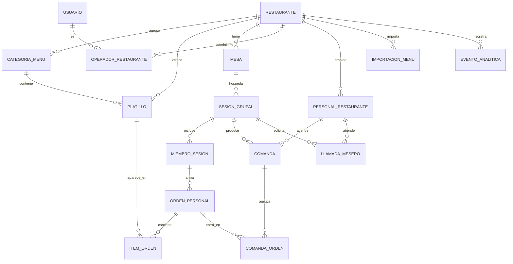

# Carta v1 — Datos

**Versión:** 1.0 · **Fecha:** 2 de noviembre de 2026 · **Base:** [`03_Data_Model.md`](../mvp/03_Data_Model.md) (agosto). Este documento sólo dice qué cambia; el DDL de `comanda`, `comanda_orden`, `llamada_mesero`, `operador_restaurante` y `evento_analitica` es el de agosto salvo lo indicado.

---

## 1. Qué tablas tiene la v1

| Grupo | Tabla | Origen | Cambios en v1 |
|---|---|---|---|
| Catálogo | `restaurante` | Fase 1 | + `slug` único (ya existe), + `logo_url`, + `tema` (ya existe); `plan` se queda pero sin uso |
| | `categoria_menu` | Fase 1 | sin cambios |
| | `platillo` | Fase 1 | − `modelo_3d_url`; + `disponible BOOLEAN NOT NULL DEFAULT true`; + `foto_thumb_url`, `foto_detalle_url`, `foto_original_url`; + `imagen_tipo` (`foto` · `ilustracion_categoria` · `ilustracion_generada`); + `ilustracion_clave VARCHAR(40)`; + `no_disponible_desde TIMESTAMPTZ`, `no_disponible_por UUID`; + `orden INTEGER NOT NULL DEFAULT 0` (posición dentro de la categoría; lo exige el índice `(categoria_id, orden)` de §5) |
| Mesa y sesión | `mesa` | Fase 1 | `qr_code` → `codigo_publico` (≥ 22 caracteres), + `codigo_revocado_en` |
| | `sesion_grupal` | Fase 1 | estados `activa` · `lista_para_enviar` · `cerrada` · `cancelada`; + `ultima_actividad_en`; + `cerrada_por_personal_id UUID NULL` |
| | `miembro_sesion` | Fase 1 | + `alias VARCHAR(24)`, + `color_avatar VARCHAR(7)`; `usuario_id` siempre nulo en v1 |
| Orden | `orden_personal` | Fase 1 | + `bloqueada BOOLEAN NOT NULL DEFAULT false`, + `confirmada_en` |
| | `item_orden` | Fase 1 | sin cambios; trigger de inmutabilidad (INV-3) |
| | `comanda` | Agosto | estados `abierta` · `atendida` · `servida` · `cancelada`; + `servida_en`; `atendida_por` pasa a `atendida_por_personal_id UUID NULL REFERENCES personal_restaurante` |
| | `comanda_orden` | Agosto | sin cambios |
| | `llamada_mesero` | Agosto | + `atendida_por_personal_id UUID NULL` |
| Acceso | `usuario` | Fase 1 | sólo operadores en v1; `provider` ∈ `google` · `email_link`; − `perfil_alimentario` (regla dura 10: los filtros de alérgenos viven en el teléfono) |
| | `operador_restaurante` | Agosto | sin cambios |
| | `personal_restaurante` | **Nueva** | §2.1 |
| Importación | `importacion_menu` | **Nueva** | §2.2 |
| Soporte | `clave_idempotencia` | **Nueva** | §2.3 |
| Analítica | `evento_analitica` | Agosto | tipos de evento de [01 §7](01_Alcance_v1.md) |

**No se crean en la v1:** `modelo_3d`, `trabajo_modelo_3d` (3D, v2), `dispositivo_restaurante` (el PIN lo sustituye), `ad_restaurante`, `escaneo`, `vista_platillo` (sustituidas por `evento_analitica`).

---

## 2. Tablas nuevas

### 2.1 `personal_restaurante`

```sql
CREATE TYPE rol_personal AS ENUM ('mesero', 'capitan');

CREATE TABLE personal_restaurante (
    id               UUID PRIMARY KEY DEFAULT uuid_generate_v4(),
    restaurante_id   UUID NOT NULL REFERENCES restaurante(id) ON DELETE CASCADE,
    nombre           VARCHAR(60) NOT NULL,
    rol              rol_personal NOT NULL DEFAULT 'mesero',
    pin_hash         VARCHAR(255) NOT NULL,          -- Argon2id; nunca el PIN
    activo           BOOLEAN NOT NULL DEFAULT true,
    intentos_fallidos SMALLINT NOT NULL DEFAULT 0,
    bloqueado_hasta  TIMESTAMPTZ,
    ultimo_acceso_en TIMESTAMPTZ,
    creado_en        TIMESTAMPTZ NOT NULL DEFAULT NOW(),
    actualizado_en   TIMESTAMPTZ NOT NULL DEFAULT NOW(),
    UNIQUE (restaurante_id, nombre)
);
CREATE INDEX idx_personal_restaurante ON personal_restaurante (restaurante_id) WHERE activo;
```

La sesión del personal es un JWT firmado (`sub = personal_id`, `restaurante_id`, `rol`, 12 h) en cookie `carta_personal`; al desactivar a la persona, la verificación en cada petición consulta `activo` (una lectura por índice) y la rechaza.

### 2.2 `importacion_menu`

```sql
CREATE TYPE estado_importacion AS ENUM ('pendiente','procesando','listo','confirmado','fallido');

CREATE TABLE importacion_menu (
    id               UUID PRIMARY KEY DEFAULT uuid_generate_v4(),
    restaurante_id   UUID NOT NULL REFERENCES restaurante(id) ON DELETE CASCADE,
    solicitado_por   UUID NOT NULL REFERENCES usuario(id) ON DELETE RESTRICT,  -- NOT NULL + SET NULL era contradictorio
    archivo_url      VARCHAR(500) NOT NULL,          -- bucket privado
    archivo_tipo     VARCHAR(40) NOT NULL,           -- application/pdf, image/jpeg…
    paginas          SMALLINT,
    estado           estado_importacion NOT NULL DEFAULT 'pendiente',
    modelo           VARCHAR(60),                    -- claude-opus-5-5
    resultado        JSONB,                          -- borrador validado contra el esquema
    tokens_entrada   INTEGER,
    tokens_salida    INTEGER,
    intentos         SMALLINT NOT NULL DEFAULT 0,
    error_mensaje    TEXT,
    iniciado_en      TIMESTAMPTZ,
    finalizado_en    TIMESTAMPTZ,
    confirmado_en    TIMESTAMPTZ,
    creado_en        TIMESTAMPTZ NOT NULL DEFAULT NOW(),
    CONSTRAINT ck_importacion_intentos CHECK (intentos <= 3)
);
CREATE INDEX idx_importacion_cola ON importacion_menu (creado_en) WHERE estado = 'pendiente';
CREATE INDEX idx_importacion_restaurante ON importacion_menu (restaurante_id, creado_en DESC);
```

Esquema de `resultado` (Pydantic en `app/schemas/importacion.py`, también es el esquema de salida estructurada que se le pide al modelo):

```json
{
  "moneda": "MXN",
  "categorias": [
    {
      "nombre": "Entradas",
      "orden": 1,
      "platillos": [
        {
          "nombre": "Guacamole de la casa",
          "descripcion": "Con totopos y queso fresco",
          "precio": 145.0,
          "precio_confianza": "alta",
          "variantes": [{"nombre": "Para compartir", "precio": 220.0}],
          "alergenos_sugeridos": ["lacteos"],
          "etiquetas_sugeridas": ["vegetariano"],
          "pagina": 1
        }
      ]
    }
  ],
  "avisos": ["La página 3 parece ser la carta de vinos y se omitió."]
}
```

### 2.3 `clave_idempotencia`

```sql
CREATE TABLE clave_idempotencia (
    ambito        VARCHAR(80)  NOT NULL,   -- 'orden_confirmar:{miembro_id}'
    clave         VARCHAR(80)  NOT NULL,   -- cabecera Idempotency-Key
    estado_http   SMALLINT     NOT NULL,
    respuesta     JSONB        NOT NULL,
    creada_en     TIMESTAMPTZ  NOT NULL DEFAULT NOW(),
    PRIMARY KEY (ambito, clave)
);
CREATE INDEX idx_idempotencia_purga ON clave_idempotencia (creada_en);
```

Una tarea periódica en proceso borra las filas de más de 24 h.

---

## 3. Alteraciones a tablas existentes

```sql
-- PLATILLO
ALTER TABLE platillo DROP COLUMN IF EXISTS modelo_3d_url;
ALTER TABLE platillo ADD COLUMN disponible BOOLEAN NOT NULL DEFAULT true;
ALTER TABLE platillo ADD COLUMN foto_thumb_url VARCHAR(500);
ALTER TABLE platillo ADD COLUMN foto_detalle_url VARCHAR(500);
ALTER TABLE platillo ADD COLUMN foto_original_url VARCHAR(500);
CREATE TYPE imagen_tipo AS ENUM ('foto','ilustracion_categoria','ilustracion_generada');
ALTER TABLE platillo ADD COLUMN imagen_tipo imagen_tipo NOT NULL DEFAULT 'ilustracion_categoria';
ALTER TABLE platillo ADD COLUMN ilustracion_clave VARCHAR(40);
ALTER TABLE platillo ADD COLUMN no_disponible_desde TIMESTAMPTZ;
ALTER TABLE platillo ADD COLUMN no_disponible_por UUID REFERENCES personal_restaurante(id) ON DELETE SET NULL;
ALTER TABLE platillo ADD COLUMN orden INTEGER NOT NULL DEFAULT 0;
CREATE INDEX idx_platillo_categoria_orden ON platillo (categoria_id, orden);

-- MESA
ALTER TABLE mesa RENAME COLUMN qr_code TO codigo_publico;
ALTER TABLE mesa ADD COLUMN codigo_revocado_en TIMESTAMPTZ;
ALTER TABLE mesa ADD CONSTRAINT ck_codigo_largo CHECK (length(codigo_publico) >= 22);

-- SESION_GRUPAL
ALTER TABLE sesion_grupal ADD COLUMN ultima_actividad_en TIMESTAMPTZ NOT NULL DEFAULT NOW();
ALTER TABLE sesion_grupal ADD COLUMN cerrada_por_personal_id UUID REFERENCES personal_restaurante(id) ON DELETE SET NULL;
CREATE UNIQUE INDEX uq_sesion_viva_por_mesa ON sesion_grupal (mesa_id)
    WHERE estado IN ('activa','lista_para_enviar');

-- MIEMBRO_SESION
ALTER TABLE miembro_sesion ADD COLUMN alias VARCHAR(24);
ALTER TABLE miembro_sesion ADD COLUMN color_avatar VARCHAR(7);

-- ORDEN_PERSONAL
ALTER TABLE orden_personal ADD COLUMN bloqueada BOOLEAN NOT NULL DEFAULT false;
ALTER TABLE orden_personal ADD COLUMN confirmada_en TIMESTAMPTZ;
CREATE UNIQUE INDEX uq_orden_viva_por_miembro ON orden_personal (miembro_id)
    WHERE estado IN ('armando','confirmada');

-- COMANDA
ALTER TYPE estado_comanda ADD VALUE 'servida';
ALTER TABLE comanda ADD COLUMN servida_en TIMESTAMPTZ;
ALTER TABLE comanda DROP COLUMN atendida_por;
ALTER TABLE comanda ADD COLUMN atendida_por_personal_id UUID REFERENCES personal_restaurante(id) ON DELETE SET NULL;
```

> Como **no existe ninguna base en producción**, la migración `0001_base_v1` crea el esquema final directamente, en lugar de la secuencia 0001–0008 de agosto. Las sentencias de arriba describen el delta conceptual, no el orden de ejecución.
>
> Detalles de la migración real (T-0.2): los `id` usan `gen_random_uuid()` (nativo desde PostgreSQL 13; no hace falta la extensión `uuid-ossp`); los índices `idx_comanda_mesa` e `idx_importacion_restaurante` son ascendentes (un índice B-tree se recorre en ambos sentidos); `item_orden.platillo_id` es `ON DELETE RESTRICT` (INV-4); los estados de `sesion_grupal` y `orden_personal` siguen siendo `VARCHAR` con `CHECK`, y sólo `comanda`, `importacion_menu`, `imagen_tipo` y los roles usan tipos enumerados. Los triggers INV-3 (`tr_item_orden_inmutable`) e INV-8 (`tr_comanda_orden_misma_sesion`) y el `downgrade()` completo viven en `migrations/versions/0001_base_v1.py`; `tests/unit/test_modelos.py` comprueba con `compare_metadata` que los modelos y el esquema real coinciden.

---

## 4. Diagrama



---

## 5. Invariantes y los índices que las sostienen

| Invariante | Mecanismo |
|---|---|
| INV-1 · una sesión viva por mesa | `uq_sesion_viva_por_mesa` |
| INV-2 · una orden viva por miembro | `uq_orden_viva_por_miembro` |
| INV-3 · ítems inmutables tras confirmar | trigger `tr_item_orden_inmutable` (agosto §5) |
| INV-4 · sin borrado físico con historial | `activo = false`; revisión de código; ningún `DELETE` sobre `platillo` en `app/services/` |
| INV-6 · comanda con estado terminal | `ck_comanda_terminal` ampliado con `servida` |
| INV-7 · el PIN nunca se guarda en claro | columna `pin_hash` única; prueba que inspecciona la fila tras crear |
| INV-8 · una comanda sólo agrupa órdenes de su sesión | trigger `tr_comanda_orden_misma_sesion` |
| INV-9 · nada entra al menú sin confirmación del operador | `importacion_menu.estado = 'confirmado'` sólo lo escribe el endpoint `confirmar`; el *task* de IA no tiene ese permiso en código |

INV-5 (modelo 3D publicado exige aprobación) se retira con el 3D y vuelve en v2.

| Consulta | Índice |
|---|---|
| Menú activo por restaurante | `idx_platillo_activo (restaurante_id, activo)` + `(categoria_id, orden)` |
| Sesión viva de una mesa | `uq_sesion_viva_por_mesa` |
| Miembros y órdenes de una sesión | `(sesion_id)` en `miembro_sesion` y `orden_personal` |
| Mesas con estado para el personal | `uq_sesion_viva_por_mesa` + `idx_comanda_abierta (restaurante_id, creada_en) WHERE estado IN ('abierta','atendida')` |
| Llamadas pendientes | `idx_llamada_pendiente` |
| Personal activo del restaurante | `idx_personal_restaurante` |
| Importación pendiente | `idx_importacion_cola` |
| Métricas por rango | `idx_evento_restaurante_fecha` |

Presupuesto: ninguna consulta del camino crítico del comensal o del personal supera 20 ms en la base con 10,000 platillos y 1,000 sesiones sembradas (T-4.4).

---

## 6. Usuarios de base de datos

| Usuario | Permisos | Quién lo usa |
|---|---|---|
| `carta_migrador` | dueño del esquema | sólo el paso de migraciones del despliegue |
| `carta_app` | `SELECT, INSERT, UPDATE, DELETE` sobre las tablas; sin `CREATE`, `ALTER`, `DROP` | la API |
| `carta_lector` | `SELECT` | reportes y el capitán del futuro panel de analítica |

Una inyección SQL con `carta_app` puede leer o alterar filas, pero no borrar el esquema.

---

## 7. Retención

| Dato | Retención | Acción |
|---|---|---|
| `evento_analitica` | 13 meses | agregación diaria y purga |
| sesiones, órdenes, comandas | 24 meses | purga |
| `importacion_menu` y el PDF original | 90 días tras confirmar | borrado del bucket y de la fila |
| `clave_idempotencia` | 24 h | purga horaria |
| fotos originales | vida del platillo + 6 meses | borrado |
| respaldos | 30 días | ciclo de vida del bucket |

---

## 8. Semillas de desarrollo

`scripts/seed.py` crea: un restaurante ("La Ceiba", el del prototipo), 4 categorías, 18 platillos con fotos de muestra y 4 sin foto, 8 mesas, un operador (correo de prueba), 3 personas (2 meseros, 1 capitán, PIN `1234`), una importación de ejemplo en estado `listo` con el PDF de prueba `tests/fixtures/menus/la-ceiba.pdf`.
