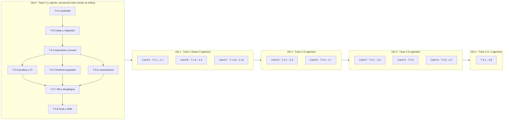

# Carta v1 — Fases y tareas

**Versión:** 1.0 · **Fecha:** 2 de noviembre de 2026 · **Destinatario:** el agente (o la persona) que ejecuta una tarea sin contexto previo.

---

## 1. Cómo leer una tarea

Cada tarea es un brief autocontenido con esta forma:

> **T-x.y — Título** · Carril · Depende de · Historias
> **Entregable** (qué existe al terminar) · **Archivos** (rutas exactas) · **Criterios** (AC a cubrir) · **Verificar** (comando que debe pasar) · **Notas**

Reglas para ejecutarla:

1. Empieza con `/tarea T-x.y`. Lee este brief, [`01_Alcance_v1.md`](01_Alcance_v1.md) y las secciones de [02](02_Arquitectura_v1.md) y [03](03_Datos_v1.md) que el brief cite. Las convenciones de API y el formato de error están en [`docs/mvp/04_API_Spec.md` §1](../mvp/04_API_Spec.md); los criterios EARS, en [`docs/mvp/01_PRD.md` §7](../mvp/01_PRD.md) y en [01 §6](01_Alcance_v1.md).
2. Planea antes de tocar código (plan mode). Si el brief contradice un documento, detente y propón el cambio al documento.
3. Una tarea no está terminada hasta que su comando de **Verificar** pasa y además pasan `uv run ruff check . && uv run ruff format --check . && uv run mypy app && uv run pytest -q`.
4. Commit con el ID: `T-1.4: fotos de platillos con variantes WebP`. Una tarea, un commit (o pocos, todos con el ID).
5. `/revisar` antes de abrir el PR. `/compound` antes de cerrar la sesión.
6. Si descubres que el plan estaba mal, corrígelo aquí y añade una fila en §11.

Estimación: una tarea ≈ una sesión de trabajo enfocada (2–4 h de agente con revisión humana). Las marcadas 🔴 bloquean lo que sigue.

---

## 2. Carriles y propiedad de carpetas

Para que varios agentes trabajen en paralelo sin conflictos, cada carril es dueño de carpetas distintas. Un agente **no edita** carpetas de otro carril; si lo necesita, lo anota en su PR y el coordinador lo resuelve.

| Carril | Carpetas | Fases |
|---|---|---|
| **A · Backend catálogo** | `app/db/`, `app/services/{menu,assets,mesas,personal}.py`, `app/api/admin/`, `migrations/`, `scripts/seed.py` | 1 |
| **B · Importación IA** | `app/services/importacion_menu.py`, `app/schemas/importacion.py`, `app/api/admin/importaciones.py`, `tests/fixtures/menus/` | 1 |
| **C · Frontend operador** | `frontend/src/admin/`, `frontend/src/compartido/` (con D/E/H coordinados) | 1 |
| **D · Backend comensal** | `app/core/seguridad.py` (invitado), `app/services/{sesion,analitica}.py`, `app/api/publico/` | 2 |
| **E · Frontend comensal** | `frontend/src/comensal/` | 2 |
| **F · Backend orden** | `app/services/{orden,comanda}.py`, `app/api/publico/orden.py` | 3 |
| **G · Backend personal** | `app/core/seguridad.py` (personal), `app/api/operacion/` | 3 |
| **H · Frontend personal y orden** | `frontend/src/personal/`, `frontend/src/comensal/orden/` | 3 |
| **I · Plataforma** | `deploy/`, `.github/`, `Dockerfile`, `Caddyfile`, `pruebas/carga/`, `scripts/` (salvo `seed.py`), `.claude/` | 0, 4 |

**Contrato primero.** La primera tarea de backend de cada fase publica los esquemas Pydantic de respuesta en `app/schemas/` y deja `/openapi.json` sirviendo aunque los endpoints devuelvan datos de ejemplo. El frontend corre `npm --prefix frontend run tipos` (openapi-typescript) y trabaja contra ese contrato con datos simulados (`frontend/src/mocks/`). Así C, E y H no esperan a que A, D, F y G terminen.

**Ramas.** `agente/T-1.4-fotos`, PR a `master`, *squash* al integrar. Cada agente trabaja en su propio *worktree* (`git worktree add ../carta-T-1.4 -b agente/T-1.4-fotos`).

---

## 3. Olas de ejecución

Dentro de una ola, el orden de integración es: backend (A, D, F+G) primero, frontend después. El frontend puede empezar al mismo tiempo gracias al contrato.

---

## 4. Fase 0 — Cimientos y primer despliegue

> **Entregable observable:** `https://staging.<dominio>/health` responde `{"status":"ok"}` desde tu teléfono, y CI está en verde.
> **Estado del repo hoy:** la aplicación no arranca (driver síncrono con motor asíncrono), `create_all()` al arrancar, pruebas con SQLite que no corren, CI escuchando ramas inexistentes (`main`/`develop` en lugar de `master`), `.gitignore` que **ignora las migraciones** (`migrations/versions/*.py`), Dockerfile con el healthcheck en una ruta equivocada, CORS abierto.

### 🔴 T-0.1 — Toolchain y configuración
**Carril:** I · **Depende de:** — · **Historias:** —
**Entregable:** el proyecto se instala con `uv sync` y arranca con `uv run uvicorn app.main:app`.
**Archivos:** `pyproject.toml` (Python ≥ 3.12; `fastapi`, `uvicorn[standard]`, `sqlalchemy[asyncio]`, `asyncpg`, `alembic`, `pydantic`, `pydantic-settings`, `httpx`, `anthropic`, `pillow`, `qrcode[pil]`, `reportlab`, `boto3`, `argon2-cffi`, `python-jose[cryptography]` o `pyjwt`, `slowapi`, `python-multipart`, `sentry-sdk[fastapi]`; dev: `pytest`, `pytest-asyncio`, `pytest-cov`, `ruff`, `mypy`, `pip-audit`, tipos), `uv.lock`, `app/core/config.py` (clase `Settings`: `DATABASE_URL` normalizado a `+asyncpg`, `ENTORNO`, `SECRET_KEY` que falla al arrancar si es corto o por defecto fuera de desarrollo, `R2_*`, `ANTHROPIC_API_KEY`, `FIREBASE_PROJECT_ID`, `DOMINIO`), `.env.example` sin secretos reales, `.gitignore` (quitar la línea de migraciones), `README.md` sección "Cómo correr".
**Verificar:** `uv sync && uv run python -c "from app.core.config import Settings; s=Settings(DATABASE_URL='postgresql://u:p@h/db', SECRET_KEY='x'*43); assert '+asyncpg' in s.DATABASE_URL; print('ok')"`
**Notas:** retirar `black`; `ruff` hace lint y formato (`[tool.ruff] line-length = 100`, `select = ["E","F","W","I","UP","B"]`). Retirar `firebase-admin` si pesa demasiado: la verificación del ID token se puede hacer con `pyjwt` + las llaves públicas de Google (`app/core/firebase.py`).

### 🔴 T-0.2 — Base de datos y migración base
**Carril:** I · **Depende de:** T-0.1 · **Historias:** —
**Entregable:** `app/db/database.py` con `create_async_engine` sobre `asyncpg`, `pool_size=10`, `max_overflow=10`; sin `create_all`; Alembic asíncrono; migración `0001_base_v1` con **todo** el esquema de [03](03_Datos_v1.md) (incluidos índices parciales, triggers INV-3 e INV-8, tipos enumerados y los tres usuarios de base como script aparte `scripts/usuarios_bd.sql`).
**Archivos:** `app/db/database.py`, `app/db/models.py` (modelos v1 completos; retirar `Escaneo`, `VistaPlatillo`, `AdRestaurante`), `migrations/env.py`, `migrations/versions/0001_base_v1.py`, `alembic.ini`, `docker-compose.yml` (PostgreSQL 16 + volumen; sin Redis ni Adminer), `app/main.py` (sin `init_db`).
**Verificar:** `docker compose up -d && uv run alembic upgrade head && uv run alembic downgrade base && uv run alembic upgrade head && psql "$DATABASE_URL_SYNC" -c "\dt" | grep -q personal_restaurante && echo ok`
**Notas:** `downgrade()` completo. Una prueba `tests/unit/test_modelos.py` comprueba que cada modelo mapea contra el esquema real (`sqlalchemy.inspect`). Usar `DeclarativeBase` y `Mapped[]` (SQLAlchemy 2.1 marca `declarative_base` como legado). **En sesiones en la nube no hay Docker:** el hook de sesión levanta PostgreSQL local y exporta `DATABASE_URL`, `DATABASE_URL_SYNC` y `TEST_DATABASE_URL`; se omite `docker compose up -d` del comando de Verificar. El guard de Bash bloquea `alembic downgrade base` fuera de pruebas: en esta tarea se corre contra la base local de desarrollo y es legítimo; si lo bloquea, usa `alembic downgrade -1` repetido o pide a la maestra que lo apruebe.

### 🔴 T-0.3 — Estructura, errores y salud
**Carril:** I · **Depende de:** T-0.2 · **Historias:** —
**Entregable:** árbol de carpetas (la lista que sigue; [02](02_Arquitectura_v1.md) no lo detalla) (`app/core/`, `app/api/{publico,operacion,admin}/`, `app/services/`, `app/schemas/`, `tests/{unit,integration}/`, `scripts/`, `deploy/`, `frontend/`, `pruebas/carga/`); envoltura de error única y manejadores (`app/core/errores.py`: `ErrorCarta(codigo, mensaje, http)` + manejadores para `HTTPException`, validación y excepciones no controladas con `request_id`); middleware de `request_id` y logs JSON; `GET /health`, `GET /ready`; sin middleware de CORS; `app/api/routes.py` reubicado en `app/api/admin/restaurantes.py` (temporal, sin auth todavía).
**Verificar:** `uv run uvicorn app.main:app --port 8000 & sleep 3 && curl -sf localhost:8000/ready | grep -q '"db":"ok"' && curl -s localhost:8000/api/v1/nada | grep -q '"codigo":"RECURSO_NO_ENCONTRADO"' && echo ok; kill %1`
**Notas:** `app/services/` no importa `fastapi` (prueba en CI: `grep -rl "fastapi" app/services/ | wc -l` = 0). La validación del payload responde **422** `PAYLOAD_INVALIDO` (convención de FastAPI; 04_API_Spec §1.2 actualizado). `tests/integration/test_salud.py` corre contra `app.main.app` con httpx ASGI y `/ready` consulta la base de `DATABASE_URL` (sólo `SELECT 1`, no exige esquema).

### T-0.4 — Pruebas y CI
**Carril:** I · **Depende de:** T-0.3 · **Historias:** —
**Entregable:** `tests/conftest.py` con base PostgreSQL real (`TEST_DATABASE_URL`), transacción por prueba con *rollback*, `AsyncClient` de httpx sobre la app, fábricas mínimas (`restaurante`, `operador`, `mesa`); una prueba unitaria y una de integración reales; `.github/workflows/ci.yml` escuchando `master`, PRs, push a `agente/**` y `claude/**` y `workflow_dispatch`, con servicio PostgreSQL 16, pasos `uv sync`, `ruff check`, `ruff format --check`, `mypy`, `pytest --cov=app`, `pip-audit`, `grep` de servicios sin FastAPI.
**Verificar:** `uv run pytest -q` en verde local; el workflow en verde en GitHub sobre el push de la rama `agente/T-0.4-pruebas-ci` (lo comprueba la maestra).
**Notas:** `pytest-asyncio` en modo `auto`. Cobertura mínima no se exige todavía; se exige ≥ 80 % en `app/services/` al cerrar la Fase 3. La base de pruebas se migra con la CLI de Alembic (`-x url=...`): mueve `url_de_pruebas()` y la fixture `esquema_migrado` de `tests/unit/test_modelos.py` a `tests/conftest.py` y reutilízalas; no crees el esquema desde los modelos. `.python-version` con `3.12` en la raíz y `actions/setup-python` leyéndolo (sin él `uv` resuelve la versión más nueva instalada: el worktree de la revisión de T-0.3 corrió en 3.13). El motor nace de `settings.DATABASE_URL` al importar `app.db.database`; la fixture `cliente` de `tests/integration/test_salud.py` hace `close_db()` al salir porque cada prueba corre en su propio bucle y una conexión asyncpg del bucle anterior rompe el pool global: `conftest.py` lo resuelve con un motor por sesión de pruebas sobre `TEST_DATABASE_URL` (`loop_scope="session"`) y retira ese `close_db()`.

### T-0.5 — Esqueleto del frontend
**Carril:** I (después C/E/H) · **Depende de:** T-0.3 · **Historias:** —
**Entregable:** `frontend/` con Vite + React 18 + TypeScript + React Router; tres áreas con *code splitting* (`/m/:codigo`, `/staff/:slug`, `/admin`); `src/compartido/tokens.css` con los tokens del skill `/diseno-visual` (DM Serif Display + DM Sans desde `prototipo/carta-assets/fonts/`, Crema, Vino, Dorado, radios, sombras); componentes base migrados del prototipo (`Boton`, `Chip`, `Tarjeta`, `HojaInferior`, `Avatar`); `manifest.webmanifest`; `npm run tipos` (openapi-typescript desde `http://localhost:8000/openapi.json`); `vitest` con una prueba; `scripts/presupuesto.mjs` que falla si el bundle inicial comprimido supera 250 KB; `npm run build` deja `frontend/dist/`.
**Verificar:** `npm --prefix frontend ci && npm --prefix frontend test && npm --prefix frontend run build && node frontend/scripts/presupuesto.mjs`
**Notas:** sin librerías de componentes pesadas; CSS con variables y módulos, sin Tailwind (la regla "no-line" y las sombras cálidas se hacen a mano). Las fuentes se sirven desde el propio dominio.

### T-0.6 — Imagen portable y variantes de despliegue
**Carril:** I · **Depende de:** T-0.3, T-0.5 · **Historias:** —
**Entregable:** `Dockerfile` multi-etapa (etapa Node que construye `frontend/dist`; etapa Python slim con `uv`, usuario sin privilegios, `HEALTHCHECK` a `/health`, `CMD uvicorn --workers ${WORKERS:-2}`); **la API sirve `frontend/dist`** (`StaticFiles` + respuesta `index.html` para `/m/*`, `/staff/*`, `/admin/*`; `/assets/*` con caché de 1 año, `index.html` sin caché) y pone las cabeceras HSTS, CSP, `nosniff`, `Referrer-Policy`, `Permissions-Policy` desde un middleware, de modo que la imagen no necesita ningún proxy (ADR-010 original, ADR-015); `deploy/respaldo/` (imagen pequeña con `pg_dump` + `age` + `rclone` a R2, pensada para correr con horario en cualquier destino); `deploy/railway/README.md` (estructura del proyecto: servicios `api`, `postgres`, `respaldo`; variables; comando previo al despliegue `alembic upgrade head`); `deploy/vps/` (`docker-compose.yml` con `caddy` opcional, `api`, `postgres`, `respaldo`; `Caddyfile`; `cloud-init.yml`) como anexo listo pero no ejecutado.
**Verificar:** `docker build -t carta:test . && docker run -d -p 8000:8000 --env-file .env.example -e ENTORNO=pruebas carta:test && sleep 3 && curl -sf localhost:8000/health && curl -sf localhost:8000/ | grep -q '
 /dev/null && echo ok` — **corre en CI**, job `imagen` de `.github/workflows/ci.yml` (en las sesiones de agente no hay daemon de Docker); la maestra lo comprueba en verde sobre el push de la rama. Localmente: `uv run pytest tests/integration/test_estaticos.py tests/integration/test_cabeceras.py tests/unit/test_cabeceras.py tests/unit/test_despliegue.py -q`.
**Notas:** ningún archivo de `app/` sabe en qué proveedor corre. Caddy existe sólo en la variante de VM. `.dockerignore` (`.env*`, `datos/`, `.venv/`, `node_modules/`, `tests/`, `docs/`, `prototipo/`, `marketing/`). `ENV PYTHONIOENCODING=utf-8` (con stdout no UTF-8 una ruta con acento pierde su línea de acceso). Con `--workers N` el supervisor de uvicorn escribe en texto plano: pásale `--log-config deploy/uvicorn_log.json` para que el proceso padre también salga en JSON por línea. El middleware de cabeceras de seguridad se añade **antes** de `MiddlewareRequestId` en `create_app` (ése debe quedar el último `add_middleware`, regla en `CLAUDE.md`). CSP por `'self'` sin nonces (02 §12, decidido en la revisión de T-0.5): verifica con `curl -I` que ninguna pantalla rompe con ella (`/`, `/m/<codigo>`, `/staff/<slug>`, `/admin`); `img-src` incluye el dominio público de R2 desde `Settings` (vacío en desarrollo). Las rutas de la SPA con `%` mal codificado (`/m/%ZZ`) deben devolver `index.html`, no 400: React Router absorbe el `decodeURI` fallido. `/assets/*` lleva `Cache-Control: public, max-age=31536000, immutable` y `index.html` `no-cache`; `/fonts/*` también un año.

### 🔴 T-0.7 — Railway, dominio y pipeline de despliegue
**Carril:** I · **Depende de:** T-0.4, T-0.6 · **Historias:** —
**Entregable:** proyecto en Railway con dos *environments* (`staging`, `produccion`), servicios `api` (desde el `Dockerfile`, con *Healthcheck Path* `/health`, *Pre-deploy Command* `uv run alembic upgrade head` y reinicio automático puestos en el panel: Railway ya no lee `railway.toml` en servicios nuevos, §11), `postgres` (plantilla oficial con volumen) y `respaldo` (servicio con horario diario, imagen de `deploy/respaldo/`); variables de entorno de `.env.example` cargadas en el panel; `staging` despliega solo desde `master`; `.github/workflows/deploy.yml` despliega a `produccion` en cada etiqueta `v*` con la CLI de Railway (`railway up --environment produccion`, secreto `RAILWAY_TOKEN`) y hace la prueba de humo; Cloudflare con `CNAME` proxied a los dominios de Railway para `<dominio>` y `staging.<dominio>`, regla de caché del menú y límite de tasa; `deploy/README.md` con los pasos exactos de [05 §2](05_Operacion.md) y el rollback (**Rollback** en *Deployments* o `deploy.yml` con la etiqueta anterior; `railway redeploy` sólo repite el último); eliminar el `deploy.yml` de Cloud Run y mover `terraform/` a `deploy/etapa2-gcp/` con un README de una línea.
**Verificar:** `curl -sf https://staging.<dominio>/health` desde un teléfono; el workflow de producción en verde sobre una etiqueta `v0.0.1`.
**Notas:** requiere que Calvin cree la cuenta de Railway (con tarjeta), el dominio y la zona de Cloudflare (no lo puede hacer el agente). **Hecho el 6 de noviembre:** dominio `carta.cooking` en Cloudflare (SSL *Full strict*), proyecto `carta` en Railway con `RAILWAY_TOKEN` en GitHub, cuatro buckets R2 con `img.carta.cooking` e `img-staging.carta.cooking` conectados y ciclo de vida `respaldos-90-dias` (ver `deploy/railway/README.md` § Valores reales). Cloudflare lo opera la sesión maestra con el conector oficial (las hijas no lo tienen): la hija deja el repo listo y documenta; la maestra crea los `CNAME` hacia Railway, la regla de caché y el límite de tasa; Calvin pega las variables en Railway. **Decisión pendiente (de T-0.6):** `deploy/vps/docker-compose.yml` arranca de `ghcr.io/klvinlopez/carta:${IMAGEN_TAG}` y hoy nadie publica en GHCR: o `deploy.yml` publica la imagen en cada etiqueta `v*` (además de `railway up`), o la VM construye con `docker compose up --build` (el ancla ya trae `build`). Fijar también los digests `@sha256` de las imágenes base del `Dockerfile` y de `deploy/respaldo/` (Dependabot ya vigila los tags). El agente deja todo listo y documenta exactamente qué valores pegar dónde. ADR-015 aceptado: Railway; la VM queda en `deploy/vps/` como anexo.

### T-0.8 — Hook de sesión y skills alineados al toolchain
**Carril:** I · **Depende de:** T-0.7 · **Historias:** —
**Entregable:** `.claude/hooks/session-start.sh` instala con `uv sync`, levanta PostgreSQL local y exporta `DATABASE_URL`/`TEST_DATABASE_URL`; `.claude/skills/desplegar/SKILL.md` (procedimiento de despliegue y rollback) y `.claude/skills/carga/SKILL.md` (cómo correr k6); `CLAUDE.md` con los comandos finales; `README.md` con el estado real.
**Verificar:** en una sesión nueva en la nube, `uv run pytest -q` pasa sin pasos manuales.

---

## 5. Fase 1 — Restaurante y menú

> **Entregable observable:** un operador entra con Google, sube el PDF de su carta, revisa el borrador, confirma, sube fotos, crea mesas e imprime los QR. Todo desde el teléfono.

### Carril A · Backend catálogo

### 🔴 T-1.1 — Modelos, invariantes y contrato de la fase
**Depende de:** T-0.4 · **Historias:** —
**Entregable:** migración `0002_consistencia_inquilino` con INV-10 de [03 §5](03_Datos_v1.md) (`UNIQUE (id, restaurante_id)` en los padres, FK compuestas en `comanda`, `llamada_mesero`, `platillo` y `comanda.atendida_por_personal_id`, trigger `fn_item_orden_mismo_restaurante`) siguiendo el skill `/migracion`; pruebas de comportamiento de invariantes en `tests/integration/test_invariantes.py`: INV-1, INV-2, INV-3 (INSERT/UPDATE/DELETE con orden bloqueada, mover un ítem fuera de una orden bloqueada, y **la carrera con dos conexiones asyncpg**: la primera pone `bloqueada=true` sin commit, la segunda inserta un ítem y debe esperar y recibir `IntegrityError`), INV-7, INV-8 (incluido `UPDATE sesion_id` de los padres), INV-10; esquemas Pydantic de respuesta de toda la Fase 1 en `app/schemas/{restaurante,menu,mesa,personal,importacion}.py` y rutas registradas que devuelven ejemplos, para que `/openapi.json` esté completo desde el primer día.
**Criterios:** AC-02.1 (INV-1), AC-10.1 (INV-2), AC-11.1 (INV-3), AC-12.1 (INV-8), AC-15.2 (INV-10), AC-26.1 (INV-7).
**Verificar:** `uv run pytest tests/integration/test_invariantes.py tests/unit/test_modelos.py -q && curl -s localhost:8000/openapi.json | python -c "import json,sys; d=json.load(sys.stdin); assert '/api/v1/admin/restaurantes/{rid}/importaciones' in d['paths']; print('ok')"`
**Notas:** las fixtures de migración viven en `tests/conftest.py` desde T-0.4; cada prueba de invariante lleva el marcador del criterio que protege (p. ej. INV-3 → `AC-11.1`, INV-8 → `AC-12.1`).

### 🔴 T-1.2 — Autenticación del operador y alta del restaurante
**Depende de:** T-1.1 · **Historias:** US-15
**Entregable:** `app/core/firebase.py` verifica el ID token de Firebase (Google y enlace por correo) contra las llaves públicas con caché; dependencia `operador_actual` que resuelve `usuario` (lo crea en el primer acceso) y `operador_restaurante`; `POST /admin/restaurantes` crea restaurante + operador `propietario` + `slug` único; `GET /admin/restaurantes`; dependencia `restaurante_del_operador(rid)` que devuelve 404 si no es suyo.
**Criterios:** AC-15.1, AC-15.2, AC-15.3.
**Verificar:** `uv run pytest tests/integration/test_auth_admin.py -q` — sin token → 401; token válido sin restaurante → lista vacía; restaurante ajeno → 404.
**Notas:** en pruebas, el verificador de tokens se sustituye por uno falso vía *dependency override*. `restaurante_id` nunca viene del cuerpo: viene de la ruta y se valida contra el operador. Quita `solo_desarrollo` de `app/api/admin/__init__.py` al poner el token. Borra `UsuarioBase.perfil_alimentario` de `app/schemas/base.py` (regla dura 10; T-0.2 ya lo quitó del modelo). `restaurante_id` sale de `PlatilloCreate` y `MesaCreate`: hoy el del cuerpo gana sobre el de la ruta (reproducido en la revisión de T-0.3).

### T-1.3 — Categorías y platillos
**Depende de:** T-1.2 · **Historias:** US-16, US-27 (parte de datos)
**Entregable:** `app/services/menu.py` (sin FastAPI) y endpoints de [02 §5.3](02_Arquitectura_v1.md): crear, editar, reordenar (lista de IDs), desactivar (`activo=false`), marcar `disponible`; validaciones AC-16.2; invalidación de la caché del menú (`app/services/cache_menu.py`: caché en proceso de 30 s + purga de Cloudflare por API cuando hay credenciales).
**Criterios:** AC-16.1, AC-16.2, AC-16.3.
**Verificar:** `uv run pytest tests/integration/test_admin_menu.py -q`
**Notas:** el precio se cuantiza a 2 decimales en Pydantic (`Decimal`, `ROUND_HALF_UP`) y se rechaza por encima de 99,999,999.99: `NUMERIC(10,2)` redondea `1.005` en silencio y desborda con 9 dígitos enteros (revisión adversarial de T-0.2). Longitudes en grafemas, no en bytes: un nombre de 29 emojis compuestos pasa el `VARCHAR(200)`. `skip`/`limit` acotados (`Query(0, ge=0)`, `Query(50, ge=1, le=100)`: hoy `limit=-1` da 500). Los esquemas espejan los CHECK de la base (`tema`, `plan`, `precio ≥ 0` (AC-16.2 y `ck_platillo_precio`), `nivel_picante ≤ 5`, `telefono ≤ 20`) para que la validación sea 422 y no 500. Manejador de `sqlalchemy.exc.IntegrityError` en `app/core/errores.py` (UNIQUE → 409 `CONFLICTO`, CHECK → 422 `PAYLOAD_INVALIDO`) que registra sólo `constraint_name`, nunca los parámetros.

### T-1.4 — Fotos de platillos
**Depende de:** T-1.3 · **Historias:** US-17
**Entregable:** `app/services/assets.py` con interfaz `Almacen` (implementaciones `AlmacenLocal` para desarrollo y `AlmacenS3` para R2); `POST /admin/platillos/{id}/foto` acepta JPG/PNG/HEIC ≤ 15 MB, valida por contenido (*magic bytes* + Pillow), corrige orientación EXIF, genera miniatura 400 px y detalle 1200 px en WebP con nombre por hash, guarda el original en el bucket privado, pone `imagen_tipo='foto'`; `DELETE` vuelve a `ilustracion_categoria`; `ilustracion_clave` se asigna por categoría con una tabla de 20 claves (`app/services/ilustraciones.py`).
**Criterios:** AC-17.1, AC-17.2, AC-17.3.
**Verificar:** `uv run pytest tests/integration/test_fotos.py -q` — incluye un PDF renombrado a `.jpg` rechazado y un HEIC convertido.
**Notas:** HEIC requiere `pillow-heif`. Las variantes se suben con `Cache-Control: public, max-age=31536000, immutable`. **Dentro de la imagen (T-0.6) `/app` es de root y sólo lectura:** `ALMACEN_LOCAL_RUTA=./datos` no es escribible, así que fuera de desarrollo la aplicación exige R2 (`Settings` debe rechazar el arranque sin `R2_*` en `staging`/`produccion`, o el almacén local debe apuntar a un volumen). `/ready` añade la comprobación del almacén (`HEAD` al bucket con timeout de 3 s) cuando `almacen_en_nube`; hasta aquí sólo comprueba la base (02 §5). **Límite antes de leer (revisión de T-1.1):** FastAPI lee el multipart entero (y lo escribe a disco) antes de resolver dependencias, es decir, antes del 401 y del 404: un POST de 50 MB se procesa aunque no haya credencial. Rechaza por `Content-Length` en un middleware (o en el borde) antes de analizar el cuerpo.

### T-1.5 — Mesas y códigos QR
**Depende de:** T-1.2 · **Historias:** US-21
**Entregable:** `app/services/mesas.py`: crear N mesas, `codigo_publico = secrets.token_urlsafe(16)`, regenerar con revocación inmediata; `GET /admin/restaurantes/{rid}/mesas/qr.pdf` con `qrcode` + `reportlab`: una tarjeta por mesa con logo, nombre del restaurante, "Mesa 7", el QR a `https://<dominio>/m/<codigo>` y la leyenda "Escanea para ver la carta · Carta".
**Criterios:** AC-21.1, AC-21.2, AC-21.3.
**Verificar:** `uv run pytest tests/integration/test_mesas.py tests/integration/test_qr_pdf.py -q` — el QR decodificado (con `pyzbar` o `zxing-cpp` en dev) apunta a la URL correcta; el código viejo da 404 tras regenerar.

### T-1.6 — Personal y PIN
**Depende de:** T-1.2 · **Historias:** US-26 (parte del operador)
**Entregable:** `app/services/personal.py`: alta con nombre, rol y PIN de 4–6 dígitos (Argon2id vía `argon2-cffi`), editar, desactivar, reasignar PIN; endpoints de [02 §5.3](02_Arquitectura_v1.md); el PIN nunca se devuelve ni se registra en logs.
**Criterios:** INV-7; AC-26.3 (desactivar revoca).
**Verificar:** `uv run pytest tests/integration/test_personal.py -q` — la fila guardada no contiene el PIN; un PIN de 3 dígitos → 422.

### T-1.7 — Semillas de desarrollo
**Depende de:** T-1.4, T-1.5, T-1.6 · **Historias:** —
**Entregable:** `scripts/seed.py` según [03 §8](03_Datos_v1.md), idempotente (borra y recrea sólo el restaurante semilla), con fotos de muestra en `tests/fixtures/fotos/` y el PDF `tests/fixtures/menus/la-ceiba.pdf`.
**Verificar:** `uv run python scripts/seed.py && psql "$DATABASE_URL_SYNC" -c "select count(*) from platillo" | grep -q 22 && echo ok`

### Carril B · Importación de menú con IA

### 🔴 T-1.8 — Servicio de extracción
**Depende de:** T-1.1 (esquemas) · **Historias:** US-25
**Entregable:** `app/services/importacion_menu.py` con `extraer_menu(archivo: bytes, tipo: str) -> ResultadoImportacion`: llama a la API de Claude con el documento (bloque `document` base64 para PDF, `image` para JPG/PNG), instrucciones en español que piden categorías, platillos, precios con confianza, variantes, alérgenos y etiquetas sugeridos, y que tratan el documento como datos; salida estructurada validada contra `app/schemas/importacion.py` (`client.messages.parse`); modelo `claude-opus-5-5` configurable por `IMPORTACION_MODELO`; tiempo de espera 120 s; reintentos con pausa exponencial; registro de tokens usados. Cliente inyectable para pruebas.
**Criterios:** AC-25.2, AC-25.5.
**Verificar:** `uv run pytest tests/unit/test_importacion.py -q` con cliente falso (respuestas grabadas en `tests/fixtures/menus/*.json`); `uv run pytest tests/live/test_importacion_live.py -q -m live` opcional con llave real sobre 5 cartas reales de `tests/fixtures/menus/`, comprobando que ≥ 90 % de los precios salen con confianza `alta` y coinciden con los anotados a mano.
**Notas:** leer el skill `claude-api` antes de escribir el cliente (modelo, `output_config.format`, límites de PDF). Las 5 cartas de prueba las aporta Calvin (menús reales, con permiso, o descargados de sitios públicos).

### T-1.9 — Endpoints y procesamiento en segundo plano
**Depende de:** T-1.8, T-1.3 · **Historias:** US-25
**Entregable:** `POST /admin/restaurantes/{rid}/importaciones` (multipart; valida tipo por contenido, ≤ 20 MB, ≤ 30 páginas con `pypdf`; guarda en bucket privado; fila `pendiente`; 202); procesador en proceso (`app/services/procesador.py`: al arrancar y cada 10 s toma importaciones `pendiente` con `FOR UPDATE SKIP LOCKED`, marca `procesando`, llama al servicio, guarda `listo` o `fallido`); `GET .../importaciones/{id}`; `POST .../confirmar` recibe el JSON revisado, lo valida y crea categorías y platillos en una transacción (`imagen_tipo='ilustracion_categoria'`); `POST .../reintentar`.
**Criterios:** AC-25.1, AC-25.3, AC-25.4; INV-9.
**Verificar:** `uv run pytest tests/integration/test_importaciones.py -q` — con el cliente falso, el flujo completo subir → listo → confirmar crea los platillos; confirmar dos veces → 409; un PDF de 40 páginas → 413.
**Notas:** (revisión de T-1.1) FastAPI lee el multipart entero antes de resolver dependencias (antes del 401/404): el límite de 20 MB se aplica por `Content-Length` en un middleware o en el borde, antes del análisis (mismo mecanismo que T-1.4). `confirmar` de una importación ya confirmada responde 409 (declarado en el contrato desde T-1.1); borra las rutas de `app/api/admin/ejemplos.py` al poner las reales. (revisión de T-1.8) Usa `extraer_menu_detallado` (→ `Extraccion` con `modelo`, `tokens_entrada`, `tokens_salida`, `intentos` y `paginas` para la fila) y, al subir, `normalizar_tipo` + `preparar_documento` o `contar_paginas` para rechazar antes del 202 lo que el servicio rechazaría. Traducción de errores: `TipoArchivoNoPermitido` → 415; `ArchivoNoValido` → 413 si es por tamaño o páginas y 422 si es contenido (vacío, firma, cifrado, ilegible); `ErrorExtraccion` → `fallido` con `error_mensaje = mensaje`, y `causa` en el log. `no_configurada` (sin `ANTHROPIC_API_KEY`) y `api_configuracion` (401/403) no son culpa del operador: comprueba `importacion_disponible()` al subir y responde **503** sin crear la fila (código propuesto `IMPORTACION_NO_DISPONIBLE`; agrégalo a 04_API_Spec §1.2, que hoy no lista 503); `api_configuracion` deja la importación `fallido` reintentable. **Imágenes:** la API admite 5 MB por imagen y AC-25.1 acepta subidas de 20 MB: decide entre 413 para imágenes de más de 5 MB o reescalarlas con Pillow antes de llamar al servicio (recomendado: reescalar a ≤ 2576 px de lado largo, que es la resolución que aprovecha el modelo).

### Carril C · Frontend del operador

### T-1.10 — Acceso y armazón del panel
**Depende de:** T-0.5 (y el contrato de T-1.1) · **Historias:** US-15
**Entregable:** `frontend/src/admin/`: pantalla de acceso con Firebase Web SDK (Google y enlace por correo), guardado del ID token y renovación; armazón con navegación inferior en teléfono y lateral en escritorio (Menú · Mesas · Personal · Pedidos · Ajustes); selector de restaurante; estados vacíos.
**Verificar:** `npm --prefix frontend test -- admin-acceso` (con el SDK simulado) + revisión visual con el checklist de `/diseno-visual`.

### T-1.11 — Asistente de alta con importación de PDF
**Depende de:** T-1.10 · **Historias:** US-25, US-21, US-26
**Entregable:** `frontend/src/admin/alta/`: pasos *Tu restaurante* (nombre, logo) → *Tu carta* (subir PDF o fotos; progreso con sondeo cada 3 s; mensajes de "estamos leyendo tu carta") → *Revisa* (tabla editable por categoría: nombre, descripción, precio con resaltado de confianza baja, alérgenos y etiquetas como chips, agregar/quitar filas, reordenar) → *Confirmar* → *Mesas* (cuántas; descarga del PDF de QR) → *Personal* (nombre, rol, PIN) → *Listo* (enlace al menú y al acceso del personal).
**Criterios:** AC-25.3, AC-25.4, AC-25.5.
**Verificar:** `npm --prefix frontend test -- alta` con datos simulados; recorrido manual completo contra la API con el PDF semilla, cronometrado (S4: < 15 min).

### T-1.12 — Pantalla Menú
**Depende de:** T-1.10 · **Historias:** US-16, US-17, US-27
**Entregable:** `frontend/src/admin/menu/`: lista por categorías con miniatura, precio, interruptores *disponible* y *activo*; editor de platillo en hoja inferior; subida de foto con **guía de captura** (ilustración de encuadre, luz, fondo) y recorte; reordenar arrastrando; búsqueda.
**Verificar:** `npm --prefix frontend test -- admin-menu` + revisión visual.

### T-1.13 — Mesas, personal y ajustes
**Depende de:** T-1.10 · **Historias:** US-21, US-26
**Entregable:** `frontend/src/admin/{mesas,personal,ajustes}/`: mesas con regenerar y descarga del PDF; personal con alta, rol, PIN y desactivar; ajustes con nombre, logo y enlaces públicos.
**Verificar:** `npm --prefix frontend test -- admin-mesas admin-personal` + revisión visual.

---

## 6. Fase 2 — Comensal

> **Entregable observable:** un comensal escanea el QR de una mesa real y ve el menú con fotos en su teléfono en menos de 3 s, con búsqueda y filtros.

### Carril D · Backend comensal

### 🔴 T-2.1 — Token de invitado y sesión de mesa
**Depende de:** T-1.7 · **Historias:** US-01, US-02, US-03
**Entregable:** `app/core/seguridad.py`: emisión y verificación del JWT de invitado (6 h, cookie `carta_invitado` `HttpOnly; Secure; SameSite=Lax`), dependencia `invitado_actual`; `app/services/sesion.py`: entrar (crea o reanuda sesión viva de la mesa, crea miembro con alias "Comensal N" y color estable, máximo 12, `host` al primero), estado de sesión, cambio de alias con lista de bloqueo; `POST /p/sesion/entrar`, `GET /p/sesion` con ETag (02 §6), `PATCH /p/miembro`; cierre por inactividad de 3 h (tarea periódica); esquemas de respuesta de toda la fase publicados primero.
**Criterios:** AC-01.2, AC-01.3, AC-01.4, AC-02.1–AC-02.5, AC-03.1–AC-03.3.
**Verificar:** `uv run pytest tests/unit/test_token_invitado.py tests/integration/test_entrar.py tests/integration/test_sesion_estado.py tests/integration/test_alias.py -q` — 13.º miembro → 409; token manipulado → 401; código inválido → 404 sin revelar si existe en otro restaurante; segunda petición con `If-None-Match` → 304; **unirse a una sesión `cerrada` → 410** y la prueba de carrera "A cierra la sesión y abre otra mientras B se une" deja a B en la sesión nueva, nunca en la cerrada.
**Notas:** INV-11 ([03 §5](03_Datos_v1.md)): `entrar` toma `SELECT … FOR SHARE` de la sesión viva (la base no impide unirse a una cerrada); INV-1 lo garantiza el índice único parcial, así que ante `UniqueViolation` al crear la sesión se relee y se une a la que ganó. El `color_avatar` es `#RRGGBB` (hay CHECK en la base).

### T-2.2 — Menú público cacheable y detalle
**Depende de:** T-2.1 · **Historias:** US-04
**Entregable:** `GET /p/menu/{slug}` sin dependencia de cookie: categorías y platillos activos ordenados, `disponible`, URLs de imagen o clave de ilustración, "top 3" (`platillo.destacado`); `ETag` + `Cache-Control: public, max-age=30, s-maxage=60`; caché en proceso 30 s invalidada por T-1.3; `GET /p/platillos/{id}`.
**Criterios:** AC-04.1, AC-04.2, AC-04.4.
**Verificar:** `uv run pytest tests/integration/test_menu.py tests/integration/test_platillo_detalle.py -q` — tras `PATCH` de un platillo, el ETag cambia en la siguiente petición; un platillo inactivo no aparece; uno no disponible aparece marcado.

### T-2.3 — Eventos, límites de tasa y cabeceras
**Depende de:** T-2.1 · **Historias:** US-24
**Entregable:** `POST /p/eventos` (lotes ≤ 50, tipos de [01 §7](01_Alcance_v1.md), `ip_hash` con sal rotativa diaria, familia de user-agent); `app/services/analitica.py`; límites de tasa con `slowapi` según [`04_API_Spec.md` §1.5](../mvp/04_API_Spec.md); middleware de cabeceras de seguridad en la API (desde T-0.6 ya lo pone `app/core/cabeceras.py` en todas las respuestas, estáticos incluidos: aquí sólo se amplía si hace falta). **Nota (T-0.6):** la imagen fija `FORWARDED_ALLOW_IPS=*`, así que `request.client.host` es el último salto de `X-Forwarded-For` (el proxy de Railway o Caddy); detrás de Cloudflare la IP real del comensal viene en `CF-Connecting-IP`: el límite por IP y el `ip_hash` deben leerla de ahí cuando exista.
**Criterios:** AC-24.1, AC-24.2.
**Verificar:** `uv run pytest tests/integration/test_analitica.py tests/integration/test_rate_limit.py tests/integration/test_seguridad_headers.py -q` — ninguna fila contiene una IP; petición 121 en un minuto → 429.

### Carril E · Frontend comensal

### T-2.4 — Entrada y errores
**Depende de:** T-0.5 (contrato de T-2.1) · **Historias:** US-01, US-03
**Entregable:** `frontend/src/comensal/entrada/`: `/m/:codigo` llama a `entrar`, muestra tarjeta de bienvenida (logo, "Estás en la mesa 7", alias editable, aviso de privacidad en una línea), guarda el espejo del identificador en `localStorage` (AC-01.4); pantallas de mesa inválida, sesión cerrada, sin conexión y error genérico en el lenguaje de la marca.
**Criterios:** AC-01.3, AC-01.4, AC-01.5.
**Verificar:** `npm --prefix frontend test -- entrada` + revisión visual.

### T-2.5 — Menú (P03)
**Depende de:** T-2.4 · **Historias:** US-04, US-05, US-06
**Entregable:** `frontend/src/comensal/menu/`: inicio con "Top 3 del chef" y categorías con desplazamiento horizontal, lista con foto o ilustración, precio en DM Sans SemiBold, chips; búsqueda insensible a acentos (≥ 2 caracteres, ≤ 300 ms); filtros por alérgeno y etiqueta en hoja inferior, guardados en `localStorage`; conteo de resultados; aviso permanente de alérgenos; carga diferida de imágenes; platillo no disponible atenuado con "Agotado hoy".
**Criterios:** AC-01.1 (manual: Lighthouse móvil contra staging), AC-04.2, AC-04.3, AC-05.1–AC-05.3, AC-06.1.
**Verificar:** `npm --prefix frontend test -- filtros busqueda` + Lighthouse móvil ≥ 85 en rendimiento contra staging.

### T-2.6 — Detalle del platillo (P02)
**Depende de:** T-2.5 · **Historias:** US-04
**Entregable:** `frontend/src/comensal/platillo/`: foto grande con transición tipo resorte, descripción, ingredientes con emoji, alérgenos, etiquetas, precio, botón "Agregar a mi orden" (activo desde la Fase 3; mientras, deshabilitado con texto "Pronto"), registro de `dish_view`.
**Verificar:** revisión visual con el checklist de `/diseno-visual`; `npm --prefix frontend test -- platillo`.

### T-2.7 — PWA y presupuesto
**Depende de:** T-2.5 · **Historias:** —
**Entregable:** *service worker* (Workbox): precarga del armazón, estáticos con caché primero, API con red primero y respaldo en caché para el menú; banner "sin conexión"; `manifest` con icono y color de tema; `scripts/presupuesto.mjs` en CI; `npm run tipos` en CI para detectar desfase con el backend.
**Verificar:** `npm --prefix frontend run build && node frontend/scripts/presupuesto.mjs` (≤ 250 KB comprimido); Lighthouse PWA instalable.

---

## 7. Fase 3 — Orden en grupo, comandas y personal

> **Entregable observable:** tres teléfonos en una mesa arman su orden, ven "2 de 3 listos", confirman, y la comanda aparece con sonido en el teléfono del mesero, que la atiende, la marca servida y libera la mesa.

### Carril F · Backend orden y comanda

### 🔴 T-3.1 — Servicio de orden
**Depende de:** T-2.1 · **Historias:** US-10
**Entregable:** `app/services/orden.py` (sin FastAPI): agregar (precio **leído de la base**, platillo activo y disponible, cantidad ≥ 1, nota ≤ 140), modificar, eliminar, recalcular subtotal, rechazar cambios si `bloqueada`; esquemas de respuesta de la fase publicados primero.
**Criterios:** AC-10.1, AC-10.2, AC-10.4.
**Verificar:** `uv run pytest tests/unit/test_servicio_orden.py -q`
**Notas:** (revisión de T-1.1) **Interbloqueo heredado de INV-3:** dos transacciones que insertan un ítem en la misma orden toman `FOR SHARE` sobre ella (trigger `tr_item_orden_inmutable`) y, si después ambas confirman (`UPDATE orden_personal … bloqueada = true`), PostgreSQL aborta una con `DeadlockDetectedError` (40P01). Al confirmar (aquí o en T-3.2), toma `SELECT … FOR UPDATE` de la orden **antes** de tocar sus ítems, o reintenta una vez ante 40P01. **Comanda:** `comanda.mesa_id` se deriva de la sesión al crearla (la base sólo exige que mesa y sesión sean del mismo restaurante, no que la mesa sea la de la sesión).

### 🔴 T-3.2 — Ítems, confirmación, comanda e idempotencia
**Depende de:** T-3.1 · **Historias:** US-11, US-12
**Entregable:** endpoints de ítems; `POST /p/orden/confirmar` en transacción con `SELECT … FOR UPDATE` sobre la sesión: congela precios y cantidades, `bloqueada=true`, miembro `listo`; si todos los miembros activos están listos → sesión `lista_para_enviar` y `comanda` (`secuencia` siguiente, `comanda_orden`, `total_estimado`, `num_comensales`); `POST /p/orden/deshacer` mientras no haya comanda; miembros que llegan después crean una ronda nueva (AC-12.4); `app/core/idempotencia.py` con la tabla `clave_idempotencia` (24 h, `Idempotent-Replay: true`); `GET /p/sesion` expone el estado de la comanda (`abierta` · `atendida` · `servida`).
**Criterios:** AC-11.1–AC-11.4, AC-12.1, AC-12.4, AC-12.5.
**Verificar:** `uv run pytest tests/integration/test_orden_items.py tests/integration/test_confirmar.py tests/integration/test_comanda.py tests/integration/test_idempotencia.py -q` — dos confirmaciones simultáneas (dos conexiones) crean **una** comanda; modificar un ítem bloqueado lanza `IntegrityError` por el trigger; orden vacía → 409; la misma clave devuelve la respuesta original; una `Idempotency-Key` de 500 caracteres no produce 500.
**Notas:** `comanda.secuencia` se calcula dentro de la transacción que ya tiene `FOR UPDATE` sobre la sesión (10 inserciones simultáneas con `max+1` ingenuo dan 4 `UniqueViolation`); la `Idempotency-Key` del cliente se guarda como hash SHA-256 (la columna admite 80 caracteres); agregar ítems toma `FOR SHARE` de la sesión (INV-11); las consultas filtran `estado` por el enum, nunca con `::text`, para que el planificador use los índices parciales. El `ck_orden_bloqueada_coherente` obliga a cambiar `estado` y `bloqueada` en la misma sentencia.

### T-3.3 — Llamada al mesero y cierre de sesión
**Depende de:** T-3.2 · **Historias:** US-12, US-28
**Entregable:** `POST /p/llamar-mesero` (1 por minuto por sesión, contando en `llamada_mesero`); cierre de sesión (por el personal en T-3.4 o por inactividad) marca `cerrada`, y `GET /p/sesion` responde 410 `SESION_CERRADA` para que la PWA muestre "la mesa se cerró".
**Criterios:** AC-12.3, AC-28.2.
**Verificar:** `uv run pytest tests/integration/test_llamar_mesero.py tests/integration/test_sesion_cerrada.py -q` — segunda llamada en < 60 s → 429; cerrar la sesión mientras un miembro agrega un ítem deja el ítem fuera o la sesión abierta, nunca un ítem en una sesión cerrada.
**Notas:** cerrar toma `SELECT … FOR UPDATE` de la sesión (INV-11) y cierra en la misma transacción las órdenes `armando` (pasan a `cerrada` con `bloqueada=true`, como exige `ck_orden_bloqueada_coherente`).

### Carril G · Backend del personal

### 🔴 T-3.4 — Acceso con PIN y operación de piso
**Depende de:** T-3.2, T-1.6 · **Historias:** US-13, US-14, US-26, US-27, US-28
**Entregable:** `app/core/seguridad.py` (parte personal): `POST /op/entrar` (comprueba PIN con Argon2id, intentos y bloqueo progresivo, mensaje uniforme, cookie `carta_personal` 12 h), `POST /op/salir`, dependencia `personal_actual` (consulta `activo` en cada petición) y `capitan_requerido`; `GET /op/personal/{slug}`; `app/services/comanda.py`: listar mesas con estado y tiempos, detalle de mesa, atender, servir, atender llamada, liberar mesa (cierra sesión y registra `cerrada_por_personal_id`), marcar platillo no disponible / disponible (registra quién y cuándo, invalida caché del menú), resumen del turno (capitán); `GET /op/mesas` y `GET /op/comandas` con ETag.
**Criterios:** AC-13.1, AC-13.3, AC-13.4 (servidor), AC-14.1, AC-26.1–AC-26.4, AC-27.1, AC-27.2, AC-28.1, AC-28.2.
**Verificar:** `uv run pytest tests/integration/test_op_entrar.py tests/integration/test_op_mesas.py tests/integration/test_op_comandas.py tests/integration/test_op_agotado.py -q` — 6.º intento de PIN en un minuto → 429; cookie de otro restaurante → 404 en todo `/op`; mesero en `/op/resumen` → 404; marcar agotado se refleja en `GET /p/menu/{slug}` con ETag nuevo.

### Carril H · Frontend del comensal (orden) y del personal

### T-3.5 — Mi orden, sesión grupal y estado (P04, P04b)
**Depende de:** T-2.6 (contrato de T-3.2) · **Historias:** US-09 (modo consulta), US-10, US-11, US-12
**Entregable:** `frontend/src/comensal/orden/`: hoja "Mi orden" con cantidades, nota, subtotal recalculado en ≤ 300 ms, persistida en `localStorage` hasta confirmar (AC-10.3); botón confirmar con `Idempotency-Key`, deshacer; sesión grupal con avatares apilados, "3 de 4 listos", tocar un avatar muestra su orden en modo consulta sin controles de edición (AC-09.1, AC-09.2); estados tras confirmar: *enviada al mesero* → *en preparación* → *servida* con ilustración; botón "Llamar al mesero" con enfriamiento visible; sondeo adaptativo (02 §6) con pausa en segundo plano.
**Criterios:** AC-09.1, AC-09.2, AC-10.1–AC-10.4 (UI), AC-11.1–AC-11.4 (UI), AC-12.3 (UI).
**Verificar:** `npm --prefix frontend test -- orden sesion-grupal` + prueba manual con tres teléfonos.

### T-3.6 — App del personal (P06, P07 simplificadas)
**Depende de:** T-0.5 (contrato de T-3.4) · **Historias:** US-13, US-14, US-26, US-27, US-28
**Entregable:** `frontend/src/personal/`: `/staff/:slug` con lista de nombres y teclado de PIN; lista de mesas con estado por color (libre · armando · lista · atendida), tiempo desde la comanda, llamadas arriba con alerta sonora (`AudioContext` desbloqueado al primer toque) y resaltado 10 s; detalle de mesa con comanda por comensal y botones *Atender*, *Servida*, *Liberar mesa*; "Agotado" como búsqueda rápida con interruptor; indicador "sin conexión" y reintento; capitán: pestaña *Turno* con el resumen; sondeo 5 s con pausa en segundo plano y petición inmediata al volver.
**Criterios:** AC-12.2, AC-13.2, AC-13.4, AC-13.5, AC-26.1, AC-26.4 (UI), AC-27.1, AC-28.1–AC-28.3.
**Verificar:** `npm --prefix frontend test -- personal` + prueba manual: con el teléfono en modo avión aparece "sin conexión"; al volver, la comanda pendiente sigue ahí.

### T-3.7 — Pedidos en vivo en el panel del operador
**Depende de:** T-3.6 · **Historias:** US-13
**Entregable:** la misma vista de mesas y comandas del personal montada en `/admin/pedidos`, con el token del operador (`GET /admin/restaurantes/{rid}/mesas-vivo`).
**Verificar:** `npm --prefix frontend test -- admin-pedidos`.

---

## 8. Fase 4 — Beta y piloto

> **Entregable observable:** un restaurante real opera con Carta una semana; seguridad, respaldos y carga verificados; reporte semanal entregado.

### T-4.1 — Seguridad verificada
**Depende de:** T-3.4 · **Entregable:** prueba parametrizada `tests/integration/test_aislamiento.py` que recorre **todas** las rutas `/op` y `/admin` del OpenAPI con credenciales de otro restaurante y exige 404; `tests/integration/test_seguridad_headers.py` ampliado; `pip-audit` y `npm audit` sin altas; Dependabot (`.github/dependabot.yml`); arranque que falla con `SECRET_KEY` débil; revisión de la lista de [05 §6](05_Operacion.md) con cada casilla marcada en el PR.
**Verificar:** `uv run pytest tests/integration/test_aislamiento.py -q` + lista completa.
**Notas:** (revisión de T-1.2) **Límites de petición:** (a) el límite de tasa de `POST /admin/**` (60/min por operador, 04_API_Spec §1.5) y un tope de restaurantes por usuario no existen todavía: un token válido puede crear restaurantes sin freno; van con el limitador (`slowapi` o en proceso) de esta tarea; (b) FastAPI lee y valida el cuerpo antes de las dependencias: un `POST` anónimo con JSON roto recibe 422 antes que 401 y un anónimo puede mandar un cuerpo enorme. Middleware global de `Content-Length` → 413 con la envoltura, antes de analizar el cuerpo (cubre también T-1.4 y T-1.9). (revisión de T-1.1) **`ENTORNO` por defecto:** `Settings` asume `desarrollo` y un despliegue sin la variable expone el CRUD heredado y las rutas de ejemplo (`solo_desarrollo`); pon `ENV ENTORNO=produccion` en la imagen para que el valor por defecto sea cerrado (carril I). **Borrado físico en cascada:** `DELETE FROM mesa` arrastra `sesion_grupal → comanda` (reglas duras 8 y 9); la API nunca borra físicamente (regla 9), pero si se quiere defensa en la base, `BEFORE DELETE` en `mesa`/`sesion_grupal` que rechace con comandas no terminales.

### T-4.2 — Observabilidad
**Depende de:** T-0.7 · **Entregable:** Sentry en API y PWA (con `request_id` y `restaurante_id` como etiquetas, sin datos personales), UptimeRobot sobre `/health`, logs JSON con latencia por ruta, consulta G1 cada 5 min con correo al operador, `GET /metrics` básico (peticiones por ruta y estado, latencias p50/p95/p99 en ventana de 5 min).
**Verificar:** forzar un error en staging y verlo en Sentry; apagar la API y recibir el aviso en el teléfono en ≤ 3 min.

### T-4.3 — Respaldos y restauración probada
**Depende de:** T-0.6 · **Entregable:** contenedor `respaldo` funcionando en staging y prod (`pg_dump -Fc` + `age` + `rclone` a R2, 30 días de ciclo de vida); `scripts/restaurar.sh`; primera restauración ejecutada contra una base temporal con las pruebas de integración en verde; registro en `docs/plan/perf/restauraciones.md`.
**Verificar:** `scripts/restaurar.sh <fecha> && TEST_DATABASE_URL=<temporal> uv run pytest tests/integration -q`

### T-4.4 — Pruebas de carga y ajuste
**Depende de:** T-3.6 · **Entregable:** `pruebas/carga/*.js` (k6) con los cinco escenarios de [02 §10.3](02_Arquitectura_v1.md); `scripts/sembrar_carga.py`; resultados p50/p95/p99 y CPU en `docs/plan/perf/<fecha>.md`; ajustes aplicados (workers, pool, índices, sondeo adaptativo) hasta cumplir los SLOs de 02 §10.2; `EXPLAIN ANALYZE` de las consultas críticas con 10,000 platillos y 1,000 sesiones.
**Verificar:** todos los SLOs en verde en el informe; ninguna consulta crítica > 20 ms.

### T-4.5 — Confianza y legal
**Depende de:** T-0.7 · **Entregable:** páginas `/acerca` (quién hace Carta, contacto), `/privacidad` (LFPDPPP 2025; qué se guarda y qué no; IPs en registros 30 días), `/terminos`; aviso en la entrada del comensal y en el acceso del personal; plantilla de acuerdo de piloto en `docs/piloto/acuerdo.md`; favicon, `og:image` y título para que el enlace se vea bien al compartirlo.
**Verificar:** revisión por abogado documentada; las tres páginas responden 200 y están enlazadas desde el pie de la PWA.

### T-4.6 — Métricas mínimas y reporte
**Depende de:** T-2.3, T-3.2 · **Entregable:** consultas SQL para M1–M4 y G1 en `app/services/metricas.py`; `GET /admin/restaurantes/{rid}/resumen` (escaneos y órdenes de hoy y de la semana) y tarjeta en el panel; `scripts/reporte_semanal.py` → Markdown ([05 §10](05_Operacion.md)).
**Criterios:** AC-24.3.
**Verificar:** `uv run pytest tests/integration/test_metricas.py -q` con eventos sembrados y valores calculados a mano.

### T-4.7 — Ensayo en restaurante real
**Depende de:** T-4.1–T-4.6 · **Entregable:** el procedimiento de [05 §9](05_Operacion.md) ejecutado en el primer restaurante con iPhone y Android; lista de 12 pasos (`docs/piloto/ensayo.md`, derivada de `07_Test_Strategy.md` §5 sin AR) firmada; hallazgos convertidos en tareas.
**Verificar:** los 12 pasos en verde; ninguna comanda perdida en 3 días de operación.

### T-4.9 — Trazabilidad y contrato en CI
**Depende de:** T-3.4 · **Entregable:** `scripts/verificar_trazabilidad.py --fase N --estricto` en CI para cada fase cerrada (toda prueba de criterio lleva `@pytest.mark.ac`); `schemathesis` como dependencia de desarrollo y paso de CI contra `/openapi.json` con la API levantada sobre la semilla (`--checks all`, excluyendo rutas de subida de archivos si hace falta); `docs/piloto/ensayo.md` con los criterios manuales listados por ID para que el verificador los cuente.
**Verificar:** `uv run python scripts/verificar_trazabilidad.py --fase 1 --fase 2 --fase 3 --estricto` en verde y el paso de `schemathesis` en verde en CI.
**Notas:** ver `docs/plan/07_Spec_Driven.md` §4.

### T-4.8 — Lanzamiento beta
**Depende de:** T-4.7 · **Entregable:** etiqueta `v0.1.0` desplegada a producción; `README.md` y `docs/plan/README.md` con el estado; primer reporte semanal entregado; lista de "qué pedimos a los siguientes 4 restaurantes".
**Verificar:** `curl -sf https://<dominio>/health` y un restaurante operando en producción.

---

## 9. Fase 5 — Después (no se construye ahora)

En orden tentativo de valor: ilustración generada por IA para platillos sin foto (servidor, bandera) → experimento de generación local en el dispositivo (WebGPU) → notificaciones push para el personal → asignación de mesas por mesero → cuenta opcional del comensal → analytics del restaurante (P09, P12) → modelo 3D desde fotos generado localmente y revisado (vuelve INV-5) → pagos y propina → multi-sucursal → migración a Cloud Run cuando un disparador de [02 §11.3](02_Arquitectura_v1.md) lo pida.

---

## 10. Criterio de terminado de la v1

- [ ] Las 45 tareas de las Fases 0–4 tienen su comando de verificación en verde.
- [ ] Las historias US-01–06, US-10–17, US-21, US-24–28 tienen al menos una prueba automatizada por criterio EARS (o un paso manual documentado en `docs/piloto/ensayo.md`).
- [ ] `pytest` completo con cobertura ≥ 80 % en `app/services/`.
- [ ] Los SLOs de 02 §10.2 medidos y en verde en staging.
- [ ] Lista de seguridad de 05 §6 completa.
- [ ] Un restaurante real operando 7 días sin comandas perdidas.
- [ ] `CLAUDE.md` ≤ 150 líneas, con el detalle en skills.

---

## 11. Registro de cambios del plan

| Fecha | Tarea | Qué se descubrió | Cambio aplicado |
|---|---|---|---|
| 2026-11-02 | — | El plan de agosto construía 3D/AR como núcleo, exigía Redis/VPC/Cloud Run desde el día uno y no tenía rol de mesero. Decisiones del 2 de noviembre. | Este plan sustituye a `06_Implementation_Plan.md`; ADR-011 a ADR-014 |
| 2026-11-05 | T-0.6, T-0.7 | El análisis de hosting (`06_Hosting.md`) mostró que la fricción de operar una VM pesa más que los 5–15 USD/mes que ahorra. | ADR-015 (propuesta): primer despliegue en Railway; T-0.6 deja la imagen agnóstica (la API sirve los estáticos) y la VM como anexo; T-0.7 despliega en Railway. |
| 2026-11-05 | T-0.1 | `tests/test_api.py` (SQLite con tipos de PostgreSQL) impedía que `pytest` pasara la puerta de calidad de T-0.1; `uv sync` resolvió `anthropic` 2.x, FastAPI 0.162 y SQLAlchemy 2.1 (la 2.1 marca `declarative_base` como legado); `ruff format .` reformateaba bloques de código dentro de `docs/*.md`. | `tests/test_api.py` se eliminó en T-0.1 (T-0.4 ya no lo hace); `tests/unit/test_config.py` cubre `Settings`; `app/db/database.py` usa el `Settings` nuevo desde T-0.1; T-0.2 debe usar `DeclarativeBase` y `Mapped[]`; `docs` y `*.md` excluidos de ruff. |
| 2026-11-05 | T-0.2 | `03_Datos_v1.md` tenía tres huecos: el índice `(categoria_id, orden)` de §5 exige una columna `orden` que `platillo` no tenía; `importacion_menu.solicitado_por` era `NOT NULL` y a la vez `ON DELETE SET NULL` (fallaría en el primer borrado); `usuario.perfil_alimentario` (Fase 1) contradice la regla dura 10. El guard de Bash también bloquea escribir con heredoc cualquier archivo que mencione la llamada prohibida de la regla 3. | `03` §1–§3 corregidos: `platillo.orden` + `idx_platillo_categoria_orden`, `solicitado_por ... ON DELETE RESTRICT`, sin `perfil_alimentario`; nota con los detalles de la migración real. `tests/unit/test_modelos.py` parte la cadena prohibida en dos. `docker-compose.yml` crea también `carta_test` (`scripts/init_bd_desarrollo.sql`). |
| 2026-11-05 | T-0.2 (revisión de maestra) | Tres revisores (seguridad, pruebas, adversarial) rompieron la primera migración con SQL real: INV-3 no vigilaba la orden de OLD al mover un ítem, no bloqueaba la fila (carrera con la confirmación) y no impedía borrar una orden bloqueada; INV-8 se burlaba cambiando `sesion_id` de los padres; una orden podía entrar en dos comandas; faltaban CHECK de dominio (notas ≤ 140, PIN sólo como hash Argon2id, capacidad, colores, listas JSONB, INV-9); los `UNIQUE` de nombre y número impedían reusar tras la baja lógica; 14 FKs con cascada sin índice; `env.py` pasaba la URL por el `.ini` (una contraseña con `%` rompía `upgrade`); la prueba de mapeo no veía CHECK, `server_default`, predicados ni eventos de triggers; `carta_lector` leía `pin_hash`. | `0001_base_v1` corregida en sitio (sin 0002): triggers con `FOR SHARE`, OLD y NEW, `search_path` fijo, `sesion_id` inmutable y `BEFORE DELETE`; `UNIQUE (orden_id)`; 29 CHECK; índices únicos parciales `WHERE activo` sobre `lower(btrim(nombre))`; índice en toda FK con cascada (regla nueva en 03 §5); `env.py` sin `.ini`; `test_modelos.py` con 35 pruebas (CHECK, triggers exactos, predicados exactos, FK con índice, checks de dominio, salvaguarda de base `*test*`); `usuarios_bd.sql` con `\getenv` y permisos por columna; 03 §2, §3, §5, §6, §8 actualizados. |
| 2026-11-05 | T-1.1, T-1.3, T-2.1, T-3.2, T-3.3 | Hallazgos de diseño de la misma revisión que no son de T-0.2: el esquema no impide mezclar restaurantes entre tablas; acepta uniones, órdenes y comandas en sesiones cerradas; `comanda.secuencia` con `max+1` ingenuo falla bajo concurrencia; una `Idempotency-Key` larga daría 500; `NUMERIC(10,2)` redondea en silencio; `DELETE FROM restaurante` con historial falla por diseño (correcto, documentado en 03 §8). | INV-10 e INV-11 en 03 §5; T-1.1 crea `0002_consistencia_inquilino` y las pruebas de comportamiento de invariantes (incluida la carrera con dos conexiones); notas de `FOR SHARE`/`FOR UPDATE`, secuencia, hash de la clave y cuantización en T-2.1, T-3.2, T-3.3 y T-1.3. |
| 2026-11-05 | T-0.3 | El brief citaba «02 §3» como el árbol de carpetas, pero esa sección es el *Stack*: el árbol sólo existe en el propio brief. `04_API_Spec.md` §1.2 ponía `PAYLOAD_INVALIDO` en 400 mientras FastAPI valida el payload con 422 (y el brief pedía 422). El manejador de excepciones no controladas corre en `ServerErrorMiddleware`, **por fuera** de cualquier middleware propio: cuando se ejecuta, la variable de contexto del `request_id` ya se reinició, así que el `request_id` debe leerse de `request.state` (o el 500 saldría sin él). Mover `/api/v1/health` a `/health` dejaba el `HEALTHCHECK` del Dockerfile apuntando a una ruta inexistente. La prueba de integración que tocaba una tabla real fallaba porque la base de `DATABASE_URL` (carta_db) no tenía el esquema: las pruebas de T-0.3 no dependen del esquema. | Referencia del brief corregida; 04_API_Spec §1.2: 422 incluye `PAYLOAD_INVALIDO`, y documenta `X-Request-ID` y `detalles.errores[]`; `app/core/errores.py` toma el `request_id` de `request.state`; `Dockerfile` apunta a `/health` (T-0.6 lo reescribe igual); **T-0.4** debe apuntar la aplicación a `TEST_DATABASE_URL` migrada (hoy `app.db.database.engine` nace de `settings.DATABASE_URL` al importar: la fixture tendrá que sustituir `async_session`/`get_db_session` o fijar `DATABASE_URL` antes de importar `app.main`). |
| 2026-11-05 | T-0.3 (revisión de maestra) | Mutaciones que la suite no detectaba: `/ready` sin consultar la base, manejador de `ErrorCarta` quitado, CORS reactivado, `configurar_registro` sin llamar. Con la base «colgada» `/ready` tardaba 60 s y 100 sondeos dejaban el pool en tarpit; `HEAD /health` daba 405; el 500 escribía la traza dos veces (la de uvicorn sin `request_id`) y con `[parameters: ...]` del cuerpo; la prueba de 422 creaba filas en `carta_db`; el CRUD heredado quedaba expuesto sin credencial en staging (T-0.7 antes de T-1.2); un middleware más externo que fallara dejaba el 500 sin `request_id`; `re.match` con `$` aceptaba `"abc\n"`; `ErrorCarta` 5xx publicaba `detalles`; el `detail` en inglés del framework salía como `mensaje`. | `/ready` con `asyncio.wait_for(3 s)` y `HEAD`; motor con `connect_args={"timeout": 5}`, `pool_timeout=5`, `hide_parameters` fuera de desarrollo; `FiltroTrazaDuplicada` en `uvicorn.error`; `request_id_de` cae a la cabecera saneada; `fullmatch`; 5xx sin `detalles` en el cuerpo; `HTTPException` siempre con `MENSAJES_POR_HTTP` y `detail` al log; `solo_desarrollo` esconde el CRUD heredado fuera de desarrollo (T-1.2 la quita); `FormateadorJson` nunca pierde una línea; pruebas para cada camino (111 en total), la de 422 ya no toca la base; Verificar termina con `kill %1`. |
| 2026-11-05 | T-0.4, T-0.6, T-1.2, T-1.3, T-1.4 | Hallazgos de la revisión de T-0.3 que pertenecen a otras tareas: sin `.python-version` `uv` resuelve 3.13; el `Dockerfile` no tiene `.dockerignore` ni `PYTHONIOENCODING`; con `--workers` el supervisor de uvicorn escribe texto plano; el CRUD heredado toma `restaurante_id` del cuerpo, acepta `limit=-1` (500) y sus esquemas de actualización no espejan los CHECK; `UsuarioBase.perfil_alimentario` sigue en un esquema; 02 §5 prometía que `/ready` comprueba el almacenamiento. | Notas en los briefs de T-0.4, T-0.6, T-1.2, T-1.3 y T-1.4; 02 §5: `/ready` comprueba la base, y el almacenamiento desde T-1.4. |
| 2026-11-05 | T-0.5 (revisión de maestra) | El code splitting (punto del Entregable) no tenía guarda: con imports estáticos todo seguía en verde. Además: un trozo lazy que falla dejaba la pantalla en blanco; `HojaInferior` reenfocaba en cada re-render del padre (lambda `onCerrar` en deps), no contenía Tab ni devolvía el foco; `.pantalla` con `animation-fill-mode: both` dejaba un `transform` residual que rompe `position: fixed` descendiente; el enlace del 404 medía 24 px; blanco sobre dorado no cumplía AA; `Chip`, `Tarjeta`, tokens, fuentes y manifest sin prueba (24 de 36 mutaciones sobrevivían); `inicialesDe` cortaba emojis; `presupuesto.mjs` dependía del orden de atributos y leía fuera de `dist/`. | `src/App.test.tsx` (estado de carga antes del área) y `presupuesto.mjs` (≥ 3 `Area-*.js` fuera de `index.html`); `LimiteError` + `vite:preloadError`; hoja con `useRef` para `onCerrar`, `inert` en `#app`, bucle de Tab y foco de vuelta; `backwards`; enlace con `clasesBoton`; texto Carbón sobre dorado; tokens oscurecidos (`--exito`, `--dorado-oscuro`, `--aviso`, `--mesa-libre`) con prueba de contraste WCAG; `esqueleto.test.ts` (tokens, fuentes, manifest, index); `Tarjeta` tocable como `div role="button"` que admite chips; validación de `codigo` (≥ 22) con 404; íconos PNG 180/192/512; 66 pruebas. Reglas 12–14 en `/diseno-visual`. |
| 2026-11-05 | T-0.6 (02 §12) | 02 §12 pedía «CSP sin `unsafe-inline` (Vite con nonces)»; la revisión de seguridad de T-0.5 comprobó en `dist/` que la build no tiene estilos ni scripts en línea ni `modulepreload` inicial, y que el helper de precarga de Vite sólo usa nonces si se configura `html.cspNonce`: una política por `'self'` basta y evita emitir un nonce por petición. | 02 §12 corregido (política exacta); notas de CSP, cachés y rutas con `%` en el brief de T-0.6. |
| 2026-11-05 | T-0.4 | Ajustes del brief al ejecutarlo. (1) Decisión de la maestra: el CI dispara también en push a `agente/**` y `claude/**` (y `workflow_dispatch`), así cada rama de agente tiene CI sin abrir PR y la maestra comprueba el «workflow en verde» sobre el push de la rama, no sobre un PR de prueba. (2) El motor global nace de `settings.DATABASE_URL` al importar `app.db`: `tests/conftest.py` fija `DATABASE_URL` (variable y `settings`) a la URL de pruebas **antes** de importar `app.db`/`app.main`, además de sustituir `get_db_session` por la sesión transaccional de la prueba; con eso ninguna prueba toca `carta_db`. (3) Un solo bucle de eventos para toda la sesión (`asyncio_default_fixture_loop_scope` **y** `asyncio_default_test_loop_scope` = `session`): con fixtures en bucle de sesión y pruebas en bucle por función, la `AsyncClient`/conexión nacería en otro bucle. (4) `url_de_pruebas()` y `alembic()` quedan en `tests/bd_pruebas.py` (pytest desaconseja importar `conftest`); las fixtures `url_bd` y `esquema_migrado` sí viven en `conftest.py`. (5) `tests/unit/test_config.py::test_variables_desconocidas_se_ignoran` fallaba con `ENTORNO=pruebas` (el de CI): `_env_file=None` ignora `.env` pero no el entorno. | Brief de T-0.4 (Entregable y Verificar) corregido; `ci.yml` con los cuatro disparadores; `conftest.py` documenta el mecanismo; `pyproject.toml` con ambos *loop scopes*; la prueba de config fija `ENTORNO` explícito. |
| 2026-11-05 | T-0.4 (revisión de maestra) | Tres lentes sobre la primera entrega. **Bloqueante:** `test_migracion_sube_baja_y_vuelve_a_subir` hacía `downgrade base` sobre la `carta_test` compartida: dos `pytest` a la vez se tumbaban el esquema y un SIGKILL entre ambos pasos dejaba la base en `base`. **Importantes:** `cliente` reutilizaba una sesión para toda la prueba (tras un 500 por `IntegrityError`, toda petición siguiente daba `PendingRollbackError`, cosa que en producción no pasa); quitar `create_savepoint` no lo detectaba ninguna prueba y un `rollback()` del código borraba lo que las fábricas sólo habían hecho `flush`; sin `lock_timeout` ni timeout por prueba una segunda conexión se colgaba hasta el final; el pool global de la app ya no lo ejercitaba nadie; `upgrade head` concurrentes chocaban en `CREATE TYPE`; acciones de CI por tag mutable; un motor `NullPool` por prueba en `test_modelos`. **Menores:** `"test" in nombre` aceptaba `carta_latest`; derivar `carta_test` de un `DATABASE_URL` remoto; `TEST_DATABASE_URL` sólo del entorno (en `.env` se ignoraba); contraseña en `argv` y en el informe de `pytest.fail`; fallo fatal repetido 57 veces; grep textual de servicios; `concurrency` duplicaba corridas y cancelaba `master`; la `SECRET_KEY` de CI pasaba `Settings` en staging; unicidad de las fábricas y orden del archivo sin probar; el brief aún pedía borrar `tests/test_api.py`. | La prueba de migración corre en una base desechable por proceso (`tests.bd_pruebas.base_desechable`, `CREATE DATABASE ... TEMPLATE template0` + borrado en `finally`); la compartida sólo recibe `upgrade head`. `cliente` abre una sesión nueva por petición desde `fabrica_sesion`; las fábricas terminan en `commit()` (RELEASE SAVEPOINT) y una prueba verifica que un `rollback()` del código no las borra; `motor_pruebas` con `lock_timeout=5s`/`statement_timeout=30s`, `pytest-timeout` (60 s) en dev; dos pruebas consecutivas de `/ready` por la app real sin `cliente`; `migrations/env.py` toma `pg_advisory_xact_lock` dentro de la transacción de la migración y conecta con `timeout=10`; `ci.yml` con acciones por SHA, `setup-uv` con `version` fijada, `uv sync --locked`, grep de sentencias `import` de `fastapi|starlette`, `concurrency` por `head_ref`, `-rfE`, `pip-audit --strict` sobre el lock exportado con `if: !cancelled()`, y `.github/dependabot.yml`; `url_de_pruebas()` exige `test` como segmento, sólo deriva de hosts locales, normaliza `psycopg`, lee `settings.TEST_DATABASE_URL` (campo nuevo en `Settings`); `alembic()` pasa la URL por `DATABASE_URL` del subproceso y falla con `pytrace=False` (fatal → `pytest.exit` con la última línea); la clave de CI entra en `SECRETOS_DE_EJEMPLO`; brief sin `tests/test_api.py`; skill `/pruebas` con la regla de sesión por petición y la receta de carreras. Se tocó `app/core/config.py` y `migrations/env.py` con autorización de la maestra. |
| 2026-11-05 | T-0.6 | Ajustes al ejecutar el brief. (1) Sin daemon de Docker en las sesiones de agente, el Verificar no se puede correr localmente: decisión de la maestra, corre como job `imagen` de `ci.yml` (en paralelo con `calidad`, con la base del job vista desde el contenedor como `host.docker.internal`; además ejecuta `uv run alembic upgrade head` desde la imagen como usuario sin privilegios, construye `deploy/respaldo/` y comprueba cachés, 404 JSON, cabeceras y que el supervisor escribe JSON). (2) El 500 de una excepción no controlada lo envía `ServerErrorMiddleware` **por fuera** de todo middleware: un middleware de cabeceras no lo alcanza; `registrar_cabeceras_seguridad` envuelve el manejador de `Exception` (sin tocar `app/core/errores.py`, fuera del carril). (3) Una ruta comodín o un montaje en `/` convierten en 405 el 404 de `POST /api/v1/nada` y en 404 el 405 de `POST /health`: la SPA se sirve como `router.default` (lo que Starlette llama cuando ninguna ruta coincide). (4) `StaticFiles(check_dir=False)` vuelve a comprobar el directorio en la primera petición y da 500: sin dist, `EstaticosInmutables.check_config` responde 404. (5) HSTS sólo en `staging` y `produccion` (en desarrollo y pruebas la aplicación va por HTTP). (6) `${VAR:?}` en el compose rompe `docker compose config` sin `.env` (el Verificar): `POSTGRES_PASSWORD` va con `:-` y PostgreSQL se niega a arrancar si queda vacía. (7) El horario del respaldo en la VM lo pone el cron del host (`cloud-init.yml`, `docker compose run --rm respaldo`), no `ofelia` (necesita el socket de Docker) ni `crond` dentro de la imagen (busybox `crond` no corre sin root). (8) `/docs` (Swagger desde CDN con script en línea) no funciona en el navegador bajo la CSP de 02 §12; `/openapi.json` sí. Pendiente de decidir: apagar `/docs` fuera de desarrollo o servir Swagger desde `'self'`. | Brief: Verificar apunta al job `imagen`; `app/core/cabeceras.py`, `app/core/estaticos.py`, `Settings.FRONTEND_DIST`; `tests/unit/test_despliegue.py` valida compose, CI, `uvicorn_log.json` y `respaldar.sh` sin Docker; reglas en CLAUDE.md y receta de scope crudo en `/pruebas`. |
| 2026-11-05 | T-0.6 (02 §12) | La política «exacta» de 02 §12 no llevaba `frame-ancestors`, `base-uri` ni `form-action` (`default-src` no los cubre): `/staff/<slug>` y `/admin` se podían embeber en un iframe ajeno (clickjacking de la pantalla de PIN). Tampoco decía que las envolturas de error no deben cachearse (Cloudflare cachea 404 de `.js`/`.css`/`.woff2` 3 min: en el solape de un despliegue dejaría a todos sin el trozo nuevo). | 02 §12 corregido **antes** del código: `frame-ancestors 'none'; base-uri 'self'; form-action 'self'`, `X-Frame-Options: DENY`, `Cache-Control: no-store` en toda envoltura de error, y dos límites anotados (400 de protocolo de uvicorn/h11 sin envoltura; T-1.2 abre la CSP a Firebase Auth desde `Settings`). |
| 2026-11-05 | T-0.6 (revisión de maestra) | Tres lentes (seguridad con dist adversarial, 56 mutaciones, 120 rutas raras, workers reales, SIGTERM, respaldo en seco) sobre la primera entrega. **Importantes:** CSP sin `frame-ancestors`/`base-uri`/`form-action` ni `X-Frame-Options`; envolturas de error sin `Cache-Control` (404 cacheable en el borde + `vite:preloadError` sin guardia = tormenta de recargas); uvicorn sólo confía `X-Forwarded-*` desde 127.0.0.1 (detrás del proxy el esquema era `http`); `.dockerignore` sin `**/` no cubría `frontend/.env.production` ni `app/**/__pycache__`; `respaldar.sh` con `RESPALDO_DIAS=0` borraba el respaldo recién subido, `ENTORNO` caía a `produccion` en silencio, la contraseña iba en `argv` de `pg_dump`, `?ssl=require` no se traducía a libpq; el compose arrancaba de una imagen en GHCR que nadie publica; 24 de 56 mutaciones sobrevivían (las pruebas importaban las constantes del módulo). **Menores:** `/docs` muerto bajo la CSP en staging/producción; dotfiles bajo `/assets` se servían; `index.html` nunca daba 304; `.woff2` sin tipo en `python:3.12-slim`; `CMD` sin comillas; `.env` completo en los tres servicios del compose; `sed` sobre `sshd_config` no gana a `sshd_config.d`; `head` sobre `docker logs` bajo `pipefail`; avisos de `operation_id` duplicado en `/health`. | CSP y `X-Frame-Options` (02 §12); `Cache-Control: no-store` en `app/core/errores.py::_respuesta` (autorizado) y guardia de recarga una vez por URL en `frontend/src/recarga.ts` (autorizado, con prueba en vitest); `FORWARDED_ALLOW_IPS=*` en la imagen con prueba de `ProxyHeadersMiddleware`; `.dockerignore` con `**/`; `respaldar.sh` valida todo antes de tocar la base, `PGPASSWORD` + `PG*` en vez de la URL, `ssl=` → `sslmode=`, llave pública obligatoria, `pipefail` probado en subshell (un `set` fallido es un error de builtin especial que aborta aunque lleve `\|\| true`); `tests/unit/test_respaldo.py` con `pg_dump`/`age`/`rclone` de mentira; compose con `build` en el ancla, variables explícitas por servicio y sin `env_file`; `/docs` y `/redoc` sólo en desarrollo (y ahí sin CSP); dotfiles 404; 304 en `index.html` y archivos de la raíz; `mimetypes.add_type` para `.woff2`/`.woff`; `CMD` con comillas y `WORKERS` validado; Dependabot para Docker (digests `@sha256` quedan para T-0.7); `ssh_pwauth: false` + `disable_root: true`; `docker logs` a archivo en CI; `/health` y `/ready` con una ruta GET+HEAD fuera del esquema y otra GET para el contrato; pruebas con literales, Dockerfile parseado instrucción por instrucción, traversal con archivo plantado, cloud-init/Caddyfile/ci.yml verificados, 422 en la tabla de cabeceras, `grep` de proveedores en `app/`, `pyyaml` declarado en dev. |
| 2026-11-06 | T-0.7 (ajustes del brief) | **Reparto** (decidido por la maestra): la hija deja el repositorio y la guía; Calvin crea servicios y pega variables en Railway siguiendo `deploy/railway/README.md`; la maestra opera Cloudflare con el conector y etiqueta `v0.0.1`. Al verificar contra docs.railway.com: **(1)** «Config as Code» está obsoleto: Railway **no lee `railway.toml`/`railway.json` en servicios nuevos** y deja de leerlos en todos el **2026-12-01** (docs.railway.com/config-as-code/reference, /infrastructure-as-code); su reemplazo es `.railway/railway.ts` aplicado con `railway config apply`. **(2)** `railway redeploy` repite el **último** despliegue: no es un rollback; el rollback es **Deployments → ⋮ → Rollback** (restaura imagen y variables). **(3)** El builder de Railway rechaza `--mount=type=cache` sin `id=s/<id-del-servicio>-…`: el `Dockerfile` de T-0.6 no habría construido. **(4)** Un dominio propio necesita `CNAME` **y** `TXT` (sin el TXT, 404). **(5)** Railway documenta SSL *Full*, «no Full (strict)», detrás de Cloudflare. **(6)** Un *project token* sólo vale para un environment. | Sin `railway.toml` (una prueba impide que vuelva como configuración muerta): *Healthcheck Path* `/health` (120 s), *Pre-deploy Command* `uv run alembic upgrade head` (300 s), *Restart Policy* «On Failure» ×5 y `PORT=8000` en el panel, paso a paso en `deploy/railway/README.md`; **propuesta:** cuando una sesión tenga la CLI de Railway, `railway config pull` → `.railway/railway.ts` (variables como `preserve()`, sin secretos) en una tarea nueva. `deploy.yml` nuevo (sustituye al de Cloud Run): etiquetas `v*` y `workflow_dispatch` con `etiqueta`; trabajo `verificar` (semver + `ci.yml` en verde en ese commit, `actions: read`), `produccion` (CLI 5.71.0 por SHA-256, `railway up --environment produccion --service api`, humo `/health` `/ready` PWA CSP HSTS) y `publicar`. **Decisión «GHCR o build en VM» resuelta:** `publicar` (en `deploy.yml`, no en `ci.yml`, que no corre en etiquetas) sube `ghcr.io/klvinlopez/carta` y `carta-respaldo` con `:<etiqueta>` y `:latest` usando `GITHUB_TOKEN` (`packages: write` sólo ahí); la VM conserva `build:` de respaldo. Rollback documentado con **Rollback** y con `deploy.yml` sobre la etiqueta anterior. `Dockerfile` sin cache mounts (`COPY` + `uv sync --no-cache`); digests `@sha256` en `node`, `python`, `uv` y `alpine` (pendiente de T-0.6). `.railwayignore` (la subida bajaba de ~70 MB). `terraform/` → `deploy/etapa2-gcp/`. `deploy/README.md` con 05 §2–§3; 05 y 02 alineados. Staging sigue `claude/gifted-allen-rqjiup` hasta que `master` reciba la integración. |
| 2026-11-06 | T-0.7 (revisión de maestra) | Tres lentes y verificación de la doc de Railway sobre la primera entrega. **Importantes:** `RAILWAY_TOKEN` era secreto del repositorio (lo lee cualquier workflow de cualquier rama, también las de hijas); `publicar` movía `:latest` en GHCR aunque `produccion` fallara; la prueba de humo en el mismo trabajo que `railway up` obligaba a redesplegar para reintentarla (y el primer despliegue puede esperar DNS/certificado); **el rollback por etiqueta moría en el comando previo** cuando la base tenía una migración que el código viejo no conoce (`alembic upgrade head` → «Can't locate revision», reproducido); una etiqueta sobre una rama de hija con CI verde desplegaba a producción; `respaldo` de producción seguía una rama sin *Wait for CI*; *Bot Fight Mode* retaría a los runners de la prueba de humo; el Rollback del panel restaura también variables (reactiva secretos rotados) y caduca con la retención. **Menores:** `URL_PRODUCCION` declarada y sin usar; `# syntax=` sin fijar; `hatchling` sin versión en `[build-system]` (fuera de `uv.lock`); textos de `concurrency` y del error de CI; doce mutaciones de `deploy.yml`, `Dockerfile`, Dependabot, `.railwayignore` y del detector de secretos que la suite no veía. | Comando previo `uv run python scripts/predespliegue.py` (migra; si la revisión de la base no está en `migrations/`, avisa en JSON y sale 0) en Railway, en el servicio `migracion` de la VM y en el job `imagen` de CI, con pruebas en bases desechables (`tests/integration/test_predespliegue.py`); `RAILWAY_TOKEN` como secreto del *Environment* `produccion` de GitHub (sólo etiquetas `v*` y `master`), trabajo `produccion` con `environment`, paso F de la guía con los clics; `publicar` tras `produccion`; trabajo `humo` aparte con `$URL_PRODUCCION`; `defaults.run.shell: bash` (pipefail); `verificar` exige `merge-base --is-ancestor` con `origin/master` (se etiqueta después del merge); `respaldo` con *Wait for CI* y *Watch Paths* `/deploy/respaldo/**` en los dos environments (alternativa futura: imagen de GHCR); sin *Bot Fight Mode*, regla WAF para `/health` y `/ready`; SSL *strict* primero y *Full* sólo para `staging.carta.cooking` y `carta.cooking` si da 526; rollback con sus dos límites documentados; variables selladas sólo con *Edit*; plan B si el dominio de un *Empty Service* espera al primer despliegue; lista «después de integrar en `master`». `Dockerfile` sin `# syntax=`; `hatchling==1.32.4`. Pruebas: `persist-credentials`, refs de checkout, sin `${{` en `run`, sin `\|\| true`/`set +e`/`continue-on-error`, `exit 1` tras el CI, semver anclado, cuatro `docker push` y `logout` final, Dependabot, digests en todo `FROM`/`COPY --from`, `/datos/` y `/.venv/`, detector de secretos por línea (largos, `gh*_`, UUID, llave age privada). |
| 2026-11-06 | T-1.1 | Ajustes al ejecutar el brief. (1) 03 §5 lista las FK compuestas de `comanda`, `llamada_mesero` y `platillo`, pero `sesion_grupal` (que recibe el `UNIQUE (id, restaurante_id)`) también apunta a `mesa` y a `personal_restaurante` sin comprobar el restaurante: una sesión de R1 en una mesa de R2 seguía entrando. (2) Una FK compuesta con `ON DELETE SET NULL` a secas anula también `restaurante_id` (NOT NULL) y el borrado del padre falla; PostgreSQL 15+ admite `SET NULL (col)`, y SQLAlchemy 2.1 lo compila, lo refleja y `compare_metadata` lo distingue de `SET NULL`. (3) La regla del skill `/migracion` («el padre no puede romper la relación») exige que `platillo.restaurante_id` sea inmutable (su categoría es opcional); en `sesion_grupal` sobra, porque su FK compuesta hacia `mesa` ya lo impide. (4) Las rutas de ejemplo chocaban con el CRUD heredado (`GET/POST /restaurantes`, `/restaurantes/{restaurante_id}`, `PUT /platillos/{id}`), que las pruebas de infraestructura de T-0.4 usan con la base real. (5) El brief no decía qué criterio marca cada invariante salvo INV-3 e INV-8. | `0002_consistencia_inquilino` con FK compuestas también en `sesion_grupal.mesa_id`/`cerrada_por_personal_id` y `tr_platillo_restaurante_inmutable`; 03 §5 (fila INV-10) actualizado. El CRUD heredado sigue respaldado por la base, pero con rutas (`{rid}`), métodos (`PATCH`) y esquemas de respuesta v1 (`app/schemas/{restaurante,menu}.py`); se quitan `DELETE /restaurantes/{id}` y `GET /admin/platillos/{id}`, que no están en 02 §5.3. Sus cuerpos de entrada siguen siendo los heredados (las notas de T-1.2 sobre `PlatilloCreate`/`MesaCreate` y `perfil_alimentario` siguen vigentes). El resto de la Fase 1 devuelve ejemplos desde `app/api/admin/ejemplos.py`, detrás de `solo_desarrollo`; cada tarea (T-1.3 a T-1.6, T-1.9) borra de ahí sus rutas al poner las reales. `app/schemas/importacion.py` (carpeta del carril B) lo crea T-1.1 por el brief; T-1.8 parte de él. Marcadores: INV-1 → AC-02.1, INV-2 → AC-10.1, INV-3 → AC-11.1, INV-7 → AC-26.1, INV-8 → AC-12.1, INV-10 → AC-15.2. |
| 2026-11-06 | T-1.1 (revisión de maestra) | Tres lentes y lectura de la maestra sobre la primera entrega (0002 sin publicar: se amplía en sitio, sin 0003). **Bloqueante (A1):** una `sesion_grupal` sin comandas ni llamadas se mudaba de restaurante cambiando a la vez `mesa_id` y `restaurante_id` (la FK compuesta hacia `mesa` se cumplía) y arrastraba órdenes e ítems con platillos del otro restaurante; la primera entrega había retirado `tr_sesion_restaurante_inmutable` por «redundante» y documentado lo contrario en 0002 y en 03 §5. **Importantes:** el miembro no estaba atado a su sesión (orden o llamada con miembro de otra sesión, mover un miembro de sesión) (B1); `evento_analitica` con mesa, sesión o platillo ajenos (B2); el contrato publicaba `HTTPValidationError` y ningún 401/404, mientras la API responde la envoltura de 04_API_Spec §1.2 (B3); `ci.yml` (job `imagen`) esperaba `0001_base_v1` en `alembic current` (B4); el borrador de importación sin topes (listas, textos, `orden`/`pagina` > int4 → 500, `moneda`) (B5); nombres en blanco y ids repetidos validaban en Pydantic y reventaban en la base (B6). **Menores:** el CRUD heredado tomaba `restaurante_id` del cuerpo y daba 500 con una categoría ajena, precio negativo o slug repetido (C1); borrado físico en cascada `mesa → sesión → comanda` y `comanda.mesa_id` que puede no ser la de su sesión (C2); interbloqueo de dos confirmaciones tras `FOR SHARE` (C3); el multipart se lee entero antes del 401/404 (C4); `ENTORNO` por defecto abierto (C5); migraciones sin `lock_timeout` (C6); `upgrade` con datos que ya mezclan restaurantes falla sin decir dónde (C7). **Pruebas:** el brief no tenía línea **Criterios:** y la trazabilidad no validaba ningún marcador (D1); campos de respuesta, rutas de 02 §5.3, la espera en la carrera, `comanda_orden` entre restaurantes y los triggers tras bajar no se contrastaban (D2–D6). | 0002: `tr_sesion_restaurante_inmutable`; `UNIQUE (id, sesion_id)` en `miembro_sesion`, FK compuestas `(miembro_id, sesion_id)` desde `orden_personal` (CASCADE) y `llamada_mesero` (`SET NULL (miembro_id)`), `tr_miembro_sesion_inmutable`; `evento_analitica.mesa_id`/`sesion_id`/`platillo_id` compuestas (`miembro_id` sigue simple, motivo en 03 §5); consulta de diagnóstico en el docstring. `ErrorRespuesta` en `app/schemas/comun.py` y `responses` 401/404/422 en el router de admin (409 en confirmar y reintentar, 413/415 en las subidas). `ci.yml`: `grep -q '(head)'` (autorizado por la maestra, sólo esas dos líneas). Topes documentados en `app/schemas/importacion.py`; `Nombre60/100/200` recortados y `Reordenar` sin repetidos; `precio` de salida con mínimo y máximo en el contrato. CRUD heredado: restaurante de `{rid}` y `IntegrityError` → 404/409/422. `migrations/env.py`: `SET LOCAL lock_timeout = '10s'` (`MIGRACION_LOCK_TIMEOUT` en pruebas) y `statement_timeout = '5min'` tras el candado de migración. Notas en T-3.1 (C2, C3), T-1.4 y T-1.9 (C4), T-4.1 (C2, C5); skill `/migracion` (C6: desde 0003, FK y CHECK con `NOT VALID` + `VALIDATE CONSTRAINT`). **Criterios:** del brief = AC-02.1, AC-10.1, AC-11.1, AC-12.1, AC-15.2, AC-26.1; en 01_PRD §7 no hay uno más preciso para INV-1 (AC-02.2, «crear sesión si no hay activa», cubre lo mismo que AC-02.1) ni para INV-2 (ningún criterio habla de una sola orden viva; AC-10.1 es el de la orden personal). Pruebas nuevas: casos A1/B1/B2/D5 en `test_invariantes.py` (cada uno falla sin su arreglo, comprobado quitando el trigger o la FK), espera medida en la carrera, contrato de errores, topes y campos exactos, rutas de 02 §5.3 leídas del documento, triggers tras bajar, migración encolada que falla por `lock_timeout`. |
| 2026-11-06 | T-1.2 | Ajustes al ejecutar el brief. (1) La maestra pidió el 401 como `NO_AUTENTICADO`, pero 04_API_Spec §1.2 y `app/core/errores.py` (y su prueba en `test_salud.py`) usan `SIN_CREDENCIAL` y `TOKEN_EXPIRADO`: manda el documento. (2) El brief no decía de dónde sale el `slug` del alta ni qué pasa si choca. (3) Con `solo_desarrollo` fuera, las rutas heredadas por id de platillo (`PATCH/DELETE /platillos/{id}`) quedaban sin aislamiento: cualquier operador editaba platillos ajenos. (4) `RestauranteCreate`/`RestauranteUpdate` heredados dejaban al operador fijar `plan`, `horarios` y `activo`. (5) `UsuarioCreate.provider` aceptaba `apple`, que el CHECK `ck_usuario_provider` (`google`, `email_link`) rechaza. (6) La hija de T-1.10 corre en paralelo y aún no dejó aquí sus dominios. | `app/core/firebase.py`: PyJWT + certificados x509 de `securetoken@system.gserviceaccount.com`, caché por `max-age` (tope 24 h; un `kid` desconocido no vuelve a pedir llaves; si Google cae, las llaves anteriores valen 6 h más y no se reintenta en 30 s), `timeout` de 3 s, cliente `httpx` inyectable, cerrado sin `FIREBASE_PROJECT_ID`; 401 `TOKEN_EXPIRADO` si sólo expiró y `SIN_CREDENCIAL` en lo demás (nunca 500); `sign_in_provider` `google.com` → `google`, `password`/`emailLink` → `email_link`, el resto 401. `app/services/operadores.py` (sin FastAPI) y `app/api/admin/dependencias.py` (`operador_actual` en todo el router, `restaurante_del_operador`, `platillo_del_operador`: un operador o restaurante inactivo cuenta como ajeno). Alta: `slug` opcional (409 si el pedido existe; sin él, del nombre: `la-querencia`, `-2`, ...); `RestauranteCrear`/`RestauranteCambios` en `app/schemas/restaurante.py` sin `plan`, `horarios`, `activo` ni `restaurante_id`; fuera los `Restaurante*` heredados, `perfil_alimentario` y `restaurante_id` de `PlatilloCreate`/`MesaCreate`. Esquema `FirebaseIdToken` (bearer) en `/openapi.json`. **CSP desde `Settings`** (cerrada por defecto, política de 02 §12 al pie de la letra): `FIREBASE_CSP_CONNECT_SRC`, `FIREBASE_CSP_SCRIPT_SRC`, `FIREBASE_CSP_FRAME_SRC`, sólo orígenes `https` limpios. **Staging** (lo de 02 §12 hasta que T-1.10 confirme): `FIREBASE_CSP_CONNECT_SRC="https://identitytoolkit.googleapis.com https://securetoken.googleapis.com"`, `FIREBASE_CSP_SCRIPT_SRC="https://apis.google.com"`, `FIREBASE_CSP_FRAME_SRC="https://<proyecto>.firebaseapp.com"`, más `FIREBASE_PROJECT_ID`; las cuatro van en las variables de Railway (carril I: `deploy/railway/README.md` no se tocó). Pruebas: `test_auth_admin.py` (401 en las 28 operaciones de `/admin` leídas del contrato), `tests/unit/test_firebase.py` (llaves y tokens propios con `MockTransport`), CSP en `tests/unit/test_cabeceras.py`; `cliente` instala `VerificadorDePrueba` (`tests/auth_pruebas.py`) y la fixture `cabecera_operador` da el token del dueño. Las rutas de ejemplo de `ejemplos.py` exigen el token pero no comprueban `{rid}` (no leen la base); cada tarea que las sustituye pone `restaurante_del_operador`. |
| 2026-11-06 | T-1.2 (revisión de maestra) | Tres lentes sobre la primera entrega, sin bloqueantes. **Importantes:** (A1) al quitar `solo_desarrollo`, las rutas de ejemplo respondían 200 con datos inventados a cualquier token válido para un `{rid}` ajeno, y aceptaban subidas sin validar, también en staging; (A2) un `\x00` en el nombre, la dirección, el teléfono, el correo o el logo, o en el `sub`/`name` del token, llegaba a PostgreSQL y daba 500; (A3) ninguna prueba hacía actuar a un segundo usuario existente; (A4) las rutas de AC-15.3 se enumeraban a mano; (A5) `obtener_verificador` y la reutilización de la caché sin prueba; (A6) `max-age=0`/`no-store` de Google daban una descarga por petición, un certificado no RSA daba 500 (`TypeError`), el `timeout` de httpx es por fase, y con la caché fría y Google caído el panel recibe 401. **Menores:** `logo_url` aceptaba `javascript:` (B1); campos desconocidos en el alta/PATCH pasaban en silencio (B2); sin slugs reservados (B3); respuestas 200 de `/admin` sin `Cache-Control` (B4); un `kid` nuevo tras una rotación esperaba a que venciera la caché (B5); el cuerpo se lee antes de autenticar (B6); huecos de pruebas (B7); `apis.google.com` en `script-src` (B8). | A1: `ejemplos.router` vuelve a `solo_desarrollo` (404 con token fuera de desarrollo; siguen en `/openapi.json`). A2: `sin_caracteres_de_control` en `app/schemas/comun.py` (`Nombre60/100/200`, teléfono, correo, logo; la dirección admite `\n`) y `sub` con caracteres de control → 401, `name` limpio. A3–A5: `test_dos_operadores_existentes_no_se_confunden`, `test_toda_ruta_admin_con_id_depende_del_operador` (recorre el árbol `dependant` de las rutas reales; falla si se quita `platillo_del_operador`), `test_obtener_verificador_usa_el_proyecto_y_conserva_la_instancia`, `test_la_cache_de_llaves_se_reutiliza`. A6: suelo de 60 s en `vigencia_de`, sólo llaves RSA, `(PyJWTError, TypeError, ValueError)` → 401, `asyncio.timeout(3 s)` sobre la descarga entera. **A6 d, decisión pendiente (Calvin):** 04_API_Spec §1.2 no tiene un 503, así que con la caché fría y Google caído sigue siendo 401 `SIN_CREDENCIAL`; si se quiere que el panel no expulse al operador, añadir al spec un `503 SERVICIO_NO_DISPONIBLE` con `Retry-After: 30` y cambiar `sin_credencial("llaves no disponibles")`. B1: `logo_url` sólo `https://` con host y sin credenciales (T-1.4 lo ata al origen de R2). B2: base `Entrada` con `extra="forbid"` en `RestauranteCrear`/`RestauranteCambios` y en el heredado `PlatilloCreate`/`PlatilloUpdate` (un `restaurante_id` en el cuerpo ya es 422); los cuerpos de `menu`, `mesa`, `personal` e `importacion` los pasan a `Entrada` T-1.3, T-1.5, T-1.6 y T-1.8/T-1.9 al poner sus rutas reales. B3: `SLUGS_RESERVADOS` (`admin`, `api`, `m`, `staff`, `assets`, `fonts`, `health`, `ready`, `static`, `carta`, `docs`, `redoc`, `openapi`, `acerca`, `privacidad`, `terminos`) → 422, y el derivado los salta (`Admin` → `admin-2`); límite de tasa y tope de restaurantes: nota en T-4.1. B4: `private, no-store` en `/api/v1/admin` y `/api/v1/op` cuando la ruta no pone su `Cache-Control` (`app/core/cabeceras.py`). B5: un `kid` desconocido refresca las llaves a lo sumo una vez por minuto. B6: nota en T-4.1 (middleware de `Content-Length` → 413). B7: RS384/PS256 → 401, `DELETE` de platillo propio → 204 y `activo = false`, 401 reales (`SIN_CREDENCIAL`, `TOKEN_EXPIRADO` con el verificador real y llaves propias, `tests/llaves_pruebas.py`) validados con `ErrorRespuesta`, `ultimo_login` pasada la hora, marcadores `ac` que faltaban, y el recorrido «sin token» une `/openapi.json` y las rutas registradas. B8: riesgo aceptado en 02 §12 con la alternativa de `authDomain` propio. **CSP de staging** (coincide con la fila T-1.10, a confirmar con un proyecto real): `connect-src` `https://identitytoolkit.googleapis.com https://securetoken.googleapis.com`; `script-src` `https://apis.google.com`; `frame-src` `https://<proyecto>.firebaseapp.com`; `www.google.com` y `www.gstatic.com` sólo si se activa reCAPTCHA. C2: esas variables y `FIREBASE_PROJECT_ID` en `deploy/railway/README.md` (pasos C y E), con autorización de la maestra. |
| 2026-11-06 | T-1.8 | Ajustes al ejecutar el brief. (1) Con `messages.parse` el SDK valida el JSON **dentro** de la llamada: una carta cortada por `max_tokens` o una negativa del modelo salían como `ValidationError` crudo, sin su causa. (2) `importacion_menu` guarda `modelo`, `tokens_entrada` y `tokens_salida` (03 §2.2), que `-> ResultadoImportacion` no devuelve. (3) La API limita cada imagen a 5 MB; AC-25.1 acepta subidas de 20 MB. (4) Sólo hay 2 cartas con precios anotados (las sintéticas); las 3 reales de `externas/` no están en el repositorio ni tienen `esperado.json`, y faltan 2 más (README de `tests/fixtures/menus/`). (5) No hay llave de Anthropic en la nube: las respuestas de `*.respuesta.json` son sintéticas en el formato de la API, no grabadas. | `messages.create` con `output_config.format` (`anthropic.transform_schema(ResultadoImportacion)`, el equivalente que documenta el skill) y validación con Pydantic tras leer `stop_reason`; `extraer_menu` es `async` y tiene a `extraer_menu_detallado` (→ `Extraccion` con modelo, tokens e intentos) para el procesador de T-1.9. Errores del dominio: `TipoArchivoNoPermitido` (`ValueError`, → 415), `ArchivoNoValido` (`ValueError`: vacío, firma que no coincide, > 20 MB PDF o > 5 MB imagen; T-1.9 decide 413/422) y `ErrorExtraccion(causa, mensaje)` con mensaje para el operador (AC-25.4). Reintentos propios (SDK con `max_retries=0`): 3 intentos, pausa 2 s → 4 s (respeta `retry-after`, tope 30 s) ante 408/429/5xx/red; nunca ante 4xx ni respuesta inválida. `effort` `low` para caber en 120 s por intento. Tokens en el **mensaje** del log (`CAMPOS_EXTRA` no tiene sus claves y `app/core/registro.py` es de otro carril). `addopts = ["-m", "not live"]` en pytest. Pendiente: grabar respuestas reales y correr la prueba `live` con llave, y los `esperado.json` de las cartas reales. |
| 2026-11-06 | T-1.8 (revisión de maestra) | Tres lentes (seguridad, adversarial con 66 escenarios, pruebas con 27 mutaciones). Sin bloqueantes. **Importantes:** (A1) un 200 que no es un `Message` (HTML de un proxy, cuerpo vacío o cortado, lista, sin `usage`) escapaba como `AttributeError`/`JSONDecodeError`; (A2) sin plazo total: 3 × 120 s + pausas ≈ 6–7 min contra AC-25.2, y un servidor que gotea bytes no dispara el tiempo de espera de httpx (es por fase); (A3) sin llave salía un `TypeError` del SDK y con llave vacía un 401 clasificado como culpa del archivo; (A4) `\u0000`, controles y marcas bidi pasaban la validación y PostgreSQL los rechaza (500 al guardar); (A5) una sola violación del esquema (`"mxn"`, `"$120"`, NaN, nombre de 201) tiraba la carta sin reintento; (A6) páginas, cifrado y PDF ilegible no se comprobaban antes de gastar. **Pruebas:** `INTENTOS_MAXIMOS = 4`, pausa lineal y `TIEMPO_ESPERA_S = 10` sobrevivían; `esperado.json` sin prueba fuera de `live`; bordes de tamaño, `content` sin texto y `retry-after` no numérico sin prueba. **Menores:** cliente sin cerrar (C1); `stop_reason` distinto de `end_turn` aceptado y JSON sólo en el primer bloque (C2); `tipo` comparado literal y reflejado entero en el mensaje (C3); 5 MB de imagen contra 20 MB de AC-25.1 (C4); precio 0 con `alta` (C5); llave visible en `repr(settings)` (C6); `anthropic>=1.0` sin techo (C7); base64 de 20 MB bloqueaba el bucle ~315 ms (C8). | (A1) toda respuesta se comprueba (`Message` con `usage`, `content` y `model`) y cualquier excepción inesperada de la llamada → `respuesta_invalida`. (A2) `PLAZO_TOTAL_S = 170` con reloj inyectable; cada intento espera `min(120, lo que queda)` bajo `asyncio.timeout`; no se empieza un intento con menos de 20 s ni se reintenta si la pausa no deja ese margen; tras un tiempo agotado, un solo reintento. (A3) `crear_cliente` sin llave → `no_configurada` sin llamar a la API; 401/403 → `api_configuracion` con `log.error` sin la llave; `importacion_disponible()` para T-1.9. (A4) `limpiar_texto` en `app/schemas/importacion.py` (descripción conserva `\n`; sólo se rechaza lo que queda vacío) para `Descripcion`, `Aviso` y `Clave`; el servicio limpia además todos los textos de la respuesta, nombres incluidos, mientras T-1.2 aplica la misma regla a `Nombre60/100/200` en `comun.py` (al integrar, una sola función). (A5) normalización previa (moneda en mayúsculas o `MXN`, `"$1,200.50"` → `Decimal`, nombres y descripciones recortados con aviso, platillo sin nombre omitido con aviso, categoría sin nombre → «Otros») y un reintento ante respuesta inválida, dentro del plazo. (A6) `contar_paginas` con `pypdf` (dependencia nueva, `>=6,<7`): > 30 páginas, cifrado (también sin clave de apertura: decisión conservadora, vigilar si rechaza cartas legítimas), sin páginas o ilegible → `ArchivoNoValido` antes de la API; `Extraccion.paginas`. B1–B6: pruebas con literales (3 intentos, pausas `[2, 4]`, `[2, 4, 8]` con 4 intentos), 120 s en `extensions["timeout"]` y en el cliente, plazo con reloj simulado y servidor que gotea, `esperado.json` contra `respuesta.json`, bordes de 20 MB y 5 MB exactos, `effort == "low"` fijado; README con el reparto de confianzas sintético. C1 `async with` sobre el cliente propio; C2 sólo `end_turn` y el primer bloque de texto que sea un objeto JSON; C3 `normalizar_tipo` (minúsculas, sin parámetros, `image/jpg` → `image/jpeg`) y `tipo[:40]` en el mensaje; C4 nota en el brief de T-1.9; C5 precio 0 `alta` → `media` con aviso; C6 `ANTHROPIC_API_KEY: SecretStr`; C7 `anthropic>=2.5,<3`; C8 tipo, páginas y base64 en `asyncio.to_thread`. C9 confirmado: HTML y emoji en nombres se conservan tal cual; los escapa el frontend. |
| 2026-11-06 | T-1.3 | Ajustes al ejecutar el brief. (1) La nota del brief (y la maestra) decía «`precio > 0`», pero AC-16.2 (01_PRD §7) pide «precio ≥ 0» y el CHECK real es `ck_platillo_precio` (`precio >= 0`): mandan el criterio y la base (un platillo de 0, como tortillas o agua, es válido). (2) «Longitudes en grafemas»: `VARCHAR(n)` de PostgreSQL cuenta puntos de código, y un grafema nunca tiene menos puntos que uno, así que un tope en grafemas dejaría pasar 200 emojis de familia (1400 puntos) y la base respondería 500 (`StringDataRightTruncation`, que no es `IntegrityError`). Los topes cuentan puntos de código, como la columna, nunca bytes: 28 familias (196) entran, 29 (203) son 422. (3) `Settings` no tenía credenciales de Cloudflare. (4) El brief no decía qué hace reordenar con una lista parcial ni cómo se sabe la categoría al reordenar platillos. (5) FastAPI resuelve las dependencias antes de validar el cuerpo: con un `{rid}` ajeno o inexistente la respuesta es 404 aunque el cuerpo sea inválido (la prueba de ids repetidos de T-1.1 usaba `{rid}` inventado). | `app/services/menu.py`, `app/services/cache_menu.py`, `app/api/admin/menu.py` (sustituye el CRUD heredado de `restaurantes.py` y las rutas de categorías y `platillos/reordenar` de `ejemplos.py`), `categoria_del_operador` en `dependencias.py`, cuerpos `CategoriaCrear`/`CategoriaCambios`/`PlatilloCrear`/`PlatilloCambios` sobre `Entrada` (un `null` en una columna NOT NULL dentro de un `PATCH` es 422), `PrecioEntrada` cuantizado (`str(float)` antes de `Decimal`, `NaN`/`Infinity` → 422). Respuestas sin cambios. Reordenar: los ids enviados quedan 1, 2, …; los demás detrás en su orden anterior; ajeno o inexistente → 404, platillos de varias categorías → 422, todo en una transacción con `FOR UPDATE` en orden de id. `manejar_integridad` en `app/core/errores.py` (23505 → 409, 23514/23502 → 422 con `errores: []`, 23503 → 404, otro SQLSTATE → 500; registra sólo SQLSTATE y `constraint_name`; mensaje propio para `uq_categoria_activa_por_nombre`); fuera `_confirmar` de `restaurantes.py` (el 409 del slug de T-1.2 sigue en `operadores.py`). Caché: `cache_menu.invalidar(slug)` tras cada `commit()` (también en `PATCH /restaurantes/{rid}`, viejo y nuevo slug); purga `https://<DOMINIO>/api/v1/p/menu/<slug>` con plazo de 3 s y nunca lanza; T-2.x la lee con `obtener`/`guardar`. **Fuera del carril A, a revisar por la maestra:** `CLOUDFLARE_ZONE_ID` y `CLOUDFLARE_API_TOKEN` (`SecretStr`, permiso «Zone · Cache Purge») en `app/core/config.py` y `.env.example`; faltan en `deploy/railway/README.md` (carril I). `PlatilloBase/Create/Update/Response` de `app/schemas/base.py` quedan sin uso (no se borraron: fuera de las carpetas del brief). Fábricas y fixtures `categoria`/`platillo` en `tests/`. |
