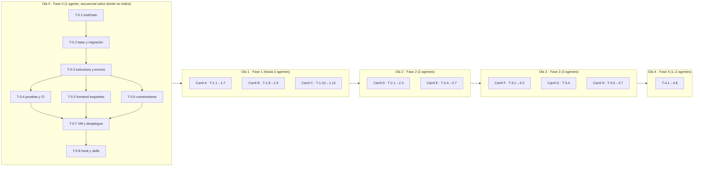

# Carta v1 — Fases y tareas

**Versión:** 1.0 · **Fecha:** 2 de noviembre de 2026 · **Destinatario:** el agente (o la persona) que ejecuta una tarea sin contexto previo.

---

## 1. Cómo leer una tarea

Cada tarea es un brief autocontenido con esta forma:

> **T-x.y — Título** · Carril · Depende de · Historias
> **Entregable** (qué existe al terminar) · **Archivos** (rutas exactas) · **Criterios** (AC a cubrir) · **Verificar** (comando que debe pasar) · **Notas**

Reglas para ejecutarla:

1. Empieza con `/tarea T-x.y`. Lee este brief, [`01_Alcance_v1.md`](01_Alcance_v1.md) y las secciones de [02](02_Arquitectura_v1.md) y [03](03_Datos_v1.md) que el brief cite. Las convenciones de API y el formato de error están en [`docs/mvp/04_API_Spec.md` §1](../mvp/04_API_Spec.md); los criterios EARS, en [`docs/mvp/01_PRD.md` §7](../mvp/01_PRD.md) y en [01 §6](01_Alcance_v1.md).
2. Planea antes de tocar código (plan mode). Si el brief contradice un documento, detente y propón el cambio al documento.
3. Una tarea no está terminada hasta que su comando de **Verificar** pasa y además pasan `uv run ruff check . && uv run ruff format --check . && uv run mypy app && uv run pytest -q`.
4. Commit con el ID: `T-1.4: fotos de platillos con variantes WebP`. Una tarea, un commit (o pocos, todos con el ID).
5. `/revisar` antes de abrir el PR. `/compound` antes de cerrar la sesión.
6. Si descubres que el plan estaba mal, corrígelo aquí y añade una fila en §11.

Estimación: una tarea ≈ una sesión de trabajo enfocada (2–4 h de agente con revisión humana). Las marcadas 🔴 bloquean lo que sigue.

---

## 2. Carriles y propiedad de carpetas

Para que varios agentes trabajen en paralelo sin conflictos, cada carril es dueño de carpetas distintas. Un agente **no edita** carpetas de otro carril; si lo necesita, lo anota en su PR y el coordinador lo resuelve.

| Carril | Carpetas | Fases |
|---|---|---|
| **A · Backend catálogo** | `app/db/`, `app/services/{menu,assets,mesas,personal}.py`, `app/api/admin/`, `migrations/`, `scripts/seed.py` | 1 |
| **B · Importación IA** | `app/services/importacion_menu.py`, `app/schemas/importacion.py`, `app/api/admin/importaciones.py`, `tests/fixtures/menus/` | 1 |
| **C · Frontend operador** | `frontend/src/admin/`, `frontend/src/compartido/` (con D/E/H coordinados) | 1 |
| **D · Backend comensal** | `app/core/seguridad.py` (invitado), `app/services/{sesion,analitica}.py`, `app/api/publico/` | 2 |
| **E · Frontend comensal** | `frontend/src/comensal/` | 2 |
| **F · Backend orden** | `app/services/{orden,comanda}.py`, `app/api/publico/orden.py` | 3 |
| **G · Backend personal** | `app/core/seguridad.py` (personal), `app/api/operacion/` | 3 |
| **H · Frontend personal y orden** | `frontend/src/personal/`, `frontend/src/comensal/orden/` | 3 |
| **I · Plataforma** | `deploy/`, `.github/`, `Dockerfile`, `Caddyfile`, `pruebas/carga/`, `scripts/` (salvo `seed.py`), `.claude/` | 0, 4 |

**Contrato primero.** La primera tarea de backend de cada fase publica los esquemas Pydantic de respuesta en `app/schemas/` y deja `/openapi.json` sirviendo aunque los endpoints devuelvan datos de ejemplo. El frontend corre `npm --prefix frontend run tipos` (openapi-typescript) y trabaja contra ese contrato con datos simulados (`frontend/src/mocks/`). Así C, E y H no esperan a que A, D, F y G terminen.

**Ramas.** `agente/T-1.4-fotos`, PR a `master`, *squash* al integrar. Cada agente trabaja en su propio *worktree* (`git worktree add ../carta-T-1.4 -b agente/T-1.4-fotos`).

---

## 3. Olas de ejecución

Dentro de una ola, el orden de integración es: backend (A, D, F+G) primero, frontend después. El frontend puede empezar al mismo tiempo gracias al contrato.

---

## 4. Fase 0 — Cimientos y primer despliegue

> **Entregable observable:** `https://staging.<dominio>/health` responde `{"status":"ok"}` desde tu teléfono, y CI está en verde.
> **Estado del repo hoy:** la aplicación no arranca (driver síncrono con motor asíncrono), `create_all()` al arrancar, pruebas con SQLite que no corren, CI escuchando ramas inexistentes (`main`/`develop` en lugar de `master`), `.gitignore` que **ignora las migraciones** (`migrations/versions/*.py`), Dockerfile con el healthcheck en una ruta equivocada, CORS abierto.

### 🔴 T-0.1 — Toolchain y configuración
**Carril:** I · **Depende de:** — · **Historias:** —
**Entregable:** el proyecto se instala con `uv sync` y arranca con `uv run uvicorn app.main:app`.
**Archivos:** `pyproject.toml` (Python ≥ 3.12; `fastapi`, `uvicorn[standard]`, `sqlalchemy[asyncio]`, `asyncpg`, `alembic`, `pydantic`, `pydantic-settings`, `httpx`, `anthropic`, `pillow`, `qrcode[pil]`, `reportlab`, `boto3`, `argon2-cffi`, `python-jose[cryptography]` o `pyjwt`, `slowapi`, `python-multipart`, `sentry-sdk[fastapi]`; dev: `pytest`, `pytest-asyncio`, `pytest-cov`, `ruff`, `mypy`, `pip-audit`, tipos), `uv.lock`, `app/core/config.py` (clase `Settings`: `DATABASE_URL` normalizado a `+asyncpg`, `ENTORNO`, `SECRET_KEY` que falla al arrancar si es corto o por defecto fuera de desarrollo, `R2_*`, `ANTHROPIC_API_KEY`, `FIREBASE_PROJECT_ID`, `DOMINIO`), `.env.example` sin secretos reales, `.gitignore` (quitar la línea de migraciones), `README.md` sección "Cómo correr".
**Verificar:** `uv sync && uv run python -c "from app.core.config import Settings; s=Settings(DATABASE_URL='postgresql://u:p@h/db', SECRET_KEY='x'*43); assert '+asyncpg' in s.DATABASE_URL; print('ok')"`
**Notas:** retirar `black`; `ruff` hace lint y formato (`[tool.ruff] line-length = 100`, `select = ["E","F","W","I","UP","B"]`). Retirar `firebase-admin` si pesa demasiado: la verificación del ID token se puede hacer con `pyjwt` + las llaves públicas de Google (`app/core/firebase.py`).

### 🔴 T-0.2 — Base de datos y migración base
**Carril:** I · **Depende de:** T-0.1 · **Historias:** —
**Entregable:** `app/db/database.py` con `create_async_engine` sobre `asyncpg`, `pool_size=10`, `max_overflow=10`; sin `create_all`; Alembic asíncrono; migración `0001_base_v1` con **todo** el esquema de [03](03_Datos_v1.md) (incluidos índices parciales, triggers INV-3 e INV-8, tipos enumerados y los tres usuarios de base como script aparte `scripts/usuarios_bd.sql`).
**Archivos:** `app/db/database.py`, `app/db/models.py` (modelos v1 completos; retirar `Escaneo`, `VistaPlatillo`, `AdRestaurante`), `migrations/env.py`, `migrations/versions/0001_base_v1.py`, `alembic.ini`, `docker-compose.yml` (PostgreSQL 16 + volumen; sin Redis ni Adminer), `app/main.py` (sin `init_db`).
**Verificar:** `docker compose up -d && uv run alembic upgrade head && uv run alembic downgrade base && uv run alembic upgrade head && psql "$DATABASE_URL_SYNC" -c "\dt" | grep -q personal_restaurante && echo ok`
**Notas:** `downgrade()` completo. Una prueba `tests/unit/test_modelos.py` comprueba que cada modelo mapea contra el esquema real (`sqlalchemy.inspect`). Usar `DeclarativeBase` y `Mapped[]` (SQLAlchemy 2.1 marca `declarative_base` como legado). **En sesiones en la nube no hay Docker:** el hook de sesión levanta PostgreSQL local y exporta `DATABASE_URL`, `DATABASE_URL_SYNC` y `TEST_DATABASE_URL`; se omite `docker compose up -d` del comando de Verificar. El guard de Bash bloquea `alembic downgrade base` fuera de pruebas: en esta tarea se corre contra la base local de desarrollo y es legítimo; si lo bloquea, usa `alembic downgrade -1` repetido o pide a la maestra que lo apruebe.

### 🔴 T-0.3 — Estructura, errores y salud
**Carril:** I · **Depende de:** T-0.2 · **Historias:** —
**Entregable:** árbol de carpetas de [02 §3](02_Arquitectura_v1.md) (`app/core/`, `app/api/{publico,operacion,admin}/`, `app/services/`, `app/schemas/`, `tests/{unit,integration}/`, `scripts/`, `deploy/`, `frontend/`, `pruebas/carga/`); envoltura de error única y manejadores (`app/core/errores.py`: `ErrorCarta(codigo, mensaje, http)` + manejadores para `HTTPException`, validación y excepciones no controladas con `request_id`); middleware de `request_id` y logs JSON; `GET /health`, `GET /ready`; sin middleware de CORS; `app/api/routes.py` reubicado en `app/api/admin/restaurantes.py` (temporal, sin auth todavía).
**Verificar:** `uv run uvicorn app.main:app --port 8000 & sleep 3 && curl -sf localhost:8000/ready | grep -q '"db":"ok"' && curl -s localhost:8000/api/v1/nada | grep -q '"codigo":"RECURSO_NO_ENCONTRADO"' && echo ok`
**Notas:** `app/services/` no importa `fastapi` (prueba en CI: `grep -rl "fastapi" app/services/ | wc -l` = 0).

### T-0.4 — Pruebas y CI
**Carril:** I · **Depende de:** T-0.3 · **Historias:** —
**Entregable:** `tests/conftest.py` con base PostgreSQL real (`TEST_DATABASE_URL`), transacción por prueba con *rollback*, `AsyncClient` de httpx sobre la app, fábricas mínimas (`restaurante`, `operador`, `mesa`); una prueba unitaria y una de integración reales; `.github/workflows/ci.yml` escuchando `master` y PRs, con servicio PostgreSQL 16, pasos `uv sync`, `ruff check`, `ruff format --check`, `mypy`, `pytest --cov=app`, `pip-audit`, `grep` de servicios sin FastAPI; eliminar `tests/test_api.py` (SQLite).
**Verificar:** `uv run pytest -q` en verde local; el workflow en verde en GitHub en un PR de prueba.
**Notas:** `pytest-asyncio` en modo `auto`. Cobertura mínima no se exige todavía; se exige ≥ 80 % en `app/services/` al cerrar la Fase 3. La base de pruebas se migra con la CLI de Alembic (`-x url=...`): mueve `url_de_pruebas()` y la fixture `esquema_migrado` de `tests/unit/test_modelos.py` a `tests/conftest.py` y reutilízalas; no crees el esquema desde los modelos.

### T-0.5 — Esqueleto del frontend
**Carril:** I (después C/E/H) · **Depende de:** T-0.3 · **Historias:** —
**Entregable:** `frontend/` con Vite + React 18 + TypeScript + React Router; tres áreas con *code splitting* (`/m/:codigo`, `/staff/:slug`, `/admin`); `src/compartido/tokens.css` con los tokens del skill `/diseno-visual` (DM Serif Display + DM Sans desde `prototipo/carta-assets/fonts/`, Crema, Vino, Dorado, radios, sombras); componentes base migrados del prototipo (`Boton`, `Chip`, `Tarjeta`, `HojaInferior`, `Avatar`); `manifest.webmanifest`; `npm run tipos` (openapi-typescript desde `http://localhost:8000/openapi.json`); `vitest` con una prueba; `scripts/presupuesto.mjs` que falla si el bundle inicial comprimido supera 250 KB; `npm run build` deja `frontend/dist/`.
**Verificar:** `npm --prefix frontend ci && npm --prefix frontend test && npm --prefix frontend run build && node frontend/scripts/presupuesto.mjs`
**Notas:** sin librerías de componentes pesadas; CSS con variables y módulos, sin Tailwind (la regla "no-line" y las sombras cálidas se hacen a mano). Las fuentes se sirven desde el propio dominio.

### T-0.6 — Imagen portable y variantes de despliegue
**Carril:** I · **Depende de:** T-0.3, T-0.5 · **Historias:** —
**Entregable:** `Dockerfile` multi-etapa (etapa Node que construye `frontend/dist`; etapa Python slim con `uv`, usuario sin privilegios, `HEALTHCHECK` a `/health`, `CMD uvicorn --workers ${WORKERS:-2}`); **la API sirve `frontend/dist`** (`StaticFiles` + respuesta `index.html` para `/m/*`, `/staff/*`, `/admin/*`; `/assets/*` con caché de 1 año, `index.html` sin caché) y pone las cabeceras HSTS, CSP, `nosniff`, `Referrer-Policy`, `Permissions-Policy` desde un middleware, de modo que la imagen no necesita ningún proxy (ADR-010 original, ADR-015); `deploy/respaldo/` (imagen pequeña con `pg_dump` + `age` + `rclone` a R2, pensada para correr con horario en cualquier destino); `deploy/railway/README.md` (estructura del proyecto: servicios `api`, `postgres`, `respaldo`; variables; comando previo al despliegue `alembic upgrade head`); `deploy/vps/` (`docker-compose.yml` con `caddy` opcional, `api`, `postgres`, `respaldo`; `Caddyfile`; `cloud-init.yml`) como anexo listo pero no ejecutado.
**Verificar:** `docker build -t carta:test . && docker run -d -p 8000:8000 --env-file .env.example -e ENTORNO=pruebas carta:test && sleep 3 && curl -sf localhost:8000/health && curl -sf localhost:8000/ | grep -q '
 /dev/null && echo ok`
**Notas:** ningún archivo de `app/` sabe en qué proveedor corre. Caddy existe sólo en la variante de VM.

### 🔴 T-0.7 — Railway, dominio y pipeline de despliegue
**Carril:** I · **Depende de:** T-0.4, T-0.6 · **Historias:** —
**Entregable:** proyecto en Railway con dos *environments* (`staging`, `produccion`), servicios `api` (desde el `Dockerfile`, con `railway.toml`: `healthcheckPath = /health`, comando previo al despliegue `uv run alembic upgrade head`, reinicio automático), `postgres` (plantilla oficial con volumen) y `respaldo` (servicio con horario diario, imagen de `deploy/respaldo/`); variables de entorno de `.env.example` cargadas en el panel; `staging` despliega solo desde `master`; `.github/workflows/deploy.yml` despliega a `produccion` en cada etiqueta `v*` con la CLI de Railway (`railway up --environment produccion`, secreto `RAILWAY_TOKEN`) y hace la prueba de humo; Cloudflare con `CNAME` proxied a los dominios de Railway para `<dominio>` y `staging.<dominio>`, regla de caché del menú y límite de tasa; `deploy/README.md` con los pasos exactos de [05 §2](05_Operacion.md) y el rollback (`railway redeploy` de la versión anterior); eliminar el `deploy.yml` de Cloud Run y mover `terraform/` a `deploy/etapa2-gcp/` con un README de una línea.
**Verificar:** `curl -sf https://staging.<dominio>/health` desde un teléfono; el workflow de producción en verde sobre una etiqueta `v0.0.1`.
**Notas:** requiere que Calvin cree la cuenta de Railway (con tarjeta), el dominio y la zona de Cloudflare (no lo puede hacer el agente). El agente deja todo listo y documenta exactamente qué valores pegar dónde. ADR-015 aceptado: Railway; la VM queda en `deploy/vps/` como anexo.

### T-0.8 — Hook de sesión y skills alineados al toolchain
**Carril:** I · **Depende de:** T-0.7 · **Historias:** —
**Entregable:** `.claude/hooks/session-start.sh` instala con `uv sync`, levanta PostgreSQL local y exporta `DATABASE_URL`/`TEST_DATABASE_URL`; `.claude/skills/desplegar/SKILL.md` (procedimiento de despliegue y rollback) y `.claude/skills/carga/SKILL.md` (cómo correr k6); `CLAUDE.md` con los comandos finales; `README.md` con el estado real.
**Verificar:** en una sesión nueva en la nube, `uv run pytest -q` pasa sin pasos manuales.

---

## 5. Fase 1 — Restaurante y menú

> **Entregable observable:** un operador entra con Google, sube el PDF de su carta, revisa el borrador, confirma, sube fotos, crea mesas e imprime los QR. Todo desde el teléfono.

### Carril A · Backend catálogo

### 🔴 T-1.1 — Modelos, invariantes y contrato de la fase
**Depende de:** T-0.4 · **Historias:** —
**Entregable:** modelos SQLAlchemy v1 verificados contra el esquema (si T-0.2 dejó pendientes); pruebas de invariantes INV-1, INV-2, INV-3, INV-7, INV-8 (`IntegrityError` al violarlas); esquemas Pydantic de respuesta de toda la Fase 1 en `app/schemas/{restaurante,menu,mesa,personal,importacion}.py` y rutas registradas que devuelven ejemplos, para que `/openapi.json` esté completo desde el primer día.
**Verificar:** `uv run pytest tests/integration/test_invariantes.py tests/unit/test_modelos.py -q && curl -s localhost:8000/openapi.json | python -c "import json,sys; d=json.load(sys.stdin); assert '/api/v1/admin/restaurantes/{rid}/importaciones' in d['paths']; print('ok')"`

### 🔴 T-1.2 — Autenticación del operador y alta del restaurante
**Depende de:** T-1.1 · **Historias:** US-15
**Entregable:** `app/core/firebase.py` verifica el ID token de Firebase (Google y enlace por correo) contra las llaves públicas con caché; dependencia `operador_actual` que resuelve `usuario` (lo crea en el primer acceso) y `operador_restaurante`; `POST /admin/restaurantes` crea restaurante + operador `propietario` + `slug` único; `GET /admin/restaurantes`; dependencia `restaurante_del_operador(rid)` que devuelve 404 si no es suyo.
**Criterios:** AC-15.1, AC-15.2, AC-15.3.
**Verificar:** `uv run pytest tests/integration/test_auth_admin.py -q` — sin token → 401; token válido sin restaurante → lista vacía; restaurante ajeno → 404.
**Notas:** en pruebas, el verificador de tokens se sustituye por uno falso vía *dependency override*. `restaurante_id` nunca viene del cuerpo: viene de la ruta y se valida contra el operador.

### T-1.3 — Categorías y platillos
**Depende de:** T-1.2 · **Historias:** US-16, US-27 (parte de datos)
**Entregable:** `app/services/menu.py` (sin FastAPI) y endpoints de [02 §5.3](02_Arquitectura_v1.md): crear, editar, reordenar (lista de IDs), desactivar (`activo=false`), marcar `disponible`; validaciones AC-16.2; invalidación de la caché del menú (`app/services/cache_menu.py`: caché en proceso de 30 s + purga de Cloudflare por API cuando hay credenciales).
**Criterios:** AC-16.1, AC-16.2, AC-16.3.
**Verificar:** `uv run pytest tests/integration/test_admin_menu.py -q`

### T-1.4 — Fotos de platillos
**Depende de:** T-1.3 · **Historias:** US-17
**Entregable:** `app/services/assets.py` con interfaz `Almacen` (implementaciones `AlmacenLocal` para desarrollo y `AlmacenS3` para R2); `POST /admin/platillos/{id}/foto` acepta JPG/PNG/HEIC ≤ 15 MB, valida por contenido (*magic bytes* + Pillow), corrige orientación EXIF, genera miniatura 400 px y detalle 1200 px en WebP con nombre por hash, guarda el original en el bucket privado, pone `imagen_tipo='foto'`; `DELETE` vuelve a `ilustracion_categoria`; `ilustracion_clave` se asigna por categoría con una tabla de 20 claves (`app/services/ilustraciones.py`).
**Criterios:** AC-17.1, AC-17.2, AC-17.3.
**Verificar:** `uv run pytest tests/integration/test_fotos.py -q` — incluye un PDF renombrado a `.jpg` rechazado y un HEIC convertido.
**Notas:** HEIC requiere `pillow-heif`. Las variantes se suben con `Cache-Control: public, max-age=31536000, immutable`.

### T-1.5 — Mesas y códigos QR
**Depende de:** T-1.2 · **Historias:** US-21
**Entregable:** `app/services/mesas.py`: crear N mesas, `codigo_publico = secrets.token_urlsafe(16)`, regenerar con revocación inmediata; `GET /admin/restaurantes/{rid}/mesas/qr.pdf` con `qrcode` + `reportlab`: una tarjeta por mesa con logo, nombre del restaurante, "Mesa 7", el QR a `https://<dominio>/m/<codigo>` y la leyenda "Escanea para ver la carta · Carta".
**Criterios:** AC-21.1, AC-21.2, AC-21.3.
**Verificar:** `uv run pytest tests/integration/test_mesas.py tests/integration/test_qr_pdf.py -q` — el QR decodificado (con `pyzbar` o `zxing-cpp` en dev) apunta a la URL correcta; el código viejo da 404 tras regenerar.

### T-1.6 — Personal y PIN
**Depende de:** T-1.2 · **Historias:** US-26 (parte del operador)
**Entregable:** `app/services/personal.py`: alta con nombre, rol y PIN de 4–6 dígitos (Argon2id vía `argon2-cffi`), editar, desactivar, reasignar PIN; endpoints de [02 §5.3](02_Arquitectura_v1.md); el PIN nunca se devuelve ni se registra en logs.
**Criterios:** INV-7; AC-26.3 (desactivar revoca).
**Verificar:** `uv run pytest tests/integration/test_personal.py -q` — la fila guardada no contiene el PIN; un PIN de 3 dígitos → 422.

### T-1.7 — Semillas de desarrollo
**Depende de:** T-1.4, T-1.5, T-1.6 · **Historias:** —
**Entregable:** `scripts/seed.py` según [03 §8](03_Datos_v1.md), idempotente (borra y recrea sólo el restaurante semilla), con fotos de muestra en `tests/fixtures/fotos/` y el PDF `tests/fixtures/menus/la-ceiba.pdf`.
**Verificar:** `uv run python scripts/seed.py && psql "$DATABASE_URL_SYNC" -c "select count(*) from platillo" | grep -q 22 && echo ok`

### Carril B · Importación de menú con IA

### 🔴 T-1.8 — Servicio de extracción
**Depende de:** T-1.1 (esquemas) · **Historias:** US-25
**Entregable:** `app/services/importacion_menu.py` con `extraer_menu(archivo: bytes, tipo: str) -> ResultadoImportacion`: llama a la API de Claude con el documento (bloque `document` base64 para PDF, `image` para JPG/PNG), instrucciones en español que piden categorías, platillos, precios con confianza, variantes, alérgenos y etiquetas sugeridos, y que tratan el documento como datos; salida estructurada validada contra `app/schemas/importacion.py` (`client.messages.parse`); modelo `claude-opus-5-5` configurable por `IMPORTACION_MODELO`; tiempo de espera 120 s; reintentos con pausa exponencial; registro de tokens usados. Cliente inyectable para pruebas.
**Criterios:** AC-25.2, AC-25.5.
**Verificar:** `uv run pytest tests/unit/test_importacion.py -q` con cliente falso (respuestas grabadas en `tests/fixtures/menus/*.json`); `uv run pytest tests/live/test_importacion_live.py -q -m live` opcional con llave real sobre 5 cartas reales de `tests/fixtures/menus/`, comprobando que ≥ 90 % de los precios salen con confianza `alta` y coinciden con los anotados a mano.
**Notas:** leer el skill `claude-api` antes de escribir el cliente (modelo, `output_config.format`, límites de PDF). Las 5 cartas de prueba las aporta Calvin (menús reales, con permiso, o descargados de sitios públicos).

### T-1.9 — Endpoints y procesamiento en segundo plano
**Depende de:** T-1.8, T-1.3 · **Historias:** US-25
**Entregable:** `POST /admin/restaurantes/{rid}/importaciones` (multipart; valida tipo por contenido, ≤ 20 MB, ≤ 30 páginas con `pypdf`; guarda en bucket privado; fila `pendiente`; 202); procesador en proceso (`app/services/procesador.py`: al arrancar y cada 10 s toma importaciones `pendiente` con `FOR UPDATE SKIP LOCKED`, marca `procesando`, llama al servicio, guarda `listo` o `fallido`); `GET .../importaciones/{id}`; `POST .../confirmar` recibe el JSON revisado, lo valida y crea categorías y platillos en una transacción (`imagen_tipo='ilustracion_categoria'`); `POST .../reintentar`.
**Criterios:** AC-25.1, AC-25.3, AC-25.4; INV-9.
**Verificar:** `uv run pytest tests/integration/test_importaciones.py -q` — con el cliente falso, el flujo completo subir → listo → confirmar crea los platillos; confirmar dos veces → 409; un PDF de 40 páginas → 413.

### Carril C · Frontend del operador

### T-1.10 — Acceso y armazón del panel
**Depende de:** T-0.5 (y el contrato de T-1.1) · **Historias:** US-15
**Entregable:** `frontend/src/admin/`: pantalla de acceso con Firebase Web SDK (Google y enlace por correo), guardado del ID token y renovación; armazón con navegación inferior en teléfono y lateral en escritorio (Menú · Mesas · Personal · Pedidos · Ajustes); selector de restaurante; estados vacíos.
**Verificar:** `npm --prefix frontend test -- admin-acceso` (con el SDK simulado) + revisión visual con el checklist de `/diseno-visual`.

### T-1.11 — Asistente de alta con importación de PDF
**Depende de:** T-1.10 · **Historias:** US-25, US-21, US-26
**Entregable:** `frontend/src/admin/alta/`: pasos *Tu restaurante* (nombre, logo) → *Tu carta* (subir PDF o fotos; progreso con sondeo cada 3 s; mensajes de "estamos leyendo tu carta") → *Revisa* (tabla editable por categoría: nombre, descripción, precio con resaltado de confianza baja, alérgenos y etiquetas como chips, agregar/quitar filas, reordenar) → *Confirmar* → *Mesas* (cuántas; descarga del PDF de QR) → *Personal* (nombre, rol, PIN) → *Listo* (enlace al menú y al acceso del personal).
**Criterios:** AC-25.3, AC-25.4, AC-25.5.
**Verificar:** `npm --prefix frontend test -- alta` con datos simulados; recorrido manual completo contra la API con el PDF semilla, cronometrado (S4: < 15 min).

### T-1.12 — Pantalla Menú
**Depende de:** T-1.10 · **Historias:** US-16, US-17, US-27
**Entregable:** `frontend/src/admin/menu/`: lista por categorías con miniatura, precio, interruptores *disponible* y *activo*; editor de platillo en hoja inferior; subida de foto con **guía de captura** (ilustración de encuadre, luz, fondo) y recorte; reordenar arrastrando; búsqueda.
**Verificar:** `npm --prefix frontend test -- admin-menu` + revisión visual.

### T-1.13 — Mesas, personal y ajustes
**Depende de:** T-1.10 · **Historias:** US-21, US-26
**Entregable:** `frontend/src/admin/{mesas,personal,ajustes}/`: mesas con regenerar y descarga del PDF; personal con alta, rol, PIN y desactivar; ajustes con nombre, logo y enlaces públicos.
**Verificar:** `npm --prefix frontend test -- admin-mesas admin-personal` + revisión visual.

---

## 6. Fase 2 — Comensal

> **Entregable observable:** un comensal escanea el QR de una mesa real y ve el menú con fotos en su teléfono en menos de 3 s, con búsqueda y filtros.

### Carril D · Backend comensal

### 🔴 T-2.1 — Token de invitado y sesión de mesa
**Depende de:** T-1.7 · **Historias:** US-01, US-02, US-03
**Entregable:** `app/core/seguridad.py`: emisión y verificación del JWT de invitado (6 h, cookie `carta_invitado` `HttpOnly; Secure; SameSite=Lax`), dependencia `invitado_actual`; `app/services/sesion.py`: entrar (crea o reanuda sesión viva de la mesa, crea miembro con alias "Comensal N" y color estable, máximo 12, `host` al primero), estado de sesión, cambio de alias con lista de bloqueo; `POST /p/sesion/entrar`, `GET /p/sesion` con ETag (02 §6), `PATCH /p/miembro`; cierre por inactividad de 3 h (tarea periódica); esquemas de respuesta de toda la fase publicados primero.
**Criterios:** AC-01.2, AC-01.3, AC-01.4, AC-02.1–AC-02.5, AC-03.1–AC-03.3.
**Verificar:** `uv run pytest tests/unit/test_token_invitado.py tests/integration/test_entrar.py tests/integration/test_sesion_estado.py tests/integration/test_alias.py -q` — 13.º miembro → 409; token manipulado → 401; código inválido → 404 sin revelar si existe en otro restaurante; segunda petición con `If-None-Match` → 304.

### T-2.2 — Menú público cacheable y detalle
**Depende de:** T-2.1 · **Historias:** US-04
**Entregable:** `GET /p/menu/{slug}` sin dependencia de cookie: categorías y platillos activos ordenados, `disponible`, URLs de imagen o clave de ilustración, "top 3" (`platillo.destacado`); `ETag` + `Cache-Control: public, max-age=30, s-maxage=60`; caché en proceso 30 s invalidada por T-1.3; `GET /p/platillos/{id}`.
**Criterios:** AC-04.1, AC-04.2, AC-04.4.
**Verificar:** `uv run pytest tests/integration/test_menu.py tests/integration/test_platillo_detalle.py -q` — tras `PATCH` de un platillo, el ETag cambia en la siguiente petición; un platillo inactivo no aparece; uno no disponible aparece marcado.

### T-2.3 — Eventos, límites de tasa y cabeceras
**Depende de:** T-2.1 · **Historias:** US-24
**Entregable:** `POST /p/eventos` (lotes ≤ 50, tipos de [01 §7](01_Alcance_v1.md), `ip_hash` con sal rotativa diaria, familia de user-agent); `app/services/analitica.py`; límites de tasa con `slowapi` según [`04_API_Spec.md` §1.5](../mvp/04_API_Spec.md); middleware de cabeceras de seguridad en la API (Caddy las pone en estáticos, la API en sus respuestas).
**Criterios:** AC-24.1, AC-24.2.
**Verificar:** `uv run pytest tests/integration/test_analitica.py tests/integration/test_rate_limit.py tests/integration/test_seguridad_headers.py -q` — ninguna fila contiene una IP; petición 121 en un minuto → 429.

### Carril E · Frontend comensal

### T-2.4 — Entrada y errores
**Depende de:** T-0.5 (contrato de T-2.1) · **Historias:** US-01, US-03
**Entregable:** `frontend/src/comensal/entrada/`: `/m/:codigo` llama a `entrar`, muestra tarjeta de bienvenida (logo, "Estás en la mesa 7", alias editable, aviso de privacidad en una línea), guarda el espejo del identificador en `localStorage` (AC-01.4); pantallas de mesa inválida, sesión cerrada, sin conexión y error genérico en el lenguaje de la marca.
**Criterios:** AC-01.3, AC-01.4, AC-01.5.
**Verificar:** `npm --prefix frontend test -- entrada` + revisión visual.

### T-2.5 — Menú (P03)
**Depende de:** T-2.4 · **Historias:** US-04, US-05, US-06
**Entregable:** `frontend/src/comensal/menu/`: inicio con "Top 3 del chef" y categorías con desplazamiento horizontal, lista con foto o ilustración, precio en DM Sans SemiBold, chips; búsqueda insensible a acentos (≥ 2 caracteres, ≤ 300 ms); filtros por alérgeno y etiqueta en hoja inferior, guardados en `localStorage`; conteo de resultados; aviso permanente de alérgenos; carga diferida de imágenes; platillo no disponible atenuado con "Agotado hoy".
**Criterios:** AC-01.1 (manual: Lighthouse móvil contra staging), AC-04.2, AC-04.3, AC-05.1–AC-05.3, AC-06.1.
**Verificar:** `npm --prefix frontend test -- filtros busqueda` + Lighthouse móvil ≥ 85 en rendimiento contra staging.

### T-2.6 — Detalle del platillo (P02)
**Depende de:** T-2.5 · **Historias:** US-04
**Entregable:** `frontend/src/comensal/platillo/`: foto grande con transición tipo resorte, descripción, ingredientes con emoji, alérgenos, etiquetas, precio, botón "Agregar a mi orden" (activo desde la Fase 3; mientras, deshabilitado con texto "Pronto"), registro de `dish_view`.
**Verificar:** revisión visual con el checklist de `/diseno-visual`; `npm --prefix frontend test -- platillo`.

### T-2.7 — PWA y presupuesto
**Depende de:** T-2.5 · **Historias:** —
**Entregable:** *service worker* (Workbox): precarga del armazón, estáticos con caché primero, API con red primero y respaldo en caché para el menú; banner "sin conexión"; `manifest` con icono y color de tema; `scripts/presupuesto.mjs` en CI; `npm run tipos` en CI para detectar desfase con el backend.
**Verificar:** `npm --prefix frontend run build && node frontend/scripts/presupuesto.mjs` (≤ 250 KB comprimido); Lighthouse PWA instalable.

---

## 7. Fase 3 — Orden en grupo, comandas y personal

> **Entregable observable:** tres teléfonos en una mesa arman su orden, ven "2 de 3 listos", confirman, y la comanda aparece con sonido en el teléfono del mesero, que la atiende, la marca servida y libera la mesa.

### Carril F · Backend orden y comanda

### 🔴 T-3.1 — Servicio de orden
**Depende de:** T-2.1 · **Historias:** US-10
**Entregable:** `app/services/orden.py` (sin FastAPI): agregar (precio **leído de la base**, platillo activo y disponible, cantidad ≥ 1, nota ≤ 140), modificar, eliminar, recalcular subtotal, rechazar cambios si `bloqueada`; esquemas de respuesta de la fase publicados primero.
**Criterios:** AC-10.1, AC-10.2, AC-10.4.
**Verificar:** `uv run pytest tests/unit/test_servicio_orden.py -q`

### 🔴 T-3.2 — Ítems, confirmación, comanda e idempotencia
**Depende de:** T-3.1 · **Historias:** US-11, US-12
**Entregable:** endpoints de ítems; `POST /p/orden/confirmar` en transacción con `SELECT … FOR UPDATE` sobre la sesión: congela precios y cantidades, `bloqueada=true`, miembro `listo`; si todos los miembros activos están listos → sesión `lista_para_enviar` y `comanda` (`secuencia` siguiente, `comanda_orden`, `total_estimado`, `num_comensales`); `POST /p/orden/deshacer` mientras no haya comanda; miembros que llegan después crean una ronda nueva (AC-12.4); `app/core/idempotencia.py` con la tabla `clave_idempotencia` (24 h, `Idempotent-Replay: true`); `GET /p/sesion` expone el estado de la comanda (`abierta` · `atendida` · `servida`).
**Criterios:** AC-11.1–AC-11.4, AC-12.1, AC-12.4, AC-12.5.
**Verificar:** `uv run pytest tests/integration/test_orden_items.py tests/integration/test_confirmar.py tests/integration/test_comanda.py tests/integration/test_idempotencia.py -q` — dos confirmaciones simultáneas (dos conexiones) crean **una** comanda; modificar un ítem bloqueado lanza `IntegrityError` por el trigger; orden vacía → 409; la misma clave devuelve la respuesta original.

### T-3.3 — Llamada al mesero y cierre de sesión
**Depende de:** T-3.2 · **Historias:** US-12, US-28
**Entregable:** `POST /p/llamar-mesero` (1 por minuto por sesión, contando en `llamada_mesero`); cierre de sesión (por el personal en T-3.4 o por inactividad) marca `cerrada`, y `GET /p/sesion` responde 410 `SESION_CERRADA` para que la PWA muestre "la mesa se cerró".
**Criterios:** AC-12.3, AC-28.2.
**Verificar:** `uv run pytest tests/integration/test_llamar_mesero.py tests/integration/test_sesion_cerrada.py -q` — segunda llamada en < 60 s → 429.

### Carril G · Backend del personal

### 🔴 T-3.4 — Acceso con PIN y operación de piso
**Depende de:** T-3.2, T-1.6 · **Historias:** US-13, US-14, US-26, US-27, US-28
**Entregable:** `app/core/seguridad.py` (parte personal): `POST /op/entrar` (comprueba PIN con Argon2id, intentos y bloqueo progresivo, mensaje uniforme, cookie `carta_personal` 12 h), `POST /op/salir`, dependencia `personal_actual` (consulta `activo` en cada petición) y `capitan_requerido`; `GET /op/personal/{slug}`; `app/services/comanda.py`: listar mesas con estado y tiempos, detalle de mesa, atender, servir, atender llamada, liberar mesa (cierra sesión y registra `cerrada_por_personal_id`), marcar platillo no disponible / disponible (registra quién y cuándo, invalida caché del menú), resumen del turno (capitán); `GET /op/mesas` y `GET /op/comandas` con ETag.
**Criterios:** AC-13.1, AC-13.3, AC-13.4 (servidor), AC-14.1, AC-26.1–AC-26.4, AC-27.1, AC-27.2, AC-28.1, AC-28.2.
**Verificar:** `uv run pytest tests/integration/test_op_entrar.py tests/integration/test_op_mesas.py tests/integration/test_op_comandas.py tests/integration/test_op_agotado.py -q` — 6.º intento de PIN en un minuto → 429; cookie de otro restaurante → 404 en todo `/op`; mesero en `/op/resumen` → 404; marcar agotado se refleja en `GET /p/menu/{slug}` con ETag nuevo.

### Carril H · Frontend del comensal (orden) y del personal

### T-3.5 — Mi orden, sesión grupal y estado (P04, P04b)
**Depende de:** T-2.6 (contrato de T-3.2) · **Historias:** US-09 (modo consulta), US-10, US-11, US-12
**Entregable:** `frontend/src/comensal/orden/`: hoja "Mi orden" con cantidades, nota, subtotal recalculado en ≤ 300 ms, persistida en `localStorage` hasta confirmar (AC-10.3); botón confirmar con `Idempotency-Key`, deshacer; sesión grupal con avatares apilados, "3 de 4 listos", tocar un avatar muestra su orden en modo consulta sin controles de edición (AC-09.1, AC-09.2); estados tras confirmar: *enviada al mesero* → *en preparación* → *servida* con ilustración; botón "Llamar al mesero" con enfriamiento visible; sondeo adaptativo (02 §6) con pausa en segundo plano.
**Criterios:** AC-09.1, AC-09.2, AC-10.1–AC-10.4 (UI), AC-11.1–AC-11.4 (UI), AC-12.3 (UI).
**Verificar:** `npm --prefix frontend test -- orden sesion-grupal` + prueba manual con tres teléfonos.

### T-3.6 — App del personal (P06, P07 simplificadas)
**Depende de:** T-0.5 (contrato de T-3.4) · **Historias:** US-13, US-14, US-26, US-27, US-28
**Entregable:** `frontend/src/personal/`: `/staff/:slug` con lista de nombres y teclado de PIN; lista de mesas con estado por color (libre · armando · lista · atendida), tiempo desde la comanda, llamadas arriba con alerta sonora (`AudioContext` desbloqueado al primer toque) y resaltado 10 s; detalle de mesa con comanda por comensal y botones *Atender*, *Servida*, *Liberar mesa*; "Agotado" como búsqueda rápida con interruptor; indicador "sin conexión" y reintento; capitán: pestaña *Turno* con el resumen; sondeo 5 s con pausa en segundo plano y petición inmediata al volver.
**Criterios:** AC-12.2, AC-13.2, AC-13.4, AC-13.5, AC-26.1, AC-26.4 (UI), AC-27.1, AC-28.1–AC-28.3.
**Verificar:** `npm --prefix frontend test -- personal` + prueba manual: con el teléfono en modo avión aparece "sin conexión"; al volver, la comanda pendiente sigue ahí.

### T-3.7 — Pedidos en vivo en el panel del operador
**Depende de:** T-3.6 · **Historias:** US-13
**Entregable:** la misma vista de mesas y comandas del personal montada en `/admin/pedidos`, con el token del operador (`GET /admin/restaurantes/{rid}/mesas-vivo`).
**Verificar:** `npm --prefix frontend test -- admin-pedidos`.

---

## 8. Fase 4 — Beta y piloto

> **Entregable observable:** un restaurante real opera con Carta una semana; seguridad, respaldos y carga verificados; reporte semanal entregado.

### T-4.1 — Seguridad verificada
**Depende de:** T-3.4 · **Entregable:** prueba parametrizada `tests/integration/test_aislamiento.py` que recorre **todas** las rutas `/op` y `/admin` del OpenAPI con credenciales de otro restaurante y exige 404; `tests/integration/test_seguridad_headers.py` ampliado; `pip-audit` y `npm audit` sin altas; Dependabot (`.github/dependabot.yml`); arranque que falla con `SECRET_KEY` débil; revisión de la lista de [05 §6](05_Operacion.md) con cada casilla marcada en el PR.
**Verificar:** `uv run pytest tests/integration/test_aislamiento.py -q` + lista completa.

### T-4.2 — Observabilidad
**Depende de:** T-0.7 · **Entregable:** Sentry en API y PWA (con `request_id` y `restaurante_id` como etiquetas, sin datos personales), UptimeRobot sobre `/health`, logs JSON con latencia por ruta, consulta G1 cada 5 min con correo al operador, `GET /metrics` básico (peticiones por ruta y estado, latencias p50/p95/p99 en ventana de 5 min).
**Verificar:** forzar un error en staging y verlo en Sentry; apagar la API y recibir el aviso en el teléfono en ≤ 3 min.

### T-4.3 — Respaldos y restauración probada
**Depende de:** T-0.6 · **Entregable:** contenedor `respaldo` funcionando en staging y prod (`pg_dump -Fc` + `age` + `rclone` a R2, 30 días de ciclo de vida); `scripts/restaurar.sh`; primera restauración ejecutada contra una base temporal con las pruebas de integración en verde; registro en `docs/plan/perf/restauraciones.md`.
**Verificar:** `scripts/restaurar.sh <fecha> && TEST_DATABASE_URL=<temporal> uv run pytest tests/integration -q`

### T-4.4 — Pruebas de carga y ajuste
**Depende de:** T-3.6 · **Entregable:** `pruebas/carga/*.js` (k6) con los cinco escenarios de [02 §10.3](02_Arquitectura_v1.md); `scripts/sembrar_carga.py`; resultados p50/p95/p99 y CPU en `docs/plan/perf/<fecha>.md`; ajustes aplicados (workers, pool, índices, sondeo adaptativo) hasta cumplir los SLOs de 02 §10.2; `EXPLAIN ANALYZE` de las consultas críticas con 10,000 platillos y 1,000 sesiones.
**Verificar:** todos los SLOs en verde en el informe; ninguna consulta crítica > 20 ms.

### T-4.5 — Confianza y legal
**Depende de:** T-0.7 · **Entregable:** páginas `/acerca` (quién hace Carta, contacto), `/privacidad` (LFPDPPP 2025; qué se guarda y qué no; IPs en registros 30 días), `/terminos`; aviso en la entrada del comensal y en el acceso del personal; plantilla de acuerdo de piloto en `docs/piloto/acuerdo.md`; favicon, `og:image` y título para que el enlace se vea bien al compartirlo.
**Verificar:** revisión por abogado documentada; las tres páginas responden 200 y están enlazadas desde el pie de la PWA.

### T-4.6 — Métricas mínimas y reporte
**Depende de:** T-2.3, T-3.2 · **Entregable:** consultas SQL para M1–M4 y G1 en `app/services/metricas.py`; `GET /admin/restaurantes/{rid}/resumen` (escaneos y órdenes de hoy y de la semana) y tarjeta en el panel; `scripts/reporte_semanal.py` → Markdown ([05 §10](05_Operacion.md)).
**Criterios:** AC-24.3.
**Verificar:** `uv run pytest tests/integration/test_metricas.py -q` con eventos sembrados y valores calculados a mano.

### T-4.7 — Ensayo en restaurante real
**Depende de:** T-4.1–T-4.6 · **Entregable:** el procedimiento de [05 §9](05_Operacion.md) ejecutado en el primer restaurante con iPhone y Android; lista de 12 pasos (`docs/piloto/ensayo.md`, derivada de `07_Test_Strategy.md` §5 sin AR) firmada; hallazgos convertidos en tareas.
**Verificar:** los 12 pasos en verde; ninguna comanda perdida en 3 días de operación.

### T-4.9 — Trazabilidad y contrato en CI
**Depende de:** T-3.4 · **Entregable:** `scripts/verificar_trazabilidad.py --fase N --estricto` en CI para cada fase cerrada (toda prueba de criterio lleva `@pytest.mark.ac`); `schemathesis` como dependencia de desarrollo y paso de CI contra `/openapi.json` con la API levantada sobre la semilla (`--checks all`, excluyendo rutas de subida de archivos si hace falta); `docs/piloto/ensayo.md` con los criterios manuales listados por ID para que el verificador los cuente.
**Verificar:** `uv run python scripts/verificar_trazabilidad.py --fase 1 --fase 2 --fase 3 --estricto` en verde y el paso de `schemathesis` en verde en CI.
**Notas:** ver `docs/plan/07_Spec_Driven.md` §4.

### T-4.8 — Lanzamiento beta
**Depende de:** T-4.7 · **Entregable:** etiqueta `v0.1.0` desplegada a producción; `README.md` y `docs/plan/README.md` con el estado; primer reporte semanal entregado; lista de "qué pedimos a los siguientes 4 restaurantes".
**Verificar:** `curl -sf https://<dominio>/health` y un restaurante operando en producción.

---

## 9. Fase 5 — Después (no se construye ahora)

En orden tentativo de valor: ilustración generada por IA para platillos sin foto (servidor, bandera) → experimento de generación local en el dispositivo (WebGPU) → notificaciones push para el personal → asignación de mesas por mesero → cuenta opcional del comensal → analytics del restaurante (P09, P12) → modelo 3D desde fotos generado localmente y revisado (vuelve INV-5) → pagos y propina → multi-sucursal → migración a Cloud Run cuando un disparador de [02 §11.3](02_Arquitectura_v1.md) lo pida.

---

## 10. Criterio de terminado de la v1

- [ ] Las 45 tareas de las Fases 0–4 tienen su comando de verificación en verde.
- [ ] Las historias US-01–06, US-10–17, US-21, US-24–28 tienen al menos una prueba automatizada por criterio EARS (o un paso manual documentado en `docs/piloto/ensayo.md`).
- [ ] `pytest` completo con cobertura ≥ 80 % en `app/services/`.
- [ ] Los SLOs de 02 §10.2 medidos y en verde en staging.
- [ ] Lista de seguridad de 05 §6 completa.
- [ ] Un restaurante real operando 7 días sin comandas perdidas.
- [ ] `CLAUDE.md` ≤ 150 líneas, con el detalle en skills.

---

## 11. Registro de cambios del plan

| Fecha | Tarea | Qué se descubrió | Cambio aplicado |
|---|---|---|---|
| 2026-11-02 | — | El plan de agosto construía 3D/AR como núcleo, exigía Redis/VPC/Cloud Run desde el día uno y no tenía rol de mesero. Decisiones del 2 de noviembre. | Este plan sustituye a `06_Implementation_Plan.md`; ADR-011 a ADR-014 |
| 2026-11-05 | T-0.6, T-0.7 | El análisis de hosting (`06_Hosting.md`) mostró que la fricción de operar una VM pesa más que los 5–15 USD/mes que ahorra. | ADR-015 (propuesta): primer despliegue en Railway; T-0.6 deja la imagen agnóstica (la API sirve los estáticos) y la VM como anexo; T-0.7 despliega en Railway. |
| 2026-11-05 | T-0.1 | `tests/test_api.py` (SQLite con tipos de PostgreSQL) impedía que `pytest` pasara la puerta de calidad de T-0.1; `uv sync` resolvió `anthropic` 2.x, FastAPI 0.162 y SQLAlchemy 2.1 (la 2.1 marca `declarative_base` como legado); `ruff format .` reformateaba bloques de código dentro de `docs/*.md`. | `tests/test_api.py` se eliminó en T-0.1 (T-0.4 ya no lo hace); `tests/unit/test_config.py` cubre `Settings`; `app/db/database.py` usa el `Settings` nuevo desde T-0.1; T-0.2 debe usar `DeclarativeBase` y `Mapped[]`; `docs` y `*.md` excluidos de ruff. |
| 2026-11-05 | T-0.2 | `03_Datos_v1.md` tenía tres huecos: el índice `(categoria_id, orden)` de §5 exige una columna `orden` que `platillo` no tenía; `importacion_menu.solicitado_por` era `NOT NULL` y a la vez `ON DELETE SET NULL` (fallaría en el primer borrado); `usuario.perfil_alimentario` (Fase 1) contradice la regla dura 10. El guard de Bash también bloquea escribir con heredoc cualquier archivo que mencione la llamada prohibida de la regla 3. | `03` §1–§3 corregidos: `platillo.orden` + `idx_platillo_categoria_orden`, `solicitado_por ... ON DELETE RESTRICT`, sin `perfil_alimentario`; nota con los detalles de la migración real. `tests/unit/test_modelos.py` parte la cadena prohibida en dos. `docker-compose.yml` crea también `carta_test` (`scripts/init_bd_desarrollo.sql`). |
| 2026-11-05 | T-0.2 (revisión de maestra) | Tres revisores (seguridad, pruebas, adversarial) rompieron la primera migración con SQL real: INV-3 no vigilaba la orden de OLD al mover un ítem, no bloqueaba la fila (carrera con la confirmación) y no impedía borrar una orden bloqueada; INV-8 se burlaba cambiando `sesion_id` de los padres; una orden podía entrar en dos comandas; faltaban CHECK de dominio (notas ≤ 140, PIN sólo como hash Argon2id, capacidad, colores, listas JSONB, INV-9); los `UNIQUE` de nombre y número impedían reusar tras la baja lógica; 14 FKs con cascada sin índice; `env.py` pasaba la URL por el `.ini` (una contraseña con `%` rompía `upgrade`); la prueba de mapeo no veía CHECK, `server_default`, predicados ni eventos de triggers; `carta_lector` leía `pin_hash`. | `0001_base_v1` corregida en sitio (sin 0002): triggers con `FOR SHARE`, OLD y NEW, `search_path` fijo, `sesion_id` inmutable y `BEFORE DELETE`; `UNIQUE (orden_id)`; 29 CHECK; índices únicos parciales `WHERE activo` sobre `lower(btrim(nombre))`; índice en toda FK con cascada (regla nueva en 03 §5); `env.py` sin `.ini`; `test_modelos.py` con 35 pruebas (CHECK, triggers exactos, predicados exactos, FK con índice, checks de dominio, salvaguarda de base `*test*`); `usuarios_bd.sql` con `\getenv` y permisos por columna; 03 §2, §3, §5, §6, §8 actualizados. |
