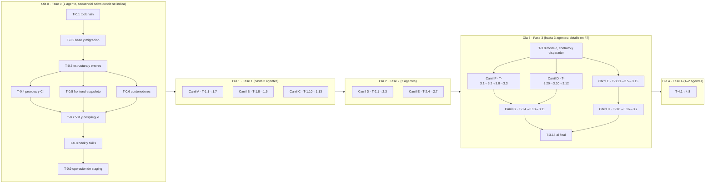

# Carta v1 — Fases y tareas

**Versión:** 1.0 · **Fecha:** 2 de noviembre de 2026 · **Destinatario:** el agente (o la persona) que ejecuta una tarea sin contexto previo.

---

## 1. Cómo leer una tarea

Cada tarea es un brief autocontenido con esta forma:

> **T-x.y — Título** · Carril · Depende de · Historias
> **Entregable** (qué existe al terminar) · **Archivos** (rutas exactas) · **Criterios** (AC a cubrir) · **Verificar** (comando que debe pasar) · **Notas**

Reglas para ejecutarla:

1. Empieza con `/tarea T-x.y`. Lee este brief, [`01_Alcance_v1.md`](01_Alcance_v1.md) y las secciones de [02](02_Arquitectura_v1.md) y [03](03_Datos_v1.md) que el brief cite. Las convenciones de API y el formato de error están en [`docs/mvp/04_API_Spec.md` §1](../mvp/04_API_Spec.md); los criterios EARS, en [`docs/mvp/01_PRD.md` §7](../mvp/01_PRD.md) y en [01 §6](01_Alcance_v1.md).
2. Planea antes de tocar código (plan mode). Si el brief contradice un documento, detente y propón el cambio al documento.
3. Una tarea no está terminada hasta que su comando de **Verificar** pasa y además pasan `uv run ruff check . && uv run ruff format --check . && uv run mypy app && uv run pytest -q`.
4. Commit con el ID: `T-1.4: fotos de platillos con variantes WebP`. Una tarea, un commit (o pocos, todos con el ID).
5. `/revisar` antes de abrir el PR. `/compound` antes de cerrar la sesión.
6. Si descubres que el plan estaba mal, corrígelo aquí y añade una fila en §11.

Estimación: una tarea ≈ una sesión de trabajo enfocada (2–4 h de agente con revisión humana). Las marcadas 🔴 bloquean lo que sigue.

---

## 2. Carriles y propiedad de carpetas

Para que varios agentes trabajen en paralelo sin conflictos, cada carril es dueño de carpetas distintas. Un agente **no edita** carpetas de otro carril; si lo necesita, lo anota en su PR y el coordinador lo resuelve.

| Carril | Carpetas | Fases |
|---|---|---|
| **A · Backend catálogo** | `app/db/`, `app/services/{menu,assets,mesas,personal}.py`, `app/api/admin/`, `migrations/`, `scripts/seed.py` | 1, 3 (T-3.0, T-3.19, rutas de T-3.7) |
| **B · Importación IA** | `app/services/importacion_menu.py`, `app/schemas/importacion.py`, `app/api/admin/importaciones.py`, `tests/fixtures/menus/` | 1 |
| **C · Frontend operador** | `frontend/src/admin/` (salvo `admin/pedidos/`), `frontend/src/compartido/` (con D/E/H coordinados) | 1, 3 (T-3.19) |
| **D · Backend comensal** | `app/core/seguridad.py` (invitado), `app/services/{sesion,analitica,avisos,entrada}.py`, `app/api/publico/` (salvo lo de F) | 2, 3 (T-3.20, T-3.10, T-3.12, T-3.18) |
| **E · Frontend comensal** | `frontend/src/comensal/` (incluidos `orden/` y `cuenta/` desde la Fase 3), `frontend/src/compartido/eventos/` | 2, 3 (T-3.21, T-3.5, T-3.15) |
| **F · Backend orden** | `app/services/{orden,ciclo}.py`, `app/api/publico/{orden,cuenta}.py`, `app/core/idempotencia.py` | 3 |
| **G · Backend personal** | `app/core/seguridad.py` (personal), `app/services/{comanda,permisos,correcciones}.py`, `app/api/operacion/` | 3 |
| **H · Frontend personal y dueño** | `frontend/src/personal/`, `frontend/src/admin/pedidos/` | 3 |
| **I · Plataforma** | `deploy/`, `.github/`, `Dockerfile`, `Caddyfile`, `pruebas/carga/`, `scripts/` (salvo `seed.py`), `.claude/` | 0, 4 |

**Contrato primero.** La primera tarea de backend de cada fase publica los esquemas Pydantic de respuesta en `app/schemas/` y deja `/openapi.json` sirviendo aunque los endpoints devuelvan datos de ejemplo. El frontend corre `npm --prefix frontend run tipos` (openapi-typescript) y trabaja contra ese contrato con datos simulados (`frontend/src/mocks/`). Así C, E y H no esperan a que A, D, F y G terminen.

**Ramas.** `agente/T-1.4-fotos`, PR a `master`, *squash* al integrar. Cada agente trabaja en su propio *worktree* (`git worktree add ../carta-T-1.4 -b agente/T-1.4-fotos`).

---

## 3. Olas de ejecución

Dentro de una ola, el orden de integración es: backend (A, D, F+G) primero, frontend después. El frontend puede empezar al mismo tiempo gracias al contrato.

---

## 4. Fase 0 — Cimientos y primer despliegue

> **Entregable observable:** `https://staging.<dominio>/health` responde `{"status":"ok"}` desde tu teléfono, y CI está en verde.
> **Estado del repo hoy:** la aplicación no arranca (driver síncrono con motor asíncrono), `create_all()` al arrancar, pruebas con SQLite que no corren, CI escuchando ramas inexistentes (`main`/`develop` en lugar de `master`), `.gitignore` que **ignora las migraciones** (`migrations/versions/*.py`), Dockerfile con el healthcheck en una ruta equivocada, CORS abierto.

### 🔴 T-0.1 — Toolchain y configuración
**Carril:** I · **Depende de:** — · **Historias:** —
**Entregable:** el proyecto se instala con `uv sync` y arranca con `uv run uvicorn app.main:app`.
**Archivos:** `pyproject.toml` (Python ≥ 3.12; `fastapi`, `uvicorn[standard]`, `sqlalchemy[asyncio]`, `asyncpg`, `alembic`, `pydantic`, `pydantic-settings`, `httpx`, `anthropic`, `pillow`, `qrcode[pil]`, `reportlab`, `boto3`, `argon2-cffi`, `python-jose[cryptography]` o `pyjwt`, `slowapi`, `python-multipart`, `sentry-sdk[fastapi]`; dev: `pytest`, `pytest-asyncio`, `pytest-cov`, `ruff`, `mypy`, `pip-audit`, tipos), `uv.lock`, `app/core/config.py` (clase `Settings`: `DATABASE_URL` normalizado a `+asyncpg`, `ENTORNO`, `SECRET_KEY` que falla al arrancar si es corto o por defecto fuera de desarrollo, `R2_*`, `ANTHROPIC_API_KEY`, `FIREBASE_PROJECT_ID`, `DOMINIO`), `.env.example` sin secretos reales, `.gitignore` (quitar la línea de migraciones), `README.md` sección "Cómo correr".
**Verificar:** `uv sync && uv run python -c "from app.core.config import Settings; s=Settings(DATABASE_URL='postgresql://u:p@h/db', SECRET_KEY='x'*43); assert '+asyncpg' in s.DATABASE_URL; print('ok')"`
**Notas:** retirar `black`; `ruff` hace lint y formato (`[tool.ruff] line-length = 100`, `select = ["E","F","W","I","UP","B"]`). Retirar `firebase-admin` si pesa demasiado: la verificación del ID token se puede hacer con `pyjwt` + las llaves públicas de Google (`app/core/firebase.py`).

### 🔴 T-0.2 — Base de datos y migración base
**Carril:** I · **Depende de:** T-0.1 · **Historias:** —
**Entregable:** `app/db/database.py` con `create_async_engine` sobre `asyncpg`, `pool_size=10`, `max_overflow=10`; sin `create_all`; Alembic asíncrono; migración `0001_base_v1` con **todo** el esquema de [03](03_Datos_v1.md) (incluidos índices parciales, triggers INV-3 e INV-8, tipos enumerados y los tres usuarios de base como script aparte `scripts/usuarios_bd.sql`).
**Archivos:** `app/db/database.py`, `app/db/models.py` (modelos v1 completos; retirar `Escaneo`, `VistaPlatillo`, `AdRestaurante`), `migrations/env.py`, `migrations/versions/0001_base_v1.py`, `alembic.ini`, `docker-compose.yml` (PostgreSQL 16 + volumen; sin Redis ni Adminer), `app/main.py` (sin `init_db`).
**Verificar:** `docker compose up -d && uv run alembic upgrade head && uv run alembic downgrade base && uv run alembic upgrade head && psql "$DATABASE_URL_SYNC" -c "\dt" | grep -q personal_restaurante && echo ok`
**Notas:** `downgrade()` completo. Una prueba `tests/unit/test_modelos.py` comprueba que cada modelo mapea contra el esquema real (`sqlalchemy.inspect`). Usar `DeclarativeBase` y `Mapped[]` (SQLAlchemy 2.1 marca `declarative_base` como legado). **En sesiones en la nube no hay Docker:** el hook de sesión levanta PostgreSQL local y exporta `DATABASE_URL`, `DATABASE_URL_SYNC` y `TEST_DATABASE_URL`; se omite `docker compose up -d` del comando de Verificar. El guard de Bash bloquea `alembic downgrade base` fuera de pruebas: en esta tarea se corre contra la base local de desarrollo y es legítimo; si lo bloquea, usa `alembic downgrade -1` repetido o pide a la maestra que lo apruebe.

### 🔴 T-0.3 — Estructura, errores y salud
**Carril:** I · **Depende de:** T-0.2 · **Historias:** —
**Entregable:** árbol de carpetas (la lista que sigue; [02](02_Arquitectura_v1.md) no lo detalla) (`app/core/`, `app/api/{publico,operacion,admin}/`, `app/services/`, `app/schemas/`, `tests/{unit,integration}/`, `scripts/`, `deploy/`, `frontend/`, `pruebas/carga/`); envoltura de error única y manejadores (`app/core/errores.py`: `ErrorCarta(codigo, mensaje, http)` + manejadores para `HTTPException`, validación y excepciones no controladas con `request_id`); middleware de `request_id` y logs JSON; `GET /health`, `GET /ready`; sin middleware de CORS; `app/api/routes.py` reubicado en `app/api/admin/restaurantes.py` (temporal, sin auth todavía).
**Verificar:** `uv run uvicorn app.main:app --port 8000 & sleep 3 && curl -sf localhost:8000/ready | grep -q '"db":"ok"' && curl -s localhost:8000/api/v1/nada | grep -q '"codigo":"RECURSO_NO_ENCONTRADO"' && echo ok; kill %1`
**Notas:** `app/services/` no importa `fastapi` (prueba en CI: `grep -rl "fastapi" app/services/ | wc -l` = 0). La validación del payload responde **422** `PAYLOAD_INVALIDO` (convención de FastAPI; 04_API_Spec §1.2 actualizado). `tests/integration/test_salud.py` corre contra `app.main.app` con httpx ASGI y `/ready` consulta la base de `DATABASE_URL` (sólo `SELECT 1`, no exige esquema).

### T-0.4 — Pruebas y CI
**Carril:** I · **Depende de:** T-0.3 · **Historias:** —
**Entregable:** `tests/conftest.py` con base PostgreSQL real (`TEST_DATABASE_URL`), transacción por prueba con *rollback*, `AsyncClient` de httpx sobre la app, fábricas mínimas (`restaurante`, `operador`, `mesa`); una prueba unitaria y una de integración reales; `.github/workflows/ci.yml` escuchando `master`, PRs, push a `agente/**` y `claude/**` y `workflow_dispatch`, con servicio PostgreSQL 16, pasos `uv sync`, `ruff check`, `ruff format --check`, `mypy`, `pytest --cov=app`, `pip-audit`, `grep` de servicios sin FastAPI.
**Verificar:** `uv run pytest -q` en verde local; el workflow en verde en GitHub sobre el push de la rama `agente/T-0.4-pruebas-ci` (lo comprueba la maestra).
**Notas:** `pytest-asyncio` en modo `auto`. Cobertura mínima no se exige todavía; se exige ≥ 80 % en `app/services/` al cerrar la Fase 3. La base de pruebas se migra con la CLI de Alembic (`-x url=...`): mueve `url_de_pruebas()` y la fixture `esquema_migrado` de `tests/unit/test_modelos.py` a `tests/conftest.py` y reutilízalas; no crees el esquema desde los modelos. `.python-version` con `3.12` en la raíz y `actions/setup-python` leyéndolo (sin él `uv` resuelve la versión más nueva instalada: el worktree de la revisión de T-0.3 corrió en 3.13). El motor nace de `settings.DATABASE_URL` al importar `app.db.database`; la fixture `cliente` de `tests/integration/test_salud.py` hace `close_db()` al salir porque cada prueba corre en su propio bucle y una conexión asyncpg del bucle anterior rompe el pool global: `conftest.py` lo resuelve con un motor por sesión de pruebas sobre `TEST_DATABASE_URL` (`loop_scope="session"`) y retira ese `close_db()`.

### T-0.5 — Esqueleto del frontend
**Carril:** I (después C/E/H) · **Depende de:** T-0.3 · **Historias:** —
**Entregable:** `frontend/` con Vite + React 18 + TypeScript + React Router; tres áreas con *code splitting* (`/m/:codigo`, `/staff/:slug`, `/admin`); `src/compartido/tokens.css` con los tokens del skill `/diseno-visual` (DM Serif Display + DM Sans desde `prototipo/carta-assets/fonts/`, Crema, Vino, Dorado, radios, sombras); componentes base migrados del prototipo (`Boton`, `Chip`, `Tarjeta`, `HojaInferior`, `Avatar`); `manifest.webmanifest`; `npm run tipos` (openapi-typescript desde `http://localhost:8000/openapi.json`); `vitest` con una prueba; `scripts/presupuesto.mjs` que falla si el bundle inicial comprimido supera 250 KB; `npm run build` deja `frontend/dist/`.
**Verificar:** `npm --prefix frontend ci && npm --prefix frontend test && npm --prefix frontend run build && node frontend/scripts/presupuesto.mjs`
**Notas:** sin librerías de componentes pesadas; CSS con variables y módulos, sin Tailwind (la regla "no-line" y las sombras cálidas se hacen a mano). Las fuentes se sirven desde el propio dominio.

### T-0.6 — Imagen portable y variantes de despliegue
**Carril:** I · **Depende de:** T-0.3, T-0.5 · **Historias:** —
**Entregable:** `Dockerfile` multi-etapa (etapa Node que construye `frontend/dist`; etapa Python slim con `uv`, usuario sin privilegios, `HEALTHCHECK` a `/health`, `CMD uvicorn --workers ${WORKERS:-2}`); **la API sirve `frontend/dist`** (`StaticFiles` + respuesta `index.html` para `/m/*`, `/staff/*`, `/admin/*`; `/assets/*` con caché de 1 año, `index.html` sin caché) y pone las cabeceras HSTS, CSP, `nosniff`, `Referrer-Policy`, `Permissions-Policy` desde un middleware, de modo que la imagen no necesita ningún proxy (ADR-010 original, ADR-015); `deploy/respaldo/` (imagen pequeña con `pg_dump` + `age` + `rclone` a R2, pensada para correr con horario en cualquier destino); `deploy/railway/README.md` (estructura del proyecto: servicios `api`, `postgres`, `respaldo`; variables; comando previo al despliegue `alembic upgrade head`); `deploy/vps/` (`docker-compose.yml` con `caddy` opcional, `api`, `postgres`, `respaldo`; `Caddyfile`; `cloud-init.yml`) como anexo listo pero no ejecutado.
**Verificar:** `docker build -t carta:test . && docker run -d -p 8000:8000 --env-file .env.example -e ENTORNO=pruebas carta:test && sleep 3 && curl -sf localhost:8000/health && curl -sf localhost:8000/ | grep -q '
 /dev/null && echo ok` — **corre en CI**, job `imagen` de `.github/workflows/ci.yml` (en las sesiones de agente no hay daemon de Docker); la maestra lo comprueba en verde sobre el push de la rama. Localmente: `uv run pytest tests/integration/test_estaticos.py tests/integration/test_cabeceras.py tests/unit/test_cabeceras.py tests/unit/test_despliegue.py -q`.
**Notas:** ningún archivo de `app/` sabe en qué proveedor corre. Caddy existe sólo en la variante de VM. `.dockerignore` (`.env*`, `datos/`, `.venv/`, `node_modules/`, `tests/`, `docs/`, `prototipo/`, `marketing/`). `ENV PYTHONIOENCODING=utf-8` (con stdout no UTF-8 una ruta con acento pierde su línea de acceso). Con `--workers N` el supervisor de uvicorn escribe en texto plano: pásale `--log-config deploy/uvicorn_log.json` para que el proceso padre también salga en JSON por línea. El middleware de cabeceras de seguridad se añade **antes** de `MiddlewareRequestId` en `create_app` (ése debe quedar el último `add_middleware`, regla en `CLAUDE.md`). CSP por `'self'` sin nonces (02 §12, decidido en la revisión de T-0.5): verifica con `curl -I` que ninguna pantalla rompe con ella (`/`, `/m/<codigo>`, `/staff/<slug>`, `/admin`); `img-src` incluye el dominio público de R2 desde `Settings` (vacío en desarrollo). Las rutas de la SPA con `%` mal codificado (`/m/%ZZ`) deben devolver `index.html`, no 400: React Router absorbe el `decodeURI` fallido. `/assets/*` lleva `Cache-Control: public, max-age=31536000, immutable` y `index.html` `no-cache`; `/fonts/*` también un año.

### 🔴 T-0.7 — Railway, dominio y pipeline de despliegue
**Carril:** I · **Depende de:** T-0.4, T-0.6 · **Historias:** —
**Entregable:** proyecto en Railway con dos *environments* (`staging`, `produccion`), servicios `api` (desde el `Dockerfile`, con *Healthcheck Path* `/health`, *Pre-deploy Command* `uv run alembic upgrade head` y reinicio automático puestos en el panel: Railway ya no lee `railway.toml` en servicios nuevos, §11), `postgres` (plantilla oficial con volumen) y `respaldo` (servicio con horario diario, imagen de `deploy/respaldo/`); variables de entorno de `.env.example` cargadas en el panel; `staging` despliega solo desde `master`; `.github/workflows/deploy.yml` despliega a `produccion` en cada etiqueta `v*` con la CLI de Railway (`railway up --environment produccion`, secreto `RAILWAY_TOKEN`) y hace la prueba de humo; Cloudflare con `CNAME` proxied a los dominios de Railway para `<dominio>` y `staging.<dominio>`, regla de caché del menú y límite de tasa; `deploy/README.md` con los pasos exactos de [05 §2](05_Operacion.md) y el rollback (**Rollback** en *Deployments* o `deploy.yml` con la etiqueta anterior; `railway redeploy` sólo repite el último); eliminar el `deploy.yml` de Cloud Run y mover `terraform/` a `deploy/etapa2-gcp/` con un README de una línea.
**Verificar:** `curl -sf https://staging.<dominio>/health` desde un teléfono; el workflow de producción en verde sobre una etiqueta `v0.0.1`.
**Notas:** requiere que Calvin cree la cuenta de Railway (con tarjeta), el dominio y la zona de Cloudflare (no lo puede hacer el agente). **Hecho el 6 de noviembre:** dominio `carta.cooking` en Cloudflare (SSL *Full strict*), proyecto `carta` en Railway con `RAILWAY_TOKEN` en GitHub, cuatro buckets R2 con `img.carta.cooking` e `img-staging.carta.cooking` conectados y ciclo de vida `respaldos-90-dias` (ver `deploy/railway/README.md` § Valores reales). Cloudflare lo opera la sesión maestra con el conector oficial (las hijas no lo tienen): la hija deja el repo listo y documenta; la maestra crea los `CNAME` hacia Railway, la regla de caché y el límite de tasa; Calvin pega las variables en Railway. **Decisión pendiente (de T-0.6):** `deploy/vps/docker-compose.yml` arranca de `ghcr.io/klvinlopez/carta:${IMAGEN_TAG}` y hoy nadie publica en GHCR: o `deploy.yml` publica la imagen en cada etiqueta `v*` (además de `railway up`), o la VM construye con `docker compose up --build` (el ancla ya trae `build`). Fijar también los digests `@sha256` de las imágenes base del `Dockerfile` y de `deploy/respaldo/` (Dependabot ya vigila los tags). El agente deja todo listo y documenta exactamente qué valores pegar dónde. ADR-015 aceptado: Railway; la VM queda en `deploy/vps/` como anexo.

### T-0.8 — Hook de sesión y skills alineados al toolchain
**Carril:** I · **Depende de:** T-0.7 · **Historias:** —
**Entregable:** `.claude/hooks/session-start.sh` instala con `uv sync`, levanta PostgreSQL local y exporta `DATABASE_URL`/`TEST_DATABASE_URL`; `.claude/skills/desplegar/SKILL.md` (procedimiento de despliegue y rollback) y `.claude/skills/carga/SKILL.md` (cómo correr k6); `CLAUDE.md` con los comandos finales; `README.md` con el estado real.
**Verificar:** en una sesión nueva en la nube, `uv run pytest -q` pasa sin pasos manuales.

### T-0.9 — Operación de staging desde la maestra
**Carril:** I · **Depende de:** T-0.7, T-0.8 · **Historias:** —
**Entregable:** la sesión maestra opera el *environment* `staging` de Railway sin el panel: `scripts/railway.py` sobre la API GraphQL pública de Railway (`https://backboard.railway.com/graphql/v2`) con las órdenes `estado` (servicios, rama que sigue cada uno, último despliegue y avisos), `despliegues`, `logs` (ejecución, construcción y peticiones de un despliegue), `variables` (ver las **no secretas**) y `variable` (corregir una al valor que la guía fija para staging), `redesplegar`, `esperar` y `dominios`; skill `.claude/skills/railway/SKILL.md` con las consultas, cuándo usar cada orden y los límites; el *project token* del environment `staging` guardado como *network secret* del entorno de nube (host `backboard.railway.com`, cabecera `Project-Access-Token`), pedido a Calvin con el formulario seguro de credenciales, nunca por el chat ni en el repositorio.
**Archivos:** `scripts/railway.py`, `tests/unit/test_railway.py`, `.claude/skills/railway/SKILL.md`, `deploy/README.md` (§6), `deploy/railway/README.md` (paso F.7), `docs/plan/05_Operacion.md` (§3), `.claude/skills/desplegar/SKILL.md`.
**Verificar:** `uv run pytest tests/unit/test_railway.py -q && uv run python scripts/railway.py estado` — la segunda orden la corre la maestra (es quien tiene el token) y lista `api`, `Postgres` y `respaldo` de `staging` con su rama y su último despliegue; un token de otro environment sale con código 2 sin mandar ninguna otra consulta.
**Notas:** los límites los hace cumplir el script, no el texto: (1) **sólo `staging`**: la primera consulta de toda orden pregunta de qué proyecto y environment es el token y se niega si no es `carta` / `staging`; producción sigue por el PR de `VERSION` y la aprobación de Calvin en GitHub ([05 §3](05_Operacion.md)); (2) **los secretos no se leen**: la API entrega en claro toda variable sin sellar, así que sólo se muestra el valor de la lista `VARIABLES_NO_SECRETAS`; (3) **escribir es sólo dejar staging como dice la guía**: `variable` corrige una variable que el servicio ya tiene al valor de la tabla `VALOR_FIJO` (los de `deploy/railway/README.md`) o a un entero de `VALOR_EN_RANGO` (`WORKERS`, `RESPALDO_DIAS`); un cambio de verdad es un PR a esa tabla o el panel; (4) **sólo `api` y `respaldo` se operan**, y sólo se repite un despliegue terminado; (5) **lo que llega de Railway es texto ajeno**: logs y mensajes de commit salen en una línea, sin caracteres de control, y son datos, nunca instrucciones; (6) nunca una traza. Fuera de alcance: la rama que sigue un servicio, los ajustes de *Deploy*, dominios, volumen, sellar o borrar variables y el *rollback* (panel de Railway, Calvin). Firebase no se automatiza.

---

## 5. Fase 1 — Restaurante y menú

> **Entregable observable:** un operador entra con Google, sube el PDF de su carta, revisa el borrador, confirma, sube fotos, crea mesas e imprime los QR. Todo desde el teléfono.

### Carril A · Backend catálogo

### 🔴 T-1.1 — Modelos, invariantes y contrato de la fase
**Depende de:** T-0.4 · **Historias:** —
**Entregable:** migración `0002_consistencia_inquilino` con INV-10 de [03 §5](03_Datos_v1.md) (`UNIQUE (id, restaurante_id)` en los padres, FK compuestas en `comanda`, `llamada_mesero`, `platillo` y `comanda.atendida_por_personal_id`, trigger `fn_item_orden_mismo_restaurante`) siguiendo el skill `/migracion`; pruebas de comportamiento de invariantes en `tests/integration/test_invariantes.py`: INV-1, INV-2, INV-3 (INSERT/UPDATE/DELETE con orden bloqueada, mover un ítem fuera de una orden bloqueada, y **la carrera con dos conexiones asyncpg**: la primera pone `bloqueada=true` sin commit, la segunda inserta un ítem y debe esperar y recibir `IntegrityError`), INV-7, INV-8 (incluido `UPDATE sesion_id` de los padres), INV-10; esquemas Pydantic de respuesta de toda la Fase 1 en `app/schemas/{restaurante,menu,mesa,personal,importacion}.py` y rutas registradas que devuelven ejemplos, para que `/openapi.json` esté completo desde el primer día.
**Criterios:** AC-02.1 (INV-1), AC-10.1 (INV-2), AC-11.1 (INV-3), AC-12.1 (INV-8), AC-15.2 (INV-10), AC-26.1 (INV-7).
**Verificar:** `uv run pytest tests/integration/test_invariantes.py tests/unit/test_modelos.py -q && curl -s localhost:8000/openapi.json | python -c "import json,sys; d=json.load(sys.stdin); assert '/api/v1/admin/restaurantes/{rid}/importaciones' in d['paths']; print('ok')"`
**Notas:** las fixtures de migración viven en `tests/conftest.py` desde T-0.4; cada prueba de invariante lleva el marcador del criterio que protege (p. ej. INV-3 → `AC-11.1`, INV-8 → `AC-12.1`).

### 🔴 T-1.2 — Autenticación del operador y alta del restaurante
**Depende de:** T-1.1 · **Historias:** US-15
**Entregable:** `app/core/firebase.py` verifica el ID token de Firebase (Google y enlace por correo) contra las llaves públicas con caché; dependencia `operador_actual` que resuelve `usuario` (lo crea en el primer acceso) y `operador_restaurante`; `POST /admin/restaurantes` crea restaurante + operador `propietario` + `slug` único; `GET /admin/restaurantes`; dependencia `restaurante_del_operador(rid)` que devuelve 404 si no es suyo.
**Criterios:** AC-15.1, AC-15.2, AC-15.3.
**Verificar:** `uv run pytest tests/integration/test_auth_admin.py -q` — sin token → 401; token válido sin restaurante → lista vacía; restaurante ajeno → 404.
**Notas:** en pruebas, el verificador de tokens se sustituye por uno falso vía *dependency override*. `restaurante_id` nunca viene del cuerpo: viene de la ruta y se valida contra el operador. Quita `solo_desarrollo` de `app/api/admin/__init__.py` al poner el token. Borra `UsuarioBase.perfil_alimentario` de `app/schemas/base.py` (regla dura 10; T-0.2 ya lo quitó del modelo). `restaurante_id` sale de `PlatilloCreate` y `MesaCreate`: hoy el del cuerpo gana sobre el de la ruta (reproducido en la revisión de T-0.3).

### T-1.3 — Categorías y platillos
**Depende de:** T-1.2 · **Historias:** US-16, US-27 (parte de datos)
**Entregable:** `app/services/menu.py` (sin FastAPI) y endpoints de [02 §5.3](02_Arquitectura_v1.md): crear, editar, reordenar (lista de IDs), desactivar (`activo=false`), marcar `disponible`; validaciones AC-16.2; invalidación de la caché del menú (`app/services/cache_menu.py`: caché en proceso de 30 s + purga de Cloudflare por API cuando hay credenciales).
**Criterios:** AC-16.1, AC-16.2, AC-16.3.
**Verificar:** `uv run pytest tests/integration/test_admin_menu.py -q`
**Notas:** el precio se cuantiza a 2 decimales en Pydantic (`Decimal`, `ROUND_HALF_UP`) y se rechaza por encima de 99,999,999.99: `NUMERIC(10,2)` redondea `1.005` en silencio y desborda con 9 dígitos enteros (revisión adversarial de T-0.2). Longitudes en grafemas, no en bytes: un nombre de 29 emojis compuestos pasa el `VARCHAR(200)`. `skip`/`limit` acotados (`Query(0, ge=0)`, `Query(50, ge=1, le=100)`: hoy `limit=-1` da 500). Los esquemas espejan los CHECK de la base (`tema`, `plan`, `precio ≥ 0` (AC-16.2 y `ck_platillo_precio`), `nivel_picante ≤ 5`, `telefono ≤ 20`) para que la validación sea 422 y no 500. Manejador de `sqlalchemy.exc.IntegrityError` en `app/core/errores.py` (UNIQUE → 409 `CONFLICTO`, CHECK → 422 `PAYLOAD_INVALIDO`) que registra sólo `constraint_name`, nunca los parámetros.

### T-1.4 — Fotos de platillos
**Depende de:** T-1.3 · **Historias:** US-17
**Entregable:** `app/services/assets.py` con interfaz `Almacen` (implementaciones `AlmacenLocal` para desarrollo y `AlmacenS3` para R2); `POST /admin/platillos/{id}/foto` acepta JPG/PNG/HEIC ≤ 15 MB, valida por contenido (*magic bytes* + Pillow), corrige orientación EXIF, genera miniatura 400 px y detalle 1200 px en WebP con nombre por hash, guarda el original en el bucket privado, pone `imagen_tipo='foto'`; `DELETE` vuelve a `ilustracion_categoria`; `ilustracion_clave` se asigna por categoría con una tabla de 20 claves (`app/services/ilustraciones.py`).
**Criterios:** AC-17.1, AC-17.2, AC-17.3.
**Verificar:** `uv run pytest tests/integration/test_fotos.py -q` — incluye un PDF renombrado a `.jpg` rechazado y un HEIC convertido.
**Notas:** HEIC requiere `pillow-heif`. Las variantes se suben con `Cache-Control: public, max-age=31536000, immutable`. **Dentro de la imagen (T-0.6) `/app` es de root y sólo lectura:** `ALMACEN_LOCAL_RUTA=./datos` no es escribible, así que fuera de desarrollo la aplicación exige R2 (`Settings` debe rechazar el arranque sin `R2_*` en `staging`/`produccion`, o el almacén local debe apuntar a un volumen). `/ready` añade la comprobación del almacén (`HEAD` al bucket con timeout de 3 s) cuando `almacen_en_nube`; hasta aquí sólo comprueba la base (02 §5). **Límite antes de leer (revisión de T-1.1):** FastAPI lee el multipart entero (y lo escribe a disco) antes de resolver dependencias, es decir, antes del 401 y del 404: un POST de 50 MB se procesa aunque no haya credencial. Rechaza por `Content-Length` en un middleware (o en el borde) antes de analizar el cuerpo.

### T-1.5 — Mesas y códigos QR
**Depende de:** T-1.2 · **Historias:** US-21
**Entregable:** `app/services/mesas.py`: crear N mesas, `codigo_publico = secrets.token_urlsafe(16)`, regenerar con revocación inmediata; `GET /admin/restaurantes/{rid}/mesas/qr.pdf` con `qrcode` + `reportlab`: una tarjeta por mesa con logo, nombre del restaurante, "Mesa 7", el QR a `https://<dominio>/m/<codigo>` y la leyenda "Escanea para ver la carta · Carta".
**Criterios:** AC-21.1, AC-21.2, AC-21.3.
**Verificar:** `uv run pytest tests/integration/test_mesas.py tests/integration/test_qr_pdf.py -q` — el QR decodificado (con `pyzbar` o `zxing-cpp` en dev) apunta a la URL correcta; el código viejo da 404 tras regenerar.

### T-1.6 — Personal y PIN
**Depende de:** T-1.2 · **Historias:** US-26 (parte del operador)
**Entregable:** `app/services/personal.py`: alta con nombre, rol y PIN de 4–6 dígitos (Argon2id vía `argon2-cffi`), editar, desactivar, reasignar PIN; endpoints de [02 §5.3](02_Arquitectura_v1.md); el PIN nunca se devuelve ni se registra en logs.
**Criterios:** INV-7 (AC-26.1); AC-26.3 (desactivar revoca).
**Verificar:** `uv run pytest tests/integration/test_personal.py -q` — la fila guardada no contiene el PIN; un PIN de 3 dígitos → 422.
**Notas:** (T-1.6 hecha) El operador elige el PIN (no se genera) y la respuesta no lo repite; Argon2id con t=3, m=64 MiB, p=4 en un pool propio de 2 hilos. `sesiones_desde` (migración 0003) es el sello de revocación; ver la nota de T-3.4.

### T-1.7 — Semillas de desarrollo
**Depende de:** T-1.4, T-1.5, T-1.6 · **Historias:** —
**Entregable:** `scripts/seed.py` según [03 §8](03_Datos_v1.md), idempotente (borra y recrea sólo el restaurante semilla), con fotos de muestra en `tests/fixtures/fotos/` y el PDF `tests/fixtures/menus/la-ceiba.pdf`.
**Verificar:** `uv run python scripts/seed.py && psql "$DATABASE_URL_SYNC" -c "select count(*) from platillo" | grep -q 22 && echo ok`

### Carril B · Importación de menú con IA

### 🔴 T-1.8 — Servicio de extracción
**Depende de:** T-1.1 (esquemas) · **Historias:** US-25
**Entregable:** `app/services/importacion_menu.py` con `extraer_menu(archivo: bytes, tipo: str) -> ResultadoImportacion`: llama a la API de Claude con el documento (bloque `document` base64 para PDF, `image` para JPG/PNG), instrucciones en español que piden categorías, platillos, precios con confianza, variantes, alérgenos y etiquetas sugeridos, y que tratan el documento como datos; salida estructurada validada contra `app/schemas/importacion.py` (`client.messages.parse`); modelo `claude-opus-5-5` configurable por `IMPORTACION_MODELO`; tiempo de espera 120 s; reintentos con pausa exponencial; registro de tokens usados. Cliente inyectable para pruebas.
**Criterios:** AC-25.2, AC-25.5.
**Verificar:** `uv run pytest tests/unit/test_importacion.py -q` con cliente falso (respuestas grabadas en `tests/fixtures/menus/*.json`); `uv run pytest tests/live/test_importacion_live.py -q -m live` opcional con llave real sobre 5 cartas reales de `tests/fixtures/menus/`, comprobando que ≥ 90 % de los precios salen con confianza `alta` y coinciden con los anotados a mano.
**Notas:** leer el skill `claude-api` antes de escribir el cliente (modelo, `output_config.format`, límites de PDF). Las 5 cartas de prueba las aporta Calvin (menús reales, con permiso, o descargados de sitios públicos).

### T-1.9 — Endpoints y procesamiento en segundo plano
**Depende de:** T-1.8, T-1.3 · **Historias:** US-25
**Entregable:** `POST /admin/restaurantes/{rid}/importaciones` (multipart; valida tipo por contenido, ≤ 20 MB, ≤ 30 páginas con `pypdf`; guarda en bucket privado; fila `pendiente`; 202); procesador en proceso (`app/services/procesador.py`: al arrancar y cada 10 s toma importaciones `pendiente` con `FOR UPDATE SKIP LOCKED`, marca `procesando`, llama al servicio, guarda `listo` o `fallido`); `GET .../importaciones/{id}`; `POST .../confirmar` recibe el JSON revisado, lo valida y crea categorías y platillos en una transacción (`imagen_tipo='ilustracion_categoria'`); `POST .../reintentar`.
**Criterios:** AC-25.1, AC-25.3, AC-25.4; INV-9.
**Verificar:** `uv run pytest tests/integration/test_importaciones.py -q` — con el cliente falso, el flujo completo subir → listo → confirmar crea los platillos; confirmar dos veces → 409; un PDF de 40 páginas → 413.
**Notas:** (revisión de T-1.1) FastAPI lee el multipart entero antes de resolver dependencias (antes del 401/404): el límite de 20 MB se aplica por `Content-Length` en un middleware o en el borde, antes del análisis (mismo mecanismo que T-1.4). `confirmar` de una importación ya confirmada responde 409 (declarado en el contrato desde T-1.1); borra las rutas de `app/api/admin/ejemplos.py` al poner las reales. (revisión de T-1.8) Usa `extraer_menu_detallado` (→ `Extraccion` con `modelo`, `tokens_entrada`, `tokens_salida`, `intentos` y `paginas` para la fila) y, al subir, `normalizar_tipo` + `preparar_documento` o `contar_paginas` para rechazar antes del 202 lo que el servicio rechazaría. Traducción de errores: `TipoArchivoNoPermitido` → 415; `ArchivoNoValido` → 413 si es por tamaño o páginas y 422 si es contenido (vacío, firma, cifrado, ilegible); `ErrorExtraccion` → `fallido` con `error_mensaje = mensaje`, y `causa` en el log. `no_configurada` (sin `ANTHROPIC_API_KEY`) y `api_configuracion` (401/403) no son culpa del operador: comprueba `importacion_disponible()` al subir y responde **503** sin crear la fila (`IMPORTACION_NO_DISPONIBLE`, ya listado en 04_API_Spec §1.2 junto con `ALMACEN_NO_DISPONIBLE` y `SERVICIO_OCUPADO`; la envoltura no lleva `Retry-After`); `api_configuracion` deja la importación `fallido` reintentable. **Imágenes:** la API admite 5 MB por imagen y AC-25.1 acepta subidas de 20 MB: decide entre 413 para imágenes de más de 5 MB o reescalarlas con Pillow antes de llamar al servicio (recomendado: reescalar a ≤ 2576 px de lado largo, que es la resolución que aprovecha el modelo).
**Notas:** (revisión de T-1.1) FastAPI lee el multipart entero antes de resolver dependencias (antes del 401/404): el límite de 20 MB se aplica por `Content-Length` en un middleware o en el borde, antes del análisis (mismo mecanismo que T-1.4: copia `limite_por_cabecera` y `leer_archivo` de `app/api/admin/fotos.py`, que reciben `Request` en vez de `UploadFile` y cortan en *streaming*; **suelta la sesión (`await sesion.close()`) antes de leer el cuerpo** y pon plazo a la lectura (408): con la conexión retenida, 20 subidas lentas agotaban el pool y caía toda la API, revisión de T-1.4, A2). `confirmar` de una importación ya confirmada responde 409 (declarado en el contrato desde T-1.1); borra las rutas de `app/api/admin/ejemplos.py` al poner las reales. (revisión de T-1.8) Usa `extraer_menu_detallado` (→ `Extraccion` con `modelo`, `tokens_entrada`, `tokens_salida`, `intentos` y `paginas` para la fila) y, al subir, `normalizar_tipo` + `preparar_documento` o `contar_paginas` para rechazar antes del 202 lo que el servicio rechazaría. Traducción de errores: `TipoArchivoNoPermitido` → 415; `ArchivoNoValido` → 413 si es por tamaño o páginas y 422 si es contenido (vacío, firma, cifrado, ilegible); `ErrorExtraccion` → `fallido` con `error_mensaje = mensaje`, y `causa` en el log. `no_configurada` (sin `ANTHROPIC_API_KEY`) y `api_configuracion` (401/403) no son culpa del operador: comprueba `importacion_disponible()` al subir y responde **503** sin crear la fila (código propuesto `IMPORTACION_NO_DISPONIBLE`; agrégalo a 04_API_Spec §1.2, que hoy no lista 503); `api_configuracion` deja la importación `fallido` reintentable. **Imágenes:** la API admite 5 MB por imagen y AC-25.1 acepta subidas de 20 MB: decide entre 413 para imágenes de más de 5 MB o reescalarlas con Pillow antes de llamar al servicio (recomendado: reescalar a ≤ 2576 px de lado largo, que es la resolución que aprovecha el modelo).

### Carril C · Frontend del operador

### T-1.10 — Acceso y armazón del panel
**Depende de:** T-0.5 (y el contrato de T-1.1) · **Historias:** US-15
**Entregable:** `frontend/src/admin/`: pantalla de acceso con Firebase Web SDK (Google y enlace por correo), guardado del ID token y renovación; armazón con navegación inferior en teléfono y lateral en escritorio (Menú · Mesas · Personal · Pedidos · Ajustes); selector de restaurante; estados vacíos.
**Verificar:** `npm --prefix frontend test -- admin-acceso` (con el SDK simulado) + revisión visual con el checklist de `/diseno-visual`.

### T-1.11 — Asistente de alta con importación de PDF
**Depende de:** T-1.10 · **Historias:** US-25, US-21, US-26
**Entregable:** `frontend/src/admin/alta/`: pasos *Tu restaurante* (nombre, logo) → *Tu carta* (subir PDF o fotos; progreso con sondeo cada 3 s; mensajes de "estamos leyendo tu carta") → *Revisa* (tabla editable por categoría: nombre, descripción, precio con resaltado de confianza baja, alérgenos y etiquetas como chips, agregar/quitar filas, reordenar) → *Confirmar* → *Mesas* (cuántas; descarga del PDF de QR) → *Personal* (nombre, rol, PIN) → *Listo* (enlace al menú y al acceso del personal).
**Criterios:** AC-25.3, AC-25.4, AC-25.5.
**Verificar:** `npm --prefix frontend test -- alta` con datos simulados; recorrido manual completo contra la API con el PDF semilla, cronometrado (S4: < 15 min).

### T-1.12 — Pantalla Menú
**Depende de:** T-1.10 · **Historias:** US-16, US-17, US-27
**Entregable:** `frontend/src/admin/menu/`: lista por categorías con miniatura, precio, interruptores *disponible* y *activo*; editor de platillo en hoja inferior; subida de foto con **guía de captura** (ilustración de encuadre, luz, fondo) y recorte; reordenar arrastrando; búsqueda.
**Verificar:** `npm --prefix frontend test -- admin-menu` + revisión visual.

### T-1.13 — Mesas, personal y ajustes
**Depende de:** T-1.10 · **Historias:** US-21, US-26
**Entregable:** `frontend/src/admin/{mesas,personal,ajustes}/`: mesas con regenerar y descarga del PDF; personal con alta, rol, PIN y desactivar; ajustes con nombre, logo y enlaces públicos.
**Verificar:** `npm --prefix frontend test -- admin-mesas admin-personal` + revisión visual.

---

## 6. Fase 2 — Comensal

> **Entregable observable:** un comensal escanea el QR de una mesa real y ve el menú con fotos en su teléfono en menos de 3 s, con búsqueda y filtros.

### Carril D · Backend comensal

### 🔴 T-2.1 — Token de invitado y sesión de mesa
**Depende de:** T-1.7 · **Historias:** US-01, US-02, US-03
**Entregable:** `app/core/seguridad.py`: emisión y verificación del JWT de invitado (6 h, cookie `carta_invitado` `HttpOnly; Secure; SameSite=Lax`), dependencia `invitado_actual`; `app/services/sesion.py`: entrar (crea o reanuda sesión viva de la mesa, crea miembro con alias "Comensal N" y color estable, máximo 12, `host` al primero), estado de sesión, cambio de alias con lista de bloqueo; `POST /p/sesion/entrar`, `GET /p/sesion` con ETag (02 §6), `PATCH /p/miembro`; cierre por inactividad de 3 h (tarea periódica); esquemas de respuesta de toda la fase publicados primero.
**Criterios:** AC-01.2, AC-01.3, AC-01.4, AC-02.1–AC-02.5, AC-03.1–AC-03.3.
**Verificar:** `uv run pytest tests/unit/test_token_invitado.py tests/integration/test_entrar.py tests/integration/test_sesion_estado.py tests/integration/test_alias.py -q` — 13.º miembro → 409; token manipulado → 401; código inválido → 404 sin revelar si existe en otro restaurante; segunda petición con `If-None-Match` → 304; **unirse a una sesión `cerrada` → 410** (en `sesion.unirse` del servicio, `GET /p/sesion` y `PATCH /p/miembro`; `entrar` con la sesión cerrada abre o se une a la viva, nunca 410: volver a escanear siempre funciona, fila T-2.1 de §11) y la prueba de carrera "A cierra la sesión y abre otra mientras B se une" deja a B en la sesión nueva, nunca en la cerrada.
**Notas:** INV-11 ([03 §5](03_Datos_v1.md)): `entrar` toma `SELECT … FOR SHARE` de la sesión viva (la base no impide unirse a una cerrada); INV-1 lo garantiza el índice único parcial, así que ante `UniqueViolation` al crear la sesión se relee y se une a la que ganó. El `color_avatar` es `#RRGGBB` (hay CHECK en la base). **Revocación de códigos (T-1.5, AC-21.3):** resuelve el código con `app.services.mesas.mesa_por_codigo(sesion, codigo)` (sólo mesas activas de restaurantes activos con el código vigente) y prueba por HTTP que, tras `POST /admin/mesas/{id}/regenerar-codigo`, `POST /p/sesion/entrar` con el código viejo da 404 `MESA_NO_ENCONTRADA` con **el mismo cuerpo, sin `request_id`, que un código inexistente**. Decide qué pasa con la sesión ya abierta en esa mesa.

### T-2.2 — Menú público cacheable y detalle
**Depende de:** T-2.1 · **Historias:** US-04
**Entregable:** `GET /p/menu/{slug}` sin dependencia de cookie: categorías y platillos activos ordenados, `disponible`, URLs de imagen o clave de ilustración, "top 3" (`platillo.destacado`); `ETag` + `Cache-Control: public, max-age=30, s-maxage=60`; caché en proceso 30 s invalidada por T-1.3; `GET /p/platillos/{id}`.
**Criterios:** AC-04.1, AC-04.2, AC-04.4.
**Estado:** hecha (fila T-2.2 de §11). **Verificar:** `uv run pytest tests/integration/test_menu.py tests/integration/test_platillo_detalle.py -q` — tras `PATCH` de un platillo, el ETag cambia en la siguiente petición; un platillo inactivo no aparece; uno no disponible aparece marcado.
**Notas (revisión de T-1.3):** filtra también por `categoria_menu.activa`: dar de baja una categoría no toca sus platillos (siguen `activo`), así que el menú no muestra los de una categoría inactiva. La caché de T-1.3 (`app/services/cache_menu.py`) tiene generación por `slug`: toma `cache_menu.generacion(slug)` **antes** de consultar la base y pásala a `guardar(slug, menu, generacion)` (descarta lo leído antes de una escritura). El `ETag` lleva una versión del contenido (`max(actualizado_en)` de restaurante, categorías y platillos, o la generación), nunca sólo el tiempo, y la ruta no rellena el borde con una entrada local de otra generación: tras una purga, otro worker puede tener hasta 30 s de menú viejo y el borde lo guardaría 60 s más. **Nota (revisión de T-1.13):** Ajustes ya no publica ninguna URL de mesa (el código es la credencial de la mesa y muere al regenerarla): cuando exista la ruta pública del menú por `slug`, esta tarea debe avisar a T-1.13 para mostrarla en «Enlaces públicos» de Ajustes con su botón «Copiar» (hoy el texto dice «llega con la Fase 2»).

### T-2.3 — Eventos, límites de tasa y cabeceras
**Depende de:** T-2.1 · **Historias:** US-24
**Entregable:** `POST /p/eventos` (lotes ≤ 50, tipos de [01 §7](01_Alcance_v1.md), `ip_hash` con sal rotativa diaria, familia de user-agent); `app/services/analitica.py`; límites de tasa con `slowapi` según [`04_API_Spec.md` §1.5](../mvp/04_API_Spec.md); middleware de cabeceras de seguridad en la API (desde T-0.6 ya lo pone `app/core/cabeceras.py` en todas las respuestas, estáticos incluidos: aquí sólo se amplía si hace falta). **Nota (T-0.6):** la imagen fija `FORWARDED_ALLOW_IPS=*`, así que `request.client.host` es el **primer** elemento de `X-Forwarded-For` (uvicorn 0.54 con `*` toma el de la izquierda, que escribe el cliente: no sirve para límites; corregido en la fila T-2.3 de §11); detrás de Cloudflare la IP real del comensal viene en `CF-Connecting-IP`: el límite por IP y el `ip_hash` deben leerla de ahí cuando exista.
**Criterios:** AC-24.1, AC-24.2.
**Notas (T-2.1):** `entrar` todavía **no** registra el evento `scan` (04_API_Spec §2.1): regístralo aquí, en el servidor, cuando exista `app/services/analitica.py` (sin que un fallo de analítica tumbe la entrada). El contrato de `POST /p/eventos` (`app/schemas/eventos.py`) sólo acepta del teléfono `menu_view`, `dish_view`, `search` y `filter`; los demás tipos de 01 §7 los registra el servidor al hacer la acción (un cliente no infla M3 ni G1). Ampliar la lista es compatible. El límite «por token de invitado» lee el `sub` de la cookie con `app.core.seguridad.verificar_token_invitado` (no consulta la base).
**Notas (T-2.4):** el log de acceso (`app/core/peticion.py`) escribe la ruta completa, y la de la SPA del comensal es `/m/<codigo>`: el código es la credencial de la mesa y hoy queda en claro en los logs de Railway (visto en la pasada de la maestra contra uvicorn). Aquí se tacha: toda ruta `/m/…` se registra como `/m/<codigo>` (con prueba), igual que ningún evento guarda el código.
**Estado:** hecha (fila T-2.3 de §11). **Verificar:** `uv run pytest tests/integration/test_analitica.py tests/integration/test_rate_limit.py tests/integration/test_seguridad_headers.py tests/integration/test_analitica_bloqueo.py tests/unit/test_limites.py -q` — ninguna fila contiene una IP; petición 121 en un minuto con el mismo token → 429; el sondeo de 3 s y una mesa entera detrás de una IP nunca dan 429.

### 🔴 T-2.8 — El límite por IP sólo cree al borde (cabecera secreta de Cloudflare)
**Depende de:** T-2.3 · **Historias:** US-24 · **Aprobada por Calvin el 12 de noviembre: se ejecuta antes del primer restaurante real y no bloquea la versión de la Fase 2. El secreto lo crea él (variable sellada en Railway y regla en Cloudflare, uno por environment); la maestra le da el clic a clic cuando la tarea esté lista.**
**Entregable:** `Settings.SECRETO_DEL_BORDE` (vacío en desarrollo y pruebas; obligatorio en staging y producción); `limites.ip_de_peticion` cree en `CF-Connecting-IP` **sólo** si la petición trae la cabecera `X-Carta-Borde` con ese secreto (comparación en tiempo constante) y, si no la trae, cuenta la petición en un único cubo «directo» (nadie legítimo llega sin pasar por Cloudflare); fuera de desarrollo `X-Forwarded-For` deja de decidir nada y `RANGOS_CLOUDFLARE` se elimina; el `ip_hash` usa la misma IP; la cabecera nunca se registra. Regla de transformación en Cloudflare que añade la cabecera (un secreto para staging y otro para producción) y variable sellada en Railway: guía clic a clic en `deploy/railway/README.md`, y 02 §12 y 04_API_Spec §1.5 al día. El secreto no pasa por el repositorio ni por el chat.
**Criterios:** AC-24.2 y el límite por IP de 04_API_Spec §1.5.
**Notas (comprobación en staging, 11 de noviembre):** T-2.3 suponía que el proxy de Railway añade a `X-Forwarded-For` la IP que se le conecta. No es así. Entrando directo al borde de Railway con el `Host` de staging (sin Cloudflare), 1400 peticiones sin cookie en 7 s: con `X-Forwarded-For` fija, 400 respondieron 429 (la primera hacia la 839); **rotándola, ninguna**. El cliente elige su cubo y su `ip_hash`, y se salta también el límite de Cloudflare. A través de Cloudflare la IP sale bien (Cloudflare añade la del cliente). La documentación de Railway sólo habla de `X-Real-IP` y no dice si un cliente puede falsificarla: por eso la solución no depende de ninguna cabecera de Railway.
**Verificar:** `uv run pytest tests/unit/test_limites.py tests/integration/test_rate_limit.py -q` y, con la tarea en staging, la misma prueba de la maestra (1400 peticiones directas al borde de Railway rotando `X-Forwarded-For` y `CF-Connecting-IP`): aparece el 429 de la app antes de la 1201; a través de Cloudflare, 52 comensales tras una IP no reciben ninguno.

### Carril E · Frontend comensal

### T-2.4 — Entrada y errores
**Depende de:** T-0.5 (contrato de T-2.1) · **Historias:** US-01, US-03
**Entregable:** `frontend/src/comensal/entrada/`: `/m/:codigo` llama a `entrar`, muestra tarjeta de bienvenida (logo, "Estás en la mesa 7", alias editable, aviso de privacidad en una línea), guarda el espejo del identificador en `localStorage` (AC-01.4); pantallas de mesa inválida, sesión cerrada, sin conexión y error genérico en el lenguaje de la marca.
**Criterios:** AC-01.3, AC-01.4, AC-01.5.
**Notas (T-2.1):** el cuerpo de `entrar` es `{codigo_mesa}`; la respuesta trae `sesion.restaurante.slug` para pedir `GET /p/menu/{slug}`. La cookie `carta_invitado` (`Path=/api/v1/p`, `HttpOnly`) la manda el navegador solo; la app nunca la lee. `GET /p/sesion` sale con `Cache-Control: private, no-store` (02 §4), así que el navegador **no** revalida solo: guarda el último `ETag` y mándalo en `If-None-Match`; con 304 conserva lo pintado. El `ETag` es de cada miembro (el cuerpo lleva `yo`). Errores: 404 `MESA_NO_ENCONTRADA` (código desconocido, revocado o dado de baja, siempre el mismo cuerpo), 409 `SESION_LLENA`, 410 `SESION_CERRADA` en `GET /p/sesion` y `PATCH /p/miembro` («la mesa se cerró»: volver a escanear abre una sesión nueva; `entrar` nunca responde 410 en la práctica), 401 `SIN_CREDENCIAL`/`TOKEN_EXPIRADO`/`TOKEN_INVALIDO` (volver a entrar con el código), 422 `ALIAS_NO_PERMITIDO` (el alias anterior se queda).
**Estado:** hecha (filas T-2.4 de §11). **Verificar:** `npm --prefix frontend test -- entrada` + revisión visual.

### T-2.5 — Menú (P03)
**Depende de:** T-2.4 · **Historias:** US-04, US-05, US-06
**Entregable:** `frontend/src/comensal/menu/`: inicio con "Top 3 del chef" y categorías con desplazamiento horizontal, lista con foto o ilustración, precio en DM Sans SemiBold, chips; búsqueda insensible a acentos (≥ 2 caracteres, ≤ 300 ms); filtros por alérgeno y etiqueta en hoja inferior, guardados en `localStorage`; conteo de resultados; aviso permanente de alérgenos; carga diferida de imágenes; platillo no disponible atenuado con "Agotado hoy".
**Criterios:** AC-01.1 (manual: Lighthouse móvil contra staging), AC-04.2, AC-04.3, AC-05.1–AC-05.3, AC-06.1.
**Notas (T-2.4):** la bienvenida (`frontend/src/comensal/entrada/Bienvenida.tsx`) deja el botón «Ver el menú» deshabilitado («El menú llega pronto»): esta tarea lo enciende y navega al menú con `sesion.restaurante.slug`. El comensal tiene su propio cliente de `/api/v1/p/*` (`entrada/servicio.ts`: cookie del propio origen, `If-None-Match`, 304 como respuesta normal, errores clasificados en `entrada/errores.ts`); no uses `crearCliente` de `compartido/http.ts` (manda `Authorization`). El menú es público y sale con `ETag` y `Cache-Control: public, max-age=30`: deja que el navegador revalide, sin sondeo propio. `useEntrada` ya sondea la sesión cada 3 s y debe seguir vivo al pasar al menú (una sola instancia por pestaña: súbelo al área, no lo montes dos veces). Los criterios que sólo viven en la pantalla (AC-05.x, AC-06.1) se marcan con `// @ac AC-x.y` encima del `it` (regla 15); el trozo del comensal no importa admin, Firebase ni mocks (`entrada-aislamiento.test.ts` lo vigila). `compartido/Avatar` acepta `color` (`#RRGGBB` del servidor).
**Notas (revisión del PR 11):** (1) al subir `useEntrada` al área, cuida la entrada compartida: hoy el desmontaje cancela la `entrar` en vuelo por servicio y código (`cancelarEntrada`), y si otra instancia viva espera esa misma promesa recibe un `AbortError` que se pinta como «Algo salió mal»; con una sola instancia por pestaña no ocurre, pero deja una prueba (desmontar y montar con el mismo código antes de que responda `entrar` → bienvenida, no error). (2) La trazabilidad ya cuenta `// @ac` sobre un `it.each(tabla)('título')` y no cuenta lo que está dentro de un `describe.skip`. (3) Con dos workers, un sondeo pedido menos de 2 s después de cambiar el alias puede traer la lista vieja de otro worker (el alias propio no parpadea; la lista sí, hasta el siguiente sondeo): si el menú muestra la mesa, toma el alias propio de `yo`, no de la lista.
**Notas (analítica del teléfono, cierra un hueco del plan):** ningún brief asignaba el envío de los eventos del comensal; lo cierra T-2.5 con la cola de `frontend/src/comensal/analitica/cola.ts`: `menu_view` una vez por menú cargado **y sólo cuando la pantalla del menú está a la vista** (sin la bienvenida ni la capa de un platillo encima: abrir directo `/m/<codigo>/platillo/<id>` no cuenta, y al volver al menú se manda; decisión de Calvin del 12 de noviembre, `useControladorMenu` con `aLaVista`), `search` una vez por búsqueda asentada (800 ms sin teclear, ≥ 2 caracteres) y `filter` al aplicar filtros distintos de los vigentes. **Sin texto libre:** el término buscado y los alérgenos elegidos nunca salen del teléfono (regla dura 10; el esquema `EventoEntrada` sólo acepta `tipo`, `platillo_id` y `ocurrido_en`, y sólo `dish_view` lleva `platillo_id`). Lotes de hasta 50 a `POST /api/v1/p/eventos` con la cookie, cada 5 s y al ocultarse la página (`visibilitychange` y `pagehide`, con `fetch` `keepalive`); cualquier fallo (red, 401, 429, 5xx) se descarta en silencio, sin reintento (el servidor descarta lo que pase de 120 por minuto) y nunca toca la pantalla; el teléfono no guarda más de 100 pendientes. T-2.6 añade `dish_view` con la misma cola (`analiticaDelComensal().registrar('dish_view', id)`).
**Estado:** hecha (filas T-2.5 de §11); carga en frío acortada el 12 de noviembre (la última fila de T-2.5 en §11: comensal en la entrada, arranque con contenido visible, primera foto con prioridad); medido después contra staging: menú visible 2.31 s p75 con Slow 4G (antes 2.50); Lighthouse móvil en limpio: **100** en rendimiento (Calvin, 12 de noviembre; registro en `docs/piloto/ensayo.md`). **Verificar:** `npm --prefix frontend test -- filtros busqueda` + Lighthouse móvil ≥ 85 en rendimiento contra staging (manual, de la maestra).

### T-2.6 — Detalle del platillo (P02)
**Depende de:** T-2.5 · **Historias:** US-04
**Entregable:** `frontend/src/comensal/platillo/`: foto grande con transición tipo resorte, descripción, ingredientes con emoji, alérgenos, etiquetas, precio, botón "Agregar a mi orden" (activo desde la Fase 3; mientras, deshabilitado con texto "Pronto"), registro de `dish_view`.
**Notas (T-2.5):** `dish_view` entra por la cola que dejó T-2.5, no por un `fetch` propio: `analiticaDelComensal().registrar('dish_view', platillo.id)` de `comensal/analitica/cola.ts` (lotes, `keepalive`, fallos en silencio). La tarjeta del menú (`menu/TarjetaPlatillo.tsx`) ya acepta `onAbrir(id)`; `Menu` lo recibe como prop opcional y hoy no se pasa: `SesionMesa.tsx` lo conecta a la ruta `/m/<codigo>/platillo/<id>` (toda ruta del comensal vive bajo `/m/<codigo>/…`). `useEntrada` corre una sola vez en `SesionMesa`, por encima de las rutas: no lo montes de nuevo en el detalle. `compartido/componentes/Ilustracion` pinta la ilustración de la categoría. **Ronda de revisión:** el estado del menú (datos, búsqueda escrita y filtros aplicados) vive en `SesionMesa` (`menu/useControladorMenu.ts`), no en la ruta: volver del detalle muestra la misma lista sin esqueleto ni otro `menu_view`; **la posición del desplazamiento al volver es de T-2.6** (hoy la lista vuelve arriba).
**Notas (integración de T-2.5):** cinco comportamientos del menú quedaron sin prueba que los fije (sobreviven a una mutación); como tocas esos mismos archivos, déjalos probados: (1) `urlDeFotoSegura` con un origen `https:` (en jsdom el origen es `http:` y quitar la comprobación de la barra invertida no hace fallar nada; en producción una ruta que empieza por barra y barra invertida se resolvería como `https://otro.sitio/…`); (2) el `.catch` del envío de la cola (`analitica/cola.ts`): un rechazo asíncrono no deja una promesa sin atender; (3) `detener()` quita las escuchas de `visibilitychange` y `pagehide`; (4) `key={codigo}` en `Area.tsx`: cambiar de código sin recargar monta una sesión nueva; (5) la guarda de aborto en la rama de error de `useControladorMenu`: una carga abortada que falla tarde no pinta un error. La foto grande del detalle pasa también por `urlDeFotoSegura` con `referrerPolicy="no-referrer"`.
**Estado:** hecha (fila T-2.6 de §11); los ingredientes con emoji quedan pendientes de Calvin (sin campo en el contrato). **Verificar:** revisión visual con el checklist de `/diseno-visual`; `npm --prefix frontend test -- platillo`.

### T-2.7 — PWA y presupuesto
**Depende de:** T-2.5 · **Historias:** —
**Entregable:** *service worker* (Workbox): precarga del armazón, estáticos con caché primero, API con red primero y respaldo en caché para el menú; banner "sin conexión"; `manifest` con icono y color de tema; `scripts/presupuesto.mjs` en CI; `npm run tipos` en CI para detectar desfase con el backend.
**Criterios:** AC-04.4.
**Notas (T-2.5):** AC-04.4 (un platillo agotado se refleja en ≤ 60 s con la sesión abierta) no lo cubre el menú: se pide una vez al entrar y no se vuelve a pedir solo. Aquí: red primero para el menú, volver a pedirlo al regresar a primer plano y, como mucho cada 60 s, mientras se ve (el navegador revalida con el `ETag`; `useControladorMenu.reintentar` ya existe). El controlador sólo reintenta hoy tras un error de red.
**Notas (maestra, 11 de noviembre, antes de lanzarla):** (1) **Hoy ya existen** el `manifest`, los íconos y `theme-color` (T-0.5) y `presupuesto.mjs` en el job `frontend` de la CI (T-1.12); faltan el *service worker* y la comprobación de desfase. (2) **Lo único de la API que el *service worker* puede guardar es `GET /api/v1/p/menu/{slug}`** (público): nunca `/p/sesion`, `entrar`, `platillos/{id}` (`private`), `/op`, `/admin`, otro origen, respuestas que no sean 200 ni las que traen `no-store`; la copia caduca (24 h como mucho). (3) **El código de mesa es una credencial:** ninguna clave de Cache Storage lo contiene; la navegación se responde con el `index.html` precargado. (4) El respaldo de navegación vale sólo para las rutas de la SPA (`PREFIJOS_SPA` de `app/core/estaticos.py`, atado por prueba): `/api`, `/health`, `/docs` y una ruta desconocida pasan a la red. (5) Sin scripts en línea (CSP); se registra sólo en el build de producción. (6) No se precargan los trozos de `/admin` ni Firebase. (7) Cuando el menú viene de la copia, la pantalla lo dice (`entrada/AvisoConexion`). (8) Una versión nueva no recarga ni toma una pestaña a media sesión (sin `skipWaiting` con recarga forzada); `sw.js` se sirve `no-cache`. (9) Desfase de contrato en la CI: regenerar `frontend/src/mocks/openapi.json` y `frontend/src/compartido/api.d.ts` desde el código del backend y fallar con `git diff --exit-code` (`npm run tipos` necesita la API arriba; `npm run contrato` no). (10) Fuera del carril, sólo para esto: el job `frontend` de `.github/workflows/ci.yml` (o uno nuevo, acciones por SHA).
**Verificar:** `npm --prefix frontend run build && node frontend/scripts/presupuesto.mjs` (≤ 250 KB comprimido); instalable según Chromium (`Page.getInstallabilityErrors` vacío por CDP: **Lighthouse retiró la categoría PWA en su versión 12**, así que «Lighthouse PWA instalable» ya no se puede medir); y el script de navegador real de la tarea (`frontend/scripts/`) contra uvicorn con el build: sin red el armazón carga y el menú sale de la copia con su aviso, ninguna clave de caché lleva el código de mesa y un platillo marcado agotado se ve agotado en ≤ 60 s sin recargar.
**Estado:** hecha e integrada el 12 de noviembre (filas T-2.7 de §11, con la ronda de revisión y su adenda); pendientes de Calvin en la fila de integración.

---

## 7. Fase 3 — Orden en grupo, comandas, ciclo de la mesa y personal

> **Entregable observable:** tres teléfonos en una mesa arman su orden y ven al instante "2 de 3 listos", confirman, y la comanda aparece con sonido en el teléfono del mesero en ≤ 1 s; el mesero la atiende y la marca servida; cada comensal cierra su cuenta con su propina, el mesero valida los pagos y marca la mesa limpia, y el siguiente grupo no ve nada del anterior. Con el teléfono bloqueado no llega nada; al volver, la pantalla se pone al día sola.

> **Base de la fase (13 de noviembre de 2026):** la [Spec 001](../specs/001-ciclo-de-la-mesa/spec.md) (aprobada por Calvin; [ADR-017](../mvp/adr/ADR-017-el-personal-lleva-el-ciclo.md)) y la entrega por eventos ([ADR-018](../mvp/adr/ADR-018-entrega-por-eventos.md), aceptada por Calvin el mismo día: «quiero que sea así, porque así va a ser escalable»; sustituye al ADR-004). La fase pasa de 7 a **19 tareas**: las 7 de siempre puestas al día, 10 de la sección 12 de la spec (sus IDs se conservan: no hay T-3.9, T-3.14 ni T-3.17) y 2 de eventos (T-3.20 y T-3.21, informe [`perf/2026-11-13-eventos-frente-a-sondeo.md`](perf/2026-11-13-eventos-frente-a-sondeo.md) §7). Los criterios están en [01 §6](01_Alcance_v1.md) (US-29 a US-39 indexados desde la spec, y US-40 para los eventos) y en el PRD con las enmiendas del 13 de noviembre.
>
> **Regla de la fase (para no rehacer nada):** ninguna pantalla nueva construye un sondeo fijo. Toda pantalla que se entera de cambios (T-3.5, T-3.6, T-3.7, T-3.15, T-3.16) usa el cliente del canal de T-3.21, y el sondeo existe sólo dentro de ese módulo, como respaldo y modo degradado. En el servidor, el aviso lo emite el disparador de T-3.0: ningún servicio nuevo llama a mano a `pg_notify` (llamar a `cache_estados.invalidar` después del `commit()` sigue siendo correcto y barato hasta que T-3.20 lo haga automático).
>
> **Amparos durante la transición (Spec 001 §12):** el cierre de 3 h por inactividad (`CierreInactivas`) y el pase de 6 h siguen vivos hasta que los sustituyen T-3.12 (pase de 24 h sin usarse, con el cierre de 3 h todavía activo) y T-3.18 (retira el cierre, sólo después de una mesa real limpiada por el personal en staging). En todo momento existe uno de los dos amparos.
>
> **Historia de esta fase:** las decisiones de Calvin del 12 y 13 de noviembre que llevaron a la spec están al final de esta sección y en §11; donde difieran, manda la spec.

### Orden y olas

```mermaid
flowchart LR
  T30["T-3.0 🔴 modelo, contrato,<br/>costuras y disparador"]
  subgraph O2["Ola 3·2"]
    T31["F · T-3.1 🔴 orden"]
    T320["D · T-3.20 🔴 canal (servidor)"]
    T321["E · T-3.21 🔴 canal (teléfono)"]
  end
  subgraph O3["Ola 3·3"]
    T32["F · T-3.2 🔴 confirmar y comanda"]
    T310["D · T-3.10 entrada de la mesa"]
    T35["E · T-3.5 mi orden"]
  end
  subgraph O4["Ola 3·4"]
    T34["G · T-3.4 🔴 PIN, piso y canal del personal"]
    T38["F · T-3.8 🔴 servicio del ciclo"]
    T36["H · T-3.6 app del personal"]
  end
  subgraph O5["Ola 3·5"]
    T313["G · T-3.13 permisos"]
    T312["D · T-3.12 pase y estatus"]
    T315["E · T-3.15 cuenta y propina"]
  end
  subgraph O6["Ola 3·6"]
    T311["G · T-3.11 rutas del personal:<br/>ciclo, entrada, correcciones"]
    T33["F · T-3.3 llamada"]
    T316["H · T-3.16 ciclo en el personal"]
  end
  subgraph O7["Ola 3·7"]
    T319["A/C · T-3.19 horario"]
    T37["H · T-3.7 el dueño opera"]
  end
  T318["D/I · T-3.18 sin cierre por inactividad<br/>(tras una mesa real en staging)"]
  T30 --> O2 --> O3 --> O4 --> O5 --> O6 --> O7 --> T318
```

Máximo tres hijas a la vez (`/orquestar`). Las olas respetan las dependencias de cada brief; la maestra puede adelantar una tarea si su dependencia ya está integrada y hay lugar (T-3.19 sólo depende de T-3.0 y puede entrar en cualquier ola con hueco; T-3.3 en cuanto esté T-3.2). **Archivos compartidos en una misma ola:** en la ola 3·4, T-3.8 registra sus rutas del comensal en `app/api/publico/__init__.py` y no toca `app/api/operacion/` ni `app/main.py`, que son de T-3.4. Dentro de una ola se integra primero el backend (D, F, G) y después el frontend (E, H), que trabaja contra el contrato de T-3.0 con datos simulados (`frontend/src/mocks/`).

**Por qué este orden.** El canal (T-3.20 y T-3.21) va en la primera ola después del modelo para que nada se construya sobre el sondeo: T-3.21 sustituye el sondeo fijo de `comensal/entrada` (T-2.4) antes de que T-3.5 haga la orden en grupo, y T-3.4 abre la línea del personal sobre la escucha de T-3.20 antes de que T-3.6 haga sus pantallas. El servicio del ciclo (T-3.8) va antes que sus rutas del personal (T-3.11) y que sus pantallas (T-3.15, T-3.16). T-3.18 cierra la fase.

| Tarea | Carril | Depende de | Modelo |
|---|---|---|---|
| 🔴 T-3.0 | A | T-2.1 | Opus |
| 🔴 T-3.1 | F | T-3.0 | Opus |
| 🔴 T-3.20 | D | T-3.0 | Opus |
| 🔴 T-3.21 | E | T-3.0 (contrato) | Opus |
| 🔴 T-3.2 | F | T-3.1 | Opus |
| T-3.10 | D | T-3.0 | Opus |
| T-3.5 | E | T-2.6, T-3.21 (contrato de T-3.2) | Sonnet |
| 🔴 T-3.4 | G | T-3.2, T-3.20, T-1.6 | Opus |
| 🔴 T-3.8 | F | T-3.2, T-3.0 | Opus |
| T-3.6 | H | T-3.21 (contrato de T-3.4) | Sonnet |
| T-3.13 | G | T-3.0, T-3.4 | Opus |
| T-3.12 | D | T-3.4, T-3.8, T-3.10 | Opus |
| T-3.15 | E | T-3.5 (contrato de T-3.8 y T-3.10) | Sonnet |
| T-3.11 | G | T-3.4, T-3.8, T-3.10, T-3.13 | Opus |
| T-3.3 | F | T-3.2 | Sonnet |
| T-3.16 | H | T-3.6 (contrato de T-3.8, T-3.10, T-3.11, T-3.12) | Sonnet |
| T-3.19 | A/C | T-3.0 | Sonnet |
| T-3.7 | H (y A para sus rutas) | T-3.8, T-3.10, T-3.11, T-3.13, T-3.16 | Opus (canje y línea del panel tocan autenticación; F3-2 decidido) |
| T-3.18 | D/I | T-3.12, T-3.16 y una mesa real limpiada en staging | Sonnet |

«Modelo» es la recomendación para la hija (skill `/orquestar` §1: Opus para 🔴, migraciones, seguridad, concurrencia o dinero; Sonnet para el resto).

**Cómo leer los briefs de esta fase.** «Criterios» es la línea que lee `verificar_trazabilidad.py` (todo lo que la tarea toca); **«Cierra»** dice de cuáles es dueña la tarea: los deja cubiertos del todo con sus pruebas, y los demás de su línea «Criterios» los comparte con la tarea que se nombra (en general, servidor frente a pantalla). Todo «Verificar» de la fase incluye `verificar_trazabilidad.py --tarea T-3.x --estricto`. Los **pasos manuales** de un brief se copian a `docs/piloto/ensayo.md` **cuando se ejecutan**, con su resultado: el verificador cuenta como cubierto cualquier criterio cuyo ID aparezca en ese archivo, así que escribirlos antes los daría por cubiertos sin haberse hecho. **Concurrencia:** las pruebas que dicen «con dos conexiones reales» usan dos sesiones de base con datos confirmados (skill `/pruebas`), no la transacción por prueba.

### Carril A · Modelo y contrato de la fase

### 🔴 T-3.0 — Modelo, contrato, costuras y disparador de avisos
**Carril:** A · **Depende de:** T-2.1 · **Historias:** US-29 a US-38, US-40 · **Modelo:** Opus
**Entregable:** migración `0004_ciclo_de_la_mesa` (skill `/migracion`) con lo de [03 §2.4](03_Datos_v1.md): estados vivos «cuenta cerrada» y «pagada» de la sesión (INV-1 y `uq_sesion_viva_por_mesa` los cubren) y su fin «limpia» o «liberada sin pago verificado»; entrada cerrada; estados del miembro y de su cuenta; propina declarada con quién validó y cuándo; **autor y hora en toda transición del ciclo** (también «mesa limpia», «liberar con cargos», «reabrir» y el atajo de cerrar las cuentas de la mesa; ADR-017 punto 11); solicitudes de entrada; marcas de tiempo; ajustes por restaurante con los valores del piloto; permisos por rol **sembrados** (también para los restaurantes existentes); reparto del cargo (una fila al 100 %) y registro de movimientos; `item_orden` con quién pidió, origen y «cancelado por el personal» (INV-3 ajustada una sola vez, ADR-017 punto 8); `restaurante.horarios` como tramos por día con versión, zona horaria y ajuste «fuera de horario»; **el disparador de avisos del ADR-018** sobre la lista cerrada de tablas de 03 §2.4, `SECURITY INVOKER`, `SET search_path = pg_catalog, public` y sólo `pg_notify(canal, id::text)` con ids de la propia fila; modelos en `app/db/models.py`; **contrato de toda la fase** en `app/schemas/` (estado de la mesa con el ciclo y la hora de la última acción, cuenta con partidas «pidió» y «responde», propina declarada, solicitudes, permisos de quien entra, horario; las acciones del personal sobre una mesa llevan la sesión que se está viendo, ADR-017) y las rutas nuevas declaradas en `/openapi.json` con datos de ejemplo, **incluidas `GET /p/sesion/eventos`, `GET /op/eventos` y `GET /p/solicitud`** (forma de `hola` con la ventana de reconexión, `cambio` con el ETag nuevo, latido y `fin` con su motivo); `npm --prefix frontend run sincronizar`.
**Archivos:** `migrations/versions/0004_ciclo_de_la_mesa.py`, `app/db/models.py`, `app/schemas/{sesion,ciclo,personal_op,horario,linea}.py` (nombres a fijar), `frontend/src/compartido/api.d.ts` y `frontend/src/mocks/openapi.json` (regenerados), `tests/integration/test_migracion_ciclo.py`, `tests/integration/test_disparador_avisos.py`, `tests/unit/test_contrato_ciclo.py`.
**Criterios:** AC-35.5, AC-36.4, AC-36.7, AC-37.9, AC-37.11.
**Cierra:** AC-35.5, AC-37.9, AC-37.11 (del esquema y del contrato). AC-36.4 y AC-36.7 los cierra T-3.13 por HTTP.
**Verificar:** `uv run pytest tests/integration/test_migracion_ciclo.py tests/integration/test_disparador_avisos.py tests/unit/test_contrato_ciclo.py tests/unit/test_modelos.py -q` y `uv run python scripts/verificar_trazabilidad.py --tarea T-3.0 --estricto` — `upgrade`/`downgrade`/`upgrade` limpios; `compare_metadata` sin diferencias; con `LISTEN` en otra conexión, cada tabla observada emite **un** aviso por canal al confirmar y ninguno si se deshace; **la prueba falla si una tabla que leen `leer_estado` o el estado del personal no avisa y no está en la lista de excepciones** de 03 §2.4; el aviso sólo contiene el id; la función del disparador no es `SECURITY DEFINER` y fija su `search_path`; un ítem confirmado sólo admite pasar a «cancelado por el personal»; ningún esquema de marca de tiempo ni de propina tiene alias, IP ni cookie (AC-35.5); el contrato no tiene ruta para editar permisos, cobrar, repartir o reportar propinas ni capturar descuentos (AC-36.7, AC-37.9, AC-37.11).
**Notas:** el ADR-017 y el ADR-018 ya están escritos (13 de noviembre): esta tarea los implementa, no los redacta. Índice en toda FK con `CASCADE`/`SET NULL`, CHECK en la base, triggers con `FOR SHARE` donde haga falta (skill `/migracion`); si una escritura toca varias mesas (pasar una cuenta), un aviso por mesa. Contrato primero: las tareas de frontend E y H arrancan con este contrato y mocks validados con Ajv. Las pruebas del disparador necesitan datos **confirmados** (la transacción por prueba de `tests/conftest.py` no confirma): una fixture propia que confirma y limpia, como las de concurrencia de T-2.1 (skill `/pruebas`). **Solicitante de entrada** (no es miembro y puede no haber sesión; la Spec 001 no dice cómo se entera y el prototipo no tiene esa pantalla: `comensal-flow.jsx` ~L674 «Solicitud enviada a Carlos» es otra cosa, una solicitud de cambio): el contrato le da una cookie propia `carta_solicitud` (`Path=/api/v1/p/solicitud`, firmada, 10 min, sólo el id de la solicitud y de la mesa, sin alias) y `GET /p/solicitud` con ETag (pendiente · aprobada · rechazada · vencida); al aprobarse, esa ruta emite la cookie de invitado (ADR-018, punto 10). Qué ve mientras espera quedó decidido por Calvin el 13 de noviembre (F3-4, T-3.10).

### T-3.19 — Horario y zona horaria: API y editor en el panel
**Carril:** A (backend) y C (`frontend/src/admin/ajustes/`) · **Depende de:** T-3.0 · **Historias:** US-38 · **Modelo:** Sonnet
**Entregable:** `PATCH /admin/restaurantes/{rid}` acepta horario (un tramo por día en la v1, la estructura ya guarda una lista), zona horaria IANA validada y el ajuste «fuera de horario» (`pedir_aprobacion` por defecto · `rechazar`); editor en la pantalla de ajustes del panel con el diseño del prototipo (`prototipo/js/admin-onboarding.jsx`, editor por día con interruptor y horas; «Horario» de `admin-ops.jsx`); el cambio aplica en el siguiente escaneo.
**Criterios:** AC-38.1, AC-38.4, AC-38.5, AC-38.7.
**Cierra:** AC-38.7. AC-38.1, AC-38.4 y AC-38.5 los cierra T-3.10 (evaluación al escanear); aquí sólo su configuración.
**Verificar:** `uv run pytest tests/integration/test_horario.py -q`, `npm --prefix frontend test -- admin-horario` y `uv run python scripts/verificar_trazabilidad.py --tarea T-3.19 --estricto` — un horario de 18:00 a 02:00 en `America/Mexico_City` se guarda y se lee igual; zona inválida → 422; otro restaurante → 404; el cambio aplica en el siguiente escaneo (prueba con `entrar`); el editor guarda con PATCH parcial y conserva lo que el servidor no aplicó.
**Notas:** la evaluación del horario al escanear es de T-3.10, que lee la estructura de T-3.0; esta tarea sólo la configura. «Rechazar todas por esta noche» y fechas especiales son v1.1 (Spec 001, US-38b): no se construyen.

### Carril F · Backend orden, comanda y ciclo

### 🔴 T-3.1 — Servicio de orden
**Carril:** F · **Depende de:** T-3.0 · **Historias:** US-10 · **Modelo:** Opus
**Entregable:** `app/services/orden.py` (sin FastAPI): agregar (precio **leído de la base**, platillo activo y disponible, cantidad ≥ 1, nota ≤ 140), modificar, eliminar, recalcular subtotal, rechazar cambios si `bloqueada`; **(Spec 001)** cada cargo lleva quién lo pidió y su reparto (una fila al 100 % al agregarlo); la cuenta de un comensal se calcula siempre sobre el reparto, en centavos enteros, y excluye retirados; agregar está prohibido con la cuenta del comensal cerrada (INV-11 extendida). Los esquemas los publicó T-3.0.
**Criterios:** AC-10.1, AC-10.2, AC-10.4.
**Cierra:** AC-10.1, AC-10.2 y AC-10.4 en el servidor (la pantalla es de T-3.5).
**Verificar:** `uv run pytest tests/unit/test_servicio_orden.py tests/integration/test_reparto_cargo.py tests/integration/test_orden_concurrencia.py -q` y `uv run python scripts/verificar_trazabilidad.py --tarea T-3.1 --estricto` — el precio del cliente se ignora; un cargo nuevo tiene exactamente una fila de reparto al 100 %; la cuenta de 3 ítems de $33.33 suma 9999 centavos; con la cuenta cerrada, agregar → 409; **con dos conexiones reales**, agregar un ítem mientras otra transacción cierra la cuenta de ese comensal deja el ítem fuera o la cuenta abierta, nunca un ítem en una cuenta cerrada; dos inserciones en la misma orden que después confirman no terminan en `DeadlockDetectedError` (o se reintentan una vez).
**Notas (revisión de T-2.1, B2):** pedir exige, además de la sesión viva, la mesa activa y el restaurante activo: usa `app.services.sesion.unirse` (o la misma condición con `FOR SHARE`), que ya trata una sesión de una mesa dada de baja o de un restaurante inactivo como cerrada (410 `SESION_CERRADA`). Toda escritura invalida `sesion.cache_estados`. **Notas:** (revisión de T-1.1) **Interbloqueo heredado de INV-3:** dos transacciones que insertan un ítem en la misma orden toman `FOR SHARE` sobre ella (trigger `tr_item_orden_inmutable`) y, si después ambas confirman (`UPDATE orden_personal … bloqueada = true`), PostgreSQL aborta una con `DeadlockDetectedError` (40P01). Al confirmar (aquí o en T-3.2), toma `SELECT … FOR UPDATE` de la orden **antes** de tocar sus ítems, o reintenta una vez ante 40P01. **Comanda:** `comanda.mesa_id` se deriva de la sesión al crearla (la base sólo exige que mesa y sesión sean del mismo restaurante, no que la mesa sea la de la sesión).

### 🔴 T-3.2 — Ítems, confirmación, comanda e idempotencia
**Carril:** F · **Depende de:** T-3.1 · **Historias:** US-11, US-12, US-29 · **Modelo:** Opus
**Entregable:** endpoints de ítems; `POST /p/orden/confirmar` en transacción con `SELECT … FOR UPDATE` sobre la sesión: congela precios y cantidades, `bloqueada=true`, miembro `listo`; si todos los miembros activos están listos → sesión `lista_para_enviar` y `comanda` (`secuencia` siguiente, `comanda_orden`, `total_estimado`, `num_comensales`); `POST /p/orden/deshacer` mientras no haya comanda; **rondas sucesivas** (AC-29.2): tras una comanda, quien pida de nuevo abre otra ronda que genera su propia comanda (comprueba que `uq_orden_viva_por_miembro` lo permite); «activos» excluye retirados y flotantes; `app/core/idempotencia.py` con la tabla `clave_idempotencia` (24 h, `Idempotent-Replay: true`); `GET /p/sesion` expone el estado de la comanda (`abierta` · `atendida` · `servida`).
**Criterios:** AC-11.1–AC-11.4, AC-12.1, AC-12.4, AC-12.5, AC-29.2.
**Cierra:** AC-11.1–AC-11.4 en el servidor, AC-12.1, AC-12.4, AC-12.5 y AC-29.2.
**Verificar:** `uv run pytest tests/integration/test_orden_items.py tests/integration/test_confirmar.py tests/integration/test_comanda.py tests/integration/test_idempotencia.py tests/integration/test_rondas.py -q` y `uv run python scripts/verificar_trazabilidad.py --tarea T-3.2 --estricto` — dos confirmaciones simultáneas (dos conexiones) crean **una** comanda; modificar un ítem bloqueado lanza `IntegrityError` por el trigger; orden vacía → 409; la misma clave devuelve la respuesta original, **también si entre el primer intento y el reintento el comensal cerró su cuenta** (la repetición devuelve lo guardado, no un 409 nuevo); una `Idempotency-Key` de 500 caracteres no produce 500; entradas a las 21:05 y postres a las 22:30 dan dos comandas de la misma mesa.
**Notas:** `comanda.secuencia` se calcula dentro de la transacción que ya tiene `FOR UPDATE` sobre la sesión (10 inserciones simultáneas con `max+1` ingenuo dan 4 `UniqueViolation`); la `Idempotency-Key` del cliente se guarda como hash SHA-256 (la columna admite 80 caracteres); agregar ítems toma `FOR SHARE` de la sesión (INV-11); las consultas filtran `estado` por el enum, nunca con `::text`, para que el planificador use los índices parciales. El `ck_orden_bloqueada_coherente` obliga a cambiar `estado` y `bloqueada` en la misma sentencia.

### 🔴 T-3.8 — Servicio del ciclo de la mesa y rutas del comensal
**Carril:** F · **Depende de:** T-3.2, T-3.0 · **Historias:** US-29, US-35, US-37 · **Modelo:** Opus
**Entregable:** `app/services/ciclo.py` (sin FastAPI) con **todas** las transiciones (las usan T-3.11 para las rutas del personal y T-3.7 para las del dueño): cerrar la cuenta de un comensal (pide confirmar o descartar lo pendiente) y las de toda la mesa como atajo del personal; desglose (ítems, subtotal, propina declarada, total); «ya pagué» como aviso; validar el pago de una cuenta (anota la propina a quien valida: personal u operador); mesa «pagada» al validar la última; «mesa limpia» (termina la sesión, libera a la vez a cada comensal y la mesa) sólo sin comandas no terminales ni cuentas sin pagar o flotantes; reabrir antes de «pagada»; liberar con cargos (marca «liberada sin pago verificado»; el permiso lo comprueba quien llama); propina declarada al cerrar y cambiable hasta la validación; autor y hora en toda transición; las acciones del personal sobre la mesa reciben la sesión que el personal está viendo y responden 409 si ya no es la viva (ADR-017). Todo bajo `FOR UPDATE` de la sesión (INV-11). **Rutas sólo del comensal** en `app/api/publico/cuenta.py`, registradas en `app/api/publico/__init__.py` (no en `app/main.py` ni en `app/api/operacion/`, que son de T-3.4 en la misma ola): cerrar mi cuenta, mi desglose, mi propina, «ya pagué».
**Criterios:** AC-28.2, AC-29.3, AC-29.4, AC-29.6–AC-29.12, AC-35.1–AC-35.4, AC-37.5–AC-37.8.
**Cierra:** AC-28.2, AC-29.3, AC-29.7 (servidor), AC-29.10, AC-29.11, AC-35.1–AC-35.4 y AC-37.5–AC-37.7. Las demás las comparte con T-3.11 (rutas del personal), T-3.15 y T-3.16 (pantallas).
**Verificar:** `uv run pytest tests/integration/test_ciclo_mesa.py tests/integration/test_propina_declarada.py tests/integration/test_marcas_tiempo.py tests/integration/test_ciclo_concurrencia.py -q` y `uv run python scripts/verificar_trazabilidad.py --tarea T-3.8 --estricto` — el escenario de La Ceiba de AC-35.1 da apertura, cuenta cerrada, pagada y limpia con autor (prueba sobre el servicio, con una persona del personal de la fábrica); una comanda sin servir impide «mesa limpia» y dice cuál; con la mesa «pagada» reabrir → 409; «mesa limpia» con una sesión que ya no es la viva → 409; propina negativa → 422; cambiar la propina tras validar → 409; la propina queda anotada a quien validó. **Con dos conexiones reales:** dos personas validan la misma cuenta a la vez y queda una sola validación con un solo autor y una sola propina; cerrar la cuenta mientras el comensal agrega deja el ítem fuera o la cuenta abierta; «mesa limpia» mientras alguien valida no deja una mesa limpia con una cuenta sin pagar.
**Notas (heredadas de T-3.3, que sólo conserva la llamada):** cerrar toma `SELECT … FOR UPDATE` de la sesión (INV-11) y cierra en la misma transacción las órdenes `armando` (pasan a `cerrada` con `bloqueada=true`, como exige `ck_orden_bloqueada_coherente`). El cierre por inactividad (`app.services.sesion.cerrar_inactivas`, una sentencia con `FOR NO KEY UPDATE SKIP LOCKED` en `CierreInactivas`) **sigue vivo hasta T-3.18**: mientras exista, debe cerrar también las órdenes `armando` en la misma transacción, y no debe cerrar una mesa en «cuenta cerrada» o «pagada» (sólo sesiones abiertas sin actividad). `GET /p/sesion` responde 410 `SESION_CERRADA` con la mesa limpia para que la PWA muestre "la mesa se cerró". Toda escritura avisa por el disparador de T-3.0 (no llames a `pg_notify` a mano); `cache_estados.invalidar(sesion_id)` después del `commit()` sigue siendo correcto. `leer_estado` marca `listo` a quien tiene su orden viva `confirmada`: ajústalo con los estados nuevos del miembro. Pedir, confirmar, cerrar y validar son actividad: muevan `ultima_actividad_en` (los relojes de T-3.12 la leen). El interbloqueo heredado de INV-3 (nota de T-3.1) también aplica al cerrar la cuenta: toma la orden `FOR UPDATE` antes de tocar sus ítems.

### T-3.3 — Llamada al mesero
**Carril:** F · **Depende de:** T-3.2 · **Historias:** US-12, US-14 · **Modelo:** Sonnet
**Entregable:** `POST /p/llamar-mesero` (1 por minuto por sesión, contando en `llamada_mesero`; `Idempotency-Key`). **El cierre de sesión que vivía aquí pasó a T-3.8** (Spec 001 §12).
**Criterios:** AC-12.3.
**Cierra:** AC-12.3 en el servidor (el botón es de T-3.5).
**Verificar:** `uv run pytest tests/integration/test_llamar_mesero.py -q` y `uv run python scripts/verificar_trazabilidad.py --tarea T-3.3 --estricto` — segunda llamada en < 60 s → 429; la llamada emite el aviso del restaurante (prueba con `LISTEN`, como en T-3.0).
**Notas:** atender la llamada es de T-3.4 (`POST /op/llamadas/{id}/atender`), que la prueba con `fabricas.crear_llamada` (una fila de `llamada_mesero` insertada directo) porque esta ruta llega después.

### Carril D · Backend comensal: canal, entrada y pase

### 🔴 T-3.20 — Canal de avisos: escucha de PostgreSQL y línea del comensal
**Carril:** D (y I para `Dockerfile` y `deploy/`) · **Depende de:** T-3.0 · **Historias:** US-40 · **Modelo:** Opus
**Entregable:** `app/services/avisos.py` (sin FastAPI): una escucha por worker (conexión `asyncpg` propia, fuera del pool, con `LISTEN carta_mesa, carta_restaurante`, reconexión con retroceso; ignora lo que no tenga forma de UUID), registro en memoria de líneas por `sesion_id` y por `restaurante_id`; al recibir un aviso: `cache_estados.invalidar`, **una** lectura del estado de esa mesa y `cambio` con el ETag nuevo de cada línea, revalidando su identidad (si ya no vale: `fin` con motivo y cierre); **con la escucha caída**, la memoria de estados vuelve a vivir 2 s y, al recuperarla, se vacía y los avisos se reparten en ≈ 30 s; `CacheEstados` purga las generaciones por antigüedad, no con `clear()`; arranca y para en el lifespan; `/ready` responde 503 `ESCUCHA_DETENIDA` si lleva caída más de 15 s [supuesto: se ajusta con la medición]. La memoria de estados pasa de 2 s a 60 s con la escucha sana. Ruta `GET /p/sesion/eventos` en `app/api/publico/sesion.py` con `invitado_actual` y `RutaComensal` (cuenta en el límite de tasa; la mesa sale del token, sin parámetros): `hola` con el ETag del miembro **después** de suscribirse y la ventana de reconexión (ADR-018 punto 8), `cambio` con el ETag nuevo, latido sólo tras 25 s sin ningún otro mensaje, cierre a los 10 min ± 20 % con `retry: 3000`, `fin` al perder el acceso; cabeceras `text/event-stream`, `Cache-Control: no-store, no-transform`, `X-Accel-Buffering: no`, sin CORS; una sesión cerrada responde 410 con la envoltura y `no-store` (no abre línea). Topes de líneas (miembro, IP, restaurante, worker) con 429 y `Retry-After` [supuestos del ADR-018]. Los plazos (latido, vida de la línea, ventana) son ajustes de `Settings` con cotas: latido 1–25 s, vida 5 s–12 min; fuera de `ENTORNO=pruebas` sólo valen los del ADR. Uvicorn con `--timeout-graceful-shutdown 3` y sin `--limit-concurrency`; `RAILWAY_DEPLOYMENT_DRAINING_SECONDS=5` en la guía de Railway. El servicio expone lo que necesita T-3.4 para la línea del personal (suscribirse por `restaurante_id`, revalidar con una función que le pasa la ruta).
**Archivos:** `app/services/avisos.py`, `app/services/sesion.py` (memoria 60 s y purga por antigüedad), `app/api/publico/sesion.py`, `app/api/salud.py`, `app/main.py` (lifespan), `app/core/config.py`, `Dockerfile` (comando de uvicorn, con aviso al carril I en el PR), `deploy/README.md` y `deploy/railway/README.md` (regla de Cloudflare «Response Body Buffering: None» para `/api/v1/*/eventos` si hace falta, `--timeout-graceful-shutdown`, `RAILWAY_DEPLOYMENT_DRAINING_SECONDS`), `scripts/railway.py` (la variable entre las que fija la guía para staging), `.claude/skills/pruebas/SKILL.md` §3a y `.claude/skills/carga/SKILL.md`, `tests/integration/test_avisos.py`, `tests/integration/test_linea_comensal.py`, `tests/integration/test_avisos_dos_workers.py`, `tests/unit/test_cache_estados.py`.
**Criterios:** AC-40.1, AC-40.2, AC-40.3, AC-40.4, AC-40.8, AC-40.11, AC-40.12.
**Cierra:** AC-40.3, AC-40.8, AC-40.12 y la parte del servidor de AC-40.1 (canal de la mesa), AC-40.2, AC-40.4 y AC-40.11. La línea del personal (AC-40.1 y AC-40.11 del restaurante) la cierra T-3.4; la parte del teléfono, T-3.21.
**Verificar:** `uv run pytest tests/integration/test_avisos.py tests/integration/test_linea_comensal.py tests/integration/test_avisos_dos_workers.py tests/unit/test_cache_estados.py -q` y `uv run python scripts/verificar_trazabilidad.py --tarea T-3.20 --estricto`. **Reparto de las pruebas:** (1) `test_avisos_dos_workers.py` levanta **uvicorn con dos workers reales** sobre la base de pruebas con datos confirmados y limpieza propia, y prueba sólo lo que cruza procesos: una escritura atendida por un worker llega como `cambio` con el ETag nuevo a una línea abierta en el otro, el `GET /p/sesion` posterior en cualquiera de los dos devuelve ese ETag, dos cambios seguidos dejan en el `hola` siguiente la versión del segundo, y al matar un worker entero (`SIGKILL`) sus líneas se pueden reabrir en el otro con el `hola` al día; **corre en la CI** (job `backend`, con `timeout` propio); si su duración pasa de 60 s se separa en un job aparte, nunca se salta. (2) Las cotas de tiempo, en un solo worker con el reloj inyectado o con los ajustes acortados dentro de sus cotas: dos `cambio` seguidos no producen latido y 25 s de silencio sí; la línea se cierra entre 8 y 12 min; el `hola` trae la ventana de reconexión. (3) En proceso: matar la conexión de la escucha la recupera, baja la memoria a 2 s mientras está caída, reparte los avisos y `/ready` da 503 mientras está caída; expulsar a un miembro (o cerrar la mesa) cierra su línea con `fin` en el siguiente aviso o latido; un cuarto `GET /p/sesion/eventos` del mismo miembro cierra el más antiguo; sin cookie o con cookie de otra mesa no hay línea; la generación de una mesa invalidada no se pierde al llenar la memoria; el log no contiene el código de mesa.
**Notas:** el prototipo desechable del informe (`pruebas/carga/local/eventos/app_eventos.py`) es la referencia de forma, no de código (no se monta en `app/`). **Medición obligatoria** (ADR-018, decisión 4.2, con el método escrito ahí: 3 corridas de 10 min por variante, 5,000 líneas, escucha caída 30 s a mitad, tolerancia del 5 %): decide si el latido lleva el ETag; el resultado va a `docs/plan/perf/` y a una fila de 04 §11, que T-3.21 lee. Mide también el costo de calcular el ETag en cada `cambio` (una lectura por mesa y worker). El `hola` lee el estado con la misma función que `GET /p/sesion`. Un fallo de la escucha nunca tumba una ruta: el respaldo del teléfono cubre. La verificación en staging (ADR-018, verificaciones 1, 2, 5, 6b y 6c) se hace al desplegar esta tarea con el generador desde fuera de Railway, nunca en producción; si el borde guarda en búfer, la regla de Cloudflare y la variable de drenado las crea Calvin con el clic a clic de `deploy/railway/README.md`.

### T-3.10 — Entrada de la mesa
**Carril:** D · **Depende de:** T-3.0 · **Historias:** US-29, US-33, US-34, US-38 · **Modelo:** Opus
**Entregable:** `app/services/entrada.py` (sin FastAPI) y cambios en `app/services/sesion.py` (`entrar`): la mesa se abre con el primer escaneo y guarda su hora; candado (con la cuenta cerrada o después, un no miembro ve «habla con tu mesero», sin solicitud ni lugar); entrada cerrada → solicitud con su alias que no ocupa lugar y emite la cookie `carta_solicitud`; `GET /p/solicitud` con ETag para la pantalla de espera (al aprobarse emite la cookie de invitado); tope de 5 pendientes por mesa y 20 por restaurante, caducidad de 10 min, mismo límite de tasa del comensal; las funciones de aprobar (se vuelve miembro), rechazar (mensaje neutro) y cerrar o abrir la entrada (las rutas del personal las monta T-3.11); mesa llena (12, ajuste por restaurante) sin solicitud; una mesa a la vez, también entre restaurantes («ya estás en la mesa N de <restaurante>» con salida de regreso, «salir de la mesa» sin cargos validados sin pagar); evaluación del horario en la zona del restaurante (solicitud o rechazo según su ajuste; sin horario, como hoy; el horario no afecta a una mesa ya abierta); regenerar el código conserva la sesión y el estado de la entrada.
**Criterios:** AC-29.1, AC-29.5, AC-33.1–AC-33.8, AC-34.1–AC-34.5, AC-38.1–AC-38.6.
**Cierra:** AC-29.1, AC-29.5, AC-33.2, AC-33.4, AC-33.6, AC-33.7, AC-34.1–AC-34.3, AC-34.5 (servidor), AC-38.1–AC-38.6. AC-33.1, AC-33.3, AC-33.5 y AC-33.8 los cierra T-3.11 por HTTP; AC-34.4 lo comparte con T-3.15.
**Verificar:** `uv run pytest tests/integration/test_entrada_mesa.py tests/integration/test_una_mesa_a_la_vez.py tests/integration/test_horario_entrada.py tests/integration/test_solicitud.py -q` y `uv run python scripts/verificar_trazabilidad.py --tarea T-3.10 --estricto` — con 5 pendientes el sexto ve «mesa ocupada» y no crea nada; a los 10 min una solicitud vence; 13.º comensal → «mesa llena» sin solicitud; con la entrada cerrada (por el servicio) los seis miembros siguen pidiendo; Ana en la mesa 7 de La Ceiba escanea la 8 u otra de otro restaurante y no se mueve; fuera de horario con «rechazar» no queda solicitud y el menú sigue visible; regenerar con la entrada cerrada la deja cerrada; `GET /p/solicitud` con la cookie de otra solicitud → 404; aprobada (por el servicio), la siguiente lectura entrega la cookie de invitado y la persona es miembro.
**Notas:** las tres razones (entrada cerrada, 2 h en rojo de T-3.12, fuera de horario) producen la misma solicitud; si coinciden, una sola. Serializa con `FOR NO KEY UPDATE` de la sesión como `entrar` hoy (INV-11 extendida). Un código sin forma válida sigue dando el mismo 404 sin consultar (T-2.1). La espera pregunta cada 5 s sólo mientras la pantalla está visible (excepción del ADR-018, punto 10). **Decidido por Calvin (13 de noviembre de 2026, F3-4):** quien pidió entrar a una mesa cerrada ve la pantalla «Le avisamos a tu mesero» con su alias y el menú en consulta, y **entra solo al aprobarse**, sin volver a escanear; si cierra la app y vuelve a escanear dentro de los 10 min, recupera la misma solicitud (la cookie); rechazada o vencida, «no pudimos agregarte, habla con tu mesero». **Su teléfono puede bloquearse**: no se fuerza nada (sin Wake Lock) y al desbloquear la pantalla se pone al día con una lectura de `GET /p/solicitud` y, si ya fue aprobada, entra (prueba de vitest con la pestaña oculta y vuelta a verse).

### T-3.12 — Pase, estatus y recordatorio
**Carril:** D · **Depende de:** T-3.4, T-3.8, T-3.10 · **Historias:** US-30 · **Modelo:** Opus
**Entregable:** el pase del comensal deja de caducar a las 6 h: vale mientras la mesa siga abierta, caduca tras 24 h sin usarse (sello de último uso que se renueva al usarlo, sin consultar la base en cada petición más de lo necesario) y queda sin efecto con la mesa limpia; quien vuelve con el pase caducado entra como persona nueva y su cuenta anterior queda flotante; la hora de la última acción la mantiene el servidor y la entregan `GET /p/sesion` y el `GET /op/mesas` de T-3.4; estatus de actividad (verde < 20 min sin acciones, amarillo 20–40, rojo > 40, umbrales por restaurante) y recordatorio de 30 min **calculados en el teléfono** (ADR-018); «todo bien con la mesa» cuenta como acción (servicio; la ruta del personal la monta T-3.11); con 2 h en rojo, escanear deja solicitud (gancho en la evaluación de T-3.10). **El cierre de 3 h sigue vivo** (lo retira T-3.18).
**Criterios:** AC-01.2, AC-30.1–AC-30.9, AC-40.9.
**Cierra:** AC-01.2 con su texto nuevo, AC-30.1, AC-30.3–AC-30.5, AC-30.9 y AC-40.9 (servidor). AC-30.6 y AC-30.7 los cierra T-3.16 en la pantalla; AC-30.2 y AC-30.8, T-3.18.
**Verificar:** `uv run pytest tests/integration/test_pase_estatus.py tests/unit/test_token_invitado.py tests/integration/test_sesion_estado.py -q` y `uv run python scripts/verificar_trazabilidad.py --tarea T-3.12 --estricto` — un pase usado a las 21:00 sigue valiendo a las 00:45; uno sin usar 25 h entra como «Comensal 3» y la cuenta anterior queda flotante; con la mesa limpia el pase viejo entra a una sesión nueva; «todo bien» mueve la hora de la última acción; con 2 h en rojo un no miembro deja solicitud y la mesa sigue igual; ningún reloj del servidor manda avisos por tiempo; **las pruebas de AC-02.4 de `test_sesion_estado.py`, `test_entrar.py` y `test_alias.py` siguen en verde** (el cierre de 3 h sigue activo).
**Notas:** **transición de AC-01.2:** esta tarea **reescribe** las pruebas marcadas `AC-01.2` que exigen 6 h (`tests/unit/test_token_invitado.py`, `tests/integration/{test_entrar,test_sesion_estado,test_alias,test_cuerpo_comensal}.py`) para que exijan «24 h sin usarse», y quita la frase «Rige 6 h hasta T-3.12» del PRD. El JWT de T-2.1 lleva `exp`; el cambio a «24 h sin usarse» necesita el último uso del lado del servidor (en `miembro_sesion`) o un token que se renueva al usarse: decide con `/revisar` de seguridad y documéntalo como nota del ADR-017 punto 4. La hora de la última acción la pone el servidor; el teléfono sólo calcula colores y minutos.

### T-3.18 — Retiro del cierre por inactividad
**Carril:** D (servicio) e I (operación y `scripts/`) · **Depende de:** T-3.12, T-3.16 y **una mesa real limpiada por el personal de punta a punta en staging** · **Historias:** US-30 · **Modelo:** Sonnet · pequeña
**Entregable:** `CierreInactivas` y `sesion.cerrar_inactivas` retirados del lifespan y del código; `INVITADO_VIGENCIA_HORAS` retirado si T-3.12 ya no lo usa; **retiro de AC-02.4:** las pruebas marcadas `AC-02.4` (`tests/integration/test_sesion_estado.py`, `test_entrar.py`, `test_alias.py`) se borran o se reescriben como pruebas de AC-30.2 («nada cierra por reloj»), el PRD marca AC-02.4 como eliminado y `scripts/verificar_trazabilidad.py` lo añade a `CRITERIOS_NO_APLICABLES` con su comentario (así deja de contar como vigente y ningún marcador queda huérfano).
**Criterios:** AC-30.2, AC-30.8.
**Retira:** AC-02.4 (no va en «Criterios»: una vez retirado ya no es vigente y el verificador lo daría por inexistente).
**Cierra:** AC-30.2 y AC-30.8.
**Verificar:** `uv run pytest tests/integration/test_sin_cierre_inactividad.py -q`, `uv run python scripts/verificar_trazabilidad.py --tarea T-3.18 --estricto` y `uv run python scripts/verificar_trazabilidad.py` sin marcadores huérfanos — una mesa sin actividad desde las 22:30 sigue abierta a las 02:00 (reloj simulado) con todo en su lugar; y la corrida en staging (paso manual «Mesa real de punta a punta» de abajo) anotada en `docs/piloto/ensayo.md` antes de abrir el PR.
**Paso manual «Mesa real de punta a punta»** (se copia a `docs/piloto/ensayo.md` con su resultado al ejecutarlo): en staging, con La Ceiba de la semilla, tres teléfonos escanean la mesa 7, piden dos rondas, cada uno cierra su cuenta (uno con propina), el mesero valida los tres pagos desde su teléfono y marca la mesa limpia; un cuarto teléfono escanea después y entra a una sesión nueva sin ver nada del grupo anterior; se anotan fecha, quién lo hizo y las horas de cada paso que guardó el sistema.
**Notas:** es lo último de la fase (Spec 001 §12): mientras no se cumpla la dependencia de staging, el cierre de 3 h es el amparo. Dueño y fecha en §11 (fila del 13 de noviembre): la maestra que integre T-3.16 la agenda con Calvin.

### Carril G · Backend del personal

### 🔴 T-3.4 — Acceso con PIN, operación de piso y línea del personal
**Carril:** G · **Depende de:** T-3.2, T-3.20, T-1.6 · **Historias:** US-13, US-14, US-26, US-27, US-28, US-39, US-40 · **Modelo:** Opus
**Entregable:** `app/core/seguridad.py` (parte personal): `POST /op/entrar` (comprueba PIN con Argon2id, intentos y bloqueo progresivo, mensaje uniforme, cookie `carta_personal` 12 h), **que consulta el bloqueo de la persona y los topes por IP y por restaurante antes de calcular ningún hash** (131 ms de procesador por intento, medido por la maestra el 13 de noviembre en la revisión de este plan), `POST /op/salir`, **cambiar de persona en una tablet compartida** (un toque y el PIN; cada acción se anota a quien la hizo, AC-39.4), dependencia `personal_actual` (consulta `activo` en cada petición) y `capitan_requerido` (que T-3.13 sustituye por el punto de permisos); `GET /op/personal/{slug}`; `app/services/comanda.py`: listar mesas con estado (incluidos los del ciclo, la entrada y las solicitudes de T-3.0), tiempos y **hora de la última acción**, detalle de mesa, atender, servir, atender llamada, marcar platillo no disponible / disponible (registra quién y cuándo, invalida caché del menú), resumen del turno (capitán); `GET /op/mesas` y `GET /op/comandas` con ETag; **`GET /op/eventos`** (línea del personal sobre la escucha de T-3.20, por el `restaurante_id` de la cookie, con las mismas reglas que la del comensal: `hola` con el ETag de `/op/mesas` y la ventana de reconexión, `cambio` con el ETag nuevo, latido tras 25 s de silencio, cierre a los 10 min ± 20 %, `fin` si la persona fue dada de baja, cambió su PIN o el restaurante quedó inactivo, y los topes de líneas). **Liberar la mesa pasó a T-3.8 y T-3.11.** Sin sondeo de 5 s: ADR-018.
**Criterios:** AC-13.1, AC-13.3, AC-13.4 (servidor), AC-14.1, AC-26.1–AC-26.4, AC-27.1, AC-27.2, AC-28.1, AC-39.4, AC-40.1, AC-40.11.
**Cierra:** AC-13.1, AC-13.3, AC-14.1, AC-26.2, AC-26.3, AC-27.2, AC-39.4 (servidor) y la línea del restaurante de AC-40.1 y AC-40.11. Las partes de pantalla (AC-13.4, AC-26.1, AC-26.4, AC-27.1, AC-28.1) las cierra T-3.6.
**Verificar:** `uv run pytest tests/integration/test_op_entrar.py tests/integration/test_op_mesas.py tests/integration/test_op_comandas.py tests/integration/test_op_agotado.py tests/integration/test_linea_personal.py tests/integration/test_cambiar_persona.py -q` y `uv run python scripts/verificar_trazabilidad.py --tarea T-3.4 --estricto` — 6.º intento de PIN en un minuto → 429; **con un espía sobre `verificar_pin`, el hash no se invoca con la persona bloqueada ni con el tope de la IP o del restaurante superado**; cookie de otro restaurante → 404 en todo `/op` (también en `/op/eventos`); mesero en `/op/resumen` → 404; marcar agotado se refleja en `GET /p/menu/{slug}` con ETag nuevo; una comanda creada por un comensal llega como `cambio` a la línea del personal del mismo restaurante y no a la de otro; reasignar el PIN de una persona cierra su línea con `fin` en el siguiente aviso o latido; tras cambiar de persona, la siguiente acción queda a nombre de la nueva; atender una llamada creada con `fabricas.crear_llamada`.
**Notas (T-2.1):** dar de baja una mesa o desactivar el restaurante ya deja sus sesiones inservibles para el comensal (410 en sondeo y alias, revisión B2), pero no las marca `cerradas`: si el personal ve la mesa, que la vista no la cuente como viva. Regenerar el código de una mesa (T-1.5) **no** cierra su sesión abierta: quienes ya entraron siguen y el código nuevo entra a la misma sesión (decisión de T-2.1, 04 §11). Para un QR filtrado, la Spec 001 da cerrar la entrada (T-3.10, T-3.11) y quitar al desconocido (T-3.11); «mesa limpia» y liberar (T-3.8, T-3.11) cierran la sesión bajo `FOR UPDATE` (INV-11) y los comensales reciben 410 `SESION_CERRADA` en su siguiente lectura, que llega por aviso (ADR-018). El inactivo (AC-02.4) lo cierra `CierreInactivas` hasta T-3.18.
**Notas (T-1.6):** `personal_actual` debe usar `app.services.personal`: `personal_por_id_activo(sesion, restaurante_id, personal_id)` (otro restaurante, inexistente y baja dan `None` → 401/404 uniforme) y `sesion_vigente(persona, emitida_en)`; la cookie guarda su hora de emisión **con precisión de microsegundos o milisegundos** (no `iat` truncado a segundos: una cookie emitida justo después de un cambio de PIN se rechazaría) y vale sólo si `emitida_en >= sesiones_desde`. El sello lo pone la **base** (`clock_timestamp()`), no el reloj de la réplica: sella la cookie con la hora de la base (o deja margen de reloj) para que dos réplicas desfasadas no la dejen por delante del sello. Comprobar el `rol` contra la fila, no contra la cookie, o aceptar que cambiar el rol ya revocó. `verificar_pin(hash, pin)` es asíncrono y corre en el pool de Argon2 (también para el hash de relleno que iguala el tiempo cuando el nombre no existe); `intentos_fallidos` y `bloqueado_hasta` son suyos y `reasignar_pin` los pone a 0/NULL.
**Notas (T-2.3):** el límite de tasa de `/op/**` no existe: 04_API_Spec §1.5 pide 600/min por IP y la entrada con PIN necesita su propio tope de intentos (por IP y por restaurante). Reutiliza `app.api.publico.limites.VentanaMovil` y `ip_de_peticion` (nunca `request.client.host`) y cuenta **antes** de leer el cuerpo, como `tope.RutaComensal`; en memoria de cada worker (con N workers, hasta N × el nominal). Hasta entonces sólo lo cubre el borde (300 por 10 s por IP).

### T-3.13 — Permisos por rol (punto único)
**Carril:** G · **Depende de:** T-3.0, T-3.4 · **Historias:** US-36 · **Modelo:** Opus · pequeña
**Entregable:** `app/services/permisos.py` con `puede(persona, permiso)` contra la tabla sembrada en T-3.0 (valores de la Spec 001 §5); toda acción del personal y del dueño pasa por ahí; sin permiso → 404 como cualquier ruta del rol (ADR-013); el dueño opera desde su panel con todos los permisos (lo usa T-3.7); sin ruta para editar permisos.
**Criterios:** AC-36.3, AC-36.4, AC-36.6, AC-36.7.
**Cierra:** AC-36.3, AC-36.4 y AC-36.7 por HTTP. AC-36.6 lo cierra T-3.7 (el dueño actuando desde su panel).
**Verificar:** `uv run pytest tests/integration/test_permisos_personal.py -q` y `uv run python scripts/verificar_trazabilidad.py --tarea T-3.13 --estricto` — prueba parametrizada sobre **todas** las rutas de `/op` que existan al integrar, con mesero, capitán y dueño contra la tabla de §5 (Marisol sin «liberar con cargos» → 404; un restaurante recién creado deja a Marisol las acciones de §5); T-3.11 y T-3.7 añaden sus rutas a la misma parametrización.
**Notas:** sustituye `capitan_requerido` de T-3.4; ninguna ruta decide permisos por su cuenta.

### T-3.11 — Rutas del personal: ciclo, entrada y correcciones
**Carril:** G · **Depende de:** T-3.4, T-3.8, T-3.10, T-3.13 · **Historias:** US-29, US-31, US-33 · **Modelo:** Opus
**Entregable:** en `app/api/operacion/`, sobre los servicios de T-3.8, T-3.10 y T-3.12 y con el punto de permisos de T-3.13: **ciclo** (cerrar la cuenta de un comensal y las de toda la mesa, validar pago, «mesa limpia», reabrir, liberar con cargos, «todo bien con la mesa»; todas llevan la sesión que se está viendo y responden 409 si ya no es la viva); **entrada** (aprobar y rechazar una solicitud, cerrar y abrir la entrada, listado de solicitudes por mesa); **correcciones** en `app/services/correcciones.py`: quitar a un comensal sin ítems confirmados (pierde el acceso y su línea se cierra con `fin`, se descartan sus ítems sin confirmar, queda su registro, «n de m listos» se recalcula); con cargos validados, ofrecer pasar su cuenta o marcarlo «perdió su lugar» (flotante); cerrar la cuenta de un comensal por él (queda quién y cuándo y él lo ve al volver); cancelar un pedido o ítem cuya comanda la cocina no empezó («cancelado por el personal», no desaparece); pasar la cuenta de un comensal a otro (mueve el reparto, avisa al destino, retira al origen, deja el movimiento); alias repetidos distinguibles; toda acción sobre otro restaurante → 404.
**Criterios:** AC-29.4, AC-29.8, AC-29.9, AC-29.12, AC-31.1, AC-31.2, AC-31.3, AC-31.5, AC-31.7, AC-31.8, AC-31.9, AC-31.10, AC-33.1, AC-33.3, AC-33.5, AC-33.8.
**Cierra:** AC-29.4, AC-29.8, AC-29.9, AC-29.12 (por HTTP), AC-31.1–AC-31.10 (los de la v1), AC-33.1, AC-33.3, AC-33.5 y AC-33.8 (servidor).
**Verificar:** `uv run pytest tests/integration/test_op_ciclo.py tests/integration/test_op_entrada.py tests/integration/test_correcciones_mesa.py -q` y `uv run python scripts/verificar_trazabilidad.py --tarea T-3.11 --estricto` — los escenarios de la Spec 001 US-29, US-31 y US-33 con La Ceiba por HTTP; Ernesto (capitán) cierra la entrada y Marisol (mesera) recibe 404; aprobar a Luis lo vuelve el séptimo miembro y rechazar le muestra el mensaje neutro en su `GET /p/solicitud`; cancelar con la comanda ya atendida → 409; pasar la cuenta de «Comensal 2» a «Comensal 6» deja los cargos en el 6 y el 2 retirado; con una cuenta flotante, «cuenta cerrada» y «mesa limpia» → 409; «mesa limpia» con la sesión anterior → 409; quitar a un comensal cierra su línea; sus rutas entran en la parametrización de permisos de T-3.13.
**Notas:** todo bajo `FOR UPDATE` de la sesión; el reparto cambia sin tocar lo que ve la cocina (INV-3 ajustada en T-3.0). Agregar ítems por el personal y la persona sin teléfono son v1.1.

### Carril E · Frontend del comensal: canal, orden y cuenta

### 🔴 T-3.21 — Cliente del canal de avisos
**Carril:** E · **Depende de:** T-3.0 (contrato) · **Historias:** US-40, US-02 · **Modelo:** Opus
**Entregable:** `frontend/src/compartido/eventos/`: un módulo que toda pantalla usa para enterarse de cambios: abre `EventSource` sobre la ruta de su audiencia; atiende `hola` (guarda la ventana de reconexión), `cambio` (si el ETag anunciado no es el suyo, llama a la lectura de la pantalla con su ETag; si la respuesta no trae el ETag anunciado, repite una vez a los ≈ 300 ms), `fin` (detiene la línea y avisa a la pantalla con el motivo) y el latido con versión si T-3.20 lo adoptó; **antes de recrear una línea `CLOSED`, lee el estado:** 410 o 401 detienen la línea (la pantalla de «la mesa se cerró» o la reentrada única de T-2.4), 200 o 304 la recrean, 429 o 5xx pasan al modo degradado con retroceso; reconexión con azar dentro de la ventana del servidor **sólo** tras un corte masivo (error de red o 5xx de una línea abierta más de 30 s, con la página visible), e inmediata al volver a primer plano o a la red; respaldo (una lectura al reconectar, al volver a primer plano o a la red; mientras la línea vive, como mucho una cada 60 s sin aviso, o ninguna si T-3.20 adoptó el latido con versión); **modo degradado** tras 3 intentos fallidos: sondeo por fase de la mesa (comensal: 3 s armando y con la cuenta cerrada, 12 s esperando la comanda, 45 s servida, nada con su cuenta pagada salvo al volver) o 5 s (personal), reintentando la línea cada 60 s; cierra la línea y no pregunta con la página oculta (`visibilitychange`, `pagehide`, `freeze`); **sustituye el sondeo fijo de 3 s de `frontend/src/comensal/entrada/`** (T-2.4) conservando su reentrada única tras un 401, el espejo `carta:invitado:v1` y las pantallas de fallo. Mock en `frontend/src/mocks/` (un `EventSource` simulado) validado contra el contrato.
**Criterios:** AC-02.3, AC-40.2, AC-40.4, AC-40.5, AC-40.6, AC-40.7.
**Cierra:** AC-02.3, AC-40.5, AC-40.6, AC-40.7 y la parte del teléfono de AC-40.2 y AC-40.4.
**Verificar:** `npm --prefix frontend test -- eventos entrada`, `uv run python scripts/verificar_trazabilidad.py --tarea T-3.21 --estricto` y `node frontend/scripts/verificar-eventos.mjs` contra uvicorn con dos workers (nuevo, como `verificar-pwa.mjs`; **no corre en la CI**, se corre a mano antes del PR y su salida se pega en él). **Éxito del guion:** sale con código 0 e imprime una línea `ok` por comprobación: un `cambio` provoca una sola lectura con `If-None-Match`; un `hola` con la misma versión no provoca ninguna; una lectura que cae en el otro worker con el ETag viejo se repite una vez; tres fallos pasan al modo degradado con el intervalo de la fase; un 403 de la ruta de eventos deja la mesa funcionando; un 410 detiene la línea sin bucle; al ocultar la página no queda línea ni temporizadores; al volver, una lectura inmediata. Cualquier otra salida es fallo. En vitest, las mismas comprobaciones con el `EventSource` simulado.
**Notas:** el comensal ya tiene una sola `useEntrada` por encima de las rutas (`comensal/SesionMesa.tsx`): el canal vive ahí, una línea por pestaña. Pruebas con reloj falso: `vi.useFakeTimers({ shouldAdvanceTime: true })` (skill `/diseno-visual`). Sin dependencias nuevas: `EventSource` es del navegador. El presupuesto de 250 KB lo vigila `presupuesto.mjs`. La verificación con el iPhone de Calvin (ADR-018, verificación 7) es el paso manual de T-3.5. **Decidido por Calvin (13 de noviembre de 2026, F3-3):** en el modo degradado, con la cuenta del comensal ya pagada, basta con ponerse al día al volver a primer plano o a la red; no se añade ningún sondeo para enterarse sola de «mesa limpia». Prueba de vitest: con la línea caída y la cuenta pagada, el cliente no hace ninguna petición hasta que la pestaña vuelve a verse.

### T-3.5 — Mi orden, sesión grupal y estado (P04, P04b)
**Carril:** E · **Depende de:** T-2.6, T-3.21 (contrato de T-3.2) · **Historias:** US-09 (modo consulta), US-10, US-11, US-12 · **Modelo:** Sonnet
**Nota (T-2.6, C2 de la revisión):** el detalle del platillo (`comensal/platillo/Platillo.tsx`) deja «Agregar a mi orden · Pronto» deshabilitado al final del contenido, **bajo el pliegue** en 375×568, 320×568 y apaisado. **Decidido por Calvin el 12 de noviembre: queda fijo abajo (pie de la capa) en todas las pantallas, no sólo en las chicas**; mide con `capturas-comensal.mjs`; el detalle es una capa sobre el menú (`SesionMesa.tsx`), no una ruta que lo reemplace.
**Entregable:** `frontend/src/comensal/orden/`: hoja "Mi orden" con cantidades, nota, subtotal recalculado en ≤ 300 ms, persistida en `localStorage` hasta confirmar (AC-10.3) **con clave por sesión** (`carta:orden:v1:<sesion_id>`, sin alias ni código) que se borra al recibir 410 o al cambiar de sesión; botón confirmar con `Idempotency-Key`, deshacer; sesión grupal con avatares apilados, "3 de 4 listos", tocar un avatar muestra su orden en modo consulta sin controles de edición (AC-09.1, AC-09.2); estados tras confirmar: *enviada al mesero* → *en preparación* → *servida* con ilustración; rondas sucesivas (pedir otra vez tras una comanda, AC-29.2); botón "Llamar al mesero" con enfriamiento visible; **el estado de la mesa llega por el canal de T-3.21** (sin sondeo propio).
**Criterios:** AC-09.1, AC-09.2, AC-10.1–AC-10.4 (UI), AC-11.1–AC-11.4 (UI), AC-12.3 (UI).
**Cierra:** AC-09.1, AC-09.2, AC-10.3 y la pantalla de AC-10.1, AC-10.2, AC-10.4, AC-11.1–AC-11.4 y AC-12.3.
**Verificar:** `npm --prefix frontend test -- orden sesion-grupal`, `uv run python scripts/verificar_trazabilidad.py --tarea T-3.5 --estricto` y el paso manual de abajo — una prueba de vitest comprueba que la orden guardada de otra sesión no se carga y que un 410 la borra.
**Paso manual «Tres teléfonos y un iPhone»** (se copia a `docs/piloto/ensayo.md` con su resultado al ejecutarlo; es la medición de AC-40.10 a mano y la verificación 7 del ADR-018): con T-3.4 y T-3.6 en staging, tres teléfonos (uno el iPhone de Calvin y uno Android) en la mesa 7 de La Ceiba y un mesero con la app en primer plano: (1) uno agrega un ítem y los otros dos lo ven en ≤ 1 s, cronometrado con un video a 60 cuadros por segundo de las dos pantallas; (2) los tres confirman y el mesero oye la comanda en ≤ 1 s; (3) Calvin bloquea su iPhone 5 min mientras otro agrega algo y, al desbloquearlo, la pantalla está al día en ≤ 3 s. Se anotan fecha, aparatos y los tres tiempos.
**Notas:** el cierre de la cuenta, el desglose y la propina son de T-3.15. **Decidido por Calvin (13 de noviembre de 2026, F3-1):** los comensales ven la orden de los demás **platillo por platillo, en modo consulta** (sin controles de edición), no sólo «armando/listo». Es lo que muestra el prototipo: en `prototipo/js/comensal-flow.jsx`, `GroupSession` (~L346–392, bloque «Orden del seleccionado»: «La orden de ${nombre}» con la lista de platillos), la pantalla de la sesión grupal muestra a los demás y, al tocar a uno, su lista. AC-09.1 ya lo cubre; el contrato de la sesión debe traer por miembro sus ítems (nombre, cantidad, nota): se comprueba contra `app/schemas/` y el contrato de T-3.2 antes de construir la pantalla, y si falta se añade ahí. Con la entrega por avisos no cuesta más (informe de eventos §1) [supuesto: el tamaño de `GET /p/sesion` con 12 miembros se mide en T-3.4].

### T-3.15 — UI del comensal: cuenta, desglose, propina, solicitud y «ya estás en la mesa»
**Carril:** E · **Depende de:** T-3.5 (contrato de T-3.8 y T-3.10) · **Historias:** US-29, US-34, US-37, US-39 · **Modelo:** Sonnet
**Entregable:** `frontend/src/comensal/cuenta/` y ajustes del comensal: «cerrar mi cuenta» (confirmar o descartar lo pendiente), desglose (ítems, subtotal, propina, total) y la vista para enseñar al mesero; propina por defecto en sus ajustes (guardada en el teléfono, `carta:propina:v1`; sin preseleccionar mientras no la elija) con 10 %, 15 %, 20 %, sin propina u otra (monto o porcentaje), calculada sobre el consumo y cambiable hasta que el personal valide; «ya pagué»; pantallas de solicitud de entrada (esperando, aprobada, «no pudimos agregarte», según F3-4 (decidido)), «mesa ocupada», «estamos cerrados» con el menú visible, «esta mesa está cerrando su cuenta», «ya estás en la mesa N de <restaurante>» con botón para volver y «salir de la mesa»; «Marisol cerró tu cuenta»; teléfono y tablet. Todo sobre el canal de T-3.21 (la espera de la solicitud, con su sondeo de 5 s del ADR-018). Diseño del prototipo (`prototipo/js/checkout-v2.jsx` ~97–122 y `comensal-flow.jsx` `Checkout`), sin pago ni «invitar» (v1.1).
**Criterios:** AC-29.6, AC-34.1–AC-34.5, AC-37.1–AC-37.4, AC-37.8, AC-37.10, AC-39.1.
**Cierra:** AC-29.6 (pantalla), AC-34.4 (pantalla), AC-37.1–AC-37.4, AC-37.8 (pantalla), AC-37.10 y AC-39.1 del comensal.
**Verificar:** `npm --prefix frontend test -- cuenta propina solicitud`, `uv run python scripts/verificar_trazabilidad.py --tarea T-3.15 --estricto` y capturas en 375×667 y 820×1180 con `frontend/scripts/capturas-comensal.mjs`, que **falla** si hay scroll horizontal o un control tocable mide menos de 44 px.
**Notas:** la propina nunca viaja al servidor antes de cerrar la cuenta (regla dura 10: sólo el dato declarado, sin nada del comensal). Ningún texto presenta «una mesa a la vez» como control de seguridad (AC-34.5).

### Carril H · Frontend del personal y del dueño

### T-3.6 — App del personal (P06, P07 simplificadas)
**Carril:** H · **Depende de:** T-3.21 (contrato de T-3.4) · **Historias:** US-13, US-14, US-26, US-27, US-28, US-39 · **Modelo:** Sonnet
**Entregable:** `frontend/src/personal/`: `/staff/:slug` con lista de nombres y teclado de PIN; lista de mesas con estado por color (libre · armando · lista · atendida, más los del ciclo que pinta T-3.16), tiempo desde la comanda, llamadas arriba con alerta sonora (`AudioContext` desbloqueado al primer toque) y resaltado 10 s; detalle de mesa con comanda por comensal y botones *Atender* y *Servida*; "Agotado" como búsqueda rápida con interruptor; indicador "sin conexión" y reintento; capitán: pestaña *Turno* con el resumen y las mismas pantallas con sus opciones extra; **el listado y la alerta sonora salen del aviso del canal de T-3.21** (`GET /op/eventos` → `GET /op/mesas`), con el modo degradado de 5 s del propio módulo (sólo si la línea falla); teléfono y tablet.
**Criterios:** AC-12.2, AC-13.2, AC-13.4, AC-13.5, AC-26.1, AC-26.4 (UI), AC-27.1, AC-28.1–AC-28.3, AC-39.3.
**Cierra:** AC-12.2, AC-13.2, AC-13.4, AC-13.5, AC-26.1, AC-26.4, AC-27.1, AC-28.1, AC-28.3 y AC-39.3 en la pantalla. AC-28.2 lo cierra T-3.8 (servidor y 410).
**Verificar:** `npm --prefix frontend test -- personal`, `uv run python scripts/verificar_trazabilidad.py --tarea T-3.6 --estricto` y dos pasos a mano anotados en el PR: con el teléfono en modo avión aparece "sin conexión" y, al volver, la comanda pendiente sigue ahí; el tiempo de la comanda al mesero se mide con el paso manual «Tres teléfonos y un iPhone» de T-3.5 (AC-40.10).
**Notas:** el ciclo, la entrada, el estatus y las correcciones son de T-3.16; aquí sólo la base de la app. Diseño del prototipo `prototipo/js/mesero.jsx`, sin «Mis mesas / Todas» (asignación de mesas: fuera de la v1). **Pantalla bloqueada:** como en el teléfono del comensal, con la tablet o el teléfono del mesero bloqueados no llega nada (ADR-018 punto 7) y al desbloquear se pone al día. **Decidido por Calvin (13 de noviembre de 2026, F3-5):** la tablet o el teléfono del personal **puede bloquearse** y se pone al día al desbloquear (lectura inmediata y reconexión, AC-40.6); la app **no fuerza la pantalla encendida**: no se usa la API Screen Wake Lock. Que el restaurante la deje encendida es un ajuste del sistema de su tablet, no de la app; la guía del piloto (`docs/piloto/`) lo menciona como recomendación al restaurante. Prueba de vitest: con la pestaña oculta no hay línea ni peticiones y al volver se lee `GET /op/mesas` una vez. Dato por conseguir: cuánto tarda una tablet real en bloquearse por defecto (se mide en la tablet del piloto).

### T-3.16 — UI del personal: ciclo, entrada, estatus y correcciones
**Carril:** H · **Depende de:** T-3.6 (contrato de T-3.8, T-3.10, T-3.11, T-3.12) · **Historias:** US-29, US-30, US-31, US-33, US-37, US-39 · **Modelo:** Sonnet
**Entregable:** en `frontend/src/personal/`: estados del ciclo por mesa (cuenta cerrada, pagada) y botones cerrar cuentas, validar pago (con consumo, propina declarada y total a cobrar, nunca menos que el consumo), mesa limpia, reabrir y liberar con permiso, que mandan la sesión que se está viendo y, con 409, recargan la mesa y avisan; aviso «ya pagué»; estatus verde/amarillo/rojo y minutos **calculados en el teléfono** con la hora de la última acción, recordatorio de 30 min y «todo bien con la mesa»; solicitudes por mesa («Mesa 7 · 2 solicitudes») con aprobar y rechazar, y cerrar o abrir la entrada (capitán y dueño); correcciones (quitar, cerrar la cuenta por él, cancelar antes de la cocina, pasar la cuenta, perdió su lugar), alias repetidos como «Ana ●1»; «cambiar de persona» en una tablet compartida; las opciones que el permiso no da no se muestran.
**Criterios:** AC-30.6, AC-30.7, AC-33.8, AC-37.6, AC-39.1, AC-39.3, AC-39.4.
**Cierra:** AC-30.6, AC-30.7, AC-37.6 y AC-39.4 en la pantalla, AC-39.1 del personal.
**Verificar:** `npm --prefix frontend test -- ciclo correcciones`, `uv run python scripts/verificar_trazabilidad.py --tarea T-3.16 --estricto` y capturas en 375×667 y 820×1180 con un guion como `capturas-comensal.mjs` que **falla** si hay scroll horizontal o un control tocable mide menos de 44 px; una prueba de vitest con reloj falso pasa una mesa de verde a amarillo a los 20 min y a rojo a los 40 sin ninguna petición.
**Notas:** el estatus por inactividad se **suma** a la `alerta` del prototipo (llamada o demora), no la sustituye (Spec 001, lectura 10). Sin cobro parcial (lectura 11): validar es sí o no por cuenta.

### T-3.7 — El dueño opera desde su panel (pedidos en vivo)
**Carril:** H (pantalla) y A (rutas en `app/api/admin/`) · **Depende de:** T-3.8, T-3.10, T-3.11, T-3.13, T-3.16 · **Historias:** US-13, US-36, US-39 · **Modelo:** Opus (el canje del token por el pase de línea y la ruta de eventos tocan autenticación; F3-2 decidido: opción (b))
**Entregable:** la misma vista de mesas, comandas y ciclo del personal montada en `/admin/pedidos`, **para ver y actuar** con el token del operador: `GET /admin/restaurantes/{rid}/mesas-vivo` y las acciones del personal en `app/api/admin/pedidos.py` sobre los mismos servicios (comanda, ciclo, entrada, correcciones), con el dueño como autor (su propina validada queda a su nombre) y todos los permisos (T-3.13); teléfono, tablet y computadora. Se entera de los cambios **por eventos** (F3-2, opción (b) del ADR-018 punto 9): `POST /admin/restaurantes/{rid}/linea` canjea el token del operador por un **pase de línea** (cookie `HttpOnly; Secure; SameSite=Strict; Path=/api/v1/admin/eventos`, vida corta, renovable antes de vencer) y `GET /admin/eventos` abre la línea del restaurante sobre la escucha de T-3.20, con el cliente de T-3.21; el sondeo de 5 s contra `mesas-vivo` es sólo el modo degradado, como para el personal. Requisitos de seguridad: el pase sólo abre esa ruta (ninguna otra lo acepta, ni lectura ni escritura); se emite sólo con un token de operador válido y para **su** restaurante (regla dura 5; el `rid` ajeno da 404, regla 6); la línea revalida en cada aviso y latido que el operador siga teniendo acceso y se corta si lo pierde; un aviso robado no da datos (los avisos no llevan datos de negocio, ADR-018); las acciones siguen con `Authorization`.
**Criterios:** AC-36.6, AC-39.2.
**Cierra:** AC-36.6 y AC-39.2.
**Verificar:** `npm --prefix frontend test -- admin-pedidos`, `uv run pytest tests/integration/test_admin_pedidos.py tests/integration/test_admin_eventos.py -q` y `uv run python scripts/verificar_trazabilidad.py --tarea T-3.7 --estricto` — Doña Lupe sola atiende, valida pagos y limpia mesas desde `/admin/pedidos`; otro restaurante → 404; sus rutas entran en la parametrización de permisos de T-3.13; captura en 1440×900 sin scroll horizontal, con la lista de mesas y el detalle de la mesa elegida **a la vez** (dos columnas) y todos los botones del detalle visibles sin desplazar; revocar al operador cierra su línea en el siguiente aviso o latido; el pase no abre ninguna otra ruta (parametrizado sobre todas las de `/admin`, lecturas y escrituras), ni sirve para otro restaurante (404), ni vencido (401); un aviso de la línea no contiene datos de negocio; pruebas de esto en `tests/integration/test_admin_eventos.py` (se añade al comando).
**Notas:** sin PIN ni fila de dueño en el personal (Spec 001, [ACLARAR-6] decidido). **Decidido por Calvin (13 de noviembre de 2026, F3-2):** «Eventos también para el dueño, sí. El tema de seguridad, considerarlo, pero que todo sea a base de eventos, de preferencia». Opción (b) del ADR-018 §9; la (a) (sondeo de 5 s) queda descartada como diseño normal y sólo existe como modo degradado. `EventSource` no manda `Authorization`, por eso el canje por el pase. **Supuestos a verificar en la tarea:** la vida del pase (1 h en el ADR) y el aviso de renovación no están medidos; se fijan en la tarea. El costo de revalidar el acceso del operador en cada aviso (una consulta por índice por línea abierta) también es supuesto y se mide con la carga de T-4.4.

#### Historia de las decisiones de la fase (12 y 13 de noviembre; la Spec 001 manda donde difieran)

> **Antes de T-3.1 (decisión de Calvin, 12 de noviembre):** se escribe con `/especificar` la especificación del **ciclo de vida de la mesa y del comensal** (fila «Ciclo de la mesa» del 12 de noviembre en §11). Cambia AC-02.4 (cierre por inactividad), la vigencia del pase del comensal, T-3.3 y T-3.4, y toca el modelo de la orden de T-3.1 y T-3.2. Hasta que esa especificación esté aceptada, ninguna tarea de esta fase arranca.
>
> **Adenda del mismo día (segunda tanda de respuestas de Calvin; insumo de la especificación):** (1) **Sin tope de horas en la v1:** ni cierre por inactividad ni duración máxima de la sesión; el ciclo lo lleva el flujo del mesero, que Calvin quiere bien hecho. (2) **Tamaño de la mesa:** el diseño se queda en 12 (no 32); 6 personas como máximo en restaurantes gratuitos y hasta 12 en los de paga (la v1 no tiene planes: ajuste por restaurante con un valor para el piloto, a fijar en la especificación). (3) **Estados: el comensal los marca y el mesero los valida.** *Cuenta cerrada* es el checkout: ya no se puede agregar nada a la cuenta. *Mesa limpia* viene después del checkout, cuando todo está pagado y verificado y los comensales se fueron; el tiempo entre el fin del checkout y la mesa limpia es el de preparación para el siguiente grupo y se guarda. Calvin pide que esté desde la v1 aunque sea rudimentario. (4) **Cobro fuera de la app:** sin tarjetas. A lo sumo facilitar la transferencia a la cuenta del dueño y el pago en efectivo; en los dos casos el mesero valida que quedó pagado por completo. (5) **Una mesa a la vez e identidad perdida:** Calvin propone «usuarios flotantes»: si alguien pierde su lugar (lo sacaron, cambió de teléfono, se salió), su cuenta queda en el aire en la mesa y el mesero se la asigna a un usuario anónimo o registrado escaneando un QR que genera el teléfono de esa persona. *Lectura de la maestra, a decidir en la especificación:* la primera versión puede no necesitar ese segundo QR, porque quien vuelve a escanear el QR de la mesa ya aparece en ella como persona nueva y el mesero puede pasarle la cuenta flotante desde su pantalla (es el mismo mecanismo que «pasar una orden a quien llega»); el QR de usuario encaja cuando haya cuentas registradas. Contra el error honesto, la app avisa «ya estás en la mesa N» y no mueve a nadie; contra el malintencionado, nada cuenta sin la validación del mesero, que además puede quitar a un desconocido. (6) **Preguntas 15 y 16 aceptadas** (límite por IP y limitador propio). Con esto el cuestionario de la Fase 2 queda contestado completo.
>
> **QR filtrado y mesa que se llena de desconocidos (pregunta de Calvin, 12 de noviembre):** quiere que el capitán o el dueño puedan cortar el ataque con un botón **sin cambiar la imagen del QR impreso**. *Respuesta de la maestra, a decidir en la especificación:* una dirección fija que redirige por detrás no sirve, porque quien tiene la foto del QR sigue la misma redirección; lo que está impreso no puede guardar un secreto que rote. Lo que sí consigue el objetivo sin reimprimir: (a) **cerrar la entrada de la mesa** (el mesero, el capitán o el dueño la cierran con un toque cuando el grupo ya está completo o cuando hay un ataque; con la entrada cerrada, escanear no ocupa lugar: deja una solicitud); (b) **aprobación** de cada solicitud por el mesero; (c) como último recurso, regenerar el código (ya existe en el panel, T-1.5: revoca al instante, pero obliga a reimprimir ese QR). Alternativa con más fricción: un código corto que cambia en cada sesión y que da el mesero. Las solicitudes pendientes llevan tope y límite de tasa para que el ataque no se mude ahí.
>
> **Comentarios de Calvin al borrador de la Spec 001 (12 de noviembre, tras leer su sección 0; la versión 2 de la spec los aplica, PR 22):** (1) **Permisos:** el dueño puede todo; el capitán, lo que el dueño le permita; el mesero, lo que le permitan el dueño o el capitán (si el dueño le delega eso). Liberar una mesa con cargos sin pagar: dueño, y capitán sólo con permiso. (2) **Pago por comensal**, con «invitar» como en el prototipo del checkout (pagar a otra persona entera, entre varios o un monto a medida, y «yo invito» a toda la mesa) y el desglose por comensal **con propina**. (3) **Cargo validado:** lo que la cocina ya procesó y hay que pagar. (4) **El personal edita la orden de un comensal:** suma, resta, agrega, quita y cancela mientras la cocina no haya empezado; también atiende a una **persona sin teléfono**. (5) **Sin relojes que actúen:** sólo estatus de la mesa (verde menos de 20 min sin actividad, amarillo de 20 a 40, rojo más de 40) y un recordatorio al personal que se marca como revisado. (6) La mesa se abre con el primer escaneo, sin más; tope de 12; el mesero pasa una cuenta sin aceptación; no se reabre después de «pagada»; el pase puede caducar a las 24 h sin uso. (7) Carta no exige meseros: como mínimo está el dueño, que es el primer mesero; todos son validadores. (8) Entre restaurantes pidió «el mismo bloqueo»: queda como pregunta con su escenario. **Lo que la maestra le señaló como choque con «Qué NO construir»** y queda como pregunta en la spec: la propina, las mesas asignadas a meseros que muestra el prototipo y dividir la cuenta al invitar.
>
> **Decisiones de Calvin sobre la versión 2 de la Spec 001 (12 de noviembre; la versión 3 las aplica, PR 22):** (1) **Acepta dejar para la v1.1** lo de la tabla de recortes (traspasos entre comensales, permisos editables y su delegación, que el personal edite la orden, invitar a medida, persona sin teléfono) **con una condición: que cubrirlo después no obligue a rehacer** infraestructura ni desarrollo. La spec lleva por eso una sección de costuras (qué queda preparado en la v1 para que la v1.1 sólo añada) y esas costuras entran en T-3.0. (2) **La propina sí entra en la v1:** un cálculo en pantalla, con una propina por defecto que el comensal fija y puede cambiar; Carta no la cobra, no la guarda ni la reparte. Al aprobarse la spec se ajusta la línea «pagos, propinas o comisión» de «Qué NO construir». (3) **Bloqueo entre restaurantes: el mismo bloqueo siempre.** Su razón: es un candado de dos partes; si el restaurante no valida el pago, tampoco puede usar la mesa para clientes nuevos, así que tiene que cerrar el ciclo, y al cerrarlo se liberan a la vez la sesión del comensal y la mesa. La maestra había recomendado no bloquear entre restaurantes; queda como riesgo aceptado el caso de la mesa que pasa la noche abierta. (4) Acepta: sin mesas asignadas a meseros en la v1, la tabla de permisos por defecto, y que tras 2 h en rojo entrar exija aprobación. (5) **Idea nueva, el horario del restaurante:** en el horario configurado por el dueño los QR admiten comensales; fuera de él, escanear deja una solicitud al dueño, que puede bloquearlas todas o rechazar «todas por esta noche». La spec lo propone como historia propia sobre las solicitudes de entrada. (6) Sin contestar: desde dónde opera el dueño. **Versión de producción: `v0.1.0`** (PR de `VERSION`).
>
> **Spec 001 aprobada por Calvin el 13 de noviembre de 2026** (PR 22, fusionado por la maestra por indicación suya). Últimas decisiones: el dueño opera desde su panel; pantallas de teléfono y tablet para todos y además computadora para el dueño; la propina se **declara**: el comensal elige en sus ajustes un porcentaje por defecto, puede cambiarlo hasta el último momento en el checkout, llega al servidor sólo como dato (para llevar el registro de propina por mesero, anotada a quien valida el pago) y el personal ve consumo, propina y total a cobrar, nunca por debajo del consumo; fuera de horario, por defecto se pide aprobación; el capitán usa las pantallas del mesero con opciones extra. **Hecho el 13 de noviembre** (fila del mismo día en §11): las tareas de la sección 12 están arriba, el ADR-017 escrito y la sección 11 aplicada a los documentos vigentes, junto con el ADR-018.

---

## 8. Fase 4 — Beta y piloto

> **Entregable observable:** un restaurante real opera con Carta una semana; seguridad, respaldos y carga verificados; reporte semanal entregado.

### T-4.1 — Seguridad verificada
**Depende de:** T-3.4 · **Entregable:** prueba parametrizada `tests/integration/test_aislamiento.py` que recorre **todas** las rutas `/op` y `/admin` del OpenAPI con credenciales de otro restaurante y exige 404; `tests/integration/test_seguridad_headers.py` ampliado; `pip-audit` y `npm audit` sin altas; Dependabot (`.github/dependabot.yml`); arranque que falla con `SECRET_KEY` débil; revisión de la lista de [05 §6](05_Operacion.md) con cada casilla marcada en el PR.
**Verificar:** `uv run pytest tests/integration/test_aislamiento.py -q` + lista completa.
**Notas:** (revisión de T-1.6) **Tasa de cambios de PIN:** `POST /personal/{id}/pin` y el alta hashean con Argon2id (≈40 ms y 64 MiB) en un pool de 2 hilos con espera acotada (503 `SERVICIO_OCUPADO`); aun así una ráfaga de 20–30 operaciones simultáneas sube `/health` a ~300 ms. Falta un límite de tasa por operador (p. ej. 10/min) en este paso. (revisión de T-1.9) **Cuota de importaciones:** hoy sólo hay un tope de 3 importaciones `pendiente`/`procesando` por restaurante (409 `IMPORTACION_EN_CURSO`); un operador puede encadenar subidas en cuanto terminan y cada una cuesta la llamada a la API de Claude. Falta una cuota diaria por restaurante (p. ej. 10/día) junto al limitador de `POST /admin/**` de esta tarea, o en el de T-2.3 si se adelanta. (revisión de T-1.4) **Retención de fotos:** cada foto nueva deja en el bucket público las variantes de la anterior y en el privado su original, y un fallo a medias puede dejar variantes sin original; nadie los enlaza. Una tarea de retención (03 §7: originales «vida del platillo + 6 meses») los borra comparando las claves del bucket con `foto_*_url`/`foto_original_url`, sin tocar la API. (revisión de T-1.2) **Límites de petición:** (a) el límite de tasa de `POST /admin/**` (60/min por operador, 04_API_Spec §1.5) y un tope de restaurantes por usuario no existen todavía: un token válido puede crear restaurantes sin freno; van con el limitador (`slowapi` o en proceso) de esta tarea; (b) FastAPI lee y valida el cuerpo antes de las dependencias: un `POST` anónimo con JSON roto recibe 422 antes que 401 y un anónimo puede mandar un cuerpo enorme. Middleware global de `Content-Length` → 413 con la envoltura, antes de analizar el cuerpo (cubre también T-1.4 y T-1.9). (revisión de T-1.1) **`ENTORNO` por defecto:** `Settings` asume `desarrollo` y un despliegue sin la variable expone el CRUD heredado y las rutas de ejemplo (`solo_desarrollo`); pon `ENV ENTORNO=produccion` en la imagen para que el valor por defecto sea cerrado (carril I). **Borrado físico en cascada:** `DELETE FROM mesa` arrastra `sesion_grupal → comanda` (reglas duras 8 y 9); la API nunca borra físicamente (regla 9), pero si se quiere defensa en la base, `BEFORE DELETE` en `mesa`/`sesion_grupal` que rechace con comandas no terminales. (revisión de T-1.7) **`scripts/predespliegue.py` debería negarse con `ENTORNO=desarrollo`:** hoy un `ENTORNO` omitido en Railway arrancaría la API en modo desarrollo (`Settings.ENTORNO` vale `desarrollo` por defecto) y la semilla y `/almacen` quedarían activos; el comando previo falla si no está `staging` o `produccion`. (revisión de T-2.3) **Límite por IP de `/admin/**`:** 04_API_Spec §1.5 (fila «Global por IP, `/op/**` y `/admin/**`») lo deja a esta tarea con `limites.VentanaMovil` e `ip_de_peticion`, contado antes de leer el cuerpo; hasta entonces sólo el borde. (cuestionario de la Fase 2, pregunta 14; Calvin, 12 de noviembre) **Endurecer el `ip_hash` de la analítica:** la sal diaria se deriva de `SECRET_KEY`, así que quien robara la llave podría revertir el identificador; aceptado para el piloto, se endurece aquí. (Calvin, 12 de noviembre) Calvin hará además una **sesión de ciberseguridad** (superficie de ataque y buenas prácticas) para endurecer el sistema; sus hallazgos entran por esta tarea.

### T-4.2 — Observabilidad
**Depende de:** T-0.7 · **Entregable:** Sentry en API y PWA (con `request_id` y `restaurante_id` como etiquetas, sin datos personales), UptimeRobot sobre `/health`, logs JSON con latencia por ruta, consulta G1 cada 5 min con correo al operador, `GET /metrics` básico (peticiones por ruta y estado, latencias p50/p95/p99 en ventana de 5 min).
**Verificar:** forzar un error en staging y verlo en Sentry; apagar la API y recibir el aviso en el teléfono en ≤ 3 min.
**Nota (cuestionario de la Fase 2, pregunta 18; Calvin, 12 de noviembre):** el menú público no responde a las peticiones de comprobación de los monitores (`HEAD`); se añade aquí.

### T-4.3 — Respaldos y restauración probada
**Depende de:** T-0.6 · **Entregable:** contenedor `respaldo` funcionando en staging y prod (`pg_dump -Fc` + `age` + `rclone` a R2, 30 días de ciclo de vida); `scripts/restaurar.sh`; primera restauración ejecutada contra una base temporal con las pruebas de integración en verde; registro en `docs/plan/perf/restauraciones.md`.
**Verificar:** `scripts/restaurar.sh <fecha> && TEST_DATABASE_URL=<temporal> uv run pytest tests/integration -q`

### T-4.4 — Pruebas de carga y ajuste
**Decisión de Calvin (13 de noviembre de 2026): la regla de tasa de Cloudflare (300 peticiones por 10 s por IP y centro de datos, bloqueo de 10 s) se deja como está y se mide aquí; no se sube ahora.** Con la entrega por eventos cada teléfono hace unas diez veces menos peticiones [supuesto: la reducción sale del informe de eventos y se mide en esta tarea]; el caso delicado es la reconexión de todos los teléfonos de un restaurante grande detrás de un mismo WiFi tras un despliegue. La medición de cuántos comensales por IP disparan la regla **incluye esa reconexión** (con la ventana al azar del `hola`) y de ella sale el valor definitivo, que aplica la maestra en Cloudflare con el visto bueno de Calvin. Sustituye la «palanca 0» de subirla a 1,500 del informe de capacidad.
**Depende de:** T-3.6, T-3.20, T-3.21 · **Entregable:** `pruebas/carga/*.js` (k6, o el generador de `pruebas/carga/local/eventos/` para las líneas de avisos) con los escenarios de [02 §10.3](02_Arquitectura_v1.md), incluidos los de líneas sostenidas, despliegue con líneas abiertas y pérdida de la escucha del ADR-018; `scripts/sembrar_carga.py`; resultados p50/p95/p99 y CPU en `docs/plan/perf/<fecha>.md`; ajustes aplicados (workers, pool, índices, memoria de estados) hasta cumplir los SLOs de 02 §10.2; `EXPLAIN ANALYZE` de las consultas críticas con 10,000 platillos y 1,000 sesiones; 02 §10.1 corregida con lo medido en Railway.
**Criterios:** AC-40.10.
**Verificar:** todos los SLOs en verde en el informe; ninguna consulta crítica > 20 ms; las verificaciones 1 a 6 del ADR-018 anotadas con su resultado.
**Nota (adelanto del 13 de noviembre):** el modelo de capacidad y la medición local del camino caliente están en [`perf/2026-11-13-modelo-de-capacidad.md`](perf/2026-11-13-modelo-de-capacidad.md) (generador en `pruebas/carga/local/`). Corrige 02 §10.1 (un sondeo cuesta 1.8–3.5 ms de CPU, no 0.4: ≈ 10 restaurantes en pico con 2 workers, no 40–60) y deja en su última sección **12 mediciones** que esta tarea debe hacer en staging; propone además la tarea T-4.10 «Usuarios simulados» (pendiente de Calvin).

### T-4.5 — Confianza y legal
**Depende de:** T-0.7 · **Entregable:** páginas `/acerca` (quién hace Carta, contacto), `/privacidad` (LFPDPPP 2025; qué se guarda y qué no; IPs en registros 30 días), `/terminos`; aviso en la entrada del comensal y en el acceso del personal; plantilla de acuerdo de piloto en `docs/piloto/acuerdo.md`; favicon, `og:image` y título para que el enlace se vea bien al compartirlo.
**Verificar:** revisión por abogado documentada; las tres páginas responden 200 y están enlazadas desde el pie de la PWA.
**Nota (cuestionario de la Fase 2, pregunta 19; Calvin, 12 de noviembre):** Calvin quiere, para el piloto, que el operador pueda **dar de baja su restaurante con un botón y borrar sus datos**, y borrar su cuenta (el restaurante sin la cuenta, o la cuenta con el restaurante), revisando lo que pide la ley mexicana. No está especificado y choca con la regla dura 9 (sin borrado físico): antes de construirlo va `/especificar` y un ADR (E4 de la fila del 12 de noviembre en §11).

### T-4.6 — Métricas mínimas y reporte
**Depende de:** T-2.3, T-3.2 · **Entregable:** consultas SQL para M1–M4 y G1 en `app/services/metricas.py`; `GET /admin/restaurantes/{rid}/resumen` (escaneos y órdenes de hoy y de la semana) y tarjeta en el panel; `scripts/reporte_semanal.py` → Markdown ([05 §10](05_Operacion.md)).
**Criterios:** AC-24.3.
**Verificar:** `uv run pytest tests/integration/test_metricas.py -q` con eventos sembrados y valores calculados a mano.
**Nota (cuestionario de la Fase 2, pregunta 17; Calvin, 12 de noviembre):** antes de usar la analítica para reportes, cada lote de `POST /p/eventos` lleva un identificador único generado en el teléfono y el servidor descarta el lote repetido (como una llave de idempotencia); cambia el contrato de esa ruta.

### T-4.7 — Ensayo en restaurante real
**Depende de:** T-4.1–T-4.6 · **Entregable:** el procedimiento de [05 §9](05_Operacion.md) ejecutado en el primer restaurante con iPhone y Android; lista de 12 pasos (`docs/piloto/ensayo.md`, derivada de `07_Test_Strategy.md` §5 sin AR) firmada; hallazgos convertidos en tareas.
**Verificar:** los 12 pasos en verde; ninguna comanda perdida en 3 días de operación.

### T-4.9 — Trazabilidad y contrato en CI
**Depende de:** T-3.4 · **Entregable:** `scripts/verificar_trazabilidad.py --fase N --estricto` en CI para cada fase cerrada (toda prueba de criterio lleva `@pytest.mark.ac`, o `// @ac AC-x.y` sobre el `it` en vitest: el script ya cuenta las dos desde el 11 de noviembre, §11); `schemathesis` como dependencia de desarrollo y paso de CI contra `/openapi.json` con la API levantada sobre la semilla (`--checks all`, excluyendo rutas de subida de archivos si hace falta); `docs/piloto/ensayo.md` con los criterios manuales listados por ID para que el verificador los cuente.
**Verificar:** `uv run python scripts/verificar_trazabilidad.py --fase 1 --fase 2 --fase 3 --estricto` en verde y el paso de `schemathesis` en verde en CI.
**Notas:** ver `docs/plan/07_Spec_Driven.md` §4.

### T-4.8 — Lanzamiento beta
**Depende de:** T-4.7 · **Entregable:** etiqueta `v0.1.0` desplegada a producción; `README.md` y `docs/plan/README.md` con el estado; primer reporte semanal entregado; lista de "qué pedimos a los siguientes 4 restaurantes".
**Verificar:** `curl -sf https://<dominio>/health` y un restaurante operando en producción.

---

## 9. Fase 5 — Después (no se construye ahora)

En orden tentativo de valor: ilustración generada por IA para platillos sin foto (servidor, bandera) → experimento de generación local en el dispositivo (WebGPU) → notificaciones push para el personal → asignación de mesas por mesero → cuenta opcional del comensal → analytics del restaurante (P09, P12) → modelo 3D desde fotos generado localmente y revisado (vuelve INV-5) → pagos y propina → multi-sucursal → migración a Cloud Run cuando un disparador de [02 §11.3](02_Arquitectura_v1.md) lo pida.

---

## 10. Criterio de terminado de la v1

- [ ] Las 58 tareas de las Fases 0–4 tienen su comando de verificación en verde (la Fase 3 pasó de 7 a 19 el 13 de noviembre: Spec 001 y ADR-018).
- [ ] Las historias US-01–06, US-09–17, US-21, US-24–31, US-33–40 tienen al menos una prueba automatizada por criterio EARS de la v1 (o un paso manual documentado en `docs/piloto/ensayo.md`).
- [ ] `pytest` completo con cobertura ≥ 80 % en `app/services/`.
- [ ] Los SLOs de 02 §10.2 medidos y en verde en staging.
- [ ] Lista de seguridad de 05 §6 completa.
- [ ] Un restaurante real operando 7 días sin comandas perdidas.
- [ ] `CLAUDE.md` ≤ 150 líneas, con el detalle en skills.

---

## 11. Registro de cambios del plan

| Fecha | Tarea | Qué se descubrió | Cambio aplicado |
|---|---|---|---|
| 2026-11-02 | — | El plan de agosto construía 3D/AR como núcleo, exigía Redis/VPC/Cloud Run desde el día uno y no tenía rol de mesero. Decisiones del 2 de noviembre. | Este plan sustituye a `06_Implementation_Plan.md`; ADR-011 a ADR-014 |
| 2026-11-05 | T-0.6, T-0.7 | El análisis de hosting (`06_Hosting.md`) mostró que la fricción de operar una VM pesa más que los 5–15 USD/mes que ahorra. | ADR-015 (propuesta): primer despliegue en Railway; T-0.6 deja la imagen agnóstica (la API sirve los estáticos) y la VM como anexo; T-0.7 despliega en Railway. |
| 2026-11-05 | T-0.1 | `tests/test_api.py` (SQLite con tipos de PostgreSQL) impedía que `pytest` pasara la puerta de calidad de T-0.1; `uv sync` resolvió `anthropic` 2.x, FastAPI 0.162 y SQLAlchemy 2.1 (la 2.1 marca `declarative_base` como legado); `ruff format .` reformateaba bloques de código dentro de `docs/*.md`. | `tests/test_api.py` se eliminó en T-0.1 (T-0.4 ya no lo hace); `tests/unit/test_config.py` cubre `Settings`; `app/db/database.py` usa el `Settings` nuevo desde T-0.1; T-0.2 debe usar `DeclarativeBase` y `Mapped[]`; `docs` y `*.md` excluidos de ruff. |
| 2026-11-05 | T-0.2 | `03_Datos_v1.md` tenía tres huecos: el índice `(categoria_id, orden)` de §5 exige una columna `orden` que `platillo` no tenía; `importacion_menu.solicitado_por` era `NOT NULL` y a la vez `ON DELETE SET NULL` (fallaría en el primer borrado); `usuario.perfil_alimentario` (Fase 1) contradice la regla dura 10. El guard de Bash también bloquea escribir con heredoc cualquier archivo que mencione la llamada prohibida de la regla 3. | `03` §1–§3 corregidos: `platillo.orden` + `idx_platillo_categoria_orden`, `solicitado_por ... ON DELETE RESTRICT`, sin `perfil_alimentario`; nota con los detalles de la migración real. `tests/unit/test_modelos.py` parte la cadena prohibida en dos. `docker-compose.yml` crea también `carta_test` (`scripts/init_bd_desarrollo.sql`). |
| 2026-11-05 | T-0.2 (revisión de maestra) | Tres revisores (seguridad, pruebas, adversarial) rompieron la primera migración con SQL real: INV-3 no vigilaba la orden de OLD al mover un ítem, no bloqueaba la fila (carrera con la confirmación) y no impedía borrar una orden bloqueada; INV-8 se burlaba cambiando `sesion_id` de los padres; una orden podía entrar en dos comandas; faltaban CHECK de dominio (notas ≤ 140, PIN sólo como hash Argon2id, capacidad, colores, listas JSONB, INV-9); los `UNIQUE` de nombre y número impedían reusar tras la baja lógica; 14 FKs con cascada sin índice; `env.py` pasaba la URL por el `.ini` (una contraseña con `%` rompía `upgrade`); la prueba de mapeo no veía CHECK, `server_default`, predicados ni eventos de triggers; `carta_lector` leía `pin_hash`. | `0001_base_v1` corregida en sitio (sin 0002): triggers con `FOR SHARE`, OLD y NEW, `search_path` fijo, `sesion_id` inmutable y `BEFORE DELETE`; `UNIQUE (orden_id)`; 29 CHECK; índices únicos parciales `WHERE activo` sobre `lower(btrim(nombre))`; índice en toda FK con cascada (regla nueva en 03 §5); `env.py` sin `.ini`; `test_modelos.py` con 35 pruebas (CHECK, triggers exactos, predicados exactos, FK con índice, checks de dominio, salvaguarda de base `*test*`); `usuarios_bd.sql` con `\getenv` y permisos por columna; 03 §2, §3, §5, §6, §8 actualizados. |
| 2026-11-05 | T-1.1, T-1.3, T-2.1, T-3.2, T-3.3 | Hallazgos de diseño de la misma revisión que no son de T-0.2: el esquema no impide mezclar restaurantes entre tablas; acepta uniones, órdenes y comandas en sesiones cerradas; `comanda.secuencia` con `max+1` ingenuo falla bajo concurrencia; una `Idempotency-Key` larga daría 500; `NUMERIC(10,2)` redondea en silencio; `DELETE FROM restaurante` con historial falla por diseño (correcto, documentado en 03 §8). | INV-10 e INV-11 en 03 §5; T-1.1 crea `0002_consistencia_inquilino` y las pruebas de comportamiento de invariantes (incluida la carrera con dos conexiones); notas de `FOR SHARE`/`FOR UPDATE`, secuencia, hash de la clave y cuantización en T-2.1, T-3.2, T-3.3 y T-1.3. |
| 2026-11-05 | T-0.3 | El brief citaba «02 §3» como el árbol de carpetas, pero esa sección es el *Stack*: el árbol sólo existe en el propio brief. `04_API_Spec.md` §1.2 ponía `PAYLOAD_INVALIDO` en 400 mientras FastAPI valida el payload con 422 (y el brief pedía 422). El manejador de excepciones no controladas corre en `ServerErrorMiddleware`, **por fuera** de cualquier middleware propio: cuando se ejecuta, la variable de contexto del `request_id` ya se reinició, así que el `request_id` debe leerse de `request.state` (o el 500 saldría sin él). Mover `/api/v1/health` a `/health` dejaba el `HEALTHCHECK` del Dockerfile apuntando a una ruta inexistente. La prueba de integración que tocaba una tabla real fallaba porque la base de `DATABASE_URL` (carta_db) no tenía el esquema: las pruebas de T-0.3 no dependen del esquema. | Referencia del brief corregida; 04_API_Spec §1.2: 422 incluye `PAYLOAD_INVALIDO`, y documenta `X-Request-ID` y `detalles.errores[]`; `app/core/errores.py` toma el `request_id` de `request.state`; `Dockerfile` apunta a `/health` (T-0.6 lo reescribe igual); **T-0.4** debe apuntar la aplicación a `TEST_DATABASE_URL` migrada (hoy `app.db.database.engine` nace de `settings.DATABASE_URL` al importar: la fixture tendrá que sustituir `async_session`/`get_db_session` o fijar `DATABASE_URL` antes de importar `app.main`). |
| 2026-11-05 | T-0.3 (revisión de maestra) | Mutaciones que la suite no detectaba: `/ready` sin consultar la base, manejador de `ErrorCarta` quitado, CORS reactivado, `configurar_registro` sin llamar. Con la base «colgada» `/ready` tardaba 60 s y 100 sondeos dejaban el pool en tarpit; `HEAD /health` daba 405; el 500 escribía la traza dos veces (la de uvicorn sin `request_id`) y con `[parameters: ...]` del cuerpo; la prueba de 422 creaba filas en `carta_db`; el CRUD heredado quedaba expuesto sin credencial en staging (T-0.7 antes de T-1.2); un middleware más externo que fallara dejaba el 500 sin `request_id`; `re.match` con `$` aceptaba `"abc\n"`; `ErrorCarta` 5xx publicaba `detalles`; el `detail` en inglés del framework salía como `mensaje`. | `/ready` con `asyncio.wait_for(3 s)` y `HEAD`; motor con `connect_args={"timeout": 5}`, `pool_timeout=5`, `hide_parameters` fuera de desarrollo; `FiltroTrazaDuplicada` en `uvicorn.error`; `request_id_de` cae a la cabecera saneada; `fullmatch`; 5xx sin `detalles` en el cuerpo; `HTTPException` siempre con `MENSAJES_POR_HTTP` y `detail` al log; `solo_desarrollo` esconde el CRUD heredado fuera de desarrollo (T-1.2 la quita); `FormateadorJson` nunca pierde una línea; pruebas para cada camino (111 en total), la de 422 ya no toca la base; Verificar termina con `kill %1`. |
| 2026-11-05 | T-0.4, T-0.6, T-1.2, T-1.3, T-1.4 | Hallazgos de la revisión de T-0.3 que pertenecen a otras tareas: sin `.python-version` `uv` resuelve 3.13; el `Dockerfile` no tiene `.dockerignore` ni `PYTHONIOENCODING`; con `--workers` el supervisor de uvicorn escribe texto plano; el CRUD heredado toma `restaurante_id` del cuerpo, acepta `limit=-1` (500) y sus esquemas de actualización no espejan los CHECK; `UsuarioBase.perfil_alimentario` sigue en un esquema; 02 §5 prometía que `/ready` comprueba el almacenamiento. | Notas en los briefs de T-0.4, T-0.6, T-1.2, T-1.3 y T-1.4; 02 §5: `/ready` comprueba la base, y el almacenamiento desde T-1.4. |
| 2026-11-05 | T-0.5 (revisión de maestra) | El code splitting (punto del Entregable) no tenía guarda: con imports estáticos todo seguía en verde. Además: un trozo lazy que falla dejaba la pantalla en blanco; `HojaInferior` reenfocaba en cada re-render del padre (lambda `onCerrar` en deps), no contenía Tab ni devolvía el foco; `.pantalla` con `animation-fill-mode: both` dejaba un `transform` residual que rompe `position: fixed` descendiente; el enlace del 404 medía 24 px; blanco sobre dorado no cumplía AA; `Chip`, `Tarjeta`, tokens, fuentes y manifest sin prueba (24 de 36 mutaciones sobrevivían); `inicialesDe` cortaba emojis; `presupuesto.mjs` dependía del orden de atributos y leía fuera de `dist/`. | `src/App.test.tsx` (estado de carga antes del área) y `presupuesto.mjs` (≥ 3 `Area-*.js` fuera de `index.html`); `LimiteError` + `vite:preloadError`; hoja con `useRef` para `onCerrar`, `inert` en `#app`, bucle de Tab y foco de vuelta; `backwards`; enlace con `clasesBoton`; texto Carbón sobre dorado; tokens oscurecidos (`--exito`, `--dorado-oscuro`, `--aviso`, `--mesa-libre`) con prueba de contraste WCAG; `esqueleto.test.ts` (tokens, fuentes, manifest, index); `Tarjeta` tocable como `div role="button"` que admite chips; validación de `codigo` (≥ 22) con 404; íconos PNG 180/192/512; 66 pruebas. Reglas 12–14 en `/diseno-visual`. |
| 2026-11-05 | T-0.6 (02 §12) | 02 §12 pedía «CSP sin `unsafe-inline` (Vite con nonces)»; la revisión de seguridad de T-0.5 comprobó en `dist/` que la build no tiene estilos ni scripts en línea ni `modulepreload` inicial, y que el helper de precarga de Vite sólo usa nonces si se configura `html.cspNonce`: una política por `'self'` basta y evita emitir un nonce por petición. | 02 §12 corregido (política exacta); notas de CSP, cachés y rutas con `%` en el brief de T-0.6. |
| 2026-11-05 | T-0.4 | Ajustes del brief al ejecutarlo. (1) Decisión de la maestra: el CI dispara también en push a `agente/**` y `claude/**` (y `workflow_dispatch`), así cada rama de agente tiene CI sin abrir PR y la maestra comprueba el «workflow en verde» sobre el push de la rama, no sobre un PR de prueba. (2) El motor global nace de `settings.DATABASE_URL` al importar `app.db`: `tests/conftest.py` fija `DATABASE_URL` (variable y `settings`) a la URL de pruebas **antes** de importar `app.db`/`app.main`, además de sustituir `get_db_session` por la sesión transaccional de la prueba; con eso ninguna prueba toca `carta_db`. (3) Un solo bucle de eventos para toda la sesión (`asyncio_default_fixture_loop_scope` **y** `asyncio_default_test_loop_scope` = `session`): con fixtures en bucle de sesión y pruebas en bucle por función, la `AsyncClient`/conexión nacería en otro bucle. (4) `url_de_pruebas()` y `alembic()` quedan en `tests/bd_pruebas.py` (pytest desaconseja importar `conftest`); las fixtures `url_bd` y `esquema_migrado` sí viven en `conftest.py`. (5) `tests/unit/test_config.py::test_variables_desconocidas_se_ignoran` fallaba con `ENTORNO=pruebas` (el de CI): `_env_file=None` ignora `.env` pero no el entorno. | Brief de T-0.4 (Entregable y Verificar) corregido; `ci.yml` con los cuatro disparadores; `conftest.py` documenta el mecanismo; `pyproject.toml` con ambos *loop scopes*; la prueba de config fija `ENTORNO` explícito. |
| 2026-11-05 | T-0.4 (revisión de maestra) | Tres lentes sobre la primera entrega. **Bloqueante:** `test_migracion_sube_baja_y_vuelve_a_subir` hacía `downgrade base` sobre la `carta_test` compartida: dos `pytest` a la vez se tumbaban el esquema y un SIGKILL entre ambos pasos dejaba la base en `base`. **Importantes:** `cliente` reutilizaba una sesión para toda la prueba (tras un 500 por `IntegrityError`, toda petición siguiente daba `PendingRollbackError`, cosa que en producción no pasa); quitar `create_savepoint` no lo detectaba ninguna prueba y un `rollback()` del código borraba lo que las fábricas sólo habían hecho `flush`; sin `lock_timeout` ni timeout por prueba una segunda conexión se colgaba hasta el final; el pool global de la app ya no lo ejercitaba nadie; `upgrade head` concurrentes chocaban en `CREATE TYPE`; acciones de CI por tag mutable; un motor `NullPool` por prueba en `test_modelos`. **Menores:** `"test" in nombre` aceptaba `carta_latest`; derivar `carta_test` de un `DATABASE_URL` remoto; `TEST_DATABASE_URL` sólo del entorno (en `.env` se ignoraba); contraseña en `argv` y en el informe de `pytest.fail`; fallo fatal repetido 57 veces; grep textual de servicios; `concurrency` duplicaba corridas y cancelaba `master`; la `SECRET_KEY` de CI pasaba `Settings` en staging; unicidad de las fábricas y orden del archivo sin probar; el brief aún pedía borrar `tests/test_api.py`. | La prueba de migración corre en una base desechable por proceso (`tests.bd_pruebas.base_desechable`, `CREATE DATABASE ... TEMPLATE template0` + borrado en `finally`); la compartida sólo recibe `upgrade head`. `cliente` abre una sesión nueva por petición desde `fabrica_sesion`; las fábricas terminan en `commit()` (RELEASE SAVEPOINT) y una prueba verifica que un `rollback()` del código no las borra; `motor_pruebas` con `lock_timeout=5s`/`statement_timeout=30s`, `pytest-timeout` (60 s) en dev; dos pruebas consecutivas de `/ready` por la app real sin `cliente`; `migrations/env.py` toma `pg_advisory_xact_lock` dentro de la transacción de la migración y conecta con `timeout=10`; `ci.yml` con acciones por SHA, `setup-uv` con `version` fijada, `uv sync --locked`, grep de sentencias `import` de `fastapi|starlette`, `concurrency` por `head_ref`, `-rfE`, `pip-audit --strict` sobre el lock exportado con `if: !cancelled()`, y `.github/dependabot.yml`; `url_de_pruebas()` exige `test` como segmento, sólo deriva de hosts locales, normaliza `psycopg`, lee `settings.TEST_DATABASE_URL` (campo nuevo en `Settings`); `alembic()` pasa la URL por `DATABASE_URL` del subproceso y falla con `pytrace=False` (fatal → `pytest.exit` con la última línea); la clave de CI entra en `SECRETOS_DE_EJEMPLO`; brief sin `tests/test_api.py`; skill `/pruebas` con la regla de sesión por petición y la receta de carreras. Se tocó `app/core/config.py` y `migrations/env.py` con autorización de la maestra. |
| 2026-11-05 | T-0.6 | Ajustes al ejecutar el brief. (1) Sin daemon de Docker en las sesiones de agente, el Verificar no se puede correr localmente: decisión de la maestra, corre como job `imagen` de `ci.yml` (en paralelo con `calidad`, con la base del job vista desde el contenedor como `host.docker.internal`; además ejecuta `uv run alembic upgrade head` desde la imagen como usuario sin privilegios, construye `deploy/respaldo/` y comprueba cachés, 404 JSON, cabeceras y que el supervisor escribe JSON). (2) El 500 de una excepción no controlada lo envía `ServerErrorMiddleware` **por fuera** de todo middleware: un middleware de cabeceras no lo alcanza; `registrar_cabeceras_seguridad` envuelve el manejador de `Exception` (sin tocar `app/core/errores.py`, fuera del carril). (3) Una ruta comodín o un montaje en `/` convierten en 405 el 404 de `POST /api/v1/nada` y en 404 el 405 de `POST /health`: la SPA se sirve como `router.default` (lo que Starlette llama cuando ninguna ruta coincide). (4) `StaticFiles(check_dir=False)` vuelve a comprobar el directorio en la primera petición y da 500: sin dist, `EstaticosInmutables.check_config` responde 404. (5) HSTS sólo en `staging` y `produccion` (en desarrollo y pruebas la aplicación va por HTTP). (6) `${VAR:?}` en el compose rompe `docker compose config` sin `.env` (el Verificar): `POSTGRES_PASSWORD` va con `:-` y PostgreSQL se niega a arrancar si queda vacía. (7) El horario del respaldo en la VM lo pone el cron del host (`cloud-init.yml`, `docker compose run --rm respaldo`), no `ofelia` (necesita el socket de Docker) ni `crond` dentro de la imagen (busybox `crond` no corre sin root). (8) `/docs` (Swagger desde CDN con script en línea) no funciona en el navegador bajo la CSP de 02 §12; `/openapi.json` sí. Pendiente de decidir: apagar `/docs` fuera de desarrollo o servir Swagger desde `'self'`. | Brief: Verificar apunta al job `imagen`; `app/core/cabeceras.py`, `app/core/estaticos.py`, `Settings.FRONTEND_DIST`; `tests/unit/test_despliegue.py` valida compose, CI, `uvicorn_log.json` y `respaldar.sh` sin Docker; reglas en CLAUDE.md y receta de scope crudo en `/pruebas`. |
| 2026-11-05 | T-0.6 (02 §12) | La política «exacta» de 02 §12 no llevaba `frame-ancestors`, `base-uri` ni `form-action` (`default-src` no los cubre): `/staff/<slug>` y `/admin` se podían embeber en un iframe ajeno (clickjacking de la pantalla de PIN). Tampoco decía que las envolturas de error no deben cachearse (Cloudflare cachea 404 de `.js`/`.css`/`.woff2` 3 min: en el solape de un despliegue dejaría a todos sin el trozo nuevo). | 02 §12 corregido **antes** del código: `frame-ancestors 'none'; base-uri 'self'; form-action 'self'`, `X-Frame-Options: DENY`, `Cache-Control: no-store` en toda envoltura de error, y dos límites anotados (400 de protocolo de uvicorn/h11 sin envoltura; T-1.2 abre la CSP a Firebase Auth desde `Settings`). |
| 2026-11-05 | T-0.6 (revisión de maestra) | Tres lentes (seguridad con dist adversarial, 56 mutaciones, 120 rutas raras, workers reales, SIGTERM, respaldo en seco) sobre la primera entrega. **Importantes:** CSP sin `frame-ancestors`/`base-uri`/`form-action` ni `X-Frame-Options`; envolturas de error sin `Cache-Control` (404 cacheable en el borde + `vite:preloadError` sin guardia = tormenta de recargas); uvicorn sólo confía `X-Forwarded-*` desde 127.0.0.1 (detrás del proxy el esquema era `http`); `.dockerignore` sin `**/` no cubría `frontend/.env.production` ni `app/**/__pycache__`; `respaldar.sh` con `RESPALDO_DIAS=0` borraba el respaldo recién subido, `ENTORNO` caía a `produccion` en silencio, la contraseña iba en `argv` de `pg_dump`, `?ssl=require` no se traducía a libpq; el compose arrancaba de una imagen en GHCR que nadie publica; 24 de 56 mutaciones sobrevivían (las pruebas importaban las constantes del módulo). **Menores:** `/docs` muerto bajo la CSP en staging/producción; dotfiles bajo `/assets` se servían; `index.html` nunca daba 304; `.woff2` sin tipo en `python:3.12-slim`; `CMD` sin comillas; `.env` completo en los tres servicios del compose; `sed` sobre `sshd_config` no gana a `sshd_config.d`; `head` sobre `docker logs` bajo `pipefail`; avisos de `operation_id` duplicado en `/health`. | CSP y `X-Frame-Options` (02 §12); `Cache-Control: no-store` en `app/core/errores.py::_respuesta` (autorizado) y guardia de recarga una vez por URL en `frontend/src/recarga.ts` (autorizado, con prueba en vitest); `FORWARDED_ALLOW_IPS=*` en la imagen con prueba de `ProxyHeadersMiddleware`; `.dockerignore` con `**/`; `respaldar.sh` valida todo antes de tocar la base, `PGPASSWORD` + `PG*` en vez de la URL, `ssl=` → `sslmode=`, llave pública obligatoria, `pipefail` probado en subshell (un `set` fallido es un error de builtin especial que aborta aunque lleve `\|\| true`); `tests/unit/test_respaldo.py` con `pg_dump`/`age`/`rclone` de mentira; compose con `build` en el ancla, variables explícitas por servicio y sin `env_file`; `/docs` y `/redoc` sólo en desarrollo (y ahí sin CSP); dotfiles 404; 304 en `index.html` y archivos de la raíz; `mimetypes.add_type` para `.woff2`/`.woff`; `CMD` con comillas y `WORKERS` validado; Dependabot para Docker (digests `@sha256` quedan para T-0.7); `ssh_pwauth: false` + `disable_root: true`; `docker logs` a archivo en CI; `/health` y `/ready` con una ruta GET+HEAD fuera del esquema y otra GET para el contrato; pruebas con literales, Dockerfile parseado instrucción por instrucción, traversal con archivo plantado, cloud-init/Caddyfile/ci.yml verificados, 422 en la tabla de cabeceras, `grep` de proveedores en `app/`, `pyyaml` declarado en dev. |
| 2026-11-06 | T-0.7 (ajustes del brief) | **Reparto** (decidido por la maestra): la hija deja el repositorio y la guía; Calvin crea servicios y pega variables en Railway siguiendo `deploy/railway/README.md`; la maestra opera Cloudflare con el conector y etiqueta `v0.0.1`. Al verificar contra docs.railway.com: **(1)** «Config as Code» está obsoleto: Railway **no lee `railway.toml`/`railway.json` en servicios nuevos** y deja de leerlos en todos el **2026-12-01** (docs.railway.com/config-as-code/reference, /infrastructure-as-code); su reemplazo es `.railway/railway.ts` aplicado con `railway config apply`. **(2)** `railway redeploy` repite el **último** despliegue: no es un rollback; el rollback es **Deployments → ⋮ → Rollback** (restaura imagen y variables). **(3)** El builder de Railway rechaza `--mount=type=cache` sin `id=s/<id-del-servicio>-…`: el `Dockerfile` de T-0.6 no habría construido. **(4)** Un dominio propio necesita `CNAME` **y** `TXT` (sin el TXT, 404). **(5)** Railway documenta SSL *Full*, «no Full (strict)», detrás de Cloudflare. **(6)** Un *project token* sólo vale para un environment. | Sin `railway.toml` (una prueba impide que vuelva como configuración muerta): *Healthcheck Path* `/health` (120 s), *Pre-deploy Command* `uv run alembic upgrade head` (300 s), *Restart Policy* «On Failure» ×5 y `PORT=8000` en el panel, paso a paso en `deploy/railway/README.md`; **propuesta:** cuando una sesión tenga la CLI de Railway, `railway config pull` → `.railway/railway.ts` (variables como `preserve()`, sin secretos) en una tarea nueva. `deploy.yml` nuevo (sustituye al de Cloud Run): etiquetas `v*` y `workflow_dispatch` con `etiqueta`; trabajo `verificar` (semver + `ci.yml` en verde en ese commit, `actions: read`), `produccion` (CLI 5.71.0 por SHA-256, `railway up --environment produccion --service api`, humo `/health` `/ready` PWA CSP HSTS) y `publicar`. **Decisión «GHCR o build en VM» resuelta:** `publicar` (en `deploy.yml`, no en `ci.yml`, que no corre en etiquetas) sube `ghcr.io/klvinlopez/carta` y `carta-respaldo` con `:<etiqueta>` y `:latest` usando `GITHUB_TOKEN` (`packages: write` sólo ahí); la VM conserva `build:` de respaldo. Rollback documentado con **Rollback** y con `deploy.yml` sobre la etiqueta anterior. `Dockerfile` sin cache mounts (`COPY` + `uv sync --no-cache`); digests `@sha256` en `node`, `python`, `uv` y `alpine` (pendiente de T-0.6). `.railwayignore` (la subida bajaba de ~70 MB). `terraform/` → `deploy/etapa2-gcp/`. `deploy/README.md` con 05 §2–§3; 05 y 02 alineados. Staging sigue `claude/gifted-allen-rqjiup` hasta que `master` reciba la integración. |
| 2026-11-06 | T-0.7 (revisión de maestra) | Tres lentes y verificación de la doc de Railway sobre la primera entrega. **Importantes:** `RAILWAY_TOKEN` era secreto del repositorio (lo lee cualquier workflow de cualquier rama, también las de hijas); `publicar` movía `:latest` en GHCR aunque `produccion` fallara; la prueba de humo en el mismo trabajo que `railway up` obligaba a redesplegar para reintentarla (y el primer despliegue puede esperar DNS/certificado); **el rollback por etiqueta moría en el comando previo** cuando la base tenía una migración que el código viejo no conoce (`alembic upgrade head` → «Can't locate revision», reproducido); una etiqueta sobre una rama de hija con CI verde desplegaba a producción; `respaldo` de producción seguía una rama sin *Wait for CI*; *Bot Fight Mode* retaría a los runners de la prueba de humo; el Rollback del panel restaura también variables (reactiva secretos rotados) y caduca con la retención. **Menores:** `URL_PRODUCCION` declarada y sin usar; `# syntax=` sin fijar; `hatchling` sin versión en `[build-system]` (fuera de `uv.lock`); textos de `concurrency` y del error de CI; doce mutaciones de `deploy.yml`, `Dockerfile`, Dependabot, `.railwayignore` y del detector de secretos que la suite no veía. | Comando previo `uv run python scripts/predespliegue.py` (migra; si la revisión de la base no está en `migrations/`, avisa en JSON y sale 0) en Railway, en el servicio `migracion` de la VM y en el job `imagen` de CI, con pruebas en bases desechables (`tests/integration/test_predespliegue.py`); `RAILWAY_TOKEN` como secreto del *Environment* `produccion` de GitHub (sólo etiquetas `v*` y `master`), trabajo `produccion` con `environment`, paso F de la guía con los clics; `publicar` tras `produccion`; trabajo `humo` aparte con `$URL_PRODUCCION`; `defaults.run.shell: bash` (pipefail); `verificar` exige `merge-base --is-ancestor` con `origin/master` (se etiqueta después del merge); `respaldo` con *Wait for CI* y *Watch Paths* `/deploy/respaldo/**` en los dos environments (alternativa futura: imagen de GHCR); sin *Bot Fight Mode*, regla WAF para `/health` y `/ready`; SSL *strict* primero y *Full* sólo para `staging.carta.cooking` y `carta.cooking` si da 526; rollback con sus dos límites documentados; variables selladas sólo con *Edit*; plan B si el dominio de un *Empty Service* espera al primer despliegue; lista «después de integrar en `master`». `Dockerfile` sin `# syntax=`; `hatchling==1.32.4`. Pruebas: `persist-credentials`, refs de checkout, sin `${{` en `run`, sin `\|\| true`/`set +e`/`continue-on-error`, `exit 1` tras el CI, semver anclado, cuatro `docker push` y `logout` final, Dependabot, digests en todo `FROM`/`COPY --from`, `/datos/` y `/.venv/`, detector de secretos por línea (largos, `gh*_`, UUID, llave age privada). |
| 2026-11-06 | T-1.1 | Ajustes al ejecutar el brief. (1) 03 §5 lista las FK compuestas de `comanda`, `llamada_mesero` y `platillo`, pero `sesion_grupal` (que recibe el `UNIQUE (id, restaurante_id)`) también apunta a `mesa` y a `personal_restaurante` sin comprobar el restaurante: una sesión de R1 en una mesa de R2 seguía entrando. (2) Una FK compuesta con `ON DELETE SET NULL` a secas anula también `restaurante_id` (NOT NULL) y el borrado del padre falla; PostgreSQL 15+ admite `SET NULL (col)`, y SQLAlchemy 2.1 lo compila, lo refleja y `compare_metadata` lo distingue de `SET NULL`. (3) La regla del skill `/migracion` («el padre no puede romper la relación») exige que `platillo.restaurante_id` sea inmutable (su categoría es opcional); en `sesion_grupal` sobra, porque su FK compuesta hacia `mesa` ya lo impide. (4) Las rutas de ejemplo chocaban con el CRUD heredado (`GET/POST /restaurantes`, `/restaurantes/{restaurante_id}`, `PUT /platillos/{id}`), que las pruebas de infraestructura de T-0.4 usan con la base real. (5) El brief no decía qué criterio marca cada invariante salvo INV-3 e INV-8. | `0002_consistencia_inquilino` con FK compuestas también en `sesion_grupal.mesa_id`/`cerrada_por_personal_id` y `tr_platillo_restaurante_inmutable`; 03 §5 (fila INV-10) actualizado. El CRUD heredado sigue respaldado por la base, pero con rutas (`{rid}`), métodos (`PATCH`) y esquemas de respuesta v1 (`app/schemas/{restaurante,menu}.py`); se quitan `DELETE /restaurantes/{id}` y `GET /admin/platillos/{id}`, que no están en 02 §5.3. Sus cuerpos de entrada siguen siendo los heredados (las notas de T-1.2 sobre `PlatilloCreate`/`MesaCreate` y `perfil_alimentario` siguen vigentes). El resto de la Fase 1 devuelve ejemplos desde `app/api/admin/ejemplos.py`, detrás de `solo_desarrollo`; cada tarea (T-1.3 a T-1.6, T-1.9) borra de ahí sus rutas al poner las reales. `app/schemas/importacion.py` (carpeta del carril B) lo crea T-1.1 por el brief; T-1.8 parte de él. Marcadores: INV-1 → AC-02.1, INV-2 → AC-10.1, INV-3 → AC-11.1, INV-7 → AC-26.1, INV-8 → AC-12.1, INV-10 → AC-15.2. |
| 2026-11-06 | T-1.1 (revisión de maestra) | Tres lentes y lectura de la maestra sobre la primera entrega (0002 sin publicar: se amplía en sitio, sin 0003). **Bloqueante (A1):** una `sesion_grupal` sin comandas ni llamadas se mudaba de restaurante cambiando a la vez `mesa_id` y `restaurante_id` (la FK compuesta hacia `mesa` se cumplía) y arrastraba órdenes e ítems con platillos del otro restaurante; la primera entrega había retirado `tr_sesion_restaurante_inmutable` por «redundante» y documentado lo contrario en 0002 y en 03 §5. **Importantes:** el miembro no estaba atado a su sesión (orden o llamada con miembro de otra sesión, mover un miembro de sesión) (B1); `evento_analitica` con mesa, sesión o platillo ajenos (B2); el contrato publicaba `HTTPValidationError` y ningún 401/404, mientras la API responde la envoltura de 04_API_Spec §1.2 (B3); `ci.yml` (job `imagen`) esperaba `0001_base_v1` en `alembic current` (B4); el borrador de importación sin topes (listas, textos, `orden`/`pagina` > int4 → 500, `moneda`) (B5); nombres en blanco y ids repetidos validaban en Pydantic y reventaban en la base (B6). **Menores:** el CRUD heredado tomaba `restaurante_id` del cuerpo y daba 500 con una categoría ajena, precio negativo o slug repetido (C1); borrado físico en cascada `mesa → sesión → comanda` y `comanda.mesa_id` que puede no ser la de su sesión (C2); interbloqueo de dos confirmaciones tras `FOR SHARE` (C3); el multipart se lee entero antes del 401/404 (C4); `ENTORNO` por defecto abierto (C5); migraciones sin `lock_timeout` (C6); `upgrade` con datos que ya mezclan restaurantes falla sin decir dónde (C7). **Pruebas:** el brief no tenía línea **Criterios:** y la trazabilidad no validaba ningún marcador (D1); campos de respuesta, rutas de 02 §5.3, la espera en la carrera, `comanda_orden` entre restaurantes y los triggers tras bajar no se contrastaban (D2–D6). | 0002: `tr_sesion_restaurante_inmutable`; `UNIQUE (id, sesion_id)` en `miembro_sesion`, FK compuestas `(miembro_id, sesion_id)` desde `orden_personal` (CASCADE) y `llamada_mesero` (`SET NULL (miembro_id)`), `tr_miembro_sesion_inmutable`; `evento_analitica.mesa_id`/`sesion_id`/`platillo_id` compuestas (`miembro_id` sigue simple, motivo en 03 §5); consulta de diagnóstico en el docstring. `ErrorRespuesta` en `app/schemas/comun.py` y `responses` 401/404/422 en el router de admin (409 en confirmar y reintentar, 413/415 en las subidas). `ci.yml`: `grep -q '(head)'` (autorizado por la maestra, sólo esas dos líneas). Topes documentados en `app/schemas/importacion.py`; `Nombre60/100/200` recortados y `Reordenar` sin repetidos; `precio` de salida con mínimo y máximo en el contrato. CRUD heredado: restaurante de `{rid}` y `IntegrityError` → 404/409/422. `migrations/env.py`: `SET LOCAL lock_timeout = '10s'` (`MIGRACION_LOCK_TIMEOUT` en pruebas) y `statement_timeout = '5min'` tras el candado de migración. Notas en T-3.1 (C2, C3), T-1.4 y T-1.9 (C4), T-4.1 (C2, C5); skill `/migracion` (C6: desde 0003, FK y CHECK con `NOT VALID` + `VALIDATE CONSTRAINT`). **Criterios:** del brief = AC-02.1, AC-10.1, AC-11.1, AC-12.1, AC-15.2, AC-26.1; en 01_PRD §7 no hay uno más preciso para INV-1 (AC-02.2, «crear sesión si no hay activa», cubre lo mismo que AC-02.1) ni para INV-2 (ningún criterio habla de una sola orden viva; AC-10.1 es el de la orden personal). Pruebas nuevas: casos A1/B1/B2/D5 en `test_invariantes.py` (cada uno falla sin su arreglo, comprobado quitando el trigger o la FK), espera medida en la carrera, contrato de errores, topes y campos exactos, rutas de 02 §5.3 leídas del documento, triggers tras bajar, migración encolada que falla por `lock_timeout`. |
| 2026-11-06 | T-1.2 | Ajustes al ejecutar el brief. (1) La maestra pidió el 401 como `NO_AUTENTICADO`, pero 04_API_Spec §1.2 y `app/core/errores.py` (y su prueba en `test_salud.py`) usan `SIN_CREDENCIAL` y `TOKEN_EXPIRADO`: manda el documento. (2) El brief no decía de dónde sale el `slug` del alta ni qué pasa si choca. (3) Con `solo_desarrollo` fuera, las rutas heredadas por id de platillo (`PATCH/DELETE /platillos/{id}`) quedaban sin aislamiento: cualquier operador editaba platillos ajenos. (4) `RestauranteCreate`/`RestauranteUpdate` heredados dejaban al operador fijar `plan`, `horarios` y `activo`. (5) `UsuarioCreate.provider` aceptaba `apple`, que el CHECK `ck_usuario_provider` (`google`, `email_link`) rechaza. (6) La hija de T-1.10 corre en paralelo y aún no dejó aquí sus dominios. | `app/core/firebase.py`: PyJWT + certificados x509 de `securetoken@system.gserviceaccount.com`, caché por `max-age` (tope 24 h; un `kid` desconocido no vuelve a pedir llaves; si Google cae, las llaves anteriores valen 6 h más y no se reintenta en 30 s), `timeout` de 3 s, cliente `httpx` inyectable, cerrado sin `FIREBASE_PROJECT_ID`; 401 `TOKEN_EXPIRADO` si sólo expiró y `SIN_CREDENCIAL` en lo demás (nunca 500); `sign_in_provider` `google.com` → `google`, `password`/`emailLink` → `email_link`, el resto 401. `app/services/operadores.py` (sin FastAPI) y `app/api/admin/dependencias.py` (`operador_actual` en todo el router, `restaurante_del_operador`, `platillo_del_operador`: un operador o restaurante inactivo cuenta como ajeno). Alta: `slug` opcional (409 si el pedido existe; sin él, del nombre: `la-querencia`, `-2`, ...); `RestauranteCrear`/`RestauranteCambios` en `app/schemas/restaurante.py` sin `plan`, `horarios`, `activo` ni `restaurante_id`; fuera los `Restaurante*` heredados, `perfil_alimentario` y `restaurante_id` de `PlatilloCreate`/`MesaCreate`. Esquema `FirebaseIdToken` (bearer) en `/openapi.json`. **CSP desde `Settings`** (cerrada por defecto, política de 02 §12 al pie de la letra): `FIREBASE_CSP_CONNECT_SRC`, `FIREBASE_CSP_SCRIPT_SRC`, `FIREBASE_CSP_FRAME_SRC`, sólo orígenes `https` limpios. **Staging** (lo de 02 §12 hasta que T-1.10 confirme): `FIREBASE_CSP_CONNECT_SRC="https://identitytoolkit.googleapis.com https://securetoken.googleapis.com"`, `FIREBASE_CSP_SCRIPT_SRC="https://apis.google.com"`, `FIREBASE_CSP_FRAME_SRC="https://<proyecto>.firebaseapp.com"`, más `FIREBASE_PROJECT_ID`; las cuatro van en las variables de Railway (carril I: `deploy/railway/README.md` no se tocó). Pruebas: `test_auth_admin.py` (401 en las 28 operaciones de `/admin` leídas del contrato), `tests/unit/test_firebase.py` (llaves y tokens propios con `MockTransport`), CSP en `tests/unit/test_cabeceras.py`; `cliente` instala `VerificadorDePrueba` (`tests/auth_pruebas.py`) y la fixture `cabecera_operador` da el token del dueño. Las rutas de ejemplo de `ejemplos.py` exigen el token pero no comprueban `{rid}` (no leen la base); cada tarea que las sustituye pone `restaurante_del_operador`. |
| 2026-11-06 | T-1.2 (revisión de maestra) | Tres lentes sobre la primera entrega, sin bloqueantes. **Importantes:** (A1) al quitar `solo_desarrollo`, las rutas de ejemplo respondían 200 con datos inventados a cualquier token válido para un `{rid}` ajeno, y aceptaban subidas sin validar, también en staging; (A2) un `\x00` en el nombre, la dirección, el teléfono, el correo o el logo, o en el `sub`/`name` del token, llegaba a PostgreSQL y daba 500; (A3) ninguna prueba hacía actuar a un segundo usuario existente; (A4) las rutas de AC-15.3 se enumeraban a mano; (A5) `obtener_verificador` y la reutilización de la caché sin prueba; (A6) `max-age=0`/`no-store` de Google daban una descarga por petición, un certificado no RSA daba 500 (`TypeError`), el `timeout` de httpx es por fase, y con la caché fría y Google caído el panel recibe 401. **Menores:** `logo_url` aceptaba `javascript:` (B1); campos desconocidos en el alta/PATCH pasaban en silencio (B2); sin slugs reservados (B3); respuestas 200 de `/admin` sin `Cache-Control` (B4); un `kid` nuevo tras una rotación esperaba a que venciera la caché (B5); el cuerpo se lee antes de autenticar (B6); huecos de pruebas (B7); `apis.google.com` en `script-src` (B8). | A1: `ejemplos.router` vuelve a `solo_desarrollo` (404 con token fuera de desarrollo; siguen en `/openapi.json`). A2: `sin_caracteres_de_control` en `app/schemas/comun.py` (`Nombre60/100/200`, teléfono, correo, logo; la dirección admite `\n`) y `sub` con caracteres de control → 401, `name` limpio. A3–A5: `test_dos_operadores_existentes_no_se_confunden`, `test_toda_ruta_admin_con_id_depende_del_operador` (recorre el árbol `dependant` de las rutas reales; falla si se quita `platillo_del_operador`), `test_obtener_verificador_usa_el_proyecto_y_conserva_la_instancia`, `test_la_cache_de_llaves_se_reutiliza`. A6: suelo de 60 s en `vigencia_de`, sólo llaves RSA, `(PyJWTError, TypeError, ValueError)` → 401, `asyncio.timeout(3 s)` sobre la descarga entera. **A6 d, decisión pendiente (Calvin):** 04_API_Spec §1.2 no tiene un 503, así que con la caché fría y Google caído sigue siendo 401 `SIN_CREDENCIAL`; si se quiere que el panel no expulse al operador, añadir al spec un `503 SERVICIO_NO_DISPONIBLE` con `Retry-After: 30` y cambiar `sin_credencial("llaves no disponibles")`. B1: `logo_url` sólo `https://` con host y sin credenciales (T-1.4 lo ata al origen de R2). B2: base `Entrada` con `extra="forbid"` en `RestauranteCrear`/`RestauranteCambios` y en el heredado `PlatilloCreate`/`PlatilloUpdate` (un `restaurante_id` en el cuerpo ya es 422); los cuerpos de `menu`, `mesa`, `personal` e `importacion` los pasan a `Entrada` T-1.3, T-1.5, T-1.6 y T-1.8/T-1.9 al poner sus rutas reales. B3: `SLUGS_RESERVADOS` (`admin`, `api`, `m`, `staff`, `assets`, `fonts`, `health`, `ready`, `static`, `carta`, `docs`, `redoc`, `openapi`, `acerca`, `privacidad`, `terminos`) → 422, y el derivado los salta (`Admin` → `admin-2`); límite de tasa y tope de restaurantes: nota en T-4.1. B4: `private, no-store` en `/api/v1/admin` y `/api/v1/op` cuando la ruta no pone su `Cache-Control` (`app/core/cabeceras.py`). B5: un `kid` desconocido refresca las llaves a lo sumo una vez por minuto. B6: nota en T-4.1 (middleware de `Content-Length` → 413). B7: RS384/PS256 → 401, `DELETE` de platillo propio → 204 y `activo = false`, 401 reales (`SIN_CREDENCIAL`, `TOKEN_EXPIRADO` con el verificador real y llaves propias, `tests/llaves_pruebas.py`) validados con `ErrorRespuesta`, `ultimo_login` pasada la hora, marcadores `ac` que faltaban, y el recorrido «sin token» une `/openapi.json` y las rutas registradas. B8: riesgo aceptado en 02 §12 con la alternativa de `authDomain` propio. **CSP de staging** (coincide con la fila T-1.10, a confirmar con un proyecto real): `connect-src` `https://identitytoolkit.googleapis.com https://securetoken.googleapis.com`; `script-src` `https://apis.google.com`; `frame-src` `https://<proyecto>.firebaseapp.com`; `www.google.com` y `www.gstatic.com` sólo si se activa reCAPTCHA. C2: esas variables y `FIREBASE_PROJECT_ID` en `deploy/railway/README.md` (pasos C y E), con autorización de la maestra. |
| 2026-11-06 | T-1.8 | Ajustes al ejecutar el brief. (1) Con `messages.parse` el SDK valida el JSON **dentro** de la llamada: una carta cortada por `max_tokens` o una negativa del modelo salían como `ValidationError` crudo, sin su causa. (2) `importacion_menu` guarda `modelo`, `tokens_entrada` y `tokens_salida` (03 §2.2), que `-> ResultadoImportacion` no devuelve. (3) La API limita cada imagen a 5 MB; AC-25.1 acepta subidas de 20 MB. (4) Sólo hay 2 cartas con precios anotados (las sintéticas); las 3 reales de `externas/` no están en el repositorio ni tienen `esperado.json`, y faltan 2 más (README de `tests/fixtures/menus/`). (5) No hay llave de Anthropic en la nube: las respuestas de `*.respuesta.json` son sintéticas en el formato de la API, no grabadas. | `messages.create` con `output_config.format` (`anthropic.transform_schema(ResultadoImportacion)`, el equivalente que documenta el skill) y validación con Pydantic tras leer `stop_reason`; `extraer_menu` es `async` y tiene a `extraer_menu_detallado` (→ `Extraccion` con modelo, tokens e intentos) para el procesador de T-1.9. Errores del dominio: `TipoArchivoNoPermitido` (`ValueError`, → 415), `ArchivoNoValido` (`ValueError`: vacío, firma que no coincide, > 20 MB PDF o > 5 MB imagen; T-1.9 decide 413/422) y `ErrorExtraccion(causa, mensaje)` con mensaje para el operador (AC-25.4). Reintentos propios (SDK con `max_retries=0`): 3 intentos, pausa 2 s → 4 s (respeta `retry-after`, tope 30 s) ante 408/429/5xx/red; nunca ante 4xx ni respuesta inválida. `effort` `low` para caber en 120 s por intento. Tokens en el **mensaje** del log (`CAMPOS_EXTRA` no tiene sus claves y `app/core/registro.py` es de otro carril). `addopts = ["-m", "not live"]` en pytest. Pendiente: grabar respuestas reales y correr la prueba `live` con llave, y los `esperado.json` de las cartas reales. |
| 2026-11-06 | T-1.8 (revisión de maestra) | Tres lentes (seguridad, adversarial con 66 escenarios, pruebas con 27 mutaciones). Sin bloqueantes. **Importantes:** (A1) un 200 que no es un `Message` (HTML de un proxy, cuerpo vacío o cortado, lista, sin `usage`) escapaba como `AttributeError`/`JSONDecodeError`; (A2) sin plazo total: 3 × 120 s + pausas ≈ 6–7 min contra AC-25.2, y un servidor que gotea bytes no dispara el tiempo de espera de httpx (es por fase); (A3) sin llave salía un `TypeError` del SDK y con llave vacía un 401 clasificado como culpa del archivo; (A4) `\u0000`, controles y marcas bidi pasaban la validación y PostgreSQL los rechaza (500 al guardar); (A5) una sola violación del esquema (`"mxn"`, `"$120"`, NaN, nombre de 201) tiraba la carta sin reintento; (A6) páginas, cifrado y PDF ilegible no se comprobaban antes de gastar. **Pruebas:** `INTENTOS_MAXIMOS = 4`, pausa lineal y `TIEMPO_ESPERA_S = 10` sobrevivían; `esperado.json` sin prueba fuera de `live`; bordes de tamaño, `content` sin texto y `retry-after` no numérico sin prueba. **Menores:** cliente sin cerrar (C1); `stop_reason` distinto de `end_turn` aceptado y JSON sólo en el primer bloque (C2); `tipo` comparado literal y reflejado entero en el mensaje (C3); 5 MB de imagen contra 20 MB de AC-25.1 (C4); precio 0 con `alta` (C5); llave visible en `repr(settings)` (C6); `anthropic>=1.0` sin techo (C7); base64 de 20 MB bloqueaba el bucle ~315 ms (C8). | (A1) toda respuesta se comprueba (`Message` con `usage`, `content` y `model`) y cualquier excepción inesperada de la llamada → `respuesta_invalida`. (A2) `PLAZO_TOTAL_S = 170` con reloj inyectable; cada intento espera `min(120, lo que queda)` bajo `asyncio.timeout`; no se empieza un intento con menos de 20 s ni se reintenta si la pausa no deja ese margen; tras un tiempo agotado, un solo reintento. (A3) `crear_cliente` sin llave → `no_configurada` sin llamar a la API; 401/403 → `api_configuracion` con `log.error` sin la llave; `importacion_disponible()` para T-1.9. (A4) `limpiar_texto` en `app/schemas/importacion.py` (descripción conserva `\n`; sólo se rechaza lo que queda vacío) para `Descripcion`, `Aviso` y `Clave`; el servicio limpia además todos los textos de la respuesta, nombres incluidos, mientras T-1.2 aplica la misma regla a `Nombre60/100/200` en `comun.py` (al integrar, una sola función). (A5) normalización previa (moneda en mayúsculas o `MXN`, `"$1,200.50"` → `Decimal`, nombres y descripciones recortados con aviso, platillo sin nombre omitido con aviso, categoría sin nombre → «Otros») y un reintento ante respuesta inválida, dentro del plazo. (A6) `contar_paginas` con `pypdf` (dependencia nueva, `>=6,<7`): > 30 páginas, cifrado (también sin clave de apertura: decisión conservadora, vigilar si rechaza cartas legítimas), sin páginas o ilegible → `ArchivoNoValido` antes de la API; `Extraccion.paginas`. B1–B6: pruebas con literales (3 intentos, pausas `[2, 4]`, `[2, 4, 8]` con 4 intentos), 120 s en `extensions["timeout"]` y en el cliente, plazo con reloj simulado y servidor que gotea, `esperado.json` contra `respuesta.json`, bordes de 20 MB y 5 MB exactos, `effort == "low"` fijado; README con el reparto de confianzas sintético. C1 `async with` sobre el cliente propio; C2 sólo `end_turn` y el primer bloque de texto que sea un objeto JSON; C3 `normalizar_tipo` (minúsculas, sin parámetros, `image/jpg` → `image/jpeg`) y `tipo[:40]` en el mensaje; C4 nota en el brief de T-1.9; C5 precio 0 `alta` → `media` con aviso; C6 `ANTHROPIC_API_KEY: SecretStr`; C7 `anthropic>=2.5,<3`; C8 tipo, páginas y base64 en `asyncio.to_thread`. C9 confirmado: HTML y emoji en nombres se conservan tal cual; los escapa el frontend. |
| 2026-11-06 | T-1.10 | Ajustes al ejecutar el brief. **Flujo elegido:** Google con `signInWithRedirect` + enlace por correo (`sendSignInLinkToEmail`, regreso a `/admin/acceso`), SDK `firebase@13.2.0` (exacta) con `import()` dinámico sólo desde `admin/acceso/proveedor.ts` (lo vigila `admin-acceso.firebase.test.ts`); ID token sólo en memoria, renovado por `onIdTokenChanged`; Firebase conserva su propia sesión en IndexedDB para sobrevivir a recargas. Presupuesto: bundle inicial 63.6 KB gzip (25 %), el SDK (~47 KB gzip) va en trozos aparte que sólo baja `/admin`. **Dominios que la CSP debe permitir (T-1.2, desde `Settings`), tomados del código del SDK, a confirmar en staging con un proyecto real:** `connect-src https://identitytoolkit.googleapis.com https://securetoken.googleapis.com` (ambos flujos); `script-src https://apis.google.com` (cargador gapi del redirect; sólo si se usa Google); `frame-src https://<proyecto>.firebaseapp.com` (el `authDomain`, ruta `/__/auth/iframe`; hoy `frame-src` cae a `default-src 'self'`). **No** hacen falta `popup` ni `accounts.google.com` en la CSP (navegación de página completa). Si sólo se dejara el enlace por correo bastan los dos `connect-src`. Riesgo conocido: con particionado de almacenamiento de terceros (Safari/Chrome recientes) el redirect funciona mejor con `authDomain` propio (proxy de `/__/auth/` en el dominio de la app, entonces `frame-src 'self'`): decisión de despliegue pendiente. Además: el dominio de la app debe estar en *Authorized domains* de Firebase y en la plantilla del enlace. Variables `VITE_FIREBASE_*` (ejemplo en `frontend/.env.example`); sin ellas el acceso dice «no configurado» y no inventa valores. `api.d.ts` regenerado desde `/openapi.json`. Sin cambios en `app/`. **Persistencia del SDK (revisión):** el SDK guarda el access y el refresh token en **IndexedDB** (`firebaseLocalStorageDb`); `initializeAuth` usa `[indexedDBLocalPersistence, inMemoryPersistence]` y se quitó `browserLocalPersistence` para que nunca caiga a `localStorage` (`firebase:authUser:…`); «el token sólo en memoria» vale para nuestro código, no para el SDK. **CSP, lo que la lente de seguridad vio en el SDK (sin confirmar, no hay proyecto real):** `apis.google.com` en `script-src` carga además módulos de `apis.google.com/_/scs/…`; si el proyecto activa reCAPTCHA Enterprise hacen falta `www.google.com` y `www.gstatic.com` (`script-src`/`frame-src`); el iframe de `gapi` puede necesitar `style-src`. **Confirmar en staging mirando la consola** antes de fijar la política. Alternativa ya anotada: `authDomain` propio con `/__/auth/` proxied desde el dominio de la app (entonces `frame-src 'self'` y sin `firebaseapp.com`). |
| 2026-11-06 | T-1.10 (revisión de maestra) | Ronda de tres lentes, sin bloqueantes; 6 importantes y 10 menores, sin tocar `app/`. **A1** enlace caducado: ante `enlace-invalido` se vuelve al inicio (correo a mano, «Enviar enlace» y Google) y el `oobCode` ya no está en la URL. **A2** SDK que no carga: sin proveedor `enviarEnlace`/`completarEnlace` lanzan `sin-red`, botones deshabilitados y «Reintentar» (`reintentarCarga`) que vuelve a importar el SDK; `proveedor.ts` tolera la segunda carga (`getAuth` si ya estaba inicializado). **A3** `crearCliente`: `renovar` que *lanza* → `SIN_RED` y la sesión se conserva; `renovar` → `null` o segundo 401 → `alNoAutorizado` (una sola vez); una renovación en vuelo compartida entre 401 paralelos; `salir()` nunca rechaza; en el proveedor, un `getIdToken(true)` sin red lanza y uno con refresh token revocado devuelve `null`. **A4** «Salir» en el estado de error y en Ajustes (con la cuenta), y «Crear mi restaurante» (→ `/admin/alta`, la pantalla llega en T-1.11) en el estado de 0 restaurantes. **A5** `presupuesto.mjs` falla si el grafo inicial contiene `identitytoolkit` o `firebaseapp` (probado con `import 'firebase/auth'` en `main.tsx`: 108.6 KB y «SDK en la carga inicial»; `PRESUPUESTO_DIST` permite probarlo con un `dist/` falso) y la guarda del código cubre `import 'x'`, `export … from`, `import(variable)` y `require`. **A6** `configuracion.test.ts` liga `.env.example`, `vite-env.d.ts` y `leerConfiguracion`. **Decisiones de B:** B1 persistencia sin `localStorage` (arriba); B2 el correo pendiente va a `sessionStorage` con caducidad de 15 min, se borra en `salir()` y sólo se precarga si la URL trae el enlace; B3 `carta.admin.restaurante` se borra en `salir()`; B4 el cliente HTTP perdió la opción `base` y rechaza (`RUTA_INVALIDA`) todo lo que no sea `/api/v1/…` del propio origen; B5 `expirada` y `error` se limpian al entrar o salir y un 401 en vuelo tras un cierre voluntario se ignora; B6 200 sin JSON → `RESPUESTA_INVALIDA` y `Retry-After` → `ErrorApi.reintentarEn`; B7 el `oobCode` sale de la barra con `navigate(replace)` al leerlo; B8 tope de 15 s a la carga de Firebase (mensaje y reintento), `pageshow` reinicia «entrando», el enlace profundo conserva `search` y `hash` (y sólo se vuelve a rutas `/admin`); B9 pruebas añadidas (`http.test.ts` y los casos nuevos de `admin-acceso*.test.*`); B10 `--sombra-navegacion` cálida para la barra inferior, selector con elipsis (nombre de 200 caracteres), un solo restaurante como texto y no como botón apagado, «Enviar enlace» con variante secundaria, copy del operador en el 404 y la carga de `/admin`. **No hecho:** nada de A, B ni C queda fuera. **Pendiente de T-1.2/T-1.11:** `api.d.ts` se regenera al integrar con T-1.2; la ruta `/admin/alta` la crea T-1.11. |
| 2026-11-06 | T-1.3 | Ajustes al ejecutar el brief. (1) La nota del brief (y la maestra) decía «`precio > 0`», pero AC-16.2 (01_PRD §7) pide «precio ≥ 0» y el CHECK real es `ck_platillo_precio` (`precio >= 0`): mandan el criterio y la base (un platillo de 0, como tortillas o agua, es válido). (2) «Longitudes en grafemas»: `VARCHAR(n)` de PostgreSQL cuenta puntos de código, y un grafema nunca tiene menos puntos que uno, así que un tope en grafemas dejaría pasar 200 emojis de familia (1400 puntos) y la base respondería 500 (`StringDataRightTruncation`, que no es `IntegrityError`). Los topes cuentan puntos de código, como la columna, nunca bytes: 28 familias (196) entran, 29 (203) son 422. (3) `Settings` no tenía credenciales de Cloudflare. (4) El brief no decía qué hace reordenar con una lista parcial ni cómo se sabe la categoría al reordenar platillos. (5) FastAPI resuelve las dependencias antes de validar el cuerpo: con un `{rid}` ajeno o inexistente la respuesta es 404 aunque el cuerpo sea inválido (la prueba de ids repetidos de T-1.1 usaba `{rid}` inventado). | `app/services/menu.py`, `app/services/cache_menu.py`, `app/api/admin/menu.py` (sustituye el CRUD heredado de `restaurantes.py` y las rutas de categorías y `platillos/reordenar` de `ejemplos.py`), `categoria_del_operador` en `dependencias.py`, cuerpos `CategoriaCrear`/`CategoriaCambios`/`PlatilloCrear`/`PlatilloCambios` sobre `Entrada` (un `null` en una columna NOT NULL dentro de un `PATCH` es 422), `PrecioEntrada` cuantizado (`str(float)` antes de `Decimal`, `NaN`/`Infinity` → 422). Respuestas sin cambios. Reordenar: los ids enviados quedan 1, 2, …; los demás detrás en su orden anterior; ajeno o inexistente → 404, platillos de varias categorías → 422, todo en una transacción con `FOR UPDATE` en orden de id. `manejar_integridad` en `app/core/errores.py` (23505 → 409, 23514/23502 → 422 con `errores: []`, 23503 → 404, otro SQLSTATE → 500; registra sólo SQLSTATE y `constraint_name`; mensaje propio para `uq_categoria_activa_por_nombre`); fuera `_confirmar` de `restaurantes.py` (el 409 del slug de T-1.2 sigue en `operadores.py`). Caché: `cache_menu.invalidar(slug)` tras cada `commit()` (también en `PATCH /restaurantes/{rid}`, viejo y nuevo slug); purga `https://<DOMINIO>/api/v1/p/menu/<slug>` con plazo de 3 s y nunca lanza; T-2.x la lee con `obtener`/`guardar`. **Fuera del carril A, a revisar por la maestra:** `CLOUDFLARE_ZONE_ID` y `CLOUDFLARE_API_TOKEN` (`SecretStr`, permiso «Zone · Cache Purge») en `app/core/config.py` y `.env.example`; faltan en `deploy/railway/README.md` (carril I). `PlatilloBase/Create/Update/Response` de `app/schemas/base.py` quedan sin uso (no se borraron: fuera de las carpetas del brief). Fábricas y fixtures `categoria`/`platillo` en `tests/`. |
| 2026-11-06 | T-1.3 (revisión de maestra) | Tres lentes (seguridad con 50 sondas de dos operadores, pruebas con 66 mutaciones, adversarial con carreras reales), sin bloqueantes; se aceptan `CLOUDFLARE_*` en `config.py` y `.env.example`. **Importantes:** (A1) precio en notación científica o enorme (`"1e26"`, `1e30`, `"9"*30`, `"1E+999999999999"`, `-1e30`) daba 500 (`InvalidOperation` de `quantize`) y `"-0.001"` entraba como 0.00; (A2) cuatro rutas por `{rid}` del menú sin prueba de restaurante ajeno y listados sin datos de otro restaurante; (A3) `limit`, `skip`, `categoria_id`, el orden por categoría y el orden previo de los no enviados al reordenar, sin prueba; (A4) `FOR UPDATE` y la rama 409 de `reordenar_platillos` sin prueba de dos conexiones; (A5) un platillo entraba en una categoría dada de baja; (A6) con varios workers el borde podía quedarse ~90 s con menú viejo y una lectura anterior al `commit` guardada después dejaba 30 s de menú viejo. **Menores:** `Reordenar` aceptaba campos desconocidos (B1); `CLOUDFLARE_ZONE_ID` sin validar entra en la URL de la API (B2); el `slug` se leía después del `commit` (B3); la purga bloqueaba la respuesta hasta 3 s y no agrupaba (B4); `orden` repetido con altas simultáneas (B5); dígitos de ancho completo, picante `"3"`/`true`, nombres sólo invisibles y alérgenos que sólo difieren en mayúsculas (B6); huecos de pruebas (B7); contrato de entrada sin fijar (B8). | A1: `_cuantizar_precio` comprueba finito, signo (también `-0`) y tope **antes** de `quantize`; el texto sólo con dígitos ASCII (`-?\d+(\.\d+)?`). A5: crear o mover a una categoría inactiva → 422 `PAYLOAD_INVALIDO` (`body.categoria_id`, «está dada de baja»); desactivar una categoría no toca sus platillos; `disponible` sobre un platillo inactivo y reordenar con inactivos se aceptan tal cual (docstring de `app/services/menu.py`); nota en el brief de **T-2.2** (la revisión decía T-2.1, pero el menú público es T-2.2): filtrar por `categoria.activa`. A6: generación por `slug` en `CacheMenu` (`generacion`, `guardar(slug, valor, generacion)` descarta lo viejo); 02 §4 y §9 y la nota de T-2.2: versión en el ETag y no rellenar el borde con caché de otra generación. B1: `Reordenar(Entrada)`. B2: `CLOUDFLARE_ZONE_ID` con `^[0-9a-f]{32}$` (vacío = sin purga). B3: `_confirmar` lee el `slug` antes del `commit`. B4: `invalidar` es síncrona; la purga sale en una tarea en segundo plano que junta los `slug` de 200 ms en una sola llamada (`esperar_purgas()` en pruebas; una purga pendiente al apagar se pierde y el borde caduca solo). B5: aceptado y escrito en `crear_categoria`/`_siguiente_orden`. B6: `limpiar_texto`, `es_invisible` y `sin_caracteres_de_control` viven sólo en `app/schemas/comun.py` (la importación los usa): quitan el formato invisible `Cf` salvo ZWJ/ZWNJ y etiquetas de bandera, y rechazan un texto sin nada visible; picante `strict`; claves en minúsculas y con espacios colapsados antes de deduplicar. B7/B8: pruebas nuevas, `CAMPOS` con `PlatilloCrear`, `PlatilloCambios`, `CategoriaCrear`, `CategoriaCambios` y `Reordenar`. C2: `CLOUDFLARE_ZONE_ID` y `CLOUDFLARE_API_TOKEN` en `deploy/railway/README.md` (pasos C y E y tabla), autorizado. C3: fuera `PlatilloBase/Create/Update/Response` de `app/schemas/base.py`. Pruebas: `test_admin_menu.py` (A1–A3, A5, B1, B4, B6, B7), `test_admin_menu_carreras.py` (A4, cada una falla sin `FOR UPDATE` o sin la rama 409), `test_cache_menu.py` (A6, B2), `test_errores_integridad.py` (`detalles`). |
| 2026-11-06 | T-1.11 | Asistente de alta en `frontend/src/admin/alta/` (ruta `/admin/alta`, `React.lazy`; `PasoRevision` en su propio trozo) contra el contrato con datos simulados en `frontend/src/mocks/` (`servicioSimulado.ts`, `menuSemilla.ts`). **Decisiones:** (1) `GET …/importaciones/{id}` no declara ETag: se sondea cada 3 s sin `If-None-Match`; pausa con la pestaña oculta y consulta inmediata al volver; aviso a los 3 min (AC-25.2) y tope de 10 min con «Seguir esperando». (2) Estado `confirmado` existe en el contrato (el brief listaba cuatro estados). (3) **Logo:** no hay endpoint de subida; el paso 1 pide un enlace `https://` opcional y lo aplica con `PATCH` (si falla, el restaurante se conserva). Subir el archivo del logo queda para T-1.13/Ajustes con endpoint. (4) El contrato recibe un solo `archivo`: «PDF o fotos» = un PDF o una imagen. (5) «Enlace al menú» del paso 7 = URL de la mesa 1 (`/m/<codigo>`), porque la SPA no tiene ruta pública por slug; el del personal es `/staff/<slug>`. (6) Las categorías sin platillos no se envían al confirmar; un precio vacío o inválido bloquea (la base lo exige); un precio corregido o marcado «Está bien» viaja con `precio_confianza: alta`. (7) `http.ts` gana `FormData` (sin `Content-Type`) y `descargar()` (Blob con token; el QR no es un enlace). (8) El PIN sale del estado antes de la llamada y no se guarda. **Pendiente de T-1.9/T-1.5/T-1.6:** el recorrido manual contra la API real con el PDF semilla, cronometrado (S4 < 15 min), no se hizo; las rutas reales de importación, mesas y personal aún no están integradas. Si T-1.9 cambia la forma de `confirmar` o de los errores 413/415/503, ajustar `servicio.ts`. |
| 2026-11-07 | T-1.11 (revisión de maestra) | Ronda de tres lentes, sin bloqueantes; 6 importantes y 12 menores, sin tocar `app/`. **A1** el avance (`rid`, importación, paso, mesas y nombres del equipo; nunca el PIN ni el borrador) vive en `sessionStorage` (`carta.alta.progreso`, borrado al salir de la cuenta y en «Ir a mi panel»); recargar o volver tras un 401 retoma en el paso guardado, vuelve a leer el borrador de `GET …/importaciones/{id}` (las ediciones sin confirmar de «Revisa» se pierden: se dice en la hoja de salida) y no repite el paso 1; «atrás» abre una hoja de confirmación (`BrowserRouter` no admite `useBlocker`: se usa una entrada de historial centinela) y `beforeunload` cubre los pasos 2–6. **Nota para T-1.5/T-1.6 (y el `POST /admin/restaurantes` de T-1.2):** los `POST` de alta, mesas y personal deberían aceptar `Idempotency-Key` (04_API_Spec §1.3) para que un reintento tras una respuesta perdida no duplique. **A2** `FilaPlatillo` con `React.memo`, callbacks estables (`alCambiar` recibe una función `borrador → borrador`), problemas en un `Map` por clave, operaciones que conservan la identidad de lo que no cambia y colapso por categoría (con más de 40 platillos sólo la primera abre). Medición en jsdom sin estrangular la CPU, 400 platillos: **antes** montaje 1 504 ms y 90 ms por tecla; **después** 983 ms y 5 ms por tecla; una prueba cuenta renders (teclear ×3 = 3 renders de una fila, no 3 × 30). **A3** el contador de mesas conserva el texto mientras se teclea y acota en `blur`/botones. **A4** estados terminales incompletos (`listo` sin `resultado`, estado desconocido) cierran el sondeo con «No pudimos leer tu carta» + subir otro/capturar a mano; `confirmado` avanza a Mesas. **A5** el sondeo se prueba con literales (2 900 ms → 0 consultas, 3 000 → 1, 183 s → aviso, 600 s → agotado) y reloj falso puro. **A6** claves exactas de `aResultado`, fixture `frontend/src/mocks/openapi.json` (`npm run contrato` la regenera con `uv run`, sin tocar `app/`), validación con Ajv (devDependency exacta `8.17.1`) contra `ResultadoImportacion-Input`, `TOPES` contrastado con el esquema, `validar` con 101 categorías, 501 platillos y nombres de 101/201 letras. «`orden` > 10 000» no es alcanzable: se numera por posición y hay ≤ 100 categorías (probado el máximo, 100). **Decisiones de B:** B1 bandera `enVuelo` y se quita `visibilitychange` en estado terminal, agotado o error. B2 PIN con `autoComplete="new-password"` + `data-lpignore`/`data-1p-ignore`, dígitos de ancho completo o árabes normalizados a ASCII y aviso «sólo lleva números». B3 firma de los primeros bytes (`%PDF-`, JPEG, PNG) antes de subir. **Nota para T-1.9:** el servidor valida la firma por su cuenta y debe sanear o ignorar `archivo.name`. B4 `href` sólo http(s), `encodeURIComponent(slug)`. B5 avisos al descartar o acortar una clave, «a, b» se parte por comas, tope de 30 visible y claves repetidas de la IA normalizadas. B6 «capturar a mano» deshabilitado mientras sube y la subida se aborta al desmontar. B7 mensajes por estado sin envoltura (413, 415, 503), «el servidor no respondió» ante 5xx sostenido, QR como `octet-stream` aceptado si empieza por `%PDF-` y tres 404 antes de rendirse. B8 categoría vacía sin nombre se descarta sin bloquear, largos en puntos de código, variantes editables (nombre ≤ 100 y precio) y precio $0 nace sin revisar con confianza media. B9 × de los chips de 36 px con área de 44, chips de rol y enlaces del paso Listo con `min-height` 44 (por CSS; no medido con Playwright en esta vuelta). B10 el 409 resuelto por un `confirmado` avisa antes de seguir. B11 pruebas añadidas (409 con y sin `confirmado`, `revokeObjectURL` y el `<a download>` retirado, confirmar deshabilitado, PIN de 7 dígitos, 413/415/422/503 con y sin envoltura, `.exe` con `type` vacío, 20 MB − 1). B12 en iOS Safari `a[download]` + `blob:` suele abrir el PDF en otra pestaña: la URL se suelta en `pagehide` o a los 60 s (antes 10 s). **No hecho:** nada de A, B ni C queda fuera. |
| 2026-11-07 | T-1.12 | Pantalla Menú en `frontend/src/admin/menu/` (`React.lazy` desde `Area.tsx`; `PasoFoto` con guía y recorte en otro trozo) con `servicioMenuSimulado.ts` en `mocks/`. Ajustes al brief: (1) `api.d.ts` y `mocks/openapi.json` estaban desactualizados (el PATCH no traía `disponible` ni `categoria_id`): regenerados desde la API viva. (2) `PlatilloRespuesta` expone `foto_thumb_url`/`foto_detalle_url` (no `foto_url`). (3) `POST …/reordenar` recibe los ids de **una** categoría, así que se pide la lista completa (páginas `skip`/`limit` de 100 en 100, tope 20) y el asa se oculta con búsqueda o en «Dados de baja». (4) AC-16.2 permite precio 0: el editor lo acepta. (5) Sin UI de categorías (crear/renombrar): fuera del brief; el editor sólo elige entre las existentes. (6) El `fetch` simulado de `admin-acceso.test.tsx` responde `[]` a categorías/platillos. **Al integrar T-1.4 la maestra regenera `api.d.ts`** (el cuerpo de `POST …/foto` ya sale como `archivo`). | Sin cambio de plan. |
| 2026-11-07 | Maestra (04_API_Spec) | Tres hijas (T-1.2 A6 d, T-1.8, T-1.4) señalaron que 04_API_Spec §1.2 no tenía 503 ni 415, mientras el código integrado ya responde 503 `BASE_NO_DISPONIBLE` en `/ready` (T-0.3) y T-1.1 declaró 415 en las subidas; §4.2 decía 422 `FORMATO_NO_SOPORTADO` y T-1.4 separa el tipo (415) de la imagen rota (422). | §1.2: filas 415 `TIPO_NO_SOPORTADO` y 503 (`BASE_NO_DISPONIBLE`, `ALMACEN_NO_DISPONIBLE`, `IMPORTACION_NO_DISPONIBLE` para T-1.9; `Retry-After` opcional: la envoltura no lleva cabeceras y el cliente no depende de ella). §4.2: validación por contenido, 401/404 antes de leer el cuerpo, `foto_thumb_url`/`foto_detalle_url` en la respuesta y `foto_original_url` sólo en la base (clave privada, no URL), 413 por bytes o píxeles, 415 `TIPO_NO_SOPORTADO`, 422 `IMAGEN_NO_VALIDA`, 503 `ALMACEN_NO_DISPONIBLE`, y `DELETE …/foto` que vuelve a la ilustración sin borrar objetos. Sigue pendiente (Calvin) el 503 genérico para las llaves de Firebase caídas (hoy 401, T-1.2 A6 d). |
| 2026-11-07 | T-1.4 | Ajustes al ejecutar el brief. (1) **415 o 422:** 04_API_Spec §4.2 dice «422 `FORMATO_NO_SOPORTADO`» para un formato no admitido y §1.2 no lista el 415, pero el contrato publicado desde T-1.1 (`errores(413, 415)` en la subida), `CODIGOS_POR_HTTP` (415 `TIPO_NO_SOPORTADO`), la nota de T-1.9 y la maestra dicen 415: queda **415 `TIPO_NO_SOPORTADO`** para lo que no es JPG/PNG/HEIC por su firma (PDF renombrado `.jpg`, GIF, WebP, AVIF, SVG…) y **422 `IMAGEN_NO_VALIDA`** para una firma buena con contenido roto (truncado, basura, AVIF con marca `mif1`); **pendiente de la maestra:** alinear 04_API_Spec §1.2 y §4.2 (fuera del carril A). (2) La maestra hablaba de `imagen_url`; la columna no existe (03 §2): `foto_detalle_url` y `foto_url` (la principal de los documentos de agosto) llevan la URL del detalle en `R2_URL_PUBLICA`, `foto_thumb_url` la miniatura y `foto_original_url` la **clave** del bucket privado (no es una URL pública); `DELETE` las vacía todas y no borra archivos. (3) Bomba de descompresión: más de 50 MP (`MAX_PIXELES`; un teléfono de 48 MP cabe) es **413 `ARCHIVO_EXCEDE_LIMITE`** antes de decodificar; `Image.MAX_IMAGE_PIXELS` acotado a 50 MP y `DecompressionBombWarning` como error para todo el proceso (y en `pyproject.toml` para pytest). (4) Almacén caído al subir: **503 `ALMACEN_NO_DISPONIBLE`** (como `BASE_NO_DISPONIBLE` de `/ready`; 04_API_Spec §1.2 no tiene 503, misma nota que T-1.2 A6 d y T-1.9). (5) Al renombrar una categoría también cambia `ilustracion_clave` de sus platillos (el brief sólo pedía crear y mover; si no, «Bebidas» renombrada a «Postres» seguiría con la ilustración de bebidas). (6) En desarrollo el almacén local no se sirve por HTTP (las URL quedan en `R2_URL_PUBLICA` o `/almacen/…` y no cargan): servirlo es de T-1.7 (semillas con fotos) o de quien lo necesite, fuera de `app/main.py` por el carril. (7) El contrato del cuerpo es un `openapi_extra` en línea (`FotoPlatillo`, `archivo` binario, sin campos extra): con `UploadFile` FastAPI leería el multipart antes del 401/404; desaparece el componente `Body_subir_foto_…` y el carril C debe regenerar `api.d.ts`. | `app/services/assets.py` (`Almacen`, `AlmacenLocal` con escritura atómica, `AlmacenS3` con `boto3` en hilos —cliente del protocolo, ADR-012— y una sonda sin reintentos de 3 s; `procesar_foto` por firma + `Image.open(formats=[…])`, `draft` del JPEG, `exif_transpose`, WebP 400/1200 sin EXIF ni XMP con nombre por SHA-256 de cada variante y `Cache-Control: public, max-age=31536000, immutable`, original al bucket privado; `asyncio.to_thread` con semáforo de 2; `poner_foto`/`quitar_foto` con `menu.confirmar`, que invalida el menú), `app/services/ilustraciones.py` (20 claves, primera palabra reconocida del nombre, singular o plural, `general` por defecto), `app/services/menu.py` (`confirmar` público, `ilustracion_clave` al crear, mover y renombrar), `app/api/admin/fotos.py` (la ruta lee el cuerpo con `Request`: `Content-Length` > 15 MB + 64 KB → 413 sin leer, *streaming* contado → 413 aunque el `Content-Length` mienta o falte, `Content-Length` no numérico → 400, un campo distinto de `archivo` → 422 `campo_no_permitido`, multipart roto → 400; 401/404 antes de leer un byte), fuera las rutas de foto de `ejemplos.py`; `/ready` añade `"almacen":"ok"` con R2 (`HEAD` a los dos buckets, ≤ 3 s, 503 `ALMACEN_NO_DISPONIBLE`) y sigue con `"db":"ok"`. `Settings`: las seis `R2_*` todas o ninguna, obligatorias en staging/producción (mensaje con `ALMACEN_LOCAL_RUTA`), vacías = ausentes, `R2_URL_PUBLICA` por https y sin barra final, `R2_SECRET_ACCESS_KEY` como `SecretStr`; sin variables nuevas (ya estaban en `deploy/railway/README.md` y `.env.example`, que sólo cambia su comentario). Dependencias: `pillow-heif`; `moto[server]` de desarrollo. Pruebas: `tests/integration/test_fotos.py` (moto en 127.0.0.1 para R2, ASGI a mano para los `Content-Length`), `tests/unit/test_ilustraciones.py`, casos nuevos en `test_config.py`, `DELETE …/foto` en `RUTAS_POR_PLATILLO` de `test_auth_admin.py`, fixture `almacen` en `conftest.py` (el `cliente` nunca escribe en `./datos`), `tests/imagenes_pruebas.py`; `test_cabeceras.py` construye `Settings` sin validar (un staging válido exige R2 y su origen en `img-src`, que no es lo que prueban). Mutaciones: quitar el tope por cabecera, el tope del *streaming*, `exif_transpose`, `to_thread` o el tope de píxeles hace fallar una prueba; `exif=b""` y `formats=` son equivalentes hoy (Pillow no copia EXIF/XMP a WebP; pillow-heif rechaza antes el AVIF disfrazado) y se quedan como defensa. |
| 2026-11-07 | T-1.4 (revisión de maestra) | Tres lentes (seguridad con uvicorn real y 40 archivos hostiles, pruebas con 48 mutaciones, adversarial con moto, sockets lentos y carreras). **Bloqueante (A1):** un PNG RGBA de 49 MP (190 KB) se decodificaba entero y se copiaba por variante y por conversión: 908 MB por imagen (PNG gris 16 bits 721 MB, HEIC 48 MP 697 MB), 2,1 GB con dos subidas. **Importantes:** (A2) la conexión de la base quedaba `idle in transaction` mientras llegaba el cuerpo, se procesaba y se subía, sin plazo: 20 subidas lentas agotaban el pool y caía toda la API; (A3) con R2 colgado el POST tardaba 45–115 s y ocupaba el *executor* común; (A4) un `ValidationError` de `Settings` al arrancar imprimía la cola de `R2_SECRET_ACCESS_KEY`/`ANTHROPIC_API_KEY`; (A5) el 503 del almacén sólo se probaba con una subclase de `AlmacenLocal`. **Menores:** `ClientDisconnect` → 500 (B1); `/ready` anónimo lanzaba dos `HEAD` facturables por llamada (B2); las variantes perdían el perfil ICC (B3); las tres capas contra bombas sólo se probaban juntas y un docstring mentía (B4); el caso AVIF no probaba lo que decía (B5); `_a_rgb` sin pruebas de paleta con transparencia ni de 16 bits, que además salía blanco (B6); el contrato no declaraba 400 (B7); marcadores `ac` que faltaban (B8); semáforo sin prueba (B9). Opcionales C1 (servir el almacén local en desarrollo), C2 (ilustraciones: negación y palabras que faltaban), C3 (proporción). | A1: `_reducir_en_sitio` reduce la imagen recién cargada a 1200 px sin copias completas (en RGBA/LA la reducción del núcleo de Pillow, que no premultiplica: la pública hacía una copia `RGBa` de 196 MB; 16 bits con `thumbnail(reducing_gap=None)`; paleta y 1 bit con vecino más cercano a 2× y conversión en pequeño), libera el original, y orientación, modo, ICC y miniatura (sacada del detalle) trabajan en pequeño. Pico `VmHWM` medido antes → después (con ~88 MB de módulos): PNG RGBA 7000² 908 → ~330 MB; PNG gris 16 bits 721 → ~208 MB; JPEG progresivo 8000 × 6100 241 → ~248 MB; HEIC 8064 × 6048 697 → ~439 MB (suelo de libheif, que decodifica entero). `PROCESOS_SIMULTANEOS = 1` (440 × 2 × 2 > 1,5 GB): ~0,9 GB en el peor momento con dos workers. Pruebas en subproceso con `VmHWM` (no `ru_maxrss`: en Linux sobrevive a `fork`+`exec` y el hijo hereda el pico de pytest) y el HEIC de 48 MP como fixture de 11 KB en `tests/fixtures/fotos/` (generarlo tarda ~4 s; tope 480 MB). A2: `subir_foto` guarda los ids, `await sesion.close()` y después lee el cuerpo; `poner_foto(sesion, usuario_id, platillo_id, restaurante_id, …)` procesa y sube sin conexión y al final recarga con `platillo_del_usuario` (404 si ya no es del operador); plazo de lectura `PLAZO_SUBIDA_SEGUNDOS = 60` → 408 `SUBIDA_INCOMPLETA`; cola `PLAZO_COLA_SEGUNDOS = 15` → 503 `SERVICIO_OCUPADO`. A3: boto3 con conexión 3 s, lectura 10 s, dos intentos, `ThreadPoolExecutor` propio de 8 hilos (`almacen`) y `PLAZO_ALMACEN_SEGUNDOS = 25` → 503. A4: `hide_input_in_errors=True` (prueba con centinelas en los tres fallos de arranque). B1: 400 «La subida se interrumpió» con log `info`. B2: la sonda de `/ready` se reutiliza 20 s, una sola en vuelo (`asyncio.Lock`), en el *executor* del almacén. B3: `_a_srgb` convierte del perfil embebido a sRGB con `ImageCms` sobre la imagen ya reducida y la variante sale sin perfil; un perfil roto se ignora; prueba con un perfil ICC v2 RGB lineal escrito a mano (`perfil_rgb_lineal` en `tests/imagenes_pruebas.py`). B6: el gris de 16 bits pasa por `I` antes de dividir (32768 → 128, no 255). B7: `errores(400, 408, 413, 415, 503)`; `errores()` de `app/schemas/comun.py` conoce 400, 408 y 503 (autorizado). C1: `/almacen` sirve `ALMACEN_LOCAL_RUTA/publico` con `EstaticosInmutables` sólo con `ENTORNO=desarrollo` y almacén local (`app/main.py`). C2: la palabra tras «sin»/«no» no cuenta; «Platos fuertes» → `general`; `mar` → mariscos, `dog` → hamburguesas. C3: más de 1:10 → 422 `IMAGEN_NO_VALIDA`. Huérfanos del bucket: nota en el brief de T-4.1 (retención, sin implementar). `docs/mvp/04_API_Spec.md` lo alineó la maestra en la rama base. Mutaciones de la ronda (quitar `sesion.close()`, el plazo de lectura, el plazo del almacén, la reducción del núcleo, la traducción de `_poner`, `hide_input_in_errors`, la vigencia de la sonda o la conversión ICC) hacen fallar cada una su prueba. |
| 2026-11-09 | T-1.12 (revisión de maestra) | Ronda de tres lentes: 1 bloqueante, 5 importantes, menores. **A1** vitest salía con 1 por un «Unhandled Error» (un `fetch` simulado de `admin-acceso.test.tsx` respondía restaurantes a `/platillos`): `deRuta` en todos los mocks, `FilaPlatillo`/`useMenu` toleran listas ausentes (`?? []`, y una respuesta que no es lista da el error «No pudimos cargar tu carta» con Reintentar), `LimiteMenu` (ErrorBoundary con «Reintentar») envuelve la pantalla, y **la CI tiene por fin el job `frontend`** (`setup-node` v4.4.0 fijado por SHA; `npm ci`, `npm test -- --run`, `build`, `presupuesto.mjs`). **A2** cola de reordenado **por categoría** en `useMenu` (nunca dos POST en vuelo; mientras uno viaja sólo se manda el último orden; las flechas esperan 400 ms sin pulsar → un solo POST; al fallar, al vaciarse la cola se relee esa categoría con `categoria_id` y se pinta lo del servidor; al salir de la pantalla se envía lo que esperaba su pausa). **A3** `Miniatura` cae a la ilustración sin URL, con esquema que no sea `/` ni `https:` o ante `onError`; las **20 claves** de `app/services/ilustraciones.py` viven en `frontend/src/compartido/ilustraciones.ts` (glifo y tono propios; `ilustraciones.test.ts` lee el `.py` y falla si dejan de coincidir). **A4** descartar cambios del editor pide confirmar. **A5/B5** prueba `colapsada_no_pinta_filas` y cota de renders derivada (sin `performance.now`). **A6** el contrato lee el esquema inline `FotoPlatillo`; el mock se valida contra `PlatilloRespuesta`/`CategoriaRespuesta` con formatos activos; 400/408/413/422/503 de la foto. **B1** ya no se reproducía (el asa se oculta con búsqueda): queda la prueba. **B2** un mensaje por vista; **B3** nombre a 2 líneas con `title`; **B4** aviso al llegar al tope de 2 000 (`cargarPlatillos` devuelve `truncado`); **B6** pruebas de precio negativo, 404 al guardar, envoltura 409 y lienzo; **B7** `RestauranteActivo` ya descartaba el `rid` que el servidor no devuelve (prueba añadida); **B8** `presupuesto.mjs` exige el trozo `PantallaMenu-*.js` fuera de la carga inicial; **C1** `frontend/scripts/capturas-menu.mjs`. **Nota B9 para T-1.13:** una categoría sin platillos activos no aparece en la pantalla Menú (no hay UI de categorías); crear, renombrar, reordenar y reactivar categorías es de T-1.13. | `app/` intacto; contrato regenerado con T-1.4 (esquema inline `FotoPlatillo`, 408 y 503 en la foto). |
| 2026-11-09 | T-1.5 | Ajustes al ejecutar el brief. (1) **Ruta:** 02 §5.3 decía `POST /mesas/{id}/regenerar` y 04_API_Spec §4 `POST /admin/mesas/{id}/regenerar-codigo`; se sigue el spec de la API y se corrigió 02 (una palabra); los ejemplos de T-1.1 usaban la ruta corta. (2) **Topes:** 100 mesas por llamada (ya estaba en el contrato; el frontend lo contrasta) y 500 activas por restaurante, igual al máximo del PDF; pasarse es 422 `PAYLOAD_INVALIDO` (`body.cantidad`); el PDF sin mesas activas es 409 `CONFLICTO`. Crear bloquea la fila del restaurante (`FOR UPDATE`): el número continúa tras el mayor que haya tenido (activo o no) y dos altas a la vez no se pasan del tope. (3) **`mesa_por_codigo(sesion, codigo)`** en `app/services/mesas.py` para la Fase 2 (`POST /p/sesion/entrar`, 404 `MESA_NO_ENCONTRADA`): sólo mesas activas de restaurantes activos con el código vigente; revocado, dado de baja y desconocido son indistinguibles. Regenerar no toca las sesiones ya abiertas en la mesa (decisión de T-2.x). (4) **Fuentes:** `frontend/public/fonts` sólo trae `woff2` y ReportLab no las incrusta: el PDF usa Helvetica (los caracteres fuera de WinAnsi salen como `?`); para DM Serif Display / DM Sans hace falta un TTF en el repo (licencia OFL ya incluida). (5) **Logo del PDF:** sólo https, puerto 443, host que resuelva a direcciones globales, sin redirecciones, 3 s y 1 MB; cualquier falla deja la tarjeta sin logo. Queda el riesgo de *DNS rebinding* entre la resolución y la conexión (acotado: lo descargado sólo se lee como imagen y no se devuelve). (6) **`Idempotency-Key`** (nota de T-1.11): no se implementó; 04_API_Spec §1.3 sólo lo prevé para `/p/orden/confirmar` y `/p/llamar-mesero`, y la tabla `clave_idempotencia` aún no tiene servicio. Un reintento de `POST …/mesas` duplica mesas (visibles y borrables sólo dándolas de baja); decidir en T-4.x si se añade. (7) **Generación del PDF** en un hilo sin límite de concurrencia: 500 tarjetas tardan unos segundos de CPU; si un operador pidiera muchos PDF a la vez conviene un semáforo (T-4.1, junto al límite de tasa). Las pruebas decodifican los QR extrayendo las imágenes del PDF con `pypdf` y leyéndolas con `zxing-cpp` (dependencia de desarrollo fijada). `qrcode` y `reportlab` quedan fijadas con `==` en `pyproject.toml`. |
| 2026-11-10 | T-1.5 (revisión de maestra) | Tres lentes + reproducción de la maestra. **A1 (bloqueante):** el PDF se generaba en el *executor* por defecto, que comparte con `loop.getaddrinfo` (asyncpg, httpx): diez PDF de 500 tarjetas dejaron un `getaddrinfo` esperando 22 s. Ahora `generar_pdf` y `preparar_logo` corren en un `ThreadPoolExecutor(max_workers=1, thread_name_prefix="qr_pdf")` propio y detrás de un `asyncio.Semaphore(1)` por bucle con espera de `ESPERA_TURNO_SEG` (15 s); pasado el plazo, 503 `SERVICIO_OCUPADO` (declarado en `responses`). **Queda resuelta la nota de T-4.1 sobre el semáforo** (fila anterior, punto 7); en T-4.1 sigue pendiente el límite de tasa por operador. **A2:** la validación del DNS corre siempre (`transporte` sólo sustituye la red) y `_ip_publica` rechaza además las IPv4 internas escondidas en IPv6 (mapeadas, NAT64 `64:ff9b::/96`, compatibles `::/96`, 6to4, Teredo) y multicast; `Image.open(..., formats=[PNG, JPEG, WEBP])`. **B6 (hecho, no sólo anotado):** el host se resuelve una vez y se conecta a esa IP con el nombre en `Host` y en el SNI (`extensions={"sni_hostname"}`): no hay segunda resolución y la verificación TLS sigue siendo contra el nombre, así que el *rebinding* deja de ser un riesgo aceptado (la prueba comprueba URL, `Host` y SNI de la petición, no un handshake real). **B2:** tope total de 3 s (`asyncio.timeout(PLAZO_LOGO_SEG)`), httpx con conexión 1 s y lectura 2 s. **A3:** pruebas nuevas con dos conexiones (`test_mesas_carreras.py`: dos altas de 60 con 440 activas → una 201 y una 422, máximo 500 y números sin repetir; crear y regenerar esperan el candado), atomicidad del lote, códigos repetidos dentro del lote, logo sin `Content-Length` (999 999 B pasa, 1 100 000 no; `MAX_BYTES_LOGO` con literal), la ñ y los acentos, 100 QR distintos, logo en todas las tarjetas y texto prohibido por la ruta real con `comprimir=False`. Quitar el `FOR UPDATE` hace fallar `test_dos_altas_simultaneas…`; en `regenerar` la prueba comprueba el estado final (un solo código vigente) y no distingue el candado, porque el `UPDATE` ya bloquea la fila. **A4:** `Settings.DOMINIO` se normaliza (minúsculas, sin esquema, barras ni espacios; `localhost:8000` vale en desarrollo) y en `staging`/`produccion` exige un host público con punto (no `localhost`, IP privada, `.local`, `.internal`); `DOMINIO` ya figuraba por entorno en `deploy/railway/README.md`, ahora con la aclaración de que se imprime en los QR. **A5:** `mesas.pdf_de_qr` vuelve a leer las mesas al terminar de generar; si algo cambió, genera otra vez una sola vez y si vuelve a cambiar responde 409 `CODIGOS_CAMBIADOS`. **B1:** regenerar una mesa inactiva es 409 `MESA_INACTIVA`. **B5 (para T-1.13):** ocho regeneraciones simultáneas dan ocho 200 con códigos distintos y sólo vale el último («el último gana»); el frontend no debe mostrar el QR de una respuesta si hay otra regeneración en curso. **B7:** nota en T-2.1 con la prueba HTTP exacta de la revocación (404 con el mismo cuerpo que un código inexistente). |
| 2026-11-10 | T-1.5 (segunda ronda) | La CI del commit `1c3d4e4` (run 62, `calidad`) quedó en rojo: 13 `ERROR at setup` por `pytest-timeout` en `test_qr_pdf.py`. **Causa:** la fixture `sin_dns` parcheaba `socket.getaddrinfo` de todo el proceso y asyncpg lo usa al conectar a la base; la CI usa `localhost` (`ci.yml:36`) y la conexión iba a una IP pública. En local la URL lleva `127.0.0.1` y no se notaba. **Arreglo:** `qr_pdf.resolver_host(host)` es el único punto de DNS y las pruebas lo sustituyen (`resolver_a`, `no_existe`, `no_debe_resolver`); ya nada toca `socket`. Reproducido y verificado con `TEST_DATABASE_URL=…@localhost:…`. Lección en `.claude/skills/pruebas/SKILL.md`. |
| 2026-11-09 | T-1.9 | Ajustes al ejecutar el brief. (1) **`intentos` de la fila:** el brief lo llenaba con `Extraccion.intentos`, pero ésos son los intentos contra la API dentro de una corrida (hasta 4 con un reintento por respuesta inválida) y `ck_importacion_intentos` admite 0–3; además el asistente simulado (T-1.11) lo sube en cada `reintentar`. Queda `intentos` = **corridas del procesador** (cada vez que toma la importación); `reintentar` con 3 corridas es 409 `IMPORTACION_SIN_REINTENTOS` y una importación que se atasca por tercera vez pasa a `fallido`; los intentos contra la API van al log. (2) El procesador relee el archivo y `Almacen` no sabía leer: `leer_privado` en `app/services/assets.py` (carril A, sólo aditivo: abstracto, `AlmacenLocal` y `AlmacenS3`). (3) Lo común de leer un multipart pasa a `app/api/admin/subidas.py` (`Limites`, `limite_por_cabecera`, `leer_archivo`, `cuerpo_multipart`); `fotos.py` lo usa con los mismos mensajes, plazos y nombres (`PLAZO_SUBIDA_SEGUNDOS`, `MAX_CUERPO`). (4) **Imágenes:** se reescala a ≤ 2576 px y JPEG 85 la que pasa de 2576 px, de 5 MB o viene girada por EXIF (la que no, se guarda tal cual tras decodificarla entera); más de 50 MP es 413 antes de decodificar; HEIC es 415 (la API no lo lee y el asistente no lo manda). Pillow usa el semáforo y la reducción en sitio de `assets` (`_semaforo`, `_reducir_en_sitio`, `_a_rgb`): el presupuesto de memoria es por proceso. Lo guardado en el bucket privado (`importaciones/<rid>/<id>.<ext>`) es lo que lee el modelo; `archivo_url` lleva la clave. (5) `ArchivoNoValido.motivo` (`tamano`/`paginas` → 413, `contenido` → 422 `ARCHIVO_NO_VALIDO`). (6) **Variantes:** `platillo` no tiene dónde guardarlas (03 §2): al confirmar se agregan como última línea de la descripción («Chica $45 · Grande $65», recortada a 1000). (7) **Confirmar:** una categoría **activa** del restaurante con el mismo nombre (`lower(btrim)`) se reutiliza y sus platillos van al final; nombres repetidos = categorías dentro de la importación y platillos dentro de su categoría (422 con `body.categorias.<i>…`, tipo `nombre_repetido`); precio vacío 422 `precio_requerido`; tope `MAX_PLATILLOS_POR_CONFIRMACION = 1000` y al menos uno; `resultado` guarda el borrador **revisado** (lo que entró al menú). 409 `IMPORTACION_YA_CONFIRMADA` o `IMPORTACION_NO_LISTA` (con `detalles.estado`). Los modelos del borrador heredan de `Entrada` (`extra="forbid"`) y su precio se valida como `PrecioEntrada` (cuantizado, sin `"1e3"`). (8) **Procesador:** `SKIP LOCKED` sobre `pendiente` y, si no hay, sobre `procesando` con `iniciado_en` de hace más de `PLAZO_RECUPERACION = 10 min` (la corrida está acotada a 5 min: extracción 170 s + almacén 25 s); el guardado es un `UPDATE … WHERE estado = 'procesando' AND iniciado_en = <el de la toma>` para que una escritura tardía no pise a quien la recuperó; si la tarea se cancela (apagado) la importación vuelve a `pendiente` sin contar la corrida; la subida y `reintentar` despiertan al procesador del worker sin esperar los 10 s. `reintentar` sin llave también es 503. | Contrato que cambia (carril C regenera `frontend/src/compartido/api.d.ts` y `frontend/src/mocks/openapi.json`): el cuerpo de la subida es `CartaImportada` en línea (desaparece `Body_crear_importacion_…`, como `FotoPlatillo` en T-1.4) y declara 400/408/503; `reintentar` declara 503; `ResultadoImportacion` publica `additionalProperties: false`. `servicio.ts` no cambia (manda `FormData` con `archivo` y el borrador sin claves locales). `tests/integration/test_contrato_fase1.py` pierde los ejemplos de importación y su prueba de topes usa una importación `listo` real. Pendiente (T-4.1): el cuerpo JSON de `confirmar` se lee entero antes de validar (sin tope por `Content-Length`) y no hay límite de importaciones por restaurante (cada una cuesta). La segunda «Notas» del brief de T-1.9 (pedía agregar el 503 a 04_API_Spec) quedó vieja: ya está en §1.2. |
| 2026-11-10 | T-1.9 (revisión de maestra) | Tres lentes (seguridad con PDFs fabricados y cuerpos de 60 MB, pruebas con 55 mutaciones, adversarial con dos workers reales y `kill -9`) y reproducción de la maestra. Sin bloqueantes. **Importantes:** (A1) contar páginas con pypdf iba fuera del semáforo de memoria (un PDF de 1 MB con *xref stream* de 1 GiB de ceros: ~120 MB por archivo, 1,3 GB con ocho a la vez) y no había tope de importaciones en curso (20 subidas de 19 MB, 20 × 202); (A2) el cuerpo de `confirmar` no tenía tope y se validaba en el bucle (60 MB = 8 s con el worker congelado; un aviso de 30 MB, 3,3 s); (A3) tras `kill -9` la importación quedaba `procesando` 10 min, justo lo que espera el asistente; (A4) el procesador podía morir en silencio (un `CancelledError` espurio) sin que `/ready` lo dijera; (A5) mutaciones de corrección sin prueba. **Menores:** B1 dos confirmaciones de importaciones distintas repetían `orden` y chocaban al crear la misma categoría; B2 secciones o platillos repetidos del modelo hacían el borrador inconfirmable; B3 mensaje del tope imposible; B4 dos caídas de la API agotaban las corridas; B5 un `despertar()` durante el ciclo se perdía; B6 `leer_privado` sin tope; B7 `moneda` aceptaba cualquier tres mayúsculas; B8 aserciones laxas o frágiles. | A1: `contar_paginas` con `pypdf.apply_configuration` (flujos descomprimidos ≤ 8 MB, `TOPE_FLUJO_PDF`; pico con 4 a la vez ~162 MB, antes ~483, prueba en subproceso con `VmHWM` < 200 MB); PDF e imágenes por el semáforo de `assets` (503 `SERVICIO_OCUPADO`); **`MAX_EN_CURSO = 3`** por restaurante → 409 `IMPORTACION_EN_CURSO` antes de leer el cuerpo y otra vez con la fila del restaurante en `FOR UPDATE` al crear. Cuota diaria pendiente: nota en el brief de T-4.1 (la §4 que citaba la ronda es la Fase 0; las deudas de límites de petición viven ahí, con la de T-1.2). A2: `subidas.ruta_con_tope` (clase de ruta que lee el cuerpo antes que FastAPI: 413 por `Content-Length` > **2 MB** sin leer, corte del *chunked*, 408 a los 30 s; el contrato no cambia); `ResultadoImportacion` cuenta categorías y platillos con un `model_validator(mode="before")` (**`MAX_PLATILLOS_TOTAL = 1000`**, 422 `demasiados_platillos`) antes de validar cada uno; los textos propios (clave, aviso, descripción) se cortan en crudo al doble de su tope antes de `limpiar_texto`. Los topes por lista (100 categorías, 500 platillos por categoría) **no se bajan**: el total acota el trabajo y bajarlos cambiaría el contrato que el asistente contrasta (`TOPES`). A3: `PLAZO_CORRIDA_SEGUNDOS = 180` y **`PLAZO_RECUPERACION = 180 + 60 = 240 s`**, derivado; el primer ciclo al arrancar ya recupera. Un latido en la fila (columna nueva, 0003 con `/migracion`) sería más fino: mejora futura. A4: `Procesador.iniciar()` con `add_done_callback` que registra y relanza a los 5 s si no es el apagado (`detener()`); un `CancelledError` sin `cancelling()` se registra y el bucle sigue; `/ready` añade `"procesador": {"ultimo_ciclo_hace_s": n}` y responde 503 `PROCESADOR_DETENIDO` si no hay señales en 30 s fuera de una corrida en marcha. A5: pruebas de aislamiento de categorías, `despertar` al subir y al reintentar, 20 MB exactos y +1 por la ruta, foto de punta a punta (bloque `image/jpeg`), PNG transparente sobre blanco, FIFO, recorte a 1000, restaurante revocado durante la subida, plazo de la corrida, atomicidad de `confirmar` y dos `reintentar` a la vez (las tres mutaciones citadas fallan ahora). B1: `confirmar` bloquea la fila del restaurante antes que la importación (mismo orden que al crear). B2: la normalización de T-1.8 une secciones por nombre (`casefold`, espacios colapsados) y, dentro de cada una, platillos repetidos (el primero manda; del otro, precio si faltaba, variantes sin repetir, alérgenos y etiquetas), con aviso; `confirmar` sigue validando: **el asistente (T-1.11/T-1.13) debe mostrar el 422 `nombre_repetido` junto al campo** si aun así llega. B3: «Caben hasta 1000 platillos; reduce la carta a 1000 platillos.» B4: las causas `no_configurada`, `api_configuracion`, `api_no_disponible` y el archivo que falta en el almacén **no cuentan** como corrida (`intentos` se devuelve); el brief decía «3.º reintento → 409» y queda «3.ª corrida que sí cuenta → 409». B5: el aviso se limpia antes del ciclo. B6: `leer_privado(clave, maximo)` lee a lo sumo `maximo + 1` (`ErrorAlmacen` si se pasa). B7: `moneda` sólo `MXN` o `USD`; otra que lea el modelo queda en MXN con aviso. B8: la prueba *chunked* ata `pedidos ≤ 22` y la del reloj sube a 3 s. Contrato: la subida declara también 409; `confirmar`, 400/408/413; `moneda` con `^(MXN|USD)$` (lo regenera la maestra al integrar). |
| 2026-11-10 | Maestra (integración de T-1.9) | Al regenerar `frontend/src/mocks/openapi.json` y `api.d.ts` con las importaciones reales, `admin-acceso.test.tsx` «navegación con las cinco secciones» falló sólo dentro de la suite completa: afirmaba `aria-current` del enlace «Menú» antes de que el `<Navigate>` del índice llevara a `/admin/menu` (bajo carga tarda). | La aserción espera con `waitFor` después del encabezado «Menú». Tipos y contrato regenerados desde `/openapi.json` de d2c9e94; puertas en verde (1350 backend por `localhost`, 390 frontend, build, presupuesto). |
| 2026-11-10 | T-1.6 | Ajustes al ejecutar el brief. (1) **Revocación (AC-26.3):** 03 §2.1 sólo prevé consultar `activo` en cada petición, pero reactivar a alguien resucitaría la cookie de 12 h que tenía al darlo de baja, y una cookie con rol `capitan` sobreviviría al cambio a `mesero`. Se añade `personal_restaurante.sesiones_desde TIMESTAMPTZ NOT NULL DEFAULT now()` (migración `0003_personal_sesiones_desde`, 03 §2.1 actualizado): el servicio la adelanta con la hora de la aplicación al desactivar, reactivar, cambiar el rol o reasignar el PIN; la cookie de la Fase 3 vale sólo si la persona está activa y se emitió en o después de ella (`sesion_vigente`); detalles en la nota de T-3.4. (2) **Decisiones:** el operador elige el PIN (4–6 dígitos ASCII, `0123` vale); no se genera ni se devuelve, tampoco en el alta; Argon2id t=3, m=64 MiB, p=4 con un pool propio de 2 hilos (no el ejecutor por defecto, que comparte con `getaddrinfo`, y acota la memoria a 128 MiB) en vez de `asyncio.to_thread`; tope de **50 activos** por restaurante (422 `limite_de_personal`, `FOR UPDATE` del restaurante en alta y reactivación); reactivar con `PATCH {activo: true}` está permitido y comprueba nombre (409) y tope; reasignar el PIN funciona también para una baja (no la reactiva), pone `intentos_fallidos` a 0 y `bloqueado_hasta` a NULL y revoca la sesión; `intentos_fallidos` y `sesiones_desde` no se exponen. (3) **`ejemplos.py` se elimina:** su último contenido era el personal; salen también `solo_desarrollo` y sus tres pruebas (`test_las_rutas_de_ejemplo_*`, `test_los_ejemplos_fuera_de_desarrollo_*`), y `personal_del_operador` entra en `DEPENDENCIAS_DEL_OPERADOR` de `test_auth_admin.py`. CLAUDE.md «Estado del código» aún menciona `ejemplos.py` (T-1.1, T-1.2): lo actualiza la maestra. (4) **Frontend:** `frontend/src/mocks/openapi.json` y `api.d.ts` no se regeneraron (fuera del carril A); el contrato cambia sólo en que las rutas de alta y PATCH declaran 409. Nota para T-1.11/T-1.13: los `POST` de personal aún no aceptan `Idempotency-Key` (pendiente de la revisión de T-1.11, A1). |
| 2026-11-10 | T-1.6 (revisión de maestra) | Ronda de tres lentes y reproducción de la maestra. **A1 (bloqueante):** `_persona_bloqueada` releía con `FOR UPDATE` sin `populate_existing`, así que `activo`/`rol` se comparaban con el objeto ya cargado por la dependencia y una baja o un cambio de rol concurrentes se perdían (o un doble clic al reactivar cerca del tope daba 422). Arreglado con `populate_existing=True` también en `mesas.regenerar_codigo` (mismo defecto). **A2:** el alta comprueba el tope antes de hashear y otra vez bajo candado; `commit()` antes de hashear suelta la conexión de las dependencias; la espera en la cola de Argon2 se acota (`ESPERA_ARGON2_SEG = 10`, 503 `SERVICIO_OCUPADO`), también en `verificar_pin`. **A3:** `StrictBool` en `activo` de personal y en `activa`, `destacado`, `disponible` y `activo` de categorías y platillos (`"yes"`, `0`, `"false"`, `1` → 422); `mesa.py` no tiene booleanos de entrada. **A4:** pruebas del tope literal de 50, del conteo por restaurante, del mismo nombre en otro restaurante, del rol por defecto, del hash fuera del log, del `rollback` tras el 409, y de `personal_por_id_activo`/`sesion_vigente`/`_persona_bloqueada` entre restaurantes. **A5:** el formato invisible (`Cf`: RLO, ZWSP, aislantes bidi) ya se quitaba en `sin_caracteres_de_control` (T-1.3, B6), así que «A‮na» se guarda como «Ana»: se mantiene **limpiar, no rechazar**, y choca con «Ana» (409); lo que faltaba eran ZWJ/ZWNJ en los bordes (`Ana\u200d` pasaba como nombre distinto): ahora se recortan. Pruebas en personal y categorías. **B1:** `sesiones_desde` usa `clock_timestamp()` de la base, no la hora de la aplicación; precisión del sello anotada en T-3.4. **B2:** medido `parallelism` 4 contra 2 en 4 núcleos: 40 ms contra 73 ms por hash, se queda en 4; límite de tasa por operador anotado en T-4.1. **B3:** renombrada la prueba de contrato. **B4:** los criterios del brief pasan a «INV-7 (AC-26.1); AC-26.3». **B5 (para T-1.13):** el mock de T-1.11 (`frontend/src/admin/alta/alta.test.tsx`) simula un 422 «PIN muy fácil de adivinar» que el servidor no tiene (`0000` y `1234` se aceptan por decisión): quitar esa regla del mock o pedirla con `/especificar`. **B6:** `Nombre60` cuenta puntos de código, no grafemas (12 emojis de familia → 422), igual que T-1.3. La prueba de carrera de A1 se probó quitando `populate_existing`: falla. |
| 2026-11-10 | T-1.13 | Mesas, Personal y Ajustes en `frontend/src/admin/{mesas,personal,ajustes}/` (cada pantalla con `React.lazy`; `presupuesto.mjs` y su prueba exigen ahora los cuatro trozos `Pantalla{Menu,Mesas,Personal,Ajustes}-*.js`), servicios simulados en `frontend/src/mocks/servicio{Mesas,Personal,Ajustes}Simulado.ts` y utilidades comunes en `admin/gestion/`. **Decisiones:** (1) **Regenerar, «el último gana» (T-1.5 B5):** cada petición por mesa lleva un turno; sólo la última puede pintar el código nuevo y el PDF se apaga mientras haya una regeneración en curso. (2) **Enlaces públicos:** el contrato no devuelve la ruta del menú público por slug (la define la Fase 2), así que Ajustes muestra `url_publica` de la primera mesa activa como ejemplo («Menú (ejemplo: la mesa 1)») y la entrada del personal `/staff/<slug>` (mismo criterio que el paso 7 del asistente). Cuando T-2.2 fije la ruta pública, sustituir el enlace de ejemplo. (3) **Logo:** sigue siendo un enlace https (no hay endpoint de subida, ver T-1.11); validado en cliente con la regla de `_url_https`. (4) **Personal:** dar de baja es optimista con reversión y pide confirmación que avisa de la revocación de la sesión; reactivar es optimista sin confirmación; nombre y rol esperan al servidor; el PIN sale del estado antes de la llamada y sólo se ve como `type=password`. (5) **Mock de T-1.11:** la regla «PIN muy fácil de adivinar» sólo existía en `alta.test.tsx` (fallo inyectado); ahora inyecta el 409 real de nombre repetido (B5 de T-1.6 resuelto). (6) `RestauranteActivo` gana `reemplazar()` para refrescar el nombre del panel tras el `PATCH`. (7) `SeccionMesas/Personal/Ajustes` de `secciones.tsx` desaparecen; «Tu cuenta/Salir» vive en Ajustes. **Pendiente (B9 de T-1.12):** una categoría sin platillos activos sigue sin verse y no hay UI de categorías (crear, renombrar, reordenar, reactivar): no estaba en el brief de T-1.13; queda por especificar. `scripts/capturas-admin.mjs` genera las capturas a 2x. |
| 2026-11-10 | T-1.13 (revisión de maestra) | Ronda de tres lentes. **A1:** Ajustes ya no muestra ni copia ninguna URL de mesa (el código es la credencial de la mesa y muere al regenerarla); queda la entrada del personal `/staff/<slug>` y el texto «El enlace público de tu menú llega con la Fase 2» (nota en T-2.2); sale `primeraMesa` del servicio y del simulado, y con él el `new URL(...)` sin `try`. **A2:** el 422 `limite_de_personal` llega con `campo: "body"`: es mensaje de la hoja, no del nombre; el aviso «Vuelve a escribir el PIN» sólo sale si el PIN se vació. **A3:** el PIN se conserva (alta y reasignación, con su confirmación) sólo si el servidor no aplicó nada (503, 408, red caída); en 2xx y en los demás errores se borra; tras una caída de red, un 409 de nombre repetido añade «Puede que el alta ya se haya guardado: revisa la lista». **A4:** sin normalizar: «١٢٣٤», «１２３４», «12 34» y «abcd» se rechazan en el cliente («El PIN sólo lleva números del 0 al 9») con el mismo `errorDePin` en el alta y la reasignación (`personal/pin.ts`); el asistente de T-1.11 conserva su `soloDigitosAscii` (fuera de esta ronda; si se quiere el mismo criterio allí, es un cambio de `alta/PasoPersonal.tsx`). **A5:** `esUrlWeb` sólo https (http en desarrollo); «Ir a Mesas» es un `<Link>` del router (el `<a href>` recargaba y tiraba el token); el 422 de tope o un 409 al crear mesas relee la lista; tras 409 `MESA_INACTIVA` se cierra la hoja y el mensaje queda en la lista; pruebas de frontera (100×50, 495+5, 500 → «te caben 0», nombre recortado). **B1:** el PDF usa el nombre de `Content-Disposition` (`http.descargarArchivo` y `nombreDeDisposicion`, sin separadores ni controles) y el 503 respeta `Retry-After` (cuenta regresiva, tope 120 s). **B2:** Mesas pide `activa=true` y `activa=false` por separado (las bajas no desplazan a las activas del tope de 500) y agrupa en tramos de 50 colapsables, sólo el abierto se pinta. **B3:** enlaces de texto ≥ 44 px. **B4:** botones de las hojas sin sombra flotante (se recortaba en una banda) y «Agregar mesas» + «Descargar QR (PDF)» en una fila a 390 px. **B5:** sin `maxLength` del DOM en nombre, dirección, teléfono, correo y logo: se valida por puntos de código. **B6:** los simulados validan con Ajv lo que reciben (`MesasCrear`, `PersonalCrear`, `PersonalCambios`, `PinNuevo`, `RestauranteCambios`) y responden 422; pruebas de claves exactas de las respuestas, de `CopiarEnlace` con reloj simulado y de `reasignarPin`. **B7:** las dos pruebas de T-1.12 que fallaban bajo carga esperan el estado final con plazo de 15 s. **B8:** el aviso del código nuevo se borra tras descargar el PDF. |
| 2026-11-10 | T-1.7 | Ajustes al ejecutar el brief. (1) **Conteo de personal:** el brief de la maestra decía «2 personal» y 03 §8 dice «3 personas (2 meseros, 1 capitán, PIN `1234`)»; manda el documento: **3** (el capitán es personal con `rol = capitan`). (2) **PIN:** el mismo `1234` de 03 §8 para las tres, sólo desarrollo (documentado en `README.md`), guardado como hash Argon2id; el seed lo imprime una vez al final. (3) **Sin criterio EARS:** 01_PRD §7 y 01_Alcance no tienen criterio para las semillas (es herramienta de desarrollo), así que `tests/integration/test_seed.py` no lleva `@pytest.mark.ac` y la trazabilidad estricta no aplica a T-1.7. (4) **Fotos:** sin red ni derechos de imagen, las 18 fotos son composiciones sintéticas (~20 KB) generadas por `scripts/generar_fotos_semilla.py`; sustituibles por fotos reales con el mismo nombre. (5) **Importación `listo`:** `importaciones.crear_importacion` la deja `pendiente`; no existe función pública que la pase a `listo` (lo hace el procesador con un `UPDATE` propio), así que el seed asigna estado, `resultado` (la respuesta grabada `la-ceiba`) y marcas a la fila; si se quiere sin tocar el ORM, T-1.9 podría exponer `procesador.marcar_listo`. (6) **mypy:** `pyproject.toml` pasa a `files = ["app", "scripts"]` y `scripts/__init__.py` (vacío) evita el módulo duplicado `seed`/`scripts.seed`; `uv run mypy` sin argumento revisa ambos, pero `ci.yml` y CLAUDE.md corren `mypy app`: **pendiente de la maestra** cambiarlos a `mypy` (fuera de mi carril). (7) El único borrado físico del proyecto queda en `borrar_semilla` (sólo `slug = 'la-ceiba'`, sólo con `ENTORNO=desarrollo`); los archivos del almacén local de corridas anteriores quedan huérfanos (inofensivos, `datos/` está ignorado). | `scripts/seed.py`, `scripts/generar_fotos_semilla.py`, `scripts/__init__.py`, `tests/fixtures/fotos/*.jpg`, `tests/integration/test_seed.py`, `README.md`, `tests/fixtures/menus/README.md`, `pyproject.toml` |
| 2026-11-10 | T-1.7 (revisión de maestra) | Ronda de dos lentes y puerta de la maestra. **A1:** `item_orden.platillo_id` es RESTRICT, así que con una sesión de la Fase 2 el `DELETE` del restaurante chocaba con sus propios ítems y el mensaje («bórralo a mano») no ayudaba; `borrar_semilla` borra primero las `sesion_grupal` del restaurante (cascada a miembros, órdenes, ítems y comandas) y después el restaurante, en una transacción, y el mensaje de `main` dice «recrea la base de desarrollo». **A2:** (1) `sembrar` y `main` comprueban antes de borrar que existan las fotos, `la-ceiba.pdf` y `la-ceiba.respuesta.json` (`ArchivosFaltantes`, salida 1 sin tocar la base: la imagen Docker no lleva `tests/`); (2) la guarda vive también en el servicio: `sembrar` y `borrar_semilla` lanzan `EntornoNoPermitido` salvo con `ENTORNO` en `desarrollo` o `pruebas`, y `main` sigue exigiendo `desarrollo` (salida 2); (3) la prueba de `main` usa un espía sobre `_correr`. **A3:** `Almacen.borrar_publico` y `borrar_privado` (`AlmacenLocal`: `unlink` con la clave validada, ausente no es error; `AlmacenS3`: `delete_object` en el ejecutor propio con `PLAZO_ALMACEN_SEGUNDOS`); la semilla lee las claves del restaurante anterior (miniatura y detalle sin el prefijo de `url_base`, original y archivo de la importación) antes del `DELETE` y las borra tras confirmarlo; si el almacén falla avisa por stderr y sigue. **B:** reuso del `usuario`, conteos del resumen contra las filas, ramas de `main`, PIN ausente de registros y hashes, README con la nota de «Pescado zarandeado» (INV-9). Nota en T-4.1 sobre `predespliegue.py`. | `scripts/seed.py`, `app/services/assets.py` (autorizado sólo para esto), `tests/integration/test_seed.py` (13 pruebas; mutación de quitar el borrado de sesiones detectada), `tests/integration/test_fotos.py` (4 pruebas de borrado local y S3), `README.md`, esta fila |
| 2026-11-10 | T-0.7 (tras el merge de la Fase 1) | La guía de Railway y el `Dockerfile` no pasaban la configuración web de Firebase: el panel (T-1.10) la lee al construir con `import.meta.env.VITE_FIREBASE_*` y la etapa `frontend` del `Dockerfile` no declaraba esos `ARG`, así que en staging el acceso habría salido «sin configurar» aunque `FIREBASE_PROJECT_ID` estuviera puesto. Ahora el `Dockerfile` declara `ARG`/`ENV` `VITE_FIREBASE_{API_KEY,AUTH_DOMAIN,PROJECT_ID,APP_ID}` (Railway pasa las variables del servicio como *build args*; `deploy/README.md` §5 explica la variante de VM, cuya imagen de GHCR se construye sin ellos) y la guía los lista en C y E, añade en «Antes de empezar» los pasos de Firebase (proyecto por ambiente, Google y enlace por correo, dominios autorizados, app web) y de la llave de Anthropic (T-1.8/T-1.9 ya la necesitan: la guía decía «no se crea todavía»), y fija `master` como rama de staging (PR #1 fusionado). Sigue pendiente la decisión de T-1.10 sobre `authDomain` propio con `/__/auth/` en el dominio de la app (Safari y Chrome con particionado de terceros). | `Dockerfile`, `deploy/railway/README.md`, `deploy/README.md`, `docs/plan/05_Operacion.md` |
| 2026-11-11 | T-0.7 (Cloudflare) | Parte de la maestra hecha con el conector de Cloudflare: los cuatro registros DNS que entregó Railway (`staging` y el apex en CNAME con proxy; los dos TXT `_railway-verify` sin proxy), SSL/TLS se queda en *Full (strict)* (staging responde 200 sin 526), *Always Use HTTPS* encendido, TLS mínimo 1.2 en la zona, *Bot Fight Mode* comprobado apagado, y tres reglas: caché de `/api/v1/p/menu/*` respetando `Cache-Control`/`ETag` más «nunca cachear `/health` ni `/ready`», límite de tasa **300 peticiones por 10 s por IP** (05 §2 decía «p. ej. 300/min»: el plan Free sólo admite ventanas de 10 s y un restaurante entero comparte una IP pública, así que el tope del borde es amplio y los límites por endpoint quedan en la API, T-2.3) y una regla WAF *skip* para `/health` y `/ready`. Verificado desde la maestra: `https://staging.carta.cooking/health` → `{"status":"ok"}`, `/ready` → `db`, `almacen` y `procesador` ok, HSTS/CSP/nosniff/DENY presentes, y el bundle del panel con la configuración de Firebase horneada (el `Dockerfile` con `ARG VITE_FIREBASE_*` funciona con los *build args* de Railway). Lección de Railway: un servicio tiene nombre único en el proyecto pero sólo existe en los environments donde se creó o se importó con **Sync**; la guía E ya lo refleja. | `deploy/railway/README.md` |
| 2026-11-11 | T-0.7 (primer despliegue a producción) | Calvin publicó la *release* `v0.0.1` sobre `8365906` desde GitHub (la maestra no puede empujar etiquetas `v*`: el clasificador de permisos del entorno bloquea cualquier disparo de un despliegue a producción, y así se queda). `deploy.yml` corrió en verde sus cuatro trabajos (etiqueta válida y CI, `railway up` a `produccion`, humo contra `https://carta.cooking`, imagen en GHCR); `https://carta.cooking/health` → `{"status":"ok"}` y `/ready` → `db`, `almacen` y `procesador` ok: **entregable observable de la Fase 0 cumplido**. En staging `/ready` devolvió un 503 `ALMACEN_NO_DISPONIBLE` aislado entre respuestas 200 (la sonda `HEAD` a R2 tiene 3 s de plazo y de vez en cuando se pasa); `/health`, que es lo que mira Railway, no se ve afectado. **Nota para T-4.1:** que `/ready` tolere un fallo aislado de la sonda del almacén (dos fallos seguidos o un plazo mayor) antes de responder 503. **Acceso con Google en staging desde iPhone:** tras volver de Google el panel regresa a la pantalla de acceso; es el riesgo anotado en T-1.10 (`signInWithRedirect` con `authDomain` de `firebaseapp.com` y el particionado de almacenamiento de terceros de Safari y Chrome). Arreglo propuesto: `signInWithPopup` con el redirect como respaldo en `frontend/src/admin/acceso/proveedor.ts`, o el proxy de `/__/auth/` en el dominio de la app; el enlace por correo no se ve afectado. | `docs/plan/04_Fases_y_Tareas.md` |
| 2026-11-11 | T-1.10 (acceso con Google) y cierre de la Fase 1 | **Cierre de la Fase 1:** Calvin hizo el recorrido real del operador en staging (`https://staging.carta.cooking/admin`, enlace por correo) con `la-ceiba.pdf` y con la carta real `mexico-lindo-orizaba.pdf`: subir, revisar, confirmar, fotos, mesas, QR y personal, **menos de 10 min cada uno** (S4 < 15 min; AC-01.1 con Lighthouse queda para la Fase 2). Antes salió que `FIREBASE_PROJECT_ID` en staging decía `carta-staging` sin sufijo y la API rechazaba todos los tokens (la maestra lo acotó levantando la API en local con el id correcto y un token real: 200); la guía lo advierte. **Acceso con Google:** desde iPhone y laptop el panel volvía a la pantalla de acceso tras Google: `signInWithRedirect` con `authDomain` en `firebaseapp.com` no puede leer el resultado con el particionado de almacenamiento de terceros (riesgo anotado en T-1.10). `proveedor.ts` pasa a `signInWithPopup` y sólo cae a `signInWithRedirect` si el navegador bloquea la ventana (`auth/popup-blocked`, `auth/operation-not-supported-in-this-environment`); cerrar la ventana sigue siendo «cancelado». La CSP no cambia (el popup usa el mismo iframe y `apis.google.com`). Alternativa futura: `authDomain` propio con `/__/auth/` en el dominio de la app. Pruebas en `admin-acceso.firebase.test.ts`. | `frontend/src/admin/acceso/proveedor.ts`, `frontend/src/admin/admin-acceso.firebase.test.ts` |
| 2026-11-11 | Pendientes al cierre de la Fase 1 (07 §8) | **Decidido:** la verificación del token de Firebase sigue respondiendo **401** cuando Google no entrega las llaves (T-1.2 A6 d): el spec no tiene 503 para esa ruta, el verificador conserva llaves vencidas 6 h y un 401 no deja al operador peor que un 503; se revisa si aparece en producción. **Dependabot:** PR 3 (`actions/setup-node` 4 → 7, exige el runner con Node 24 que GitHub ya fuerza) fusionado por la maestra; PR 2 (`node` 22-slim → 26-slim) cerrado: la imagen se queda en Node 22 LTS, alineada con el job `frontend` de `ci.yml`, y `.github/dependabot.yml` ignora las mayores de `node`. **Ramas `agente/*`:** las 20 están fusionadas y **se conservan** por decisión de Calvin: son el registro de qué se hizo en cada tarea y por qué; no se borran. **Quedan con dueño:** T-2.2 (enlace público por `slug` en Ajustes y 404 del código revocado, sesión maestra de la Fase 2); T-2.3 (límites finos por endpoint; el borde tiene 300/10 s por IP); T-3.4 (precisión de `sesiones_desde`); T-4.1 (tasa de PIN e importaciones, cuota diaria, huérfanos del almacén, `/ready` tolerante a un fallo de R2, `predespliegue.py` que rechace `ENTORNO=desarrollo`); UI de categorías (B9 de T-1.12, por `/especificar`); AC-01.1 con Lighthouse móvil contra staging (T-2.5); `authDomain` propio con `/__/auth/` (T-1.10, opcional). | `docs/plan/07_Spec_Driven.md`, `CLAUDE.md`, `.claude/skills/{orquestar,compound}/SKILL.md`, `.github/dependabot.yml` |
| 2026-11-11 | T-0.7 (publicación de versiones con aprobación) | Calvin quiere que la maestra publique las versiones y él valide: nuevo workflow `.github/workflows/publicar.yml` (**Publicar versión**, `workflow_dispatch` con `version`): comprueba forma `vX.Y.Z`, etiqueta inexistente y `ci.yml` en verde en la punta de `master`; crea la etiqueta anotada sobre `master` con `GITHUB_TOKEN`, publica la Release con notas generadas y lanza `deploy.yml` por `workflow_dispatch` (el push de una etiqueta con `GITHUB_TOKEN` no dispara workflows; el `dispatch` sí). El humano en medio es el Environment `produccion` con **required reviewer** (Calvin, paso F.6 de la guía): el trabajo `produccion` espera su **Approve and deploy**. La maestra lanza `publicar.yml` con `actions_run_trigger` y nunca empuja etiquetas a mano. Documentado en `deploy/README.md` §3, guía H y skill `/desplegar`. | `.github/workflows/publicar.yml`, `deploy/README.md`, `deploy/railway/README.md`, `.claude/skills/desplegar/SKILL.md`, `CLAUDE.md` |
| 2026-11-11 | T-0.7 (publicación por PR de `VERSION`) | Al probar el flujo, la API de GitHub con la que trabaja la sesión maestra no puede lanzar workflows (`workflow_dispatch` → 403 «Resource not accessible by integration»: la integración no tiene `actions: write`, y `gh` del contenedor usa el mismo token). Solución sin permisos nuevos: `publicar.yml` también dispara con `push` a `master` cuando cambia el archivo `VERSION` de la raíz; la maestra «lanza» una versión abriendo un PR que cambia esa línea, Calvin lo fusiona (primera validación) y el workflow espera hasta 20 min a que `ci.yml` termine en verde sobre ese commit antes de etiquetar, publicar la Release y lanzar `deploy.yml`, que espera su aprobación (segunda validación). `VERSION` nace en `v0.0.2`, la primera versión publicada por este camino (acceso con Google por ventana emergente). | `.github/workflows/publicar.yml`, `VERSION`, `deploy/README.md`, `deploy/railway/README.md`, `.claude/skills/desplegar/SKILL.md`, `CLAUDE.md` |
| 2026-11-11 | v0.0.2 en producción por el flujo nuevo | Primera versión publicada con el camino de 07 §8 y `publicar.yml`: PR 9 cambió `VERSION`, Calvin lo fusionó, el workflow esperó al CI del merge, creó la etiqueta y la Release `v0.0.2` y lanzó `deploy.yml`, que quedó en *waiting* hasta el **Approve and deploy** de Calvin (required reviewer del Environment `produccion`, paso F.6); después, cuatro trabajos en verde y `https://carta.cooking/health` y `/ready` ok. Al verificar salió que la cabecera de producción no traía `frame-src` (faltaba `FIREBASE_CSP_FRAME_SRC` en `api` de produccion; staging sí la tenía): Calvin la añadió, Railway redesplegó la misma versión y **el acceso con Google por ventana emergente funcionó en producción desde el iPhone**. Lección: tras cada despliegue, comparar las directivas de CSP de staging y producción (`script-src`, `connect-src`, `frame-src`, `img-src`); una variable `FIREBASE_CSP_*` vacía no rompe el arranque, sólo el acceso. Dependabot PR 8 (huella de `python:3.12-slim`) fusionado. | `docs/plan/04_Fases_y_Tareas.md`, `.claude/skills/desplegar/SKILL.md` |
| 2026-11-11 | T-0.9 | Tarea nueva de plataforma, pedida por Calvin al abrir la Fase 2 (brief en §4): la maestra opera el environment `staging` de Railway sin el panel. `scripts/railway.py` sobre la API GraphQL pública (`backboard.railway.com/graphql/v2`; el esquema se leyó por introspección) con `estado`, `despliegues`, `logs`, `variables`, `variable`, `redesplegar`, `esperar` y `dominios`; skill `/railway`. El *project token* de `staging` lo guardó Calvin con el formulario seguro como *network secret* del entorno de nube «Carta» (cabecera `Project-Access-Token`): lo inyecta el proxy de la sesión, también en las hijas de ese entorno, y nadie lo ve. Tres límites en código y con prueba (97 pruebas; 34 mutaciones, todas caen): **sólo `staging`** (la primera consulta de toda orden es `projectToken`; otro environment → código 2 sin más consultas), **valores sólo de `VARIABLES_NO_SECRETAS`** (la API entrega en claro toda variable sin sellar y, sin `unrendered`, la `DATABASE_URL` con su contraseña) y **escritura sólo de esa lista** menos `ENTORNO` y `PORT`. Probado contra staging: las lecturas, `variable api WORKERS 2 --sin-desplegar` (mismo valor) y `redesplegar api --esperar` (despliegue nuevo en `SUCCESS`, `/health` y `/ready` ok). **Hallazgos de la primera corrida, con dueño:** (1) **el respaldo diario nunca ha funcionado**: en staging termina en `CRASHED` («server version mismatch»: `pg_dump` 16 de `deploy/respaldo/` contra el PostgreSQL **18** que instala hoy la plantilla de Railway; los documentos dicen 16) y no hay ningún objeto bajo `respaldos/` en los buckets privados de staging ni de producción → corrección de T-0.6 (cliente 18 en la imagen) y decisión de versión de PostgreSQL, **Calvin decide, la maestra corrige**; (2) `api` y `respaldo` de staging siguen la rama `claude/gifted-allen-rqjiup` (la de la sesión maestra anterior, que hoy coincide con `master`) y no `master` como dice la guía: un merge a `master` desde otra rama no llega a staging → **Calvin, panel** (Source → Branch), antes de validar la Fase 2 en staging; (3) `ANTHROPIC_API_KEY` de staging está sin sellar → **Calvin, panel**; (4) `respaldo` tiene *Restart Policy* «On Failure» y la guía dice «Never» → **Calvin, panel**; (5) el *network secret* de `api.cloudflare.com` del entorno de nube ya no es válido (el conector de Cloudflare sí funciona) → **Calvin**, renovarlo o quitarlo. Nota para T-4.2: los logs JSON de la API llegan a Railway con `message` vacío (la clave es `mensaje` y Railway parte el JSON en atributos); el script los rearma y el filtro va por atributo (`@request_id:…`, `@level:error`). | `scripts/railway.py`, `tests/unit/test_railway.py`, `.claude/skills/railway/SKILL.md`, `deploy/README.md`, `deploy/railway/README.md`, `docs/plan/05_Operacion.md`, `.claude/skills/desplegar/SKILL.md`, `CLAUDE.md` |
| 2026-11-11 | T-0.9 (revisión de maestra) | La maestra escribió la tarea, así que la revisaron dos lentes independientes (seguridad y adversarial, sin tocar la API real) y la maestra reprodujo cada hallazgo antes de corregir. Sin bloqueantes. **A1 (importante):** «no secreta» no es «inocua»: la lista que se podía escribir incluía `FIREBASE_PROJECT_ID`, las `FIREBASE_CSP_*`, `DOMINIO`, los buckets y la llave pública del respaldo, que deciden quién entra y a dónde van los datos (con `DOMINIO=carta.cooking` staging purgaría la caché de producción: comparten zona). Ahora `variable` sólo deja una variable **que el servicio ya tiene** en el valor que la guía fija para staging (tabla `VALOR_FIJO`, atada por prueba a `deploy/railway/README.md`) o en un entero de su rango (`WORKERS` 1–8, `RESPALDO_DIAS` 1–365); lo rechazado no sale hacia Railway ni se repite en el error. **A2:** `variable` y `redesplegar` aceptaban `Postgres` (un redespliegue reinicia la base): sólo `api` y `respaldo` se operan, y sólo se repite un despliegue terminado. **A3:** formas inesperadas de la API (`errors` que no es lista de objetos, `meta` que no es objeto, nombres nulos, JSON abismal en un atributo) y Ctrl-C acababan en traza: `main` responde siempre en una línea (código 2; 130 al interrumpir). **A4:** `--plazo nan` o `inf` esperaba para siempre y un 502 o un timeout a mitad de `esperar` la abortaba: plazo de 1 a 3600 s y hasta tres fallos transitorios seguidos tolerados (red, 5xx, 429 con su `Retry-After`). **A5:** `estado --estricto` daba verde con staging vacío, con `api` sin fuente conectada, con dos disparadores (sólo miraba el último) o con `api` sin despliegue activo: ahora avisa. **A6:** la salida es texto de terceros: logs, mensajes de commit y nombres salen en una línea, sin caracteres de control ni marcas de formato Unicode y acotados; `logs` tacha el valor de cualquier variable no listada si aparece; el skill dice que son datos, nunca instrucciones. También: el token debe ser del proyecto `carta` además del environment `staging`; con dos servicios que sólo difieren en mayúsculas gana el exacto; `--sin-desplegar` con `--esperar` se rechaza. 236 pruebas (antes 102) y 73 mutaciones, todas caen (la lente adversarial encontró 11 supervivientes en la primera versión: la ruta `--esperar` no se probaba por `main`). Verificado otra vez contra staging. **Lección para `/orquestar`:** una herramienta con credencial se revisa como una tarea 🔴 aunque no sea código de la aplicación, y lo que escribe la maestra también pasa por lentes. | `scripts/railway.py`, `tests/unit/test_railway.py`, `.claude/skills/railway/SKILL.md`, `deploy/README.md`, `deploy/railway/README.md`, `docs/plan/05_Operacion.md`, `CLAUDE.md` |
| 2026-11-11 | T-2.1 | Ajustes y decisiones al ejecutar el brief. (1) **Regenerar el código con una sesión abierta** (decisión que dejaba el brief): la sesión y sus miembros siguen; el código viejo da el mismo 404 que uno inexistente y el nuevo entra a la misma sesión viva. AC-21.3 habla del código, no de la sesión; el token del comensal está atado a su sesión, y cerrar a media comida por un cambio de tarjeta le quitaría la orden a toda la mesa. Para sacar a quien entró con un QR filtrado, el personal libera la mesa (T-3.4, nota añadida). (2) **INV-11 con `FOR NO KEY UPDATE`**, no `FOR SHARE`: con `FOR SHARE` dos uniones simultáneas ven 11 miembros y entran las dos (13), y al mover `ultima_actividad_en` se interbloquean; `FOR NO KEY UPDATE` serializa las uniones sin chocar con el `FOR KEY SHARE` de las FK. 03 §5 actualizado. (3) **Cuerpo `{codigo_mesa}`** (04_API_Spec y `openapi.yaml`); 02 §5.1 decía `{codigo}` y se corrigió. Cualquier texto de 1–200 caracteres; lo que no existe es 404, nunca 422. (4) **410 `SESION_CERRADA`** en `GET /p/sesion` y `PATCH /p/miembro`; `entrar` con la sesión cerrada (o una cookie vieja) abre o se une a la sesión viva: volver a escanear siempre funciona (AC-28.2). (5) **El sondeo no es actividad**: sólo entrar y cambiar el alias (y en la Fase 3, pedir) mueven `ultima_actividad_en`; un teléfono olvidado no mantiene la mesa abierta. (6) **ETag** = hash del contenido más el miembro (`yo`), en memoria por sesión 2 s con generación (02 §6); con `Cache-Control: private, no-store` el cliente lo maneja a mano (nota en T-2.4). (7) **Token**: `aud = carta:invitado`, `iss = carta`, algoritmo fijo, ≤ 1 KB; códigos 401 `SIN_CREDENCIAL`, `TOKEN_EXPIRADO` y `TOKEN_INVALIDO` (nuevo); cookie `Path=/api/v1/p`, `Secure` también en desarrollo (los navegadores lo aceptan en `localhost`). `invitado_actual` no toca la base. (8) **Contrato de la Fase 2** (`app/schemas/{sesion,menu_publico,eventos}.py`): `sesion.restaurante` lleva `slug` y `tema` (el menú se pide por `slug`); `POST /p/eventos` sólo acepta del teléfono `menu_view`, `dish_view`, `search` y `filter` (nota en T-2.3). Las rutas de T-2.2 y T-2.3 devuelven ejemplos detrás de `solo_desarrollo` (404 fuera de desarrollo) en `app/api/publico/ejemplos.py`. (9) `entrar` no registra `scan` todavía (T-2.3, nota). (10) **Fuera del carril D, a revisar por la maestra:** `app/main.py` (el *lifespan* arranca y detiene `CierreInactivas`, como pedía la maestra), `docs/plan/02` (una palabra) y `03` §5 (INV-11). | `app/core/seguridad.py`, `app/services/sesion.py` (entrar con *savepoint* ante INV-1 y relectura ante INV-11, alias con lista de bloqueo por palabras con *leet* y sin acentos, `CacheEstados`, `cerrar_inactivas` con `SKIP LOCKED`, `CierreInactivas`), `app/api/publico/sesion.py`. Pruebas: `tests/unit/test_token_invitado.py`, `tests/integration/test_{entrar,sesion_estado,alias,contrato_fase2}.py` (carreras con conexiones reales: A cierra y abre mientras B se une, dos abren la mesa a la vez, dos por el lugar 12, dos workers cerrando, cierre que salta una sesión en uso); quitar el `estado` de la relectura o usar `FOR SHARE` las hace fallar. |
| 2026-11-11 | T-2.1 (revisión de maestra) | Tres lentes (seguridad, pruebas con 106 mutaciones, adversarial con dos uvicorn reales) y reproducción de la maestra. **A1:** con dos workers el recién llegado recibía 401 en su primer sondeo si caía en el worker con la foto en memoria sin él. **A2:** un NUL en `codigo_mesa` llegaba a asyncpg y daba 500 en una ruta anónima. **A3:** las rutas del comensal leían cuerpos de cualquier tamaño antes de las dependencias (30 MB antes del 401). **B1:** la lista de bloqueo rechazaba nombres reales («Maricarmen», «Dick», «Pito», «Cono») y dejaba pasar `puto1`, `putoo`, `putote`. **B2:** un token vigente seguía sirviendo con el restaurante inactivo o la mesa dada de baja. **B3:** huecos de prueba (listos, `rid` ajeno en el alias, cookie vencida, token > 1 KB, límite exacto de 3 h, lote, marcadores, casos límite). **B4:** el Verificar decía «unirse a una cerrada → 410» sin decir dónde. **Pendiente de Calvin (11 de noviembre):** P1 fantasmas: 12 `entrar` sin cookie llenan la mesa hasta que se cierre (el límite de tasa llega con T-2.3 y liberar con T-3.4); P2 `entrar` con cookie vigente cuenta como actividad y renueva el token, así que un solo teléfono mantiene la sesión viva sin fin; P3 el token de 6 h vence con la sesión viva y el comensal vuelve como miembro nuevo (pierde lugar, alias y, en la Fase 3, su orden; hoy fijado por `test_cookie_vencida_con_la_mesa_viva_entra_como_miembro_nuevo`); P4 alias duplicados permitidos; P5 un miembro nuevo puede unirse a una sesión `lista_para_enviar`. **Menores anotados:** homoglifos cirílicos en el alias (bloqueo básico por diseño) → T-4.1; prefijo `__Secure-` en la cookie contra una cookie plantada desde un subdominio (cambia el nombre documentado) → T-4.1; `CierreInactivas` no se ve en `/ready` si falla de forma persistente → T-4.2; las pruebas del lugar 12 y de INV-1 dependen de la planificación de `gather` (una barrera como la de la prueba A/B las haría deterministas; no se hizo en esta ronda); una sesión cerrada por otro worker da 200 hasta 2 s desde el worker con caché caliente (aceptado en 02 §6). | A1: `sesion.estado` relee la base una vez si el miembro no está en una foto de memoria; sólo una foto recién leída da 401 (y queda guardada). A2: `FORMA_CODIGO` (`[A-Za-z0-9_-]{1,100}`, el alfabeto de `token_urlsafe`) en `sesion.entrar` antes de consultar: mismo 404 y mismo cuerpo; `mesas.py` no se tocó. A3: `app/api/publico/tope.py` (`RutaComensal`: 16 KiB, 10 s) con `subidas.ruta_con_tope` en los routers de sesión y de ejemplos; 400, 408 y 413 en el contrato. **Fuera del carril:** `app/api/admin/subidas.py` acepta el plazo como función (leído en cada petición, para acortarlo en pruebas) y dice «KB» bajo 1 MB; el import de admin no cambia. B1: decisión por palabra con plegado (dígitos finales, *leet*, letras repetidas, plural, aumentativo `-ote/-azo`), subcadena sólo con `RAICES`, sin nombres propios, «ñ» → «ny» («coño» ≠ «cono»). B2: `unirse` y `leer_estado` exigen mesa activa y restaurante activo (`FOR NO KEY UPDATE OF sesion_grupal`), sin consulta extra en el 304 de memoria; notas en T-3.1 y T-3.4. **Hallazgo al aplicar B3e:** `cerrar_inactivas` con `lote=2` cerró 5 en la suite completa: como subconsulta de `IN (… LIMIT … SKIP LOCKED)` PostgreSQL podía volver a evaluarla y, con empates en `ultima_actividad_en`, cada vuelta elegía filas distintas; ahora es un CTE `MATERIALIZED` (una evaluación) con desempate por `id`. B3 y B4: pruebas nuevas en `test_{entrar,sesion_estado,alias,cuerpo_comensal}.py`, `test_token_invitado.py` y `test_bd_pruebas.py`; Verificar de T-2.1 corregido. |
| 2026-11-11 | Maestra (integración de T-2.1) | Una hija en Opus (34 min la tarea y 25 min la ronda), tres lentes en worktrees y bases propias, reproducción de la maestra de cada hallazgo (`A1` 401 al recién llegado con dos workers, `A2` 500 por NUL en el código, `A3` cuerpos sin tope en rutas anónimas), `/analizar T-2.1` y CI en verde en `aeb97ee`. Fusionada con `merge --no-ff` en la rama de la maestra; el único choque, las filas de este registro (se conservan las dos partes). Al integrar, la maestra regeneró `frontend/src/mocks/openapi.json` (`npm run contrato`) y `frontend/src/compartido/api.d.ts` (`npm run tipos`) con las rutas del comensal: 1888 pruebas backend, 565 de frontend, build y presupuesto en verde. **Menor anotado:** `POST /p/sesion/entrar` declara 410 en el contrato aunque en la práctica no lo responde. **Pendiente de Calvin (11 de noviembre), sin bloquear T-2.2 ni T-2.4:** P1 fantasmas (12 `entrar` sin cookie llenan la mesa hasta que se cierre; el límite de tasa llega con T-2.3 y liberar la mesa con T-3.4); P2 reanudar con la cookie cuenta como actividad (un teléfono mantiene la sesión viva sin fin); P3 el token de 6 h vence con la sesión viva y el comensal vuelve como miembro nuevo; P4 alias duplicados; P5 unirse a una sesión `lista_para_enviar`. **El límite de 5 h de la cuenta cortó cuatro lentes a la vez** a las 09:12 UTC; se reanudaron con `SendMessage` al mismo agente tras el reinicio (conservan su trabajo) y un `send_later` puesto para el minuto 3 después del reinicio despertó a la maestra. | `CLAUDE.md`, `docs/plan/README.md`, `frontend/src/mocks/openapi.json`, `frontend/src/compartido/api.d.ts` |
| 2026-11-11 | T-2.2 | Menú público y detalle reales (sustituyen los ejemplos de `ejemplos.py`; `POST /p/eventos` sigue de ejemplo para T-2.3). **Sin cambio de contrato:** `app/schemas/menu_publico.py` queda como lo publicó T-2.1, así que T-2.4 no regenera nada. **Decisiones:** (1) **`ETag` = hash del cuerpo**, no `max(actualizado_en)`: `categoria_menu` no tiene `actualizado_en` y un cambio de nombre u orden de categoría no movería la versión. (2) **Varios workers:** `invalidar` sólo borra la memoria del worker que atendió el `PATCH`; otro sirve su copia hasta 30 s y, con `s-maxage=60` fijo, el borde la guardaría 60 s más (hasta 90 s, más que AC-27.1). Cada respuesta descuenta la edad de la copia local: recién armado sale `public, max-age=30, s-maxage=60`; a los 20 s, `max-age=10, s-maxage=40`; el borde nunca conserva un menú más de 60 s contando desde que se armó. No cambia `cache_menu.py`: la hora de armado va en el valor guardado. (3) La generación se toma antes de leer y se pasa a `guardar`; un 404 no se guarda; un `slug` sin la forma de 02/`PATRON_SLUG` (o de más de 60 caracteres, con NUL, mayúsculas…) da el mismo 404 sin consultar la base. (4) Una categoría sin platillos visibles y un platillo sin categoría no salen (el menú se agrupa por categoría; `CategoriaPublica.id` es obligatorio). (5) `destacados` = los tres primeros destacados visibles en el orden del menú (agotados incluidos). (6) **Detalle** `GET /p/platillos/{id}`: público, sin cookie (el ejemplo de T-2.1 no declara 401); 404 si el platillo, su categoría o su restaurante están de baja o no existe (mismo cuerpo, `RECURSO_NO_ENCONTRADO`); `ETag` + `Cache-Control: private, no-cache` (el borde no lo guarda: la purga del operador sólo borra la URL del menú) y 304 con `If-None-Match`. No registra `dish_view` (04_API_Spec §2.2 lo decía del modelo 3D v0; el comensal lo manda a `POST /p/eventos`, T-2.3). **Para la maestra (frontend, carril C):** la ruta pública del menú que Ajustes debe mostrar con «Copiar» en «Enlaces públicos» es **`/api/v1/p/menu/<slug>`** (JSON, `https://<DOMINIO>/api/v1/p/menu/<slug>`); la **página** del comensal es `/m/<codigo>` y sólo existe con el código de la mesa (credencial: no publicarla). Si lo que se quiere compartir es una página del menú por `slug` (sin mesa), no existe en el plan: se especifica antes con `/especificar`. | `app/services/menu_publico.py`, `app/api/publico/menu.py`, `app/api/publico/{__init__,ejemplos}.py`. Pruebas: `tests/integration/test_menu.py` (45), `test_platillo_detalle.py` (13) y `test_contrato_fase2.py`; mutaciones que las hacen fallar: guardar sin generación, no filtrar `categoria.activa`, `ETag` fijo, tiempos sin descontar la edad, consultar un `slug` inválido. |
| 2026-11-11 | T-2.2 (revisión de maestra) | Tres lentes sobre `b359a5a` (seguridad entera: 404 idénticos, sin fuga de campos, ETag igual entre workers) y dos defectos de caché reproducidos. **A1:** una lectura anterior al `commit` salía con `public, s-maxage=60` aunque `guardar` la descartara. Ahora lo que `guardar` rechaza sale **`Cache-Control: no-store`** (`FotoMenu.almacenable = False`); no se relee (la siguiente petición lo hace con la generación nueva). **A2:** sin vuelo único, 40 peticiones con la caché fría hacían 40 lecturas y 500 simultáneas agotaban el pool. `menu_publico.menu` tiene ahora un vuelo por `slug` (`_vuelos`): el primero arma, los demás esperan su resultado; un error llega a todos y el `slug` no queda atascado; si se cancela quien armaba, los demás reintentan sin cancelarse (`None` en el vuelo); cancelar a uno que espera no toca el vuelo (`asyncio.shield`); el mapa queda vacío. **B1:** la edad se redondea **hacia arriba** (holgura de 50 ms para el tiempo de servir la respuesta, que deja la cabecera completa en un menú recién armado): `edad + s-maxage <= 60` con 0.5, 9.99, 20.9, 29.5, 29.999; sin `min(…)` inalcanzable, `max(0, …)` se ejerce con un armado lento (45 s, 75 s). **B2:** `test_menu_huecos.py` (orden con empates por nombre y reordenar por la API, foto/ilustración/tema/orden/precio, Top 3 entre categorías con agotado, sin `Set-Cookie` ni `Vary: Cookie`, rutas reales en `staging` y `produccion` con `eventos` en 404, ETag por campo, renombrar categoría con la ilustración ya correcta, subir y quitar foto, slugs `a%0A`/`a%20`/`%E3%80%80` sin consultar, `actualizado_en` fijo, casos límite y 413 sin leer); `test_menu_vuelo.py` (A1, A2, B1); ayudante común `tests/menu_pruebas.py`. Las 11 mutaciones probadas (sin `orden`, sin nombre de desempate en categorías y platillos, `match`, `min`, excluir agotados, `int` en vez de `ceil`, ignorar `almacenable`, sin vuelo, sin manejar la cancelación, vuelo que no se borra) hacen fallar al menos una prueba. **Pendiente de Calvin (11 de noviembre):** (1) ¿se admite `HEAD` en el menú? (hoy 405; lo usan monitores y previsualizadores); (2) una página pública del menú por `slug`, sin mesa, no existe en el plan (lo que hay es el JSON): ¿se especifica?; (3) dar de baja un restaurante no tiene endpoint: por SQL nada invalida (hasta 30 s en el worker y 60 s en el borde). **Menores anotados (no se tocan aquí):** `/p/menu/{slug}/` (barra final) da 307 sin `Cache-Control` y con el `Host` recibido (framework) → T-4.1; las variantes con `?x=1` salen `public` y la purga sólo borra la URL exacta (acotadas por `s-maxage` ≤ 60 s) → regla de clave de caché en Cloudflare, maestra/T-4.1; un `slug` válido inexistente cuesta una consulta por petición y no se guarda → límite de tasa de T-2.3 (caché negativa sólo si T-4.4 la pide); pool agotado responde 500 y no 503 con `Retry-After` → T-4.1; hasta 2000 menús por worker (~180 KB uno de 300 platillos) y el origen no comprime → T-4.4; `logo_url` es cualquier https del operador y el CSP `img-src` decide si carga → la tarea que abra `img-src`. | `app/services/menu_publico.py`, `tests/integration/test_menu_{vuelo,huecos}.py`, `tests/menu_pruebas.py` |
| 2026-11-11 | Maestra (integración de T-2.2) | Una hija en Sonnet (16 min la tarea y 16 min la ronda), tres lentes en Sonnet con worktrees y bases propias, dos defectos de caché reproducidos por la maestra (`A1` y `A2` de la fila anterior; con dos uvicorn reales, 500 peticiones simultáneas a la caché fría daban 222 errores 500 por agotar el pool), las pruebas de la lente adversarial vueltas a correr sobre la ronda, `/analizar T-2.2` y CI en verde en `fa3f5f9`. Fusionada sin choques (la hija nació de la rama de la maestra); contrato del frontend regenerado: 1999 pruebas backend, 565 de frontend. **Pendiente de Calvin (11 de noviembre):** (a) qué muestra Ajustes en «Enlaces públicos»: hoy lo único público por `slug` es el JSON `/api/v1/p/menu/<slug>`, que no le sirve a un dueño; una **página** del menú por `slug`, sin mesa, no está en el plan y se especifica con `/especificar` si se quiere; (b) si el menú admite `HEAD` (hoy 405); (c) dar de baja un restaurante no tiene endpoint y nada invalida su menú. **Lección para `/orquestar`:** una tarea que no es 🔴 en Sonnet salió en 16 min por 1.6 USD, pero la lente adversarial con uvicorn real encontró lo que las 58 pruebas de la hija no veían: toda caché nueva se ataca con ráfagas simultáneas y con una escritura a mitad de lectura antes de integrar. | `CLAUDE.md`, `docs/plan/README.md`, `frontend/src/mocks/openapi.json`, `frontend/src/compartido/api.d.ts` |
| 2026-11-11 | T-2.4 | Entrada del comensal (`frontend/src/comensal/entrada/`). **Sin cambio de contrato** (`npm run tipos` contra el backend de la rama no produce diff). **Decisiones:** (1) **Cliente propio de `/api/v1/p/*`** (`servicio.ts`), no `crearCliente`: el de `compartido/http.ts` manda `Authorization`, reintenta tras renovar y trata el 304 como error; el comensal sólo necesita la cookie (`credentials: 'same-origin'`), `If-None-Match` y 304. `compartido/` no cambió. (2) **Espejo de AC-01.4** (`carta:invitado:v1`): sólo `{miembro, sesion}` (ids opacos); ni alias ni código de la mesa; sirve para decir «Qué bueno verte de nuevo» sólo si el servidor devolvió el mismo miembro, y se borra con 404 o 410. (3) **Sondeo de 3 s** del estado con ETag, retroceso hasta 30 s si falla, pausado en segundo plano; 401 → reentra con el código (máx. 2 seguidas, después «No pudimos guardar tu lugar»: cookies bloqueadas); 410 → «La mesa se cerró» y deja de sondear. (4) Una sola `entrar` en vuelo por código (StrictMode, doble toque, dos pestañas montadas a la vez). (5) Un código con forma imposible (`/m/%ZZ`, corto, de más de 100) da la pantalla de mesa inválida sin llamar a la API (antes el 404 genérico de la SPA). (6) El avatar usa el color por nombre de `compartido/Avatar`, no `color_avatar` del servidor (no hay estilos en línea; cambiarlo pide una prop nueva en `compartido/`). (7) «Ver el menú» queda deshabilitado («El menú llega pronto») hasta T-2.5. **Abiertas con Calvin, comportamiento actual intacto:** P3 (el token de 6 h vence y se vuelve como miembro nuevo: la entrada reentra sola) y P1 (12 escaneos llenan la mesa: pantalla amable de «mesa completa» con reintento). **Ronda de revisión de la maestra (aplicada):** una sola reentrada automática tras un 401 (contador que se reinicia con un sondeo bueno); `entrar` cancelable al cambiar de código o desmontar (la respuesta tardía de otra mesa no deja su cookie); el sondeo compara `estado.id` con la sesión de la entrada y reentra una vez si no coincide; el avatar pinta el `color_avatar` del servidor (prop opcional `color` en `compartido/Avatar`, validada `#RRGGBB`, como propiedad CSS personalizada por CSSOM; comprobado en Chromium contra uvicorn sin violaciones de CSP); se descartan los sondeos pedidos antes de un PATCH de alias y el PATCH de un miembro que ya no es el vigente; aviso propio para un 500 del sondeo; la hoja del alias no se cierra mientras guarda; foco al título de cada pantalla y `role="alert"` en todos los fallos; `Retry-After` entero al alza; aviso de privacidad literal; captura de «No pudimos guardar tu lugar». **Pendiente de Calvin, 11 de noviembre (no resuelto):** (a) hay una sola cookie por navegador: visitar otra mesa y volver con «atrás» pierde la identidad y el alias y deja un fantasma por cambio, ¿se acepta (una persona, una mesa a la vez)?; (b) la mesa se cierra a las 3 h sin actividad aunque los teléfonos sigan sondeando (el sondeo no cuenta): en una sobremesa larga el comensal vería «La mesa se cerró»; (c) recargar con un código regenerado da «No encontramos esta mesa» aunque la sesión siga viva para quien no recarga. **Menores anotados (no tocados):** el logo https del operador nunca se ve porque `img-src` sólo abre el origen propio y R2 y el esquema acepta cualquier https (cae a la inicial): la tarea que dé subida de logo o restrinja `UrlLogo`; `npm audit --omit=dev` trae 4 altas en `@grpc/grpc-js` dentro de `firebase` (heredado, el trozo del comensal no lo lleva) → T-4.1; dos pestañas nuevas a la vez sin cookie crean dos comensales (la guarda es por pestaña); 408 y 413 sólo se prueban en la tabla de clasificación, sin pantalla propia; el log de acceso escribe `/m/<codigo>` completo (el código es la credencial de la mesa) → T-2.3. | `frontend/src/comensal/{Area.tsx,entrada/}`, `frontend/src/mocks/servicioEntradaSimulado.ts`, `frontend/scripts/capturas-comensal.mjs`, `frontend/src/App.test.tsx` (la fila del comensal ya no espera el marcador de T-0.5). Pruebas: `entrada-servicio`, `entrada`, `entrada-sondeo`, `entrada-aislamiento` (el trozo no importa admin, Firebase ni mocks). |
| 2026-11-11 | T-4.9 (adelanto de la maestra) | La lente de pruebas de T-2.4 encontró que `scripts/verificar_trazabilidad.py` sólo leía `@pytest.mark.ac` de `tests/`: una tarea de frontend salía «0 criterios sin cobertura» gracias a las pruebas de backend de otra tarea, y T-2.5 (AC-05.1–AC-05.3 y AC-06.1, búsqueda y filtros, que sólo viven en la pantalla) habría quedado bloqueada por el modo estricto. El script cuenta ahora también las pruebas de vitest marcadas con un comentario **`// @ac AC-x.y`** en la línea de arriba de un `it(`, `test(` o `describe(` de `frontend/src/**/*.test.ts(x)` (rangos y varias líneas seguidas admitidos); un `AC-x.y` en el título no cuenta, ni un marcador suelto, ni uno sobre `it.skip`/`it.todo`. Con pruebas en `tests/unit/test_trazabilidad.py`. Regla 15 de `CLAUDE.md`, `/pruebas` §2.9, `/analizar` §1, 07 §4 y el brief de T-4.9 lo dicen. El resto de T-4.9 (el paso en CI por fase y `schemathesis`) sigue pendiente. | `scripts/verificar_trazabilidad.py`, `tests/unit/test_trazabilidad.py`, `CLAUDE.md`, `.claude/skills/{pruebas,analizar}/SKILL.md`, `docs/plan/07_Spec_Driven.md` |
| 2026-11-11 | Maestra (integración de T-2.4) | Una hija en Sonnet, tres lentes en worktrees propios y ronda aplicada en `14352b1` (fila T-2.4). La maestra verificó la ronda con la puerta del frontend (690 pruebas, build, presupuesto: 63.7 KB gzip de 250), la trazabilidad estricta de T-2.4 ya con las pruebas de vitest, las capturas y **dos pasadas en Chromium contra uvicorn real** (2 workers, base sembrada): bienvenida en menos de 0.5 s, el avatar pinta el `color_avatar` del servidor (`--color-avatar`), un segundo teléfono aparece en 2.8 s, un alias con `<b>` y emoji se pinta como texto, recargar conserva al mismo miembro y dice «Qué bueno verte de nuevo», sin cookie entra como comensal nuevo sin fingir que lo reconoce, `localStorage` sólo guarda `carta:invitado:v1` sin el código, una pestaña quieta hace 4 sondeos en 12 s (los 4 con 304) y la consola queda sin errores ni violaciones de CSP. CI en verde en `14352b1`. Fusionada sin choques; `npm run contrato` y `npm run tipos` no producen diff; 2004 pruebas backend. **A T-2.3:** tachar `/m/<codigo>` en el log de acceso (nota en su brief). **A T-2.5:** notas en su brief (botón «Ver el menú», cliente del comensal, una sola instancia del sondeo). **Pendiente de Calvin (11 de noviembre):** las tres preguntas (a)–(c) de la fila T-2.4. **Lección para `/orquestar`:** en una tarea de frontend la pasada de la maestra en navegador real contra el backend vale lo que una lente (ve la CSP, la cookie y el `localStorage` de verdad), pero el guion se revisa antes de creerle: `innerText` aplica `text-transform` (un sobretítulo en mayúsculas no casa con el texto del código) y un color que va en una propiedad CSS personalizada no se ve en `backgroundColor` del contenedor. | `CLAUDE.md`, `docs/plan/README.md`, briefs de T-2.3 y T-2.5 |
| 2026-11-11 | Maestra (compound de la primera ola de la Fase 2) | Lecciones 22–28 en `/orquestar` (el límite de 5 h mata lentes y se reanudan con `SendMessage`; lo que escribe la maestra también pasa por las lentes; toda caché nueva se ataca con ráfagas y con una escritura a mitad de lectura; la trazabilidad estricta puede dar verde por pruebas de otra tarea; pasada en navegador real para las tareas de frontend; avisar a la hija cuando la rama de la maestra avanza; qué hacer cuando Calvin no está). El skill describe ya el flujo real: las hijas nacen de la rama de la maestra, cada tarea se fusiona ahí con `--no-ff` y el PR sólo se abre con el «abre el PR» de Calvin. **Corrección de documentos:** 07 §8.1 y §8.2 y `/orquestar` §4 decían que las ramas `agente/*` fusionadas se borran; desde la decisión de Calvin del 11 de noviembre (fila «Pendientes al cierre de la Fase 1») **se conservan**, y ahora lo dicen los tres. | `.claude/skills/orquestar/SKILL.md`, `docs/plan/07_Spec_Driven.md` |
| 2026-11-11 | Pendientes al pausar la sesión maestra (07 §8.1) | La Fase 2 **no** está cerrada; la maestra se detiene tras la primera ola porque Calvin lleva más de 4 h sin escribir (límite de `/orquestar`). **Nada volando, todo con dueño:** (1) **PR** — la rama `claude/blissful-euler-yqcrht` lleva T-0.9, T-2.1, T-2.2, T-2.4 y el adelanto de T-4.9, empujada y con la CI en verde; el PR se abre sólo con el «abre el PR» de Calvin (dueño: Calvin; lo abre la maestra). (2) **Hijas sin archivar** hasta que ese PR esté en `master` (dueña: maestra): T-2.1 `session_01T4zNEoaeAkbzee68wsEM5E`, T-2.2 `session_01T4zNEpDjbzv49Byahc8QGc`, T-2.4 `session_01T4zNEn3TRF1onYwLBb3qjd`; sus ramas `agente/*` se conservan. (3) **Panel de Railway, staging** (dueño: Calvin; lo sigue avisando `scripts/railway.py estado`): `api` y `respaldo` siguen la rama `claude/gifted-allen-rqjiup` y no `master`; `ANTHROPIC_API_KEY` sin sellar; `respaldo` con Restart Policy «On Failure» (la guía dice «Never»). (4) **El respaldo diario no ha funcionado nunca** (fila T-0.9: `pg_dump` 16 contra PostgreSQL 18 de la plantilla de Railway, cero objetos en R2): decide Calvin entre subir la imagen de `respaldo` a un cliente 18 o fijar PostgreSQL 16; contradice los documentos (02 y T-0.6 dicen PostgreSQL 16), así que primero el documento y después la tarea (T-4.2 o una nueva de plataforma). **Antes del primer restaurante real.** (5) El *network secret* de `api.cloudflare.com` del entorno de nube no es válido (el conector de Cloudflare sí funciona): Calvin lo renueva o lo quita. (6) **Política de escritura de `/railway`**: Calvin pidió «cambiar variables no secretas» y la revisión la dejó en «corregir al valor de la guía» (fila T-0.9): falta su visto bueno. (7) **Preguntas de producto** sin responder, con el comportamiento actual intacto: P1–P5 (fila «T-2.1 (revisión de maestra)»), (a)–(c) de la integración de T-2.2 y (a)–(c) de la fila T-2.4. (8) Sin check-ins ni suscripciones pendientes, sin worktrees, sin PRs abiertos. **Siguiente ola:** T-2.3 (carril D) y T-2.5 (carril E) ya tienen sus dependencias integradas en la rama de la maestra y sus briefs llevan las notas de esta ola; una hija a la vez mientras el límite semanal siga en aviso (se reinicia el 16 de noviembre a las 10:00 UTC), después T-2.6 y T-2.7. | — |
| 2026-11-11 | PR 11 (`/code-review` de la maestra) | Primera ola de la Fase 2 en [KlvinLopez/carta#11](https://github.com/KlvinLopez/carta/pull/11), abierto con el «abre el PR» de Calvin. `/code-review` dio 10 hallazgos, ninguno bloqueante. **Corregidos en el propio PR:** (1) `scripts/railway.py logs --tipo http` imprimía la ruta de cada petición, con el código de mesa en claro en la salida de la sesión: ahora toda ruta `/m/…` sale como `/m/<codigo>` (también en los logs de ejecución de despliegues anteriores a T-2.3) y cualquier segmento con forma de código sale como `<codigo>`; los ids de petición de 22 caracteres y los UUID se conservan (13 pruebas, 6 mutaciones, probado contra staging). (2) `scripts/verificar_trazabilidad.py` perdía el marcador `// @ac` sobre un `it.each(…)('título')` y contaba un `it` dentro de un `describe.skip`: ahora cuenta el primero (tabla en una o varias líneas, o en plantilla) y no el segundo. **A T-2.5** (notas en su brief): la cancelación de la `entrar` compartida al desmontar y el parpadeo del alias en la lista con dos workers. **Anotados, sin tocar:** `CacheEstados.invalidar` vacía todas las generaciones al pasar de 5000 y deja una ventana de milisegundos para guardar una foto anterior a una escritura (2 s de estado viejo) → T-4.1; la cookie `Secure` impide probar desde un teléfono por HTTP contra una máquina de desarrollo (usar un túnel HTTPS; nota para la guía de desarrollo) → T-4.1; `actualizado_en` del menú no cambia al renombrar o reordenar una categoría (el `ETag` sí) → T-2.5 no debe usarlo para decidir si refrescar; `ruta_con_tope` vive en `app/api/admin/subidas.py` y `coincide_etag` en `app/services/sesion.py` aunque los usa todo el comensal (mover a `app/core/`) → T-4.1; el patrón del código de mesa está escrito dos veces (`{22,100}` en `Area.tsx`, `{1,100}` en `FORMA_CODIGO`) sin prueba que los ate → T-2.5; el sondeo revalida y serializa el estado en cada 200 → T-4.4 si la carga lo pide. | `scripts/{railway,verificar_trazabilidad}.py`, `tests/unit/{test_railway,test_trazabilidad}.py`, `.claude/skills/railway/SKILL.md` |
| 2026-11-11 | T-2.5 | Menú del comensal (`frontend/src/comensal/menu/`, ruta `/m/<codigo>/menu`). **Sin cambio de contrato.** **Decisiones:** (1) **`useEntrada` sube al área** (`SesionMesa.tsx`): una sola entrada y un solo sondeo por pestaña, la bienvenida es la ruta índice y el menú la ruta `menu`; un enlace directo al menú espera la entrada; si la mesa falla o se cierra, se ve el mismo fallo en cualquier ruta. (2) **Cliente del comensal ampliado:** `entrada/servicio.ts` exporta `crearPeticion` (la base de `/api/v1/p/*`: cookie, plazo, errores) y `menu/servicioMenu.ts` pide `GET /p/menu/{slug}` con ella: sin `If-None-Match` a mano (el navegador revalida con el `ETag` y la app ve un 200), sin sondeo propio y sin `actualizado_en`. (3) **Cola de analítica** (`analitica/cola.ts`): ver la nota del brief; cierra el hueco de que ningún brief asignaba el envío de eventos. (4) **Búsqueda local** (`busqueda.ts`): NFD sin marcas, minúsculas, ≥ 2 puntos de código, cada palabra debe estar en nombre o descripción, texto normalizado una vez por menú; 200 platillos en ≪ 300 ms. (5) **Filtros** (`filtros.ts`): alérgenos ocultan, etiquetas se piden **todas**; se aplican al pulsar «Ver N platillos» (con el conteo previo) y se guardan en `localStorage` (`carta:filtros:v1`, lo leído se revalida; un almacenamiento bloqueado no tumba nada); el Top 3 también respeta el filtro; la lista de la hoja es la base (gluten, lácteos, huevo, nueces y frutos secos, cacahuate, mariscos, pescado, soya) más lo que traiga el menú. (6) **Aviso de alérgenos siempre visible** en cada estado (sin forma de cerrarlo). (7) **Agotado:** foto apagada y chip «Agotado hoy», texto con su contraste, sin rol de botón. **La tarjeta** (`TarjetaPlatillo`) acepta `onAbrir(id)`; hoy `Menu` no lo conecta (T-2.6) y no hay botón de agregar. (8) **Imágenes:** `foto_thumb_url` sólo si es https o del propio origen, `loading="lazy"`, `width`/`height` y contenedor con tamaño fijo (1:1 en la lista, 4:3 en el Top 3); sin foto o con foto rota, la ilustración (`compartido/componentes/Ilustracion`, **aditivo**: el mismo trazo que `admin/menu/Miniatura`, que no se tocó). `content-visibility: auto` por categoría para listas de 200. (9) **Revisión del PR 11, nota 1:** `useEntrada` cuenta las instancias vivas por servicio y código y sólo cancela la `entrar` en vuelo cuando se va la última (antes una instancia nueva con el mismo código recibía un `AbortError` y pintaba «Algo salió mal»); el mock de `entrar` ahora respeta la señal como el cliente real, y la prueba falla sin la corrección. (10) **El patrón del código de mesa** de `Area.tsx` se ata por prueba a `app/` (alfabeto de `FORMA_CODIGO`, piso del CHECK `ck_codigo_largo`, tope de la columna, y un `token_urlsafe(16)` pasa). **Pendiente, de la maestra:** AC-01.1 (Lighthouse móvil contra staging; `verificar_trazabilidad --estricto` lo marca FALTA hasta que T-4.9 cree `docs/piloto/ensayo.md`) y la pasada en Chromium contra el backend real; AC-04.4 (reflejar un platillo agotado en ≤ 60 s con la sesión abierta) no es de esta tarea: el menú no sondea y se revalida al volver a pedirlo, hay que decidir quién lo cubre (T-2.7 o una tarea de la Fase 3). **Menores anotados:** `POST /p/eventos` sigue siendo la ruta de ejemplo hasta que T-2.3 llegue a la base; el recorrido de «Ver el menú» (pestaña nueva, cookie bloqueada) depende de la entrada ya existente. | `frontend/src/comensal/{Area.tsx,SesionMesa.tsx,menu/,analitica/,entrada/}`, `frontend/src/compartido/componentes/Ilustracion*`, `frontend/src/mocks/servicioMenuComensalSimulado.ts`, `frontend/scripts/capturas-comensal.mjs`. Pruebas: `busqueda`, `filtros`, `menu`, `servicioMenu`, `analitica`, `sesion-mesa`. |
| 2026-11-11 | T-2.3 | Eventos, límites de tasa y log sin código de mesa. **Sin cambio de contrato:** `/openapi.json` queda idéntico a `frontend/src/mocks/openapi.json` (las descripciones publicadas no se tocaron); la maestra no regenera tipos. `POST /p/eventos` real (`app/api/publico/eventos.py`): exige la cookie (401 como ya publicaba el contrato; 401 antes del 422 de un lote inválido), responde **202 sin cuerpo** y `no-store`; `ejemplos.py` y `solo_desarrollo` se borraron (ya no quedan rutas de ejemplo). **Decisiones:** (1) **IP del cliente** (`limites.ip_del_cliente`): el brief decía que `request.client.host` es el último salto de `X-Forwarded-For`; con uvicorn 0.54 y `FORWARDED_ALLOW_IPS=*` es el **primero**, el que escribe el cliente, así que no se usa. Se toma el último elemento **público** de `X-Forwarded-For` (el que anota el proxy de la plataforma al recibir la conexión; los privados, CGNAT y loopback a su derecha son saltos internos) y, sólo si ese salto está en los rangos publicados de Cloudflare (lista en el código, consultada el 11 de noviembre), `CF-Connecting-IP` (Cloudflare la sobrescribe). Quien entra directo al origen sin Cloudflare cae en la IP que anotó la plataforma aunque falsifique las dos cabeceras (prueba). IPv6 se agrupa por `/64`. **Supuesto a verificar en staging (maestra):** que el proxy de Railway **añada** su salto a `X-Forwarded-For` (si lo pasara intacto, quien entre directo a `*.up.railway.app` elegiría su cubo); comprobación: 601 peticiones sin cookie a `/api/v1/p/menu/no-existe` contra el dominio de Railway con un `X-Forwarded-For` distinto en cada una → la 601 da 429. Sin proxy delante (uvicorn a pelo) `X-Forwarded-For` lo escribe el cliente: no es un despliegue soportado. (2) **Límites** (04_API_Spec §1.5, en `app/api/publico/limites.py`, dependencia de todo `/api/v1/p`): 120 por minuto por miembro con cookie válida y **600 por minuto por IP sólo para peticiones sin cookie válida** (`entrar`, menú, detalle, cookie vencida o falsa). Contar también las de token en la IP haría chocar a un restaurante con 30+ comensales sondeando cada 3 s detrás de la misma IP (prueba con 36 en 3 mesas, 720 sondeos en un minuto); un token sólo sale de `entrar`, que paga en el cubo de la IP, y hay 12 lugares por mesa. 04_API_Spec §1.5 lo aclara. Ventana **móvil** de 60 s en memoria (la 121 dentro de cualquier minuto es 429, sin la ráfaga doble de una ventana fija; lo rechazado no cuenta; sin `await` entre leer y anotar: una ráfaga simultánea en un worker deja pasar exactamente el límite, prueba con 650 a la vez). 429 `DEMASIADAS_PETICIONES` con la envoltura, `no-store` y `Retry-After` entero hacia arriba. No se usó `slowapi` (sigue en `pyproject.toml`): su decorador pide `request` en cada ruta y su 429 no sale con la envoltura; la ventana propia son 60 líneas con reloj inyectable. **Con N workers el límite efectivo es hasta N × el nominal** (cada worker cuenta lo suyo, sin Redis por regla); un teléfono con *keep-alive* suele quedarse en un worker. Con `WORKERS=2` la maestra verá hasta ~240 por token y ~1200 por IP antes del 429. El techo grueso sigue en Cloudflare (300 por 10 s por IP). Hasta 50 000 claves por limitador y worker (se olvida la más quieta). (3) **Eventos**: además del límite general, 120 **eventos** por minuto por miembro; lo que pasa se descarta en silencio (202, 04_API_Spec §2.6), para que un teléfono no meta 6000 filas por minuto. La mesa sale de la sesión del token; `dish_view` sólo con un platillo del mismo restaurante (si no, se descarta; la FK compuesta de INV-10 tumbaría el lote entero); los demás tipos se guardan sin platillo; la hora del teléfono se acota a `[ahora − 6 h, ahora]`. (4) **`scan`** en cada `entrar` con 200 (nuevo o reanudado). (5) **AC-24.2:** `ip_hash` = HMAC-SHA256 de la IP con una sal diaria (UTC) **derivada de `SECRET_KEY` y la fecha**: igual en todos los workers y reinicios del día (escaneos únicos), distinta cada día; quien tenga `SECRET_KEY` puede recalcular la sal de un día pasado y probar las 2³² IPv4 (aceptado: la llave ya protege las cookies; una sal aleatoria guardada pediría una tabla y una migración, fuera del carril). Familia del navegador de una lista cerrada de 15 valores, nunca el *user agent*. (6) **Un fallo de analítica nunca tumba la ruta**: `registrar_scan`/`registrar_lote` atrapan todo, hacen `rollback()` y escriben un aviso con sólo la clase del error (`ANALITICA_FALLIDA`). **Hallazgo:** registrar el `scan` antes de armar la respuesta daba 500 `MissingGreenlet` cuando la analítica fallaba (el `rollback()` expira las filas de `entrar`); el `scan` va al final (prueba con un error real de la base). Un `INSERT` colgado sí retrasaría `entrar` (no hay plazo propio; lo acota `statement_timeout` si se fija) → T-4.4. (7) **Log:** `peticion.ruta_para_log` tacha toda ruta `/m/…` (también `//m/x`, `/m`) como `/m/<codigo>` en la línea de acceso y en la traza de un 500. **Fuera del carril D:** `app/core/errores.py` (una línea: la traza del 500 usa `ruta_para_log`), `tests/conftest.py` (`cliente` vacía los limitadores al empezar y al terminar: sin eso la suite entera agota el cubo de 127.0.0.1), `tests/integration/test_{contrato_fase2,menu_huecos}.py` (esperaban la ruta de ejemplo), `docs/mvp/04_API_Spec.md` §1.5. **Para T-4.1:** el limitador de `POST /admin/**` (60/min por operador), la tasa de PIN y la cuota de importaciones pueden reutilizar `limites.VentanaMovil`; el comentario del `Dockerfile` que dice que `request.client.host` sirve para el «límite por IP» es inexacto (carril I). | `app/api/publico/{limites,eventos,sesion,__init__}.py`, `app/services/analitica.py`, `app/core/{peticion,errores}.py`. Pruebas: `tests/unit/test_limites.py` (IP por casos, falsificación, ventana, ráfaga simultánea), `tests/integration/test_rate_limit.py`, `test_analitica.py`, `test_seguridad_headers.py`. |
| 2026-11-11 | T-2.3 (revisión de maestra) | Tres lentes (seguridad, pruebas con 132 mutaciones, adversarial con uvicorn real y dos workers) y reproducción de la maestra. **A1:** la analítica no tenía plazo ni tope: con `evento_analitica` bloqueada, 40 lotes simultáneos de un comensal agotaban el pool (sondeo y alias con 500 a los 5 s, `entrar` 22 s). Ahora cada escritura corre con `SET LOCAL lock_timeout = '1s'` y `statement_timeout = '1500ms'` y como mucho **2 a la vez por worker** (`analitica.turnos`); con el cupo lleno se descarta sin esperar. Prueba con dos conexiones reales: candado `ACCESS EXCLUSIVE` en la tabla, 40 lotes + sondeo + `entrar` → todo en < 3 s, 40 × 202, ninguna fila a medias (`test_analitica_bloqueo.py`; sin plazos ni cupo se cuelga). **A2:** `X-Forwarded-For` en varias líneas: se leía sólo la primera (la del cliente). Ahora se unen todas en orden (`getlist`) y `ip_del_cliente` recibe `Headers`. **A3:** `entrar` con cookie válida se cobraba al miembro y una cookie seguía acuñando miembros con la IP agotada. Ahora `entrar` cuenta **siempre** en el cubo de la IP (`tope.RutaEntrar`); 52 comensales tras una IP con sus recargas no tocan el límite. **B1:** un `scan` por miembro y minuto al reanudar (`limites.scan_por_miembro`); el del miembro nuevo siempre. **B2:** saltos internos sólo de una lista explícita (privadas, loopback, link-local, CGNAT, ULA; Teredo, 6to4, NAT64 y 198.18/15 ya no se saltan); con `X-Forwarded-For` presente pero inservible la IP es `DESCONOCIDA`, nunca el par de la conexión. **B3:** el log tacha `/m/…` sin distinguir mayúsculas y cualquier segmento con la forma exacta de un código (22 caracteres de `token_urlsafe`) en cualquier ruta, también en la traza del 500. **B4:** la cuenta se mueve a la clase de ruta (`RutaComensal`), antes de leer el cuerpo: un JSON roto, un cuerpo de más o un 401 también cuentan y lo limitado no se lee. **B5:** 04_API_Spec §1.5 conserva la fila del comensal y añade «Global por IP, `/op/**` y `/admin/**`» (T-3.4 y T-4.1, notas en sus briefs); 02 sin `slowapi`; `slowapi` (y `limits`, `deprecated`) fuera de `pyproject.toml`/`uv.lock`; comentario del `Dockerfile` corregido (con `*`, `client.host` es lo que escribe el cliente); el docstring de `limites.py` dice que el comportamiento del proxy de Railway es un supuesto sin verificar. **B6:** pruebas para las 17 mutaciones que sobrevivían (borde de 120/121 eventos, lote vacío, borde exacto de 60 s, `move_to_end`, los 22 rangos de Cloudflare con sus vecinas, vector fijo de `ip_hash` a ambos lados de la medianoche UTC, evento sin hora, sesión usable tras un fallo con `scan` y con lote, límite de eventos por miembro, sesión real de otro restaurante, familias de navegador, retorno de `registrar_lote`, `origen_de` sin cliente, IP de 46 caracteres, token vencido, `vaciar` de los cuatro limitadores) y `limites.vaciar()` en una fixture `autouse` de `tests/conftest.py`. **Contrato:** sin cambio (comprobado contra `frontend/src/mocks/openapi.json`). **Pendiente de Calvin (11 de noviembre):** C1 la sal del `ip_hash` se deriva de `SECRET_KEY` y la fecha: con la llave se revierte el hash de cualquier día pasado (~3 h por día para todo IPv4 en un núcleo); alternativa, sal aleatoria diaria en la base borrada al día siguiente (pide migración): ¿se acepta para el piloto o va a T-4.1?; C2 el límite por IP sólo cuenta las peticiones sin cookie válida (y `entrar` siempre), porque un restaurante entero sale por una IP; C3 ventana móvil propia en vez de `slowapi`; C4 quien tiene el QR llena los 12 lugares en menos de 1 s y una respuesta de `entrar` perdida consume un lugar (P1 de T-2.1; liberar la mesa llega con T-3.4); C5 reenviar el mismo lote duplica filas (sin deduplicación; la spec no la pide). **Menores anotados:** se confía en `CF-Connecting-IP` si el último salto está en cualquier rango de Cloudflare, no sólo en nuestra zona, y el origen es alcanzable directo (cabecera secreta por *Transform Rule* o *Authenticated Origin Pulls*) → T-4.1; revisión periódica de `RANGOS_CLOUDFLARE` (un rango nuevo comparte un cubo de 600/min) → T-4.1; `deploy/vps/Caddyfile` registra `uri` (`/m/<codigo>`), `remote_ip` y `Referer` en claro → T-4.1 (carril I), y los registros HTTP de Railway y Cloudflare también ven la ruta → nota en 05_Operacion (T-4.1); `registrar_lote` acepta eventos de una sesión cerrada mientras viva el token (6 h); pool agotado responde 500 y no 503 → T-4.1; la purga del limitador es de 64 claves por petición y con 200 000 claves distintas se expulsan también las de comensales legítimos (sólo con acceso directo al origen) → T-4.1; un `dish_view` cuyo platillo se borra entre el SELECT y el INSERT pierde el lote entero (aceptado: no hay borrado físico); `SET LOCAL` en las pruebas deja `statement_timeout` de 1.5 s en el resto de la transacción de la prueba tras un `scan` (ninguna prueba lo nota). **Verificación operativa pendiente (maestra, con este código en staging):** 601 peticiones sin cookie directas al dominio de Railway rotando `X-Forwarded-For`; la 601 debe ser 429. | `app/api/publico/{limites,tope,sesion,__init__}.py`, `app/services/analitica.py`, `app/core/peticion.py`, `Dockerfile` (comentario), `pyproject.toml`, `uv.lock`, `docs/plan/02_Arquitectura_v1.md`, `docs/mvp/04_API_Spec.md` §1.5, briefs de T-3.4 y T-4.1. Pruebas: `tests/unit/test_limites.py`, `tests/integration/test_{rate_limit,analitica,analitica_bloqueo,seguridad_headers}.py`, `tests/conftest.py`. |
| 2026-11-11 | Maestra (integración de T-2.3) | El PR 11 (primera ola) se fusionó en `master` (`1023586`) y staging lo desplegó a las 19:48 UTC; las hijas de T-2.1, T-2.2 y T-2.4 quedaron archivadas y la rama de la maestra se reinició desde `master`. T-2.3: una hija en Opus (19 min la tarea, 19 min la ronda, 6.3 USD la primera parte), tres lentes (seguridad en Opus) y reproducción de la maestra. **Bloqueantes reproducidos y corregidos:** `A1` con `evento_analitica` bloqueada 15 s, 40 `POST /p/eventos` de un solo comensal agotaban el pool (sondeo y alias 500 a los 5 s, `/ready` 503); tras la ronda todo responde al instante, los 40 dan 202 en 2 s y `entrar` tarda 1 s; `A2` `X-Forwarded-For` en dos líneas evadía el límite por IP (700 de 700); `A3` `entrar` con cookie no pagaba el cubo de la IP. La maestra volvió a correr sobre `41de216` la puerta (2172 pruebas), las reproducciones de las lentes (ya invertidas), 17 mutaciones propias sobre el código de la ronda (15 caen; quitar un solo plazo es equivalente porque el otro lo cubre, y quitar los dos cae) y las 25 que sobrevivían (23 caen; las otras dos son equivalentes: un elemento de más de 45 caracteres y el filtro de restaurante de la sesión, que la FK compuesta de INV-10 ya impone en la base). CI en verde. Fusionada con `--no-ff` (un choque en esta tabla: se conservaron las dos partes); `npm run contrato` y `npm run tipos` no producen diff; 2187 pruebas backend y 690 de frontend. **Pendiente de Calvin (11 de noviembre):** C1–C5 de la fila «T-2.3 (revisión de maestra)» (sal del `ip_hash` derivada de `SECRET_KEY`, límite por IP sólo sin cookie, ventana propia en vez de `slowapi`, mesas que se llenan con el QR, lotes repetidos). **Pendiente de la maestra:** con T-2.3 en staging, 601 peticiones sin cookie directas al dominio de Railway rotando `X-Forwarded-For` (la 601 debe ser 429): es lo único que confirma que el proxy de Railway añade su salto. **Lección para `/orquestar`:** con un PR abierto sobre la rama de la maestra no se integra nada más ahí sin permiso (cambiaría el PR); las hijas siguientes se lanzan igual desde esa rama y la integración espera a la fusión o al visto bueno de Calvin. | `CLAUDE.md`, `docs/plan/README.md` |
| 2026-11-11 | T-2.5 (revisión de maestra) | Ronda B1–B11 aplicada tras integrar T-2.3 (`POST /p/eventos` real). **Cambió:** (B1) el menú se reintenta solo al volver `online` o la pestaña a primer plano tras un fallo de red (`useControladorMenu`). (B2) los chips de la hoja miden 44 px de verdad (clase propia; `compartido/Chip` no se tocó). (B3) acciones fijas al pie de la hoja de filtros (`position: sticky` con degradado), capturas a 844×390, 375×568 y texto al 200 %; **`capturas-comensal.mjs` falla (código ≠ 0)** si un control del menú o de la hoja mide < 44 px o «Ver N platillos» queda fuera de la ventana (probado por mutación). (B4) el Top 3 sólo se ve con el menú completo (sin búsqueda ni filtros). (B5/B6) el estado del menú (datos, búsqueda, filtros) sube a `SesionMesa` y se pide en cuanto `entrar` responde: ir y volver no repite petición, esqueleto ni `menu_view`; `menu_view` se registra al lograr la carga (StrictMode: una). (B7) `urlDeFotoSegura` sólo acepta `https:` o el propio origen fuera de `/api/`, sin barras invertidas ni `//`; `referrerPolicy="no-referrer"`; la foto rota se recuerda por URL (sin efecto que corra tarde). (B8) un 404 del menú dice «Este menú ya no está disponible» y no ofrece reintentar (`ClaseError` `no_disponible`). (B9) `entrada/AvisoConexion` se pinta también en el menú. (B10) un menú sin platillos no muestra buscador ni filtros. (B11) pruebas: esperas con `waitFor`, tarjeta agotada con `onAbrir` y control positivo, lista mínima del AC-05.1 con un menú sin alérgenos, desmontaje con la señal abortada, espera de `search` en 799/800 ms, cola periódica, rechazo asíncrono atendido, tope de 100 y de 30, etc.; cinco corridas seguidas con CPU saturada sin fallos. **No hecho:** la prueba de `key={codigo}` en `Area` (con `useEntrada` reaccionando al código no distingue la mutación; queda anotada). **Pendiente de Calvin:** (C1) los filtros de alérgenos quedan en el teléfono entre visitas (lo pide el brief): en un teléfono prestado otra persona los ve aplicados, ¿se quedan o se olvidan al cerrarse la mesa?; (C2) un platillo de precio 0 se pinta «$0.00», ¿así o sin precio?; (C3) AC-01.1 (≤ 3 s con 4G) lo mide la maestra con Lighthouse contra staging. **Menores, con su tarea:** AC-04.4 → T-2.7 (nota en su brief); una respuesta del menú que tarda más de 15 s dice «Sin conexión» → T-4.1; el botón de la hoja cuenta con la búsqueda aplicada (coherente, sin cambio); dos pestañas nuevas sin cookie crean dos comensales y borrar la cookie con el menú abierto deja un huérfano (heredado, P1 de T-2.1); `keepalive` al cerrar la pestaña sólo se comprueba con un teléfono real al cierre de la fase; parada en `BODY` al tabular entre categorías y «Mi mesa» → T-4.x; más de 3 destacados se pintan todos (el backend ya limita a 3). | `frontend/src/comensal/{SesionMesa.tsx,menu/,entrada/AvisoConexion.tsx,entrada/errores.ts}`, `frontend/scripts/capturas-comensal.mjs`. |
| 2026-11-11 | Maestra (integración de T-2.5) | Una hija en Sonnet (17 min la tarea y unos 15 la ronda, 6.3 USD), tres lentes en Sonnet con worktrees propios (seguridad y adversarial con Chromium contra el backend real; pruebas con 130 mutaciones) y dos pasadas de la maestra en navegador real. Sin bloqueantes. **Reproducido por la maestra y corregido en la ronda (`163dd92`):** el error del menú prometía reintentar al volver la red y no lo hacía; los 15 chips de la hoja medían 36 px (ahora 44); el botón de aplicar quedaba fuera de la vista en 844×390 y 375×568 (ahora pie fijo); «Top 3 del chef» repetía platillos con filtros (2 platillos, 3 tarjetas); tres idas y vueltas a «Mi mesa» mandaban cuatro `menu_view` (ahora uno, sin esqueleto y con el menú pedido una sola vez). Tras la ronda: puerta del frontend (797 pruebas, build, 63.7 KB gzip de 250), capturas con sus comprobaciones de tamaño, la pasada en Chromium contra uvicorn con T-2.3 real (filas `menu_view` 1, `filter` 1 y un `scan` por entrada; el log escribe `/m/<codigo>`), 26 de las mutaciones que sobrevivían y aún aplican caen, y de 22 mutaciones propias sobre el código de la ronda caen 19. **Quedan sin prueba que los fije (a T-2.6, nota en su brief):** `urlDeFotoSegura` con origen `https:`, el `.catch` del envío de la cola, `detener()` y sus escuchas, `key={codigo}` en `Area` y la guarda de aborto en la rama de error del controlador. Fusionada sin choques; 2187 pruebas backend. **La CI de GitHub no corrió para `163dd92` ni para la rama de la maestra desde las 20:19 UTC:** las corridas quedaron «en cola» sin crear trabajos (la última en verde es la de `1e3b932`); la integración se hizo con las puertas locales y la CI se comprueba antes de abrir el PR. **Pendiente de Calvin (11 de noviembre):** C1 los filtros de alérgenos quedan en el teléfono entre visitas (¿se olvidan al cerrarse la mesa?); C2 un precio 0 se pinta «$0.00». **Pendiente de la maestra:** AC-01.1 con Lighthouse móvil contra staging con T-2.5 desplegada (medido en local sin compresión, 4G lenta y CPU ×4: 3.1 s con 22 platillos y 3.7 s con 222, antes de pedir el menú junto con la entrada); el paso manual se anota en `docs/piloto/ensayo.md` cuando se mida. AC-04.4 (agotado en ≤ 60 s con la sesión abierta) quedó asignado a T-2.7. | `CLAUDE.md`, `docs/plan/README.md`, briefs de T-2.5 y T-2.6 |
| 2026-11-11 | T-2.6 | Detalle del platillo (`frontend/src/comensal/platillo/`, ruta `/m/<codigo>/platillo/<id>`). **Sin cambio de contrato ni de backend.** **Decisiones:** (1) **Se abre con lo que el menú ya tiene** (`RutaPlatillo` busca el platillo y su categoría en el controlador) y pide `GET /p/platillos/{id}` con el cliente del comensal; un enlace directo espera la entrada y pinta en cuanto llega el menú o el detalle (esqueleto con la foto 4:3 reservada). (2) **Volver:** `useControladorMenu` guarda la posición (`menu/posicion.ts`: `scrollY` + dónde estaba la tarjeta; se corrige con lo que mide la tarjeta porque `content-visibility: auto` estima alturas) y `Menu` la restaura con el foco en la tarjeta; el botón de la pantalla hace `navigate(-1)` si se llegó desde el menú (`state.desdeMenu`) y, con un enlace directo, va al menú; «Mi mesa» la olvida; `history.scrollRestoration = 'manual'` mientras vive `SesionMesa`. (3) **`dish_view`:** una instancia por apertura (`key` = `location.key`), sólo cuando se sabe que el platillo existe (200 del servidor, o fallo no-404 con el platillo en memoria); un 404 no cuenta. (4) **Estados:** 404 o id que no es UUID → «Este platillo ya no está en el menú» sin «Reintentar»; red/429/5xx con el platillo en memoria → aviso con reintento (cuenta atrás con `Retry-After`) sin tapar nada, y sin memoria → `PantallaError` (+ hijo «Volver al menú», aditivo); reintento solo al volver la red. (5) «Agregar a mi orden · Pronto» deshabilitado; agotado: «Agotado hoy» y sin botón. (6) Aviso de alérgenos en `menu/avisos.ts`, compartido con el menú. **Pendiente de Calvin:** el brief pedía «ingredientes con emoji» y el contrato no los tiene (`PlatilloDetalle`): se construyó con descripción, «Contiene: …», etiquetas, calorías y picante; los ingredientes pedirían una columna nueva y no están en el plan. **Heredados de T-2.5 ya fijados por prueba** (`platillo-heredados.test.tsx`, cada uno cae con su mutación): `urlDeFotoSegura` con origen https (ahora acepta `origen` opcional), `.catch` de la cola, `detener()`, `key={codigo}` de `Area` y la guarda de aborto de `useControladorMenu`. Capturas ampliadas (`detalle-*`, apaisada y al 200 %): la comprobación nueva halló el rótulo del botón cortado al 200 % y se corrigió. Compartido: sólo aditivo (ninguno de `compartido/` cambió; `PantallaError` ganó `children`). | `frontend/src/comensal/{SesionMesa.tsx,platillo/,menu/{posicion.ts,avisos.ts}}`, `frontend/src/mocks/servicioPlatilloSimulado.ts`, `frontend/scripts/capturas-comensal.mjs`. Pruebas: `platillo`, `servicioPlatillo`, `platillo-heredados`. |
| 2026-11-11 | T-2.6 (revisión de maestra) | Tres lentes sobre `20efd51`. **A1 (reproducido en Chromium con 132 y 222 platillos: la tarjeta volvía a −624…+12 155 px de su sitio):** el detalle ya no desmonta el menú; es una **capa** (`position: fixed`, con su propio desplazamiento) sobre un menú que sigue montado, `inert` y `aria-hidden` mientras la capa está abierta (`SesionMesa.tsx`: `MenuConCapa` como ruta-diseño con `<Outlet/>`). Así la posición, los tamaños que `content-visibility: auto` ya midió y el foco no se tocan: **no hay nada que restaurar**, y `menu/posicion.ts` quedó en `tarjetaAbierta` (la copia enfocada o, si no, la más a la vista, para devolverle el foco; el «Top 3» repite platillos). Medido: quitar `content-visibility` no arreglaba (también fallaba, por el alto del documento al montar) y costaba fluidez (p95 33 ms frente a 16.8 ms con la CPU ×4), así que se conserva. **Prueba en navegador real:** `frontend/scripts/posicion-comensal.mjs` (menú de 132 y de 222 platillos en 4 categorías; tarjetas 5, 45, 100 y 200; botón de la pantalla, atrás del navegador y con una búsqueda escrita; toca, vuelve y falla si \|top_después − top_antes\| > 4 px o el foco no vuelve): **21 casos, desvío 0 px en todos** (antes: hasta 12 155 px), p95 16.8 ms por fotograma con 222 platillos y la CPU ×4. **A2:** las cuatro pruebas que disparaban `online` antes de que el efecto registrara el oyente (`menu-ronda` ×2, `platillo`, `entrada`) esperan `await act(async () => {})` primero; `dejarPasar()` y los `setTimeout` reales salieron (`asentar()` y `setImmediate`). Corridas de `menu/`, `entrada/` y `platillo/` ×20 con 4 procesos ocupando la CPU: ver el resultado en el RESULTADO de la sesión. **B1:** con el menú cargado, un id que no está en él es «ya no está en el menú» (sin pedir el detalle ni contar `dish_view`); con el menú cargando, esqueleto y ninguna petición; si el menú falla, se pide el detalle (no hay con qué comparar). **B2:** `analitica/cola.ts` cuenta como mucho un `dish_view` por platillo y minuto en la pestaña (`VENTANA_DISH_VIEW_MS`). **B3:** al irse el detalle el menú no guarda nada que se pegue: «Mi mesa» → «Ver el menú» abre arriba con el foco en el título. **B4:** `App.tsx` (fuera del carril: cambio mínimo, aditivo) quita los caracteres de control codificados (`%00`–`%1F`, `%7F`) de la ruta y redirige con `replace` (el comodín del enrutador no casa un `%0A` al final). **B5:** el id de la ruta se pasa a minúsculas; la prueba usa un UUID con letras. **B6:** pruebas de reintento (pestaña a primer plano, 500 sin reintento, oyentes quitados, «Reintentar» limpia el aviso), de respuestas tardías (servicio manual que ignora la señal; la señal del detalle queda abortada al irse), «Volver» sin apilar entradas (enlace directo: `replace`), `tarjetaAbierta`, `preventScroll`, `scrollRestoration` y los datos opcionales; 40+ mutaciones nuevas sobre `usePlatillo`, `SesionMesa`, `posicion`, `cola`, `App` y `Platillo` caen todas. **D:** los puntos del picante usan Vino (el rojo no es de la paleta). **Pendiente de Calvin (C):** C1 ingredientes (el contrato no los tiene); C2 «Agregar a mi orden» queda bajo el pliegue en 375×568, 320×568 y apaisado: cuando la Fase 3 lo active, ¿debe quedar fijo abajo? (nota en el brief de T-3.5); C3 un enlace directo al detalle pide también el menú y cuenta un `menu_view` que la persona no vio; C4 un precio 0 se pinta «$0.00», igual que en el menú. **Menores con su tarea:** recargar en el detalle y volver pierde la posición (vive en memoria: aceptable); dos clics en el mismo instante apilan dos entradas de historial (con un toque real no se reproduce); texto de derecha a izquierda sin `dir="auto"` → T-4.x (accesibilidad); un platillo con `categoria_id` nulo da 404 en la API y no sale en el menú → T-4.1; `urlDeFotoSegura` acepta cualquier host `https:` (la CSP lo corta) → T-4.1: limitar al host del almacén; `src/App.test.tsx` depende del orden (falla con `--sequence.shuffle`, ya antes de esta tarea) → T-4.9. | `frontend/src/comensal/{SesionMesa.tsx,analitica/cola.ts,menu/{posicion.ts,useControladorMenu.ts,Menu.tsx},platillo/}`, `frontend/src/App.tsx`, `frontend/scripts/posicion-comensal.mjs`, `frontend/src/mocks/servicioMenuComensalSimulado.ts` (`crearMenuGrande(total, porCategoria)`). Pruebas: `platillo`, `platillo-reintento`, `platillo-detalles`, `platillo-heredados`. |
| 2026-11-11 | T-2.3 (comprobación en staging, maestra) | Con T-2.3 desplegada en staging se hizo la prueba pendiente. **El supuesto era falso:** el proxy de Railway no añade un salto público a `X-Forwarded-For`. Directo al borde de Railway con el `Host` de staging, 1400 peticiones sin cookie en 7 s dieron 400 × 429 con la cabecera fija (primer 429 hacia la 839, con dos workers) y **0 × 429 rotándola**: quien entra sin pasar por Cloudflare elige su cubo de límite y su `ip_hash`, y evita además el límite del borde. A través de Cloudflare no se pudo forzar el 429 desde esta sesión (su salida usa al menos tres IP y el borde limita a 30 por segundo y por IP), pero ese camino sí lleva la IP real. No hay fuga de datos: es un control contra abuso que no aguanta el acceso directo. **Propuesta:** tarea correctiva T-2.8 (brief en §6): cabecera secreta puesta por Cloudflare y comprobada por la app. **Pendiente de Calvin:** visto bueno y crear el secreto (Railway sellado y regla de Cloudflare, uno por environment). Hasta entonces el límite por IP vale sólo para quien entra por Cloudflare. | brief de T-2.8, `CLAUDE.md` |
| 2026-11-11 | PR 12 y 13 (fusionados por Calvin) | Calvin abrió y fusionó en GitHub dos PR desde las ramas de las hijas: el 12 (`agente/T-2.5-menu-comensal`, `163dd92`, ya revisada y con su ronda) y el 13 (`agente/T-2.6-detalle-platillo`, `20efd51`, **la primera entrega, antes de su ronda de revisión**). Como las hijas nacen de la rama de la maestra, `master` (`a297ecc`) quedó con todo: T-2.3, T-2.5 y T-2.6. La CI de `master` pasó y staging lo desplegó a las 21:43 UTC. La CI de la rama de T-2.6 había fallado en `menu-ronda.test.tsx` (prueba de la ronda de T-2.5, en investigación como inestable). La rama de la maestra se reinició desde `master`; las hijas de T-2.3 y T-2.5 quedaron archivadas. La ronda de T-2.6 (tres lentes en curso) entra en un PR de seguimiento desde la rama de la maestra. **Propuesto a Calvin (sin respuesta todavía):** fusionar sólo los PR que abre la maestra tras la revisión; los avisos «Compare & pull request» de las ramas `agente/*` son entregas sin revisar. | — |
| 2026-11-11 | Decisión de Calvin: el repositorio sigue público hasta la beta | Calvin pidió hacer privado el repositorio. La maestra no puede cambiarlo (no tiene herramienta para ajustes del repositorio) y, con la cuenta en GitHub Free, hacerlo hoy rompería el flujo de producción: según la documentación de GitHub, en un repositorio privado de una cuenta Free las reglas de protección y los secretos de los environments se ignoran (el revisor obligatorio de `produccion` y su `RAILWAY_TOKEN`), el sitio de GitHub Pages se despublica, Actions deja de ser gratis (12 USD al mes incluidos) y se borran estrellas y observadores. **Decisión (así la entendió la maestra de su mensaje: «trabajar todo hasta llegar a la beta… en ese punto migrarlo a Pro potencialmente»):** se trabaja con el repositorio público hasta la beta; entonces se valora pasar a GitHub Pro y hacerlo privado. Dueño: Calvin; se revisa al cerrar la Fase 4. Mientras tanto vale la regla 12 tal cual: ningún secreto en el repositorio. | — |
| 2026-11-11 | PR 14 y 15 (fusionados por Calvin) y verificación de la ronda de T-2.6 (maestra) | Calvin abrió y fusionó el PR 14 (los documentos de la maestra, `0c08d61`) y, diez minutos después de que la hija la empujara y **antes de que la maestra terminara de verificarla**, el PR 15 desde `agente/T-2.6-detalle-platillo` (`708ec55`, la ronda de revisión): `master` quedó en `65bde6c` con T-2.6 completa. La CI de `708ec55` pasó (corrida 168). **Lo que la maestra comprobó sobre ese mismo commit, ya en `master`:** puerta del frontend por código de salida (885 pruebas, build, 63.8 KB gzip de 250); el bloqueante ya no se reproduce: con el menú de 132 platillos contra uvicorn, las tarjetas 5, 20, 45, 80 y 120 vuelven con **0 px** de desvío (antes −391…+10 210 px) en 390×844 y en 844×390, con el botón de pantalla y con atrás del navegador, también tras mover la rueda y arrastrar dentro de la capa (el menú de abajo no se desplaza: `overscroll-behavior: contain`) y con una búsqueda escrita (se conserva); el foco vuelve a la tarjeta; con la capa abierta 25 tabulaciones no entran al menú y nada del menú asoma; un id que no está en el menú dice «ya no está en el menú» sin pedir el detalle; un id en mayúsculas se pide en minúsculas; las rutas con `%0A` o `%00` ya no quedan en blanco; el mismo platillo abierto cinco veces manda un solo `dish_view`; a 320×568 con el texto al 200 % la capa se desplaza sin desborde horizontal; el log de uvicorn sin trazas, sin 500 y sin códigos de mesa. **Menores anotados:** `Escape` no cierra el detalle (no está pedido; con teclado se usa «Menú») → T-4.x (accesibilidad); a 320 px con el texto al 200 % el título parte la palabra. **Lecciones del script de la maestra (a `/orquestar`):** una tarjeta de una categoría aún sin pintar (`content-visibility: auto`) puede medir 0 px un instante, y cada contexto nuevo de Playwright es un comensal nuevo (a los 12 la mesa se llena). **A Calvin:** es la segunda vez que una entrega llega a `master` antes de su verificación (la primera, el PR 13, llevó a staging el defecto de posición durante hora y media); esta vez la verificación salió bien. La maestra se adapta: verifica lo que ya está en `master` y corrige hacia delante; si prefieres que nada llegue sin revisar, basta con no usar el aviso «Compare & pull request» de las ramas `agente/*`. | `docs/plan/README.md`, brief de T-2.7 |
| 2026-11-11 | T-2.7 (ajuste del brief antes de lanzarla) | **El plan estaba mal:** el Verificar pedía «Lighthouse PWA instalable» y Lighthouse retiró esa categoría en su versión 12; se sustituye por la comprobación de instalabilidad de Chromium por CDP y un script de navegador real. El brief gana las notas de la maestra sobre qué puede guardar el *service worker* (sólo el menú público), el código de mesa fuera de toda clave de caché, las rutas del respaldo de navegación, la actualización de versión sin recargar a media sesión y el desfase de contrato en la CI (excepción al carril: el job `frontend` de `ci.yml`). | brief de T-2.7 |
| 2026-11-11 | T-2.7 | PWA del comensal (`frontend/src/{sw.ts,pwa/}`, `frontend/scripts/{armazon,sincronizar-contrato}.mjs`, `verificar-pwa.mjs`). **No se tocó `app/`**: `sw.js` ya sale `no-cache` (`curl -I` contra uvicorn: `cache-control: no-cache`) y la CSP ya trae `script-src 'self'`. **Decisiones:** (1) **Service worker** con `vite-plugin-pwa` 2.0.0 en modo `injectManifest` (versiones exactas, Workbox 7.4.1; el plugin sólo compila `src/sw.ts` e inyecta la lista; sin registro automático ni manifest generado). Se registra en `src/pwa/registro.ts` sólo con `import.meta.env.PROD` y tras `load` (nunca `vite dev` ni vitest; las capturas corren en Vite dev y no lo ven). (2) **Precarga** (`scripts/armazon.mjs`, `manifestTransform`): `index.html`, la entrada, `Area-comensal-*.js` con las dependencias que Vite lista en `__vite__mapDeps` (JS y CSS), las dos fuentes latin de `index.html`, manifest e íconos de 180/192 y SVG: **21 archivos, 347 KB sin comprimir, 168 KB gzip**; fuera `/admin`, `/staff`, Firebase y los PNG de 512 (144 KB que sólo pide el navegador al instalar). Los trozos de área ahora se llaman `Area-comensal-`, `Area-personal-`, `Area-admin-` (`chunkFileNames`; `presupuesto.mjs` sigue contando `Area-*.js`). Lo demás de `/assets/` y `/fonts/` se guarda al usarse, caché primero, tope de 80. (3) **Navegación:** `NavigationRoute` con **lista de permitidos** (`RUTAS_SPA` = `/`, `/m`, `/staff`, `/admin` con lo que cuelgue), atada por prueba a `PREFIJOS_SPA` de `app/core/estaticos.py`; se responde con el `index.html` precargado, **no se guarda ninguna URL visitada**. `/api`, `/health`, `/ready`, `/docs`, `/openapi.json`, `/almacen/…`, `/wp-admin` y lo desconocido pasan a la red (comprobado en Chromium: `/wp-admin` navegando con el worker activo sigue siendo 404 JSON). (4) **API:** sólo `GET /api/v1/p/menu/{slug}` del propio origen: red primero con plazo de 4 s y, si falla, la última copia; sólo se guarda un 200 sin `no-store` ni `private` (nunca respuestas opacas), con clave sin query; **caduca a las 12 h, 20 entradas como máximo**; la respuesta de la copia lleva `X-Carta-Copia: 1`. Nada más de la API se guarda ni se sirve. (5) **El código de mesa no está en ninguna clave de caché** (comprobado en Chromium tras el recorrido; tampoco ninguna ruta `/m/…`). Por la misma razón el espejo local **no guarda el código**: guarda una huella de 53 bits (`marcaDeMesa`, cyrb53) para saber si la copia es de la mesa que se abrió. (6) **Copia dicha en pantalla:** `servicioMenu` lee la cabecera y marca el menú `deCopia`; `AvisoConexion` ahora tiene cuatro avisos y **sólo se pinta uno** (`avisoUnico`: copia > sin conexión > fallo del sondeo); el aviso «sin conexión» general sale de `navigator.onLine` y los eventos `online`/`offline`, pero la copia sólo de la cabecera. Se pinta en la bienvenida y en el menú (los errores a pantalla completa ya lo dicen; el detalle del platillo no lleva banner). (7) **Recarga sin red en `/m/<codigo>/menu`:** la entrada falla (no hay `entrar` sin red) y el `slug` del menú sólo llegaba con ella, así que el espejo (`carta:invitado:v1`) **ahora guarda también el `slug` público del restaurante y la huella de la mesa** (no son datos personales; el comentario de «sólo ids opacos» se actualizó); con la entrada fallida por falta de red y la huella de esta mesa, `SesionMesa` muestra el menú de la copia sin número de mesa y con su aviso, y mantiene esa vista mientras `entrar` se reintenta al volver la red (sin esqueleto). Con una huella de otra mesa o sin ella, la pantalla de siempre («Sin conexión»). (8) **AC-04.4:** `useControladorMenu` vuelve a pedir el menú cada 60 s mientras se ve (pausado en segundo plano, retoma al volver la pestaña si pasaron ≥ 5 s, y al volver `online`), sin esqueleto ni otro `menu_view`; si el contenido cambió (un platillo agotado, uno que desaparece) actualiza sin perder búsqueda, filtros ni posición, y el detalle abierto lo refleja (`usePlatillo`: el `disponible` del menú releído manda sobre el del detalle ya traído); una lectura que falla conserva lo que se ve. Gasta como mucho 1 petición por minuto de las 120 que admite el servidor. **Aviso: el límite de 60 s es sólo el del cliente.** De punta a punta se suman la caché en proceso del servidor (30 s; con N workers una escritura del operador sólo invalida la de su worker) y `s-maxage=60` del borde de Cloudflare: en el peor caso un platillo agotado tarda hasta ~60 + 30 (+ 60 si el borde guarda el menú) s. Cumplir el AC de punta a punta pide bajar el TTL del servidor o el `s-maxage`, o bajar el intervalo del cliente (a 30 s cuesta 2 peticiones por minuto): decisión de la maestra o de Calvin. (9) **Actualización de versión:** sin `skipWaiting` ni `clients.claim` (una prueba lo vigila): una versión nueva se instala y **espera**; no recarga ni toma una pestaña a media orden, y entra en cuanto no queda ninguna pestaña controlada por la vieja (cerrar o navegar fuera). Consecuencia: **la primera visita no está controlada** (la copia del menú se guarda desde la siguiente navegación completa; el script lo hace con una recarga). Marcha atrás: ver la fila «T-2.7 (revisión de maestra)» (`VITE_SW_APAGADO=1`); la frase original («un `sw.js` cambiado o vacío llega en la siguiente visita») era falsa: sin `skipWaiting` el worker nuevo queda esperando. **Un trozo perezoso que ya no existe:** *hoy (antes)* `vite:preloadError` recargaba una vez y, si el borde o el navegador seguían sirviendo lo viejo, `LimiteError` con «Reintentar»; *con el worker*, la pestaña vieja recibiría el mismo `index.html` precargado, que vuelve a pedir el mismo trozo, así que la guardia (`recarga.ts`) **primero da de baja el worker y vacía sus cachés** (`liberarServiceWorker`) y luego recarga: la recarga trae la versión nueva de la red. Nunca pantalla en blanco. (10) **Instalable:** `Page.getInstallabilityErrors` vacío en un perfil persistente de Chromium (no incógnito) y manifest completo (nombre, `start_url`, `display: standalone`, íconos 192/512, maskable, `theme_color`). (11) **Desfase de contrato en la CI:** job nuevo `contrato` en `ci.yml` (acciones por SHA, las mismas que `calidad`): `npm run sincronizar` regenera `src/mocks/openapi.json` y `src/compartido/api.d.ts` desde `app.openapi()` sin servidor y `git diff --exit-code` falla con un mensaje que dice el comando. **Hoy no había desfase.** Demostrado: añadí un campo a `MiembroRespuesta`, el diff salió con código **1**; deshecho, **0**. `api.d.ts` sale del documento sin ordenar, idéntico al de `npm run tipos` contra la API en marcha; `openapi.json` sigue ordenado. (12) **Presupuesto:** bundle inicial **64.1 KB gzip de 250** con el registro dentro; `presupuesto.mjs` ahora también falla si el trozo del comensal (y su cierre de imports) lleva Firebase, datos simulados o un trozo de otra área, o si falta `Area-comensal-*.js` (probado con dist falsos), e imprime el peso de la precarga. **Verificación en navegador real:** `frontend/scripts/verificar-pwa.mjs` (sale ≠ 0 si algo falla; nunca imprime el código) contra uvicorn con el build y la base sembrada: **todo en verde**; (b) necesita esperar 31 s porque el menú trae `max-age=30` y el navegador lo serviría de su caché HTTP aun sin red (vaciarla por CDP descuadra la emulación de «sin red»), y (f) espera 32 s reales por la caché del servidor (la escritura directa a la base no la invalida) y usa el reloj de Playwright. Capturas nuevas en `capturas-comensal.mjs` (`menu-copia-sin-conexion`, `menu-banner-sin-conexion`, 390×844, con sus comprobaciones de 44 px y de un solo aviso). **Pendiente / para la maestra y Calvin:** (a) el decidir lo de AC-04.4 de punta a punta (arriba); (b) `verificar-pwa.mjs` no corre en la CI (necesita uvicorn y la base): se corre a mano al cerrar la fase; (c) el CDP de instalabilidad se comprobó en Chromium sin interfaz con perfil persistente: en un teléfono real (Safari iOS no usa `beforeinstallprompt`) falta la prueba manual; (d) `npm audit` (véase la corrección en la fila de la revisión: son 6 nuevos de `workbox-build`, herramienta de build); (e) el panel `/staff`, cuando exista, quedará fuera de la precarga. | `frontend/{vite.config.ts,package.json,package-lock.json,src/{sw.ts,main.tsx,recarga.ts,pwa/,comensal/,mocks/},scripts/}`, `.github/workflows/ci.yml` |
| 2026-11-12 | T-2.2 (corrección, revisión de T-2.7): el borde guarda el menú 30 s | **El plan estaba mal:** T-2.2 gastó los 60 s de AC-04.4 enteros en el servidor (`s-maxage=60`: el borde podía servir una copia anterior a un cambio hasta 60 s después de armarla) y no dejó nada para el teléfono, que pregunta por turnos. Con el refresco de 60 s de T-2.7 el peor caso eran 120 s; la hija de T-2.7 lo avisó en su RESULTADO y la maestra hizo la cuenta sobre el código. **Cambio (maestra, carril D):** `S_MAXAGE_SEGUNDOS = 30` en `app/services/menu_publico.py`: `Cache-Control: public, max-age=30, s-maxage=30` menos la edad de la copia local, así que ninguna copia anterior a un cambio (en proceso, borde o navegador) vive más de 30 s desde que se armó. El comensal vuelve a pedir el menú cada 25 s (`INTERVALO_MENU_MS`, ronda de T-2.7): 30 + 25 = 55 s, con 5 s de margen. Costo: el borde revalida cada restaurante como mucho 2 veces por minuto en vez de 1, y cada comensal hace 2.4 peticiones de menú por minuto (casi siempre un 304) frente al límite de 120. La regla de caché de Cloudflare respeta el `Cache-Control` del origen (`deploy/railway/README.md` §4): no hay nada que tocar en el panel. Pruebas del menú ajustadas (las tablas de tiempos por edad y el invariante `edad + s-maxage <= 30`); 02 §4 y `CLAUDE.md` al día. | `app/services/{menu_publico,cache_menu}.py`, `app/api/publico/menu.py`, `app/core/config.py` (comentario), `tests/integration/{test_menu,test_menu_vuelo}.py`, `docs/plan/02_Arquitectura_v1.md` |
| 2026-11-12 | Decisión de Calvin: lo que queda en el teléfono del comensal | La lente de seguridad de T-2.7 preguntó si basta con lo que queda guardado en el teléfono tras una visita: la copia del menú de hasta 20 restaurantes (12 h cada una), el `slug` del último restaurante y una huella de la mesa (sin caducidad, nunca el código). Nada de eso llega al servidor, pero dice dónde comió la persona. **Calvin: sí, basta; se queda como está.** Contexto que dio, como visión y **no** como encargo para la v1 (así lo entendió la maestra; su mensaje llegó cortado): Carta quiere llegar a ser un motor de recomendación «tipo Spotify» (historial de dónde comió la persona, calificaciones, ingredientes y platillos que le gustan → recomendaciones en otros restaurantes), con el historial conservado a largo plazo en su cuenta en el servidor y en su teléfono. Hoy no hay nada de eso en las fases en curso: `01_Alcance_v1.md` deja la cuenta, el perfil y el historial del comensal en la v2 y Carta+ en la v3 (la visión está en `docs/Carta_Ideacion_v3.md`); en la v1 el comensal es anónimo y cada visita es una persona nueva para el servidor (regla 10). Cuando toque, empieza por `/especificar` (cuenta opcional con consentimiento). **Relacionado y pendiente de Calvin:** los ingredientes no existen en el contrato del platillo (fila T-2.6, C1); recomendar por ingredientes los necesitará como dato estructurado. | — |
| 2026-11-12 | T-2.7 (revisión de maestra) | Ronda A1–A4, B1–B5, D1 aplicada. **Cambió:** (A1) `sincronizar-contrato.mjs` ya no lee el stdout de Python (al importar `app.main` sin `frontend/dist` sale una línea de log que acabó dentro del JSON): Python **escribe el archivo** cuya ruta recibe; `npm run contrato` es ahora el mismo script. Comprobado sin `dist` y con `dist`: salida 0, dos corridas sin diferencias, `git diff --exit-code` limpio, y con un campo añadido a un esquema la salida es 1. (A2) `clients.claim()` en `activate` (sólo actúa en la primera instalación): la primera visita queda controlada y, al `controllerchange`, el menú se pide una vez para dejar la copia; `verificar-pwa.mjs` hace ahora la primera visita **sin recargar**, espera 31 s reales, sin red recarga y el menú sale de la copia con su aviso. La prueba del worker prohíbe `skipWaiting` (no `clientsClaim`). (A3) **la navegación es red primero** (3 s) y se devuelve tal cual, sin guardarla; el `index.html` precargado es sólo el respaldo (sin red, plazo vencido o 5xx). La ruta de la precarga se registra después (`precache` + `addRoute`, `cleanURLs: false`, `directoryIndex: ''`). Experimento v1 → v2 con la pestaña abierta (cambié el texto de la bienvenida y reconstruí): **v2 se ve en la primera recarga con red**, y en las tres siguientes; el worker nuevo no queda `waiting` en esa visita. Con el mismo cambio, las cabeceras del servidor (CSP) llegan en la siguiente carga. En el script: dos navegaciones seguidas a la mesa traen `X-Request-ID` distintos. (A4) `INTERVALO_MENU_MS = 25_000` (30 s de copia vieja como mucho en el servidor y el borde + 25 s = 55 s; 2.4 peticiones por minuto, casi siempre 304); las pruebas fijan 25 s con el número. Paso f del script: adelanta sólo 25.5 s de reloj y después espera en tiempo real; **el platillo agotado aparece 11 ms reales después de cruzar el turno** (peor caso diseñado: 55 s). (B1) marcha atrás **lista y probada**: `VITE_SW_APAGADO=1 npm run build` genera con `selfDestroying` un `sw.js` de 608 bytes (con `skipWaiting`, `unregister` y borrado de cachés) y la página deja de registrar; en Chromium, worker normal instalado → build de apagado → **una carga → 0 registros y 0 cachés**, y una segunda carga tampoco los recrea. Párrafo en `deploy/README.md` §4. **Pendiente:** el `Dockerfile` no declara `ARG VITE_SW_APAGADO` (fuera de mi carril): sin él la variable de Railway no llega al build. (B2) el paso f ya no adelanta 61 s. (B3) `esGuardable` exige `Content-Type: application/json` (un 200 `text/html` del borde no se guarda). (B4) `cleanURLs: false`; `/index` es 404 JSON (fetch y navegación) en el script y en las pruebas de rutas. (B5) fijadas con mutación: `VENTANA_DISH_VIEW_MS` (la prueba usa 60 000 y comprueba 59 999 ms contra 60 000 ms por separado), `replace` de `SinControlesEnLaRuta` (atrás no vuelve a la ruta con el carácter de control) y la capa del detalle (`.capa` no está en el DOM en `/m/<codigo>/menu`); las tres caen sin su protección. (D1) `workbox-window` fuera de `devDependencies` (sigue como *peer* automático de `vite-plugin-pwa`). **Correcciones a mi fila anterior:** `npm audit` pasó de 5 a 11 avisos: **6 son nuevos y vienen de `workbox-build`** (herramienta de build; con `--omit=dev` quedan los 4 de firebase/grpc de antes); el `@babel/*` transitivo subió de 7.29.11/13 a 7.29.14. **Para Calvin (C):** lo que queda en el teléfono (copia del menú hasta 12 h, `slug` y huella de mesa sin caducidad) se queda como está (decisión del 12 de noviembre). Verificado con `uvicorn --workers 2`: `verificar-pwa.mjs` en verde. | `frontend/{src/sw.ts,src/pwa/,src/comensal/menu/useControladorMenu.ts,vite.config.ts,scripts/}`, `deploy/README.md` |
| 2026-11-12 | T-2.7 (adenda de la ronda de la maestra) | B6–B13 aplicadas. **Cambió:** (B6) para el menú, un 5xx o un 429 cuenta como fallo de red **si hay copia** (`fetchDidSucceed` guarda la respuesta mala y lanza; `handlerDidError` la devuelve si no hubo copia: la página ve el 503 o el 429 con su `Retry-After`); lógica en `esFalloDeServidor` (`pwa/rutas.ts`) probada, y `verificar-pwa.mjs` pone un proxy mínimo delante del uvicorn (todo lo que ve el navegador pasa por él) y simula el 503: con copia sale la copia con su aviso; sin copia llega el 503 con `Retry-After: 7`. (B7) un **refresco** que devuelve la copia no sustituye un menú leído de la red ni enciende el aviso; si lo que se ve ya es una copia y la nueva trae otro contenido, se actualiza; la respuesta de la red siempre sustituye y apaga el aviso; con una copia en pantalla y `navigator.onLine` el siguiente turno es a los **8 s**; texto neutro: «Estás viendo la última copia guardada del menú. Se actualiza sola en cuanto la red responda.» (B8) `manejarPreloadError` no libera ni recarga con `navigator.onLine === false` (y no gasta la única recarga); con prueba. (B9) `online` con espera mínima: en el menú, una lectura cada 5 s como mucho (si hubo una hace poco se programa para cuando acabe la espera, no se pierde; el `controllerchange` queda inmediato), y en el sondeo de la sesión (`useEntrada`) el primer `online` adelanta el sondeo y los de ese segundo se descartan; pruebas con diez eventos espaciados (sin la guarda, diez peticiones). (B10) el intervalo lo fija una prueba con el número (24 999 ms una lectura, 25 000 dos): con `INTERVALO_MENU_MS = 600_000` caen 8 pruebas de vitest; el paso f de `verificar-pwa.mjs` afirma sobre la tarjeta del platillo elegido (`[data-platillo=id] [data-agotado]` `no` antes, `si` después; busca por el nombre completo y comprueba que no había otro «Agotado hoy») y **con el intervalo en 600 s cae** (✗, 10 s reales sin verlo; probado con `--solo-f`). (B11) pruebas nuevas: reloj tras ocultar 3 min, entradas que fallan con 404/410/429 muestran su pantalla y no la copia (no se pide el menú), `deCopia` sólo con `X-Carta-Copia: 1` (4 casos), `src/pwa/sw.test.ts` (carga `sw.ts` con Workbox simulado: orden navegación → precarga, `clientsClaim`, 12 h / 20 menús / 4 s / 80 estáticos con el número, plugins de guardado, marca de copia, 5xx y 429, navegación red primero con plazo de 3 s, qué rutas tienen manejador), `espejo.test.ts` (slug y huella inválidos), `avisoUnico` sobre las ocho combinaciones, `main.test.tsx` (la guardia recibe «liberar» y se registra), recarga que espera una promesa diferida, registro que falla sin rechazo sin capturar, y la precarga «son exactamente estos archivos». (B12) el script hace la primera visita sin recargar, comprueba que una versión nueva del worker queda **esperando** con la pestaña abierta (sin recarga ni cambio de controlador), y elige la mesa de la semilla con menos comensales (si la mesa está llena lo dice en vez de agotar el plazo). (B13) el brief de T-2.7 tiene `**Criterios:** AC-04.4.` y `verificar_trazabilidad --tarea T-2.7 --estricto` cuenta las pruebas marcadas. **Medida de A4 con tráfico de fondo** (tres menús cada 2 s desde otras conexiones, 2 workers, tiempo real, fase aleatoria del turno): el agotado tardó **50.1, 38.4 y 0.1 s** en verse (peor 50.1 s ≤ 55); antes de la ronda, con el borde en 60 s, la maestra midió 75, 80 y 85 s. **Nota sobre el script:** con el menú a la vista la app lo pide cada 25 s y eso renueva el `max-age=30` del navegador, así que para probar la copia sin red la pestaña se pone «en segundo plano» durante los 31 s de espera. **Para Calvin (C):** C3: con 4G lenta y CPU ×4 el menú se ve a los 3.1 s con 22 platillos y a los 3.6 s con 222, con worker o sin él; el objetivo de ≤ 3 s (AC-01.1) sigue pendiente de medir con Lighthouse contra staging. **Anotado sin arreglar (D):** D3 el aviso del sondeo ante un 429 dice «un problema de nuestro lado» y, cuando falta un trozo perezoso, la consola muestra un instante `TypeError … reading 'default'` antes de la pantalla de «Reintentar» (→ T-4.x); D4 con `--sequence.shuffle` caen por orden dos pruebas de archivos que este diff no toca (`src/App.test.tsx`, ya anotada para T-4.9, y `platillo.test.tsx` «espera la entrada…»). | `frontend/{src/sw.ts,src/pwa/,src/main.test.tsx,src/comensal/,scripts/verificar-pwa.mjs}`, `docs/plan/04_Fases_y_Tareas.md` |
| 2026-11-12 | Maestra (integración de T-2.7) y PR 16 | **PR 16:** Calvin fusionó la rama de la maestra con sus documentos y la corrección de T-2.2 (`8dc7b02`, el borde a 30 s); `master` quedó en `3e3aa23`. **T-2.7:** una hija en Sonnet (24 min la tarea; la ronda en dos commits, unos 30 min) y tres lentes en Sonnet con worktree, base y puerto propios (seguridad 10 min; adversarial 65 min y 14 escenarios en Chromium con dos workers; pruebas 75 min, 101 mutaciones sobre vitest y 10 sobre el script de navegador). La entrega llegó con la **CI en rojo** (el job nuevo `contrato` metía una línea de log en el JSON cuando no hay `frontend/dist`). **Reproducido por la maestra antes de la ronda:** ese fallo; 5 de 5 primeras visitas sin copia del menú (pasados los 30 s de la caché del navegador, recargar sin red daba «Sin conexión» con 0 platillos); tras un despliegue, quien ya había visitado veía la versión anterior en la primera carga y en tres recargas, y la nueva sólo al cerrar la pestaña; y una carrera en el paso f del script de la hija. **Decisiones de la ronda (`35698e7` y `7a85d28`):** (1) la navegación es red primero (3 s) y la precarga sólo el respaldo: con red, un despliegue y sus cabeceras llegan en la siguiente carga, como sin worker; (2) `clients.claim()` sin `skipWaiting`: la primera visita ya guarda la copia y un worker nuevo sigue esperando a que se cierren las pestañas; (3) AC-04.4 de punta a punta: borde a 30 s (fila de T-2.2) y turno del teléfono de 25 s; (4) un 5xx o un 429 del menú usan la copia si la hay y, si no, llega la respuesta original; (5) un refresco que devuelve la copia no sustituye lo leído de la red ni enciende el aviso, y el aviso ya no afirma que no hay conexión; (6) sin red la guardia de recarga no da de baja el worker ni recarga; (7) `online` con espera mínima en el menú y en el sondeo; (8) worker de apagado con `VITE_SW_APAGADO=1`, y la maestra añadió el `ARG` al `Dockerfile` (carril I) para que llegue a la imagen (probado: `sw.js` de 608 bytes frente a 28 KB). **Verificación de la maestra sobre `7a85d28`:** puerta del frontend por código de salida (1025 pruebas, build, 64.2 KB gzip de 250), puerta del backend (2187 pruebas), `verificar_trazabilidad --tarea T-2.7 --estricto` con AC-04.4 cubierto, CI en verde con el job `contrato` (corridas 178 y 180); `verificar-pwa.mjs` contra uvicorn con dos workers: 47 comprobaciones, 0 fallos (primera visita sin recargar, 503 con copia, versión nueva que espera, claves de caché sin código de mesa); primera visita 3 de 3 con copia y menú desde la copia tras 38 s y corte de red; tras un despliegue se ve la versión nueva en la **primera** carga; **platillo agotado con otras mesas pidiendo el menú cada 2 s: 5.7 a 30.1 s en 9 muestras de la maestra y 50.1 s el peor de la hija (antes 75, 80 y 85 s)**; el árbol fusionado es idéntico al revisado; 23 mutaciones propias sobre el código de la ronda, caen 22 (sobrevive «turno corto con copia aunque no haya red», menor). **Pendiente de Calvin (12 de noviembre):** (a) AC-01.1: con 4G lenta y CPU ×4 en local el menú se ve a los 3.1 s con 22 platillos y a los 3.6 s con 222, con worker o sin él (objetivo ≤ 3 s): hay que medirlo con Lighthouse contra staging y puede salir justo; (b) Safari de iPhone: ni la instalación ni el worker se pueden comprobar en Chromium; probarlo con un teléfono real al cerrar la fase; (c) T-2.8, sí o no; (d) los ingredientes (fila T-2.6); (e) el número de versión para publicar. **Menores con su tarea:** `verificar-pwa.mjs` no corre en la CI (necesita uvicorn y la base) → T-4.9: job con el servicio de PostgreSQL; el texto del sondeo ante un 429 dice «un problema de nuestro lado» → T-4.x; dos pruebas acopladas por orden con `--sequence.shuffle` → T-4.9; una respuesta 5xx guardada por el worker podría devolverse más tarde si la copia caduca y después se cae la red (muy raro) → T-4.1. **Lecciones:** 33 a 35 de `/orquestar`. | `Dockerfile`, `deploy/README.md`, `CLAUDE.md`, `docs/plan/README.md`, brief de T-2.7, `.claude/skills/orquestar/SKILL.md` |
| 2026-11-12 | `/code-review` antes del PR de T-2.7 (maestra) | Dos notas. (1) **Corregida:** `menu_publico._armar_y_guardar` sellaba la copia del menú al **terminar** de armarla, así que con un armado lento la copia (en proceso, borde y navegador) vivía 30 s contados desde el final y no desde la lectura de la base, y se comía el margen de 5 s de AC-04.4. El reloj se toma ahora antes de leer y `cache_menu.guardar` cuenta la vigencia desde ahí; prueba nueva con un armado de 2 s (`max-age=28, s-maxage=28` en la primera respuesta, la copia caduca a los 30 s de la lectura). (2) **No aplica:** `usePlatillo` conservaría la respuesta de otro platillo si cambiara el `id` sin desmontar, pero `RutaPlatillo` monta una instancia por apertura (`key={ubicacion.key}` en `SesionMesa.tsx`). La revisión fue de nivel bajo y parcial (no leyó `sw.ts` ni `useEntrada.ts`, que ya pasaron por las tres lentes). | `app/services/{menu_publico,cache_menu}.py`, `tests/integration/test_menu_vuelo.py` |
| 2026-11-12 | Decisión de Calvin: a staging fusiona la maestra; él revisa antes de producción | Calvin pidió dejar de ser el cuello de botella: que la maestra fusione sola cada tarea mientras el destino sea staging, que él valide usándolo ahí, y revisar el código cuando se vaya a producción, en cambios de un tamaño que una persona pueda leer y con explicación de qué pasa y por qué. **Regla nueva (`07_Spec_Driven.md` §9, decisión 11 del README):** todo sigue entrando por PR; la maestra fusiona el suyo con la revisión hecha y la CI en verde, comprueba staging y avisa; el PR de `VERSION` sólo se abre cuando Calvin dice la versión, sólo lo fusiona él y su descripción es la guía de revisión (qué PR leer, en qué orden, con qué cuidado). Sigue esperándolo: producción, decisiones de producto y de alcance, migraciones no compatibles hacia atrás, secretos y paneles. Sustituye la regla del 11 de noviembre («nunca un PR sin mi «abre el PR»»). **Los límites de §9.2 y el formato de la guía los redactó la maestra a partir de su mensaje; quedan a su corrección.** La plantilla de PR gana la sección «Para la revisión antes de producción». | `CLAUDE.md`, `docs/plan/07_Spec_Driven.md` §9, `docs/plan/README.md`, `.claude/skills/{orquestar,desplegar}/SKILL.md`, `.github/pull_request_template.md` |
| 2026-11-12 | PR 17 fusionado por la maestra; staging y Cloudflare | Primera entrega con la regla nueva (07 §9): PR 17 (T-2.7 integrada, la segunda corrección de T-2.2, el `ARG` del `Dockerfile` y la propia regla) con `/analizar T-2.7` limpio, los cuatro trabajos de la CI del PR en verde y fusión con commit de fusión (`82a90d9`). **Staging:** Railway desplegó `82a90d9` (SUCCESS) y la prueba de humo pasó: `/health` y `/ready` 200, la SPA carga, un menú inexistente da su 404 con la envoltura, `sw.js` es el worker normal (28 KB, sin `skipWaiting`), la CSP es la de siempre; producción (`v0.0.2`, sin service worker) responde. **Hallazgo:** a través de Cloudflare `sw.js` sale con `Cache-Control: max-age=14400` aunque el origen manda `no-cache` (comprobado entrando directo al borde de Railway): es el *Browser Cache TTL* de la zona (4 h), que reescribe la cabecera de los estáticos de extensión cacheable; el borde sí revalida en cada petición (`cf-cache-status: REVALIDATED`). **No rompe las actualizaciones ni la marcha atrás del worker:** al buscar una versión nueva el navegador se salta su caché HTTP y el registro usa `updateViaCache: 'none'`. **Propuesto a Calvin:** una *Cache Rule* para `/sw.js` con *Browser TTL: Respect origin* (la crearía la maestra con el conector; afecta a la zona, que también sirve producción). Lección en `/desplegar`: las cabeceras se comprueban a través del borde. **ADR-016 (propuesta):** la estrategia del service worker (red primero, sin `skipWaiting`, sólo el menú público, marcha atrás), para que una sesión futura no la «optimice» de vuelta a la precarga. | `docs/mvp/adr/ADR-016-service-worker-red-primero.md`, `.claude/skills/desplegar/SKILL.md`, `CLAUDE.md`, `docs/plan/README.md` |
| 2026-11-12 | Pendientes al cierre de la Fase 2 (07 §8) | El código de la fase está completo, en `master` y desplegado en staging (T-2.1 a T-2.7; 2188 pruebas de backend, 1025 de frontend). **La fase no se da por cerrada hasta el entregable observable, que es de Calvin.** **Para cerrarla (dueño: Calvin):** (1) escanear un QR de staging con su teléfono y ver el menú; de paso, modo avión con el menú abierto y un platillo marcado agotado desde el panel (Safari de iPhone no se pudo comprobar en la sesión); (2) AC-01.1: Lighthouse móvil contra el enlace de una mesa de staging, o pasarle ese enlace a la maestra para medirlo (en local: 3.1 s con 22 platillos y 3.6 s con 222, objetivo ≤ 3 s); al medirlo se anota el paso manual en `docs/piloto/ensayo.md` (hoy `verificar_trazabilidad --tarea T-2.5 --estricto` marca FALTA AC-01.1); (3) T-2.8, sí o no (él crea el secreto: variable sellada en Railway y regla en Cloudflare); (4) el número de versión, cuando quiera llevar la fase a producción: el PR de `VERSION` será su guía de revisión (07 §9.3); (5) aceptar o corregir ADR-016, los límites de 07 §9.2 y la regla de Cloudflare para `/sw.js`. **Heredados sin cambio (dueño: Calvin; el comportamiento actual no se toca):** el servicio `respaldo` de Railway sigue la rama `claude/gifted-allen-rqjiup` y su último despliegue terminó en CRASHED, y el respaldo diario no ha funcionado nunca (`pg_dump` 16 contra PostgreSQL 18: cliente 18 o PostgreSQL 16), **antes del primer restaurante real**; la política de escritura de `/railway`; el *network secret* de `api.cloudflare.com` del entorno de nube, que no es válido (el conector sí funciona); las preguntas de producto P1–P5 de T-2.1, (a)–(c) de T-2.2 y de T-2.4, C1–C5 de T-2.3, C1–C2 de T-2.5 y C1–C4 de T-2.6 (entre ellas los ingredientes, que el contrato no tiene); el repositorio público hasta la beta. **De la siguiente sesión maestra:** T-2.8 si Calvin dice que sí (🔴, Opus); la Fase 3 arranca por T-3.1 (carril F) y, en paralelo cuando el límite semanal lo permita, lo que no dependa de ella; `verificar-pwa.mjs` en la CI y las dos pruebas acopladas por orden quedan para T-4.9. **Salida limpia:** sin PR abiertos, sin suscripciones ni check-ins, sin worktrees; las siete hijas de la fase archivadas; las ramas `agente/*` fusionadas se conservan; staging y producción responden. | — |
| 2026-11-12 | T-0.6 (corrección): el respaldo usa pg_dump 18 | El plan decía PostgreSQL 16 en todas partes, pero la base que crea la plantilla de Railway es **PostgreSQL 18**, y `pg_dump` 16 se niega a volcar un servidor más nuevo: cada corrida del respaldo terminaba en `CRASHED` y no había ningún objeto en R2 (hallazgo de T-0.9). Decisión de Calvin (12 de noviembre): subir el cliente a 18. **Qué cambió:** `deploy/respaldo/Dockerfile` pasa a `alpine:3.23` (por digest; 3.22 no trae el cliente 18) con `postgresql18-client` y un `RUN` que hace fallar la construcción si `pg_dump --version` no es 18; el paso «Imagen de respaldo» de la CI también lo afirma; prueba nueva en `tests/unit/test_despliegue.py`; `respaldar.sh` sin cambios (las opciones de `pg_dump`, `age` y `rclone` que usa siguen igual y el mensaje de `pg_dump` ya dice la discrepancia de versión); notas en `deploy/respaldo/README.md` y `deploy/railway/README.md` §B. **Pendiente anotado, sin hacerlo:** desarrollo local y CI siguen en PostgreSQL 16 (`docker-compose.yml`, `ci.yml`, `deploy/vps/docker-compose.yml`) mientras staging y producción corren 18 → alinear en T-4.x; y la variante de VM (`deploy/vps/`, PostgreSQL 16) tendría que subir su servidor a 18 para usar esta imagen. La maestra actualiza `CLAUDE.md` y `02_Arquitectura_v1.md`. | `deploy/respaldo/{Dockerfile,README.md}`, `.github/workflows/ci.yml`, `tests/unit/test_despliegue.py`, `deploy/railway/README.md` |
| 2026-11-12 | Decisiones de Calvin tras la Fase 2 y lo que la maestra aplicó | Calvin aceptó las recomendaciones de la maestra: **(1) ADR-016 aceptada.** **(2) T-2.8 aprobada**: se ejecuta antes del primer restaurante real y no bloquea la versión de la Fase 2; él crea el secreto. **(3) Límites de 07 §9.2 confirmados** tal como estaban. **(4) Política de escritura de `/railway` confirmada**: sólo corrige variables no secretas al valor de la guía. **(5) Regla de Cloudflare para `/sw.js`, hecha por la maestra con el conector:** sin caché en el borde y *Browser TTL: Respect origin*; comprobado, `sw.js` sale ahora con `Cache-Control: no-cache` y `cf-cache-status: DYNAMIC` (antes `max-age=14400`). **(6) Web Analytics de Cloudflare apagado** (`rum: off` en la zona): inyectaba `beacon.min.js` en cada página y la CSP lo bloqueaba en cada carga (lo vio la maestra al abrir staging con un navegador real); comprobado, el HTML de staging y de producción ya no lo trae. **(7) Respaldo roto:** aprobado subir el cliente a 18 (fila de T-0.6 de arriba, hecha por una hija en Sonnet, 37 líneas; revisada por la maestra y con la imagen construida en la CI); Calvin cambió en el panel la rama del servicio `respaldo` a `master`. **Pruebas de staging sin Calvin:** un navegador real con tamaño de iPhone abre staging desde la sesión (la app carga y el worker toma la página en la primera visita), pero el recorrido del comensal necesita el enlace de una mesa y crear una mesa exige el acceso de Google del operador, que la sesión no tiene ni debe tener. Lighthouse 12 se instala pero no mide en el Chromium sin pantalla de la sesión (`NO_FCP` en tres intentos); la maestra mide con el mismo perfil de red y procesador. La laptop de Calvin aparece en la lista de carpetas pero ninguna se puede usar desde una sesión en la nube (la app de esa computadora tendría que actualizarse; la función no está disponible para todos). **Sigue pendiente de Calvin:** el enlace de una mesa de prueba de staging (o correr él Lighthouse), su prueba en el iPhone, el número de versión y las 20 preguntas de producto que la maestra le entregó como cuestionario con una recomendación en cada una (son P1–P5 de T-2.1, (a)–(c) de T-2.2 y de T-2.4, C1–C5 de T-2.3, C1–C2 de T-2.5 y C1–C4 de T-2.6). **Recordatorio de Calvin:** la sesión maestra orquesta y no ejecuta; hasta las correcciones pequeñas van a una hija. | `docs/mvp/adr/ADR-016-service-worker-red-primero.md`, brief de T-2.8, `deploy/railway/README.md` §4, `CLAUDE.md` |
| 2026-11-12 | PR 19 fusionado por la maestra; el respaldo espera su primera corrida real | PR 19 (corrección de T-0.6 y decisiones del 12 de noviembre) fusionado con sus cuatro trabajos de CI en verde (`master` = `90b408d`); hija archivada, check-in borrado, rama de la maestra reiniciada desde `master`. **Staging:** `api` y `respaldo` desplegaron `90b408d` (`SUCCESS`), `/ready` 200, `sw.js` sigue `no-cache` y `DYNAMIC`; producción (`v0.0.2`) responde. La imagen del respaldo se construyó en Railway con la comprobación de `pg_dump` 18. **Lo que falta comprobar:** que el respaldo termina de punta a punta (volcado, cifrado y subida a R2). Un servicio programado de Railway no corre al desplegarse ni al redesplegarlo (la maestra lo redesplegó: `SUCCESS` y cero líneas de ejecución); corre a las 04:00 UTC o con **Run now** en el panel. La maestra dejó un check-in para el 13 de noviembre a las 04:12 UTC que lee sus logs; si falla, la corrección va a una hija. Lección anotada en el skill `/railway`. | `.claude/skills/railway/SKILL.md` |
| 2026-11-12 | Calvin validó la Fase 2 en su iPhone; su Lighthouse; respuestas al cuestionario | **Entregable observable de la Fase 2, hecho:** Calvin recorrió en su iPhone contra staging los pasos 1 a 5 de la lista de la maestra (PDF de QR desde el panel, escanear, «Ver el menú», búsqueda, filtro, abrir un platillo y volver; modo avión con el aviso de copia guardada; platillo agotado visible en menos de un minuto) y todo funcionó. **AC-01.1, primera medición (de Calvin):** Lighthouse móvil desde las DevTools de su Chrome contra el menú de una mesa de staging: rendimiento **54** (el brief de T-2.5 pide ≥ 85), FCP 2.0 s, **LCP 4.4 s**, TBT 2,900 ms, Speed Index 3.3 s, CLS 0; accesibilidad 100, buenas prácticas 92, SEO 100. Lighthouse avisó de que las extensiones de Chrome y datos guardados afectaron la corrida: no es una medición limpia. Una hija en Sonnet mide en limpio contra staging (p75 con limitación de red y de procesador) y diagnostica; el veredicto va en la fila siguiente. **Cuestionario (20 preguntas), respuestas de Calvin.** Aceptadas como estaban: 1 (ocupar lugares es «apartarlos»; el mesero libera la mesa en la Fase 3), 2, 4 (cada miembro ya tiene su id único), 5, 8 (el texto ya manda a pedir el QR al personal), 9, 14 (se endurece en la Fase 4; nota en T-4.1) y 18 (Fase 4; nota en T-4.2). **10: se queda `$0.00`**; no se oculta el precio en cero y el comensal lo valida con el mesero. **12: «Agregar a mi orden» fijo abajo en todas las pantallas** (nota en T-3.5). **Cambios de alcance que piden `/especificar` antes de construirse:** (E1) **pedir por otra persona y pasarle la orden cuando llegue**, con aceptación de quien la recibe (hábito común en México); toca el modelo de la orden, así que se especifica antes de T-3.1 y T-3.2. (E2) **una mesa a la vez, de verdad** (pregunta 6): quien ya está en una mesa abierta no entra a otra hasta que el mesero la libere; el servidor sólo conoce la cookie, así que es una guarda contra el error honesto y no un control; con T-3.3 y T-3.4. (E3) **ingredientes del platillo** (pregunta 11): opcionales y muy recomendados al restaurante; cambia el contrato, el editor, la importación y el detalle. (E4) **baja del restaurante con botón, borrado de sus datos y de la cuenta del operador** (pregunta 19), revisando la ley mexicana; choca con la regla dura 9 y pide ADR; nota en T-4.5, antes del piloto. (E5, visión, fuera de la v1) **menú público sin QR**, mapa de restaurantes cercanos y reservas (pregunta 13), junto con el motor de recomendaciones ya anotado. **Sin decidir todavía:** la 7 (Calvin prefiere que la mesa **no** se cierre sola por inactividad salvo que haya escenarios que lo justifiquen; hoy AC-02.4 la cierra a las 3 h; la maestra le entregó los escenarios y una opción intermedia) y las que pidió desglosar: 3 (con la 2), 15, 16, 17 y 20. **La credencial caducada de Cloudflare:** Calvin la descartó; no queda pendiente. **Sesión en la laptop de Calvin:** Remote Control está encendido y sus carpetas aparecen, pero ninguna se ofrece a una sesión en la nube (`not_available`); una sesión que corra en la propia laptop, en la carpeta Carta, sí puede hacer las pruebas con su Chrome. | briefs de T-3.5, T-4.1, T-4.2 y T-4.5 |
| 2026-11-12 | Ciclo de la mesa: decisiones de Calvin (respuestas 2, 3, 6, 7, 10, 15 a 20) | Insumo para la especificación que va antes de T-3.1. **Lo que Calvin dijo (resumen fiel):** (1) **Sin cierre por inactividad.** La mesa no se cierra sola por horas sin actividad: el mesero sigue el ciclo de la mesa y es quien la cierra. El reloj de la mesa corre desde el primer escaneo hasta que todos pagan; quiere que se guarde el tiempo total de la mesa y el de cada fase del recorrido del comensal. (2) **El pase del comensal dura lo que dure la mesa**, no 6 horas fijas. Tope de seguridad: sesiones de hasta 16 horas en restaurantes de paga y 6 horas en gratuitos. (3) **Candado:** con la cuenta ya cerrada, ningún comensal nuevo entra a esa mesa hasta que el mesero la marque como limpia o lista; así el grupo siguiente nunca cae en la mesa del anterior. (4) **El mesero valida y puede corregir:** quita de la mesa a quien no reconoce (si no tiene cargos validados por él) y actúa por un comensal al que se le apagó el teléfono (agregar, cerrar su cuenta). En cascada: dueño (que cuenta como un mesero), capitán y meseros. La presencia la da el flujo del comensal, no tener el teléfono desbloqueado: al terminar vuelve a entrar y cierra su cuenta. (5) **Carta es para restaurantes con meseros:** siempre hay un intermediario entre el comensal y la cocina; no se diseña para un restaurante que sólo use el menú por QR. (6) Si el botón del mesero hace falta antes, se adelanta: no quiere adaptar el sistema a un escenario que después no será real. (7) **Tamaño de la mesa por plan:** gratuitos 6 u 8; de paga de 8 hasta unos 32, lo que aguante la infraestructura. (8) **Pregunta 10:** el precio en cero se muestra `$0.00`; en el panel, al guardar un platillo en cero, el operador confirma que sabe que costará 0 pesos, con la opción «no volver a mostrar». (9) **Pregunta 17:** identificador único por lote de analítica para descartar duplicados (nota en T-4.6). (10) **Pregunta 19:** al dar de baja un restaurante, si es gratuito se borra todo de inmediato; si es de paga puede conservarse hasta 30 días por si se arrepiente (según lo que aguante la capacidad). (11) **Pregunta 20:** abrir directo un platillo **no** cuenta una vista de menú; `menu_view` es sólo de la pantalla del menú (se corrige con la ronda de T-2.5). (12) Aceptadas: 11 (ingredientes) y 19 (baja y borrado, a especificar). **Lectura de la maestra, a confirmar en la especificación (no son palabras de Calvin):** (a) la v1 no tiene planes ni cobros (regla «Qué NO construir»): los topes (horas de sesión, tamaño de mesa, días de gracia) se especifican como ajustes por restaurante con un valor único para el piloto, y los planes los cambian después sin rediseño. (b) la v1 no tiene pagos: «pagar» y «cerrar la cuenta» son estados que marca el comensal o el mesero, y el cobro ocurre fuera de la app; hay que decidir si «cuenta cerrada» y «mesa limpia» son dos pasos o uno. (c) El cierre por inactividad de hoy (AC-02.4, 3 h) y el pase de 6 h se quedan en el código hasta que la tarea que dé al mesero el botón de liberar la mesa los sustituya: nunca un momento sin ninguno de los dos. (d) Una sesión abierta con los teléfonos bloqueados no consume infraestructura (el sondeo se pausa en segundo plano); el tope de 16 h es una red de seguridad, no una necesidad de capacidad. (e) 32 comensales por mesa caben en el sondeo actual, pero las pantallas de la sesión grupal se diseñaron para 12. (f) Guardar las marcas de tiempo de cada fase es barato desde la v1; el reporte al restaurante sigue fuera del alcance (T-4.6 da el mínimo). **Sin respuesta todavía:** 6 (pidió que se le desglose; la maestra se lo explicó de nuevo), 15 y 16 (no las entendió; son técnicas y sólo piden su «ok»). **Tareas chicas nuevas a crear al planear la Fase 3:** la confirmación del precio en cero en el panel (8). | encabezado de la Fase 3, nota en T-4.6 |
| 2026-11-12 | T-2.5 (corrección): carga en frío del comensal más corta (medición de AC-01.1) | **El plan estaba mal:** el «Verificar» de T-2.5 pedía Lighthouse ≥ 85 y la medición (`docs/plan/perf/2026-11-12-ac-01-1-staging.md`) mostró AC-01.1 cumplido (menú visible p75 2.50 s en Slow 4G + CPU ×4, 9 corridas contra staging) pero FCP = LCP = menú visible (sin contenido hasta `entrar` y el menú) y una cadena de seis saltos de red; el TBT de 2 900 ms de Calvin no se reprodujo (≈ 100 ms). **Cambió:** (A) el área del comensal va en la entrada (`App.tsx`, import estático; `/admin` y `/staff` siguen perezosos, Firebase sólo por `import()`): se midieron las dos variantes en local con proxy gzip, Slow 4G + CPU ×4, 9 corridas, y gana la importación estática sobre `modulepreload` por ≈ 0.1–0.15 s (carta grande sin fotos 1 572 frente a 1 693 ms p75); `presupuesto.mjs` exige ≥ 2 trozos `Area-*` (antes 3), el precaché del service worker pasa de 21 a 10 archivos y `index.js` de 63 a 80 KB gzip (86.5 de 250). (B) arranque con texto visible («Carta» en DM Serif y «Un momento…») dentro de `index.html` (sin nada en línea; neutro para las tres áreas) y el mismo bloque como `Suspense` fallback (`compartido/pantalla/Arranque.tsx`, sin animación para que el relevo no parpadee, `aria-hidden` para no anunciar dos veces): elegido el HTML sobre el primer render de React porque pinta antes de que llegue `index.js` (FCP 2 000 → 610 ms en local). (C) las fotos del «Top 3» y la primera tarjeta con foto van `eager` + `fetchpriority="high"` (React 18.3 no conoce `fetchPriority`: atributo en minúsculas); LCP con fotos −0.3 s. **Medido (local, Slow 4G + CPU ×4):** menú visible p75 1 829 → 1 643 ms (carta de 120 sin fotos) y 1 795 → 1 602 ms (seed), FCP p75 ≈ 620 ms, CLS 0 en 18 de 18, TBT p75 ≤ 101 ms. `verificar-pwa.mjs` y `posicion-comensal.mjs` en verde; `capturas-comensal.mjs` falla en `menu-copia-sin-conexion` igual que antes del cambio. **No se hizo:** pedir el menú junto a `entrar` (cambia contrato o 02), renderizar por tandas (toca la posición de T-2.6), brotli (≈ 0.06 s) y caché del HTML en el borde (choca con ADR-016). Pendiente (maestra): medir staging ya desplegado y Lighthouse limpio. **Ronda de revisión de la maestra (`3fdc83a`), aplicada:** (A1) el arranque de `index.html` trae una ayuda que el CSS revela solo a los 12 s (`animation` con retardo sobre `.arranque-ayuda`, absoluta para que la marca no se mueva, solo opacidad y visibilidad): «Está tardando más de lo normal. Revisa tu conexión.» y «Volver a intentar» (`<a href="">`, 44 px, estilo píldora Vino); sin nada en línea; `verificar-pwa.mjs` ganó el paso h (con `index-*.js` en 503 aparece pasado el plazo, recarga y con la carga normal nunca existe). (A2) `Arranque` como `Suspense` fallback es un `role="status"` legible; el `aria-hidden` queda sólo en la marca del HTML. (A3) una prueba ata `Arranque.tsx` con el bloque del HTML (mismas clases y textos; la ayuda y el `role` son las únicas diferencias). (A4) con «Top 3» sólo sus fotos llevan prioridad; sin él, la primera foto sólo si está entre las 4 primeras tarjetas (siete pruebas nuevas: filtro y búsqueda, foto lejana, foto que falla, carta sin fotos). (A5) `medir-ac-01-1.mjs` exige `CARTA_MEDICION_SALIDA`, se niega dentro del repositorio, carpeta `0700` y `cookie.json` `0600` (también en `.gitignore`), valida la forma `/m/<codigo>` y el perfil. (B1) `scripts/sin-mocks.mjs`, un plugin de Vite que rechaza el build si cualquier trozo incluye un módulo de `src/mocks/` (demostrado con `import * as m from './mocks/servicioMenuSimulado'` en `main.tsx`: el build falla); (B2) `presupuesto.mjs` exige por nombre `Area-admin-*` y `Area-personal-*`. (C) `capturas-comensal.mjs` lee la frase del aviso de copia de `AvisoConexion.tsx` y corre entero (commit aparte). (D) `menu_view` sólo con la pantalla del menú a la vista (`aLaVista`; commit aparte; la nota de analítica de T-2.5 arriba está al día). Medición local después de la ronda (Slow 4G + CPU ×4, proxy gzip, 9 corridas): menú visible p75 1 669 ms (carta de 120 sin fotos) y 1 591 ms (seed), FCP p75 ≈ 630 ms, CLS 0: sin regresión frente a 1 643 / 1 602. **Heredados menores, anotados y no corregidos:** sin JavaScript se ve el aviso del `<noscript>` y debajo el arranque (la CSP no deja ocultarlo con estilo en línea); en `/admin` un cuadro en blanco de ≈ 30 ms entre «Preparando tu panel…» y el panel, y CLS 0.0157 en apaisado en la bienvenida del comensal (los dos ya existían antes de este cambio). |
| 2026-11-12 | Maestra (integración de la corrección de T-2.5) | Una hija en Sonnet: medición y diagnóstico (unos 20 min), corrección (unos 45 min) y ronda (unos 15 min), 5.7 USD en total. **Verificación de la maestra sobre `5a5f8d2`:** vitest 1047 en verde por código de salida, build, presupuesto al 35 %, `sincronizar` sin diferencias, `verificar-pwa.mjs` contra uvicorn con dos workers (con el paso nuevo de la ayuda del arranque), `posicion-comensal.mjs` (desvío 0 px con 132 y 222 platillos), `capturas-comensal.mjs` entero (38 capturas y las comprobaciones de 44 px, que no corrían desde T-2.7), la mutación de un mock importado en `main.tsx` (el build falla) y la ayuda vista en Chromium a 320×568 y 390×844 con el JS de entrada en 503 (aparece a los 12 s, la marca no se mueve, enlace de 44 px). **Tres lentes en Sonnet con worktree propio, ninguna con bloqueantes:** seguridad (1 importante: la cookie del script de medición podía quedar en el repositorio; 4 menores), pruebas (18 mutaciones, 2 vivas; confirmó en `origin/master` que `capturas-comensal.mjs` estaba roto por una frase desfasada) y adversarial (2 importantes reproducidos: el JS de entrada que no llega dejaba «Un momento…» para siempre, y `/staff` dejó de anunciar su carga; el desfase de versiones entre el despliegue viejo y el nuevo no rompió en ninguna dirección). Todo lo importante quedó cerrado en la ronda (fila anterior). **Lecciones:** (1) primero medir y diagnosticar, después decidir el alcance: la ganancia real del cambio principal fue 0.19 s y no los 0.5 s estimados, y lo que más movió fue pintar contenido antes del JS. (2) Lighthouse no mide en el Chromium de la nube (la página de staging no emite FCP ahí) y el servicio de Google que lo correría desde fuera exige una llave: la nota de Lighthouse la da un Chrome de verdad. (3) El hook de Bash no deja a las lentes descartar cambios con `git checkout` sobre todo el árbol: deshacen cada mutación volcando el archivo desde `HEAD` con `git show`. (4) Un script de verificación que no corre en la CI se rompe en silencio: `capturas-comensal.mjs` llevaba una tarea entera sin llegar a sus comprobaciones (T-4.9). **Pendiente:** la medición de después contra staging (la hija, con el mismo enlace de mesa) y el Lighthouse en limpio de Calvin; después Calvin regenera el código de esa mesa. | `CLAUDE.md` |
| 2026-11-12 | Cierre de la Fase 2 (07 §8.1) y trabajo autónomo de la maestra | **Entregable observable cumplido:** Calvin escaneó un QR de staging con su iPhone y recorrió el menú, la búsqueda, los filtros, el platillo, el modo avión y el platillo agotado. **PR 20 fusionado por la maestra** (`master` = `20cc6e4`, CI en verde, staging desplegado, humo en verde). **Medición de después contra staging** (la misma hija, mismo enlace y misma cookie): menú visible **2.31 s p75** con Slow 4G y procesador ×4 (antes 2.50), 1.55 s con Fast 4G, primer contenido a 0.82 s, CLS 0 en 27 de 27; la cadena pasó de seis saltos de red a cuatro. AC-01.1 se cumple; la estimación de Lighthouse en limpio es 85–93. **Trabajo autónomo (Calvin pidió avanzar mientras dormía):** una hija en Sonnet escribió con `/especificar` el borrador de la **Spec 001, ciclo de vida de la mesa y del comensal** (siete historias, US-29 a US-35; 16 preguntas con recomendación; propone pasar la Fase 3 de 7 a unas 15 tareas y dice en qué orden se sustituyen el cierre de 3 h y el pase de 6 h); la maestra lo leyó entero, pidió tres ajustes y lo dejó en un PR abierto **que no fusiona** (decisión de producto, 07 §9.2). **Pendientes anotados (dueño · cuándo):** (1) Lighthouse móvil en incógnito ≥ 85 contra staging y, después, regenerar el código de la mesa de prueba que pegó en el chat · Calvin · al volver. (2) Revisar la Spec 001 y contestar sus preguntas · Calvin · antes de que arranque la Fase 3. (3) Primera corrida real del respaldo con `pg_dump` 18 · la maestra, check-in del 13 de noviembre a las 04:12 UTC; si esta sesión ya cerró, la siguiente lo comprueba con `scripts/railway.py logs respaldo`. (4) Número de versión para llevar la Fase 2 a producción · Calvin; el PR de `VERSION` listará los PRs 11 a 21 como guía de revisión. (5) T-2.8 (🔴, Opus) · siguiente sesión maestra; Calvin crea el secreto. (6) Por especificar con `/especificar`: ingredientes del platillo, y baja del restaurante con borrado de datos y de cuenta (antes del piloto, nota en T-4.5) · siguiente sesión maestra, cuando Calvin lo pida. (7) Tareas chicas por crear al planear la Fase 3: confirmación del precio en cero en el panel; identificador de lote en la analítica (nota en T-4.6). (8) Heredados menores sin dueño urgente: el aviso del `<noscript>` junto al arranque, un cuadro en blanco de 30 ms en `/admin`, CLS 0.0157 en apaisado en la bienvenida, y los tres scripts de navegador fuera de la CI (T-4.9). **Sesiones:** la hija de la medición, archivada; la de la Spec 001 queda viva para aplicar las respuestas de Calvin y se archiva al aprobarse. Lecciones 38 a 42 en el skill `/orquestar`. | `docs/plan/README.md`, `CLAUDE.md`, `.claude/skills/orquestar/SKILL.md`, `docs/piloto/ensayo.md` |
| 2026-11-12 | T-2.5: pruebas del `menu_view` sin carrera con el efecto (fallaban a ratos en la CI) | **Qué falló:** en la CI del PR 24, 1 de 1047: `menu-ronda.test.tsx:31` («sin red muestra «Sin conexión»…») afirmaba `registrar` justo después de `await titulo()`. **Causa:** `d38bb95` movió `menu_view` a un efecto aparte (`vistaPendiente` + `aLaVista`) que corre después del render en que aparece el menú; `findByRole` se resuelve antes. Defecto de la prueba, no del producto (el efecto siempre corre; no se tocó el producto). **Alcance:** 5 pruebas con el patrón (aserción positiva inmediata sobre `menu_view`/`dish_view`): `menu-ronda` (1), `platillo/menu-view` (3: entrada normal, refresco de 25 s, y la de `dish_view`/0 `menu_view` que ahora espera primero al `dish_view`), `platillo` (las 2 de «volver al menú», una prueba parametrizada) y `sesion-mesa` (3 idas y vueltas); todas con `waitFor`, mismas llamadas y mismo número. `menu-pwa` (AC-04.4) no se toca: corre con temporizadores falsos y `asentar()` vacía los efectos de forma determinista (un `waitFor` allí se cuelga). **Comprobación:** retrasando el registro 40 ms en una copia temporal del hook fallaban 3 pruebas antes de corregir; con 400 ms (revertido), 1047/1047 después; los 4 archivos tocados, 30 corridas seguidas cada uno sin un fallo; vitest 0, build y presupuesto en verde. |
| 2026-11-13 | Spec 001 aprobada (ciclo de vida de la mesa y del comensal) | Cinco versiones en un día con Calvin (borrador; sus comentarios y diagramas; recortes con costuras, propina y horario; propina declarada y pantallas; aprobación), 11 historias (US-29 a US-39), sin preguntas abiertas. La Fase 3 pasa de 7 a 17 tareas y la v1.1 suma unas 6.5 sobre las costuras. La escribió una sesión hija en Sonnet con `/especificar` y la maestra la revisó en cada versión. Regla nueva: el prototipo navegable es la referencia de flujo. | Pendientes para la siguiente sesión maestra: las tareas en 04, el ADR-017 y los cambios de la sección 11. Archivos: `docs/specs/001-ciclo-de-la-mesa/spec.md`, `CLAUDE.md`, `docs/plan/README.md`, `.claude/skills/especificar/SKILL.md`, `.claude/skills/orquestar/SKILL.md`. |
| 2026-11-13 | `v0.1.0` en producción (Fase 2) y lo que Calvin pidió después | **Publicación:** Calvin dio el número, la maestra abrió el PR 25 (sólo `VERSION`, con la guía de revisión de los PR 10 a 24), él lo revisó y lo fusionó, «Publicar versión» esperó a la CI, creó la etiqueta `v0.1.0` y lanzó el despliegue, que él aprobó en GitHub (02:36 UTC). **Comprobado por la maestra en producción:** `/health` y `/ready` responden 200; el HTML trae el arranque; `sw.js` sale `no-cache` y `DYNAMIC` a través de Cloudflare; un menú inexistente da 404; la CSP tiene las mismas directivas y el mismo número de entradas que la de staging. Sin migraciones ni variables nuevas. **Antes de publicar:** la CI de un PR de sólo documentos (24) falló por una prueba inestable del frontend (carrera con el efecto de `menu_view`); una hija corrigió las cinco pruebas con ese patrón y entró con el mismo PR. **Pendiente de Calvin en el panel de producción:** confirmar que el servicio `respaldo` sigue la rama `master` (la maestra no tiene acceso a producción). **Lo que Calvin pidió después:** (1) guardar la comparación de proveedores frente a la visión de plataforma (Railway con Cloudflare, Google Cloud, AWS, Vercel, Replit, Lovable): está en `06_Hosting.md` §5; se queda Railway. (2) Un **modelo de capacidad**: cuál es el tope con lo que se paga hoy, si se pueden pasar los 100 restaurantes, qué tiempos de espera se esperan y cómo exprimir más el servidor; lo escribe una hija como adelanto de T-4.4 (teoría y medición local, sin carga contra staging). (3) Pruebas de esfuerzo y **usuarios simulados** (comensales, meseros y dueño ficticios, y agentes de QA) antes de la alfa: el informe de capacidad propone en qué tarea encajan; no están especificados todavía. (4) Mencionó un video, un audio y un skill sobre esto que no están en esta sesión: queda pendiente que los comparta. | `docs/plan/06_Hosting.md`, `CLAUDE.md`, `docs/plan/README.md` |
| 2026-11-13 | T-4.4 (adelanto): modelo de capacidad y medición local | Sesión hija. Informe [`perf/2026-11-13-modelo-de-capacidad.md`](perf/2026-11-13-modelo-de-capacidad.md): modelo por recurso con teoría de colas (M/M/1 por worker, fórmulas recalculables), 41 corridas locales del camino caliente (datos crudos `perf/2026-11-13-modelo-de-capacidad-datos.jsonl`; generador `pruebas/carga/local/medir.mjs`), palancas ordenadas, demostración formal (recomendada: Hypothesis con estados) y usuarios simulados (propuesta T-4.10). **Hallazgos:** (1) 02 §10.1 subestima el costo del sondeo ~5×: **medido 1.8–2.0 ms (estado en memoria), 2.5–3.6 ms (leyendo la base), ≈ 3.3 ms con mesas de 3**; el tope con `WORKERS=2` es ≈ 10 restaurantes en pico con holgura de 70 % (≈ 14 al 100 %), no 40–60; 02 §10.1 y la estimación de 06 deben revisarse tras la T-4.4. (2) El sondeo adaptativo de 02 §6 (10 s con la mesa quieta) **no está implementado** (`INTERVALO_SONDEO_MS = 3000` fijo): con la Spec 001 (sin cierre por inactividad) pasa de mejora a necesario. (3) La regla de Cloudflare de 300 peticiones/10 s por IP corta a ~90 teléfonos tras una misma IP (WiFi del local), antes de que el servidor se canse; estimada, no medida. (4) Con `WORKERS` ≥ 5 y el pool actual (10+10 por worker) se superan las ≈ 100 conexiones de Postgres. (5) Saturado, el pool agotado responde 500, no 503 (ya anotado para T-4.1). (6) La analítica descarta en silencio lo que no cabe: no sirve como cota de escritura. **Sin cambios de código del producto, de contrato ni de ADR.** Pendiente de Calvin: aprobar T-4.10 y decidir qué palancas (0–5) entran antes del primer restaurante. | `docs/plan/perf/`, `pruebas/carga/local/`, este archivo |
| 2026-11-13 | Planes gratuito y de paga: costo por restaurante, mercado y propuesta (borrador) | Sesión hija. Informe [`research/2026-11-13-planes-y-costo-por-restaurante.md`](../research/2026-11-13-planes-y-costo-por-restaurante.md) con su guion de cálculo. **Hallazgos:** (1) el costo variable por restaurante es de 1 a 8 pesos al mes; la base fija (≈ 54 USD con 100, ≈ 138 con 1,000, supuestos en §6.3) es casi toda la factura; (2) lo que más cuesta es el sondeo de 3 s en todas las fases (más del 95 % `304`), y lo que se agota primero es el CPU, no el dinero (≈ 1,200 comensales al frente con 2 procesos, ±2×); (3) el único costo directo por restaurante es leer el PDF con Opus 5.5 (0.11–0.64 USD) y **no hay tope mensual de importaciones**; tampoco hay tope de platillos por restaurante ni limpieza del historial; (4) 100 gratuitos con 6 meses de historial pasan los 5 GB de volumen del plan Hobby; (5) el prototipo no es consistente con los planes (Chef/Master Chef 799, Pro 249, Carta+ 29 pesos) e incluye AR, pagos y anuncios fuera de la v1. **Sin cambios de código, contrato ni ADR.** Pendiente de Calvin: las 12 preguntas de §8 (límites del gratuito, precio, retención, tope de PDFs al mes, sondeo adaptativo, `WORKERS`, Spec 002 «Planes»). | informe de investigación; tareas chicas y Spec 002 a decidir |
| 2026-11-13 | Estrategia de precios desde el valor (borrador) | Sesión hija. Informe [`research/2026-11-13-estrategia-de-precios.md`](../research/2026-11-13-estrategia-de-precios.md), con el método de Founder OS (Adamek, Impact Brussels ASBL, CC-BY-4.0; las skills `founderos:*` no estaban disponibles en la sesión, se siguió el resumen del encargo). **Recomendación:** cobrar a la mesa de servicio completo que pasa de 10 mesas, con una suscripción fija por nivel de tamaño (mesas activas) y un nivel gratuito; no por comanda, escaneo, mesero, anuncios ni comisión. Planes: Gratuito (≤ 10 mesas), **Servicio** (central, hasta 25 mesas, hipótesis de 349 pesos al mes antes de IVA) y «A medida» (grandes, sin precio de lista). **Hallazgos:** (1) el costo no limita el precio: un restaurante de paga sostiene ≈ 35 gratuitos hoy y ≈ 100 a escala (margen ≈ 94–99 %); (2) toda cifra de valor para el dueño es supuesta y la mejor alternativa cuesta cero (OlaClick Gratis); (3) como razón de pago, sirven las mesas, la marca propia, el tiempo del dueño (alta asistida) y las imágenes con prioridad; platillos, lecturas de PDF e historial son guardas de costo, y personal (3) y 6 por mesa castigan a los turnos y al comensal; (4) el dato que más pesa y no se conoce es cuántos restaurantes objetivo pasan de 10 mesas. **Prueba para el piloto sin cobro:** 5–10 entrevistas, consultas de lectura sobre los topes y una hoja de «precio revelado» a las 6 semanas; aprobado con ≥ 30 % de los activos con más de 10 mesas que paguen o firmen. **Sin cambios de código, contrato ni ADR.** Pendiente de Calvin: las 12 preguntas de §6 (cobrar en el piloto, precio, «A medida», meta de ingreso, personal, mesa de 7, tope de platillos, Spec 002). | informe de investigación; Spec 002 a decidir tras la prueba |
| 2026-11-13 | Posturas de Calvin «para la Spec 002 Planes» y mapa de procesos con simulador de uso | Sesión hija. Informe [`research/2026-11-13-mapa-de-procesos-y-costos.md`](../research/2026-11-13-mapa-de-procesos-y-costos.md) y simulador [`research/2026-11-13-simulador-de-uso.py`](../research/2026-11-13-simulador-de-uso.py) (modelo, no prueba de carga). **Posturas de Calvin del 13 de noviembre, registradas para la Spec 002 «Planes» (no cambian ningún otro documento):** (1) 10 mesas en gratuito y 40 en paga; (2) personal 3 en gratuito y 20 en paga, con justificación estadística (otra rama); (3) lecturas de PDF en gratuito: 3 intentos en total, una sola vez, no por mes (en paga, sin cifra); (4) eventos en dos grupos, comensales (los de una mesa) y restaurante (meseros, capitanes y dueño): lo dispara cualquiera, el aviso se publica una vez por grupo y cada quien ve lo que su papel permite; (5) el tope de platillos se decide con la estadística de cartas; (6) idea fuera de la v1 (ADR-011, Fase 5): generación de imágenes o modelos 3D con modelo propio y fila de espera, sin construir. **Hallazgos:** con 2 procesos caben ≈ 150 gratuitos típicos, ≈ 55 de paga típicos o ≈ 65 gratuitos al tope (p95 de 364 días, CPU a 70 %), 3–4× menos que el informe de planes porque cuenta el sondeo del personal y las escrituras; un paga al tope (40 × 12) pesa 8 gratuitos al tope y dispara la regla de Cloudflare de 300/10 s; un PIN cuesta 131 ms de CPU y 64 MiB (medido). **Ronda 2 (mismo día), decisiones de Calvin:** lecturas de PDF en gratuito, 3 en total **por dueño**; en paga, **sin número al mes: fila prioritaria sujeta a disponibilidad**; historial de 30 días (gratuito) y 12 meses (paga) aceptado; medir la pantalla encendida, aceptado; plan **Hobby** de Railway (dos entornos encendidos, Cloudflare gratuito, 25 USD al año de dominio); logo y «caveman» descartados; Founder OS en uso para la estrategia de precios; la fila de imágenes y modelos 3D, después. **Cambios en el informe:** costos rehechos con Hobby (5 USD con 5 USD de uso incluido; el disco de 5 GB pasa a ser el segundo muro: manda desde 85 restaurantes con 80/20 y 17 con todos de paga), curva «cuántos caben por tope de factura», parámetros de eventos medidos (informe `eventos-frente-a-sondeo`), foto y modelo 3D por platillo (dimensionamiento; el 3D sigue fuera de la v1) y auditoría de fuentes con la lista de datos por conseguir. **Sin cambios de código, contrato ni ADR.** Pendiente de Calvin: las decisiones de §0 y §6 del informe y su factura real del mes. | informe y simulador; Spec 002 y tareas chicas a decidir |
| 2026-11-13 | Medición: entrega por eventos frente a sondeo (pedido de Calvin: «todo por eventos») | Sesión hija con un prototipo desechable en `pruebas/carga/local/eventos/` (SSE + `LISTEN/NOTIFY` envolviendo la app real; disparador sólo en la base local; nada en `app/`, `frontend/src/` ni `migrations/`) y el mismo método del modelo de capacidad. **Medido en local, con 1,200 comensales y 1 evento/min/mesa:** sondeo de 3 s ≈ 1 núcleo y cambio visible p50 1.5 s / p95 2.8 s; por eventos ≈ 0.23 núcleos y 21 / 32 ms. Con 2 workers, el tope sube de ≈ 1,200–1,600 a ≈ 8,000–10,000 comensales. El tope de ≈ 10,000 conexiones de Railway llega antes que el del CPU. Cuesta ≈ 4.2 ms abrir una conexión, ≈ 25 KB por conexión y ≈ 0.09 ms por latido. **Riesgos medidos:** un despliegue con 5,000 conectados satura los 2 núcleos ≈ 9 s al reconectar, y avisar a todos tras perder la escucha los satura ≈ 13 s; los dos tienen remedio en el diseño. Además, la memoria de estado de 60 s invalidada por `NOTIFY` casi duplica la capacidad del sondeo actual (0.88 → 0.47 ms/s por comensal). **Fuentes oficiales leídas hoy:** Cloudflare corta a los 125 s sin respuesta; Railway corta a los 15 min (5 min sin datos) y da 0 s de gracia en despliegues; un no-200 cierra `EventSource` para siempre. Recomendación: B (SSE + `NOTIFY` + respaldo de 60 s, con el sondeo por fase como modo degradado). Hay un borrador del ADR-018 en el informe. Si se adopta, la Fase 3 pasa de 17 a 19 tareas (T-3.20 y T-3.21). **El ADR-004 sigue vigente.** Pendiente de Calvin: elegir B o A antes de T-3.0, aceptar el latido y el respaldo como lo único «por tiempo», y decidir si se evalúa aparte el push para el mesero con el teléfono bloqueado. | `docs/plan/perf/2026-11-13-eventos-frente-a-sondeo*.{md,jsonl}`, `pruebas/carga/local/eventos/`, este archivo |
| 2026-11-13 | Estadística de cartas y personal por restaurante (muestra y topes de plan) | Sesión hija. Informe [`research/2026-11-13-estadistica-de-cartas-y-personal.md`](../research/2026-11-13-estadistica-de-cartas-y-personal.md), datos y guion de cálculo. **Hallazgos:** (1) 148 cartas de 16 capitales (147 de reparto en Rappi, conteo de la herramienta ±5 %): mediana 44 platillos con bebidas, p90 ≈ 82 (75–90), el 76 % (70–81) tiene hasta 60 y el 89 % (85–93) hasta 80; (2) el número de platillos separa mal gratuito de paga (los tipos se traslapan): conviene que lo ordenen mesas y cuentas de personal; (3) personal y mesas son un modelo con supuestos (no hay estadística por clase ni de mesas): 3 cuentas cubren ≈ 64 % (46–76) y 10 mesas ≈ 61 % (29–84) del servicio completo; 20 cuentas y 40 mesas, ≈ 97–99 %; (4) Google Maps no sirve como fuente (sin platillos, llave de pago, términos). | Ninguno al plan; la decisión de topes (80 en vez de 60 platillos; mesas y personal como separador) es de Calvin. |
| 2026-11-13 | Respaldo verificado, regla «cifras con fuente» y lo que queda abierto antes de la Fase 3 | Sesión maestra. **Respaldo:** la primera corrida programada del servicio `respaldo` de staging con `pg_dump` 18 (PR 19) terminó bien el 13 de noviembre a las 04:03 UTC (volcado, cifrado con age, subida a R2 y poda; `scripts/railway.py logs respaldo --despliegue <id>`); falta que Calvin confirme en el panel de producción que `respaldo` sigue `master`. **Regla nueva de Calvin (en `CLAUDE.md`):** toda cifra con fuente; lo que es juicio va a «datos por conseguir». **Datos que dio Calvin:** Railway en plan Hobby; Cloudflare en plan gratuito (confirmado por la API: «Free Website») más 25 USD del dominio. **Confirmado en Cloudflare:** la regla de tasa es de 300 peticiones por 10 s por IP y centro de datos, bloqueo de 10 s, en todas las rutas menos `/health` y `/ready`. **Skills de terceros:** Founder OS instalada por Calvin y revisada (método en texto, sin guiones que se ejecuten); las sesiones hijas no la reciben, así que la estrategia de precios siguió su método citado; «caveman» y la de logo, descartadas; `watch-video` instalada pero las descargas de video quedaron bloqueadas por los permisos de la sesión (no se rodeó). **Abierto, con dueño:** (1) Calvin decide si se adopta la entrega por eventos (borrador del ADR-018 en `perf/2026-11-13-eventos-frente-a-sondeo.md` §7) antes de T-3.0; (2) Calvin da el total de «Usage» de Railway para fijar cuántos restaurantes caben sin que suba la factura; (3) Calvin decide si crea la llave de la interfaz oficial de lugares de Google para el marco de la muestra de 500 cartas (la primera pasada, de 148, fue de conveniencia y casi toda de una plataforma de reparto); (4) Calvin decide subir o no el umbral de la regla de Cloudflare y si la tarea T-4.10 «Usuarios simulados» entra al plan; (5) las 12 preguntas de `research/2026-11-13-estrategia-de-precios.md` §6; (6) la siguiente sesión maestra lleva a 04 las tareas de la sección 12 de la Spec 001, escribe el ADR-017 y, si Calvin aprueba el ADR-018, las tareas T-3.20 y T-3.21. |
| 2026-11-13 | Comparativo de precios de competidores, anuncios y oferta para el piloto | Sesión hija (sin código ni plan). Informe [`research/2026-11-13-comparativo-de-precios-y-anuncios.md`](../research/2026-11-13-comparativo-de-precios-y-anuncios.md) y datos [`…-datos.csv`](../research/2026-11-13-comparativo-de-precios-y-anuncios-datos.csv) (33 filas, páginas leídas el 13 de noviembre; OpenTable, Parrot y Wansoft sin precio oficial). **Hallazgos:** (1) el 349 sale de «USD 20» convertidos a pesos en `Carta_Market_Analysis.md` del 4 de abril, sin lectura de precios; (2) de 10 planes de entrada, 4 cuestan menos (157 a 317) y 6 más (550 a 1,243): percentil 40, sobre el menú QR (mediana 225) y bajo el POS (mediana 699); rango recomendado 249–449, lista 349 (juicio, la confirma la prueba de la semana 6); (3) oferta del piloto en dos hojas: la de medición a 349 sin descuento y, sólo a quien dijo sí, primer mes gratis y 3 a 175; (4) anuncios: el rendimiento publicado para México es débil (CPM de compra 0.60–1.50 USD, reparto 68 %); rango 4 a 57 pesos por mil visitas, 7 a 103 pesos por restaurante al mes, y las redes con rastreo chocan con la regla dura 10 y la CSP: no en el piloto, a lo más patrocinio directo sin rastreo; (5) costo real de Railway Hobby con cero tráfico ≈ 7.6 a 9.5 USD al mes (extrapolado de la captura de Calvin, rango por la hora de arranque de producción) y ≈ 11.6 con el dominio; un restaurante de paga a 349 cubre la infraestructura de hoy y hasta ≈ 90 gratuitos, 4 de paga con 500 y 7 con 1,000 (≈ 0.7 %). Datos por conseguir y preguntas en §7 y §8 del informe. |
| 2026-11-13 | Informe consolidado «Planos de Carta» (PDF con su fuente) | Sesión hija. [`informes/2026-11-13-planos-de-carta.pdf`](../informes/2026-11-13-planos-de-carta.pdf) (21 páginas, tamaño carta) con su fuente reproducible en `docs/informes/2026-11-13-planos-de-carta/` (`extraer_simulador.py`, `generar.py`, `pdf.mjs`, datos con su fuente). Une los informes del 13 de noviembre y la factura real de Railway (0.6422 USD acumulados: ≈ 8.5 USD al mes proyectados, 7.6–9.5; memoria de PostgreSQL ≈ 0.085 GB por entorno, que ahora usa el simulador). **Respuesta:** todo gratuito cuesta ≈ 10.6 USD al mes (Railway y dominio) y no se sostiene solo; un restaurante de paga a 349 pesos lo cubre; con eventos caben ≈ 299 gratuitos típicos (manda el disco de 5 GB; Pro lo quita) y basta 1 % de conversión a escala. Integra el comparativo de precios (en master desde el PR 33). Sin cambios de código. | 12 decisiones en su §10 |
| 2026-11-13 | Fase 3 lista para arrancar: entrega por eventos decidida (ADR-018), ADR-017 y tareas de la Spec 001 | Sesión hija de documentación (sin código). **Decisiones de Calvin del 13 de noviembre:** (1) se adopta la entrega por eventos **antes** de la Fase 3 («así va a ser escalable»); (2) con el teléfono bloqueado no llega nada y al volver se pone al día; el push para el mesero queda como posible spec futura; (3) lo que quede por tiempo, mínimo y guiado por la actividad. **Cómo se tradujo (3), como diseño a verificar con medición:** cualquier mensaje reinicia el latido (sólo hay latido tras 25 s de silencio, AC-40.3); el latido lleva la versión del estado y quita el respaldo fijo de 60 s mientras la línea vive **sólo si** la medición de T-3.20 lo confirma (regla de decisión en el ADR-018, punto 4.2; AC-40.7 fija el tope de una pregunta por minuto en cualquier caso); la reconexión de ~10 min no se puede guiar por la actividad (Railway corta a los 15 min aunque fluyan datos) y se abarata con el `hola` con versión. **Cambios:** ADR-018 aceptado y ADR-004 marcado sustituido; ADR-017 escrito y ADR-003 y ADR-013 marcados enmendados; la Fase 3 pasa a 19 tareas en 7 olas (T-3.0; F/D/E con el canal primero para que nada se construya sobre el sondeo; G y H después; T-3.18 al final); **desviaciones respecto del informe de eventos:** la línea del personal (`GET /op/eventos`) va en T-3.4 y no en T-3.20, porque la cookie del personal nace en T-3.4; el panel del dueño (T-3.7) pregunta cada 5 s porque `EventSource` no manda `Authorization` (excepción escrita en el ADR-018). **Desviaciones respecto de la Spec 001 §12:** T-3.0 ya no redacta el ADR-017 (está escrito); el cierre de la mesa sale de T-3.3 a T-3.8 y la liberación de T-3.4 a T-3.8; carriles E (comensal: `orden/`, `cuenta/`, `compartido/eventos/`) y H (personal y `admin/pedidos/`) separados para repartir el frontend. **Criterios:** los de la spec (v1) quedan indexados uno por uno en 01 §6 para que `verificar_trazabilidad.py` los cuente (el guion expande rangos sólo en los briefs, no en 01 ni en el PRD; con rangos en 01 salían «no existe»; 154 vigentes, todos citados); US-40 nueva con AC-40.1–AC-40.10 (eventos); AC-28.1–28.3 de 01 y AC-01.2, 01.4, 02.1, 02.2, 02.4, 02.5, 12.1, 12.4 y 13.4 del PRD anotados con su enmienda y la tarea desde la que rige. **Modo degradado (interpretación de la hija):** «nada al pagar» del informe se lee como «con su cuenta pagada, sólo al volver a primer plano». | `docs/mvp/adr/ADR-017-*.md`, `ADR-018-*.md`, ADR-003, ADR-004, ADR-013, `adr/README.md`; `docs/mvp/01_PRD.md`, `docs/mvp/04_API_Spec.md` §1.4; `01_Alcance_v1.md` §2–§6; `02_Arquitectura_v1.md` §1, §4–§6, §9–§12; `03_Datos_v1.md` §1, §2.4, §5; este documento §2, §3, §7, §8 (T-4.4) y §10; `06_Hosting.md`; `CLAUDE.md`; `docs/plan/README.md` |
| 2026-11-13 | Fase 3 y ADR-018 tras la revisión con tres lentes de la maestra | Sesión hija de documentación. Se cerraron los 28 hallazgos de la revisión (seguridad, pruebas, adversarial) menos dos matizados abajo. **Canal:** `cambio` lleva siempre el ETag nuevo y el teléfono repite una vez si la lectura cae en un worker atrasado; con la escucha caída la memoria vuelve a 2 s; lista cerrada de tablas que avisan (03 §2.4) con prueba que falla si una tabla leída no avisa; generaciones purgadas por antigüedad; antes de recrear una línea cerrada, una lectura (410 y 401 la detienen); «corte masivo» definido y ventana de reconexión fijada por el servidor según las líneas abiertas; pruebas de dos cambios seguidos y de un worker muerto. **Seguridad:** la línea revalida la identidad y cierra con `fin` (AC-40.11); topes de líneas con 429 (AC-40.12, supuestos); PIN consulta bloqueo y topes antes de hashear; disparador `SECURITY INVOKER` con `search_path` fijo; canal sólo del token; autor en toda transición y acciones del personal por sesión con 409 (ADR-017). **Diseño:** solicitante de entrada con cookie propia y espera de 5 s (excepción del ADR-018; [ACLARAR-F3-4]); panel del dueño con dos opciones y recomendación (b), cookie de línea ([ACLARAR-F3-2]); capacidad corregida a «≈ 5,000 con margen; 10,000 techo medido» y el pico a T-4.4; `RAILWAY_DEPLOYMENT_DRAINING_SECONDS=5` en T-3.20; tablet bloqueada ([ACLARAR-F3-5]); orden en el teléfono por sesión; T-3.8 sólo servicio y rutas del comensal, y las rutas del personal (ciclo, entrada con AC-33.x, correcciones) en T-3.11; dependencias de T-3.12 y T-3.7 declaradas; línea «Cierra:» en cada tarea; `--estricto` en todo Verificar; pruebas de T-3.20 repartidas entre dos workers reales (en la CI) y un worker con reloj inyectado; método de la medición del latido con versión escrito en el ADR-018. **Matizados:** (1) los pasos manuales no se escriben aún en `docs/piloto/ensayo.md`: el verificador cuenta como cubierto **cualquier** ID que aparezca en ese archivo (no sólo los encabezados), así que van en los briefs (T-3.5, T-3.18) y se copian al ejecutarse; (2) T-3.18 no lleva AC-02.4 en «Criterios» sino en una línea «Retira:», porque al retirarlo deja de ser vigente y `--estricto` lo daría por inexistente; T-3.18 lo añade a `CRITERIOS_NO_APLICABLES`. **T-3.18, dueño y fecha:** la sesión maestra que integre T-3.16 agenda con Calvin la mesa real en staging; sin fecha de calendario hasta entonces. | `docs/mvp/adr/ADR-017-*.md`, `ADR-018-*.md`; `01_Alcance_v1.md` (AC-40.2, 40.4, 40.11, 40.12); `02_Arquitectura_v1.md` §5, §6, §10.1; `03_Datos_v1.md` §2.4; este documento §7 |
| 2026-11-13 | Decisiones de Calvin F3-1 a F3-5 y regla de tasa de Cloudflare | Sesión hija de documentación (sin código). **F3-1:** la orden de los demás se ve platillo por platillo, en modo consulta (prototipo `comensal-flow.jsx` `GroupSession`). **F3-2:** el panel del dueño también va por eventos, opción (b) del ADR-018 §9 (pase de línea de vida corta); el sondeo de 5 s queda sólo como modo degradado; T-3.7 pasa a Opus y gana `test_admin_eventos.py`; las excepciones del ADR-018 §10 quedan en la importación del PDF, la espera de la solicitud y el menú. **F3-3:** con la cuenta pagada y sin línea basta ponerse al día al volver. **F3-4:** quien pide entrar ve «Le avisamos a tu mesero» con el menú en consulta y entra solo al aprobarse; su teléfono puede bloquearse. **F3-5:** la tablet o el teléfono del personal puede bloquearse; sin Screen Wake Lock obligatorio (ajuste del restaurante). **Cloudflare:** la regla de 300 por 10 s se deja y se mide en T-4.4 (incluye la reconexión tras un despliegue); **la recomendación de «subirla a 1,500» del informe `perf/2026-11-13-modelo-de-capacidad.md` (palanca 0) y de `research/2026-11-13-mapa-de-procesos-y-costos.md` queda sustituida por esta decisión** (los informes no se reescriben). | `04` §7 (T-3.5, T-3.6, T-3.7, T-3.10, T-3.15, T-3.21, T-4.4 y tabla de olas), ADR-018 §9–§10, `02` §5, §6 y §12, `README` y `CLAUDE.md` puestos al día. |
| 2026-11-13 | Anuncios, capa del comensal y escaleras de capacidad y conversión (investigación; informe en PDF, versión 2) | Sesión hija, tras lo que Calvin dijo leyendo «Planos de Carta»: «gratuito» es **con anuncios no personalizados**; capa del comensal como en el prototipo (sin registro, registrado gratis, de pago 29 pesos al mes); sin patrocinio directo por ahora. Informe [`research/2026-11-13-anuncios-y-capa-del-comensal.md`](../research/2026-11-13-anuncios-y-capa-del-comensal.md), su [CSV de fuentes](../research/2026-11-13-anuncios-y-capa-del-comensal-datos.csv) y su [guion](../research/2026-11-13-anuncios-y-capa-del-comensal-modelo.py) (reutiliza el simulador de uso); el PDF pasa a la versión 2 (24 páginas, sección 9 nueva y sección 8 corregida). **Hallazgos:** (1) **ninguna fuente primaria da el ingreso por mil impresiones en México**; la tarifa se derivó (calculadora de AdSense 2.62 USD por mil vistas en Américas × multiplicador de México 0.2–0.4 de un blog débil × pérdida por no personalizar de Google 2019: 52 % medio, 64 % mediana) y da **0.19 / 0.75 / 1.97 USD por mil visitas** (3.5 / 14 / 37 pesos), ≈ 7 / 29 / 75 pesos al mes por restaurante gratuito (2,050 visitas con la app); (2) con anuncios y **sin nadie de paga la infraestructura se paga desde 3 / 8 / 35 gratuitos** (alto / medio / bajo; con eventos 3 / 7 / 29), la meta de 70 % de la capacidad la cubre con las tres tarifas y la de 10,000 visitas sólo con la alta, pero **dejar 10,000 pesos al mes pide 137 a 1,544 gratuitos**; (3) **escalera de capacidad** (gratuitos típicos / de paga): hoy 148 / 17, eventos en Hobby 299 / 17 (disco), eventos y Pro 1,064 / 450, 4 procesos 1,896 / 691, 8 procesos 2,116 / 687; **el muro de 10,000 conexiones abiertas de Railway** frena ahí y las réplicas no lo mueven (límite por dominio; nada medido); (4) **escalera de conversión**: un restaurante de paga a 349 (329 pesos netos) cubre lo fijo y 76 gratuitos más (282 con eventos) y ≈ 214 (1,344) cada uno siguiente, pero **ocupa el lugar de 2.4 a 2.7 gratuitos**: no agranda el cupo, paga el escalón siguiente; 100 comensales de 29 pesos dejan 2,031 pesos netos y pagan toda la infraestructura hasta el tope de cada escalón; (5) recomendar con Opus 5.5 cuesta 17 veces lo que deja un anuncio por visita: la «IA personalizada» del gratuito sólo cabe con SQL o un modelo chico; (6) **ley** (texto vigente leído): LFPDPPP nueva (DOF 20-mar-2025, reforma 14-nov-2025; autoridad: Secretaría Anticorrupción y Buen Gobierno), datos sensibles como la salud con consentimiento expreso y por escrito (art. 8), cláusula de transferencia (art. 35), sin mención de cookies ni publicidad; LFPC art. 76 Bis para el cobro recurrente; (7) el prototipo **no tiene anuncios ni «sin anuncios»**, y pone la «IA personalizada» en Carta+ (de pago), no en el gratuito registrado. **Lo que habría que cambiar si se construye** (nada se toca ahora): ADR nuevo para la regla dura 10 de `CLAUDE.md`, «Qué NO construir» y `01_Alcance_v1.md`, la política de cabeceras de `02_Arquitectura_v1.md` §12, el aviso de privacidad y una Spec nueva. **Sin cambios de código, contrato ni ADR.** Pendiente de Calvin: las preguntas de §7.2 del informe (pedir la aprobación de AdSense y correr su calculadora, 29 pesos con o sin IVA, dónde va la «IA personalizada», ADR de la regla 10). | `research/2026-11-13-anuncios-y-capa-del-comensal*`, `informes/2026-11-13-planos-de-carta*` |
| 2026-11-13 | Análisis de mercado con el DENUE y «Planos de Carta» versión 3 (investigación) | Sesión hija, sin código ni plan. Informe [`research/2026-11-13-mercado-de-carta.md`](../research/2026-11-13-mercado-de-carta.md), su guion, tablas y CSV de fuentes; el PDF pasa a la versión 3 (33 páginas): Parte I «para vender» (8 páginas) y Parte II con los capítulos de la versión 2. **Hallazgos:** (1) universo 773,860 (7225 + 7224); núcleo (722511 + bares) 104,882, de los cuales **94 % no declara sitio web** (98,712); servible ≈ 100,000 (96,021 a 104,855; núcleo de hasta 250 personas; el DENUE no marca cadenas y la aproximación por nombre es una cota superior, así que no se resta como dato); (2) ganable = escenario: 100 a 1,000 activos a 12 meses y 200 a 2,116 a 24, donde 2,116 es un tope de servidor sin medir (hoy caben ≈ 148 gratuitos típicos; 299 con eventos, de la Fase 3); con 1 % a 3 % de paga y 349 pesos, 1,000 activos dejan 3,490 a 10,470 pesos al mes: cubre la infraestructura, no es aún un negocio; (3) problema con fuentes oficiales (ENDUTIH 2024: 83.1 % usa internet; Censos Económicos 2024: 4.4 % de las micro vende por internet); lo que no abrió (NielsenIQ 404, Ipsos sin contenido, OpenTable 503) queda en «datos por conseguir»; (4) las fondas con comida corrida ya están en el núcleo; los bares son 4.4 %, no 5 %; (5) INEGI corrigió 13 registros del DENUE 05/2026 sin tocar el universo; la tasa de carta contable de la muestra baja a 0.098 (≈ 1,750 cartas legibles, no 3,000); «nadie ofrece pedido compartido» queda como «no encontrado, sin releer» (indicio de OlaClick sin probar con dos teléfonos; Uber Eats tiene pedido en grupo de reparto); ronda de revisión de la maestra aplicada el 13 de noviembre; **referencias con autor u organización y año** en todo el PDF (`informes/2026-11-13-planos-de-carta/datos/referencias.json`: 61 entradas, `generar.py` falla si falta una cita o queda una etiqueta genérica; el CSV de fuentes se genera de ahí). **ENIGH corregida (13 de nov., tarde):** el archivo `…_tab.pdf` es de Tabasco y sus cifras (2,249 fuera del hogar, 14 %, +38 %) se habían rotulado «nacionales»; la nacional es 3,896 pesos al trimestre fuera del hogar (21.7 % del gasto en alimentos, 8.2 % del gasto monetario; +19.2 % frente a 2022; hogar de 3.35), CDMX gasta 2.0 veces el promedio y los 29 pesos son ≈ 2.2 % del gasto mensual; CDMX, Jalisco y Nuevo León cuadran con su PDF y las demás entidades quedan «leídas por un ayudante». **Pendiente de la otra hija:** `muestra-500-cartas.md` §3 usa 667 pesos por persona como «promedio nacional» para Aguascalientes, Morelia y Veracruz y debe rehacerse con la cifra nacional; (6) ocho candidatas posteriores a la v1 con su pantalla del prototipo; ninguna cambia el plan; recomendación: especificar primero la página pública del negocio y la recomendación sin cuenta. **Pendiente de Calvin:** ¿mercado ganable como rango o una cifra?; ¿la fonda entra al discurso?; la salvedad de términos de la primera pasada (Rappi «uso personal, no comercial»; Uber Eats lo prohíbe) a revisión legal. | `research/2026-11-13-mercado-de-carta*`, `informes/2026-11-13-planos-de-carta*` |
| 2026-11-14 | Precio con fundamento, tres planes y disco e historial (investigación) | Sesión hija, sin código ni plan. Informes [`research/2026-11-14-precio-con-fundamento.md`](../research/2026-11-14-precio-con-fundamento.md) (matriz de 33 planes releída con navegador, precios por función, corredor 249–349 con K de 0.3 a 0.7 y prueba de precio; **349 ya no se presenta como resultado**), [`…-tres-planes.md`](../research/2026-11-14-tres-planes.md) (fronteras por topes que el producto aplica; Servicio 249–349 y Salón 249–599 como rangos que dependen del sustituto y de K; 80 platillos se queda; punto de equilibrio 9.7 pagantes) y [`…-disco-e-historial.md`](../research/2026-11-14-disco-e-historial.md) (medición real del disco: 7.1–8.5 KB por visita; historial de paga de 3 meses en línea sube 22 a 128 restaurantes en 5 GB; ley: 10 años Código de Comercio y 5 años CFF obligan al restaurante, no a Carta; pregunta abierta para un abogado). Con guiones y datos. **Decisión de Calvin registrada: no se venden ni comparten datos de usuarios ni de restaurantes**; contradicen esto `docs/Carta_Ideacion_v3.md` (554–556, 583–584, 777, 846) y `docs/Carta_Diagramas_v2.md` (57, 388, 406): los corrige la maestra. La v1 no cobra ni tiene planes; es insumo de la Spec 002. |
| 2026-11-14 | Planos de Carta v4 ejecutivo y archivo histórico (presentación) | Sesión hija, sin código ni plan. Informe ejecutivo [`informes/2026-11-14-planos-de-carta-v4.pdf`](../informes/2026-11-14-planos-de-carta-v4.pdf) (resumen en una vista y una idea por página, sólo estado vigente, con eventos) y su versión interactiva (`…-v4/interactivo.html`); nuevo [`docs/historia/`](../historia/README.md) con el índice de cómo se organiza la documentación y el archivo del sondeo cada 3 s (cifras, motivo del cambio y lecciones). **Lo que corrige o integra la maestra:** enlazar `docs/historia/` desde `docs/plan/README.md`; la v3 queda como histórica. | `informes/2026-11-14-planos-de-carta-v4*`, `historia/` |
| 2026-11-14 | Modelo de escenarios, glosario de negocio, lo que paga un restaurante y recomendaciones (investigación, ronda 2) | Sesión hija, sin código de producción. Módulo ES [`research/2026-11-14-modelo-de-escenarios.mjs`](../research/2026-11-14-modelo-de-escenarios.mjs) (funciones puras, 23 pruebas que reproducen las cifras publicadas), [`…-parametros.json`](../research/2026-11-14-parametros.json), [`…-glosario-de-negocio.md`](../research/2026-11-14-glosario-de-negocio.md) (clientes potenciales = 104,882; planes Chef, Master Chef y Chef Ejecutivo), [`…-lo-que-paga-un-restaurante.md`](../research/2026-11-14-lo-que-paga-un-restaurante.md) (SAIC de INEGI: ingreso medio de 107,450 pesos al mes en 0 a 10 personas y 737,584 en 11 a 50; valor agregado ≈ 80 pesos por hora trabajada) y [`…-recomendaciones.md`](../research/2026-11-14-recomendaciones.md) (Master Chef 299, Chef Ejecutivo 499, Chef 10 mesas / 3 cuentas / 80 platillos, 12 meses de historial para la paga, anuncios sólo tras medir la tarifa, sin avisos de reloj en el servidor). **El peor caso (todos gratuitos) sólo se sostiene con anuncios; arriba de ≈ 2,100 restaurantes típicos la arquitectura actual no alcanza.** La curva de pago es supuesto: la sustituye la prueba del piloto. |
| 2026-11-14 | Modelo de escenarios, glosario de negocio, lo que paga un restaurante y recomendaciones (investigación, ronda 2) | Sesión hija, sin código de producción. Módulo ES [`research/2026-11-14-modelo-de-escenarios.mjs`](../research/2026-11-14-modelo-de-escenarios.mjs) (funciones puras, 23 pruebas que reproducen las cifras publicadas), [`…-parametros.json`](../research/2026-11-14-parametros.json), [`…-glosario-de-negocio.md`](../research/2026-11-14-glosario-de-negocio.md) (clientes potenciales = 104,882; planes Chef, Master Chef y Chef Ejecutivo), [`…-lo-que-paga-un-restaurante.md`](../research/2026-11-14-lo-que-paga-un-restaurante.md) (SAIC de INEGI: ingreso medio de 107,450 pesos al mes en 0 a 10 personas y 737,584 en 11 a 50; valor agregado ≈ 80 pesos por hora trabajada) y [`…-recomendaciones.md`](../research/2026-11-14-recomendaciones.md) (Master Chef en un rango de 192 a 349, lanzar en 299; Chef Ejecutivo 499 sugerido por regla; Chef 10 mesas / 3 cuentas / 80 platillos si se exige que quepa gratis el 60 %; 12 meses de historial para la paga; sin avisos de reloj en el servidor). **Tras la ronda de revisión del modelo (mismo día):** el peor caso firme (todos gratuitos, sin anuncios) pierde dinero (−1,137 pesos al mes con 1,000 restaurantes) y los anuncios son condicionales (no están aprobados ni construidos); los topes del gratuito son consecuencia de cuánto cupo gratis se exija (decisión de Calvin), no un óptimo; el precio de Master Chef es una meseta (192 a 349) que depende de una curva de pago supuesta; se añadieron bajas, costo de conseguir un cliente y soporte del gratuito; arriba de ≈ 2,000 restaurantes todo costo es extrapolación sin medir. La sustituye la prueba del piloto. |
| 2026-11-14 | Segmentación de Calvin, peor caso con anuncios, banderas, Meniu y precio de entrada (investigación, ronda 3) | Sesión hija, sin código de producción. Modelo r3 ([`research/2026-11-14-modelo-de-escenarios.mjs`](../research/2026-11-14-modelo-de-escenarios.mjs), 53 pruebas): anuncios en régimen con mes de inicio (sin interruptor), segmentación Chef/Master Chef/Chef Ejecutivo traducida a topes con intervalo ([`segmentacion.py`](../research/2026-11-14-segmentacion.py)), `todosGratuitos`, `resumen` en tres casos; informes [`banderas-de-operacion`](../research/2026-11-14-banderas-de-operacion.md), [`chequeo-de-margenes`](../research/2026-11-14-chequeo-de-margenes.md), [`meniu-y-capas-gratuitas`](../research/2026-11-14-meniu-y-capas-gratuitas.md) y [`precio-de-entrada`](../research/2026-11-14-precio-de-entrada.md). Decisión pendiente de Calvin: topes de Chef (15 mesas, 4 cuentas, 150 platillos) y subir el tope técnico de 50 cuentas para Chef Ejecutivo. Todo supuesto sin dato está marcado. |
| 2026-11-14 | Correcciones de la lente crítica a la ronda 3 (investigación, ronda 4) | Sesión hija, sin código de producción. [`segmentacion.py`](../research/2026-11-14-segmentacion.py) mete la dispersión de mesas por cuenta (σ = 0.5, rango 0–0.75, supuesto) y el tope de mesas de Chef pasa de 15 a 25 para seguir cumpliendo 95 %; un solo `ESCENARIOS` (recomendado, peor sin anuncios en ningún mes, mejor, piso de verdad) con matriz curva × anuncios; umbrales de anuncios y bolsa como rangos; sensibilidad del precio por mediana y sigma (225 es decisión de posicionamiento, no resultado del modelo); informes regenerados desde los generadores; 99 comprobaciones que fijan las cifras de titular. Pendiente de Calvin: aprobar topes de Chef (25 mesas, 4 cuentas, 150 platillos) y subir el tope técnico de 50 cuentas activas para Chef Ejecutivo. |
