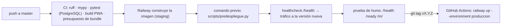

# Carta v1 — Operación

**Versión:** 1.0 · **Fecha:** 2 de noviembre de 2026

---

## 1. Entornos y dominios

| Entorno | Dominio | Stack de Compose | Base | Se despliega con |
|---|---|---|---|---|
| Desarrollo | `localhost:5173` (Vite) + `localhost:8000` (API) | `docker-compose.yml` (sólo PostgreSQL) | `carta_dev` | `uv run uvicorn …` |
| Staging | `staging.<dominio>` | Railway, *environment* `staging` | PostgreSQL de Railway (`staging`) | cada push a `master` |
| Producción | `<dominio>` · `img.<dominio>` (R2) | Railway, *environment* `produccion` | PostgreSQL de Railway (`produccion`) | cada etiqueta `v*` |

Cada *environment* de Railway tiene sus propios servicios y variables; nada se comparte entre staging y producción. (Variante VM: dos stacks de Compose en la misma máquina; ver Anexo A.)

---

## 2. Primer despliegue en Railway (una vez)

1. Cuenta en Railway con 2FA y tarjeta (plan Hobby). Proyecto `carta` con *environments* `staging` y `produccion`.
2. En cada *environment*: servicio `postgres` (plantilla oficial, con volumen); servicio `api` conectado al repositorio de GitHub (`staging` sigue `master`; `produccion` se despliega desde CI con etiquetas), construido con el `Dockerfile`, con *Healthcheck Path* `/health`, *Pre-deploy Command* `uv run python scripts/predespliegue.py` (`alembic upgrade head`, salvo que la base vaya por delante del código en un rollback) y *Restart Policy* «On Failure» puestos en el panel (Railway ya no lee `railway.toml` en servicios nuevos; ver 04 §11); servicio `respaldo` con horario diario (desde `deploy/respaldo/`, con *Wait for CI* y *Watch Paths* `/deploy/respaldo/**`).
3. Variables del servicio `api` (las de `.env.example`): `ENTORNO`, `DATABASE_URL` (referencia a la variable del servicio `postgres`), `SECRET_KEY` (256 bits, `openssl rand -base64 32`), `DOMINIO`, `R2_*`, `ANTHROPIC_API_KEY`, `FIREBASE_PROJECT_ID` y `FIREBASE_CSP_*`, `SENTRY_DSN`, más las cuatro `VITE_FIREBASE_*` de la app web de Firebase, que el `Dockerfile` recibe como *build args* y hornea en el bundle del panel. Las de `respaldo`: `DATABASE_URL`, `R2_*`, `RESPALDO_CLAVE_AGE`.
4. Dominio: en Railway, *custom domain* `staging.<dominio>` y `<dominio>`; en Cloudflare, los `CNAME` (con proxy) y los `TXT` de verificación que Railway indique, SSL *Full (strict)* (Railway documenta *Full*; si da 526, *Full* sólo para `staging.<dominio>` y `<dominio>`), `CNAME img` al bucket R2 público, regla de caché para `/api/v1/p/menu/*`, regla de límite de tasa (p. ej. 300 peticiones/min por IP) y una regla WAF que no rete `/health` ni `/ready`; sin *Bot Fight Mode* (en el plan Free no admite excepciones y reta a los runners de la prueba de humo).
5. `curl https://staging.<dominio>/health`; en GitHub, el secreto `RAILWAY_TOKEN` en el *Environment* `produccion` (sólo etiquetas `v*` y `master`), no en el repositorio.

Todo esto queda documentado paso a paso en `deploy/README.md` (T-0.7) para poder recrearlo en menos de una hora. La variante de VM está en el Anexo A.

---

## 3. Despliegue

- **Migraciones compatibles hacia atrás** (expandir → usar → contraer): primero se agrega la columna o tabla, se despliega el código que la usa, y sólo en una versión posterior se borra lo viejo. Así un *rollback* de la imagen nunca choca con el esquema.
- **Rollback:** en el panel de Railway, **Deployments → ⋮ → Rollback** del despliegue anterior (restaura imagen **y variables**: si se rotó un secreto entre medias, reactiva el viejo; y desaparece pasada la retención de imágenes del plan), o `deploy.yml` a mano con la etiqueta anterior (no toca variables; el comando previo `scripts/predespliegue.py` no migra si la base va por delante). Un clic, menos de un minuto. `railway redeploy` **no** sirve: repite el último despliegue. Producción sólo se despliega desde etiquetas sobre `master`. Se documenta en `deploy/README.md`.
- **Secretos de CI:** sólo `RAILWAY_TOKEN`, en el *Environment* `produccion` de GitHub (no del repositorio). Las variables de la aplicación viven en Railway.
- **Desde el teléfono:** el panel de Railway permite ver logs, reiniciar y hacer rollback desde el navegador del teléfono; GitHub Actions permite relanzar el despliegue a producción.
- **Variante VM (Anexo A):** imagen en GHCR (la publica `deploy.yml` en cada etiqueta `v*`) → `ssh` → `compose pull` + migrador → `compose up -d --wait`; rollback `IMAGEN_TAG=<sha-anterior> docker compose up -d`.

---

## 4. Respaldos y restauración

| Qué | Cómo | Cuándo |
|---|---|---|
| Base de datos | Contenedor `respaldo` con `pg_dump -Fc` de cada base → R2 privado (`respaldos/<entorno>/<fecha>.dump`), cifrado con `age` | Diario a las 04:00; ciclo de vida de 30 días en R2 |
| Archivos WAL (opcional, Etapa 1.5) | `wal-g` a R2 para recuperación a un punto en el tiempo | Cuando haya > 10 restaurantes |
| Fotos y PDFs | Ya están en R2 (durable por diseño); *versioning* del bucket activado | — |
| Configuración | `deploy/` en git; `.env` copiado a un gestor de contraseñas | Al cambiar |
| **Prueba de restauración** | `scripts/restaurar.sh <fecha>` levanta una base temporal, restaura y corre `pytest tests/integration -q` contra ella | **Mensual**, con registro en `docs/plan/perf/restauraciones.md` |

Objetivos: RPO ≤ 24 h (≤ 5 min con WAL), RTO ≤ 2 h (crear VM con `cloud-init` + restaurar).

---

## 5. Monitoreo y alertas

| Señal | Herramienta | Alerta |
|---|---|---|
| `/health` cada 60 s desde fuera | UptimeRobot (gratis) | correo + push al teléfono tras 2 fallos |
| Errores 5xx y excepciones (API y PWA) | Sentry (plan gratis) | correo al primer error nuevo; umbral de 10/min |
| Disco, memoria, CPU de la VM | Agente del proveedor o `node_exporter` + alerta por correo | disco > 80 % |
| Comandas sin atender > 10 min (G1) | Consulta programada en la API, cada 5 min | correo al operador y a Carta |
| Importaciones fallidas | Sentry + consulta diaria | — |
| Logs | JSON por línea con `request_id`, `restaurante_id`, latencia; `docker logs` con rotación 7 días; Caddy access log 30 días | — |
| Costo | Alertas de presupuesto en Cloudflare y en la consola de Claude (p. ej. 20 USD/mes) | correo |

---

## 6. Lista de verificación de seguridad antes del primer restaurante

**Cuentas**
- [ ] 2FA en GitHub, Cloudflare, proveedor de VM, Google/Firebase, consola de Claude, registrador del dominio
- [ ] Llave SSH única; root deshabilitado; `fail2ban` activo
- [ ] Cuenta de servicio aparte para GitHub Actions con el mínimo acceso

**Servidor**
- [ ] `ufw` sólo 22/80/443; PostgreSQL y la API sin puertos publicados fuera de la red de Compose
- [ ] Actualizaciones automáticas de seguridad activas
- [ ] `.env` con permisos 600; sin secretos en imágenes ni en logs
- [ ] Usuarios de base separados (migrador / app / lector)

**Aplicación**
- [ ] HSTS, CSP sin `unsafe-inline`, `nosniff`, `Referrer-Policy`, `Permissions-Policy` verificados con `curl -I`
- [ ] Cookies `HttpOnly; Secure; SameSite=Lax`
- [ ] La API se niega a arrancar en producción con `SECRET_KEY` por defecto o corto
- [ ] Prueba parametrizada "otro restaurante → 404" en verde para todos los endpoints `/op` y `/admin`
- [ ] Límite de intentos de PIN probado; mensaje uniforme
- [ ] Validación de archivos por contenido (PDF, JPG, PNG, HEIC); límites de tamaño
- [ ] Límites de tasa activos en Cloudflare y en la API
- [ ] `pip-audit` y `npm audit` sin vulnerabilidades altas; Dependabot activo

**Datos y legal**
- [ ] Aviso de privacidad y términos publicados; página "Acerca de"
- [ ] Ningún dato sensible del comensal en servidor (verificado en el esquema)
- [ ] Acuerdo de piloto firmado

**Operación**
- [ ] UptimeRobot y Sentry recibiendo datos
- [ ] Una restauración de respaldo hecha y registrada
- [ ] `deploy/README.md` permite recrear la VM desde cero

---

## 7. Pruebas de carga

1. `uv run python scripts/sembrar_carga.py --restaurantes 10 --mesas 40` sobre staging.
2. `k6 run pruebas/carga/<escenario>.js -e BASE=https://staging.<dominio>` para cada escenario de [02 §10.3](02_Arquitectura_v1.md).
3. Registrar p50/p95/p99, tasa de error, CPU y memoria de la VM (`docker stats`) en `docs/plan/perf/<fecha>.md`.
4. Si algún objetivo falla, aplicar las palancas en orden y repetir. No se pasa a producción con un objetivo en rojo.

---

## 8. Respuesta a incidentes (runbook)

| Síntoma | Primera acción | Después |
|---|---|---|
| UptimeRobot: caído | Desde el teléfono: reiniciar la VM en el panel del proveedor; si no vuelve en 5 min, `ssh` y `docker compose ps / logs` | Causa raíz en `docs/incidentes/` |
| Errores 5xx en Sentry tras un despliegue | *Rollback* a la imagen anterior | Arreglar en rama, pasar CI, redesplegar |
| Comandas sin atender (G1) | Llamar al restaurante; verificar que la vista del personal sondea | Revisar logs de `/op/mesas` |
| Disco lleno | `docker system prune`; revisar logs y respaldos locales | Alerta más temprana |
| Sospecha de fuga de datos o abuso | Revocar: rotar `SECRET_KEY` (invalida cookies), desactivar al personal afectado, bloquear IP en Cloudflare | Procedimiento de `08_Security_Compliance.md` §8; notificar en ≤ 72 h si hubo datos personales |
| La API de Claude falla | Las importaciones quedan `pendiente` y se reintentan; el resto del sistema no depende de ella | — |
| Cloudflare caído | La VM sigue viva pero no se alcanza; esperar (histórico: minutos) | — |

Todo incidente se registra en `docs/incidentes/AAAA-MM-DD-titulo.md`, aunque no haya afectado a nadie.

---

## 9. Alta de un restaurante piloto (procedimiento)

1. Visita: medir señal en el local con el teléfono (S2); acordar quién será capitán; firmar el acuerdo de piloto.
2. El operador entra a `/admin` con Google, crea el restaurante, sube el PDF y revisa el borrador (cronometrar: S4).
3. Fotos: tomar 5–8 platillos con la guía (Top 3 del chef, los más vendidos); subirlas desde el teléfono.
4. Mesas: crear las mesas, imprimir el PDF de QR en un papel grueso o acrílico (lección: el QR debe mostrar el nombre del restaurante y "Carta", nunca un subdominio raro).
5. Personal: dar de alta a cada mesero con su PIN; probar la entrada en sus teléfonos.
6. Ensayo con dos teléfonos (iPhone y Android): escanear, armar orden en grupo, confirmar, ver la comanda en el teléfono del mesero, atender, servir, liberar.
7. Primera semana: visita el día 2 y el día 7; reporte semanal (§10).

---

## 10. Reporte semanal del piloto

`uv run python scripts/reporte_semanal.py --restaurante <slug> --semana 2026-W47` produce un Markdown con M1–M4 y G1, los platillos más vistos y más pedidos, los más vistos y no pedidos, las horas pico y los errores de la semana. Se envía al restaurante y se archiva en `docs/plan/piloto/`.

---

## Anexo A — Variante de VM con Docker Compose (ADR-012)

Se adopta cuando la factura de Railway supere ~40 USD/mes sostenidos o se quiera control total. Todo está en `deploy/vps/` desde T-0.6.

1. Cuenta en el proveedor con 2FA (Hetzner, Vultr en Ciudad de México o DigitalOcean). Llave SSH propia; la contraseña de root se desactiva.
2. VM Ubuntu LTS, 2 vCPU / 4 GB, con `deploy/vps/cloud-init.yml`: crea el usuario `carta`, instala Docker, `ufw` (22, 80, 443), `fail2ban`, actualizaciones automáticas, y clona `deploy/vps/` en `/opt/carta`.
3. `/opt/carta/.env` (permisos 600) con las variables de `.env.example` más `IMAGEN_TAG`.
4. Cloudflare: registros `A` para `@` y `staging` apuntando a la VM con proxy activado; el resto igual que en §2.
5. `docker compose up -d` (Caddy sirve HTTPS y hace proxy a la API; PostgreSQL y `respaldo` en la misma red interna); dos stacks `-p carta-staging` y `-p carta-prod` comparten la instancia de PostgreSQL con dos bases y dos usuarios.
6. Despliegue: `.github/workflows/deploy-vps.yml` (imagen en GHCR → `ssh` → migrador → `compose up -d --wait`); rollback con `IMAGEN_TAG` anterior.
7. Respaldos y monitoreo: idénticos a §4 y §5; además, alerta de disco de la VM.
