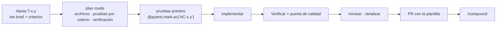
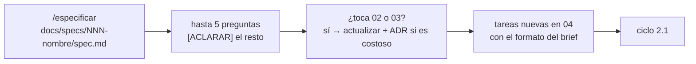
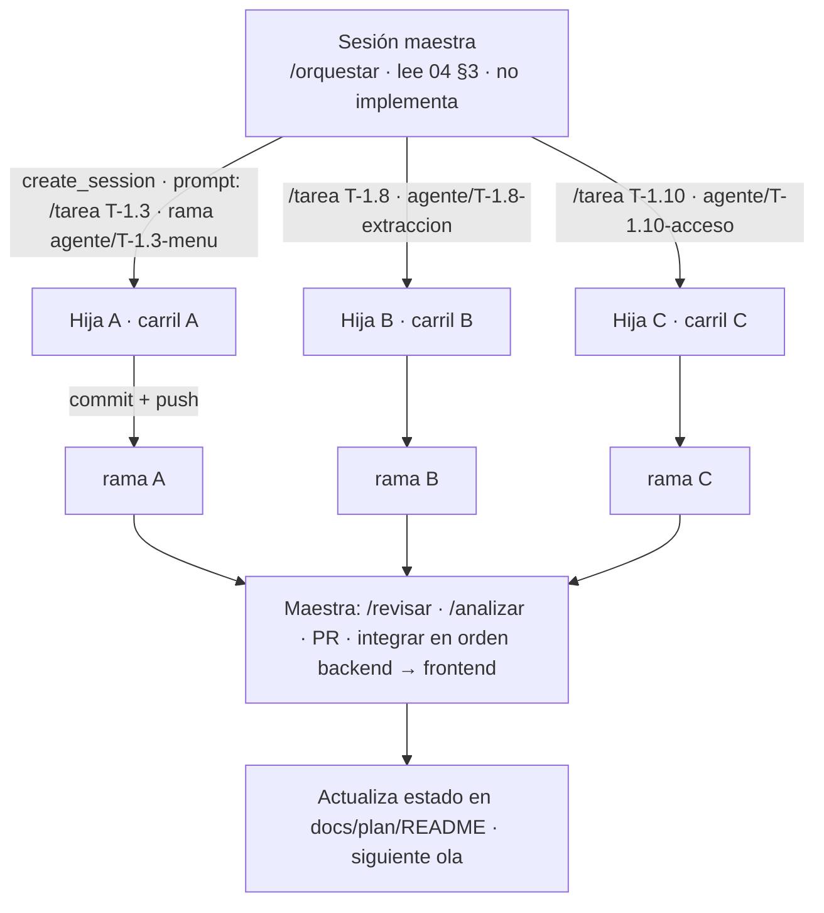

# Carta — Desarrollo guiado por especificación (spec-driven) con agentes

**Versión:** 1.0 · **Fecha:** 5 de noviembre de 2026

> La idea central: **la especificación es la fuente de verdad y el código la sigue.** El agente no adivina qué construir; lee una spec con criterios verificables, planea contra ella, implementa, y una prueba demuestra cada criterio. Lo que no está en la spec no se construye; lo que la spec dice mal se corrige en la spec, no en el código.

---

## 1. Qué ya tenemos y qué falta

Las metodologías spec-driven (Spec Kit de GitHub, el flujo *requirements → design → tasks* de Kiro, los *specs* de Amazon) comparten cinco etapas. Carta ya cubre casi todas con artefactos que viven en el repo:

| Etapa | Qué es | En Carta | Estado |
|---|---|---|---|
| **Constitución** | Principios que no se negocian | `CLAUDE.md` (reglas duras, qué NO construir), ADRs | ✓ |
| **Especificación** | Qué y por qué, en criterios verificables, sin decidir cómo | `docs/plan/01_Alcance_v1.md` (roles, historias US-25–28) + `docs/mvp/01_PRD.md` §7 (US-01–24 con criterios EARS) | ✓ |
| **Plan técnico** | Cómo: arquitectura, datos, contratos | `02_Arquitectura_v1.md`, `03_Datos_v1.md`, `/openapi.json` (contrato primero) | ✓ |
| **Tareas** | Pasos pequeños, ordenados, cada uno con verificación | `04_Fases_y_Tareas.md` (44 briefs con comando de **Verificar**) | ✓ |
| **Implementación y verificación** | Código que demuestra los criterios | `/tarea`, `/revisar`, puerta de calidad, `/compound` | ✓ |
| **Trazabilidad** | Saber qué criterio cubre qué prueba, automáticamente | marcador `@pytest.mark.ac(...)` + `scripts/verificar_trazabilidad.py` | **nuevo** |
| **Contrato ejecutable** | Que la API cumpla el OpenAPI que publica | pruebas de contrato con `schemathesis` (T-4.9) | **nuevo** |
| **Features nuevas** | Especificar antes de planear cuando algo no está en el plan | `/especificar` → `docs/specs/NNN-<nombre>/spec.md` | **nuevo** |
| **Compuerta de integración** | Nada se integra sin spec, pruebas y revisión | `/analizar` + plantilla de PR | **nuevo** |
| **Orquestación** | Varias sesiones trabajando en paralelo sin pisarse | `/orquestar` (sesión maestra e hijas) | **nuevo** |
| **Portabilidad de las reglas** | Que cualquier herramienta de IA lea las mismas reglas | `AGENTS.md` → `CLAUDE.md` | **nuevo** |

---

## 2. Dos ciclos

### 2.1 Tarea del plan (lo normal durante la v1)

La spec ya existe: el brief en 04 cita sus criterios (AC-xx.y), que a su vez están en 01 o en el PRD. El ciclo es el de `CLAUDE.md`:

### 2.2 Feature nueva o cambio de alcance (fuera del plan)

Cuando alguien pide algo que no está en 04 (o un brief resulta ambiguo), **no se improvisa en el código**:

La spec se escribe **antes** del plan y **sin** decisiones de implementación. Cuando entra al plan, sus criterios se citan desde el brief igual que los del PRD.

---

## 3. Qué hace buena una spec para un agente

1. **Criterios EARS**, uno por línea, con ID estable (`AC-29.3`): `CUANDO <evento>, EL sistema DEBERÁ <respuesta medible>`. Un criterio = una prueba (o un paso manual documentado en `docs/piloto/ensayo.md`).
2. **Un escenario concreto por criterio** (Dado / Cuando / Entonces) con datos reales de la semilla: "Dado La Ceiba con 22 platillos y la mesa 7 con 3 comensales…". Los agentes fallan más por datos vagos que por lógica.
3. **Sin cómo.** Nada de tablas, endpoints ni librerías en la spec; eso va en 02/03. Si la spec dice "usar Redis", está mal escrita.
4. **Lo que NO hace**, explícito. Es lo que evita que el agente "mejore" cosas.
5. **Máximo 5 `[ACLARAR]`.** Si hay más, la feature no está lista para especificarse: falta una conversación.
6. **Métrica o señal de éxito** si la feature existe para mover un número (M1–M5, G1–G2).
7. **Trazable:** la spec dice a qué historia pertenece y el brief cita los criterios; la prueba lleva el marcador; el script lo comprueba.

Plantilla en `.claude/skills/especificar/SKILL.md`.

---

## 4. Trazabilidad y contrato ejecutable

| Mecanismo | Cómo | Cuándo falla |
|---|---|---|
| **Marcador de criterio** | `@pytest.mark.ac("AC-25.3")` sobre la prueba (varios IDs permitidos) | — |
| **Verificador** | `uv run python scripts/verificar_trazabilidad.py --tarea T-1.9` lista los criterios del brief y qué prueba los cubre; `--estricto` sale con 1 si falta alguno | En `/analizar` y en CI para la fase cerrada (T-4.9) |
| **Contrato** | `schemathesis run http://localhost:8000/openapi.json` genera peticiones válidas e inválidas desde el OpenAPI y exige que la API responda como declara (códigos, esquemas, envoltura de error) | T-4.9 en CI; antes, a mano en `/analizar` |
| **Camino crítico** | Playwright: escanear → menú → orden en grupo → comanda en el teléfono del personal | T-4.7, contra staging |
| **Reglas duras mecánicas** | `grep` en CI: `fastapi` en `app/services/`, `create_all`, secretos | T-0.4 |

---

## 5. Prácticas de desarrollo con IA que adoptamos

| Práctica | Por qué |
|---|---|
| **Tareas de 2–4 h con un comando de verificación** | Un agente con un objetivo verificable termina; uno con "construye el módulo de órdenes" divaga |
| **Contrato primero** (`app/schemas/` + `/openapi.json` al inicio de la fase) | Permite paralelizar frontend y backend sin esperar |
| **Pruebas primero, marcadas con el criterio** | La prueba es la spec ejecutable; el marcador es la trazabilidad |
| **Plan mode antes de tocar código** | Separa pensar de escribir; el plan se revisa en 2 minutos, el código en 20 |
| **Contexto corto**: `CLAUDE.md` ≤ 150 líneas, detalle en skills | Un agente con 5,000 líneas de instrucciones ignora la mitad |
| **Subagentes con una sola lente** (explorar, implementar, 3 revisores) | Contexto limpio por rol; revisión adversarial real |
| **Un carril por agente, un worktree por rama** | Dos agentes en los mismos archivos pierden trabajo |
| **Un commit por tarea con su ID** | El historial es el registro de qué spec produjo qué código |
| **ADR para cada decisión costosa** | El agente de la semana que viene no rediscute lo decidido |
| **`/compound` al cerrar** | Cada sesión deja test, regla, skill, hook o ADR: la bola de nieve |
| **Medir, no creer** (k6, Lighthouse, `EXPLAIN ANALYZE`) | Los agentes afirman con seguridad; los números no |
| **Nunca "refactoriza todo" a medio vuelo** | Lección de Alerta Roja MX: el rediseño total en medio del flujo rompe integraciones |
| **Revisar diffs, no prosa** | El resumen del agente dice lo que cree que hizo; el diff dice lo que hizo |
| **Hooks para lo que no puede fallar** | Una regla en texto se olvida; un hook no |

---

## 6. Sesión maestra y sesiones hijas

Cuando hay varias tareas independientes (una ola de 04 §3), una **sesión maestra** coordina y **sesiones hijas** ejecutan. Protocolo completo en `.claude/skills/orquestar/SKILL.md`; en resumen:

Reglas:
- **Máximo tres hijas a la vez**, una por carril; nunca dos en el mismo carril.
- La maestra **no escribe código**: crea sesiones, vigila (`get_session`, `list_events`), revisa, integra y actualiza el estado. Si una hija se atasca, la maestra le manda el contexto que falta (`send_message`) o la archiva y relanza con un brief corregido.
- Cada hija arranca con el mismo entorno (hook de sesión incluido), su rama y el prompt `/tarea T-x.y`. No necesita saber que existen las otras.
- Los PR los abre la maestra con la plantilla, **sólo con permiso explícito de Calvin** en cada ola; la integración sigue el orden de dependencias de 04.
- Cada hija consume cuota de uso; una ola de tres tareas medianas son unas 6–12 h de agente. La maestra reporta al final de cada ola: qué se integró, qué quedó bloqueado y qué aprendimos.

---

## 7. Sin IDE: cómo se ve el día a día

- **Claude Code en la nube** (lo que estás usando) es el entorno principal: sesión maestra desde el teléfono o el navegador, hijas en paralelo, hook de arranque que deja todo listo.
- **GitHub** es donde se revisa: PRs con la plantilla, `/code-review` integrado, diffs legibles en el teléfono. El PR es la unidad de revisión humana; la conversación con el agente es la unidad de trabajo.
- **Antigravity (o cualquier IDE con agente)** es opcional y encaja sin cambiar nada: abre el repo, lee `AGENTS.md` (que apunta a `CLAUDE.md`), y sirve para ver la app corriendo (`npm run dev`, Vite con recarga), revisar diffs grandes con comodidad y hacer ajustes visuales pequeños del frontend. Dos reglas: **las mismas instrucciones** (no crees reglas propias del IDE que `CLAUDE.md` no tenga) y **nunca dos agentes en el mismo carril al mismo tiempo**, sea en la nube o en el IDE.
- **La vista previa de la app** en sesiones en la nube: la sesión puede levantar `uvicorn` y `vite` y anunciar el puerto para verla desde el teléfono (T-0.5 en adelante).
