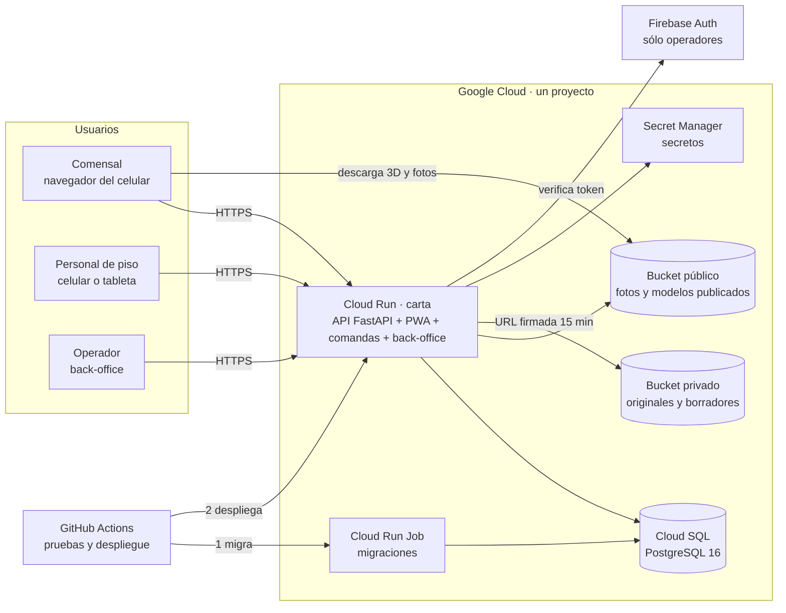
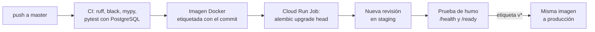
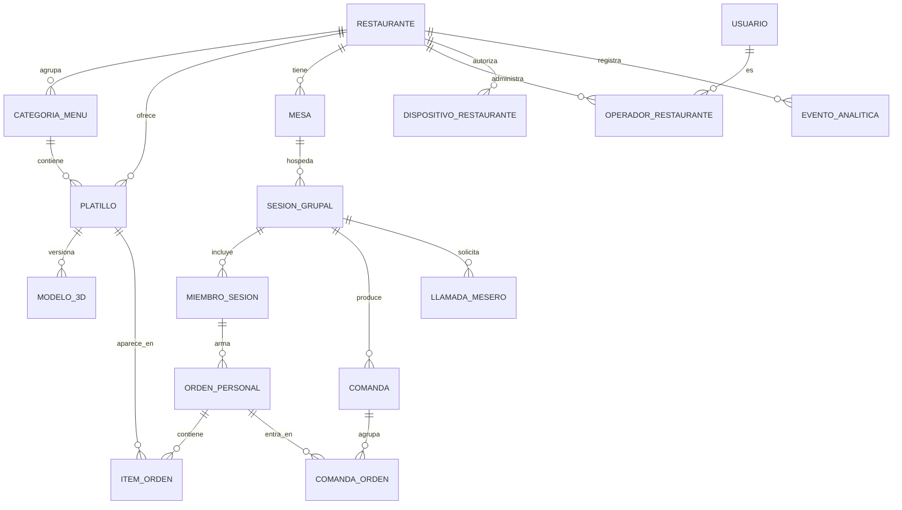

# Carta — Revisión del estado y plan hacia el primer despliegue

**Fecha:** 26 de octubre de 2026 · **Autor:** Calvin + Claude Code · **Estado:** propuesta, pendiente de aprobación

> Este documento **no cambia** ningún ADR ni el plan de implementación. Revisa dónde está el proyecto, señala contradicciones y propone cambios. Según la regla de `CLAUDE.md`, los documentos de `docs/mvp/` se actualizan primero (sección 11) y sólo después se escribe código que los siga.

---

## 0. Resumen

1. **El diseño está completo y el código no ha empezado.** De las 58 tareas del plan, ninguna está hecha. El backend de abril no arranca, las pruebas no corren y el CI nunca se ha ejecutado.
2. **Sí es viable una web app sin tienda de aplicaciones.** El comensal escanea el QR con la cámara y abre el menú en Safari o Chrome, sin instalar nada. El 3D funciona en cualquier teléfono moderno y el AR sobre la mesa funciona en iPhone y en la mayoría de los Android de gama media y alta. **El límite:** en iPhone, el AR lo muestra el visor de Apple, no tu interfaz. La pantalla de inicio "AR inmersiva" del prototipo (cámara en vivo con tu interfaz encima) no se puede construir así en web.
3. **Propongo arrancar con una arquitectura más chica que la diseñada:** un servicio en Cloud Run, una base PostgreSQL y dos buckets. Cuesta entre 15 y 35 USD al mes al arrancar, contra 130 a 160 del diseño actual, y crece agregando piezas sin rehacer nada.
4. **Para una sola persona, el cuello de botella no es el código: es producir los modelos 3D** de cada restaurante. La v1 usa sólo la vía curada (tú haces o consigues el modelo y lo apruebas) y modela de 5 a 8 platillos por restaurante. La generación automática con IA se pospone.
5. **Plan en cuatro entregas:** Etapa 0 (cimientos y primer despliegue real) → Release A "Menú en 3D" (primer restaurante usándolo) → Release B "Orden en grupo y comandas" → Release C "Piloto". A 15 horas por semana son unos 3 meses hasta tener el piloto listo; el primer restaurante podría usar la Release A hacia la semana 8.
6. **Hay seis decisiones que necesito de ti** (sección 10). La más urgente es la tipografía, porque los documentos y el prototipo no coinciden.

---

## 1. Lo que ya habíamos decidido

> **Sobre la sesión "Carta + Restaurant System Overview":** no pude abrirla. Desde este entorno sólo se ven las sesiones que corren en la nube y esa no aparece; probablemente corrió en tu computadora o en Cowork. Lo que sigue lo reconstruí de lo que esa sesión dejó en el repositorio (los commits del 18 y 19 de septiembre) y del resto de la documentación. Si me pasas el texto de esa conversación, lo contrasto punto por punto.

| Tema | Lo que quedó decidido | Dónde está |
|---|---|---|
| **Alcance del MVP** | Comensal con AR + orden en grupo + Vista de Comandas + back-office mínimo. Sin pagos, sin app de mesero, sin analytics para el restaurante, sin alta self-service, sin Carta+, sin multi-idioma. | `docs/mvp/README.md` (D1), PRD §4 |
| **Quién construye** | Tú solo, con Claude Code. Los documentos están escritos para que Claude Code construya sin contexto previo. | D3, ADR-001, `08_Security` §8 |
| **Para cuánta gente** | 5 a 10 restaurantes piloto en CDMX. Unas 36,000 sesiones al mes y un pico de 200 sesiones simultáneas entre 20:00 y 21:30. | PRD §3, TDD §8 |
| **Cómo se mide el éxito** | M1 escaneo ≥ 40%, M2 activación AR ≥ 60%, M3 orden ≥ 25%, M4 ticket ≥ +8%, M5 retención a 6 semanas ≥ 70%. Con reglas de seguir, pivotar o detener. | PRD §3 |
| **Esfuerzo** | 58 tareas en 7 fases, cada una pensada como "una sesión de trabajo enfocada". No hay calendario. | `06_Implementation_Plan.md` |
| **Presupuesto de nube** | ≤ 150 USD al mes durante el piloto. | NFR-09 |
| **Equipo del restaurante** | No se exige computadora: Carta corre en el teléfono del mesero, del capitán y del dueño; la tableta es opcional. | Análisis de mercado §1 (corrección del 19 de septiembre) |
| **Competencia real** | No son las apps de EE.UU.: es el punto de venta instalado (Soft Restaurant, Fudo), que ya vende menú QR con pedido en mesa. Lo que nadie tiene es **la orden armada en grupo desde varios teléfonos**, además del 3D. | Análisis de mercado §5.5 |

### 1.1 Cobro: hay cuatro versiones y ninguna está cerrada

| Fuente | Comensal | Restaurante | Otros ingresos |
|---|---|---|---|
| Pitch deck y README (septiembre) | Carta+ $29 MXN/mes o $249/año | Pro $249 MXN/mes; promociones desde $500/mes | Marketplace de artistas 3D (15–20%), anuncios, datos agregados |
| Análisis de mercado (abril) | $29/mes | Gratis (20 platillos) · Pro $349 · Enterprise desde $2,500 | Anuncios |
| Documento de contexto (mayo) | — | 1.8% de comisión sobre pagos en mesa | — |
| Corrección del 19 de septiembre | — | "El precio tiene que subir". El POS completo cuesta $360 a $1,100 al mes. El modelo vigente es gratis con anuncios más funciones de pago. | — |

**Conclusión:** el precio no está decidido, y el MVP no lo necesita. La recomendación para el piloto está en §8.5.

---

## 2. Dónde estamos

### 2.1 Lo que sí está hecho

| Entregable | Estado |
|---|---|
| Definición de producto, análisis de mercado (corregido con fuentes de INEGI y SAT), pitch deck | Completo |
| 27 pantallas en Google Stitch | Completo |
| Prototipo de Claude Design: 35 pantallas, 4 roles | Completo, exportado al repo el 18 de septiembre |
| Paquete técnico del MVP: PRD (24 historias, 83 criterios), TDD, 10 ADRs, modelo de datos, OpenAPI, plan de 58 tareas, pruebas, seguridad | Completo |
| Videos de lanzamiento, landing y prototipo publicados en GitHub Pages | Completo; es lo único "desplegado" hoy |

### 2.2 El código: lo que encontré

| Problema | Dónde | Efecto | Tarea que lo corrige |
|---|---|---|---|
| Usa el driver síncrono `psycopg2` con un motor asíncrono | `app/db/database.py`, `pyproject.toml` | La aplicación no arranca | T-0.1 |
| Crea tablas con `create_all()` al arrancar; no existe ninguna migración | `app/main.py`, `migrations/versions/` vacío | El esquema no se puede versionar | T-0.3 |
| Las pruebas usan SQLite en memoria con tipos de PostgreSQL (`JSONB`, `UUID`) y falta `aiosqlite` | `tests/test_api.py` | Las pruebas no corren | T-0.6 |
| **El CI escucha las ramas `main` y `develop`, pero la rama del repo es `master`** | `.github/workflows/ci.yml`, `deploy.yml` | El CI nunca se ha ejecutado | T-0.5 (nuevo hallazgo) |
| El despliegue migra la base **después** de publicar la nueva versión y despliega la etiqueta `:latest` | `.github/workflows/deploy.yml` | Código nuevo contra esquema viejo; despliegues no reproducibles | T-6.7 → adelantar a Etapa 0 |
| El Dockerfile instala el paquete antes de copiar el código, y su healthcheck apunta a `/api/v1/health` cuando la spec dice `/health` | `Dockerfile` | La imagen probablemente no se construye bien | T-0.2 |
| CORS abierto a cualquier origen | `app/main.py` | Riesgo de seguridad | T-6.5 → cerrar en Etapa 0 |
| La contraseña de la base va en texto plano como variable de entorno; no hay buckets ni estado remoto; el conector VPC y Memorystore cuestan ~50 USD/mes antes del primer usuario | `terraform/` | Costo y riesgo innecesarios para empezar | T-6.7 (ver §5.3) |
| No existe el frontend y no se ha elegido framework (sólo se menciona `vitest`) | — | Decisión pendiente | T-2.6 (propuesta en §5.2) |

### 2.3 El entorno en la nube

Este entorno ya tiene Docker, PostgreSQL 16, Redis, Node 22 y `uv`, así que la Fase 0 se puede hacer aquí mismo. Le faltan dos cosas:

- **Las dependencias de Python no están instaladas** y el Python del sistema es 3.13 (el proyecto pide 3.11). Conviene un script de arranque del entorno que instale dependencias con `uv` y levante PostgreSQL, para que cada sesión nueva llegue lista para correr pruebas.
- **No tiene credenciales de Google Cloud.** Para desplegar desde aquí habrá que configurarlas; lo recomendado es que despliegue GitHub Actions y no la sesión (ver §5.5).

### 2.4 Contradicciones entre documentos

| Tema | Una fuente dice | Otra dice | Recomendación |
|---|---|---|---|
| **Tipografía** | `CLAUDE.md`, `Carta_Design_System.md` y la tarea T-2.7: Playfair Display + Inter | Prototipo de Claude Design, README y videos: DM Serif Display + DM Sans | Adoptar **DM Serif Display + DM Sans**, que es lo más reciente y ya está en los assets del prototipo. Actualizar el sistema de diseño y `CLAUDE.md`. |
| **Dónde se ven las comandas** | PRD: una tableta en la barra (supuesto S4) | Corrección de mercado: el restaurante no necesita computadora; corre en el teléfono del personal | Hacer la Vista de Comandas **primero para teléfono**, y que en tableta se vea bien. Elimina el supuesto S4 como riesgo. |
| **Tiempo real** | ADR-004: sondeo HTTP cada 3–5 s | Pitch deck: WebSockets | Gana el ADR. Corregir el pitch cuando se actualice. |
| **Inicio del comensal** | Prototipo P01: cámara en vivo con el platillo flotando y tu interfaz encima | ADR-002: AR mediante el visor nativo del sistema | No se puede en iPhone desde web (§3). El inicio es el menú con el "Top 3 del Chef". |
| **Pago en mesa** | README: "the check gets paid without waiting for the bill" | MVP: sin pagos | Está bien como visión; aclarar en el README que llega en v2. |
| **Precio** | $249, $349, gratis con anuncios | — | Ver §8.5. |

### 2.5 Aviso sobre Claude Design

Claude Design como producto independiente (claude.ai/design) cierra el 14 de diciembre de 2026 y pasa a vivir dentro de Claude. Si cambiaste el prototipo después del 18 de septiembre, **expórtalo otra vez antes de esa fecha** y súbelo a `prototipo/`.

---

## 3. ¿Web app en lugar de app de tienda? Sí

| | iPhone | Android |
|---|---|---|
| **Abrir desde el QR** | La cámara abre el enlace en Safari | La cámara o Google Lens lo abren en Chrome |
| **Instalar algo** | No. "Agregar a inicio" es opcional | No. "Instalar app" es opcional |
| **Ver el platillo en 3D (girar, acercar)** | Sí, en cualquier iPhone reciente | Sí, en cualquier Android reciente |
| **AR sobre la mesa** | Sí, con AR Quick Look (el visor de Apple) | Sí, con Scene Viewer, en teléfonos compatibles con ARCore |
| **Si el teléfono no soporta AR** | Se queda el visor 3D; el botón AR no aparece | Igual |
| **Notificaciones push** | Sólo si el usuario instaló la web app en su pantalla de inicio | Sí |

**Qué implica para el diseño:**

1. **En AR, la interfaz es la del sistema.** Al tocar "Ver en mi mesa", el teléfono abre su visor nativo a pantalla completa con el platillo a escala real. Dentro de ese visor no puedes mostrar tu barra inferior, los avatares del grupo, ni cambiar de platillo deslizando. Al cerrar, el comensal vuelve a tu app.
2. **Un platillo a la vez en AR.** Comparar dos platillos sobre la mesa o ver "el platillo de tu amigo" en AR (P01 amigo) no es posible con el visor nativo.
3. **No dependas de push para el comensal.** El sondeo cada 3 s del ADR-004 resuelve el "3 de 4 listos" sin notificaciones.
4. **iPhone necesita el modelo en USDZ.** El componente `<model-viewer>` puede generarlo al vuelo a partir del GLB cuando el usuario toca el botón AR. Eso permite **no construir la conversión a USDZ** en la v1 (T-5.5). Hay que validar en un iPhone real que los materiales se vean bien; si no, se genera el USDZ a mano para esos platillos.
5. **Navegadores dentro de otras apps** (Instagram, WhatsApp) pueden comportarse distinto. El QR de la mesa abre el navegador normal, así que el riesgo es bajo, pero hay que probarlo.
6. **Una alternativa con cámara en vivo existe, pero no conviene ahora:** pedir permiso de cámara y dibujar el modelo encima del video sin anclarlo a la mesa. Agrega fricción (un permiso) y contradice la postura de privacidad (`08_Security` §1 dice que nunca se pide la cámara).

**Conclusión:** la web app es el punto de partida correcto, como ya decidía el ADR-002. Una app nativa sólo tendría sentido más adelante para el personal del restaurante.

---

## 4. El prototipo de Claude Design contra la v1

El prototipo muestra la visión completa. La v1 construye lo que responde la pregunta del MVP y deja lo demás para después. El criterio fue: ¿ayuda a medir M1–M5? ¿Cuánto cuesta construirlo y operarlo solo? ¿Es técnicamente posible en web?

### Comensal

| Pantalla | Decisión | Por qué |
|---|---|---|
| P17a Escaneo de QR dentro de la app | **No se construye** | La cámara del teléfono ya abre el enlace. |
| P18a Bienvenida | **Simplificar** | Un mensaje dentro del menú, sin pasos previos. Cada paso antes del menú baja M1. |
| P18b Preferencias | **Simplificar** | Filtros de alérgenos guardados **sólo en el teléfono**, sin cuenta. Así no se guardan datos de salud en el servidor. |
| P18c Carta+ | **Después (v3)** | Monetizar al comensal antes de probar el valor es prematuro (PRD §4). |
| P01 AR inmersiva (cámara como inicio) | **Rediseñar** | No es posible en iPhone desde web (§3). El inicio es el menú con el "Top 3 del Chef" del mismo diseño. |
| P02 Detalle de platillo | **Construir** | Es el núcleo: visor 3D, foto de respaldo y botón "Ver en mi mesa". |
| P03 Menú completo | **Construir** | Categorías, filtros, búsqueda. |
| P03b Carta en PDF | **Después** | Útil como respaldo mientras se digitaliza un menú, pero no es necesaria. |
| P04 Sesión grupal | **Construir** | Es el diferenciador que nadie más tiene en México. |
| P04b Seguimiento (enviada → en cocina → servida) | **Simplificar** | Sólo "Ya avisamos al mesero" y "El mesero ya viene", a partir de la comanda abierta o atendida. Los estados de cocina exigen que alguien los capture. |
| P05 y P05b Checkout, propina y pago | **Después (v2)** | Requiere contrato con un procesador de pagos, PCI y facturación. |
| P22 Perfil del comensal | **Después** | Depende de la cuenta opcional (Capa 1). |

### Mesero y Capitán

| Pantallas | Decisión | Por qué |
|---|---|---|
| P06, P07, P19a, P19b, P20 (mesero) | **Después (v2)** | En la v1 las sustituye la Vista de Comandas. Sustituir el flujo del mesero introduce riesgo sin aprendizaje (PRD §4). |
| C01–C08 (capitán) | **Después (v2)** | Igual que arriba. |
| C07 Pausar un platillo agotado | **Propuesta: rescatar como botón** | Cuando se acaba un platillo a las 21:00, el personal necesita marcarlo agotado en segundos, no entrar al back-office. Es un botón en la Vista de Comandas. Requiere agregar un criterio al PRD (§11). |

### Administración

| Pantalla | Decisión | Por qué |
|---|---|---|
| P21 Alta del restaurante | **Después** | Con 5–10 pilotos, das de alta tú a mano. |
| P09 Dashboard, P12 Analytics, P14 Rendimiento | **Después** | Durante el piloto entregas un reporte semanal hecho con consultas SQL. |
| P10 Mi menú | **Simplificar** | Lista, editar, foto, modelo 3D. |
| P11 Pedidos | **Simplificar** | Es la Vista de Comandas. |
| P15 Miembros del equipo | **Después** | No hay cuentas de mesero en la v1. |
| P16 Dispositivos | **Simplificar** | "Activar este dispositivo" con un código y revocarlo. |
| P13 Configuración | **Simplificar** | Nombre, logo, mesas e impresión de QR. |

**Lo que sí se conserva entero:** el lenguaje visual. Los colores, tipografías y componentes del prototipo (`prototipo/carta-assets/colors_and_type.css` y los componentes en `prototipo/js/`) se trasladan a la PWA real, porque ya están en React.

---

## 5. Arquitectura en la nube

### 5.1 Principios

1. **Un servicio, una base, dos buckets.** Todo lo demás se agrega cuando un número lo pida.
2. **Servicios administrados.** No hay servidores que parchar: Google opera la base, el cómputo y el almacenamiento.
3. **Se paga por uso.** Cloud Run baja a cero instancias fuera de horario.
4. **Nada a mano en la consola**, salvo el arranque. Lo demás pasa por GitHub Actions y Terraform, para que se pueda repetir y auditar.
5. **Cada etapa extiende la anterior.** Nada de la Etapa 1 se tira al crecer.

### 5.2 Etapa 1 — Piloto (lo que propongo construir)



| Pieza | Qué es, en una línea | Configuración inicial |
|---|---|---|
| **Cloud Run** | Corre tu contenedor Docker; escala solo y cobra por uso | Un servicio con la API y los tres frontends (ADR-010). 1 vCPU, 512 MiB. Mínimo 1 instancia de 12:00 a 24:00 para evitar arranques lentos; 0 el resto. Máximo 3. |
| **Cloud SQL** | PostgreSQL administrado, con respaldos automáticos | PostgreSQL 16, instancia chica (`db-f1-micro` al arrancar, `db-g1-small` con 3+ restaurantes). Respaldo diario y recuperación a un punto en el tiempo de 7 días. |
| **Conexión a la base** | Cloud Run se conecta con el conector integrado de Cloud SQL | Sin red privada (VPC). La base tiene IP pública pero **ninguna red autorizada**: sólo entra quien tenga el permiso de IAM `cloudsql.client`. |
| **Dos buckets** | Almacenamiento de archivos | Público para fotos y modelos aprobados, con caché de un año; privado para originales y borradores, con URLs firmadas (ADR-007). |
| **Secret Manager** | Bóveda de secretos | Secreto de firma JWT y contraseña de la base. |
| **Firebase Auth** | Login de Google | Sólo para operadores del back-office. El comensal no inicia sesión en la v1. |
| **Frontend** | PWA del comensal, comandas y back-office | **Vite + React**, porque el prototipo ya está en React. `<model-viewer>` se carga sólo al abrir un platillo, para cumplir el presupuesto de 250 KB (NFR-08). El sondeo se pausa cuando la pestaña no está visible. |
| **Dominio** | `carta.mx` o el que elijas | Mapeo de dominio de Cloud Run, o Firebase Hosting delante (gratis y con CDN para estáticos). |
| **Monitoreo** | Saber que algo falló antes que el restaurante | Revisión de disponibilidad de `/health` cada minuto con aviso por correo; reporte de errores; alertas de presupuesto en 25, 50 y 100 USD. |

### 5.3 Qué se quita del diseño actual y por qué

| Pieza del diseño actual | Propuesta | Ahorro aproximado | Cómo se cubre su función |
|---|---|---|---|
| **Memorystore (Redis)** | Quitar en la Etapa 1 | ~35 USD/mes | **Caché del menú:** en memoria del proceso, 60 s; AC-04.4 pide reflejar cambios en ≤ 60 s y el vencimiento lo garantiza. **ETag:** se calcula con `max(actualizado_en)` sobre índices, que es barato. **Idempotencia:** una tabla en PostgreSQL. **Límite de llamadas al mesero:** consulta a `llamada_mesero`, exacta. **Límites por token:** en memoria por instancia; con máximo 3 instancias es aproximado y suficiente. El propio TDD §8 ya lo proponía como palanca de ahorro. |
| **Red privada (VPC) y conector serverless** | Quitar | ~13 USD/mes y bastante complejidad | Conector integrado de Cloud SQL con IAM. |
| **Load balancer y Cloud CDN** | Etapa 2 | ~18 USD/mes | Los archivos con nombre inmutable y caché de un año se sirven directo del bucket. |
| **Worker 3D y cola de trabajos** | Después (Fase 5 casi completa) | Semanas de trabajo y una máquina con GPU | Vía curada: subes un GLB, lo revisas y lo apruebas (US-20, US-19). |
| **Conversión a USDZ** | Después | Una tarea completa | `<model-viewer>` lo genera en el iPhone (§3, punto 4). |
| **Región `us-central1`** | Se queda en la Etapa 1 | — | Ver §5.4. |

### 5.4 Región

Google Cloud ya tiene una región en México (`northamerica-south1`, Querétaro) con Cloud Run y Cloud SQL. **Pero** Cloud Run no permite ahí el mapeo directo de dominio: para usar `carta.mx` haría falta un load balancer (~18 USD/mes y más configuración).

**Recomendación:** empezar en `us-central1`. La latencia desde CDMX es de unos 50 ms, irrelevante para un menú que se carga una vez y se actualiza cada 3 s. Moverse a Querétaro en la Etapa 2, cuando el load balancer se justifique por el CDN y el firewall de aplicación. La ley mexicana de datos personales no exige que los datos estén en México, y en Capa 0 no hay datos personales.

### 5.5 Entornos y despliegue

- **Un proyecto de Google Cloud, dos servicios:** `carta-staging` y `carta-prod`. Una sola instancia de Cloud SQL con dos bases (`carta_staging`, `carta_prod`), cada una con su usuario. Ahorra una instancia sin mezclar datos.
- **Cada push a `master` despliega a staging; cada etiqueta `v*` promueve la misma imagen a producción.**
- **GitHub se autentica con Workload Identity Federation**, ya presente en el workflow: sin archivos de llaves.



**Volver atrás** es mandar el tráfico a la revisión anterior de Cloud Run (un comando). Por eso las migraciones deben ser compatibles hacia atrás: primero se agrega una columna, después se usa, y sólo en otra versión se borra lo viejo.

### 5.6 Etapas 2 y 3: cuándo crecer

Cada pieza se agrega cuando se cumple su disparador, no antes.

| Disparador | Qué se agrega |
|---|---|
| Más de 15 restaurantes, o p95 de lecturas > 300 ms | Load balancer + Cloud CDN, y mudanza a Querétaro |
| Tráfico abusivo o más de 20 restaurantes | Cloud Armor (firewall de aplicación y límites de tasa en el borde) |
| CPU de la base > 60% sostenido | Instancia de núcleo dedicado |
| Primer contrato que exija disponibilidad (SLA) | Alta disponibilidad regional en Cloud SQL (la instancia chica no tiene SLA) |
| Cloud Run con más de 3 instancias sostenidas | Memorystore (Redis) para caché y límites compartidos |
| Más de 50 modelos 3D por semana | Worker de generación con IA (Fase 5), local o en Cloud Run con GPU |
| `evento_analitica` > 10 millones de filas | Exportación a BigQuery |
| Pagos (v2) | Procesador con tokenización; los datos de tarjeta nunca tocan tus servidores |

### 5.7 Costo estimado

Cifras aproximadas en USD al mes; confírmalas en la calculadora de Google Cloud antes de crear la cuenta. Si tu cuenta de Google Cloud es nueva, el crédito de prueba cubre los primeros meses.

| Concepto | Arranque (1–2 restaurantes) | Piloto completo (10 restaurantes) |
|---|---|---|
| Cloud Run (incluye 1 instancia mínima en horario) | 0–10 | 15–35 |
| Cloud SQL (instancia chica, 10 GB, respaldos) | 12–15 | 30–40 |
| Cloud Storage y transferencia de modelos 3D | 1–5 | 20–45 |
| Secret Manager, Logging, Artifact Registry | 0–3 | 2–5 |
| Firebase Auth (operadores) | 0 | 0 |
| **Total** | **≈ 15–35** | **≈ 70–125** |
| Diseño actual, como referencia | ≈ 130–160 desde el primer día | ≈ 160+ |

**Supuestos:** el sondeo cada 3 s se pausa cuando la pantalla no está visible, así que una sesión hace unas 300–400 peticiones (la mayoría respuestas `304` vacías). Un modelo pesa en promedio 3 MB y el navegador lo guarda en caché. **La transferencia de modelos 3D es el costo que más crece con el uso;** si se dispara, el CDN de la Etapa 2 lo baja.

---

## 6. Arquitectura de datos

### 6.1 Cómo se organizan los datos

- **Una base para todos los restaurantes** (multi-tenant con esquema compartido). Cada tabla de negocio lleva `restaurante_id`.
- **El aislamiento entre restaurantes se garantiza en tres capas:**
  1. `restaurante_id` sale siempre del token, nunca de la petición (regla dura 5).
  2. Cada función de servicio recibe `restaurante_id` como parámetro obligatorio.
  3. Cada endpoint tiene una prueba de "otro restaurante → 404".
  En la Etapa 2 se puede agregar Row-Level Security de PostgreSQL como cuarta capa.
- **Nada se borra físicamente si tiene historial** (`activo = false`).
- **Nombres en español** (ADR-008).

### 6.2 Esquema de la v1

El modelo de `docs/mvp/03_Data_Model.md` es sólido y se conserva. Esto es lo que la v1 usa:



| Grupo | Tablas | Release |
|---|---|---|
| Catálogo | `restaurante`, `categoria_menu`, `platillo`, `modelo_3d` | A |
| Acceso | `usuario` (sólo operadores), `operador_restaurante`, `dispositivo_restaurante` | A |
| Mesa y sesión | `mesa`, `sesion_grupal`, `miembro_sesion` | A |
| Orden | `orden_personal`, `item_orden`, `comanda`, `comanda_orden`, `llamada_mesero` | B |
| Analítica | `evento_analitica` | A |
| Soporte | `clave_idempotencia` (nueva, sustituye a Redis) | B |
| Se pospone | `trabajo_modelo_3d` (cola del worker); perfil alimentario en servidor; `ad_restaurante` | Después |

### 6.3 Cambios propuestos al modelo

1. **Nueva tabla `clave_idempotencia`** en lugar de Redis:
   ```sql
   CREATE TABLE clave_idempotencia (
       clave        VARCHAR(80)  NOT NULL,
       ambito       VARCHAR(60)  NOT NULL,      -- p. ej. 'orden_confirmar:{miembro_id}'
       estado_http  SMALLINT     NOT NULL,
       respuesta    JSONB        NOT NULL,
       creada_en    TIMESTAMPTZ  NOT NULL DEFAULT NOW(),
       PRIMARY KEY (ambito, clave)
   );
   CREATE INDEX idx_idempotencia_purga ON clave_idempotencia (creada_en);
   ```
   Una tarea diaria borra las filas de más de 24 h.
2. **La migración `0004` crea sólo `modelo_3d`;** `trabajo_modelo_3d` entra cuando se construya el worker.
3. **Dos usuarios de base de datos:** uno dueño del esquema, que sólo usa el job de migraciones, y uno de aplicación con permisos de lectura y escritura pero sin poder alterar tablas. Si alguien explota una inyección SQL, no puede borrar el esquema.
4. **PostgreSQL 16 en lugar de 15**, que es la versión de este entorno y Cloud SQL la soporta. No cambia nada del DDL.

### 6.4 Clasificación de datos

| Clase | Ejemplos | Dónde vive | Quién la ve |
|---|---|---|---|
| **Pública** | Menú, precios, fotos y modelos publicados | PostgreSQL y bucket público | Cualquiera con el QR |
| **Operativa** | Sesiones, órdenes, comandas, llamadas | PostgreSQL | Los miembros de esa mesa y el personal de ese restaurante |
| **Confidencial de negocio** | Métricas y tickets por restaurante, fotos originales, borradores 3D | PostgreSQL y bucket privado | El operador de ese restaurante y tú |
| **Personal** | Correo y nombre de los operadores | Firebase Auth y `usuario` | Tú |
| **Personal sensible** | Alergias, dieta | **Sólo en el teléfono del comensal** en la v1 | Nadie más |
| **Secretos** | Llave JWT, contraseña de la base, tokens de dispositivo (sólo su hash) | Secret Manager | El servicio |

Que el perfil alimentario viva sólo en el teléfono es la decisión que más simplifica el cumplimiento legal: en la v1 el servidor **no guarda ningún dato sensible**.

### 6.5 Respaldos y recuperación

| Qué | Cómo | Objetivo |
|---|---|---|
| Base de datos | Respaldo automático diario + recuperación a cualquier punto de los últimos 7 días | Pérdida máxima de minutos (RPO); el NFR-10 pide ≤ 24 h |
| Copia fuera de Cloud SQL | `pg_dump` semanal a un bucket con borrado a los 90 días | Portabilidad y protección contra un error de configuración |
| Archivos | Borrado suave de Cloud Storage (7 días) | Recuperar un modelo borrado por error |
| **Prueba de restauración** | Una vez al mes, restaurar el respaldo en una base temporal y correr las pruebas de integración | Un respaldo que nunca se probó no es un respaldo |
| Recuperación total | Terraform recrea la infraestructura; la base se restaura del respaldo | ≤ 4 h (NFR-10) |

### 6.6 Analítica y la métrica M4

Los eventos viven en `evento_analitica` y M1–M5 salen de consultas SQL (T-6.2). **M4 (ticket promedio con y sin Carta) no se puede calcular con datos de Carta:** como la v1 no cobra, Carta no ve la cuenta final. Necesitas los reportes de ventas del punto de venta del restaurante, por mesa y por franja horaria. Eso debe quedar escrito en el acuerdo de piloto.

---

## 7. Ciberseguridad

El modelo de amenazas de `08_Security_Compliance.md` (A1–A12) sigue siendo válido. Esta sección lo vuelve una lista que una persona sola puede cumplir.

### 7.1 Lista obligatoria antes de que el primer restaurante use Carta

**Cuentas y accesos**
- [ ] Verificación en dos pasos en Google, GitHub y el registrador del dominio.
- [ ] No usar la cuenta de propietario del proyecto para el trabajo diario.
- [ ] Una cuenta de servicio por proceso, con permisos mínimos: el servicio lee sus secretos y escribe en sus buckets; nada más.
- [ ] GitHub despliega con Workload Identity Federation; no existe ningún archivo de llave.

**Nube**
- [ ] Cloud SQL sin redes autorizadas; sólo el conector con IAM.
- [ ] Usuario de base de la aplicación sin permisos para alterar el esquema (§6.3).
- [ ] Bucket privado sin acceso público; borradores sólo con URL firmada de 15 minutos.
- [ ] Alertas de presupuesto activas (también te protegen de un abuso que dispare el costo).

**Aplicación**
- [ ] HTTPS obligatorio con HSTS; CSP; `nosniff`; `Referrer-Policy`.
- [ ] Sin middleware de CORS: todo es del mismo dominio (ADR-010).
- [ ] La app se niega a arrancar en producción con un secreto por defecto.
- [ ] Cookies `HttpOnly`, `Secure`, `SameSite=Lax`.
- [ ] El precio se lee siempre de la base (regla dura 4).
- [ ] Prueba de "otro restaurante → 404" en cada endpoint.
- [ ] Validación de archivos subidos por contenido, no por extensión.
- [ ] Límites de tasa activos.

**Código y dependencias**
- [ ] Dependabot, `pip-audit` y `npm audit` en el CI.
- [ ] Protección contra subir secretos activada en GitHub.

**Datos y privacidad**
- [ ] Aviso de privacidad publicado y revisado por un abogado.
- [ ] Acuerdo de piloto firmado con cada restaurante (`08_Security` §6), incluyendo el acceso a sus reportes de ventas para M4.

**Operación**
- [ ] Revisión de disponibilidad con aviso por correo.
- [ ] Prueba de restauración de respaldo hecha al menos una vez.

### 7.2 Tres hallazgos que no estaban en el documento de seguridad

1. **Los registros de Cloud Run guardan la IP de cada visitante.** El documento de seguridad promete que la IP sólo se guarda como hash, y eso es cierto para la tabla de analítica, pero Cloud Logging guarda la IP completa en los registros de peticiones. Opciones: conservar esos registros sólo 30 días (es lo predeterminado) y declararlo en el aviso de privacidad, o excluirlos con un filtro. Recomiendo lo primero, porque los registros sirven para investigar incidentes.
2. **El repositorio es público.** Está bien mientras no haya secretos, pero significa que el código de producción, la infraestructura y el modelo de amenazas son visibles. Cuando tengas clientes que paguen, considera hacer privado el código y dejar público sólo el portafolio.
3. **La ley de datos personales cambió en 2025.** México publicó una nueva Ley Federal de Protección de Datos Personales en Posesión de los Particulares en marzo de 2025 y el INAI dejó de existir. Las siglas siguen siendo LFPDPPP, pero el aviso de privacidad debe citar la ley vigente y la nueva autoridad. Hay que confirmarlo con el abogado que lo revise.

### 7.3 Después

Row-Level Security en PostgreSQL, Cloud Armor, una prueba de penetración externa antes de integrar pagos, y PCI DSS a través del procesador de pagos (v2).

---

## 8. Plan de trabajo

### 8.1 La forma del plan

El plan actual construye siete fases y despliega hasta la tarea T-6.7, casi al final. Propongo **desplegar desde la primera semana** y ordenar el trabajo en entregas que un restaurante real pueda usar:

| Entrega | Qué puede hacer alguien al terminar | Qué mide |
|---|---|---|
| **Etapa 0 — Cimientos y primer despliegue** | Abrir `https://staging.<tu-dominio>/health` desde tu teléfono | Que el sistema arranca, se prueba y se despliega solo |
| **Release A — Menú en 3D** | Un comensal escanea el QR de una mesa real, ve el menú, abre un platillo en 3D y lo pone sobre la mesa | M1 escaneo y M2 activación AR |
| **Release B — Orden en grupo y comandas** | La mesa arma su orden en varios teléfonos y el mesero recibe la comanda en su teléfono | M3 orden y M4 ticket |
| **Release C — Piloto** | 5–10 restaurantes operando con métricas, respaldos probados y seguridad completa | M5 retención y decisión de seguir o pivotar |

Desplegar desde el inicio importa por una razón práctica: **el AR sólo se puede probar en un teléfono real con HTTPS.** Sin una URL real, la Fase 4 no se puede verificar.

### 8.2 Las 58 tareas, reordenadas

| Entrega | Tareas | Total |
|---|---|---|
| **Etapa 0** | T-0.1 a T-0.6, más **T-6.7a** (nueva: infraestructura mínima de §5.2 y primer despliegue de staging). Incluye arreglar las ramas del CI y cerrar CORS. | 7 |
| **Release A** | T-1.1 a T-1.10 · T-2.1, T-2.2, T-2.3, T-2.4, T-2.6, T-2.7, T-2.8, T-2.10 · T-4.1 a T-4.5, T-4.7 · T-5.6 (sólo subir, aprobar, rechazar y despublicar), T-5.7 (simplificada), T-5.8 · T-6.1 · T-6.4 y T-6.5 (antes de abrirlo a un restaurante) | 30 |
| **Release B** | T-2.5 · T-3.1 a T-3.9 · T-4.6 | 11 |
| **Release C** | T-2.9 · T-6.2 · T-6.6 · T-6.7 (resto: Terraform alineado, alertas, respaldos) · T-6.8 | 5 |
| **Se pospone** | T-5.1 a T-5.5 (generación automática y USDZ) · T-6.3 (cuenta y perfil del comensal) | 6 |

### 8.3 El trabajo que no es código

Para una sola persona, esto pesa tanto como programar.

| Frente | Qué hay que hacer | Esfuerzo estimado |
|---|---|---|
| **Modelos 3D** | Capturar cada platillo con fotogrametría en el teléfono (aplicaciones como Reality Composer en iPhone, Polycam o KIRI Engine; conviene probar dos), limpiar, optimizar con `gltf-transform` y subir. **Sólo 5–8 platillos por restaurante:** el Top 3 del Chef, los más vendidos y los de mayor margen; el resto, con foto. | 30–60 min por platillo; 4–8 h por restaurante. **Mide el tiempo real con el primer restaurante.** |
| **Restaurantes piloto** | Conseguir el primero antes de terminar la Release A. Visita, medición de señal en el local (supuesto S2), entrevista con meseros (S5). | Continuo desde la Etapa 0 |
| **Alta de cada restaurante** | Cargar el menú, tomar fotos, imprimir y colocar los QR, enseñar la Vista de Comandas al personal. | ~4 h por restaurante |
| **Legal** | Aviso de privacidad, términos de uso y acuerdo de piloto, revisados por un abogado. | 1–2 semanas de calendario; pocas horas tuyas |

### 8.4 Estimación

Supuesto: una tarea del plan equivale a una sesión de unas 3 horas tuyas (Claude Code escribe; tú revisas, pruebas en el teléfono y decides). Las tareas de la Fase 3 llevan más, por la concurrencia.

| Entrega | Sesiones | Horas | A 15 h/semana | A 25 h/semana |
|---|---|---|---|---|
| Etapa 0 | 7 | ~20 | 1.5 semanas | 1 semana |
| Release A | 30 | ~90 | 6 semanas | 3.5 semanas |
| Release B | 11 | ~40 | 3 semanas | 2 semanas |
| Release C | 5 | ~20 | 1.5 semanas | 1 semana |
| **Total de código** | **53** | **~170** | **≈ 12 semanas** | **≈ 7.5 semanas** |

A eso se suma el trabajo de §8.3. Son estimaciones gruesas: después de la Etapa 0 vale la pena recalibrarlas con lo que de verdad tardó.

### 8.5 Cobro durante el piloto

- **El piloto es gratis, por 6 a 8 semanas,** a cambio de: un acuerdo firmado, acceso a sus reportes de ventas para M4, una entrevista en la semana 6 y permiso para usar los resultados (anónimos o con su nombre, si acepta).
- **En la entrevista de la semana 6 se prueba el precio:** tres opciones concretas (por ejemplo $349, $699 y $999 MXN al mes) y se pregunta cuál pagaría y qué tendría que incluir. Los competidores cobran entre $360 y $1,100 por el punto de venta completo; eso es tu referencia.
- **No construyas facturación automática en la v1.** Los primeros clientes que paguen lo hacen por transferencia SPEI, con factura emitida desde un servicio de facturación. Automatiza con Stripe o Mercado Pago hasta tener unos 10 clientes de pago.
- **Carta+ ($29 para el comensal), anuncios y marketplace 3D** se quedan para después, como dice el PRD. Ojo: un modelo con anuncios choca con la promesa de cero identificadores publicitarios en Capa 0. Si llegan anuncios, deben ser contextuales (por restaurante y platillo), nunca por perfil.

---

## 9. Riesgos principales

| Riesgo | Probabilidad | Impacto | Mitigación |
|---|---|---|---|
| **No te alcanza el tiempo para producir modelos 3D** de varios restaurantes | Alta | Alto | 5–8 platillos por restaurante; medir el tiempo real en el primero; la generación con IA (Fase 5) entra en cuanto sea el cuello de botella. |
| Los modelos de fotogrametría de comida se ven mal (salsas brillantes, vidrio, vapor) | Media | Alto | Revisión humana obligatoria (INV-5); empezar por platillos de forma sólida; la foto siempre está como respaldo. |
| El USDZ generado al vuelo se ve mal en iPhone | Media | Medio | Probarlo en la Release A; para los platillos que fallen, exportar el USDZ a mano. |
| El restaurante prefiere el menú QR que ya le da su punto de venta | Media | Alto | Venderle la orden en grupo y el 3D, que su POS no tiene; no competir como menú QR. |
| El personal percibe Carta como carga extra | Media | Alto | Vista de Comandas en el teléfono que ya traen, sin login, con un solo toque para atender. |
| Te desvías construyendo pantallas del prototipo fuera de alcance | Media | Alto | La lista "Qué NO construir" de `CLAUDE.md` y la tabla de §4. |
| Costo de nube inesperado | Baja | Medio | Alertas de presupuesto; máximo 3 instancias de Cloud Run. |
| Incidente de seguridad con una sola persona para responder | Baja | Alto | Superficie mínima: sin pagos, sin datos sensibles en servidor, procedimiento corto de `08_Security` §8. |

---

## 10. Decisiones que necesito de ti

| # | Decisión | Mi recomendación |
|---|---|---|
| 1 | Tipografía oficial | DM Serif Display + DM Sans, la del prototipo |
| 2 | Arquitectura de arranque | La Etapa 1 de §5.2: sin Redis, sin VPC, sin CDN al inicio |
| 3 | Región | `us-central1` ahora; Querétaro en la Etapa 2 |
| 4 | 3D en la v1 | Sólo vía curada, 5–8 platillos por restaurante; generación con IA después |
| 5 | Orden del plan | Desplegar en la Etapa 0 y construir por entregas A, B y C (§8.2) |
| 6 | Vista de Comandas | Primero para teléfono, con botón de "agotado" |

Y tres datos que me ayudan a afinar el plan:

- ¿Cuántas horas a la semana puedes dedicarle?
- ¿Ya tienes dominio? ¿Ya tienes cuenta de Google Cloud con facturación activa?
- ¿Tienes en mente al primer restaurante piloto?

---

## 11. Cambios a documentos, una vez aprobados

| Documento | Cambio |
|---|---|
| **ADR-011 (nuevo)** | Arquitectura de la Etapa 1: sin Redis ni VPC; caché en proceso; idempotencia en PostgreSQL; disparadores de la Etapa 2 |
| **ADR-012 (nuevo)** | Región `us-central1` para el piloto y condición para mudarse a Querétaro |
| ADR-005 | Enmienda: la v1 usa sólo la vía curada; la vía asistida queda para cuando la producción 3D sea el cuello de botella |
| ADR-006 | Enmienda: USDZ generado por `<model-viewer>` en la v1; USDZ manual cuando la calidad lo pida |
| `02_TDD.md` | §2 diagrama, §8 costos, §9 carpeta `worker/` pospuesta, frontend con Vite + React |
| `03_Data_Model.md` | Tabla `clave_idempotencia`; `trabajo_modelo_3d` pospuesta; dos usuarios de base; PostgreSQL 16 |
| `04_API_Spec.md` | §1.3–§1.5: idempotencia, ETag y límites sin Redis |
| `01_PRD.md` | P01 sin cámara en vivo; Vista de Comandas para teléfono (retira el supuesto S4); criterio nuevo para marcar un platillo agotado desde comandas; perfil alimentario sólo local en la v1 |
| `06_Implementation_Plan.md` | Reorden de §8.2, tarea T-6.7a y fila en el registro de cambios |
| `08_Security_Compliance.md` | Registros con IP en Cloud Logging, ley de 2025, usuarios de base separados |
| `Carta_Design_System.md` y `CLAUDE.md` | Tipografía DM Serif Display + DM Sans; tabla de errores conocidos con los hallazgos de §2.2 |

En cuanto apruebes las decisiones de §10, el siguiente paso es aplicar estos cambios a los documentos en un commit y empezar con T-0.1 en este mismo entorno.
