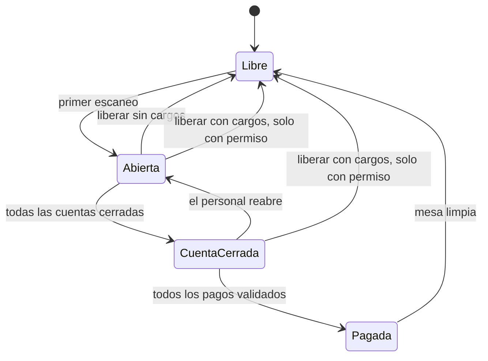
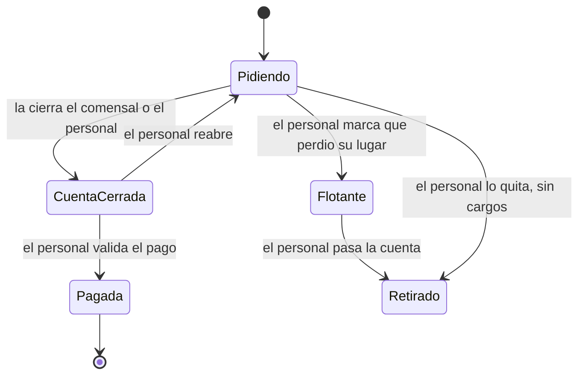
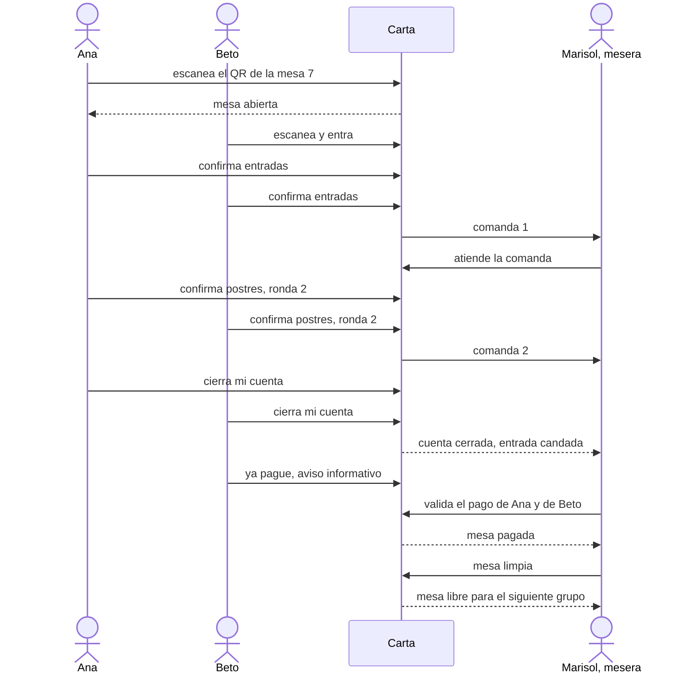
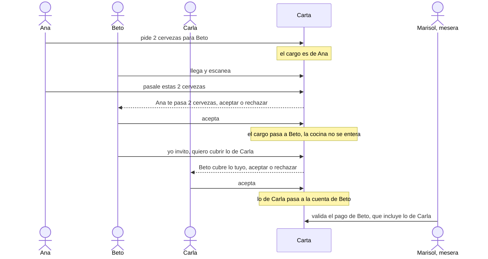
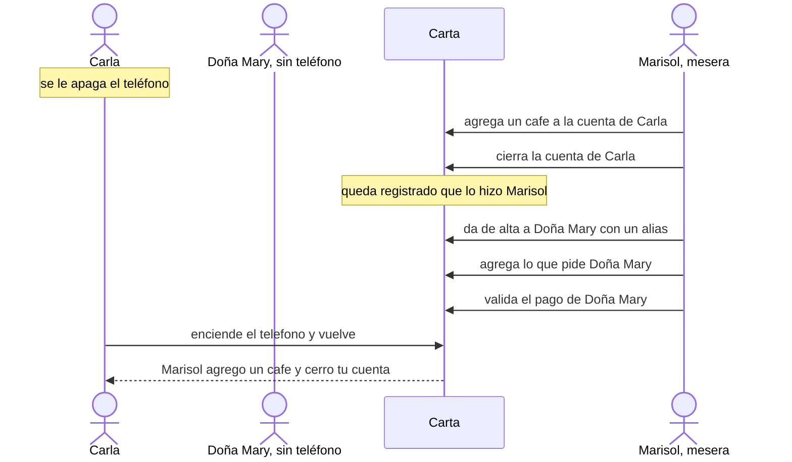
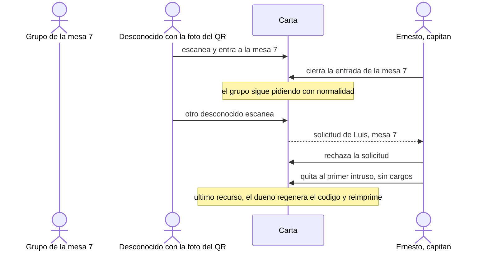
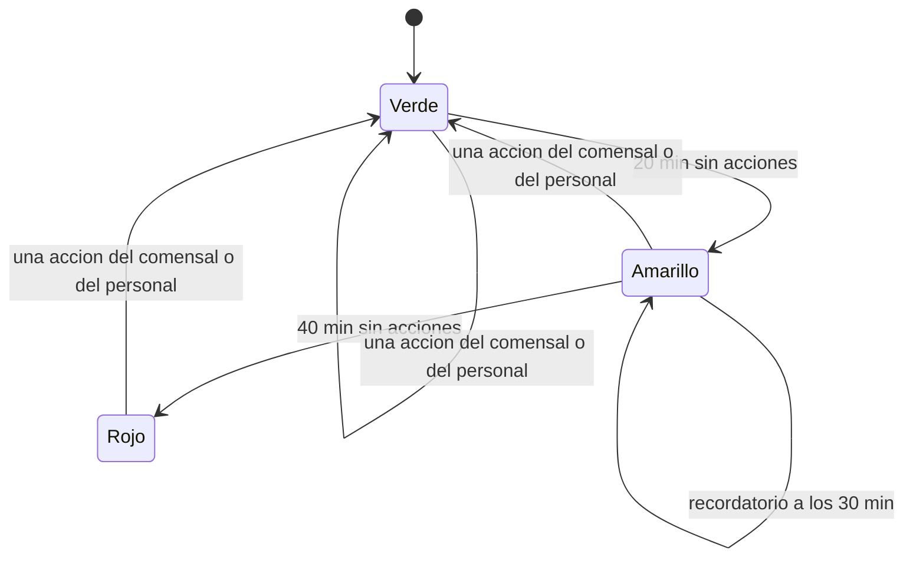
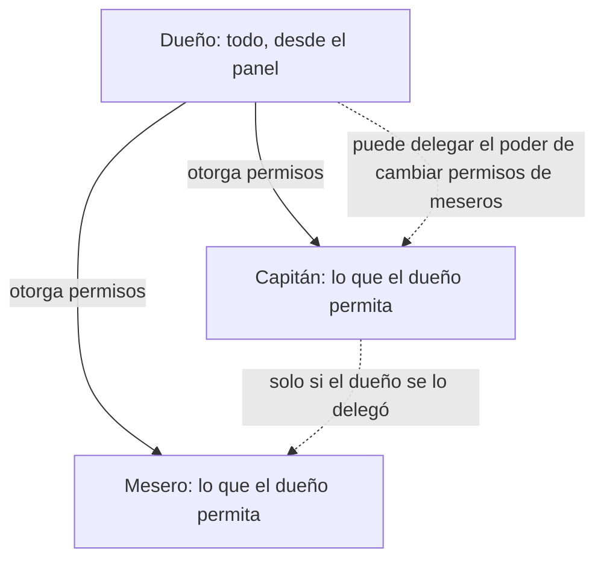

# Spec 001 — Ciclo de vida de la mesa y del comensal

**Fecha:** 2026-11-12 · **Versión:** 2 (con las respuestas de Calvin) · **Estado:** borrador · **Pedida por:** Calvin · **Historias:** US-29 a US-36 (nuevas) · **Insumo:** `docs/plan/04_Fases_y_Tareas.md` §7 y §11 (12 de noviembre), los comentarios de Calvin a la versión 1 y los prototipos (`prototipo/js/{checkout-v2,mesero,capitan,admin-ops}.jsx`, `stitch/p05-checkout-pago.html`) y la nota `docs/research/2026-09-23-checkout-y-ley-fintech.md`

> Separa tres cosas. **Decidido por Calvin:** criterios firmes. **Propuesta:** lo que redacta quien escribe la spec para completar el diseño (va marcado «Propuesta»). **Abierto:** `[ACLARAR-n]`, con escenario y recomendación. No toca código, plan, PRD ni otros documentos: la sección 9 dice qué cambiaría en cada uno.

---

## 0. Resumen

**Qué se resuelve.** Hoy la mesa se cierra sola a las 3 h sin actividad y el pase del comensal dura 6 h. Una comida real dura más, tiene gente que llega tarde, teléfonos apagados y un cobro al final. Esta spec pone **al personal a cargo del ciclo de la mesa**: el comensal marca («cerré mi cuenta», «ya pagué»), el personal valida. **Ningún reloj cierra ni cambia nada**; los relojes sólo marcan un estatus para que el personal verifique. Carta exige **al menos un validador**: el dueño, que es el primer y único mesero si no hay más; después, un capitán o meseros de confianza. El cobro ocurre **fuera de la app**.

**El ciclo de la mesa**

- **Abierta:** los comensales entran, piden por rondas, ven lo de los demás.
- **Cuenta cerrada** (el *checkout*): ya no se agrega nada y **ningún comensal nuevo entra** hasta que la mesa quede limpia (el candado).
- **Pagada:** el personal verificó que cada cuenta quedó pagada por completo.
- **Limpia:** el personal libera la mesa; sólo entonces entra el siguiente grupo. Tras «pagada» ya no se reabre.

**La cuenta de cada comensal**

Mientras haya una cuenta sin cerrar o sin pagar, **la mesa no se puede limpiar** (la sesión no se cierra), y mientras haya una cuenta flotante, tampoco se cierra la cuenta de la mesa. La única salida es la liberación forzada con permiso.

**Decidido por Calvin**
1. El personal lleva el ciclo; no hay cierre por inactividad ni tope de horas para la mesa.
2. Estados: abierta → cuenta cerrada → pagada → mesa limpia, con candado. El comensal marca, el personal valida; «ya pagué» es sólo informativo.
3. Pago **por comensal**, con el desglose; sin tarjetas ni datos de transferencia en la v1.
4. Permisos como de administrador: el dueño puede todo y los va otorgando al capitán y al mesero; puede delegar en el capitán el cambiar los permisos de los meseros.
5. El personal agrega **y quita** ítems, suma y resta cantidades y cancela pedidos **si la cocina aún no empezó**; pasa cuentas sin aceptación del destino; da de alta a la **persona sin teléfono**.
6. «Cargo validado» = lo que la cocina ya procesó y el usuario acepta pagar.
7. Estatus de actividad (verde / amarillo / rojo) y recordatorio al personal; umbrales por restaurante; nada se cierra solo.
8. La mesa se abre con el primer escaneo, sin ajuste de aprobación.
9. Pase de 24 h sin usarse; la sesión y la cuenta no caducan. Tope de 12 comensales (el piloto).
10. «Invitar» (pagar lo de otro, o «yo invito» a toda la mesa) y «pedir por otro / pasarle la orden» con aceptación de quien recibe.
11. Cuenta flotante, que impide cerrar la sesión hasta pasarse. Reabrir sólo antes de «pagada». Liberar con cargos sin pagar: dueño, y capitán sólo con permiso.

**Propuestas de esta spec que Calvin puede cambiar** (no son palabras suyas): invitar y pasar son **un solo mecanismo** de «traspaso» (§4); la tabla de permisos por defecto (§5); el dueño opera desde el panel; la propina es sólo una sugerencia en pantalla; «a medida» (porcentaje o monto) y «dividir a una persona entre varios» se pueden dejar para la v1.1 (línea de corte).

**Abierto: 6 preguntas** (el detalle, con escenario y recomendación, en las historias)
- **[ACLARAR-1]** Ana comió ayer en La Ceiba y la mesa nunca se liberó; hoy, en otro restaurante, la app le dice que sigue en la mesa 7 de La Ceiba. Recomendación: mismo bloqueo siempre, con «salir de la mesa» si no tiene cargos validados sin pagar.
- **[ACLARAR-2]** Propina sugerida en el desglose. Recomendación: sí, sólo calculada en el teléfono, sin cobrarla, guardarla ni repartirla; obliga a ajustar una línea de «Qué NO construir».
- **[ACLARAR-3]** Mesas asignadas a meseros. Recomendación: no en la v1; lo más cercano barato es un «tomar mesa» visual (v1.1).
- **[ACLARAR-4]** Valores por defecto de los permisos. Recomendación: la tabla de §5 (lo básico en «sí», lo delicado en «no»), no «todos no».
- **[ACLARAR-5]** La mañana siguiente: una mesa que quedó abierta toda la noche sigue admitiendo a quien escanee. Recomendación: tras 2 h en rojo, entrar exige aprobación del personal; no cierra nada.
- **[ACLARAR-6]** Dónde opera el dueño. Recomendación: desde el panel (`/admin/pedidos`), con las mismas acciones que el personal.

Cada pregunta trae su recomendación: Calvin puede contestar «ok a todo» o sólo los números que cambiaría.

**Tamaño de la Fase 3.** De 7 tareas a unas **18** con todo lo anterior (alrededor de 2.5 veces); el núcleo sin lo opcional es de unas **14**. Qué puede salir a la v1.1 sin romper el ciclo:

| Se puede dejar para la v1.1 | Ahorra | Qué se pierde |
|---|---|---|
| «Invitar» a medida (porcentaje o monto) y dividir a una persona entre varios | 0.5 tareas | Sólo se invita todo lo de una persona o ítems completos |
| Propina sugerida en el desglose | 0.3 | El comensal calcula su propina por su cuenta |
| Delegación de permisos al capitán | 0.5 | Sólo el dueño cambia permisos |
| Permisos editables (quedan los valores por defecto fijos) | 2 | Un restaurante no puede ajustar nada; hay que acertar con los valores |
| Persona sin teléfono | 0.5 | Se resuelve fuera de la app |
| El personal edita la orden (queda cerrar la cuenta por el comensal y cancelar) | 1.5 | El mesero cancela y pide de nuevo en lugar de corregir |
| Traspasos entre comensales (invitar y pasar) | 2 | Cada quien paga lo suyo; invitar se resuelve con el mesero |

Lo que **no** puede salir: el ciclo y el candado (US-29), el estatus de actividad, la entrada cerrada con solicitudes (US-33) y la sustitución del cierre de 3 h (§9).

---

## 1. Problema

En La Ceiba, un viernes a las 21:00, la mesa 7 tiene seis personas: dos llegan 40 minutos tarde, una pide una cerveza «para Beto, que ya viene», a las 23:00 siguen de sobremesa sin pedir nada y, al final, tres se levantan sin cerrar nada porque se les apagó el teléfono. Con las reglas de hoy, la mesa se cierra sola en plena sobremesa, el pase de Ana expira antes de que pague, nadie sabe quién debe qué, y si alguien filtra la foto del QR, un desconocido ocupa un lugar. Carta es para restaurantes con **al menos un validador** (el dueño); ese validador debe llevar el ciclo, no los relojes.

## 2. Resultado esperado

- Una mesa vive mientras el personal no la limpie; ningún reloj la corta ni la cambia.
- Cada comensal ve su cuenta (un total estimado, no un comprobante) y la cierra al terminar; el personal ve en qué paso va cada mesa y cuánto lleva sin actividad.
- El siguiente grupo nunca cae en la mesa del anterior.
- El personal arregla los casos reales (teléfono apagado, cambiado o inexistente, desconocido en la mesa, pedido equivocado) sin perder el historial.
- Un QR filtrado se contiene con un toque, sin reimprimir.
- Quedan guardadas las horas de cada paso para medir cuánto tarda una mesa y su preparación.
- Señal: M3 de `01_Alcance_v1.md` (mesas atendidas sin que el restaurante tenga que pedirle ayuda a Calvin) y, en el ensayo de T-4.7, mesas cerradas por el personal sin ayuda.

## 3. Glosario llano y ajustes por restaurante

La v1 **no tiene planes ni cobros de Carta**. Los topes que podrían variar por plan son **ajustes por restaurante** con un valor para el piloto. Los cambia Calvin; el operador no los edita. Los planes sólo fijarán estos valores, sin rediseño.

| Ajuste o término | Qué es, con un ejemplo | Valor del piloto |
|---|---|---|
| **Pase** | Lo que guarda el teléfono para saber quién eres en la mesa. Si el teléfono pasa 24 h sin abrir la app, deja de valer; la mesa y la cuenta no cambian | 24 h sin usarse |
| **Solicitud** | Cuando la entrada está cerrada, escanear no mete a nadie: deja un aviso «Luis quiere entrar a la mesa 7» que el mesero aprueba o rechaza | — |
| **Cerrar la entrada** | Un interruptor por mesa. Normal: quien escanea entra. Cerrada: quien escanea queda en espera y el personal decide. Sirve cuando el grupo ya está completo o si el QR se filtró. Los que ya están siguen pidiendo | — |
| **Solicitudes pendientes** | Cuántos «quiero entrar» puede haber a la vez en una mesa; la sexta ve «mesa ocupada» y no deja otro aviso, para que nadie llene al mesero de avisos | 5 |
| **Vigencia de una solicitud** | Una solicitud sin respuesta se borra sola de la lista a los 10 min; la persona puede volver a escanear | 10 min |
| **Ofertas de traspaso pendientes** | Cuántas invitaciones o «pásale esto» sin responder puede tener una persona; la cuarta se rechaza para evitar spam | 3 |
| **Máximo de comensales** | Personas por mesa; el diseño llega a 12 (hoy 6 en gratuitos, 12 en de paga cuando existan planes) | 12 |
| **Estatus de actividad** | Color de la mesa según los minutos sin acciones de comensales ni de personal: verde menos de 20, amarillo de 20 a 40, rojo más de 40 | 20 y 40 min |
| **Recordatorio** | Aviso al personal cuando una mesa lleva unos 30 min sin acciones; se marca «todo bien con la mesa» y vuelve a empezar la cuenta | 30 min |
| **Entrada por aprobación tras rojo** | Con la mesa en rojo cierto tiempo, escanear deja solicitud en lugar de entrar. Ver [ACLARAR-5] | 2 h en rojo |

## 4. Recorridos

**Comida normal con dos rondas y checkout**

**Alguien invita, o pide por otro y le pasa la orden.** Es un solo mecanismo, el **traspaso**: cambia *quién responde por un cargo*; nunca mueve dinero ni cambia lo que ve la cocina (la nota de ley fintech exige que lo que se mueva sea la atribución de una partida, no un monto, y que el otro acepte). Lo propone una persona y lo acepta la otra; nada se mueve sin las dos.

**Teléfono apagado o persona sin teléfono**

**QR filtrado**

**Estatus de actividad de la mesa (no cierra nada)**

## 5. Quién puede qué

El dueño puede todo. El capitán puede lo que el dueño le permita; el mesero, lo que el dueño le permita (o el capitán, si el dueño le delegó eso). Son **permisos por rol** (todos los capitanes y todos los meseros del restaurante), no por persona. «Opciones extra» del capitán dentro de las mismas pantallas: no hay pantallas propias del capitán.

**Propuesta: valores por defecto** (para que un restaurante nuevo funcione sin configurar nada). Lo marcado «Calvin» viene de sus respuestas:

| Permiso | Mesero | Capitán | Dueño |
|---|---|---|---|
| Cerrar la cuenta de un comensal por él (comensal: la suya) | sí (Calvin) | sí | sí |
| Cerrar la cuenta de toda la mesa (atajo opcional) | sí | sí | sí |
| Validar pagos y la mesa pagada | sí (Calvin) | sí (Calvin) | sí |
| Mesa limpia | sí | sí | sí |
| Reabrir antes de «pagada» | sí (Calvin) | sí | sí |
| Agregar y quitar ítems y cantidades; cancelar si la cocina no empezó | sí | sí | sí |
| Dar de alta a una persona sin teléfono | sí | sí | sí |
| Pasar una cuenta a otra persona | sí (Calvin) | sí | sí |
| Quitar a un comensal sin cargos | sí | sí | sí |
| Aprobar o rechazar solicitudes de entrada | sí | sí | sí |
| Cerrar o abrir la entrada de una mesa | **no** | sí | sí |
| Liberar una mesa con cargos sin pagar | no | **no** (Calvin: sólo con permiso del dueño) | sí |
| Cambiar los permisos de los meseros | no | no (delegable) | sí |
| Regenerar el código del QR (T-1.5) | no | no | sí, en el panel |
| Marcar un platillo agotado (ya existe) | sí | sí | sí |

«Avisar ya pagué» es sólo del comensal; el personal valida aunque no haya aviso. **El precio nunca se edita** (regla dura 4): descuentos y cortesías no están en la v1.

**[ACLARAR-4] Valores por defecto.** Calvin dijo primero «algunos por defecto sí» y luego «mejor todos no». Recomendación: la tabla de arriba. Con «todos no», un restaurante recién creado tendría meseros que no pueden ni marcar una mesa limpia hasta que el dueño configure todo. Escenario: Doña Lupe da de alta a Marisol un viernes a las 20:00; con la tabla, Marisol atiende; con «todos no», no puede marcar limpia la mesa 7 hasta que Doña Lupe abra los permisos. También: ¿cerrar la entrada debe ser del mesero? Recomendación: no por defecto, para que el capitán o el dueño corten el ataque; el dueño puede otorgarlo. El regenerar el código queda sólo del dueño: obliga a reimprimir y el PDF de QR está en el panel.

## 6. Historias y criterios

Definiciones:
- **Cuenta** de un comensal: lo que pidió y confirmó, más lo que le traspasaron, con precio congelado al confirmar. Es un **total estimado**, no comprobante ni factura.
- **Cargo validado:** ítem que la cocina ya procesó (de una comanda que el personal atendió). **Propuesta de lectura:** antes de eso el personal puede cancelarlo (queda cancelado, con quién y cuándo; nada se pierde, regla dura 8).
- **Personal:** mesero, capitán o dueño, sujeto a sus permisos (§5).
- **Cuenta flotante:** la de alguien que perdió su lugar; sigue contando y no la edita nadie hasta que el personal la pasa.

### US-29 — Ciclo de la mesa y candado

> Como mesero, quiero llevar la mesa desde que se abre hasta que queda limpia y que el siguiente grupo no caiga en el anterior, para no depender de relojes ni de recordar quién pagó.

- **AC-29.1** — CUANDO se escanea el QR de una mesa libre, EL sistema DEBERÁ abrirla y guardar la hora del primer escaneo.
- **AC-29.2** — MIENTRAS la mesa esté abierta, EL sistema DEBERÁ permitir a cada comensal pedir en rondas sucesivas, y cada confirmación del grupo DEBERÁ generar su propia comanda.
- **AC-29.3** — CUANDO un comensal cierre su cuenta, EL sistema DEBERÁ impedirle agregar o confirmar más ítems; SI tiene ítems sin confirmar, ENTONCES DEBERÁ pedirle confirmarlos o descartarlos antes.
- **AC-29.4** — CUANDO todos los comensales activos hayan cerrado su cuenta (ellos o el personal por ellos), EL sistema DEBERÁ pasar la mesa a «cuenta cerrada» y guardar la hora; el personal DEBERÁ poder cerrar de una vez todas las cuentas como atajo.
- **AC-29.5** — MIENTRAS la mesa esté en «cuenta cerrada» o posterior, EL sistema DEBERÁ rechazar a quien no es miembro con un mensaje que le pida hablar con el mesero, sin solicitud y sin ocupar lugar; los miembros conservan su acceso para ver su cuenta.
- **AC-29.6** — MIENTRAS la cuenta de un comensal esté cerrada, EL sistema DEBERÁ mostrarle el desglose: ítems propios, lo que recibió y lo que cubre por invitaciones, subtotal y total estimado.
- **AC-29.7** — CUANDO un comensal avise «ya pagué», EL sistema DEBERÁ mostrárselo al personal como aviso, sin considerar pagada la cuenta hasta que el personal la valide (que podrá validar sin aviso).
- **AC-29.8** — CUANDO el personal valide el pago de una cuenta (efectivo o transferencia, hechos fuera de la app), EL sistema DEBERÁ marcarla «pagada» con hora y quién la validó; cuando todas lo estén, la mesa DEBERÁ pasar a «pagada».
- **AC-29.9** — CUANDO el personal marque «mesa limpia» sobre una mesa pagada, EL sistema DEBERÁ terminar la sesión, guardar hora y autor y dejar la mesa libre para un grupo que no verá nada del anterior.
- **AC-29.10** — SI hay comandas no terminales (abierta o atendida) o cuentas sin pagar o flotantes, ENTONCES EL sistema DEBERÁ impedir «mesa limpia» (regla dura 8: ninguna comanda se pierde).
- **AC-29.11** — CUANDO el personal reabra una cuenta o la mesa antes de «pagada», EL sistema DEBERÁ volver a «abierta», levantar el candado y conservar el historial; después de «pagada» NO DEBERÁ permitir reabrir, y el ciclo nuevo empieza con la mesa limpia.
- **AC-29.12** — CUANDO alguien con permiso libere una mesa con cargos sin pagar, EL sistema DEBERÁ cerrar la sesión y registrarla «liberada sin pago verificado» con quién y cuándo; una mesa sin cargos DEBERÁ poder liberarla cualquier mesero.
- **AC-29.13** — DONDE se apruebe la propina sugerida ([ACLARAR-2]), EL sistema DEBERÁ mostrarla en el desglose como sugerencia calculada en el teléfono, y NO DEBERÁ cobrarla, guardarla ni repartirla.

**Escenarios**
- **AC-29.1** · Dado La Ceiba, mesa 7 libre · Cuando Ana escanea a las 20:58 · Entonces el personal ve la mesa 7 «abierta» con un comensal.
- **AC-29.2** · Dado Ana, Beto y Carla que piden entradas a las 21:05 y postres a las 22:30 · Entonces llegan dos comandas de la mesa 7.
- **AC-29.3** · Dado Carla con un flan sin confirmar · Cuando toca «cerrar mi cuenta» · Entonces debe confirmar o descartar el flan; después ve su total y no agrega nada.
- **AC-29.4** · Dado Ana, Beto y Carla; Ana y Beto cierran y Marisol cierra la de Carla (teléfono apagado) · Entonces la mesa pasa a «cuenta cerrada».
- **AC-29.5** · Dado la mesa 7 en «cuenta cerrada» · Cuando Dani escanea · Entonces ve «esta mesa está cerrando su cuenta, habla con tu mesero» y no queda solicitud.
- **AC-29.6** · Dado Beto que cubrió lo de Carla · Cuando cierra su cuenta · Entonces ve sus ítems, «cubres a Carla: $210» y el total.
- **AC-29.7** · Dado Beto con $480 por pagar · Cuando toca «ya pagué» · Entonces Marisol ve el aviso, pero la cuenta sigue «por pagar».
- **AC-29.8** · Dado Beto que pagó en efectivo · Cuando Marisol valida · Entonces su cuenta queda «pagada» con «validó Marisol»; al validar a la última, la mesa pasa a «pagada».
- **AC-29.9** · Dado la mesa 7 pagada y recogida · Cuando Marisol toca «mesa limpia» · Entonces el grupo de las 23:40 ve un menú vacío, sin alias ni cuentas del anterior.
- **AC-29.10** · Dado una comanda de café sin servir · Cuando Marisol intenta «mesa limpia» · Entonces el sistema se lo impide y le dice cuál falta.
- **AC-29.11** · Dado la mesa en «cuenta cerrada» y Carla que pide otro café · Cuando Marisol reabre la cuenta de Carla · Entonces la mesa vuelve a «abierta»; con la mesa ya «pagada», el botón no existe.
- **AC-29.12** · Dado Beto que se fue sin pagar $480 · Cuando Doña Lupe (dueña) libera la mesa · Entonces queda «liberada sin pago verificado»; si Ernesto (capitán sin ese permiso) lo intenta, se le niega.
- **AC-29.13** · Dado un total de $480 · Cuando Beto ve el desglose · Entonces ve «propina sugerida 15%: $72» calculada en su teléfono; el servidor no guarda ese número.

**Preguntas abiertas:** [ACLARAR-2] la propina. «Pagos, propinas o comisión» está en «Qué NO construir». La nota de ley fintech (§2.4) concluye que Carta puede **sugerir y calcular** la propina, pero **nunca cobrarla, guardarla ni repartirla** (el artículo 346 de la Ley Federal del Trabajo la reserva a los trabajadores). Recomendación: sí, así; al aprobarla hay que ajustar esa línea de `CLAUDE.md` y de `01_Alcance_v1.md` §4 a «cobrar, guardar o repartir propinas». Alternativa: sin propina en la v1.

### US-30 — El pase del comensal y el estatus de la mesa

> Como comensal, quiero que mi lugar siga siendo mío aunque mi teléfono se bloquee y la comida dure horas; como mesero, quiero ver qué mesas llevan rato sin que nadie haga nada, para ir a verificar.

- **AC-30.1** — MIENTRAS la mesa de un comensal siga abierta, EL sistema DEBERÁ conservar su identidad y su cuenta sin una vigencia fija en horas; la sesión de la mesa NO DEBERÁ caducar.
- **AC-30.2** — EL sistema NO DEBERÁ cerrar una mesa ni cambiar su contenido por falta de actividad: sólo el personal lo hace.
- **AC-30.3** — CUANDO el teléfono de un comensal esté bloqueado o la app cerrada, EL sistema NO DEBERÁ tratarlo como salida: su lugar y su cuenta siguen donde estaban.
- **AC-30.4** — CUANDO la mesa quede limpia, EL sistema DEBERÁ dejar sin efecto los pases de esa sesión.
- **AC-30.5** — SI un pase pasa 24 h sin usarse mientras la mesa sigue abierta, ENTONCES EL sistema DEBERÁ hacerlo caducar (no la mesa ni la cuenta); quien vuelve entra como persona nueva y su cuenta anterior queda flotante.
- **AC-30.6** — MIENTRAS una mesa esté abierta, EL sistema DEBERÁ mostrar al personal su estatus por minutos sin acciones de comensales ni de personal: verde (menos de 20), amarillo (20 a 40) y rojo (más de 40), con umbrales configurables por restaurante.
- **AC-30.7** — CUANDO una mesa lleve unos 30 min sin acciones, EL sistema DEBERÁ mostrar un recordatorio al personal; CUANDO el personal lo marque «todo bien con la mesa», EL sistema DEBERÁ contarlo como una acción y reiniciar el conteo.
- **AC-30.8** — EL sistema NO DEBERÁ hacer nada más que mostrar el estatus y el recordatorio (decisión de Calvin: los relojes sólo marcan estatus).

**Escenarios**
- **AC-30.1** · Dado Ana que entró a las 21:00 · Cuando vuelve a las 00:45 · Entonces es la misma Ana con su cuenta intacta.
- **AC-30.2** · Dado la mesa 7 sin pedidos desde las 22:30 · Cuando son las 02:00 · Entonces sigue abierta, en rojo, con todo en su lugar.
- **AC-30.3** · Dado el teléfono de Beto bloqueado desde las 22:00 · Cuando Marisol abre la mesa 7 · Entonces Beto sigue en la lista con su cuenta.
- **AC-30.4** · Dado la mesa 7 limpia a las 23:50 · Cuando Ana abre su QR con su teléfono viejo · Entonces entra como comensal nuevo en una sesión nueva.
- **AC-30.5** · Dado un pase sin usar 25 h en una mesa que sigue abierta · Cuando su dueño escanea · Entonces entra como «Comensal 3» y el personal ve la cuenta anterior flotante.
- **AC-30.6** · Dado la mesa 7 con la última acción a las 21:00 · Cuando son las 21:25 · Entonces aparece en amarillo; a las 21:45, en rojo.
- **AC-30.7** · Dado la mesa 7 con 30 min sin acciones · Cuando Marisol la revisa y toca «todo bien» · Entonces vuelve a verde y el recordatorio reaparece 30 min después si nadie hace nada.
- **AC-30.8** · Dado la mesa 7 en rojo toda la noche · Cuando nadie la toca · Entonces sigue igual de abierta; ningún reloj la cierra.

**Preguntas abiertas:** [ACLARAR-5] la mañana siguiente. Escenario: el mesero olvida limpiar la mesa 7 a las 23:50. A las 14:00 del día siguiente llegan dos clientes, escanean y entran a la sesión de ayer, con sus alias y cuentas. Con sólo estatus, nada lo impide. Recomendación: tras 2 h en rojo (ajuste por restaurante), escanear deja solicitud en lugar de entrar. No cierra nada ni toca cuentas; es el mismo mecanismo de la entrada cerrada (US-33). Si Calvin no quiere ni eso, la alternativa es confiar en que el recordatorio sea atendido.

### US-31 — El personal corrige la mesa

> Como mesero, quiero quitar a un desconocido, actuar por quien se quedó sin teléfono, corregir una orden y pasar una cuenta a la persona correcta, para que el cobro cuadre sin perder el historial.

- **AC-31.1** — CUANDO el personal quite a un comensal sin ítems confirmados, EL sistema DEBERÁ retirarlo de la mesa (pierde el acceso), descartar sus ítems sin confirmar, conservar el registro de que estuvo (regla dura 9) y recalcular el progreso «n de m listos» sin él.
- **AC-31.2** — SI un comensal tiene ítems confirmados que la cocina ya procesó (cargos validados), ENTONCES EL sistema NO DEBERÁ permitir quitarlo y DEBERÁ ofrecer pasar su cuenta o marcar que perdió su lugar; si sus ítems aún no los procesa la cocina, DEBERÁ ofrecer cancelarlos primero (AC-31.5).
- **AC-31.3** — CUANDO el personal actúe por un comensal (agregar o quitar ítems, cerrar su cuenta), EL sistema DEBERÁ registrar que lo hizo el personal, quién y cuándo, y mostrárselo al comensal cuando vuelva.
- **AC-31.4** — EL sistema DEBERÁ calcular siempre el precio de un ítem agregado por el personal desde la base y congelarlo al confirmar (regla dura 4); el personal NO DEBERÁ poder cambiar precios.
- **AC-31.5** — CUANDO el personal sume o reste cantidades, quite ítems o cancele un pedido cuya comanda la cocina aún no ha empezado, EL sistema DEBERÁ aplicarlo conservando el original y la corrección con quién y cuándo (la comanda cancelada o corregida no desaparece); después de que la cocina empezó, NO DEBERÁ permitir quitar, sólo agregar ítems nuevos en una comanda nueva.
- **AC-31.6** — CUANDO el personal dé de alta a una persona sin teléfono con un alias, EL sistema DEBERÁ crearla como miembro cuyas acciones realiza el personal (agregar, cerrar, validar su pago) y contarla en el máximo de comensales.
- **AC-31.7** — CUANDO el personal pase la cuenta de un comensal a otro, EL sistema DEBERÁ mover todos sus cargos al destino sin pedirle aceptación, avisar al destino, retirar al origen y registrar quién, cuándo, de quién y a quién.
- **AC-31.8** — CUANDO el personal marque a un comensal como «perdió su lugar», EL sistema DEBERÁ dejar su cuenta flotante y NO DEBERÁ permitir «cuenta cerrada» ni «mesa limpia» mientras haya cuentas flotantes.
- **AC-31.9** — SI dos comensales tienen el mismo alias, ENTONCES EL sistema DEBERÁ distinguirlos con su color y un número.
- **AC-31.10** — EL sistema DEBERÁ rechazar con 404 toda corrección sobre una mesa de otro restaurante (regla dura 6), y toda corrección DEBERÁ exigir el permiso correspondiente (§5).

**Escenarios**
- **AC-31.1** · Dado «Comensal 5», que nadie reconoce, sin ítems, con la mesa en «2 de 3 listos» · Cuando Marisol lo quita · Entonces la mesa muestra «2 de 2», él ve «te quitaron de la mesa» y queda su registro.
- **AC-31.2** · Dado un «Comensal 5» desconocido con una hamburguesa confirmada que la cocina aún no empieza · Cuando Marisol intenta quitarlo · Entonces se le ofrece cancelar la hamburguesa y luego quitarlo; si la cocina ya la hizo, se le ofrece pasar la cuenta.
- **AC-31.3** · Dado el teléfono de Carla apagado · Cuando Marisol agrega un café y cierra su cuenta · Entonces Carla, al volver, ve «Marisol agregó un café y cerró tu cuenta».
- **AC-31.4** · Dado un café a $45 en la base · Cuando Marisol lo agrega · Entonces el cargo es $45; no existe campo para editarlo.
- **AC-31.5** · Dado una comanda de 2 tacos que la cocina no ha empezado · Cuando Marisol los baja a 1 · Entonces la cuenta baja y el historial conserva «2, corregido a 1 por Marisol»; con la comanda ya atendida, el botón de quitar no existe.
- **AC-31.6** · Dado Doña Mary, sin teléfono · Cuando Marisol la da de alta como «Doña Mary» y le agrega un caldo · Entonces aparece como la cuarta comensal con su cuenta.
- **AC-31.7** · Dado Beto que cambió de teléfono y quedó como «Comensal 6» con su cuenta vieja en «Comensal 2» · Cuando Marisol pasa la cuenta de 2 a 6 · Entonces los cargos están en «Comensal 6», «Comensal 2» queda retirado y «Comensal 6» recibe el aviso.
- **AC-31.8** · Dado Dani que se fue dejando una cerveza servida · Cuando Marisol lo marca «perdió su lugar» · Entonces la mesa no puede cerrarse hasta pasar su cuenta.
- **AC-31.9** · Dado dos «Ana» · Cuando el personal abre la mesa · Entonces los ve como «Ana ●1» y «Ana ●2».
- **AC-31.10** · Dado Marisol de La Ceiba · Cuando intenta corregir una mesa de otro restaurante · Entonces recibe 404.

**Preguntas abiertas:** ninguna (las lecturas de «cargo validado» y de cancelar antes de que la cocina empiece están marcadas como propuesta en las definiciones; Calvin las confirmó en lo esencial).

### US-32 — Traspasos: pedir por otro, pasarle la orden e invitar

> Como comensal, quiero pedir por alguien que aún no llega y pasarle lo que pedí, o invitar a un acompañante (o a toda la mesa), para que cada quien pague lo que acordamos.

**Propuesta de unificación.** «Pedir por otro y pasarle la orden» e «invitar» son el mismo mecanismo: cambiar quién responde por cada cargo. Hay dos formas de empezar: **«pásale esto»** (yo doy mis cargos) e **«invito»** (yo tomo los tuyos). Siempre lo propone una persona y lo acepta la otra. «Yo invito» a toda la mesa son varias invitaciones a la vez; cada persona acepta la suya. El personal puede pasar cuentas sin aceptación (AC-31.7).

- **AC-32.1** — CUANDO un comensal marque un ítem como «para otra persona» (un alias presente o un nombre libre de hasta 24 caracteres), EL sistema DEBERÁ dejar el cargo en su cuenta y mostrar la marca a la mesa. El nombre libre se trata **igual que un alias** (misma limpieza y lista de bloqueo, visible sólo en la mesa) y NO DEBERÁ pedirse ni guardarse nada más de esa persona (regla dura 10).
- **AC-32.2** — CUANDO un comensal ofrezca pasar ítems confirmados («pásale esto») o invite a otro (todo lo suyo o ítems elegidos), EL sistema DEBERÁ mostrarle al otro quién propone, qué y cuánto, y NO DEBERÁ mover nada hasta que acepte.
- **AC-32.3** — CUANDO el otro acepte, EL sistema DEBERÁ mover la atribución de esos cargos con el precio ya congelado, sin alterar lo que ve la cocina, y registrar quién propuso, quién aceptó y cuándo. Lo que se mueve es la atribución de cargos; el sistema NO DEBERÁ guardar ningún monto «que alguien le debe a otro».
- **AC-32.4** — CUANDO un comensal toque «yo invito» para la mesa, EL sistema DEBERÁ enviar una invitación a cada comensal activo; los que no acepten conservan lo suyo.
- **AC-32.5** — SI el destinatario rechaza, o cierra su cuenta sin responder, ENTONCES EL sistema DEBERÁ dejar los cargos como estaban.
- **AC-32.6** — EL sistema NO DEBERÁ permitir proponer a quien ya cerró su cuenta ni aceptar con la cuenta cerrada, y DEBERÁ bloquear los cargos ya ofrecidos hasta que se acepten, se rechacen o la cuenta se cierre, para que no se cobren dos veces.
- **AC-32.7** — EL sistema NO DEBERÁ permitir a nadie imponer cargos a otro ni quedarse con los de otro sin su aceptación, y DEBERÁ limitar las ofertas pendientes por comensal (3 en el piloto).

**Escenarios**
- **AC-32.1** · Dado Ana y Beto de camino · Cuando Ana pide dos cervezas «para Beto» · Entonces los cargos son de Ana y la mesa ve «2 cervezas, para Beto».
- **AC-32.2** · Dado que Beto llega · Cuando Ana le pasa las cervezas ($130) · Entonces Beto ve «Ana te pasa 2 cervezas, $130» con Aceptar/Rechazar; su cuenta sigue en $0.
- **AC-32.3** · Dado la oferta · Cuando Beto acepta · Entonces su cuenta es $130, la de Ana baja $130 y la comanda no cambia.
- **AC-32.4** · Dado la mesa 7 con Ana, Beto y Carla · Cuando Ana toca «yo invito» · Entonces Beto y Carla reciben «Ana quiere cubrir lo tuyo»; Beto acepta, Carla no; Ana paga lo de Beto y Carla paga lo suyo.
- **AC-32.5** · Dado una oferta sin responder · Cuando Beto cierra su cuenta · Entonces las cervezas quedan con Ana.
- **AC-32.6** · Dado Carla con su cuenta cerrada · Cuando Ana intenta invitarla · Entonces no puede elegirla.
- **AC-32.7** · Dado Dani, que sabe el alias «Ana» · Cuando intenta reclamar sus cervezas · Entonces no hay forma; sólo Ana propone y sólo el destinatario acepta; con 3 ofertas sin responder, una cuarta se rechaza.

**Preguntas abiertas:** ninguna. **Línea de corte:** invitar «a medida» (porcentaje o monto) y dividir a una persona entre varios que la invitan, que el prototipo (`checkout-v2.jsx`) muestra con «100 %», «la mitad» y «otro monto», necesitan partir un cargo en partes y rozan la regla de la nota fintech de no mover montos; se proponen para la v1.1 (§0).

### US-33 — La entrada de la mesa

> Como capitán o dueño, quiero cortar con un toque que la mesa se llene de desconocidos sin cambiar el QR impreso, para que un QR filtrado no se convierta en un problema de servicio.

Un QR impreso no puede guardar un secreto que rote: quien tiene la foto sigue entrando. Lo que sí corta el ataque sin reimprimir es cerrar la entrada y que cada ingreso lo apruebe el personal. Regenerar el código (T-1.5, ya existe) queda como último recurso, sólo del dueño.

- **AC-33.1** — CUANDO alguien con permiso cierre la entrada de una mesa abierta, EL sistema DEBERÁ dejar de admitir personas nuevas; los miembros siguen entrando y pidiendo.
- **AC-33.2** — MIENTRAS la entrada esté cerrada, EL sistema DEBERÁ convertir el escaneo de un no miembro en una solicitud con su alias, que NO ocupa lugar.
- **AC-33.3** — CUANDO el personal apruebe una solicitud, EL sistema DEBERÁ convertir a esa persona en miembro; si la rechaza, DEBERÁ mostrarle un mensaje neutro.
- **AC-33.4** — EL sistema DEBERÁ limitar las solicitudes pendientes por mesa (5), caducar cada una a los 10 minutos sin respuesta y contar los intentos con el mismo límite de tasa del comensal; superado el tope, DEBERÁ responder «mesa ocupada, habla con tu mesero» sin crear más.
- **AC-33.5** — CUANDO se reabra la entrada, EL sistema DEBERÁ volver a admitir personas con un escaneo.
- **AC-33.6** — CUANDO se regenere el código, EL sistema DEBERÁ conservar la sesión abierta y el estado de la entrada (decisión vigente de T-2.1); el código anterior deja de abrir al instante (AC-21.3).
- **AC-33.7** — CUANDO una mesa llegue al máximo de comensales (12 en el piloto), EL sistema DEBERÁ responder «mesa llena», sin solicitud.
- **AC-33.8** — EL sistema DEBERÁ mostrar al personal cuántas solicitudes tiene cada mesa y quién las pidió.

**Escenarios**
- **AC-33.1** · Dado la mesa 7 completa y un QR filtrado en un grupo · Cuando Ernesto (capitán) cierra la entrada · Entonces los seis siguen pidiendo normal.
- **AC-33.2** · Dado la entrada cerrada · Cuando un desconocido escanea y escribe «Luis» · Entonces Marisol ve «Mesa 7: solicitud de Luis»; la mesa sigue con seis.
- **AC-33.3** · Dado la solicitud de Luis · Cuando Marisol la aprueba · Entonces es el séptimo miembro; si la rechaza, ve «no pudimos agregarte».
- **AC-33.4** · Dado 5 pendientes · Cuando un sexto escanea · Entonces ve «mesa ocupada»; a los 10 min las no atendidas desaparecen.
- **AC-33.5** · Dado pasado el ataque · Cuando Ernesto reabre la entrada · Entonces escanear vuelve a admitir directo.
- **AC-33.6** · Dado la entrada cerrada y el QR filtrado · Cuando Doña Lupe regenera el código · Entonces los seis siguen, la entrada sigue cerrada y el QR viejo ya no abre nada.
- **AC-33.7** · Dado la mesa 7 con 12 miembros · Cuando un decimotercero escanea · Entonces ve «mesa llena».
- **AC-33.8** · Dado dos mesas con solicitudes · Cuando Marisol abre su lista · Entonces ve «Mesa 7 · 2 solicitudes».

**Preguntas abiertas:** [ACLARAR-5] (mañana siguiente, arriba) usa este mismo mecanismo. La apertura por aprobación **se quitó**: la mesa se abre siempre con el primer escaneo (decisión de Calvin).

### US-34 — Una mesa a la vez

> Como restaurante, quiero que quien ya está en una mesa abierta no pueda entrar a otra sin que lo liberen, para que nadie reparta cargos entre dos mesas por error.

- **AC-34.1** — CUANDO un teléfono cuyo comensal está en una mesa abierta escanea el QR de **otra** mesa, EL sistema NO DEBERÁ agregarlo ni moverlo, y DEBERÁ decirle «ya estás en la mesa N» con una salida de regreso a ella.
- **AC-34.2** — MIENTRAS su cuenta no esté pagada, EL sistema DEBERÁ mantener esa restricción.
- **AC-34.3** — CUANDO el personal lo quite, el pago de su cuenta quede validado, la mesa quede limpia o se libere, EL sistema DEBERÁ dejarlo escanear otra mesa.
- **AC-34.4** — EL sistema NO DEBERÁ presentarla como control de seguridad: sólo conoce la cookie, y quien la borra o usa otro navegador entra como persona nueva (ver §7).
- **AC-34.5** — DONDE el comensal no tenga cargos validados sin pagar, EL sistema DEBERÁ ofrecerle «salir de la mesa» para soltar su lugar. (Ver [ACLARAR-1].)

**Escenarios**
- **AC-34.1** · Dado Ana en la mesa 7 · Cuando por error escanea la mesa 8 · Entonces ve «ya estás en la mesa 7» y un botón para volver.
- **AC-34.2** · Dado Ana con la cuenta cerrada sin pagar · Cuando escanea la mesa 8 · Entonces sigue viendo «ya estás en la mesa 7».
- **AC-34.3** · Dado el pago de Ana validado · Cuando escanea la mesa 8 · Entonces entra normal.
- **AC-34.4** · Dado Beto que abre una pestaña privada y escanea la mesa 8 · Entonces entra como persona nueva; el control real es que sus cargos no cuentan sin validación.
- **AC-34.5** · Dado Ana sin pedidos aún en la mesa 7 · Cuando toca «salir de la mesa» · Entonces queda libre y retirada de la mesa 7.

**Preguntas abiertas:** [ACLARAR-1] **Bloqueo entre restaurantes.** Calvin dijo que es «el mismo bloqueo» fuera del restaurante. Escenario: Ana comió ayer en La Ceiba, el mesero nunca liberó la mesa 7; hoy, en otro restaurante, escanea y la app le dice «sigues en la mesa 7 de La Ceiba». (a) **Mismo bloqueo siempre**, con «salir de la mesa» si no tiene cargos validados sin pagar; si los tiene (comió y no pagó), ve el nombre de La Ceiba y «habla con ellos para que te liberen». (b) Entre restaurantes entra a la nueva y su lugar anterior queda como cuenta flotante para el personal de allá. **Recomendación: (a)**: es lo que Calvin pidió y respeta los cargos reales; su costo es que quien pagó pero el mesero no validó se queda bloqueado hasta que lo liberen, y que quien de veras debe no puede escapar cambiando de restaurante.

### US-35 — Cuánto tarda una mesa y cada paso

> Como dueño, quiero que el sistema guarde cuándo ocurrió cada paso de la mesa, para saber cuánto tarda una comida y cuánto se tarda en dejar la mesa lista.

- **AC-35.1** — EL sistema DEBERÁ guardar, sin sobrescribir, la hora y el autor (comensal, personal o sistema) de: primer escaneo, cada comanda, cuenta cerrada de cada comensal y de la mesa, pago validado de cada comensal y de la mesa, y mesa limpia.
- **AC-35.2** — CUANDO se corrija un paso (reabrir la cuenta), EL sistema DEBERÁ conservar las horas anteriores y registrar las nuevas.
- **AC-35.3** — EL sistema DEBERÁ poder calcular: tiempo total (primer escaneo a limpia), consumo (primer escaneo a cuenta cerrada), cobro (cuenta cerrada a pagada) y preparación (pagada a limpia); la medida de Calvin (checkout a limpia) sale sumando cobro y preparación.
- **AC-35.4** — CUANDO una mesa se libere sin pago verificado, EL sistema DEBERÁ marcarla para que no distorsione promedios.
- **AC-35.5** — EL sistema NO DEBERÁ guardar datos personales del comensal en esas marcas (regla dura 10).

**Escenarios**
- **AC-35.1** · Dado la mesa 7 de las 20:58 a las 23:50 · Entonces el historial muestra apertura 20:58, cuenta cerrada 23:10, pagada 23:35 y limpia 23:50, con autor.
- **AC-35.2** · Dado que Marisol reabrió a las 23:12 · Entonces el cierre de las 23:10 queda en la historia y el definitivo es el de las 23:20.
- **AC-35.3** · Dado ese historial · Entonces total 2 h 52 min, consumo 2 h 12, cobro 25 min, preparación 15 min.
- **AC-35.4** · Dado una liberación forzada · Entonces no entra en promedios.
- **AC-35.5** · Dado cualquier marca · Cuando se inspecciona · Entonces no hay alias, nombre, IP ni cookie.

**Preguntas abiertas:** ninguna (Calvin aceptó la definición de «preparación» de la v1: de «pagada» a «limpia»). El reporte al restaurante queda fuera.

### US-36 — Permisos del personal

> Como dueño, quiero decidir qué puede hacer mi capitán y mi mesero, y delegar en el capitán los permisos de los meseros, para que cada uno haga lo que le corresponde.

- **AC-36.1** — EL sistema DEBERÁ permitir al dueño otorgar o retirar cada permiso de §5 a todo el rol de capitán y a todo el rol de mesero.
- **AC-36.2** — DONDE el dueño delegue el cambio de permisos de meseros en el capitán, EL sistema DEBERÁ permitir al capitán cambiar los permisos de los meseros, y a nadie más.
- **AC-36.3** — EL sistema DEBERÁ comprobar el permiso en cada acción, en el servidor; una acción sin permiso responde 404 como cualquier ruta del rol (ADR-013).
- **AC-36.4** — CUANDO un restaurante se crea, EL sistema DEBERÁ dejar los permisos con los valores por defecto de §5 para que funcione sin configurar nada.
- **AC-36.5** — CUANDO cambie un permiso, EL sistema DEBERÁ aplicarlo en la siguiente acción de la persona, sin reiniciar su sesión de 12 h, y registrar quién lo cambió y cuándo.
- **AC-36.6** — MIENTRAS el restaurante no tenga más personal que el dueño, EL sistema DEBERÁ permitirle hacer todo lo del personal desde el panel.

**Escenarios**
- **AC-36.1** · Dado Doña Lupe · Cuando retira a los meseros «agregar ítems» · Entonces Marisol ya no puede agregar a la cuenta de otro.
- **AC-36.2** · Dado que Doña Lupe delegó en Ernesto · Cuando Ernesto da a los meseros «cerrar la entrada» · Entonces Marisol puede cerrarla.
- **AC-36.3** · Dado Marisol sin permiso de liberar con cargos · Cuando llama a esa ruta · Entonces recibe 404.
- **AC-36.4** · Dado un restaurante recién creado · Cuando Marisol entra · Entonces puede marcar limpia la mesa 7.
- **AC-36.5** · Dado Marisol con sesión abierta · Cuando Doña Lupe le quita un permiso · Entonces el siguiente toque ya no lo permite.
- **AC-36.6** · Dado un restaurante con sólo la dueña · Cuando Doña Lupe abre `/admin/pedidos` · Entonces atiende, cobra y limpia mesas ella sola.

**Preguntas abiertas:** [ACLARAR-4] (valores por defecto, §5) y [ACLARAR-6] **dónde opera el dueño**. Escenario: Doña Lupe atiende sola y está en el salón con el teléfono. Recomendación: desde el panel, con las mismas acciones que el personal (T-3.7 pasa de «ver» a «ver y actuar»), sin crear un PIN ni un rol de dueño en el personal. Alternativa: un rol `dueño` en el personal con PIN (otra tabla, otra cookie, entrar en dos lugares).

## 7. Lo que protege y lo que no

El servidor conoce al comensal **sólo por su cookie**; no hay cuenta, nombre ni teléfono.
- **Protege contra el error honesto:** escanear otra mesa por equivocación (US-34), pedir dos veces (idempotencia), traspasar al alias equivocado (US-32: nadie recibe cargos sin aceptar).
- **Protege parcialmente contra el malintencionado:** un QR filtrado se contiene con la entrada cerrada, las solicitudes y el tope (US-33); un desconocido se quita (US-31).
- **No protege, y no lo promete:** quien borra cookies o usa otro teléfono es una persona nueva. Lo hace inofensivo que **nada cuenta sin la validación del personal**: un cargo ajeno lo ve el mesero, y el pago sólo vale cuando lo verifica.
- **Depende del personal y de sus permisos:** un mesero o dueño malintencionado puede dañar su restaurante; se mitiga con el registro de quién hizo qué y cuándo y con que el dueño decide los permisos.

## 8. Abuso y seguridad

| Escenario | Qué lo cubre | Riesgo que se acepta |
|---|---|---|
| QR filtrado | Entrada cerrada + solicitudes (AC-33.1–33.4); regenerar como último recurso (AC-33.6) | Entre la filtración y el toque del personal, entran los primeros; se quitan (AC-31.1) |
| Llenar la mesa hasta el tope | Tope por restaurante (AC-33.7); quitar (AC-31.1) | Los lugares ocupados hasta que el personal actúe |
| Llenar la cola de solicitudes | Tope de 5, caducidad de 10 min, límite de tasa (AC-33.4) | Un cliente legítimo espera a que el personal responda |
| Abrir una mesa libre a las 3 a.m. con la foto | El estatus y el recordatorio (AC-30.6, 30.7); el personal ve la mesa abierta sin comandas | Cualquiera con el QR abre una mesa libre; decisión de Calvin |
| Mesa olvidada toda la noche | Estatus rojo y recordatorio (AC-30.6–30.7); [ACLARAR-5] | El día siguiente se entra a la sesión de ayer si no se acepta la propuesta |
| Miembro silencioso que frena la comanda | El personal lo quita (AC-31.1) | El grupo espera al mesero |
| Pedidos falsos de un desconocido | El personal los cancela si la cocina no empezó (AC-31.5) | Una comanda falsa puede llegar a cocina antes de verse |
| Hacerse pasar por otro comensal | Identidad = cookie; ofertas sólo las acepta el destinatario (AC-32.7) | Alias repetidos: se distinguen (AC-31.9) |
| Texto ofensivo o datos personales en el nombre de «para otra persona» | Mismo tratamiento que un alias (AC-32.1) | El que ya tiene el alias |
| Quitar a alguien con cargos | Prohibido con cargos validados (AC-31.2) | — |
| Traspaso o invitación no deseados | Sin aceptación no se mueve nada; máximo 3 pendientes (AC-32.2, 32.7) | Spam de hasta 3 ofertas |
| Invitación que se cobra dos veces | Bloqueo de los cargos ofrecidos (AC-32.6) | — |
| Mesero que cancela ítems indebidamente | Sólo antes de que la cocina empiece; queda el original y quién canceló (AC-31.5); el permiso lo da el dueño | Un mesero puede cancelar lo que aún no se cocina |
| Permisos mal configurados | Valores por defecto razonables (AC-36.4); registro de cambios (AC-36.5) | El dueño puede dar de más o de menos |
| Mesero malintencionado o descuidado | Registro de autor y hora (AC-31.3, 31.7, 35.1); mismo restaurante (AC-31.10) | Puede perjudicar a su restaurante; el dueño audita |
| Comensal que se va sin cerrar | El personal cierra su cuenta (AC-29.4) o la marca flotante (AC-31.8); liberación forzada con permiso (AC-29.12) | El cobro de lo no pagado es del restaurante, fuera de la app |
| Evadir «una mesa a la vez» con otra cookie | Ninguno, a propósito (AC-34.4) | Aceptado |
| Pase robado | Caducidad sin uso (AC-30.5); mesa limpia deja sin efecto los pases (AC-30.4) | Mientras dura la mesa, quien tenga la cookie es esa persona |
| Corrección sobre una mesa de otro restaurante | 404 (AC-31.10) | — |

## 9. Qué cambia en los documentos vigentes (sin editarlos)

| Dónde | Dice hoy | Propuesto | ADR |
|---|---|---|---|
| PRD AC-01.2 | Token con vigencia de 6 h | Pase sin vigencia fija de la mesa; caduca tras 24 h sin usarse (AC-30.1, 30.5) | Enmienda a ADR-003 |
| PRD AC-01.4 | Restaurar la orden con token vigente | Igual, mientras la mesa siga abierta y el pase no haya caducado | — |
| PRD AC-02.4 | Cerrar la sesión tras 3 h sin actividad | **Se elimina.** Sólo el personal cierra la mesa; entra el estatus y el recordatorio (AC-30.2, 30.6–30.8) | ADR-017 |
| PRD AC-02.5 | Máximo 12 miembros | Máximo = ajuste por restaurante, piloto 12 (AC-33.7) | ADR-017 |
| PRD AC-02.1, 02.2 | Mesa activa agrega miembro; libre crea sesión | Con el candado o la entrada cerrada la persona queda en solicitud o se rechaza (AC-29.5, 33.2) | ADR-017 |
| PRD AC-12.1, 12.4 | Todos los activos confirmados crean la comanda; el tardío pide aparte | «Activos» excluye retirados y flotantes; rondas sucesivas (AC-29.2) | — |
| PRD AC-21.3 | Revocar y regenerar el código | Sin cambio; no cierra la sesión (T-2.1); último recurso del dueño | — |
| `01_Alcance_v1.md` AC-28.1 | Estados `libre`, `armando`, `lista`, `atendida` | Añade `cuenta cerrada`, `pagada`, entrada cerrada, solicitudes y estatus de actividad | — |
| `01_Alcance_v1.md` AC-28.2 | «Liberar mesa» cierra la sesión | «Mesa limpia» sobre una mesa pagada; liberar con cargos sin pagar sólo con permiso (AC-29.9, 29.12) | — |
| `01_Alcance_v1.md` §2 y ADR-013 | Mesero libera «una mesa», capitán «cualquier» | **Permisos por rol** que otorga el dueño, con delegación al capitán; el dueño es el primer validador y opera desde el panel (US-36) | Enmienda a ADR-013 |
| `01_Alcance_v1.md` §4 y `CLAUDE.md` «Qué NO construir» | «Pagos, propinas o comisión» | Sólo si se aprueba [ACLARAR-2]: «cobrar, guardar o repartir propinas»; la propina sugerida y calculada en el teléfono queda permitida. Lo demás (pagos, asignación de mesas, pantallas del capitán) no cambia | ADR-017 |
| `CLAUDE.md` y 01 | «Carta es para restaurantes con meseros» | «Al menos un validador: el dueño» | — |
| `03_Datos_v1.md` — sesión | Estados `activa` · `lista_para_enviar` · `cerrada` · `cancelada` | Añade cuenta cerrada y pagada como estados **vivos** (INV-1 y su índice parcial los cubren); sin cierre automático | ADR-017 |
| `03_Datos_v1.md` — miembro | Estado `activo` | Retirado, flotante, cuenta cerrada y pagada; «sin teléfono» | ADR-017 |
| `03_Datos_v1.md` — tablas | — | Solicitudes de entrada, traspasos, marcas de tiempo, ajustes y **permisos por rol**, quién responde por cada cargo | ADR-017 |
| INV-3 (ítems inmutables tras confirmar) | Un ítem confirmado no cambia | **Cambia:** antes de que la cocina empiece el personal puede cancelar o corregir, conservando el original y la corrección con autor y hora; después, sólo se agrega. El responsable del cargo cambia con el traspaso sin tocar lo que ve la cocina | ADR-017 |
| INV-11 | Nadie se une ni pide en sesión cerrada | Se extiende: nadie se une con el candado; nadie agrega con la cuenta cerrada | — |
| `sesion.cerrar_inactivas` / `CierreInactivas`, `INVITADO_VIGENCIA_HORAS` | 3 h y 6 h | Se sustituyen según §10 | — |

**ADR-017 (propuesto):** «El personal lleva el ciclo de la mesa; la sesión no se cierra sola». Registra ciclo, candado, cuentas por comensal, permisos por rol, ausencia de cierre por reloj, traspasos, cambios a INV-3 y ajustes por restaurante. Enmienda ADR-003 (pase) y ADR-013 (permisos y dueño).

## 10. Cómo entra al plan (propuesta)

**Qué pasa con cada tarea de la Fase 3.**

| Tarea | Cambia |
|---|---|
| T-3.1 Servicio de orden | Absorbe «para otra persona» (AC-32.1) y el responsable del cargo, y excluye retirados |
| T-3.2 Confirmación y comanda | Rondas (AC-29.2); «activos» sin retirados ni flotantes; comprueba que `uq_orden_viva_por_miembro` permite otra ronda tras una comanda |
| T-3.3 Llamada y cierre | Sólo la llamada al mesero; el cierre pasa a T-3.8 |
| T-3.4 PIN y operación | PIN y operación de piso; con permisos por rol (T-3.13); las correcciones pasan a T-3.11 y T-3.14 |
| T-3.5 Mi orden | UI de la orden sin cambios; ciclo, traspasos y desglose pasan a T-3.15 |
| T-3.6 App del personal | Lista, detalle, comandas y llamadas; el ciclo y las correcciones pasan a T-3.16 |
| T-3.7 Pedidos en vivo | Pasa de «ver» a «ver y actuar»: el dueño opera desde el panel |

**Tareas nuevas** (IDs provisionales; reemplazan la numeración de la v1 del borrador):

- 🔴 **T-3.0 — Modelo, contrato y ADR-017.** Carril A · Depende de T-2.1 · US-29 a US-36. Migración (estados vivos nuevos, estados del miembro, solicitudes, traspasos, eventos de la mesa, ajustes, permisos por rol, responsable del cargo, cancelación y corrección de ítems), esquemas publicados, ADR-017 y enmiendas. Verificar: `uv run pytest tests/integration/test_migracion_ciclo.py tests/unit/test_contrato_ciclo.py -q` y `uv run python scripts/verificar_trazabilidad.py --tarea T-3.0 --estricto`. Ver `/migracion`.
- **T-3.8 — Servicio del ciclo de la mesa.** Carril F · Depende de T-3.2 y T-3.0 · AC-29.x, AC-35.x. Verificar: `uv run pytest tests/integration/test_ciclo_mesa.py -q`.
- **T-3.9 — Traspasos (invitar y pasar).** Carril F · Depende de T-3.8 · AC-32.x. Verificar: `uv run pytest tests/integration/test_traspasos.py -q`.
- **T-3.10 — Entrada de la mesa.** Carril D · Depende de T-3.0 · AC-33.x, AC-34.x (y la entrada por solicitud de [ACLARAR-5]). Verificar: `uv run pytest tests/integration/test_entrada_mesa.py -q`.
- **T-3.11 — Correcciones del personal.** Carril G · Depende de T-3.4 y T-3.8 · AC-31.1–31.4, 31.6–31.10. Verificar: `uv run pytest tests/integration/test_correcciones_mesa.py -q`.
- **T-3.12 — Pase, estatus y recordatorio.** Carril D · Depende de T-3.8 · AC-30.x. Verificar: `uv run pytest tests/integration/test_pase_estatus.py -q`.
- **T-3.13 — Permisos por rol.** Carril G · Depende de T-3.0 y T-3.4 · AC-36.x. Verificar: `uv run pytest tests/integration/test_permisos_personal.py -q`.
- **T-3.14 — El personal edita y cancela la orden.** Carril F · Depende de T-3.8 y T-3.13 · AC-31.5. Verificar: `uv run pytest tests/integration/test_edicion_personal.py -q`.
- **T-3.15 — UI del comensal: cuenta, traspasos, solicitud y «ya estás en la mesa».** Carril H · Depende de T-3.5 y el contrato de T-3.0. Verificar: `npm --prefix frontend test -- cuenta traspaso solicitud`.
- **T-3.16 — UI del personal: ciclo, entrada, estatus, correcciones y selector del menú.** Carril H · Depende de T-3.6 y el contrato. Verificar: `npm --prefix frontend test -- ciclo correcciones`.
- **T-3.17 — Permisos en el panel (UI).** Carril C · Depende de T-3.13. Verificar: `npm --prefix frontend test -- admin-permisos`.
- **T-3.18 — Retiro del cierre por inactividad.** Carril D/I · Depende de T-3.12, T-3.16 y una corrida real en staging. Verificar: `uv run pytest tests/integration/test_sin_cierre_inactividad.py -q`.

**Orden.** T-3.0 primero. Después, en paralelo: F (T-3.1 → T-3.2 → T-3.8 → T-3.9 → T-3.14), D (T-3.10 y T-3.12), G (T-3.4 → T-3.13 → T-3.11), y H/C sobre el contrato con datos simulados. T-3.18 es lo último.

**Cuándo se sustituyen el cierre de 3 h y el pase de 6 h, para que nunca falten los dos.** En todo momento debe existir **al menos uno** de estos amparos: (A) el cierre de 3 h por inactividad, o (B) el personal puede limpiar mesas desde su teléfono y ve el estatus y el recordatorio, y el pase caduca por falta de uso. Por eso:
1. T-3.12 cambia el pase de 6 h por el de 24 h sin usarse **mientras el cierre de 3 h sigue vivo** (amparo A).
2. T-3.16 entrega al personal el flujo completo en su teléfono (amparo B, falta correrlo en staging).
3. **T-3.18 quita el cierre de 3 h sólo después** de que el personal limpia una mesa real de punta a punta en staging. Hasta entonces, una sobremesa larga sin pedidos puede cerrarse sola; no hay restaurante real todavía.

**Cuánto crece.** De 7 a unas 18 tareas; con las líneas de corte de §0, el núcleo queda en unas 14.

## 11. Los prototipos: qué se toma y dónde chocan con «Qué NO construir»

Los diseños son de una visión más amplia que la v1. Se toman como **referencia de flujo y de pantallas**, no como alcance.

| En el prototipo | Qué hace la v1 |
|---|---|
| Checkout con «yo invito», invitar a uno o varios y montos (`checkout-v2.jsx`, `stitch/p05`) | Se toma el flujo como traspaso con aceptación (US-32). El monto a medida y la mitad quedan como línea de corte |
| Edición de la orden por el mesero con permisos `addItems`, `removeItems`, `editQty`, `editPrice` y su pantalla en «Mi brigada» (`shared.jsx`, `capitan.jsx`) | Se toman los tres primeros como permisos (US-31, US-36); `editPrice` **no entra**: el precio sale de la base (regla dura 4). La pantalla de permisos del capitán sería una opción extra en las pantallas compartidas, no una pantalla propia |
| «Mis mesas / Todas» y reasignar mesas del capitán | **Choca** con «asignación de mesas por mesero» → [ACLARAR-3] |
| Pago con tarjeta, SPEI y efectivo; «propinas 100 % directas vía Carta» | **Choca** con «pagos, propinas o comisión». En la v1 el cobro es fuera de la app; la propina sólo se sugiere ([ACLARAR-2]) |
| Calificar platillos y al mesero, satisfacción, rendimiento y ranking de meseros | **Choca** con analytics del restaurante y reputación del mesero: fuera |
| Invitar mesero con QR que expira en 24 h | **Choca** con «invitaciones por QR»: fuera; el operador sigue dando de alta con nombre y PIN |
| Solicitud de cambio del comensal al mesero (`modRequest`) | No está en el plan; el comensal deshace antes de la comanda y el personal corrige después. Se puede especificar en la v1.1 |
| Dispositivos autorizados, turnos y zonas | Fuera (P16 y asignación) |

**Asignación de mesas ([ACLARAR-3]).** Escenario: Marisol tiene las mesas 1 a 4 y Ernesto las 5 a 8; cada uno quiere ver «las suyas». La v1 excluye la asignación (cualquier miembro del personal ve y atiende todas las mesas). **Recomendación:** no en la v1. Costo si se quisiera: relación mesa-personal, reasignar desde el capitán, filtro «mías», alertas hacia el asignado, y decidir si un mesero puede actuar en una mesa que no es suya: unas 2 tareas y un cambio a `01_Alcance_v1.md` §4, ADR-013 y «Qué NO construir». Una versión barata para la v1.1: «tomar mesa», una marca visual que cada mesero se pone sin permisos ni notificaciones.

## 12. Fuera de alcance

- **QR de usuario para cuentas registradas:** no hay cuentas en la v1; quien vuelve a escanear ya aparece como persona nueva y el personal le pasa la cuenta (AC-31.7).
- **Planes y cobros de Carta:** los topes son ajustes por restaurante (§3).
- **Mesas de 32 personas:** el diseño se queda en 12.
- **Reportes de tiempos al restaurante:** US-35 sólo guarda las marcas.
- **Pagos en la app, tarjetas, datos de transferencia, comisión:** la v1 no cobra; el personal valida el cobro hecho fuera.
- **Cobrar, guardar o repartir propinas:** nunca (LFT 346); sólo la sugerencia calculada en el teléfono, si se aprueba.
- **Asignar mesas a meseros y pantallas propias del capitán:** siguen en «Qué NO construir».
- **Editar precios, descuentos y cortesías.**
- **Reabrir después de «pagada»:** el ciclo nuevo empieza tras la mesa limpia.
- **Juntar o cambiar de mesa a un grupo:** el grupo conserva su sesión original; la v1 no la mueve.
- **Notificaciones push al comensal:** las acciones del personal se ven en el siguiente sondeo.
- **Cualquier cierre automático por reloj:** descartado por Calvin.

## 13. Preguntas abiertas: dónde está cada una

[ACLARAR-1] en US-34 · [ACLARAR-2] en US-29 · [ACLARAR-3] en §11 · [ACLARAR-4] en §5 y US-36 · [ACLARAR-5] en US-30 y US-33 · [ACLARAR-6] en US-36.
