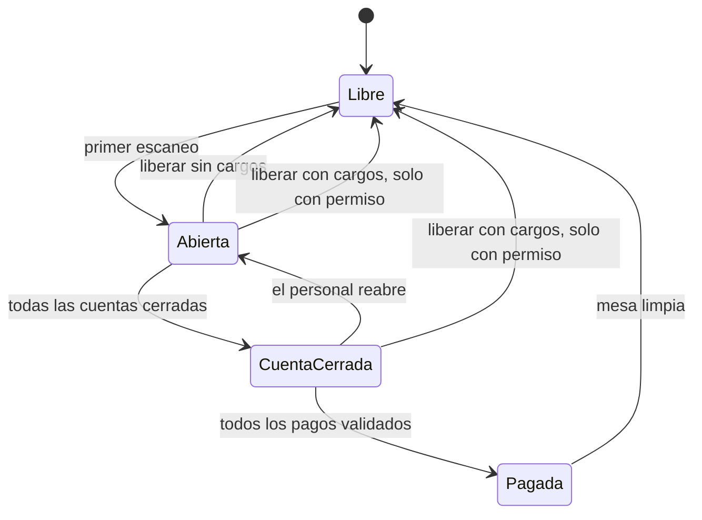
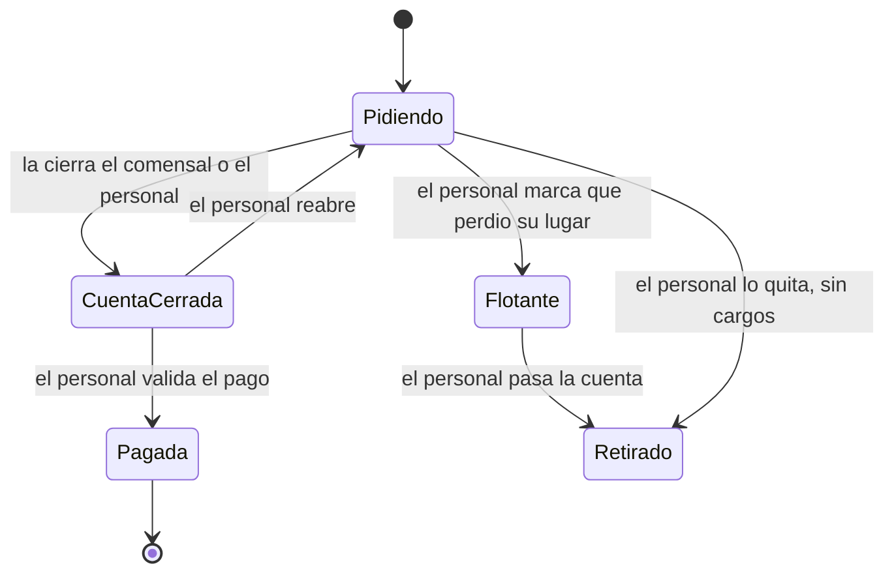
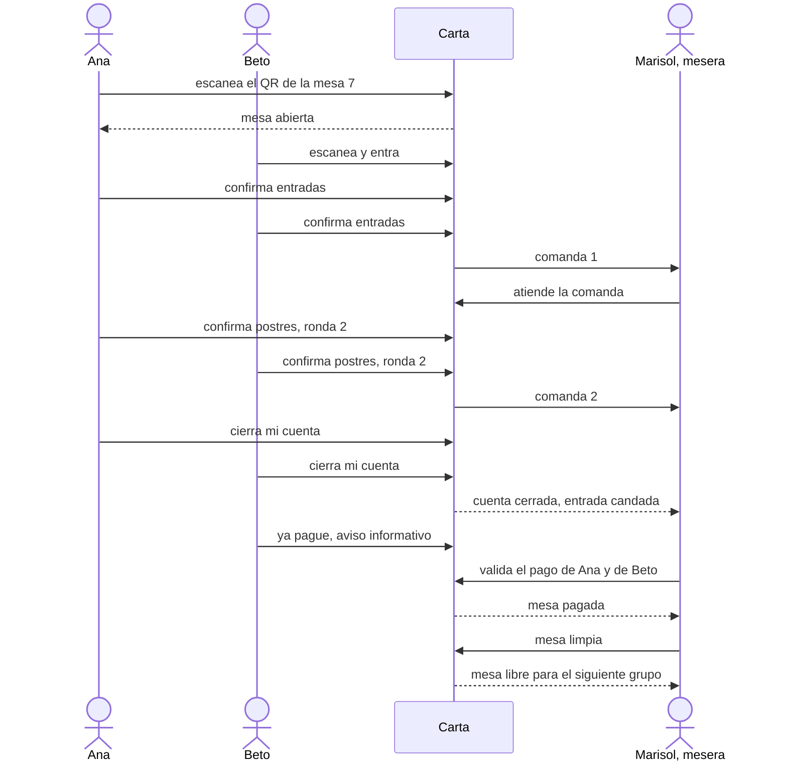
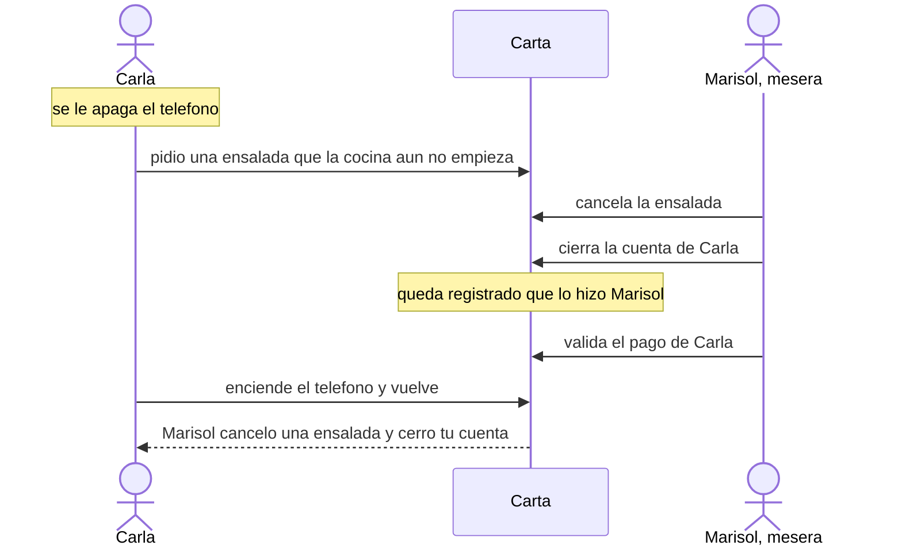
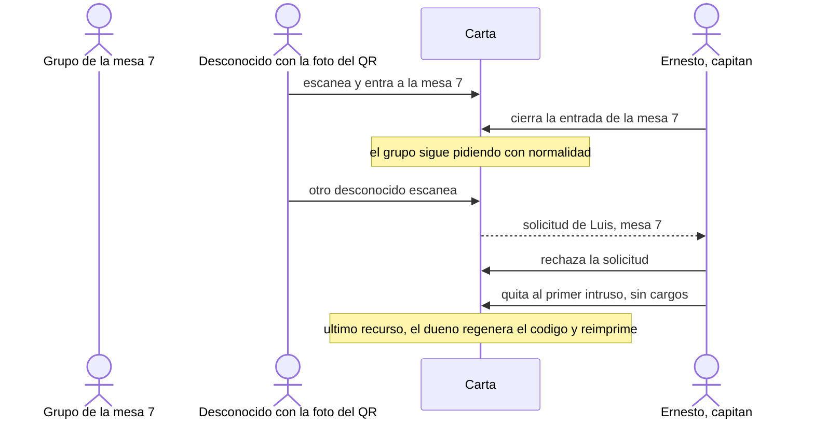
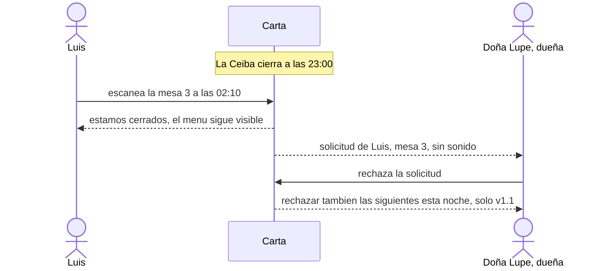
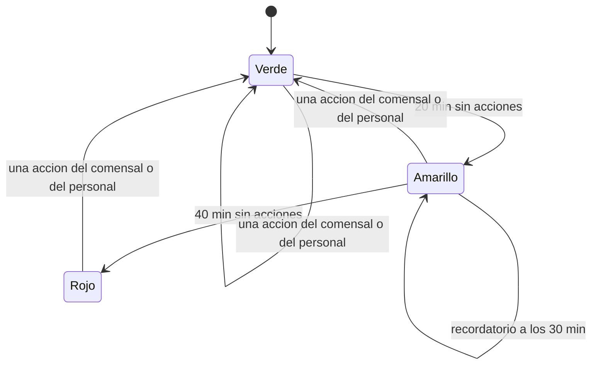
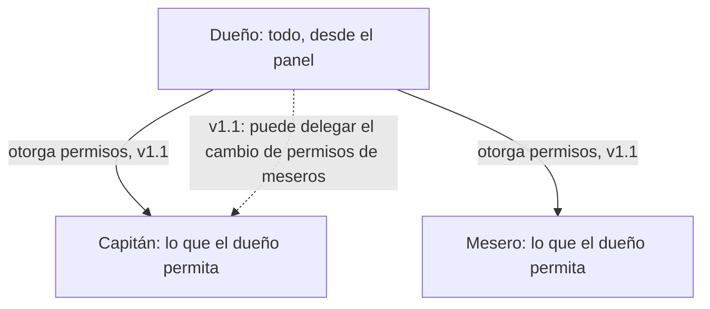
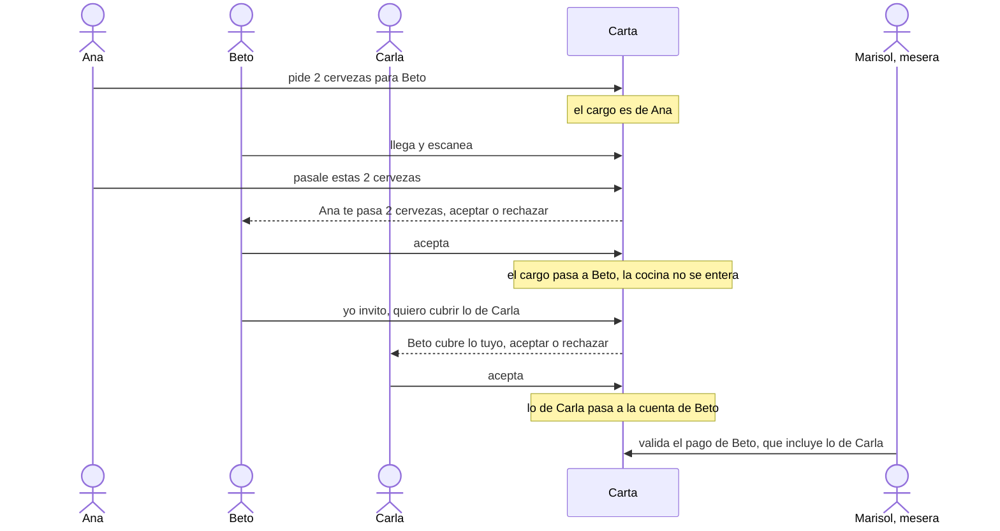

# Spec 001 — Ciclo de vida de la mesa y del comensal

**Fecha:** 2026-11-12 · **Versión:** 3 (para aprobar) · **Estado:** borrador · **Pedida por:** Calvin · **Historias:** US-29 a US-38 (nuevas) · **Insumo:** `docs/plan/04_Fases_y_Tareas.md` §7 y §11, los comentarios de Calvin a las versiones 1 y 2, los prototipos (`prototipo/js/{checkout-v2,mesero,capitan,admin-ops,admin-onboarding}.jsx`, `stitch/p05-checkout-pago.html`) y `docs/research/2026-09-23-checkout-y-ley-fintech.md`

> Separa **Decidido por Calvin** (criterios firmes), **Propuesta** (completa el diseño; Calvin puede cambiarla) y **Abierto** (`[ACLARAR-n]`, con escenario y recomendación). No toca código, plan, PRD ni otros documentos: la sección 11 dice qué cambiaría en cada uno. Lo que se difiere a la v1.1 **no se borró**: está en la sección 8 con sus criterios, porque es su especificación.

---

## 0. Resumen

**Qué se resuelve.** Hoy la mesa se cierra sola a las 3 h sin actividad y el pase del comensal dura 6 h. Una comida real dura más, tiene gente que llega tarde, teléfonos apagados y un cobro al final. Esta spec pone **al personal a cargo del ciclo de la mesa**: el comensal marca («cerré mi cuenta», «ya pagué»), el personal valida. **Ningún reloj cierra ni cambia nada**; los relojes sólo marcan un estatus. Carta exige **al menos un validador**: el dueño, que es el primer y único mesero si no hay más. El cobro ocurre **fuera de la app**.

**El ciclo de la mesa**

- **Abierta:** los comensales entran, piden por rondas y ven lo de los demás.
- **Cuenta cerrada** (el *checkout*): ya no se agrega nada y **ningún comensal nuevo entra** hasta que la mesa quede limpia (el candado).
- **Pagada:** el personal verificó que cada cuenta quedó pagada por completo.
- **Limpia:** el personal libera la mesa; sólo entonces entra el siguiente grupo y se libera también la sesión de cada comensal. Tras «pagada» ya no se reabre.

**La cuenta de cada comensal**

Mientras haya una cuenta sin cerrar, sin pagar o flotante, la mesa no se puede limpiar; la única salida es la liberación forzada con permiso.

**Decidido por Calvin**
1. El personal lleva el ciclo; sin cierre por inactividad ni tope de horas de la mesa. Los relojes sólo marcan estatus (verde, amarillo, rojo) y recordatorio.
2. Estados: abierta → cuenta cerrada → pagada → mesa limpia, con candado. El comensal marca, el personal valida; «ya pagué» es informativo.
3. Pago **por comensal**, con desglose. Sin tarjetas ni datos de transferencia.
4. Permisos como de administrador: el dueño puede todo; el capitán y el mesero, lo que el dueño les permita (valores de §5).
5. «Cargo validado» = lo que la cocina ya procesó. El personal cancela lo que la cocina aún no empieza.
6. La mesa se abre con el primer escaneo. Pase de 24 h sin usarse; la sesión y la cuenta no caducan. Tope de 12 comensales.
7. **Candado de dos partes entre restaurantes:** quien está en una mesa abierta no entra a otra (de ningún restaurante) hasta que el ciclo se cierre en orden; entonces se liberan a la vez su sesión y la mesa del restaurante.
8. **La propina entra en la v1:** es sólo un cálculo en el teléfono, con una propina por defecto que siempre se suma al total.
9. Sin mesas asignadas a meseros; permisos por defecto de §5; tras 2 h en rojo, escanear exige aprobación.
10. **Recortes a la v1.1, con condición:** que cubrir después esos huecos **no obligue a rehacer** infraestructura ni desarrollo (sección 7).
11. **Horario del restaurante** («para considerar»): dentro del horario, entrada normal; fuera, el escaneo deja una solicitud o se rechaza, según un ajuste del dueño.

**Qué entra en la v1 y qué espera a la v1.1** (confirma de un vistazo)

| Tema | v1 | v1.1 (preparado, no construido) |
|---|---|---|
| Ciclo de la mesa y candado; cuenta y pago por comensal; desglose | ✔ | |
| Propina por defecto, calculada en el teléfono | ✔ | |
| Estatus de actividad, recordatorio, 2 h en rojo → aprobación | ✔ | |
| Entrada cerrada y solicitudes; tope de comensales | ✔ | |
| Una mesa a la vez, también entre restaurantes | ✔ | |
| Tiempos de la mesa y de cada fase | ✔ | |
| Horario del restaurante: configurarlo; fuera de horario, solicitud o rechazo | ✔ | «Rechazar todas por esta noche», excepciones por fecha |
| Permisos por rol: tabla fija, comprobada en el servidor | ✔ | Editables por el dueño y delegables al capitán |
| Personal: quitar a un comensal, cerrar su cuenta por él, cancelar antes de la cocina, pasar su cuenta, cuenta flotante | ✔ | Agregar y quitar ítems y cantidades; persona sin teléfono |
| Traspasos entre comensales: pedir por otro, «pásale esto», invitar, «yo invito» | | ✔ |
| Invitar a medida (porcentaje o monto) y dividir a una persona entre varios | | ✔ |
| El dueño opera desde el panel con las mismas acciones del personal | ✔ ([ACLARAR-6]) | |

**Abierto: 3 preguntas** (escenario y recomendación en su historia; Calvin puede contestar «ok a todo» o sólo los números que cambiaría)
- **[ACLARAR-6]** Dónde opera el dueño. Recomendación: desde el panel (`/admin/pedidos`).
- **[ACLARAR-7]** Si el personal ve en su pantalla la propina que eligió cada comensal. Recomendación: no; el comensal enseña su pantalla.
- **[ACLARAR-8]** Qué hace por defecto un restaurante fuera de horario. Recomendación: pedir aprobación, con «rechazar siempre» a un ajuste de distancia.

**Tamaño de la Fase 3.** De 7 a **17 tareas** (10 nuevas, 2 de ellas pequeñas). Después, la v1.1 son unas 6 tareas más, todas **añadidas** sobre las costuras de la v1 (sección 7), sin rehacer.

---

## 1. Problema

En La Ceiba, un viernes a las 21:00, la mesa 7 tiene seis personas: dos llegan tarde, a las 23:00 siguen de sobremesa sin pedir nada y, al final, tres se levantan sin cerrar nada porque se les apagó el teléfono. Con las reglas de hoy, la mesa se cierra sola en plena sobremesa, el pase de Ana expira antes de que pague, y si alguien filtra la foto del QR, un desconocido ocupa un lugar o abre la mesa a las 3 a.m. Carta es para restaurantes con **al menos un validador**; ese validador debe llevar el ciclo, no los relojes.

## 2. Resultado esperado

- Una mesa vive mientras el personal no la limpie; ningún reloj la corta.
- Cada comensal ve su cuenta (total estimado, no comprobante) con su propina, y la cierra al terminar; el personal ve en qué paso va cada mesa y cuánto lleva sin actividad.
- El siguiente grupo nunca cae en la mesa del anterior; fuera de horario nadie entra sin que el dueño decida.
- Un QR filtrado se contiene con un toque, sin reimprimir.
- Quedan guardadas las horas de cada paso. Señal: M3 de `01_Alcance_v1.md` (mesas atendidas sin que el restaurante tenga que pedirle ayuda a Calvin) y, en T-4.7, mesas cerradas por el personal sin ayuda.

## 3. Glosario llano y ajustes por restaurante

La v1 **no tiene planes ni cobros de Carta**. Los topes que podrían variar por plan son **ajustes por restaurante** con un valor del piloto; los cambia Calvin, no el operador (salvo el horario y su ajuste, que son del dueño). Los planes sólo fijarán estos valores.

| Ajuste o término | Qué es, con un ejemplo | Piloto |
|---|---|---|
| **Pase** | Lo que guarda el teléfono para saber quién eres en la mesa. Si pasa 24 h sin abrir la app, deja de valer; la mesa y la cuenta no cambian | 24 h sin usarse |
| **Solicitud** | Cuando la entrada está cerrada (o fuera de horario), escanear no mete a nadie: deja un aviso «Luis quiere entrar a la mesa 7» que el personal aprueba o rechaza | — |
| **Cerrar la entrada** | Interruptor por mesa. Cerrada: quien escanea queda en espera y el personal decide. Los que ya están siguen pidiendo | — |
| **Solicitudes pendientes** | Cuántos «quiero entrar» puede haber a la vez en una mesa; la sexta ve «mesa ocupada» y no deja otro aviso. Además, un tope por restaurante fuera de horario | 5 por mesa, 20 por restaurante |
| **Vigencia de una solicitud** | Una solicitud sin respuesta desaparece sola de la lista a los 10 min; la persona puede escanear de nuevo | 10 min |
| **Máximo de comensales** | Personas por mesa; el diseño llega a 12 (6 en gratuitos cuando existan planes) | 12 |
| **Estatus de actividad** | Color de la mesa según los minutos sin acciones de comensales ni de personal: verde menos de 20, amarillo de 20 a 40, rojo más de 40 | 20 y 40 min |
| **Recordatorio** | Aviso al personal tras unos 30 min sin acciones; se marca «todo bien con la mesa» y el conteo reinicia | 30 min |
| **Aprobación tras rojo** | Con la mesa 2 h en rojo, escanear deja solicitud en lugar de entrar | 2 h |
| **Horario** | Días y horas en que el QR admite comensales, en la zona horaria del restaurante | sin configurar = como hoy |
| **Fuera de horario** | Qué pasa al escanear fuera del horario: «pedir aprobación» (llega una solicitud) o «rechazar siempre» | pedir aprobación |
| **Propina por defecto** | Porcentaje o monto que el comensal fija una vez; se queda en su teléfono y se suma a su total | ninguna hasta que la fije |

## 4. Recorridos

**Comida normal con dos rondas y checkout**

**Teléfono apagado** (v1: el personal cierra la cuenta y cancela lo que la cocina no empezó)

**QR filtrado**

**Fuera de horario**

**Estatus de actividad de la mesa (no cierra nada)**

Con la mesa dos horas en rojo, escanear deja de admitir directo y pasa a solicitud (AC-30.9).

## 5. Quién puede qué

El dueño puede todo. El capitán y el mesero, lo que indica esta tabla, **fija en la v1** y comprobada en un solo punto del servidor contra una tabla de valores por rol; en la v1.1 el dueño podrá editarla y delegar en el capitán el cambiar los permisos de los meseros (sección 8). «Opciones extra» del capitán dentro de las mismas pantallas: no hay pantallas propias del capitán.

| Permiso | Mesero | Capitán | Dueño |
|---|---|---|---|
| Cerrar la cuenta de un comensal por él (el comensal, la suya) | sí | sí | sí |
| Cerrar la cuenta de toda la mesa (atajo opcional) | sí | sí | sí |
| Validar pagos y la mesa pagada | sí | sí | sí |
| Mesa limpia | sí | sí | sí |
| Reabrir antes de «pagada» | sí | sí | sí |
| Cancelar pedidos o ítems que la cocina no ha empezado | sí | sí | sí |
| Pasar una cuenta a otra persona | sí | sí | sí |
| Quitar a un comensal sin cargos | sí | sí | sí |
| Aprobar o rechazar solicitudes de entrada | sí | sí | sí |
| Cerrar o abrir la entrada de una mesa | no | sí | sí |
| Liberar una mesa con cargos sin pagar | no | no | sí |
| Regenerar el código del QR (T-1.5) | no | no | sí, en el panel |
| Marcar un platillo agotado (ya existe) | sí | sí | sí |
| *(v1.1)* Agregar y quitar ítems y cantidades; persona sin teléfono | sí | sí | sí |
| *(v1.1)* Cambiar los permisos de los meseros | no | no (delegable) | sí |

«Avisar ya pagué» es sólo del comensal; el personal valida aunque no haya aviso. **El precio nunca se edita** (regla dura 4): descuentos y cortesías no están en la v1. Los valores de arriba son los aceptados por Calvin; el restaurante recién creado funciona sin configurar nada.

## 6. Historias y criterios de la v1

Definiciones:
- **Cuenta** de un comensal: lo que pidió y confirmó, con precio congelado al confirmar. Es un **total estimado**, no comprobante ni factura.
- **Cargo validado:** ítem que la cocina ya procesó (de una comanda que el personal atendió). Antes de eso el personal puede cancelarlo (queda cancelado con quién y cuándo; nada se pierde, regla dura 8).
- **Personal:** mesero, capitán o dueño, sujeto a sus permisos.
- **Cuenta flotante:** la de alguien que perdió su lugar; sigue contando hasta que el personal la pasa.

### US-29 — Ciclo de la mesa y candado

> Como mesero, quiero llevar la mesa desde que se abre hasta que queda limpia y que el siguiente grupo no caiga en el anterior, para no depender de relojes ni de recordar quién pagó.

- **AC-29.1** — CUANDO se escanea el QR de una mesa libre, EL sistema DEBERÁ abrirla y guardar la hora del primer escaneo.
- **AC-29.2** — MIENTRAS la mesa esté abierta, EL sistema DEBERÁ permitir a cada comensal pedir en rondas sucesivas, y cada confirmación del grupo DEBERÁ generar su propia comanda.
- **AC-29.3** — CUANDO un comensal cierre su cuenta, EL sistema DEBERÁ impedirle agregar o confirmar más ítems; SI tiene ítems sin confirmar, ENTONCES DEBERÁ pedirle confirmarlos o descartarlos antes.
- **AC-29.4** — CUANDO todos los comensales activos hayan cerrado su cuenta (ellos o el personal por ellos), EL sistema DEBERÁ pasar la mesa a «cuenta cerrada» y guardar la hora; el personal DEBERÁ poder cerrar de una vez todas las cuentas como atajo.
- **AC-29.5** — MIENTRAS la mesa esté en «cuenta cerrada» o posterior, EL sistema DEBERÁ rechazar a quien no es miembro con un mensaje que le pida hablar con el mesero, sin solicitud y sin ocupar lugar; los miembros conservan su acceso para ver su cuenta.
- **AC-29.6** — MIENTRAS la cuenta de un comensal esté cerrada, EL sistema DEBERÁ mostrarle el desglose: ítems, subtotal, propina (US-37) y total.
- **AC-29.7** — CUANDO un comensal avise «ya pagué», EL sistema DEBERÁ mostrárselo al personal como aviso, sin considerar pagada la cuenta hasta que el personal la valide (que podrá validar sin aviso).
- **AC-29.8** — CUANDO el personal valide el pago de una cuenta (efectivo o transferencia, hechos fuera de la app), EL sistema DEBERÁ marcarla «pagada» con hora y quién la validó; cuando todas lo estén, la mesa DEBERÁ pasar a «pagada».
- **AC-29.9** — CUANDO el personal marque «mesa limpia» sobre una mesa pagada, EL sistema DEBERÁ terminar la sesión y liberar a la vez la sesión de cada comensal y la mesa del restaurante, guardar hora y autor y dejar la mesa libre para un grupo que no verá nada del anterior.
- **AC-29.10** — SI hay comandas no terminales (abierta o atendida) o cuentas sin pagar o flotantes, ENTONCES EL sistema DEBERÁ impedir «mesa limpia» (regla dura 8).
- **AC-29.11** — CUANDO el personal reabra una cuenta o la mesa antes de «pagada», EL sistema DEBERÁ volver a «abierta», levantar el candado y conservar el historial; después de «pagada» NO DEBERÁ permitir reabrir.
- **AC-29.12** — CUANDO alguien con permiso libere una mesa con cargos sin pagar, EL sistema DEBERÁ cerrar la sesión y registrarla «liberada sin pago verificado»; una mesa sin cargos DEBERÁ poder liberarla cualquier mesero.

**Escenarios**
- **AC-29.1** · Dado La Ceiba, mesa 7 libre · Cuando Ana escanea a las 20:58 · Entonces el personal ve la mesa 7 «abierta» con un comensal.
- **AC-29.2** · Dado entradas a las 21:05 y postres a las 22:30 · Entonces llegan dos comandas de la mesa 7.
- **AC-29.3** · Dado Carla con un flan sin confirmar · Cuando toca «cerrar mi cuenta» · Entonces debe confirmar o descartar el flan; después ve su total y no agrega nada.
- **AC-29.4** · Dado que Ana y Beto cierran y Marisol cierra la de Carla (teléfono apagado) · Entonces la mesa pasa a «cuenta cerrada».
- **AC-29.5** · Dado la mesa 7 en «cuenta cerrada» · Cuando Dani escanea · Entonces ve «esta mesa está cerrando su cuenta, habla con tu mesero» y no queda solicitud.
- **AC-29.6** · Dado Beto con $480 · Cuando cierra su cuenta · Entonces ve sus ítems, la propina que tiene fijada y el total.
- **AC-29.7** · Dado Beto con $480 por pagar · Cuando toca «ya pagué» · Entonces Marisol ve el aviso, pero la cuenta sigue «por pagar».
- **AC-29.8** · Dado Beto que pagó en efectivo · Cuando Marisol valida · Entonces su cuenta queda «pagada» con «validó Marisol»; al validar a la última, la mesa pasa a «pagada».
- **AC-29.9** · Dado la mesa 7 pagada y recogida · Cuando Marisol toca «mesa limpia» · Entonces Ana y Beto quedan libres para otra mesa y el grupo de las 23:40 ve un menú vacío.
- **AC-29.10** · Dado una comanda de café sin servir · Cuando Marisol intenta «mesa limpia» · Entonces el sistema se lo impide y le dice cuál falta.
- **AC-29.11** · Dado la mesa en «cuenta cerrada» y Carla que pide otro café · Cuando Marisol reabre su cuenta · Entonces la mesa vuelve a «abierta»; con la mesa «pagada», el botón no existe.
- **AC-29.12** · Dado Beto que se fue sin pagar $480 · Cuando Doña Lupe libera la mesa · Entonces queda «liberada sin pago verificado»; si Ernesto (capitán) lo intenta, se le niega.

### US-30 — El pase del comensal y el estatus de la mesa

> Como comensal, quiero que mi lugar siga siendo mío aunque mi teléfono se bloquee y la comida dure horas; como mesero, quiero ver qué mesas llevan rato sin que nadie haga nada, para ir a verificar.

- **AC-30.1** — MIENTRAS la mesa de un comensal siga abierta, EL sistema DEBERÁ conservar su identidad y su cuenta sin una vigencia fija en horas; la sesión de la mesa NO DEBERÁ caducar.
- **AC-30.2** — EL sistema NO DEBERÁ cerrar una mesa ni cambiar su contenido por falta de actividad: sólo el personal lo hace.
- **AC-30.3** — CUANDO el teléfono de un comensal esté bloqueado o la app cerrada, EL sistema NO DEBERÁ tratarlo como salida.
- **AC-30.4** — CUANDO la mesa quede limpia, EL sistema DEBERÁ dejar sin efecto los pases de esa sesión.
- **AC-30.5** — SI un pase pasa 24 h sin usarse mientras la mesa sigue abierta, ENTONCES EL sistema DEBERÁ hacerlo caducar (no la mesa ni la cuenta); quien vuelve entra como persona nueva y su cuenta anterior queda flotante.
- **AC-30.6** — MIENTRAS una mesa esté abierta, EL sistema DEBERÁ mostrar al personal su estatus por minutos sin acciones de comensales ni de personal: verde (menos de 20), amarillo (20 a 40) y rojo (más de 40), con umbrales configurables por restaurante.
- **AC-30.7** — CUANDO una mesa lleve unos 30 min sin acciones, EL sistema DEBERÁ mostrar un recordatorio al personal; CUANDO el personal lo marque «todo bien con la mesa», EL sistema DEBERÁ contarlo como una acción y reiniciar el conteo.
- **AC-30.8** — EL sistema NO DEBERÁ hacer nada con los relojes más que mostrar el estatus y el recordatorio y lo que dice AC-30.9.
- **AC-30.9** — SI una mesa lleva 2 horas en rojo (ajuste por restaurante), ENTONCES EL sistema DEBERÁ exigir solicitud (AC-33.2) a quien escanee y no sea miembro; NO DEBERÁ cerrar la mesa ni tocar sus cuentas.

**Escenarios**
- **AC-30.1** · Dado Ana que entró a las 21:00 · Cuando vuelve a las 00:45 · Entonces es la misma Ana con su cuenta intacta.
- **AC-30.2** · Dado la mesa 7 sin pedidos desde las 22:30 · Cuando son las 02:00 · Entonces sigue abierta, en rojo, con todo en su lugar.
- **AC-30.3** · Dado el teléfono de Beto bloqueado desde las 22:00 · Cuando Marisol abre la mesa 7 · Entonces Beto sigue en la lista con su cuenta.
- **AC-30.4** · Dado la mesa 7 limpia a las 23:50 · Cuando Ana abre su QR con su teléfono viejo · Entonces entra como comensal nuevo en una sesión nueva.
- **AC-30.5** · Dado un pase sin usar 25 h en una mesa que sigue abierta · Cuando su dueño escanea · Entonces entra como «Comensal 3» y el personal ve la cuenta anterior flotante.
- **AC-30.6** · Dado la última acción a las 21:00 · Cuando son las 21:25 · Entonces la mesa 7 aparece en amarillo; a las 21:45, en rojo.
- **AC-30.7** · Dado 30 min sin acciones · Cuando Marisol toca «todo bien» · Entonces vuelve a verde y el recordatorio reaparece 30 min después si nadie hace nada.
- **AC-30.8** · Dado la mesa 7 en rojo toda la noche · Entonces sigue igual de abierta; ningún reloj la cierra.
- **AC-30.9** · Dado que el mesero olvidó limpiar la mesa 7 a las 23:50 · Cuando a las 14:00 dos clientes escanean · Entonces no entran a la sesión de ayer: dejan una solicitud para Marisol.

### US-31 — El personal corrige la mesa (v1)

> Como mesero, quiero quitar a un desconocido, cerrar la cuenta de quien se quedó sin teléfono, cancelar lo que la cocina aún no empieza y pasar una cuenta a la persona correcta, para que el cobro cuadre sin perder el historial.

- **AC-31.1** — CUANDO el personal quite a un comensal sin ítems confirmados, EL sistema DEBERÁ retirarlo de la mesa (pierde el acceso), descartar sus ítems sin confirmar, conservar el registro de que estuvo (regla dura 9) y recalcular el progreso «n de m listos» sin él.
- **AC-31.2** — SI un comensal tiene ítems confirmados que la cocina ya procesó (cargos validados), ENTONCES EL sistema NO DEBERÁ permitir quitarlo y DEBERÁ ofrecer pasar su cuenta o marcar que perdió su lugar; si aún no los procesa la cocina, DEBERÁ ofrecer cancelarlos primero (AC-31.5).
- **AC-31.3** — CUANDO el personal cierre la cuenta de un comensal por él, EL sistema DEBERÁ registrar que lo hizo el personal, quién y cuándo, y mostrárselo al comensal cuando vuelva.
- **AC-31.5** — CUANDO el personal cancele un pedido o un ítem cuya comanda la cocina aún no ha empezado, EL sistema DEBERÁ conservarlo como «cancelado por el personal» con quién y cuándo (no desaparece); después de que la cocina empezó, NO DEBERÁ permitir cancelarlo.
- **AC-31.7** — CUANDO el personal pase la cuenta de un comensal a otro, EL sistema DEBERÁ mover todos sus cargos al destino sin pedirle aceptación, avisar al destino, retirar al origen y registrar quién, cuándo, de quién y a quién.
- **AC-31.8** — CUANDO el personal marque a un comensal como «perdió su lugar», EL sistema DEBERÁ dejar su cuenta flotante y NO DEBERÁ permitir «cuenta cerrada» ni «mesa limpia» mientras haya cuentas flotantes.
- **AC-31.9** — SI dos comensales tienen el mismo alias, ENTONCES EL sistema DEBERÁ distinguirlos con su color y un número.
- **AC-31.10** — EL sistema DEBERÁ rechazar con 404 toda corrección sobre una mesa de otro restaurante (regla dura 6), y exigir en el servidor el permiso correspondiente (§5).

**Escenarios**
- **AC-31.1** · Dado «Comensal 5», que nadie reconoce, sin ítems, con la mesa en «2 de 3 listos» · Cuando Marisol lo quita · Entonces la mesa muestra «2 de 2», él ve «te quitaron de la mesa» y queda su registro.
- **AC-31.2** · Dado un «Comensal 5» con una hamburguesa que la cocina aún no empieza · Cuando Marisol intenta quitarlo · Entonces se le ofrece cancelarla y luego quitarlo; si la cocina ya la hizo, se le ofrece pasar la cuenta.
- **AC-31.3** · Dado el teléfono de Carla apagado · Cuando Marisol cierra su cuenta · Entonces Carla, al volver, ve «Marisol cerró tu cuenta».
- **AC-31.5** · Dado una ensalada en una comanda sin empezar · Cuando Marisol la cancela · Entonces la cuenta baja y el historial conserva «cancelada por Marisol»; con la comanda ya atendida, el botón no existe.
- **AC-31.7** · Dado Beto que cambió de teléfono y quedó como «Comensal 6» con su cuenta vieja en «Comensal 2» · Cuando Marisol pasa la cuenta de 2 a 6 · Entonces los cargos están en «Comensal 6», «Comensal 2» queda retirado y «Comensal 6» recibe el aviso.
- **AC-31.8** · Dado Dani que se fue dejando una cerveza servida · Cuando Marisol lo marca «perdió su lugar» · Entonces la mesa no puede cerrarse hasta pasar su cuenta.
- **AC-31.9** · Dado dos «Ana» · Cuando el personal abre la mesa · Entonces los ve como «Ana ●1» y «Ana ●2».
- **AC-31.10** · Dado Marisol de La Ceiba · Cuando corrige una mesa de otro restaurante · Entonces recibe 404.

### US-33 — La entrada de la mesa

> Como capitán o dueño, quiero cortar con un toque que la mesa se llene de desconocidos sin cambiar el QR impreso, para que un QR filtrado no se convierta en un problema de servicio.

Un QR impreso no puede guardar un secreto que rote: quien tiene la foto sigue entrando. Lo que sí corta el ataque sin reimprimir es cerrar la entrada y que cada ingreso lo apruebe el personal. Regenerar el código (T-1.5, ya existe) es el último recurso, sólo del dueño. Tres razones hacen que un escaneo deje solicitud en lugar de entrar: la entrada cerrada, las 2 h en rojo (AC-30.9) y el horario (US-38); el mecanismo es el mismo.

- **AC-33.1** — CUANDO alguien con permiso cierre la entrada de una mesa abierta, EL sistema DEBERÁ dejar de admitir personas nuevas; los miembros siguen entrando y pidiendo.
- **AC-33.2** — MIENTRAS la entrada esté cerrada, EL sistema DEBERÁ convertir el escaneo de un no miembro en una solicitud con su alias, que NO ocupa lugar.
- **AC-33.3** — CUANDO el personal apruebe una solicitud, EL sistema DEBERÁ convertir a esa persona en miembro; si la rechaza, DEBERÁ mostrarle un mensaje neutro.
- **AC-33.4** — EL sistema DEBERÁ limitar las solicitudes pendientes por mesa (5), caducar cada una a los 10 minutos sin respuesta y contar los intentos con el mismo límite de tasa del comensal; superado el tope, DEBERÁ responder «mesa ocupada, habla con tu mesero» sin crear más.
- **AC-33.5** — CUANDO se reabra la entrada, EL sistema DEBERÁ volver a admitir personas con un escaneo.
- **AC-33.6** — CUANDO se regenere el código, EL sistema DEBERÁ conservar la sesión abierta y el estado de la entrada (decisión vigente de T-2.1); el código anterior deja de abrir al instante (AC-21.3).
- **AC-33.7** — CUANDO una mesa llegue al máximo de comensales (12), EL sistema DEBERÁ responder «mesa llena», sin solicitud.
- **AC-33.8** — EL sistema DEBERÁ mostrar al personal cuántas solicitudes tiene cada mesa y quién las pidió.

**Escenarios**
- **AC-33.1** · Dado la mesa 7 completa y un QR filtrado en un grupo · Cuando Ernesto (capitán) cierra la entrada · Entonces los seis siguen pidiendo normal.
- **AC-33.2** · Dado la entrada cerrada · Cuando un desconocido escanea y escribe «Luis» · Entonces Marisol ve «Mesa 7: solicitud de Luis»; la mesa sigue con seis.
- **AC-33.3** · Dado la solicitud de Luis · Cuando Marisol la aprueba · Entonces es el séptimo miembro; si la rechaza, ve «no pudimos agregarte».
- **AC-33.4** · Dado 5 pendientes · Cuando un sexto escanea · Entonces ve «mesa ocupada»; a los 10 min las no atendidas desaparecen.
- **AC-33.5** · Dado pasado el ataque · Cuando Ernesto reabre la entrada · Entonces escanear vuelve a admitir directo.
- **AC-33.6** · Dado la entrada cerrada y el QR filtrado · Cuando Doña Lupe regenera el código · Entonces los seis siguen, la entrada sigue cerrada y el QR viejo ya no abre nada.
- **AC-33.7** · Dado la mesa 7 con 12 miembros · Cuando un decimotercero escanea · Entonces ve «mesa llena».
- **AC-33.8** · Dado dos mesas con solicitudes · Cuando Marisol abre su lista · Entonces ve «Mesa 7 · 2 solicitudes».

### US-34 — Una mesa a la vez, también entre restaurantes

> Como restaurante, quiero que quien está en una mesa abierta no pueda entrar a otra hasta que el ciclo se cierre en orden, para que nadie reparta cargos entre dos mesas y yo no reciba clientes en una mesa que no he validado.

**Decidido por Calvin:** es un candado de **dos partes**. Si el restaurante no valida el pago, tampoco puede usar esa mesa para clientes nuevos y tiene que terminar el ciclo; cuando el ciclo se cierra con todo en orden, se libera a la vez la sesión del comensal y la mesa del restaurante. Vale también entre restaurantes distintos.

- **AC-34.1** — CUANDO un teléfono cuyo comensal está en una mesa abierta (de cualquier restaurante) escanea el QR de **otra** mesa, EL sistema NO DEBERÁ agregarlo ni moverlo, y DEBERÁ decirle «ya estás en la mesa N de <restaurante>» con una salida de regreso a ella.
- **AC-34.2** — MIENTRAS su cuenta no esté pagada, EL sistema DEBERÁ mantener esa restricción.
- **AC-34.3** — CUANDO el pago de su cuenta quede validado, la mesa quede limpia, el personal lo quite o se libere la mesa, EL sistema DEBERÁ dejarlo escanear otra mesa.
- **AC-34.4** — DONDE el comensal no tenga cargos validados sin pagar, EL sistema DEBERÁ ofrecerle «salir de la mesa» para soltar su lugar y retirarlo de ella; SI los tiene, ENTONCES DEBERÁ mostrarle el nombre del restaurante y que hable con ellos.
- **AC-34.5** — EL sistema NO DEBERÁ presentar la restricción como control de seguridad: sólo conoce la cookie, y quien la borra o usa otro navegador entra como persona nueva (§9).

**Escenarios**
- **AC-34.1** · Dado Ana en la mesa 7 de La Ceiba · Cuando escanea la mesa 8, o una mesa de otro restaurante · Entonces ve «ya estás en la mesa 7 de La Ceiba» y un botón para volver.
- **AC-34.2** · Dado Ana con la cuenta cerrada sin pagar · Cuando escanea la mesa 8 · Entonces sigue viendo el aviso.
- **AC-34.3** · Dado el pago de Ana validado · Cuando escanea la mesa 8 · Entonces entra normal.
- **AC-34.4** · Dado Ana sin pedidos aún en la mesa 7 · Cuando toca «salir de la mesa» · Entonces queda libre y retirada; con una hamburguesa servida sin pagar, ve «habla con La Ceiba».
- **AC-34.5** · Dado Beto que abre una pestaña privada y escanea la mesa 8 · Entonces entra como persona nueva; el control real es que sus cargos no cuentan sin validación.

**Riesgo aceptado** (Calvin lo conoce): La Ceiba cierra a las 23:00 con la mesa 7 abierta y Ana queda bloqueada en otro restaurante hasta que alguien la limpie o la libere.

### US-35 — Cuánto tarda una mesa y cada paso

> Como dueño, quiero que el sistema guarde cuándo ocurrió cada paso de la mesa, para saber cuánto tarda una comida y cuánto se tarda en dejar la mesa lista.

- **AC-35.1** — EL sistema DEBERÁ guardar, sin sobrescribir, la hora y el autor (comensal, personal o sistema) de: primer escaneo, cada comanda, cuenta cerrada de cada comensal y de la mesa, pago validado de cada comensal y de la mesa, y mesa limpia.
- **AC-35.2** — CUANDO se corrija un paso (reabrir la cuenta), EL sistema DEBERÁ conservar las horas anteriores y registrar las nuevas.
- **AC-35.3** — EL sistema DEBERÁ poder calcular: tiempo total (primer escaneo a limpia), consumo (primer escaneo a cuenta cerrada), cobro (cuenta cerrada a pagada) y preparación (pagada a limpia); la medida «checkout a limpia» sale sumando cobro y preparación.
- **AC-35.4** — CUANDO una mesa se libere sin pago verificado, EL sistema DEBERÁ marcarla para que no distorsione promedios.
- **AC-35.5** — EL sistema NO DEBERÁ guardar datos personales del comensal en esas marcas (regla dura 10).

**Escenarios**
- **AC-35.1** · Dado la mesa 7 de las 20:58 a las 23:50 · Entonces el historial muestra apertura 20:58, cuenta cerrada 23:10, pagada 23:35 y limpia 23:50, con autor.
- **AC-35.2** · Dado que Marisol reabrió a las 23:12 · Entonces el cierre de las 23:10 queda en la historia y el definitivo es el de las 23:20.
- **AC-35.3** · Dado ese historial · Entonces total 2 h 52 min, consumo 2 h 12, cobro 25 min, preparación 15 min.
- **AC-35.4** · Dado una liberación forzada · Entonces no entra en promedios.
- **AC-35.5** · Dado cualquier marca · Cuando se inspecciona · Entonces no hay alias, nombre, IP ni cookie.

### US-36 — Permisos del personal (v1: tabla fija)

> Como dueño, quiero que cada rol haga lo que le corresponde sin que yo configure nada, para atender desde el primer día.

- **AC-36.3** — EL sistema DEBERÁ comprobar el permiso en cada acción, en un solo punto del servidor y contra una tabla de valores por rol; una acción sin permiso responde 404 como cualquier ruta del rol (ADR-013).
- **AC-36.4** — CUANDO un restaurante se crea, EL sistema DEBERÁ dejar los permisos con los valores de §5 para que funcione sin configurar nada.
- **AC-36.6** — MIENTRAS el restaurante no tenga más personal que el dueño, EL sistema DEBERÁ permitirle hacer todo lo del personal desde el panel.
- **AC-36.7** — EL sistema NO DEBERÁ permitir editar los valores en la v1.

**Escenarios**
- **AC-36.3** · Dado Marisol sin permiso de liberar con cargos · Cuando llama a esa ruta · Entonces recibe 404.
- **AC-36.4** · Dado un restaurante recién creado · Cuando Marisol entra · Entonces puede marcar limpia la mesa 7.
- **AC-36.6** · Dado un restaurante con sólo la dueña · Cuando Doña Lupe abre `/admin/pedidos` · Entonces atiende, valida pagos y limpia mesas ella sola.
- **AC-36.7** · Dado cualquier petición para cambiar un permiso · Entonces no existe esa ruta.

**Pregunta abierta: [ACLARAR-6] dónde opera el dueño.** Escenario: Doña Lupe atiende sola y está en el salón con el teléfono. Recomendación: desde el panel (`/admin/pedidos`, T-3.7 pasa de «ver» a «ver y actuar»), sin crear un PIN ni un rol de dueño en el personal. Alternativa: un rol `dueño` en el personal con PIN (otra tabla, otra cookie, entrar en dos lugares).

### US-37 — Propina por defecto, sólo como cálculo

> Como comensal, quiero fijar una propina por defecto que siempre se sume a mi total, para que el mesero y yo entendamos lo mismo al pagar.

La propina **no la maneja la app**: es un cálculo en el teléfono. Carta no la cobra, no la guarda ni la reparte (LFT art. 346; nota de ley fintech §2.4).

- **AC-37.1** — EL sistema DEBERÁ permitir al comensal fijar una propina por defecto, en porcentaje o en monto, que se guarda **sólo en su teléfono** (como los filtros de alérgenos; regla dura 10).
- **AC-37.2** — MIENTRAS la propina esté fijada, EL sistema DEBERÁ sumarla al total que el comensal ve de su cuenta y de su desglose, de forma visible y quitable.
- **AC-37.3** — CUANDO el comensal cambie la propina por otro monto o porcentaje, EL sistema DEBERÁ ajustar el desglose en el acto.
- **AC-37.4** — EL sistema DEBERÁ calcular la propina sobre el consumo, nunca sobre otra propina, y NO DEBERÁ precargar ninguna hasta que el comensal la fije.
- **AC-37.5** — EL sistema NO DEBERÁ enviar la propina al servidor, ni guardarla, ni cobrarla, ni repartirla.
- **AC-37.6** — CUANDO el comensal cierre su cuenta, EL sistema DEBERÁ mostrar consumo, propina y total en una vista pensada para enseñarse al mesero.

**Escenarios**
- **AC-37.1** · Dado Beto que fija 15 % · Cuando cierra la app y vuelve mañana en otra mesa · Entonces sigue en 15 % (en su teléfono).
- **AC-37.2** · Dado un consumo de $480 y 15 % · Entonces ve «consumo $480 · propina $72 · total $552».
- **AC-37.3** · Dado el 15 % · Cuando escribe $100 · Entonces el total pasa a $580.
- **AC-37.4** · Dado un comensal nuevo · Entonces su propina es $0 hasta que la fije.
- **AC-37.5** · Dado cualquier petición del comensal · Cuando se inspecciona · Entonces no lleva la propina.
- **AC-37.6** · Dado Beto con la cuenta cerrada · Entonces le muestra su pantalla a Marisol, que valida el pago por ese total.

**Pregunta abierta: [ACLARAR-7] ¿el personal ve la propina que eligió cada comensal?** Calvin habló de «aceptación de las dos partes». Escenario: Marisol valida el pago de Beto; ¿necesita ver $72 en su pantalla o basta con mirar el teléfono de Beto? Recomendación: basta con que el comensal enseñe su pantalla (AC-37.6): no manda ningún dato al servidor. Si más adelante se quiere que el personal lo vea, se añade un campo opcional «propina declarada» sin tocar lo construido.

### US-38 — Horario del restaurante

> Como dueño, quiero decir qué días y a qué horas abre mi restaurante, para que fuera de horario nadie ocupe mis mesas sin que yo lo decida.

**Hoy:** la tabla `restaurante` tiene una columna `horarios` (JSON, por defecto vacío) que la v1 declaró «sin uso» (`app/schemas/restaurante.py`); el panel de ajustes (`frontend/src/admin/ajustes/`) no la edita; **no existe zona horaria del restaurante**. El prototipo (`admin-onboarding.jsx`) trae el editor: por día, un interruptor abierto/cerrado y hora de abrir y cerrar.

- **AC-38.1** — DONDE el restaurante haya configurado su horario (días y horas) y su zona horaria, EL sistema DEBERÁ admitir la entrada normal dentro de ese horario.
- **AC-38.2** — SI alguien escanea fuera del horario, ENTONCES EL sistema DEBERÁ, según el ajuste del restaurante, crear una solicitud (AC-33.2) o rechazar directamente con un mensaje de que está cerrado; en ambos casos el menú público sigue visible para consulta.
- **AC-38.3** — CUANDO llegue una solicitud fuera de horario, EL sistema DEBERÁ mostrarla al dueño y al personal con permiso, sin alerta sonora, con el tope de 5 por mesa y de 20 por restaurante y la caducidad de 10 min de AC-33.4.
- **AC-38.4** — MIENTRAS el restaurante no tenga horario configurado, EL sistema DEBERÁ comportarse como hoy (admitir siempre).
- **AC-38.5** — EL sistema DEBERÁ interpretar el horario en la zona horaria del restaurante y tratar un cierre anterior a la apertura como cierre en la madrugada del día siguiente.
- **AC-38.6** — CUANDO termine el horario, EL sistema NO DEBERÁ cerrar ni afectar una mesa ya abierta ni a sus miembros; sólo aplica a no miembros que escaneen.
- **AC-38.7** — CUANDO el dueño cambie el horario o el ajuste «fuera de horario», EL sistema DEBERÁ aplicarlo en el siguiente escaneo.

**Escenarios**
- **AC-38.1** · Dado La Ceiba abierta de 13:00 a 23:00 · Cuando Ana escanea a las 20:58 · Entonces entra normal.
- **AC-38.2** · Dado «pedir aprobación» · Cuando Luis escanea la mesa 3 a las 02:10 · Entonces ve «estamos cerrados» y el menú, y Doña Lupe recibe su solicitud. Con «rechazar siempre», sólo ve el mensaje.
- **AC-38.3** · Dado 20 solicitudes pendientes en el restaurante · Cuando llega otra · Entonces ve «mesa ocupada» y no se crea; ninguna suena.
- **AC-38.4** · Dado un restaurante sin horario · Cuando alguien escanea a las 03:00 · Entonces entra como hoy.
- **AC-38.5** · Dado un horario de 18:00 a 02:00 en Ciudad de México · Cuando son las 01:30 · Entonces es horario de apertura.
- **AC-38.6** · Dado la mesa 7 abierta y las 23:05 · Entonces Ana y Beto siguen pidiendo.
- **AC-38.7** · Dado que Doña Lupe cambia a «rechazar siempre» a las 22:00 · Cuando alguien escanea fuera de horario a las 23:30 · Entonces no hay solicitud.

**Relación con las 2 h en rojo (decidida por Calvin):** **se suman**, no se sustituyen. El horario decide si un no miembro puede *abrir o entrar* mientras el restaurante está cerrado; las 2 h en rojo protegen una mesa olvidada *dentro* del horario (la comida de hoy que cae en la sesión de ayer). Las tres razones (entrada cerrada, rojo, fuera de horario) producen la misma solicitud, y si coinciden se muestra una sola.

**Pregunta abierta: [ACLARAR-8] valor por defecto de «fuera de horario».** Escenario: Doña Lupe configura su horario y no toca el ajuste. Recomendación: «pedir aprobación», para no perder a un cliente legítimo que llega tarde; «rechazar siempre» queda a un ajuste de distancia. **Qué parte es núcleo:** configurar horario y zona, solicitud o rechazo, topes; **v1.1:** «rechazar todas por esta noche» y excepciones por fecha (sección 8). **Costo:** unas 1.5 tareas (la evaluación va en T-3.10 y la API y el editor del panel en T-3.19).

## 7. Costuras: qué se deja preparado para que la v1.1 no rehaga nada

Condición de Calvin: cubrir después los huecos recortados **no debe obligar a rehacer** infraestructura ni desarrollo. Una costura cuenta si la v1.1 sólo **añade**: sin migración destructiva, sin cambiar un contrato publicado de forma incompatible, sin reescribir pantallas. Estas costuras se construyen en la v1 (la mayoría, en T-3.0 y T-3.1/3.2) y suman unas 0.3 tareas.

| Recorte | Qué queda construido en la v1 | Qué añade la v1.1 | Por qué es añadir |
|---|---|---|---|
| **Traspasos** (pedir por otro, «pásale esto», invitar, «yo invito») | Cada cargo lleva **quién lo pidió**; quién responde por él vive en una tabla de **reparto del cargo** (una fila por cargo y persona, con su parte) que en la v1 siempre tiene **una fila al 100 %**. La cuenta de un comensal **siempre** se calcula sobre ese reparto, en centavos enteros. «Pasar la cuenta» del personal (AC-31.7) y la cuenta flotante ya mueven el reparto y escriben el registro de movimientos (quién propuso, quién aceptó, cuándo) | La oferta (propone una persona, acepta otra), el bloqueo de cargos ofrecidos y la marca «para otra persona»; endpoints y pantallas | Es el mismo mecanismo que usa el personal, con una fila más de oferta y columnas opcionales. El contrato de la cuenta ya lista cada partida con «pidió» y «responde» (en v1 son la misma persona) |
| **Invitar a medida** (porcentaje, monto, dividir entre varios) | El reparto del cargo ya admite **varias filas con partes** y la regla de redondeo en centavos (el resto, a la última fila) | Aceptar filas con parte menor a 100 % y la pantalla de «a medida» | Si el responsable fuera una sola columna del cargo, esto **sí obligaría a rehacer** la cuenta y las pantallas. Por eso el reparto se construye ya como tabla. Un monto a medida se guarda como parte, nunca como deuda entre personas (nota de ley fintech, regla 2) |
| **Permisos editables y delegación** | Tabla de permisos por restaurante y rol, **sembrada** al crear el restaurante y con migración para los existentes; **un solo punto** del servidor (`puede(persona, permiso)`) que toda acción consulta; incluye el permiso «cambiar permisos de meseros» (en no) | El endpoint de guardar, el registro de cambios y la pantalla del panel; que el capitán pase por ese punto | La v1 ya lee la tabla; guardar valores nuevos no cambia el servidor ni los clientes |
| **El personal edita la orden** (agregar, quitar, cantidades) | El ítem tiene **estado «cancelado por el personal»** con autor y hora, y un origen («comensal» o «personal»); los ítems **nunca se modifican**: una corrección es cancelar y agregar | El endpoint de agregar por el comensal, el selector del menú en la app del personal y «sumar o restar» (= cancelar + agregar) | Es combinar dos operaciones que la v1 ya tiene. INV-3 (ítems inmutables) se ajusta una sola vez, en T-3.0 |
| **Persona sin teléfono** | Un miembro puede existir **sin pase**: ya ocurre con el flotante y con el pase caducado; el pase es un token firmado que no se guarda por miembro. El personal ya cierra cuentas por otros (AC-31.3) | El alta con alias y las acciones del personal sobre ella; la cuenta ya cuenta en el máximo de comensales | Un alta más sobre un miembro que ya puede existir sin teléfono |
| **Horario: «rechazar esta noche» y excepciones** | La estructura del horario guarda una **lista de tramos por día** (la v1 edita uno) y una versión; la solicitud ya tiene motivo | Una marca «rechazar hasta» en el restaurante, tramos extra y fechas especiales | Campos opcionales nuevos; la evaluación del horario ya existe |
| **Propina visible al personal** (si [ACLARAR-7] cambia) | Nada se guarda | Un campo opcional «propina declarada» | Columna nueva y nula |

**Qué sí obligaría a rehacer y cómo se evita:** sólo el responsable único del cargo (fila de arriba). Por eso **no se recorta** el modelo del reparto; sólo se recortan sus usos. Ningún otro recorte lo exige.

## 8. v1.1 (preparado, no construido)

Criterios ya escritos: son la especificación de la v1.1. Sus IDs no cambian respecto de la versión 2.

### US-32 — Traspasos: pedir por otro, pasarle la orden e invitar

> Como comensal, quiero pedir por alguien que aún no llega y pasarle lo que pedí, o invitar a un acompañante (o a toda la mesa), para que cada quien pague lo que acordamos.

«Pedir por otro y pasarle la orden» e «invitar» son el mismo mecanismo: cambiar quién responde por cada cargo. Dos formas de empezar: **«pásale esto»** (yo doy mis cargos) e **«invito»** (yo tomo los tuyos); lo propone una persona y lo acepta la otra. «Yo invito» a toda la mesa son varias invitaciones a la vez, y cada persona acepta la suya. No mueve dinero ni cambia lo que ve la cocina.

- **AC-32.1** — CUANDO un comensal marque un ítem como «para otra persona» (un alias presente o un nombre libre de hasta 24 caracteres), EL sistema DEBERÁ dejar el cargo en su cuenta y mostrar la marca a la mesa. El nombre libre se trata **igual que un alias** (misma limpieza y lista de bloqueo, visible sólo en la mesa) y NO DEBERÁ pedirse ni guardarse nada más de esa persona (regla dura 10).
- **AC-32.2** — CUANDO un comensal ofrezca pasar ítems confirmados («pásale esto») o invite a otro (todo lo suyo o ítems elegidos), EL sistema DEBERÁ mostrarle al otro quién propone, qué y cuánto, y NO DEBERÁ mover nada hasta que acepte.
- **AC-32.3** — CUANDO el otro acepte, EL sistema DEBERÁ mover la atribución de esos cargos con el precio ya congelado, sin alterar lo que ve la cocina, y registrar quién propuso, quién aceptó y cuándo; NO DEBERÁ guardar ningún monto «que alguien le debe a otro».
- **AC-32.4** — CUANDO un comensal toque «yo invito» para la mesa, EL sistema DEBERÁ enviar una invitación a cada comensal activo; los que no acepten conservan lo suyo.
- **AC-32.5** — SI el destinatario rechaza, o cierra su cuenta sin responder, ENTONCES EL sistema DEBERÁ dejar los cargos como estaban.
- **AC-32.6** — EL sistema NO DEBERÁ permitir proponer a quien ya cerró su cuenta ni aceptar con la cuenta cerrada, y DEBERÁ bloquear los cargos ya ofrecidos hasta que se acepten, se rechacen o la cuenta se cierre, para que no se cobren dos veces.
- **AC-32.7** — EL sistema NO DEBERÁ permitir a nadie imponer cargos a otro ni quedarse con los de otro sin su aceptación, y DEBERÁ limitar las ofertas pendientes por comensal (3).
- **AC-32.8** — CUANDO se invite «a medida» (porcentaje o monto) o una persona sea cubierta por varios, EL sistema DEBERÁ repartir el cargo en partes, con el resto en la última, en centavos.

**Escenarios:** (32.1) Ana pide dos cervezas «para Beto» y la mesa ve «2 cervezas, para Beto» · (32.2) Ana le pasa a Beto las cervezas ($130) y él ve Aceptar/Rechazar con su cuenta aún en $0 · (32.3) Beto acepta: su cuenta es $130, la de Ana baja $130 y la comanda no cambia · (32.4) Ana toca «yo invito»; Beto acepta y Carla no · (32.5) Beto cierra su cuenta sin responder y las cervezas quedan con Ana · (32.6) Carla con su cuenta cerrada no puede elegirse · (32.7) Dani no puede reclamar las cervezas de Ana; una cuarta oferta se rechaza · (32.8) Ana cubre el 50 % de lo de Beto ($100 de $200) y cada uno queda con $100.

### US-31b — El personal edita la orden y da de alta a una persona sin teléfono

- **AC-31.4** — EL sistema DEBERÁ calcular siempre el precio de un ítem agregado por el personal desde la base y congelarlo al confirmar (regla dura 4); el personal NO DEBERÁ poder cambiar precios.
- **AC-31.6** — CUANDO el personal dé de alta a una persona sin teléfono con un alias, EL sistema DEBERÁ crearla como miembro cuyas acciones realiza el personal (agregar, cerrar, validar su pago) y contarla en el máximo de comensales.
- **AC-31.11** — CUANDO el personal agregue o quite ítems de la cuenta de un comensal, EL sistema DEBERÁ registrarlo como «hecho por el personal» con quién y cuándo y mostrárselo al comensal cuando vuelva.
- **AC-31.12** — CUANDO el personal sume o reste cantidades de un pedido cuya comanda la cocina aún no empezó, EL sistema DEBERÁ conservar el original y la corrección (cancelar y agregar); después de que la cocina empezó, NO DEBERÁ permitir quitar, sólo agregar ítems nuevos en una comanda nueva.

**Escenarios:** (31.4) un café de $45 en la base se agrega a $45 y no hay campo de precio · (31.6) Marisol da de alta a «Doña Mary» y le agrega un caldo; es la cuarta comensal · (31.11) Carla ve «Marisol agregó un café» al volver · (31.12) Marisol baja 2 tacos a 1 antes de que la cocina empiece: «2, corregido a 1 por Marisol».

### US-36b — Permisos editables y delegación

- **AC-36.1** — EL sistema DEBERÁ permitir al dueño otorgar o retirar cada permiso de §5 a todo el rol de capitán y a todo el rol de mesero.
- **AC-36.2** — DONDE el dueño delegue el cambio de permisos de meseros en el capitán, EL sistema DEBERÁ permitir al capitán cambiar los permisos de los meseros, y a nadie más.
- **AC-36.5** — CUANDO cambie un permiso, EL sistema DEBERÁ aplicarlo en la siguiente acción de la persona, sin reiniciar su sesión de 12 h, y registrar quién lo cambió y cuándo.

**Escenarios:** (36.1) Doña Lupe retira a los meseros «cancelar pedidos» y Marisol ya no puede · (36.2) Doña Lupe delega en Ernesto y él da a los meseros «cerrar la entrada» · (36.5) Marisol con sesión abierta pierde un permiso y el siguiente toque ya no lo permite.

### US-38b — Horario: lo que espera

- **AC-38.8** — CUANDO el dueño rechace una solicitud fuera de horario y elija «rechazar todas por esta noche», EL sistema DEBERÁ rechazar sin avisar las siguientes hasta la próxima apertura.
- **AC-38.9** — DONDE el dueño marque una fecha especial (festivo, evento), EL sistema DEBERÁ aplicar ese horario ese día; y varios tramos en un mismo día (comida y cena).

**Escenarios:** (38.8) Luis y otros dos escanean tras el rechazo de Doña Lupe y ninguno llega a su lista · (38.9) el 24 de diciembre La Ceiba abre sólo de 13:00 a 18:00.

## 9. Lo que protege y lo que no

El servidor conoce al comensal **sólo por su cookie**; no hay cuenta, nombre ni teléfono.
- **Protege contra el error honesto:** escanear otra mesa por equivocación (US-34), pedir dos veces (idempotencia), pasar la cuenta al alias equivocado (el personal lo valida).
- **Protege parcialmente contra el malintencionado:** un QR filtrado se contiene con la entrada cerrada, las solicitudes, el tope y el horario (US-33, US-38); un desconocido se quita (US-31).
- **No protege, y no lo promete:** quien borra cookies o usa otro teléfono es una persona nueva. Lo hace inofensivo que **nada cuenta sin la validación del personal**: un cargo ajeno lo ve el mesero, y el pago sólo vale cuando lo verifica.
- **Depende del personal y de sus permisos:** un mesero o dueño malintencionado puede dañar su restaurante; se mitiga con el registro de quién hizo qué y con que el dueño es quien tiene todos los permisos.

## 10. Abuso y seguridad

| Escenario | Qué lo cubre | Riesgo que se acepta |
|---|---|---|
| QR filtrado | Entrada cerrada + solicitudes (AC-33.1–33.4); regenerar como último recurso (AC-33.6) | Entre la filtración y el toque del personal entran los primeros; se quitan (AC-31.1) |
| Llenar la mesa hasta el tope | Tope por restaurante (AC-33.7); quitar (AC-31.1) | Los lugares ocupados hasta que el personal actúe |
| Llenar la cola de solicitudes | Tope de 5 por mesa y 20 por restaurante, caducidad de 10 min, límite de tasa (AC-33.4, 38.3) | Un cliente legítimo espera a que el personal responda |
| Solicitudes fuera de horario como molestia al dueño | Sin sonido, tope de 20, «rechazar siempre» (AC-38.2, 38.3); «rechazar esta noche» en la v1.1 | El dueño ve hasta 20 avisos por noche si deja «pedir aprobación» |
| Abrir una mesa con la foto del QR de madrugada | Horario (AC-38.2); sin horario, estatus y recordatorio (AC-30.6, 30.7) | Un restaurante sin horario configurado se comporta como hoy |
| Mesa olvidada | Estatus y recordatorio; a las 2 h en rojo, aprobación (AC-30.9) | Dos horas de ventana antes de pedir aprobación |
| Miembro silencioso que frena la comanda | El personal lo quita (AC-31.1) | El grupo espera al mesero |
| Pedidos falsos de un desconocido | El personal los cancela si la cocina no empezó (AC-31.5) | Una comanda falsa puede llegar a cocina antes de verse |
| Hacerse pasar por otro comensal | Identidad = cookie; el personal valida el pago | Alias repetidos: se distinguen (AC-31.9) |
| Quitar a alguien con cargos | Prohibido con cargos validados (AC-31.2) | — |
| Mesero que cancela ítems indebidamente | Sólo antes de la cocina; queda lo original y quién cancela (AC-31.5) | Un mesero puede cancelar lo que aún no se cocina |
| Permisos mal configurados | Valores fijos y razonables en la v1 (AC-36.4, 36.7) | En la v1.1 el dueño podrá dar de más o de menos (queda registrado) |
| Mesero malintencionado o descuidado | Registro de autor y hora (AC-31.3, 31.7, 35.1); mismo restaurante (AC-31.10) | Puede perjudicar a su restaurante; el dueño audita |
| Comensal que se va sin cerrar | El personal cierra su cuenta (AC-29.4) o la marca flotante (AC-31.8); liberación forzada con permiso (AC-29.12) | El cobro de lo no pagado es del restaurante, fuera de la app |
| Comensal bloqueado en otro restaurante porque su mesa no se cerró | «Salir de la mesa» si no tiene cargos validados sin pagar (AC-34.4) | **Aceptado:** el restaurante cierra por la noche con la mesa abierta y el comensal queda bloqueado hasta que la limpien o liberen |
| Evadir «una mesa a la vez» con otra cookie | Ninguno, a propósito (AC-34.5) | Aceptado |
| Pase robado | Caducidad sin uso (AC-30.5); la mesa limpia lo deja sin efecto (AC-30.4) | Mientras dura la mesa, quien tenga la cookie es esa persona |
| Propina con datos de más | Nada llega al servidor (AC-37.5) | — |
| Traspasos no deseados o invitaciones que se cobran dos veces (v1.1) | Aceptación, bloqueo de cargos ofrecidos y 3 ofertas pendientes (AC-32.2, 32.6, 32.7) | Spam de hasta 3 ofertas |
| Texto ofensivo o datos personales en «para otra persona» (v1.1) | Mismo tratamiento que un alias (AC-32.1) | El que ya tiene el alias |
| Corrección sobre una mesa de otro restaurante | 404 (AC-31.10) | — |

## 11. Qué cambia en los documentos vigentes (sin editarlos)

| Dónde | Dice hoy | Propuesto | ADR |
|---|---|---|---|
| PRD AC-01.2 | Token con vigencia de 6 h | Pase sin vigencia fija de la mesa; caduca tras 24 h sin usarse (AC-30.1, 30.5) | Enmienda a ADR-003 |
| PRD AC-01.4 | Restaurar la orden con token vigente | Igual, mientras la mesa siga abierta y el pase no haya caducado | — |
| PRD AC-02.4 | Cerrar la sesión tras 3 h sin actividad | **Se elimina.** Sólo el personal cierra la mesa; entran el estatus, el recordatorio y la aprobación tras 2 h en rojo (AC-30.2, 30.6–30.9) | ADR-017 |
| PRD AC-02.5 | Máximo 12 miembros | Máximo = ajuste por restaurante, piloto 12 (AC-33.7) | ADR-017 |
| PRD AC-02.1, 02.2 | Mesa activa agrega miembro; libre crea sesión | Con candado, entrada cerrada, rojo 2 h o fuera de horario la persona queda en solicitud o se rechaza (AC-29.5, 33.2, 38.2) | ADR-017 |
| PRD AC-12.1, 12.4 | Todos los activos confirmados crean la comanda; el tardío pide aparte | «Activos» excluye retirados y flotantes; rondas sucesivas (AC-29.2) | — |
| PRD AC-21.3 | Revocar y regenerar el código | Sin cambio; no cierra la sesión (T-2.1); último recurso del dueño | — |
| `01_Alcance_v1.md` §3.1 (operador) | Sin horario | El operador configura horario y zona horaria; «fuera de horario» (US-38) | — |
| `01_Alcance_v1.md` AC-28.1 | Estados `libre`, `armando`, `lista`, `atendida` | Añade `cuenta cerrada`, `pagada`, entrada cerrada, solicitudes y estatus de actividad | — |
| `01_Alcance_v1.md` AC-28.2 | «Liberar mesa» cierra la sesión | «Mesa limpia» sobre una mesa pagada; liberar con cargos sin pagar sólo con permiso (AC-29.9, 29.12) | — |
| `01_Alcance_v1.md` §2 y ADR-013 | Mesero libera «una mesa», capitán «cualquier» | **Permisos por rol** con tabla fija en la v1 (editable y delegable en la v1.1); el dueño es el primer validador y opera desde el panel | Enmienda a ADR-013 |
| `01_Alcance_v1.md` §4 y `CLAUDE.md` «Qué NO construir» | «Pagos, propinas o comisión» | «Pagos o comisión; **propinas: sólo el cálculo en pantalla, nunca cobro, custodia ni reparto**». Es lo que Calvin aprobó para la v1 (US-37) | ADR-017 |
| `CLAUDE.md` y 01 | «Carta es para restaurantes con meseros» | «Al menos un validador: el dueño» | — |
| `03_Datos_v1.md` — restaurante | `horarios` JSON sin uso; sin zona horaria | `horarios` con lista de tramos por día y versión; columna de zona horaria; ajuste «fuera de horario» | ADR-017 |
| `03_Datos_v1.md` — sesión | Estados `activa` · `lista_para_enviar` · `cerrada` · `cancelada` | Añade cuenta cerrada y pagada como estados **vivos** (INV-1 y su índice parcial los cubren); sin cierre automático | ADR-017 |
| `03_Datos_v1.md` — miembro | Estado `activo` | Retirado, flotante, cuenta cerrada, pagada | ADR-017 |
| `03_Datos_v1.md` — tablas | — | Solicitudes de entrada, marcas de tiempo, ajustes, permisos por rol y reparto del cargo con registro de movimientos (§7) | ADR-017 |
| INV-3 (ítems inmutables tras confirmar) | Un ítem confirmado no cambia | Sigue; se añade el estado «cancelado por el personal» antes de la cocina; una corrección es cancelar y agregar. El reparto del cargo cambia sin tocar lo que ve la cocina | ADR-017 |
| INV-11 | Nadie se une ni pide en sesión cerrada | Se extiende: nadie se une con el candado; nadie agrega con la cuenta cerrada | — |
| `sesion.cerrar_inactivas` / `CierreInactivas`, `INVITADO_VIGENCIA_HORAS` | 3 h y 6 h | Se sustituyen según §12 | — |

**ADR-017 (propuesto):** «El personal lleva el ciclo de la mesa; la sesión no se cierra sola». Registra ciclo, candado, cuentas por comensal, ausencia de cierre por reloj, permisos por rol, reparto del cargo, estado cancelado, horario con zona horaria y ajustes por restaurante. Enmienda ADR-003 (pase) y ADR-013 (permisos y dueño).

## 12. Cómo entra al plan (propuesta)

**Qué pasa con cada tarea de la Fase 3.**

| Tarea | Cambia |
|---|---|
| T-3.1 Servicio de orden | El cargo lleva quién lo pidió y su reparto (una fila al 100 %); cuenta calculada en centavos sobre el reparto; excluye retirados |
| T-3.2 Confirmación y comanda | Rondas (AC-29.2); «activos» sin retirados ni flotantes; comprueba que `uq_orden_viva_por_miembro` permite otra ronda tras una comanda |
| T-3.3 Llamada y cierre | Sólo la llamada al mesero; el cierre pasa a T-3.8 |
| T-3.4 PIN y operación | PIN y operación de piso; usa el punto único de permisos (T-3.13) |
| T-3.5 Mi orden | UI de la orden sin cambios; ciclo, desglose y propina pasan a T-3.15 |
| T-3.6 App del personal | Lista, detalle, comandas y llamadas; el ciclo y las correcciones pasan a T-3.16 |
| T-3.7 Pedidos en vivo | Pasa de «ver» a «ver y actuar»: el dueño opera desde el panel |

**Tareas nuevas** (IDs provisionales; formato del brief):

- 🔴 **T-3.0 — Modelo, contrato, costuras y ADR-017.** Carril A · Depende de T-2.1 · US-29 a US-38. Migración (estados vivos nuevos, estados del miembro, solicitudes, marcas de tiempo, ajustes, permisos por rol sembrados, reparto del cargo y registro de movimientos, estado «cancelado por el personal», zona horaria y tramos de horario), las costuras de la sección 7, esquemas publicados, ADR-017 y enmiendas. Verificar: `uv run pytest tests/integration/test_migracion_ciclo.py tests/unit/test_contrato_ciclo.py -q` y `uv run python scripts/verificar_trazabilidad.py --tarea T-3.0 --estricto`. Ver `/migracion`.
- **T-3.8 — Servicio del ciclo de la mesa.** Carril F · Depende de T-3.2 y T-3.0 · AC-29.x, AC-35.x. Verificar: `uv run pytest tests/integration/test_ciclo_mesa.py -q`.
- **T-3.10 — Entrada de la mesa.** Carril D · Depende de T-3.0 · AC-33.x, AC-34.x, AC-38.1–38.6 (evaluación del horario y solicitudes). Verificar: `uv run pytest tests/integration/test_entrada_mesa.py -q`.
- **T-3.11 — Correcciones del personal.** Carril G · Depende de T-3.4 y T-3.8 · AC-31.x (v1). Verificar: `uv run pytest tests/integration/test_correcciones_mesa.py -q`.
- **T-3.12 — Pase, estatus y recordatorio.** Carril D · Depende de T-3.8 · AC-30.x. Verificar: `uv run pytest tests/integration/test_pase_estatus.py -q`.
- **T-3.13 — Permisos por rol (punto único).** Carril G · pequeña · Depende de T-3.0 y T-3.4 · AC-36.x (v1). Verificar: `uv run pytest tests/integration/test_permisos_personal.py -q`.
- **T-3.15 — UI del comensal: cuenta, desglose, propina, solicitud y «ya estás en la mesa».** Carril H · Depende de T-3.5 y el contrato · AC-29.6, US-37, AC-34.x. Verificar: `npm --prefix frontend test -- cuenta propina solicitud`.
- **T-3.16 — UI del personal: ciclo, entrada, estatus y correcciones.** Carril H · Depende de T-3.6 y el contrato. Verificar: `npm --prefix frontend test -- ciclo correcciones`.
- **T-3.19 — Horario y zona horaria: API y editor en el panel.** Carril A/C · Depende de T-3.0 · AC-38.1, 38.4, 38.5, 38.7. Verificar: `uv run pytest tests/integration/test_horario.py -q` y `npm --prefix frontend test -- admin-horario`.
- **T-3.18 — Retiro del cierre por inactividad.** Carril D/I · pequeña · Depende de T-3.12, T-3.16 y una corrida real en staging. Verificar: `uv run pytest tests/integration/test_sin_cierre_inactividad.py -q`.

**Orden.** T-3.0 primero. Después, en paralelo: F (T-3.1 → T-3.2 → T-3.8), D (T-3.10 y T-3.12), G (T-3.4 → T-3.13 → T-3.11), A/C (T-3.19) y H sobre el contrato con datos simulados. T-3.18 es lo último.

**Cuándo se sustituyen el cierre de 3 h y el pase de 6 h, para que nunca falten los dos.** En todo momento debe existir **al menos uno** de estos amparos: (A) el cierre de 3 h por inactividad, o (B) el personal puede limpiar mesas desde su teléfono, ve el estatus y el recordatorio, y el pase caduca por falta de uso. Por eso:
1. T-3.12 cambia el pase de 6 h por el de 24 h sin usarse **mientras el cierre de 3 h sigue vivo** (amparo A).
2. T-3.16 entrega al personal el flujo completo en su teléfono (amparo B, falta correrlo en staging).
3. **T-3.18 quita el cierre de 3 h sólo después** de que el personal limpia una mesa real de punta a punta en staging. Hasta entonces una sobremesa larga sin pedidos puede cerrarse sola; no hay restaurante real todavía.

**Tamaño.** Fase 3: 7 + 10 = **17 tareas** (T-3.13 y T-3.18 pequeñas). **v1.1** (después, sobre las costuras): traspasos con su pantalla (2), permisos editables y delegación con su pantalla (1.5), edición de la orden por el personal y persona sin teléfono (2), invitar a medida (0.5), «rechazar esta noche» y fechas especiales (0.5): unas **6.5**.

## 13. Los prototipos: qué se toma y dónde chocan con «Qué NO construir»

Referencia de flujo y de pantallas, no alcance.

| En el prototipo | Qué hace la v1 |
|---|---|
| Checkout con «yo invito», invitar a uno o varios y montos (`checkout-v2.jsx`, `stitch/p05`) | Se toma como traspaso con aceptación; en la v1.1 (US-32), con el reparto del cargo ya preparado |
| Editor de horario por día (`admin-onboarding.jsx`) y «Horario» de los ajustes (`admin-ops.jsx`) | Se toma para US-38; una sola franja por día en la v1 |
| Edición de la orden por el mesero con permisos `addItems`, `removeItems`, `editQty`, `editPrice` y su pantalla en «Mi brigada» | v1.1 los tres primeros como permisos; `editPrice` **no entra** (el precio sale de la base, regla dura 4). La pantalla sería una opción extra de las pantallas compartidas |
| «Mis mesas / Todas» y reasignar mesas del capitán | **Choca** con «asignación de mesas por mesero». Calvin aceptó que no entre en la v1 |
| Pago con tarjeta, SPEI y efectivo; «propinas 100 % directas vía Carta» | **Choca** con «pagos o comisión». La v1 no cobra; la propina es sólo un cálculo en pantalla |
| Calificar platillos y al mesero, satisfacción y ranking | **Choca** con analytics y reputación del mesero: fuera |
| Invitar mesero con QR que expira en 24 h | **Choca** con «invitaciones por QR»: fuera |
| Solicitud de cambio del comensal al mesero (`modRequest`) | No está en el plan; se puede especificar después |

## 14. Fuera de alcance

- **QR de usuario para cuentas registradas:** no hay cuentas en la v1; quien vuelve a escanear aparece como persona nueva y el personal le pasa la cuenta (AC-31.7).
- **Planes y cobros de Carta:** los topes son ajustes por restaurante (§3).
- **Mesas de 32 personas:** el diseño se queda en 12.
- **Reportes de tiempos al restaurante:** US-35 sólo guarda las marcas.
- **Pagos en la app, tarjetas, datos de transferencia, comisión.**
- **Cobrar, guardar o repartir propinas:** nunca (LFT 346).
- **Asignar mesas a meseros y pantallas propias del capitán.** Una versión barata, «tomar mesa» (marca visual), queda para después.
- **Editar precios, descuentos y cortesías.**
- **Reabrir después de «pagada»:** el ciclo nuevo empieza tras la mesa limpia.
- **Juntar o cambiar de mesa a un grupo:** el grupo conserva su sesión original.
- **Notificaciones push al comensal.**
- **Cualquier cierre automático por reloj.**

## 15. Preguntas abiertas

Tres, todas con recomendación: **[ACLARAR-6]** dónde opera el dueño (en US-36) · **[ACLARAR-7]** si el personal ve la propina (en US-37) · **[ACLARAR-8]** valor por defecto de «fuera de horario» (en US-38). Las decisiones de Calvin de la versión 2 (bloqueo entre restaurantes, mesas asignadas, permisos por defecto, aprobación tras 2 h en rojo, propina) están incorporadas como criterios firmes.
