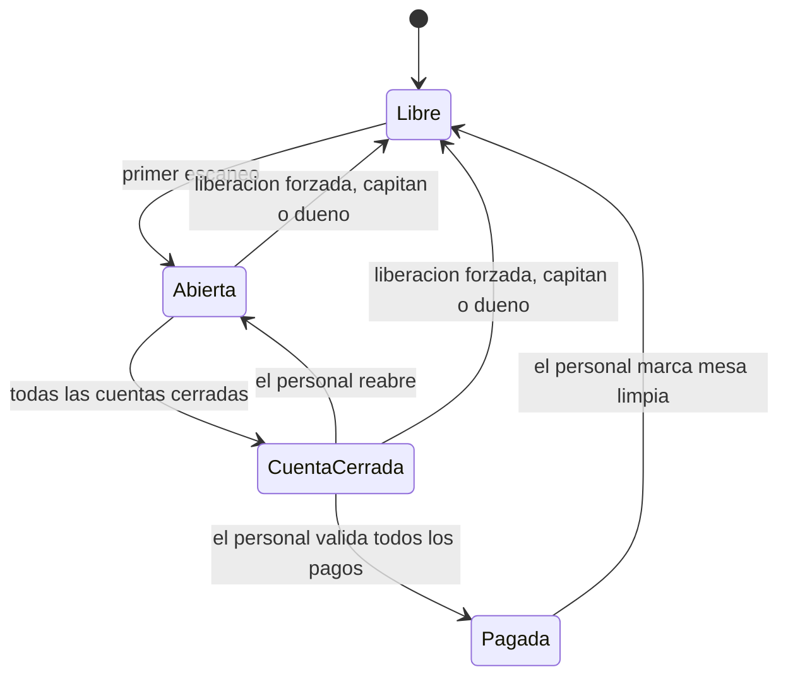

# Spec 001 — Ciclo de vida de la mesa y del comensal

**Fecha:** 2026-11-12 · **Estado:** borrador · **Pedida por:** Calvin · **Historias:** US-29 a US-35 (nuevas) · **Insumo:** `docs/plan/04_Fases_y_Tareas.md` §7 (encabezado de la Fase 3) y §11 (filas del 12 de noviembre)

> Borrador para que Calvin lo revise. Separa lo que **Calvin dijo** (criterios firmes) de lo que **propone quien redacta** (marcado «Propuesta» o `[ACLARAR-n]`, siempre con recomendación). No toca código, plan, PRD ni los demás documentos: la sección 7 dice qué cambiaría en cada uno.

---

## 0. Resumen de una página

**Qué se resuelve.** Hoy una mesa se abre con el primer escaneo, se cierra sola a las 3 h sin actividad y el comensal tiene un pase de 6 h. Eso no se parece a una comida real: hay sobremesas de tres horas, gente que llega tarde, teléfonos apagados, cuentas que se pagan al final y un mesero que es quien sabe cuándo la mesa terminó. Esta spec pone **al mesero a cargo del ciclo de la mesa** y define qué hace el comensal, qué valida el mesero y qué puede corregir.

**El ciclo (la mesa).**

- **Abierta:** los comensales entran, piden por rondas, ven lo de los demás.
- **Cuenta cerrada** (el *checkout*): ya no se agrega nada y **ningún comensal nuevo entra** hasta que la mesa esté limpia (el candado). Se llega cuando cada comensal cerró su cuenta (o el personal la cerró por él).
- **Pagada:** el mesero verificó que cada cuenta quedó pagada por completo. El cobro ocurre **fuera de la app**.
- **Mesa limpia:** el mesero libera la mesa; la sesión termina; sólo entonces entra el siguiente grupo. El tiempo entre «pagada» y «limpia» es el de preparación.
- El comensal **marca** («cerré mi cuenta», «ya pagué»); el mesero **valida** (el pago, la limpieza). Nada cuenta sin la validación del mesero.

**Quién mueve cada paso** (el dueño cuenta como un mesero; el capitán es el segundo al mando; hacia arriba, todos pueden lo del mesero):

| Paso | Comensal | Mesero | Capitán | Dueño |
|---|---|---|---|---|
| Cerrar su propia cuenta | sí (la suya) | sí, por él | sí | sí |
| Cerrar la cuenta de toda la mesa | no | sí | sí | sí |
| Avisar «ya pagué» | sí (informativo) | — | — | — |
| Validar un pago / la mesa pagada | no | sí | sí | sí |
| Mesa limpia | no | sí | sí | sí |
| Reabrir la cuenta antes de «pagada» | no | sí | sí | sí |
| Liberar una mesa con cargos sin pagar | no | no | sí | sí |
| Cerrar o abrir la entrada; aprobar solicitudes | no | sí | sí | sí |
| Quitar a alguien; actuar por él; pasar una cuenta | no | sí | sí | sí |
| Regenerar el código del QR (T-1.5, ya existe) | no | no | no | sí (panel) |

**Lo que se le pide a Calvin decidir** (detalle, escenario y recomendación en cada historia; ordenadas por cuánto cambian el producto):

1. **[ACLARAR-1] Pago por comensal o por mesa.** Recomendación: por comensal, con un atajo «toda la mesa pagada».
2. **[ACLARAR-2] ¿Qué es un «cargo validado»?** Recomendación: lectura estricta (cualquier ítem confirmado impide quitar a alguien; se le pasa su cuenta).
3. **[ACLARAR-3] ¿El mesero agrega ítems a la cuenta de un comensal?** Recomendación: sí, sólo desde el menú y con el precio de la base.
4. **[ACLARAR-4] Caducidad del pase.** Recomendación: la mesa no tiene tope; el pase caduca tras 24 h **sin usarse** (la sesión sigue abierta y la cuenta queda flotante).
5. **[ACLARAR-5] Mesa olvidada.** Recomendación: tras 5 h sin pedidos ni acciones del personal, avisar al personal y exigir solicitud para entrar; **nunca** cerrarla sola.
6. **[ACLARAR-6] Pasar una cuenta lo hace el mesero sin aceptación de quien la recibe.** Recomendación: sí, con aviso y registro; el pago validado en persona es la salvaguarda.
7. **[ACLARAR-7] Tope de comensales del piloto.** Recomendación: 12 (el máximo del diseño); lo cambia Calvin por restaurante, no el operador.
8. **[ACLARAR-8] ¿La mesa se abre con el primer escaneo o con la aprobación del mesero?** Recomendación: primer escaneo por defecto; ajuste por restaurante para exigir aprobación.
9. **[ACLARAR-9] «Una mesa a la vez» entre restaurantes distintos.** Recomendación: sólo dentro del mismo restaurante.
10. **[ACLARAR-10] Datos para transferencia en la pantalla del comensal.** Recomendación: no en la v1; el mesero cobra y valida.
11. **[ACLARAR-11] Liberar con cargos sin pagar.** Recomendación: sólo capitán o dueño, marcada «sin pago verificado».
12. **[ACLARAR-12] «Preparación» = de «pagada» a «limpia»** (el encargo) o de «cuenta cerrada» a «limpia» (la adenda). Recomendación: guardar todas las marcas; llamar preparación a lo primero.
13. **[ACLARAR-13] Valores del piloto** de solicitudes, ofertas y avisos (sección 3).
14. **[ACLARAR-14] Reabrir después de «pagada».** Recomendación: no en la v1.
15. **[ACLARAR-15] Ofrecer en un traspaso sólo ítems ya confirmados.** Recomendación: sí.

**Qué crece la Fase 3:** de 7 a unas 15 tareas (sección 8). Las tres decisiones que más pesan: la 1 (pago por comensal), la 3 (el mesero agrega ítems) y los traspasos entre comensales (US-32).

---

## 1. Problema

El plan vigente cierra la mesa a las 3 h sin actividad, da al comensal un pase de 6 h fijas y deja al mesero un solo botón, «liberar mesa». En La Ceiba, un viernes a las 21:00, la mesa 7 tiene seis personas: dos llegan 40 minutos tarde, una pide una cerveza «para Beto, que ya viene», a las 23:00 siguen de sobremesa sin pedir nada, y al final tres se levantan sin cerrar nada porque su teléfono se apagó. Con las reglas de hoy, la mesa se cierra sola en plena sobremesa, el pase de Ana expira antes de que pague, nadie sabe quién debe qué, y si alguien filtra la foto del QR, un desconocido puede ocupar un lugar o abrir la mesa a las 3 a.m.

Hay un intermediario entre el comensal y la cocina: el mesero. Carta es para restaurantes con meseros (decisión de Calvin). El ciclo de la mesa debe apoyarse en él, no en relojes.

## 2. Resultado esperado

- Una mesa vive mientras el mesero no la cierre; ningún reloj la corta a media comida.
- Cada comensal ve su propia cuenta (un total estimado, no un comprobante) y la cierra al terminar; el mesero ve de un vistazo en qué paso va cada mesa.
- El grupo siguiente nunca cae en la mesa del anterior.
- El mesero puede arreglar los casos reales (teléfono apagado, persona que cambió de teléfono, desconocido en la mesa) sin romper el historial.
- Un QR filtrado se contiene con un toque, sin reimprimir.
- Quedan guardadas las horas de cada paso para medir cuánto tarda una mesa y cuánto se tarda en dejarla lista.
- Señal que lo muestra: M3 de `01_Alcance_v1.md` (mesas atendidas sin llamar a Calvin) y, en el ensayo de T-4.7, mesas cerradas por el mesero sin ayuda; el tiempo medio de preparación se obtiene de las marcas de US-35.

## 3. Ajustes por restaurante (la v1 no tiene planes)

La v1 **no tiene planes ni cobros de Carta**. Cada tope que Calvin quiere distinto por plan se especifica como un **ajuste por restaurante** con un valor único para el piloto. Los cambia Calvin (por script o migración de datos); **el operador no los edita**. Cuando existan planes, un plan sólo fijará estos valores, sin rediseño.

| Ajuste | Valor del piloto | Dónde pesa |
|---|---|---|
| Máximo de comensales por mesa | 12 (futuro: 6 gratuito, 12 de paga) | AC-33.8 |
| Solicitudes de entrada pendientes por mesa | 5 | AC-33.4 |
| Vigencia de una solicitud sin respuesta | 10 minutos | AC-33.4 |
| Ofertas de traspaso pendientes por comensal | 3 | AC-32.7 |
| Horas sin actividad para marcar «mesa olvidada» | 5 | AC-30.6 |
| Horas sin usar para que caduque el pase | 24 | AC-30.5 |
| La mesa se abre con aprobación del mesero | no | AC-33.7 |

**[ACLARAR-13]** ¿Te parecen estos valores? Recomendación: sí, para el piloto; se afinan en T-4.7.

## 4. Historias y criterios

Definiciones usadas en los criterios:
- **Cuenta** de un comensal: lo que él pidió y confirmó, más lo que le hayan pasado, con el precio congelado al confirmar. Es un **total estimado**: no es comprobante ni factura.
- **Cargo validado:** ítem de una comanda que el personal ya marcó como atendida. Se aclara en US-31.
- **Personal:** mesero, capitán o dueño (el dueño actúa desde el panel). «Todos pueden lo del mesero».
- **Cuenta flotante:** cuenta de alguien que perdió su lugar en la mesa; sigue contando y nadie más la ve como suya hasta que el personal la pasa a la persona correcta.

### US-29 — Ciclo de la mesa y candado

> Como mesero, quiero llevar la mesa desde que se abre hasta que queda limpia y que el siguiente grupo no caiga en el anterior, para no depender de relojes ni de recordar quién pagó.

- **AC-29.1** — CUANDO se escanea el QR de una mesa libre, EL sistema DEBERÁ abrir la mesa y guardar la hora del primer escaneo.
- **AC-29.2** — MIENTRAS la mesa esté abierta, EL sistema DEBERÁ permitir a cada comensal pedir en rondas sucesivas (entradas, plato fuerte, postre), y cada confirmación del grupo DEBERÁ generar su propia comanda.
- **AC-29.3** — CUANDO un comensal cierre su cuenta, EL sistema DEBERÁ impedirle agregar o confirmar más ítems y mostrarle su total estimado; SI tiene ítems sin confirmar, ENTONCES DEBERÁ pedirle confirmarlos o descartarlos antes.
- **AC-29.4** — CUANDO todos los comensales activos hayan cerrado su cuenta (ellos mismos o el personal por ellos), o el personal cierre la cuenta de toda la mesa, EL sistema DEBERÁ pasar la mesa a «cuenta cerrada» y guardar la hora.
- **AC-29.5** — MIENTRAS la mesa esté en «cuenta cerrada», «pagada» o posterior, EL sistema DEBERÁ rechazar a quien no es miembro con un mensaje que le pida hablar con el mesero, sin crear solicitud y sin ocupar lugar; los miembros existentes conservan su acceso para ver su cuenta.
- **AC-29.6** — CUANDO un comensal avise «ya pagué», EL sistema DEBERÁ mostrarlo al personal como aviso, y NO DEBERÁ considerar pagada la cuenta hasta que el personal la valide.
- **AC-29.7** — CUANDO el personal valide el pago de una cuenta (efectivo o transferencia), EL sistema DEBERÁ marcarla «pagada» con hora y quién la validó.
- **AC-29.8** — CUANDO todas las cuentas de la mesa estén pagadas (o el personal valide toda la mesa de un golpe), EL sistema DEBERÁ pasar la mesa a «pagada» y guardar la hora.
- **AC-29.9** — CUANDO el personal marque «mesa limpia» sobre una mesa pagada, EL sistema DEBERÁ terminar la sesión, guardar la hora y quién, y dejar la mesa libre para un grupo nuevo que no verá nada del anterior.
- **AC-29.10** — SI hay comandas que no son terminales (abierta o atendida), ENTONCES EL sistema DEBERÁ impedir «mesa limpia» hasta que el personal las sirva o las cancele (regla dura 8: ninguna comanda se pierde).
- **AC-29.11** — CUANDO el personal reabra la cuenta de un comensal o de la mesa antes de «pagada», EL sistema DEBERÁ volver a «abierta», levantar el candado y conservar en el historial lo que ya había ocurrido.
- **AC-29.12** — CUANDO un capitán o el dueño liberen una mesa sin que esté pagada, EL sistema DEBERÁ permitirlo, cerrar la sesión y registrarla como «liberada sin pago verificado» con quién y cuándo; un mesero sólo DEBERÁ poder hacerlo si la mesa no tiene cargos.

**Escenarios**
- **AC-29.1** · Dado La Ceiba, mesa 7 libre · Cuando Ana escanea su QR a las 20:58 · Entonces la mesa 7 aparece «abierta» para el personal con un comensal y la hora 20:58.
- **AC-29.2** · Dado la mesa 7 con Ana, Beto y Carla · Cuando los tres confirman entradas a las 21:05 y postres a las 22:30 · Entonces el personal recibe dos comandas separadas de la mesa 7.
- **AC-29.3** · Dado Carla con un flan sin confirmar · Cuando toca «cerrar mi cuenta» · Entonces la app le pide confirmar o descartar el flan; al descartarlo, ve su total y ya no puede agregar nada.
- **AC-29.4** · Dado Ana, Beto y Carla en la mesa 7 · Cuando Ana y Beto cierran su cuenta y Marisol (mesera) cierra la de Carla porque su teléfono se apagó · Entonces la mesa pasa a «cuenta cerrada» y Marisol lo ve en su lista.
- **AC-29.5** · Dado la mesa 7 en «cuenta cerrada» · Cuando Dani, que no estaba, escanea el QR de la mesa 7 · Entonces ve «esta mesa está cerrando su cuenta, habla con tu mesero», no aparece como solicitud y Ana sigue viendo su cuenta.
- **AC-29.6** · Dado Beto con $480 por pagar · Cuando toca «ya pagué» · Entonces Marisol ve un aviso en la cuenta de Beto, pero la cuenta sigue «por pagar» hasta que ella la valide.
- **AC-29.7** · Dado Beto que pagó en efectivo a Marisol · Cuando Marisol valida su pago · Entonces su cuenta queda «pagada» con la hora y «validó Marisol».
- **AC-29.8** · Dado Ana y Carla ya pagadas · Cuando Marisol valida a Beto · Entonces la mesa 7 pasa a «pagada».
- **AC-29.9** · Dado la mesa 7 «pagada» y recogida · Cuando Marisol toca «mesa limpia» · Entonces la mesa 7 queda libre y el grupo de las 23:40 que escanea ve un menú vacío, sin alias ni cuentas del grupo anterior.
- **AC-29.10** · Dado una comanda de café aún «atendida» pero no servida · Cuando Marisol intenta «mesa limpia» · Entonces el sistema se lo impide y le muestra qué comanda falta servir o cancelar.
- **AC-29.11** · Dado la mesa 7 en «cuenta cerrada» y Carla que pide otro café · Cuando Marisol reabre la cuenta de Carla · Entonces la mesa vuelve a «abierta», Carla puede pedir y la hora del primer cierre queda en el historial.
- **AC-29.12** · Dado Beto que se fue sin pagar y la mesa 7 con $480 pendientes · Cuando Ernesto (capitán) libera la mesa · Entonces queda «liberada sin pago verificado» con su nombre; si Marisol lo intenta, el sistema se lo niega.

**Preguntas abiertas**
- **[ACLARAR-1] Pago por comensal o por mesa.** Calvin dijo que el mesero valida que «quedó pagado por completo». Recomendación: validar **por comensal** (cada cuenta se paga de forma distinta) con un atajo «toda la mesa pagada»; la mesa pasa a «pagada» cuando todas lo están. Es la decisión que más agranda la Fase 3. Alternativa más barata: un solo «mesa pagada» sin desglose, que no sabe quién falta.
- **[ACLARAR-12] «Preparación».** El encargo la define entre «pagada» y «limpia»; la adenda de la Fase 3 entre el fin del *checkout* y «limpia». Recomendación: se guardan las tres marcas (US-35) y «preparación» es de «pagada» a «limpia», que es lo que el restaurante controla.
- **[ACLARAR-11] Liberar con cargos sin pagar.** Recomendación: sólo capitán o dueño, siempre con la marca «sin pago verificado». El mesero libera sin cargos (mesa escaneada por error, ataque sin pedidos).
- **[ACLARAR-10] Datos para transferencia en la pantalla del comensal.** Calvin dijo «a lo sumo». Recomendación: no en la v1; el mesero cobra y valida. Si se quiere, un texto libre del operador mostrado sólo a miembros con la cuenta cerrada.
- **[ACLARAR-14] ¿Se puede reabrir después de «pagada»?** Recomendación: no en la v1; el capitán o dueño usa la liberación forzada y la mesa vuelve a abrirse con un escaneo. Evita cuentas pagadas que cambian.

### US-30 — El pase del comensal dura lo que la mesa

> Como comensal, quiero que mi lugar en la mesa siga siendo mío aunque mi teléfono se bloquee y la comida dure horas, para volver al final y cerrar mi cuenta sin perder lo que pedí.

- **AC-30.1** — MIENTRAS la mesa de un comensal siga abierta, EL sistema DEBERÁ conservar su identidad y su cuenta sin una vigencia fija en horas.
- **AC-30.2** — EL sistema NO DEBERÁ cerrar una mesa por falta de actividad: sólo el personal la cierra.
- **AC-30.3** — CUANDO el teléfono de un comensal esté bloqueado o la app cerrada, EL sistema NO DEBERÁ tratarlo como si hubiera salido de la mesa: su lugar y su cuenta siguen donde estaban.
- **AC-30.4** — CUANDO la mesa llegue a «limpia», EL sistema DEBERÁ dejar sin efecto los pases de esa sesión; escanear de nuevo desde ese teléfono abre una identidad nueva en la sesión nueva.
- **AC-30.5** — SI un pase pasa más de 24 h sin usarse mientras la mesa sigue abierta, ENTONCES EL sistema DEBERÁ hacerlo caducar (no la mesa); quien vuelve entra como persona nueva y su cuenta anterior queda flotante para que el personal la pase.
- **AC-30.6** — SI una mesa abierta lleva más de 5 h sin pedidos ni acciones del personal, ENTONCES EL sistema DEBERÁ marcarla «posible mesa olvidada» para el personal y exigir solicitud (AC-33.2) a quien escanee; NO DEBERÁ cerrarla ni tocar sus cuentas.

**Escenarios**
- **AC-30.1** · Dado Ana que entró a las 21:00 · Cuando regresa a la app a las 00:45 · Entonces es la misma Ana, con su cuenta intacta; hoy su pase seguiría vivo, pero la mesa se habría cerrado sola a las 3 h sin pedidos.
- **AC-30.2** · Dado la mesa 7 sin pedidos desde las 22:30 · Cuando son las 02:00 y nadie la ha cerrado · Entonces sigue abierta y Marisol la ve «abierta, 5 h».
- **AC-30.3** · Dado el teléfono de Beto bloqueado desde las 22:00 · Cuando Marisol abre la mesa 7 a las 23:30 · Entonces Beto sigue en la lista de comensales con su cuenta completa.
- **AC-30.4** · Dado la mesa 7 limpia a las 23:50 · Cuando Ana, aún con su teléfono viejo, abre el QR de la mesa 7 · Entonces entra como comensal nuevo en una sesión nueva, sin su cuenta anterior.
- **AC-30.5** · Dado un pase de la mesa 7 que no se usa desde hace 25 h · Cuando su dueño vuelve a escanear · Entonces entra como «Comensal 3» nuevo y el personal ve su cuenta anterior como flotante.
- **AC-30.6** · Dado la mesa 7 abierta desde ayer a las 21:00 sin actividad · Cuando hoy a las 14:00 llegan dos clientes y escanean · Entonces su solicitud llega a Marisol, no entran a la sesión de ayer, y la mesa aparece marcada «posible mesa olvidada».

**Preguntas abiertas**
- **[ACLARAR-4] Caducidad del pase.** Lo dicho por Calvin es «lo que dure la mesa»; una fila anterior menciona topes de 6 y 16 h y la adenda dice «sin tope de horas». Recomendación: ningún tope a la **mesa**; una red de seguridad para el **pase** (cookie robada, teléfono prestado): 24 h sin usarse. Sin ella, una cookie robada valdría para siempre. Esto cambia AC-01.2 (ver sección 7).
- **[ACLARAR-5] Mesa olvidada.** Sin cierre automático, un mesero que olvida liberar la mesa 7 deja a los clientes del día siguiente entrando a la sesión de ayer. Recomendación: la propuesta de AC-30.6 (aviso al personal y entrada por solicitud, sin cerrar nada). Calvin prefería no cerrar nada sola salvo que hubiera escenarios que lo justificaran: este es el escenario, pero el remedio no cierra, sólo avisa y pide aprobación. Si no lo quiere, la alternativa es no hacer nada y confiar en el mesero.

### US-31 — El mesero corrige la mesa

> Como mesero, quiero quitar a un desconocido, actuar por quien se quedó sin teléfono y pasar una cuenta a la persona correcta, para que el cobro cuadre sin perder el historial.

- **AC-31.1** — CUANDO el personal quite a un comensal que no tiene ítems confirmados, EL sistema DEBERÁ retirarlo de la mesa (pierde el acceso), descartar sus ítems sin confirmar, conservar el registro de que estuvo (regla dura 9) y recalcular el progreso «n de m listos» sin él.
- **AC-31.2** — SI un comensal tiene ítems confirmados, ENTONCES EL sistema NO DEBERÁ permitir quitarlo y DEBERÁ ofrecer al personal pasar su cuenta (AC-31.5) o marcarlo «perdió su lugar» (AC-31.6).
- **AC-31.3** — CUANDO el personal actúe por un comensal (agregar un ítem del menú a su cuenta o cerrar su cuenta), EL sistema DEBERÁ registrar que lo hizo el personal, quién y cuándo, y mostrárselo al comensal cuando vuelva.
- **AC-31.4** — EL sistema DEBERÁ calcular siempre el precio de un ítem agregado por el personal desde la base y congelarlo al confirmar (regla dura 4).
- **AC-31.5** — CUANDO el personal pase la cuenta de un comensal a otro, EL sistema DEBERÁ mover todos sus cargos al destino, avisar al destino, retirar al origen y registrar quién, cuándo, de quién y a quién.
- **AC-31.6** — CUANDO el personal marque a un comensal como «perdió su lugar», EL sistema DEBERÁ dejar su cuenta como flotante: sigue contando en la mesa, no la edita nadie, y EL sistema NO DEBERÁ permitir que la mesa pase a «cuenta cerrada» mientras haya cuentas flotantes.
- **AC-31.7** — SI dos comensales de la mesa tienen el mismo alias, ENTONCES EL sistema DEBERÁ distinguirlos ante el personal y ante los demás con su color y un número.
- **AC-31.8** — EL sistema DEBERÁ rechazar con 404 cualquier corrección sobre una mesa de otro restaurante (regla dura 6).

**Escenarios**
- **AC-31.1** · Dado «Comensal 5», que nadie reconoce en la mesa 7 y no confirmó nada, con la mesa en «2 de 3 listos» · Cuando Marisol lo quita · Entonces la mesa muestra «2 de 2 listos», él ve «te quitaron de la mesa» y su registro queda en el historial.
- **AC-31.2** · Dado un «Comensal 5» desconocido que confirmó una hamburguesa · Cuando Marisol intenta quitarlo · Entonces el sistema se lo impide y le propone pasar su cuenta o marcarlo «perdió su lugar».
- **AC-31.3** · Dado el teléfono de Carla apagado y Marisol en la mesa · Cuando Marisol agrega un café a la cuenta de Carla y cierra su cuenta · Entonces Carla, al encender, ve «Marisol agregó un café y cerró tu cuenta».
- **AC-31.4** · Dado un café a $45 en la base · Cuando Marisol lo agrega · Entonces el cargo es $45 sin importar lo que envíe el cliente.
- **AC-31.5** · Dado Beto que cambió de teléfono y quedó como «Comensal 6» con la cuenta vieja en «Comensal 2» · Cuando Marisol pasa la cuenta de «Comensal 2» a «Comensal 6» · Entonces todos los cargos están en «Comensal 6», «Comensal 2» queda retirado y «Comensal 6» recibe el aviso.
- **AC-31.6** · Dado Dani que se fue dejando una cerveza confirmada · Cuando Marisol lo marca «perdió su lugar» · Entonces su cuenta queda flotante y la mesa no puede pasar a «cuenta cerrada» hasta pasarla.
- **AC-31.7** · Dado dos «Ana» · Cuando el personal abre la mesa · Entonces los ve como «Ana ●1» (rosa) y «Ana ●2» (azul).
- **AC-31.8** · Dado Marisol de La Ceiba · Cuando intenta quitar a un comensal de una mesa de otro restaurante · Entonces recibe 404.

**Preguntas abiertas**
- **[ACLARAR-2] «Cargo validado».** Calvin dijo «quita a quien no reconoce (si no tiene cargos validados por él)». Tres lecturas: (a) estricta, cualquier ítem confirmado impide quitar; (b) intermedia, sólo los de comandas ya atendidas; (c) laxa, ninguno impide. Recomendación: **(a)**. Con (b) o (c), una comanda con ítems de un desconocido queda con ítems sin dueño que cobrar (choca con la regla dura 8). Con (a), el desconocido que confirmó algo se resuelve pasando o marcando su cuenta.
- **[ACLARAR-3] El mesero agrega ítems por el comensal.** Calvin lo pidió («agregar a su cuenta»). Obliga a que la app del personal tenga un selector del menú, que no estaba en T-3.6. Recomendación: sí, sólo ítems del menú y con cantidad y nota; sin precios libres. Si el costo asusta, se difiere a la v1.1 y la v1 sólo permite cerrar por el comensal.
- **[ACLARAR-6] Pasar una cuenta sin aceptación del destino.** Calvin pidió aceptación para el traspaso entre comensales (US-32), no para el que hace el mesero. Recomendación: el mesero lo hace sin aceptación, con aviso y registro; la salvaguarda es que el pago se valida en persona.

### US-32 — Pedir por otra persona y pasarle la orden

> Como comensal, quiero pedir por alguien que aún no llega y pasarle lo que pedí cuando llegue, para que cada quien pague lo suyo sin perder la costumbre de invitar la primera ronda.

- **AC-32.1** — CUANDO un comensal marque un ítem como «para otra persona» (un alias de alguien presente o un nombre libre de hasta 24 caracteres), EL sistema DEBERÁ dejar el cargo en la cuenta de quien lo pidió y mostrar la marca a la mesa.
- **AC-32.2** — CUANDO un comensal ofrezca pasar ítems ya confirmados a otro miembro presente, EL sistema DEBERÁ mostrarle a ese miembro quién ofrece, qué y cuánto, y NO DEBERÁ mover nada hasta que acepte.
- **AC-32.3** — CUANDO el destinatario acepte, EL sistema DEBERÁ mover los cargos a su cuenta con el precio ya congelado, sin alterar la comanda que ve la cocina, y registrar quién ofreció, quién aceptó y cuándo.
- **AC-32.4** — SI el destinatario rechaza, o cierra su cuenta sin responder, ENTONCES EL sistema DEBERÁ dejar los cargos con quien los pidió.
- **AC-32.5** — EL sistema NO DEBERÁ permitir pasar cargos a quien ya cerró su cuenta, ni ofrecer desde una cuenta ya cerrada.
- **AC-32.6** — EL sistema NO DEBERÁ permitir a nadie quedarse con los cargos de otro ni imponer cargos a otro sin su aceptación.
- **AC-32.7** — EL sistema DEBERÁ limitar a 3 las ofertas pendientes por comensal.

**Escenarios**
- **AC-32.1** · Dado Ana en la mesa 7 y Beto de camino · Cuando Ana pide dos cervezas «para Beto» · Entonces los cargos están en la cuenta de Ana y la mesa ve «2 cervezas, para Beto».
- **AC-32.2** · Dado que Beto llega y escanea · Cuando Ana le ofrece las dos cervezas ($130) · Entonces Beto ve «Ana te pasa 2 cervezas, $130» con Aceptar y Rechazar, y su cuenta sigue en $0.
- **AC-32.3** · Dado la oferta anterior · Cuando Beto acepta · Entonces su cuenta es $130, la de Ana baja $130 y la comanda de cocina no cambia.
- **AC-32.4** · Dado una oferta sin responder · Cuando Beto cierra su cuenta · Entonces las cervezas quedan con Ana.
- **AC-32.5** · Dado Carla con su cuenta cerrada · Cuando Ana intenta ofrecerle algo · Entonces el sistema no la deja elegir a Carla.
- **AC-32.6** · Dado Dani, que sabe el alias «Ana» · Cuando intenta reclamar las cervezas de Ana · Entonces no hay forma de hacerlo; sólo Ana ofrece y sólo el destinatario acepta.
- **AC-32.7** · Dado Ana con 3 ofertas sin responder · Cuando intenta una cuarta · Entonces el sistema la rechaza.

**Preguntas abiertas**
- **[ACLARAR-15] ¿Se puede ofrecer lo que aún no se confirmó?** Recomendación: no; sólo ítems confirmados, para no mezclar el traspaso con el armado de la orden.
- (La aceptación del mesero al pasar cuentas es [ACLARAR-6], arriba.)

### US-33 — La entrada de la mesa: cerrarla, solicitudes y tamaño

> Como capitán o dueño, quiero cortar con un toque que la mesa se llene de desconocidos sin cambiar el QR impreso, para que un QR filtrado no se convierta en un problema de servicio.

Un QR impreso no puede guardar un secreto que rote: quien tiene la foto sigue entrando. Lo que sí corta el ataque sin reimprimir es cerrar la entrada de la mesa y que cada ingreso lo apruebe el mesero. Regenerar el código (T-1.5, ya existe) queda como último recurso.

- **AC-33.1** — CUANDO el personal cierre la entrada de una mesa abierta, EL sistema DEBERÁ dejar de admitir personas nuevas; los miembros siguen entrando y pidiendo.
- **AC-33.2** — MIENTRAS la entrada esté cerrada, EL sistema DEBERÁ convertir el escaneo de un no miembro en una solicitud con su alias, que NO ocupa lugar.
- **AC-33.3** — CUANDO el personal apruebe una solicitud, EL sistema DEBERÁ convertir a esa persona en miembro; si la rechaza, DEBERÁ mostrarle un mensaje neutro sin detalles.
- **AC-33.4** — EL sistema DEBERÁ limitar las solicitudes pendientes de una mesa (5 en el piloto), caducar cada una a los 10 minutos sin respuesta y contar los intentos con el mismo límite de tasa del comensal; superado el tope, DEBERÁ responder «mesa ocupada, habla con tu mesero» sin crear más solicitudes.
- **AC-33.5** — CUANDO el personal reabra la entrada, EL sistema DEBERÁ volver a admitir personas con un escaneo.
- **AC-33.6** — CUANDO se regenere el código de una mesa, EL sistema DEBERÁ conservar la sesión abierta y el estado de la entrada (decisión vigente de T-2.1), y el código anterior dejará de abrir la mesa al instante (AC-21.3).
- **AC-33.7** — DONDE el restaurante pida aprobación del mesero para abrir mesas, EL sistema DEBERÁ tratar el primer escaneo de una mesa libre como una solicitud y no abrirla hasta que el personal la apruebe.
- **AC-33.8** — CUANDO una mesa llegue a su máximo de comensales (12 en el piloto), EL sistema DEBERÁ responder «mesa llena» a quien intente entrar, sin crear solicitud.
- **AC-33.9** — EL sistema DEBERÁ mostrar al personal cuántas solicitudes tiene cada mesa y quién las pidió.

**Escenarios**
- **AC-33.1** · Dado la mesa 7 completa con seis amigos y un QR filtrado en un grupo · Cuando Ernesto (capitán) cierra la entrada · Entonces los seis siguen pidiendo con normalidad.
- **AC-33.2** · Dado la entrada cerrada · Cuando un desconocido escanea y escribe «Luis» · Entonces Marisol ve «Mesa 7: solicitud de Luis» y la mesa sigue con seis miembros.
- **AC-33.3** · Dado la solicitud de Luis · Cuando Marisol la aprueba · Entonces Luis es el séptimo miembro; si la hubiera rechazado, Luis vería «no pudimos agregarte; habla con tu mesero».
- **AC-33.4** · Dado 5 solicitudes pendientes · Cuando un sexto escanea · Entonces ve «mesa ocupada» y no se crea una sexta; a los 10 minutos las no atendidas caducan.
- **AC-33.5** · Dado la amenaza pasada · Cuando Ernesto reabre la entrada · Entonces escanear vuelve a admitir directamente.
- **AC-33.6** · Dado la entrada cerrada y un QR filtrado · Cuando Doña Lupe regenera el código desde el panel · Entonces los seis siguen en la sesión, la entrada sigue cerrada y el QR viejo ya no abre nada.
- **AC-33.7** · Dado un restaurante con «aprobación para abrir mesas» · Cuando alguien escanea la mesa 3 libre a las 3 a.m. · Entonces nada se abre; Marisol ve la solicitud en el turno de la mañana.
- **AC-33.8** · Dado la mesa 7 con 12 miembros · Cuando un decimotercero escanea · Entonces ve «mesa llena».
- **AC-33.9** · Dado dos mesas con solicitudes · Cuando Marisol abre su lista · Entonces ve «Mesa 7 · 2 solicitudes» y «Mesa 3 · 1 solicitud».

**Preguntas abiertas**
- **[ACLARAR-7] Tope del piloto.** Calvin dijo: 6 en gratuitos, hasta 12 en de paga; ocho y hasta unos 32 en una respuesta anterior, que la adenda sustituye («el diseño se queda en 12»). Recomendación: 12 para el piloto (el restaurante piloto se trata como de paga y se prueba el diseño completo); lo fija Calvin, no el operador.
- **[ACLARAR-8] Apertura por aprobación.** Hoy el primer escaneo abre la mesa (AC-02.2), lo que da a cualquiera con la foto del QR la capacidad de abrir una mesa libre. Recomendación: primer escaneo por defecto (cero fricción para el comensal) y el ajuste de AC-33.7 por restaurante para quien lo necesite; el mecanismo es el mismo que la entrada cerrada.
- Alternativa que la maestra dejó anotada y esta spec no recomienda: un código corto que cambia en cada sesión y que da el mesero. Más fricción y una pantalla más.

### US-34 — Una mesa a la vez

> Como restaurante, quiero que quien ya está en una mesa abierta no pueda entrar a otra sin que lo liberen, para que nadie reparta cargos entre dos mesas por error.

- **AC-34.1** — CUANDO un teléfono cuyo comensal está en una mesa abierta de un restaurante escanea el QR de **otra** mesa de ese restaurante, EL sistema NO DEBERÁ agregarlo ni moverlo, y DEBERÁ decirle «ya estás en la mesa N» con una salida clara de regreso a ella.
- **AC-34.2** — MIENTRAS la cuenta de ese comensal no esté pagada, EL sistema DEBERÁ mantener esa restricción.
- **AC-34.3** — CUANDO el personal lo quite de la mesa, la cuenta del comensal sea validada como pagada, o la mesa quede limpia, EL sistema DEBERÁ dejarlo escanear otra mesa.
- **AC-34.4** — EL sistema NO DEBERÁ presentar esta restricción como un control de seguridad: sólo conoce la cookie, y quien la borra o usa otro navegador entra como persona nueva (ver sección 5).

**Escenarios**
- **AC-34.1** · Dado Ana en la mesa 7 · Cuando por error escanea el QR de la mesa 8 · Entonces ve «ya estás en la mesa 7», un botón para volver, y la mesa 8 no cambia.
- **AC-34.2** · Dado Ana con su cuenta cerrada pero sin pagar · Cuando escanea la mesa 8 · Entonces sigue viendo «ya estás en la mesa 7».
- **AC-34.3** · Dado el pago de Ana validado · Cuando escanea la mesa 8 · Entonces entra a la mesa 8 con normalidad.
- **AC-34.4** · Dado Beto que abre una pestaña privada y escanea la mesa 8 · Entonces el sistema lo admite como persona nueva; el control real es que sus cargos no cuentan sin validación del mesero.

**Preguntas abiertas**
- **[ACLARAR-9] Entre restaurantes.** La cookie del comensal es la misma para todos. Recomendación: la restricción sólo vale dentro del mismo restaurante; si Ana comió ayer en otro restaurante y olvidó cerrar, hoy no debe quedar bloqueada por una sesión ajena. Escanear en otro restaurante sustituye su pase; la sesión anterior queda como sesión olvidada, de la que se ocupa su mesero.

### US-35 — Cuánto tarda una mesa y cada paso

> Como dueño, quiero que el sistema guarde cuándo ocurrió cada paso de la mesa, para saber cuánto tarda una comida y cuánto se tarda en dejar la mesa lista.

- **AC-35.1** — EL sistema DEBERÁ guardar, sin sobrescribir, la hora y el autor (comensal, personal o sistema) de: primer escaneo, cada comanda (ya existente), cuenta cerrada de cada comensal y de la mesa, pago validado de cada comensal y de la mesa, y mesa limpia.
- **AC-35.2** — CUANDO se corrija un paso (reabrir la cuenta, por ejemplo), EL sistema DEBERÁ conservar las horas anteriores como historia y registrar las nuevas.
- **AC-35.3** — EL sistema DEBERÁ poder calcular a partir de esas marcas: el tiempo total de la mesa (primer escaneo a mesa limpia), el consumo (primer escaneo a cuenta cerrada), el cobro (cuenta cerrada a pagada) y la preparación (pagada a mesa limpia).
- **AC-35.4** — CUANDO una mesa se libere sin pago verificado, EL sistema DEBERÁ marcarla para que no distorsione los promedios.
- **AC-35.5** — EL sistema NO DEBERÁ guardar datos personales del comensal en esas marcas (regla dura 10).

**Escenarios**
- **AC-35.1** · Dado la mesa 7 de las 20:58 a las 23:50 · Cuando se consulta el historial · Entonces aparecen apertura 20:58, cuenta cerrada 23:10, pagada 23:35 y limpia 23:50, con el autor de cada una.
- **AC-35.2** · Dado que Marisol reabrió la cuenta a las 23:12 · Cuando se consulta · Entonces el cierre de las 23:10 sigue en la historia y el definitivo es el de las 23:20.
- **AC-35.3** · Dado el historial anterior · Cuando se calcula · Entonces total 2 h 52 min, consumo 2 h 12 min, cobro 25 min, preparación 15 min.
- **AC-35.4** · Dado una liberación forzada · Cuando se calculan promedios · Entonces esa mesa no entra en ellos.
- **AC-35.5** · Dado cualquier marca · Cuando se inspecciona la fila · Entonces no contiene alias, nombre, IP ni cookie.

**Fuera de esta historia:** el reporte al restaurante (T-4.6 sólo da el mínimo ya planeado).

---

## 5. Lo que protege y lo que no

El servidor conoce al comensal **sólo por su cookie**; no hay cuenta, nombre ni teléfono. Por eso:

- **Protege contra el error honesto:** escanear otra mesa por equivocación (US-34), pedir dos veces (idempotencia), pasar cargos al alias equivocado (US-32: nadie recibe cargos sin aceptar).
- **Protege parcialmente contra el malintencionado:** un QR filtrado se contiene con la entrada cerrada y las solicitudes (US-33) y por el tope de comensales; un desconocido dentro se quita (US-31).
- **No protege, y no lo promete:** quien borra cookies, abre una pestaña privada o usa otro teléfono es una persona nueva. Lo que lo hace inofensivo es que **nada cuenta sin la validación del mesero**: un cargo de un desconocido lo ve el mesero, y el pago sólo es válido cuando el mesero lo verifica.
- **Depende del personal:** un mesero malintencionado o descuidado puede dañar su propio restaurante. Se mitiga con registro de quién hizo qué y cuándo, y con que el dueño ve lo mismo.

## 6. Abuso y seguridad

| Escenario | Qué lo cubre | Riesgo que se acepta |
|---|---|---|
| QR filtrado: un grupo de desconocidos escanea | Entrada cerrada + solicitudes aprobadas (AC-33.1–33.4); regenerar como último recurso (AC-33.6) | Entre la filtración y el toque del personal, entran los primeros. Se quitan (AC-31.1) |
| Llenar la mesa hasta el tope | Tope por restaurante (AC-33.8); quitar (AC-31.1) | Los lugares ocupados hasta que el personal actúe |
| Llenar la cola de solicitudes | Tope de 5, caducidad de 10 min, límite de tasa (AC-33.4) | Una cola llena le impide pedir entrada a un cliente legítimo hasta que el personal responda |
| Abrir una mesa libre a las 3 a.m. con la foto del QR | Ajuste de aprobación (AC-33.7); el personal ve la mesa abierta sin comandas | Por defecto cualquiera con el QR abre una mesa |
| Miembro silencioso que nunca confirma y frena la comanda | El personal lo quita (AC-31.1) y el progreso se recalcula | El grupo espera hasta que el mesero actúe |
| Pedidos falsos de un desconocido | El mesero revisa las comandas antes de atender; AC-31.2 | Una comanda falsa puede llegar a cocina antes de que el mesero la vea |
| Hacerse pasar por otro comensal | Identidad = cookie; ofertas sólo se aceptan desde el miembro destinatario (AC-32.6) | Alias repetidos: se distinguen por color y número (AC-31.7) |
| Quitar a alguien que ya tiene cargos | Prohibido (AC-31.2) | — |
| Traspaso no deseado | Sin aceptación no se mueve nada (AC-32.2, 32.6); máximo 3 ofertas (AC-32.7) | Spam hasta 3 ofertas por persona |
| Mesero malintencionado o descuidado | Registro de autor y hora de cada corrección (AC-31.3, 31.5, 35.1); el mismo restaurante nada más (AC-31.8) | Un mesero puede perjudicar a su restaurante; el dueño lo audita |
| Comensal que se va sin cerrar | El personal cierra su cuenta (AC-29.4) o la marca flotante y la pasa (AC-31.6); capitán libera sin pago verificado (AC-29.12) | El cobro de lo no pagado es del restaurante, fuera de la app |
| Mesa olvidada | Aviso y entrada por solicitud (AC-30.6) | Hasta 5 h hasta que el aviso aparezca |
| Evadir «una mesa a la vez» borrando cookies | Ninguno, a propósito (AC-34.4) | Aceptado: el control es el mesero |
| Pase robado | Caducidad sin uso (AC-30.5); candado de «mesa limpia» (AC-30.4) | Durante la mesa, quien tenga la cookie es esa persona |
| Intentar corregir una mesa de otro restaurante | 404 (AC-31.8) | — |

## 7. Qué cambia en los documentos vigentes (sin editarlos)

| Dónde | Dice hoy | Propuesto | ADR |
|---|---|---|---|
| PRD AC-01.2 | Token de invitado con vigencia de 6 h | Pase que vale lo que dure la mesa, con caducidad sin uso de 24 h (AC-30.1, 30.5) | Enmienda a ADR-003 |
| PRD AC-01.4 | Restaurar la orden del dispositivo con token vigente | Igual, mientras la mesa siga abierta y el pase no haya caducado | — |
| PRD AC-02.4 | Cerrar la sesión tras 3 h sin actividad | **Se elimina.** Sólo el personal cierra la mesa (AC-30.2); entra el aviso «mesa olvidada» (AC-30.6) | ADR-017 |
| PRD AC-02.5 | Máximo de 12 miembros | Máximo = ajuste por restaurante; piloto 12 (AC-33.8) | ADR-017 |
| PRD AC-02.1, AC-02.2 | Mesa activa agrega miembro; libre crea sesión | Con candado, entrada cerrada o aprobación, la persona puede quedar como solicitud (AC-29.5, 33.2, 33.7) | ADR-017 |
| PRD AC-12.1, AC-12.4 | Todos los miembros activos confirmados crean la comanda; quien llega tarde pide aparte | «Miembros activos» excluye retirados y flotantes; rondas sucesivas (AC-29.2) | — |
| PRD AC-21.3 | Revocar y regenerar el código | Sin cambio; se aclara que no cierra la sesión (ya decidido en T-2.1) y es el último recurso (AC-33.6) | — |
| `01_Alcance_v1.md` AC-28.1 | Estados `libre`, `armando`, `lista`, `atendida` | Añade `cuenta cerrada`, `pagada`, `entrada cerrada`, solicitudes y `mesa olvidada` | — |
| `01_Alcance_v1.md` AC-28.2 | «Liberar mesa» cierra la sesión | «Mesa limpia» sobre una mesa pagada; liberar sin pago sólo capitán/dueño (AC-29.9, 29.12) | — |
| `01_Alcance_v1.md` §2 y ADR-013 | Liberar: mesero «una mesa», capitán «cualquier» | En cascada: todos pueden lo del mesero; el capitán suma la liberación sin pago, el dueño actúa desde el panel | Enmienda a ADR-013 |
| `03_Datos_v1.md` — sesión | Estados `activa` · `lista_para_enviar` · `cerrada` · `cancelada` | Añade cuenta cerrada y pagada como estados **vivos** (INV-1 y su índice parcial deben cubrirlos); sin cierre automático | ADR-017 |
| `03_Datos_v1.md` — miembro | Estado `activo` | Añade retirado y flotante; cuenta cerrada y pagada por miembro | ADR-017 |
| `03_Datos_v1.md` — tablas nuevas | — | Solicitudes de entrada, traspasos, marcas de tiempo (eventos de la mesa), ajustes por restaurante, quién pidió vs. a quién se carga | ADR-017 |
| INV-3 (ítems inmutables) | Un ítem confirmado no cambia | Sigue; el responsable del cargo cambia con el traspaso sin tocar lo que ve la cocina. El diseño exacto es de T-3.0 | ADR-017 |
| INV-11 | Nadie se une ni pide en sesión cerrada | Se extiende: nadie se une con el candado; nadie agrega con la cuenta cerrada | — |
| Código `sesion.cerrar_inactivas` / `CierreInactivas`, `INVITADO_VIGENCIA_HORAS` | 3 h y 6 h | Se sustituyen según la sección 8 | — |
| `CLAUDE.md` «Qué NO construir» | — | Sin cambios: no hay asignación de mesas ni pantallas del capitán | — |

**ADR-017 (propuesto):** «El mesero lleva el ciclo de la mesa; la sesión no se cierra sola». Registra el ciclo, el candado, las cuentas por comensal, la ausencia de cierre por inactividad y los ajustes por restaurante. Enmienda ADR-003 (pase) y ADR-013 (cascada de roles).

## 8. Cómo entra al plan (propuesta)

**Qué pasa con cada tarea de la Fase 3.**

| Tarea | Cambia |
|---|---|
| T-3.1 Servicio de orden | Absorbe «para otra persona» (AC-32.1), cargo = responsable ≠ quien pidió, excluir retirados |
| T-3.2 Ítems, confirmación, comanda | Rondas (AC-29.2); «activos» sin retirados ni flotantes; se verifica que el índice `uq_orden_viva_por_miembro` ya permite pedir otra ronda tras una comanda |
| T-3.3 Llamada y cierre | Se queda con la llamada al mesero; el cierre pasa a T-3.8 |
| T-3.4 Acceso con PIN y operación | Sólo PIN y operación de piso; las correcciones pasan a T-3.11 |
| T-3.5 Mi orden | UI comensal de la orden, sin cambios; el ciclo y los traspasos pasan a T-3.12 |
| T-3.6 App del personal | Lista, detalle, comandas y llamadas, como está; el ciclo y las correcciones pasan a T-3.13 |
| T-3.7 Pedidos en vivo en el panel | Pasa de «ver» a «ver y actuar» (el dueño cuenta como mesero) |

**Tareas nuevas** (IDs provisionales; formato del brief):

- 🔴 **T-3.0 — Modelo, contrato y ADR-017 del ciclo.** Carril A · Depende de T-2.1 · US-29 a US-35. Entregable: migración (estados vivos nuevos, estados del miembro, solicitudes, traspasos, eventos de la mesa, ajustes por restaurante, responsable del cargo), esquemas de la fase en `app/schemas/`, ADR-017 y enmiendas a ADR-003 y 013. Verificar: `uv run pytest tests/integration/test_migracion_ciclo.py tests/unit/test_contrato_ciclo.py -q` y `uv run python scripts/verificar_trazabilidad.py --tarea T-3.0 --estricto`. Ver `/migracion`.
- **T-3.8 — Servicio del ciclo de la mesa.** Carril F · Depende de T-3.2, T-3.0 · AC-29.x, AC-35.x. Entregable: `app/services/ciclo_mesa.py` (sin FastAPI): cerrar cuenta, estados derivados, candado, validar pago, mesa limpia, reabrir, liberación forzada, marcas de tiempo. Verificar: `uv run pytest tests/integration/test_ciclo_mesa.py -q`. Nota: toma `FOR UPDATE` de la sesión en todo cambio de estado (INV-11).
- **T-3.9 — Traspasos entre comensales.** Carril F · Depende de T-3.8 · AC-32.x. Verificar: `uv run pytest tests/integration/test_traspasos.py -q`.
- **T-3.10 — Entrada de la mesa.** Carril D · Depende de T-3.0 · AC-33.x, AC-34.x. Entregable: entrada cerrada, solicitudes con tope y caducidad, apertura por aprobación, tope de comensales por restaurante y «ya estás en la mesa N». Verificar: `uv run pytest tests/integration/test_entrada_mesa.py -q`.
- **T-3.11 — Correcciones del personal.** Carril G · Depende de T-3.4, T-3.8 · AC-31.x. Entregable: quitar, actuar por, pasar cuenta, perdió su lugar, y cascada de permisos (incluyendo al operador). Verificar: `uv run pytest tests/integration/test_correcciones_mesa.py -q`.
- **T-3.12 — Pase de la mesa.** Carril D · Depende de T-3.8 · AC-30.x. Entregable: pase sin vigencia fija con caducidad por falta de uso, «mesa olvidada» y entrada por solicitud. Verificar: `uv run pytest tests/integration/test_pase_mesa.py -q`.
- **T-3.13 — UI del comensal: cuenta, traspasos, solicitud y «ya estás en la mesa».** Carril H · Depende de T-3.5 y el contrato de T-3.0. Verificar: `npm --prefix frontend test -- cuenta traspaso solicitud`.
- **T-3.14 — UI del personal: ciclo, entrada, correcciones.** Carril H · Depende de T-3.6 y el contrato. Incluye el selector del menú si [ACLARAR-3] es sí. Verificar: `npm --prefix frontend test -- ciclo correcciones`.
- **T-3.15 — Retiro del cierre por inactividad.** Carril D/I · Depende de T-3.12, T-3.14 y una corrida real en staging. Verificar: `uv run pytest tests/integration/test_sin_cierre_inactividad.py -q`.

**Orden.** T-3.0 primero. Después, en paralelo: F (T-3.1 → T-3.2 → T-3.8 → T-3.9), D (T-3.10 y T-3.12), G (T-3.4 → T-3.11), y H sobre el contrato con datos simulados. T-3.15 es lo último de la fase.

**Cuándo se sustituyen el cierre de 3 h y el pase de 6 h, para que nunca falten los dos.** La regla: en todo momento debe existir **al menos uno** de estos amparos: (A) el cierre de 3 h por inactividad, o (B) el mesero puede cerrar mesas desde su teléfono, hay aviso de «mesa olvidada» y el pase caduca por falta de uso. Por eso:
1. T-3.12 cambia el pase de 6 h por el nuevo, **mientras el cierre de 3 h sigue vivo** (amparo A).
2. T-3.14 entrega al mesero el flujo completo en su teléfono (amparo B, falta que corra en staging).
3. **T-3.15 quita el cierre de 3 h sólo después** de que el mesero cierra una mesa real de punta a punta en staging. Hasta entonces sigue vivo, lo que significa que una sobremesa de más de 3 h sin pedir puede cerrarse sola; no hay restaurante real todavía, así que es aceptable.

**Cuánto crece la Fase 3.** De 7 tareas a unas 15; aproximadamente el doble de sesiones, repartidas en tres carriles. Las tres decisiones que más pesan: pago por comensal ([ACLARAR-1]), el mesero agrega ítems por el comensal ([ACLARAR-3]) y los traspasos entre comensales (US-32, que además obliga a diseñar el responsable del cargo bajo INV-3). Si Calvin prefiere recortar, esas tres son las palancas.

## 9. Fuera de alcance

- **QR de usuario para cuentas registradas** (lectura de la maestra, adenda 5): no hay cuentas en la v1; quien vuelve a escanear ya aparece como persona nueva y el mesero le pasa la cuenta (US-31).
- **Planes y cobros de Carta:** los topes son ajustes por restaurante (sección 3).
- **Mesas de 32 personas:** el diseño se queda en 12.
- **Reportes de tiempos al restaurante:** US-35 sólo guarda las marcas.
- **Pagos en la app, propinas, tarjetas, dividir la cuenta:** la v1 no cobra; el mesero valida el cobro hecho fuera.
- **Datos de transferencia en la app** ([ACLARAR-10]): recomendación, no en la v1.
- **Asignar mesas a meseros y pantallas propias del capitán:** siguen en «Qué NO construir»; cualquier miembro del personal atiende cualquier mesa.
- **Juntar o cambiar de mesa a un grupo:** un grupo que se muda a otra mesa conserva su sesión original; la v1 no la mueve.
- **Notificaciones push al comensal:** las acciones del personal se ven en el siguiente sondeo.
- **Cierre automático de cualquier tipo:** descartado por Calvin; el aviso de AC-30.6 no cierra nada.

## 10. Preguntas abiertas (dónde está cada una)

Las 15 están en la sección 0 con su recomendación. Por historia (máximo cinco cada una): US-29 → 1, 10, 11, 12, 14; US-30 → 4, 5; US-31 → 2, 3, 6; US-32 → 6 (remite a US-31), 15; US-33 → 7, 8; US-34 → 9; ajustes (sección 3) → 13.
